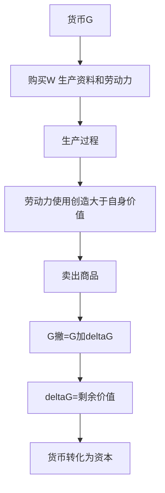

# KP02 · 货币转化为资本（G—W—G'）

<div style="text-align:right;margin:10px 0;"><a href="../../../../exam.html" target="_blank" style="display:inline-block;padding:6px 16px;background:#2563eb;color:#fff;border-radius:6px;text-decoration:none;font-size:14px;">📝 开始做题</a></div>


> 所属：[[../00_章节总结|第5章 资本主义生产]] ｜ 节：原书第五章第一节

## 1. 一句话先懂（小白版）

**货币本身不是资本**。你兜里 100 块钱用来吃饭，它就是普通货币；但王老板拿 10 万开店，年底变成 12 万——这时候这 10 万就成了**资本**。

判断货币是不是资本，看它**最后有没有变多**。马克思把这两种运动写成两个公式：

- **简单商品流通**：$W—G—W$（先卖商品换钱，再拿钱买别的商品）。目的是**使用价值**（我要奶茶）；
- **资本流通**：$G—W—G'$（先拿钱买商品，再卖商品换回更多钱）。目的是**交换价值本身**（钱变多）。

$G' = G + \Delta G$，这个多出来的 $\Delta G$ 就是**剩余价值**。

## 2. 严格定义

| 公式 | 流通顺序 | 起点 | 终点 | 目的 |
|---|---|---|---|---|
| 商品流通 | $W—G—W$ | 商品 | 商品 | 获取使用价值 |
| 资本流通 | $G—W—G'$ | 货币 | 更多货币 | 价值增殖 |

**资本总公式**：$G—W—G'$，其中 $G' = G + \Delta G$，$\Delta G$ 是剩余价值。

**资本**：能带来剩余价值的价值。它不是物，而是**以物为媒介的社会生产关系**——资本家剥削工人的关系。

## 3. 为什么（原理/机制）——完整推导

### G—W—G' 有个矛盾

```
等价交换原则下：
G = 10 万买商品 W
卖 W 换回 G'
```

如果等价交换，买的时候按价值买，卖的时候按价值卖，那 $G' = G$，钱不会变多。

**但现实中资本确实增殖了**。这就是资本总公式的矛盾：**不能从流通中产生剩余价值，又不能不从流通中产生**。

- 不能从流通中产生：等价交换不增殖；不等价交换（贵买贱卖）只是一方赚另一方亏，全社会总量不增加。
- 不能不从流通中产生：如果把钱藏在家里，它永远不会变多。

### 矛盾怎么解决？

马克思说：必须在市场上找到一种特殊商品，**它的使用价值本身具有成为价值源泉的特殊属性**——它的实际使用就是劳动的物化，就是价值的创造。

这种商品就是**劳动力**（见 [[KP03_劳动力商品]]）。

```
G—W
   ├── W1 = 生产资料（茶叶、机器）→ 价值不增殖，只是转移
   └── W2 = 劳动力                → 使用它 = 劳动，能创造新价值
                                      ↓
                              新价值 > 劳动力自身价值
                                      ↓
                              差额 = 剩余价值 m
                                      ↓
W'（新商品）— G'（增殖了的货币）
```

### 关键洞察

**剩余价值不能从流通中产生，因为流通只进行等价交换；它也不能离开流通产生，因为只有在流通中才买得到劳动力。** 所以解决办法是：在流通中买到劳动力，然后在生产过程中让它创造比自身价值更大的价值。

## 4. 来源（理论怎么来的）

- 古典政治经济学一直没说清楚利润从哪来。他们有的说"贵卖"（让渡利润），有的说"资本天生有生产力"。
- 马克思的突破：区分了**劳动和劳动力**，在《资本论》第一卷第四章解决了这个千年难题。

## 5. 怎么用（现实例子）

**王老板的奶茶店账本：**

| 项目 | 金额 |
|---|---|
| 王老板投入 G | 10 万元 |
| 买茶叶、牛奶、机器（生产资料） | 6 万元 |
| 雇你一个月工资（劳动力价值） | 0.5 万元 |
| 一个月后卖出 1100 杯 × 15 元 | 1.65 万元 |
| 扣除原料成本（1100 × 4 元） | 0.44 万元 |
| 扣除工资 | 0.5 万元 |
| **一个月剩余价值** | **1.65 - 0.44 - 0.5 = 0.71 万元** |

一个月增殖 0.71 万 = $G' = G + 0.71$ 万。

> 注意：这里我们简化了机器折旧。后面 KP05 会严格区分 c 和 v。

## 5.5 理论推导（一步步推）

> 本节补充：货币怎么就变成了资本。

**假设起点**：货币是固定充当一般等价物的商品；商品流通公式 $W-G-W$。

**推导过程**：
- 第一步：简单商品流通 $W-G-W$：为买而卖，目的是获得使用价值。
- 第二步：资本流通 $G-W-G'$：为卖而买，两端都是货币。货币在质上相同，只有量的差别——资本家追求 $G' > G$。
- 第三步：差额 $\Delta G$ 叫剩余价值。能带来剩余价值的货币就不再是普通货币，而是**资本**。
- 第四步：但等价交换不产生增殖；贱买贵卖只是欺骗，不能增加社会总价值。矛盾的解决：资本家在市场上买到一种特殊商品——**劳动力**，它的使用价值能创造大于自身的价值。
- 结论：货币转化为资本的前提是劳动力成为商品；剩余价值不在流通中产生，又不能离开流通。



## 5.6 数学推导（公式怎么来的）

> 每个符号第一次出现必须解释。

资本总公式：

$$G' = G + \Delta G, \qquad \Delta G = m > 0$$

设预付资本 $G = c + v$（$c$ 不变资本买生产资料，$v$ 可变资本买劳动力）。生产出商品价值：

$$W' = c + v + m$$

卖出后收回货币 $G' = W'$，故：

$$G' - G = (c+v+m) - (c+v) = m$$

$\Delta G$ 不来自 $c$（只转移旧价值），只能来自 $v$——劳动力使用创造的新价值 $v+m$ 超出 $v$ 本身。


## 6. 什么时候不能用（边界条件）

- **G—W—G' 是资本总公式，不是所有赚钱都算资本**。你低买高卖倒卖机票赚差价，那是让渡利润（投机），不是剩余价值生产。真正的资本运动必须经过**生产过程**购买劳动力。
- **资本是历史范畴**。它不是永恒的，不是"钱天生就能生钱"。在没有劳动力商品的社会（自给自足的小农经济），钱不能变成资本。
- **社会主义市场经济中的资本**：仍然是带来剩余价值的价值，但它受国家引导，服务于共同富裕，不是统治一切的力量。

## 7. 容易混淆什么

| 容易混 | 区别 |
|---|---|
| 货币 vs 资本 | 货币是一般等价物；资本是能带来剩余价值的价值。货币在运动中增殖了才变成资本。 |
| W—G—W vs G—W—G' | 前者为买而卖（要使用价值）；后者为卖而买（要价值增殖）。 |
| 剩余价值 vs 利润 | 剩余价值是本质（工人创造的差额）；利润是现象（把 m 看成全部预付资本的产物）。 |
| 资本 vs 财富 | 财富是使用价值总和；资本是能增殖的价值。一个古董花瓶是财富，但不是资本（它不雇人创造剩余价值）。 |

## 8. 现实意义

- **为什么说"资本是带来剩余价值的价值"而不是"钱是万恶之源"？** 因为资本的魔力不在钱本身，而在它背后的**雇佣劳动关系**。
- **为什么平台经济的利润这么大？** 因为平台买到了骑手的劳动力，骑手创造的价值远大于配送费——这就是数字时代的剩余价值生产。
- **为什么社会主义也要用资本？** 因为发展生产力需要资本运动，但要把它关进制度的笼子里。

---

## 🔗 相关知识点

**同章关联：** [[KP03_劳动力商品]] ｜ [[KP04_劳动过程与价值增殖过程]] ｜ [[KP05_不变资本与可变资本]]

**跨章关联：** [[../../01_商品与货币/知识点/KP05_货币的起源与本质|货币的本质]] ｜ [[../../03_资本流通与剩余价值分配/知识点/KP01_资本循环|资本循环 G—W…P…W'—G']]

**跨课对照：** 西方经济学没有"资本总公式"概念，它把资本当生产要素，按边际产出分配。

**📖 原书原文：** [[../../../../原文件/经济学/马克思主义政治经济学概论_全书|《概论》第五章第一节]]

---

## 📝 考研真题（首经贸 801）

**配套主观题：** 见同目录 [[../考研真题集|本章考研真题集]]
**配套选择题：** 见同目录 [[../选择题集|本章选择题集]]

### 高频简答
- 简述货币转化为资本的总公式及其矛盾 → 见 [[../考研真题集#s1|真题集·简答 1]]

### 高频论述
- 试述剩余价值学说的创立及其在马克思主义政治经济学中的地位 → 见 [[../考研真题集#l5|真题集·论述 5]]

### 易错选择
- 本知识点选择题见 [[../选择题集#KP02 货币转化为资本|选择题集·KP02]]
