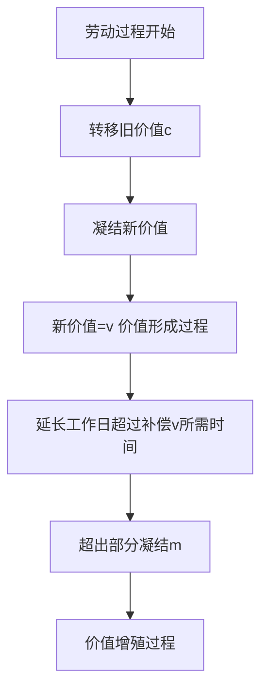

# KP04 · 劳动过程与价值增殖过程

<div style="text-align:right;margin:10px 0;"><a href="../../../../exam.html" target="_blank" style="display:inline-block;padding:6px 16px;background:#2563eb;color:#fff;border-radius:6px;text-decoration:none;font-size:14px;">📝 开始做题</a></div>


> 所属：[[../00_章节总结|第5章 资本主义生产]] ｜ 节：原书第五章第二节

## 1. 一句话先懂（小白版）

资本主义生产过程有**两副面孔**：

- **从一面看**：它是劳动过程——工人用机器把原料变成商品（做奶茶），这和任何社会的生产都一样；
- **从另一面看**：它是价值增殖过程——资本家不关心奶茶好不好喝，他关心的是**最后能不能赚到剩余价值**。

关键差别：普通商品生产过程是"劳动过程 + 价值形成过程"；资本主义生产过程是"劳动过程 + 价值增殖过程"。多出来的那个"增殖"，就是剩余价值。

## 2. 严格定义

**劳动过程**：劳动者运用劳动资料对劳动对象进行加工、创造使用价值的过程。三个简单要素：有目的的活动（劳动）、劳动对象、劳动资料。

**资本主义劳动过程的两个特点：**
1. 工人的劳动属于资本家，工人在资本家监督下劳动；
2. 劳动产品归资本家所有，不归工人。

**价值形成过程**：生产过程中，具体劳动把生产资料价值转移到新产品中，抽象劳动创造新价值。如果新价值 = 劳动力价值，那只是**价值形成过程**，没有剩余价值。

**价值增殖过程**：超过一定点而延长了的价值形成过程。工人劳动创造的新价值，超过劳动力价值，超过的部分就是剩余价值。

## 3. 为什么（原理/机制）——完整推导

### 第一步：看价值怎么形成

以生产一杯奶茶为例：

| 要素 | 价值 | 在生产过程中怎么变 |
|---|---|---|
| 茶叶、牛奶、杯子（生产资料） | 4 元 | 具体劳动把它们的价值**转移**到新奶茶里 |
| 你 1 小时劳动（抽象劳动） | 假设创造 15 元新价值 | 抽象劳动**凝结**到奶茶里 |
| **一杯奶茶总价值** | 4 + 15 = 19 元 | |

### 第二步：看劳动力价值是多少

假设你一天工作 8 小时，日工资 400 元（= 每小时 50 元）。
你一小时创造 15 元价值？不对——让我重新设计数字让它更清楚：

**重新设计（数字更整齐）**：
- 一杯奶茶的生产资料（c）= 4 元；
- 你每小时劳动创造新价值 = 10 元；
- 你日工资（劳动力价值 v）= 200 元/天 = 25 元/小时；
- 工作日 = 8 小时；
- 你一天做 40 杯奶茶（每小时 5 杯）。

**第三步：算一天的总价值**

- 转移的生产资料价值：$40 \times 4 = 160$ 元（c）；
- 你一天 8 小时创造的新价值：$8 \times 10 = 80$ 元；
- 一天 40 杯奶茶总价值：$W = c + v + m = 160 + 80$？不对——这里要分清楚：

> 新创造价值 = v + m。如果工作日 8 小时，前 4 小时创造的价值 = 劳动力价值（200 元），后 4 小时创造的价值 = 剩余价值。

让我们严格按马克思的逻辑：

```
工作日 8 小时
├── 必要劳动时间 4 小时：创造 v = 200 元（等于工资）
└── 剩余劳动时间 4 小时：创造 m = 200 元（被资本家占有）
```

你一天新创造价值 = v + m = 200 + 200 = 400 元。
转移的生产资料价值 c = 160 元。
40 杯奶茶总价值 W = c + v + m = 160 + 200 + 200 = 560 元。

### 第四步：价值形成 vs 价值增殖

- **如果工作日只到 4 小时**：新创造价值 = 200 元 = v，资本家没赚钱。这是**单纯价值形成过程**，不是资本主义生产。
- **资本家把工作日延长到 8 小时**：后 4 小时白干，多创造 200 元 m。这就是**价值增殖过程**。

**结论**：价值增殖过程就是**超过劳动力价值补偿点而延长了的价值形成过程**。

## 4. 来源（理论怎么来的）

马克思在《资本论》第一卷第五章区分了"劳动过程"和"价值增殖过程"。他说："作为劳动过程和价值形成过程的统一，生产过程是商品生产过程；作为劳动过程和价值增殖过程的统一，生产过程是资本主义生产过程，是商品生产的资本主义形式。"

## 5. 怎么用（现实例子）

**看奶茶店一天的账：**

| 项目 | 金额 | 性质 |
|---|---|---|
| 40 杯奶茶卖 14 元/杯 = 560 元 | 总价值 W | |
| 原料 4 元 × 40 = 160 元 | c（不变资本，转移价值） | |
| 你日工资 200 元 | v（可变资本，再生产劳动力价值） | |
| 王老板赚的 200 元 | m（剩余价值） | |

**关键洞察**：王老板之所以是资本家，不是因为他"管理得好"，而是因为他把工作日延长到了必要劳动时间（4 小时）以上。后 4 小时你在给他白干。

## 5.5 理论推导（一步步推）

> 本节补充：价值形成过程怎么变成价值增殖过程。

**假设起点**：资本家已购买到生产资料和劳动力。

**推导过程**：
- 第一步：劳动过程开始。工人用具体劳动把生产资料加工成新产品，把生产资料旧价值 $c$ 转移到新产品上。
- 第二步：工人同时支出抽象劳动，凝结成新价值。
- 第三步：先让工人劳动一段时间，其凝结的新价值恰好等于工资 $v$——这是**价值形成过程**。
- 第四步：资本家不让工人下班，把工作日延长到补偿 $v$ 所需时间以上。
- 第五步：超出部分的劳动凝结成 $m$——价值形成过程就变成**价值增殖过程**。
- 结论：价值增殖过程 = 超过一定点而延长了的价值形成过程。这个"一定点"就是补偿劳动力价值所需的劳动时间。



## 5.6 数学推导（公式怎么来的）

> 每个符号第一次出现必须解释。

新产品价值：

$$W = c + v + m$$

其中 $c$ 是转移的旧价值（不变），$v$ 是工人必要劳动再生产的等价物。

设工作日 $L = a + b$（$a$ 必要劳动，$b$ 剩余劳动），单位时间价值 $w$。则：

$$v = a \cdot w, \qquad m = b \cdot w$$

价值形成过程只到 $a$ 为止；价值增殖过程延长到 $L = a + b$。

$$W - (c + v) = m = b \cdot w > 0$$


## 6. 什么时候不能用（边界条件）

- **这个模型是"纯粹"的资本主义生产**。它抽象掉了竞争、供求、价格波动。现实中资本家可能贵卖赚更多，也可能贱卖赔本，但这不改变剩余价值生产的本质。
- **管理劳动也是生产劳动**。王老板自己管店、研发新品，这部分劳动也创造价值，不是剥削。**他占有剩余价值的那部分，才是无偿占有的**。
- **社会主义公有制企业的生产过程**：劳动过程是为了满足人民需要；价值增殖不再是为了少数人致富，而是为了扩大再生产、提高集体福利。

## 7. 容易混淆什么

| 容易混 | 区别 |
|---|---|
| 劳动过程 vs 价值增殖过程 | 前者是任何社会都有的具体劳动；后者是资本主义特有的、以剩余价值为目的的过程。 |
| 价值形成过程 vs 价值增殖过程 | 形成 = 新价值 = v（无剥削）；增殖 = 新价值 = v + m（有剥削）。 |
| 具体劳动转移 c vs 抽象劳动创造 v+m | 具体劳动把生产资料价值转移到新产品；抽象劳动凝结成新价值（v+m）。 |
| 资本主义生产 vs 简单商品生产 | 简单商品生产：W—G—W，为买而卖；资本主义生产：G—W—G'，为卖而买、为增殖而生产。 |

## 8. 现实意义

- **为什么"996"是资本主义生产的内在要求？** 因为资本家要尽可能延长剩余劳动时间。8 小时工作制的斗争史，就是工人阶级缩短剩余劳动时间的斗争史。
- **为什么流水线、泰勒制、算法管理这么重要？** 因为它们提高劳动强度，让工人在同样时间里干更多活——变相延长剩余劳动时间（相对剩余价值）。
- **为什么平台算法算配送时间？** 算法把每一秒都算到极限，就是在榨取相对剩余价值。

---

## 🔗 相关知识点

**同章关联：** [[KP03_劳动力商品]] ｜ [[KP05_不变资本与可变资本]] ｜ [[KP06_剩余价值率]] ｜ [[KP07_绝对剩余价值与相对剩余价值]]

**跨章关联：** [[../../01_商品与货币/知识点/KP02_劳动二重性|劳动二重性（具体劳动转移 c，抽象劳动创造 v+m）]]

**跨课对照：** 西方经济学把生产过程看成"投入—产出"的技术关系，不分析其中的剥削关系。

**📖 原书原文：** [[../../../../原文件/经济学/马克思主义政治经济学概论_全书#第二节 剩余价值的生产|《概论》第五章第二节]]

---

## 📝 考研真题（首经贸 801）

**配套主观题：** 见同目录 [[../考研真题集|本章考研真题集]]
**配套选择题：** 见同目录 [[../选择题集|本章选择题集]]

### 高频简答
- 简述资本主义生产过程是劳动过程和价值增殖过程的统一 → 见 [[../考研真题集#s4|真题集·简答 4]]

### 高频论述
- 试述剩余价值生产过程，并运用马克思主义政治经济学分析"996"工作制的本质 → 见 [[../考研真题集#l1|真题集·论述 1]]

### 易错选择
- 本知识点选择题见 [[../选择题集#KP04 劳动过程与价值增殖过程|选择题集·KP04]]
