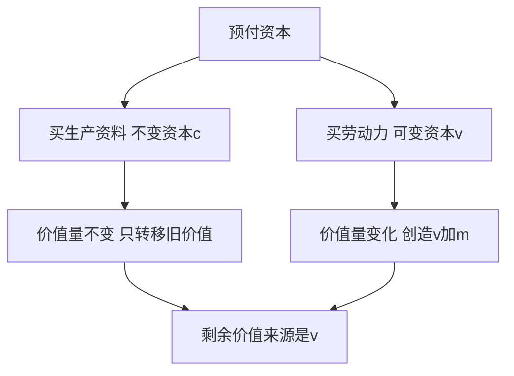

# KP05 · 不变资本与可变资本

<a href="../../../../exam.html" target="_blank" style="display:inline-block;padding:6px 16px;background:#2563eb;color:#fff;border-radius:6px;text-decoration:none;font-size:14px;">📝 开始做题</a>

> 所属：[[../00_章节总结|第5章 资本主义生产]] ｜ 节：原书第五章第二节

## 1. 一句话先懂（小白版）

王老板开店投的钱分成两部分：

- **买茶叶、牛奶、机器的钱（c）**：这些东西在生产中只是把自己的价值**转移**到奶茶里，不会变多。茶叶 4 元，转移到奶茶里还是 4 元。这叫**不变资本**（c = constant）。
- **雇你的工资（v）**：你干活能创造比工资更多的价值。工资 200 元，你实际创造了 400 元。这部分钱**会变多**，这叫**可变资本**（v = variable）。

**关键洞察**：剩余价值 m 不是全部预付资本生出来的，它**只是可变资本 v 雇来的工人创造的**。这就揭穿了"资本也创造利润"的谎言。

## 2. 严格定义

| 分类 | 含义 | 在剩余价值生产中的作用 |
|---|---|---|
| **不变资本 c** | 以生产资料形式存在的资本（厂房、机器、原料、燃料） | 在生产过程中**只转移价值**，不改变自己的价值量 |
| **可变资本 v** | 以劳动力形式存在的资本（工资） | 在生产过程中**改变自己的价值量**，再生产出自身等价并创造剩余价值 |

**商品价值公式**：

$$W = c + v + m$$

- $c$：转移的生产资料价值；
- $v$：再生产出来的劳动力价值；
- $m$：工人创造、被资本家无偿占有的剩余价值。

**划分依据**：资本不同部分在**剩余价值生产过程中的不同作用**。

## 3. 为什么（原理/机制）——完整推导

### 为什么要做这个划分？

古典政治经济学（斯密、李嘉图）只知道把资本分成**固定资本**和**流动资本**（按价值周转方式分）。这个分法看不见剩余价值的真正来源。

马克思按**在剩余价值生产中的作用**分：
- 不变资本：生产资料，是活劳动的吸收器，但本身不创造新价值；
- 可变资本：劳动力，是剩余价值的唯一源泉。

### 为什么生产资料不创造新价值？

- 茶叶值 4 元，做成奶茶后，这 4 元原封不动转移到奶茶里；
- 机器值 6 万元，能用 3 年，每年转移 2 万元到产品里；
- 它们的价值是**过去劳动**凝结的，在生产中只是转移，不会增殖。

**真正的新价值是工人抽象劳动凝结的**——你一天 8 小时劳动，凝结成 400 元新价值。这 400 元里，200 元补偿 v，200 元是 m。

### 这个划分的意义

1. **揭穿利润来源**：剩余价值不是全部资本生的，只是 v 生的；
2. **为计算剥削程度提供基础**：$m' = m/v$，不是 $m/(c+v)$；
3. **为资本有机构成理论打基础**（见 [[KP10_资本有机构成]]）。

## 4. 来源（理论怎么来的）

马克思在《资本论》第一卷第六章第一次明确提出不变资本和可变资本的划分。这是他继劳动二重性之后的又一创造——古典派从来不知道这两者的区别。

## 5. 怎么用（现实例子）——手把手算

**题目**：王老板奶茶店一个月账本如下。算：c、v、m、商品价值 W。

| 项目 | 金额 |
|---|---|
| 茶叶、牛奶、杯子（全部消耗） | 4400 元 |
| 制冰机、封口机（月折旧） | 1000 元 |
| 店面租金 | 2000 元 |
| 你一个月工资 | 5000 元 |
| 一个月营业额 | 16500 元 |

**第一步：算不变资本 c。**

不变资本 = 所有生产资料的价值转移：

$$c = 4400 + 1000 + 2000 = 7400 \text{ 元}$$

> 注意：租金是店面这个生产资料的价值转移，也是 c 的一部分。

**第二步：算可变资本 v。**

$$v = 5000 \text{ 元}$$

**第三步：算剩余价值 m。**

营业额 16500 元 = W = c + v + m。

$$m = W - c - v = 16500 - 7400 - 5000 = 4100 \text{ 元}$$

**第四步：商品价值构成。**

$$W = 7400c + 5000v + 4100m = 16500 \text{ 元}$$

**第五步：解读。**

- 王老板投了 12400 元（c+v），其中 7400 是死钱（不增殖），5000 是活钱（雇你）；
- 真正生出 4100 元 m 的，是那 5000 元 v 雇来的你；
- 机器、房子、茶叶只是**必要条件**，不是剩余价值的**源泉**。

## 5.5 理论推导（一步步推）

> 本节补充：为什么要把资本分成 $c$ 和 $v$。

**假设起点**：资本家的预付资本一部分买生产资料，一部分买劳动力。

**推导过程**：
- 第一步：用于买生产资料（厂房、机器、原料）的那部分资本，在生产中只把自身价值转移到新产品上，价值量不发生变化 → 叫**不变资本 $c$**。
- 第二步：用于买劳动力的那部分资本，在生产中由工人活劳动再生产出等价物，并创造出剩余价值，价值量发生变化 → 叫**可变资本 $v$**。
- 第三步：这一划分第一次揭示剩余价值的真正来源不是全部资本，而是可变资本 $v$。
- 结论：资本主义剥削率不能用 $m/(c+v)$ 表示，必须用 $m/v$。

## 5.6 数学推导（公式怎么来的）

> 每个符号第一次出现必须解释。

新产品价值 $W = c + v + m$。

- 不变资本 $c$：生产中转移的旧价值，$\Delta c = 0$；
- 可变资本 $v$：工人再生产其等价物，并额外创造 $m$，$\Delta v = m > 0$。

因此剩余价值率（剥削程度）必须是：

$$m' = \frac{m}{v}$$

而利润率（预付资本的赚钱程度）才用：

$$p' = \frac{m}{c+v}$$

## 6. 什么时候不能用（边界条件）

- **c 和 v 的划分是本质划分，不是会计科目**。会计上"工资"是成本，"机器"是资产；政治经济学看，工资是可变资本（能增殖），机器是不变资本（不增殖）。
- **当代新问题**：研发投入、数据、算法算不算不变资本？马克思时代没有这些。当代马克思主义政治经济学认为：研发人员、数据标注员的劳动是复杂劳动，他们的 v 创造更多 m；而算法、数据集本身是 c（不变资本）。
- **社会主义公有制企业**：c 仍然是生产资料价值转移，v 是职工工资，但 m 不归私人，而归社会（通过税收、国企利润上缴）。

## 7. 容易混淆什么

| 容易混 | 区别 |
|---|---|
| 不变资本 c vs 固定资本 | c 是按"在 m 生产中的作用"分；固定资本是按"价值周转方式"分（机器是固定资本，原料是流动资本）。两者交叉：机器是 c 也是固定资本；原料是 c 但属于流动资本。 |
| 可变资本 v vs 流动资本 | v 是按"作用"分；工资在周转方式上属于流动资本。所以 v 一定是流动资本，但流动资本不一定是 v（原料也是流动资本但属于 c）。 |
| 不变资本 vs 固定资本 | 不变资本包括原料（流动）和机器厂房（固定）；固定资本只包括机器厂房。 |
| 剩余价值 vs 利润 | m 是本质（v 的产物）；p（利润）是现象（被看成全部 c+v 的产物）。 |

## 8. 现实意义

- **为什么"机器换人"不能消灭剥削？** 因为机器是 c，不创造剩余价值；它只是把工人变得更高效，让工人在同样时间里创造更多 m。失业的工人变成"产业后备军"，反过来压低在职工人工资。
- **为什么研发公司估值高但利润少？** 因为它们 c（设备、数据、服务器）巨大，v（工程师工资）相对小，但工程师是复杂劳动，单位 v 创造的 m 大。
- **理解"利润率下降趋势"**：随着技术进步，c 占比越来越大（资本有机构成提高），v 占比越来越小——如果 m 率不变，利润率 m/(c+v) 会下降。这是马克思预言的资本主义长期趋势（见 [[../../03_资本流通与剩余价值分配/知识点/KP05_平均利润与生产价格]]）。

---

## 🔗 相关知识点

**同章关联：** [[KP04_劳动过程与价值增殖过程]] ｜ [[KP06_剩余价值率]] ｜ [[KP10_资本有机构成]]

**跨章关联：** [[../../03_资本流通与剩余价值分配/知识点/KP03_固定资本与流动资本|固定资本与流动资本（另一种划分）]] ｜ [[../../03_资本流通与剩余价值分配/知识点/KP05_平均利润与生产价格|利润平均化]]

**跨课对照：** 西方经济学不分 c/v，它把所有资本都按边际生产力分配。

**📖 原书原文：** [[../../../../原文件/经济学/马克思主义政治经济学概论_全书#第二节 剩余价值的生产|《概论》第五章第二节]]

---

## 📝 考研真题（首经贸 801）

**配套主观题：** 见同目录 [[../考研真题集|本章考研真题集]]
**配套选择题：** 见同目录 [[../选择题集|本章选择题集]]

### 高频简答
- 简述不变资本和可变资本的划分及其意义 → 见 [[../考研真题集#s5|真题集·简答 5]]

### 高频论述
- 试述剩余价值学说的创立及其在马克思主义政治经济学中的地位 → 见 [[../考研真题集#l5|真题集·论述 5]]

### 易错选择
- 本知识点选择题见 [[../选择题集#KP05 不变资本与可变资本|选择题集·KP05]]
