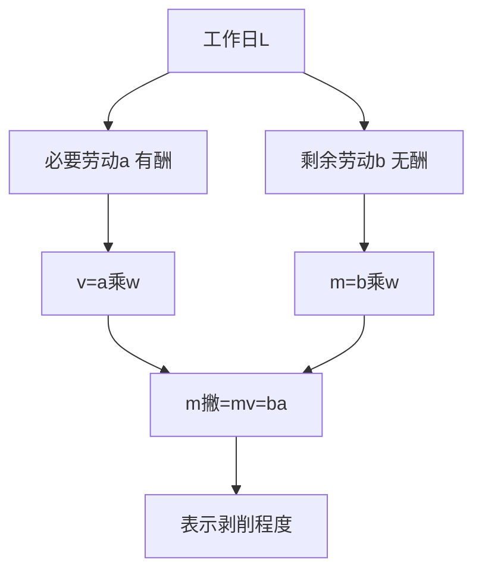

# KP06 · 剩余价值率（剥削程度）

<a href="../../../../exam.html" target="_blank" style="display:inline-block;padding:6px 16px;background:#2563eb;color:#fff;border-radius:6px;text-decoration:none;font-size:14px;">📝 开始做题</a>

> 所属：[[../00_章节总结|第5章 资本主义生产]] ｜ 节：原书第五章第二节

## 1. 一句话先懂（小白版）

剩余价值率就是**剥削率**——工人一天里，有多少时间是给自己干的，多少时间是给老板白干的。

公式：

$$m' = \frac{m}{v} = \frac{\text{剩余劳动时间}}{\text{必要劳动时间}}$$

如果 m' = 100%，意思是你一天干 8 小时，前 4 小时给自己赚工资，后 4 小时给老板白干。
如果 m' = 200%，那就是前 2.67 小时给自己，后 5.33 小时白干。

**m' 越高，剥削越重。**

## 2. 严格定义

**剩余价值率 m'**：剩余价值与可变资本的比率，表示资本家对工人的剥削程度。

$$m' = \frac{m}{v}$$

也可以用劳动时间表示：

$$m' = \frac{\text{剩余劳动时间}}{\text{必要劳动时间}}$$

- **必要劳动时间**：工人生产劳动力价值（工资）所需要的劳动时间；
- **剩余劳动时间**：工人超出必要劳动时间、为资本家生产剩余价值的时间。

**产品价值构成**：$W = c + v + m$，其中 c 是不变资本，不参与 m' 计算。

**利润率 p'**：和 m' 不同，它是剩余价值与**全部预付资本**的比率：

$$p' = \frac{m}{c+v}$$

利润率掩盖了剥削程度——因为 c 不创造 m，但 p' 把它算进分母。

## 3. 为什么（原理/机制）——完整推导

### 为什么 m' 要用 v 而不是 c+v？

因为剩余价值 m **只由 v 雇来的工人创造**。c 只是转移价值，不产生 m。

- 王老板投 7400 元 c + 5000 元 v = 12400 元，赚了 4100 元 m；
- 如果你只看"投 12400 赚 4100"，利润率 = 4100/12400 ≈ 33%，看起来很正常；
- 但看剥削率：m' = 4100/5000 = 82%——意思是工人一天 8 小时里，有 4.4 小时在给老板白干。

**m' 揭示真相，p' 掩盖真相。**

### 为什么说 m' 准确表示剥削程度？

因为它直接衡量"工人新创造价值里，资本家拿走了多少"：

$$\text{新创造价值} = v + m$$

m' = m/v 就是剩余部分和必要部分的比例。

## 4. 来源（理论怎么来的）

马克思在《资本论》第一卷第七章专门讨论剩余价值率。他批评古典派只知道利润、地租、利息这些分配范畴，不知道它们共同的源泉——剩余价值，更不知道衡量它的比率。

## 5. 怎么用（现实例子）——手把手算

**题目**：王老板奶茶店一个月：c = 7400 元，v = 5000 元，m = 4100 元。求：
① 剩余价值率 m'；
② 利润率 p'；
③ 工作日 8 小时里，必要劳动时间和剩余劳动时间各多少？
④ 王老板想把 m' 提高到 150%，他可以怎么做？

**第一步：算 m'。**

$$m' = \frac{m}{v} = \frac{4100}{5000} = 82\%$$

**第二步：算 p'。**

$$p' = \frac{m}{c+v} = \frac{4100}{7400+5000} = \frac{4100}{12400} \approx 33.1\%$$

**第三步：分工作日。**

m' = 剩余劳动时间/必要劳动时间 = 82%。

设必要劳动时间为 $t$，剩余劳动时间为 $8-t$：

$$\frac{8-t}{t} = 0.82 \Rightarrow 8 - t = 0.82t \Rightarrow 8 = 1.82t \Rightarrow t \approx 4.4 \text{ 小时}$$

- 必要劳动时间 ≈ 4.4 小时（你给自己赚工资）；
- 剩余劳动时间 ≈ 3.6 小时（你给王老板白干）。

**第四步：怎么把 m' 提到 150%？**

两条路（见 [[KP07_绝对剩余价值与相对剩余价值]]）：

- **绝对剩余价值路线**：延长工作日。必要劳动时间还是 4.4 小时，要让 m' = 150%，剩余劳动时间 = 4.4 × 1.5 = 6.6 小时，工作日 = 4.4 + 6.6 = 11 小时（从 8 小时加到 11 小时）。
- **相对剩余价值路线**：提高劳动生产率，让必要劳动时间缩短。工作日还是 8 小时，要让 m' = 150%：设必要劳动时间 $t$，剩余 $8-t$，$(8-t)/t = 1.5 \Rightarrow t = 3.2$ 小时。即必要劳动时间从 4.4 小时缩短到 3.2 小时（比如让工人同样时间做更多奶茶，每杯工资成本下降）。

## 5.5 理论推导（一步步推）

> 本节补充：剩余价值率为什么能表示剥削程度。

**假设起点**：$m$ 由工人剩余劳动创造，$v$ 由工人必要劳动再生产。

**推导过程**：
- 第一步：工作日分成两段：必要劳动时间 $a$（再生产工资 $v$）和剩余劳动时间 $b$（创造 $m$）。
- 第二步：$v = a \cdot w$，$m = b \cdot w$。
- 第三步：两式相除，单位时间价值 $w$ 约掉，得 $m' = m/v = b/a$。
- 第四步：$m'$ 表示工人一个工作日中，有酬部分和无酬部分的比例——即资本家对工人的剥削程度。
- 结论：$m'$ 越高，剥削越重。

## 5.6 数学推导（公式怎么来的）

> 每个符号第一次出现必须解释。

$$m' = \frac{m}{v} = \frac{\text{剩余劳动时间}}{\text{必要劳动时间}} = \frac{b}{a}$$

**数值例**：工作日 8 小时，$a = 4$ 小时，$b = 4$ 小时，则 $m' = 4/4 = 100\%$。

与利润率的关系：

$$p' = \frac{m}{c+v} = \frac{m' \cdot v}{c+v} = \frac{m'}{c/v + 1}$$

利润率总是小于剩余价值率，因为分母 $c+v > v$。

## 6. 什么时候不能用（边界条件）

- **m' 是本质比率，不是会计指标**。现实中工资、利润、地租混在一起，不能直接从财报里算出 m'，要经过理论还原。
- **管理劳动、监督劳动**也创造价值。王老板自己管理店铺的劳动应该算 v，不能全算 m。严格说要把他的管理劳动报酬从 m 里扣掉。
- **社会主义企业**：m 以纯收入形式存在，不归私人，而归社会。m' 在社会主义下衡量的是"企业为社会做的贡献"，不是剥削率。

## 7. 容易混淆什么

| 容易混 | 区别 |
|---|---|
| m' vs p' | m' = m/v（剥削率）；p' = m/(c+v)（利润率）。p' 总是小于 m'，因为分母大。 |
| 剩余价值率 vs 剩余价值量 | m' 是比率（程度）；M = m' × V 是总量（剥削的总规模）。 |
| 必要劳动时间 vs 剩余劳动时间 | 必要 = 给自己赚工资；剩余 = 给老板白干。 |
| 剥削率 vs 利润率 | 前者揭露真相，后者掩盖真相。 |

## 8. 现实意义

- **为什么"涨工资"和"提利润"是零和博弈？** 因为新创造价值 = v + m。工资涨 = v 变大，在新创造价值不变的情况下 m 就小了，m' 下降。
- **为什么平台公司利润这么高？** 因为算法把必要劳动时间压到极低（骑手跑一单 5 元，但用户付 20 元），m' 极高。
- **怎么判断一个行业是不是"血汗工厂"？** 不能只看工资绝对数，要看 m'——即工人创造的新价值里，多少归了资本。

---

## 🔗 相关知识点

**同章关联：** [[KP05_不变资本与可变资本]] ｜ [[KP07_绝对剩余价值与相对剩余价值]] ｜ [[KP08_资本主义工资]]

**跨章关联：** [[../../03_资本流通与剩余价值分配/知识点/KP05_平均利润与生产价格|利润率平均化（m' 转化为 p'）]]

**跨课对照：** 西方经济学没有"剥削率"概念，它把利润和工资都看成各自的边际产出报酬。

**📖 原书原文：** [[../../../../原文件/经济学/马克思主义政治经济学概论_全书#第二节 剩余价值的生产|《概论》第五章第二节]]

---

## 📝 考研真题（首经贸 801）

**配套主观题：** 见同目录 [[../考研真题集|本章考研真题集]]
**配套选择题：** 见同目录 [[../选择题集|本章选择题集]]

### 高频简答
- 简述剩余价值率 m' 及其表示方法 → 见 [[../考研真题集#s6|真题集·简答 6]]
- 计算题：已知 c、v、工作日，求 m'、m、W 及绝对剩余价值 → 见 [[../考研真题集#s7|真题集·简答 7]]

### 高频论述
- 试述剩余价值生产过程，并运用马克思主义政治经济学分析"996"工作制的本质 → 见 [[../考研真题集#l1|真题集·论述 1]]

### 易错选择
- 本知识点选择题见 [[../选择题集#KP06 剩余价值率|选择题集·KP06]]
