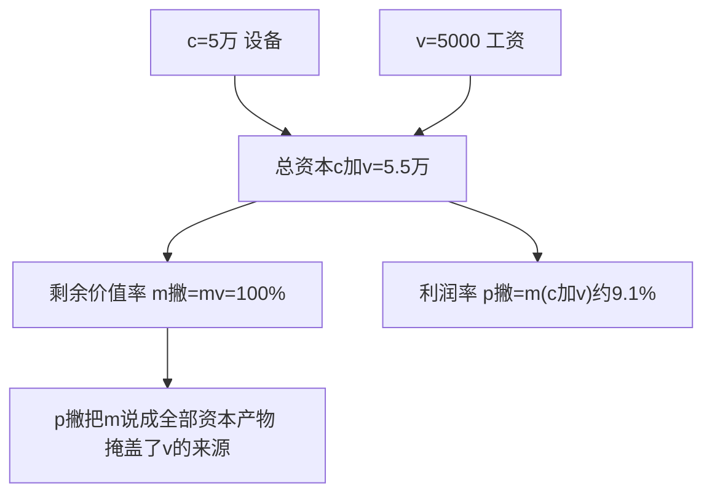
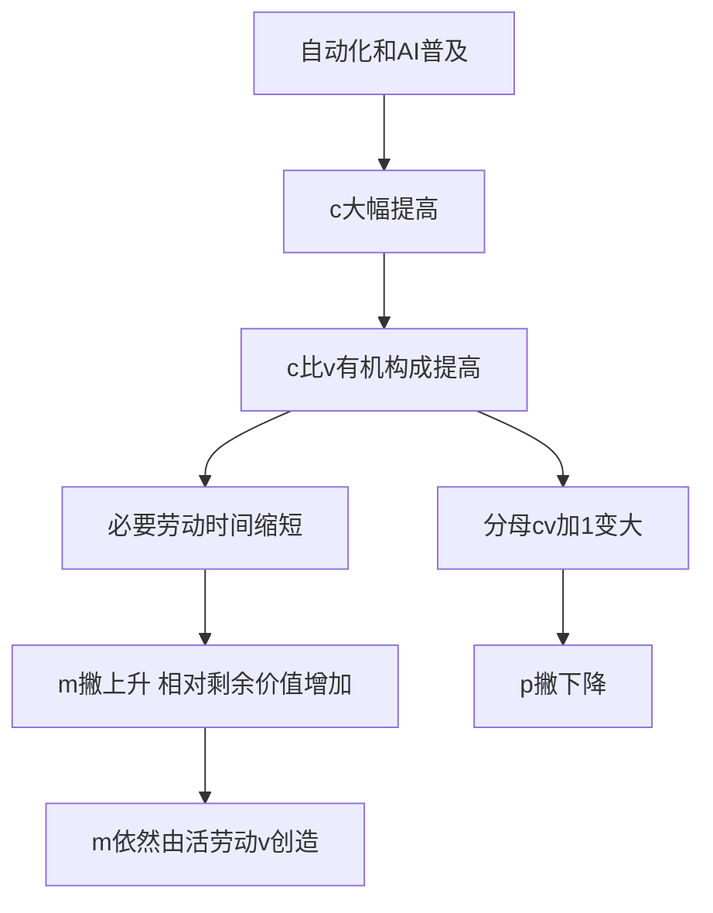

# 02 资本主义经济制度与生产 · 考研真题集（首经贸 801）

<div style="text-align:right;margin:10px 0;"><a href="../../../exam.html" target="_blank" style="display:inline-block;padding:6px 16px;background:#2563eb;color:#fff;border-radius:6px;text-decoration:none;font-size:14px;">📝 开始做题</a></div>


> 本章共收录：简答题 12 道（每题 15 分，含 1 道计算题）｜论述题 5 道（每题 30 分）
> 配套选择题见 [[选择题集|本章选择题集]]
> 对应大纲：《马克思主义政治经济学概论》第二篇 资本主义经济制度及其演变、资本主义生产（第 4–5 章）

## 📋 本题集目录

### 简答题
1. [简述货币转化为资本的总公式及其矛盾](#s1)
2. [为什么说劳动力成为商品是货币转化为资本的根本条件](#s2)
3. [简述劳动力商品的二因素及其使用价值的特殊性](#s3)
4. [简述资本主义生产过程是劳动过程和价值增殖过程的统一](#s4)
5. [简述不变资本和可变资本的划分及其意义](#s5)
6. [简述剩余价值率 m' 及其表示方法](#s6)
7. [计算题：已知 c、v、工作日，求 m'、m、W 及绝对剩余价值](#s7)
8. [比较绝对剩余价值和相对剩余价值](#s8)
9. [简述超额剩余价值与相对剩余价值的关系](#s9)
10. [简述资本主义工资的本质及其基本形式](#s10)
11. [简述资本积累的本质、源泉和影响因素](#s11)
12. [简述资本有机构成提高及其后果](#s12)

### 论述题
1. [试述剩余价值生产过程，并运用马克思主义政治经济学分析"996"工作制的本质](#l1)
2. [运用马克思主义政治经济学分析外卖骑手的剩余价值榨取](#l2)
3. [试述资本积累、资本有机构成提高与相对过剩人口的关系，并分析 AI/自动化对当代就业的影响](#l3)
4. [试述资本主义工资的本质，并分析当代工资形式的新变化](#l4)
5. [试述剩余价值学说的创立及其在马克思主义政治经济学中的地位](#l5)

---

## 一、简答题（每题 15 分，建议 450–700 字）

### <a id="s1"></a>简答 1：简述货币转化为资本的总公式及其矛盾。

**【建议字数】450–700 字 ｜ 【建议时间】15 分钟 ｜ 【题型】概念简答**

**【考什么】** 对应知识点 [[知识点/KP02_货币转化为资本|KP02 货币转化为资本]]，题型属于概念简答。

**【答题框架】**
- 第 1 段：简单商品流通公式（3 分）
- 第 2 段：资本总公式（5 分）
- 第 3 段：总公式的矛盾（5 分）
- 第 4 段：解决矛盾的条件（2 分）

**【参考答案】**

一、简单商品流通公式
简单商品流通公式是 **W—G—W**（商品—货币—商品）。商品生产者先卖后买，为买而卖，目的是获取使用价值。货币在这里只是交换媒介。

二、资本总公式
资本的流通公式是 **G—W—G'**（货币—商品—货币'）。其中 $G' = G + \Delta G$，即预付货币经过流通后带来了一个增殖额 $\Delta G$（剩余价值）。
(一) 资本家先买后卖，为卖而买，目的是获取交换价值的增殖。
(二) 这个公式概括了产业资本、商业资本、借贷资本的共同特征，所以叫**资本总公式**。

三、总公式的矛盾
(一) 从形式上看，资本总公式与价值规律相矛盾：价值规律要求等价交换，等价交换不能产生价值增殖。
(二) 但资本流通的结果确实带来了 $\Delta G$。
(三) 剩余价值不能从流通中产生：①等价交换不产生增殖；②不等价交换（贵卖）也不产生增殖，因为资本家既是买者又是卖者，彼此欺诈得失相抵。
(四) 剩余价值又不能离开流通产生：如果把货币贮藏起来，不进入流通，永远不会增殖。

四、解决矛盾的条件
(一) 剩余价值的产生，必须用货币购买到一种特殊商品——它的使用价值本身具有创造价值的能力。
(二) 这种特殊商品就是**劳动力**。
(三) 劳动力成为商品，是货币转化为资本的根本条件。

**【解析·得分点】** 采分点：①W—G—W 与 G—W—G' 对比（5 分）；②总公式矛盾：等价交换不产生增殖，但资本确实增殖（5 分）；③剩余价值不在流通中产生又不能离开流通（3 分）；④解决条件是劳动力成为商品（2 分）。易丢分：把 G—W—G' 说成简单商品流通；忘记"不能在流通中产生又不能离开流通"这个辩证表述。

**【生活实例】** 王老板拿 1 万元进货奶茶原料，卖完收回 1.2 万元。多出来的 2000 元不是他"贵卖"来的（因为他买原料时也被别人贵卖），而是他在市场上买到了一种特殊商品——你的劳动力。

**【双链接】** 🔗 [[知识点/KP02_货币转化为资本|回知识点]] ｜ [[知识点/KP03_劳动力商品|劳动力商品]] ｜ 📖 [[../../../原文件/经济学/马克思主义政治经济学概论_全书|《概论》第五章第一节]]

---

### <a id="s2"></a>简答 2：为什么说劳动力成为商品是货币转化为资本的根本条件？

**【建议字数】450–700 字 ｜ 【建议时间】15 分钟 ｜ 【题型】原因分析**

**【考什么】** 对应知识点 [[知识点/KP03_劳动力商品|KP03 劳动力商品]]，题型属于原因分析。

**【答题框架】**
- 第 1 段：货币本身不是资本（3 分）
- 第 2 段：劳动力成为商品的两个条件（5 分）
- 第 3 段：劳动力商品使用价值的特殊性（5 分）
- 第 4 段：小结（2 分）

**【参考答案】**

一、货币本身不是资本
货币是固定充当一般等价物的商品。作为流通媒介的货币，它只是 W—G—W 的交换手段，不会自行增殖。只有当货币能带来剩余价值时，它才转化为资本。

二、劳动力成为商品的两个条件
劳动力是人的劳动能力。劳动力要成为商品，必须同时具备两个条件：
(一) **劳动者有人身自由**。他在法律上是自己劳动力的所有者，可以把它出卖。这不同于奴隶——奴隶一次卖断，不是商品。
(二) **劳动者一无所有**。他不占有生产资料（土地、工具、厂房），不出卖劳动力就无法生存。
这两个条件是历史发展的产物（封建社会末期的资本原始积累，特别是圈地运动，使大批农民失去土地成为无产者）。

三、劳动力商品使用价值的特殊性
(一) 一般商品的使用价值在消费过程中被消耗掉，不创造新价值。
(二) **劳动力商品的使用价值就是劳动本身**。
(三) 劳动能创造价值，而且能创造出比劳动力自身价值更大的价值。
(四) 劳动力的价值 = 工资（养活工人及其家庭的费用）；但劳动力的使用（劳动）创造的新价值 > 工资。
(五) 这个差额就是**剩余价值**，被资本家无偿占有。

四、小结
正是因为买到了劳动力这种特殊商品，货币才能在生产过程中实现增殖，转化为资本。所以说，**劳动力成为商品是货币转化为资本的根本条件**。

**【解析·得分点】** 采分点：①货币本身不是资本（3 分）；②两个条件：人身自由+一无所有（5 分）；③使用价值特殊性：能创造大于自身价值的价值（5 分）；④小结（2 分）。易丢分：把劳动力和劳动混为一谈；忘记"一无所有"这个条件。

**【生活实例】** 王老板买茶叶（一般商品），茶叶消耗完就没了；他买你的劳动力，你干一个月做出 16500 元奶茶，工资只拿 5000 元——中间 11500 元就是剩余价值。这就是劳动力商品的特殊之处。

**【双链接】** 🔗 [[知识点/KP03_劳动力商品|回知识点]] ｜ [[知识点/KP02_货币转化为资本|货币转化为资本]] ｜ 📖 [[../../../原文件/经济学/马克思主义政治经济学概论_全书|《概论》第五章第一节]]

---

### <a id="s3"></a>简答 3：简述劳动力商品的二因素及其使用价值的特殊性。

**【建议字数】450–700 字 ｜ 【建议时间】15 分钟 ｜ 【题型】概念简答**

**【考什么】** 对应知识点 [[知识点/KP03_劳动力商品|KP03]]，题型属于概念简答。

**【答题框架】**
- 第 1 段：劳动力商品的定义（2 分）
- 第 2 段：劳动力的价值（6 分）
- 第 3 段：劳动力的使用价值（6 分）
- 第 4 段：历史和道德因素（1 分）

**【参考答案】**

一、劳动力商品的定义
劳动力是人的劳动能力，即存在于活的人体中的、生产使用价值时运用的体力和智力的总和。劳动力作为商品，也具有价值和使用价值二因素。

二、劳动力的价值
(一) 劳动力的价值是由生产和再生产劳动力所必需的生活资料的价值决定的。
(二) 它包括三个组成部分：
1. 维持劳动者本人生存所必需的生活资料价值（吃饭、租房、穿衣）；
2. 维持劳动者家属生存所必需的生活资料价值（养孩子，即未来劳动力的再生产）；
3. 劳动者的教育训练费用（培训成会做奶茶、会写代码的人）。
(三) 与其他商品不同，劳动力价值的决定还包含**历史的和道德的因素**。在不同国家、不同时代，"必需生活资料"的范围不同。19 世纪英国工人只要面包；21 世纪中国城市劳动力要手机、通勤、社交。发达国家工资高，不是资本家仁慈，而是那里劳动力再生产的费用本来就高。

三、劳动力的使用价值
(一) 劳动力的使用价值就是**劳动本身**。
(二) 一般商品的使用价值被消费时，其价值随之消失或转移；而劳动力的使用价值在被消费（劳动）时，能**创造出新价值**。
(三) 而且创造的新价值**大于劳动力自身的价值**。
(四) 这就是劳动力商品使用价值的特殊性——它是价值的源泉，而且是大于自身价值的价值源泉。
(五) 资本家购买劳动力，正是看中了这一点：他支付劳动力价值（工资），却获得劳动创造的全部新价值，两者的差额就是剩余价值。

四、小结
劳动力商品的特殊性不在于它的价值（与一般商品一样由生产它的社会必要劳动时间决定），而在于它的使用价值——它是剩余价值的源泉。

**【解析·得分点】** 采分点：①劳动力价值三组成部分（6 分）；②使用价值就是劳动、能创造大于自身价值的价值（6 分）；③历史和道德因素（1 分）；④定义（2 分）。易丢分：忘记劳动力价值包含历史和道德因素；把使用价值说成"劳动的产品"。

**【生活实例】** 程序员月薪 2 万，这是他的劳动力价值（包括他 16 年教育投入、北京生活成本、养孩子费用）。但他一个月给公司写的代码创造的价值可能是 20 万——差额 18 万就是剩余价值。

**【双链接】** 🔗 [[知识点/KP03_劳动力商品|回知识点]] ｜ 📖 [[../../../原文件/经济学/马克思主义政治经济学概论_全书|《概论》第五章第一节]]

---

### <a id="s4"></a>简答 4：简述资本主义生产过程是劳动过程和价值增殖过程的统一。

**【建议字数】450–700 字 ｜ 【建议时间】15 分钟 ｜ 【题型】概念简答**

**【考什么】** 对应知识点 [[知识点/KP04_劳动过程与价值增殖过程|KP04 劳动过程与价值增殖过程]]，题型属于概念简答。

**【答题框架】**
- 第 1 段：劳动过程（5 分）
- 第 2 段：价值形成过程（4 分）
- 第 3 段：价值增殖过程（4 分）
- 第 4 段：统一（2 分）

**【参考答案】**

一、劳动过程
(一) 劳动过程是劳动者运用劳动资料对劳动对象进行加工、创造使用价值的过程。
(二) 它有三个简单要素：有目的的活动（劳动）、劳动对象、劳动资料。
(三) 资本主义劳动过程有两个特点：
1. 工人的劳动属于资本家，工人在资本家监督下劳动；
2. 劳动产品归资本家所有，不归工人。

二、价值形成过程
(一) 生产商品的劳动具有二重性：具体劳动把生产资料价值（c）转移到新产品中；抽象劳动创造新价值。
(二) 如果工人劳动创造的新价值恰好等于劳动力价值（v），这就是单纯的**价值形成过程**——没有剩余价值，不是资本主义生产。

三、价值增殖过程
(一) 资本家把工作日延长到补偿劳动力价值所需的时间以上。
(二) 例如：工人一天劳动 8 小时，前 4 小时创造的价值 = 工资（v），这是必要劳动时间；后 4 小时继续劳动，这部分不拿工资，创造的价值全部归资本家，这是**剩余劳动时间**。
(三) 价值增殖过程就是**超过一定点而延长了的价值形成过程**。
(四) 用公式表示：
```
工作日 8 小时
├── 必要劳动时间 4 小时 → 再生产 v（工资）
└── 剩余劳动时间 4 小时 → 创造 m（剩余价值）
```

四、统一
(一) 资本主义生产过程是**劳动过程和价值增殖过程的统一**。
(二) 作为劳动过程，它生产使用价值；作为价值增殖过程，它生产剩余价值。
(三) 劳动过程是手段，价值增殖是目的。资本家关心的不是奶茶好不好喝，而是能不能赚到剩余价值。

**【解析·得分点】** 采分点：①劳动过程三要素+两特点（5 分）；②价值形成过程 = 新价值 = v（4 分）；③价值增殖 = 延长到 v 补偿点以上（4 分）；④统一（2 分）。易丢分：把劳动过程和价值增殖过程当成两个独立过程；忘记具体劳动转移 c、抽象劳动创造 v+m。

**【生活实例】** 王老板的奶茶店，从一面看是劳动过程（你烧水、泡茶、封口，做出奶茶）；从另一面看是价值增殖过程（你前 4 小时做的奶茶值你的工资，后 4 小时做的奶茶全归王老板）。

**【双链接】** 🔗 [[知识点/KP04_劳动过程与价值增殖过程|回知识点]] ｜ [[../01_商品与货币/知识点/KP02_劳动二重性|劳动二重性]] ｜ 📖 [[../../../原文件/经济学/马克思主义政治经济学概论_全书|《概论》第五章第二节]]

---

### <a id="s5"></a>简答 5：简述不变资本和可变资本的划分及其意义。

**【建议字数】450–700 字 ｜ 【建议时间】15 分钟 ｜ 【题型】概念简答**

**【考什么】** 对应知识点 [[知识点/KP05_不变资本与可变资本|KP05 不变资本与可变资本]]，题型属于概念简答/意义分析。

**【答题框架】**
- 第 1 段：划分依据（3 分）
- 第 2 段：不变资本 c（4 分）
- 第 3 段：可变资本 v（4 分）
- 第 4 段：划分意义（4 分）

**【参考答案】**

一、划分依据
马克思根据资本不同部分在**剩余价值生产过程中的不同作用**，把资本划分为不变资本和可变资本。这与古典政治经济学按价值周转方式划分固定资本和流动资本完全不同。

二、不变资本 c
(一) 以生产资料形式存在的资本（厂房、机器、原料、燃料）。
(二) 在生产过程中，它的价值通过具体劳动**转移**到新产品中，不改变自己的价值量。
(三) 例如茶叶值 4 元，做成奶茶后这 4 元原封不动转移到奶茶里；机器值 6 万元，能用 3 年，每年转移 2 万元。
(四) 它是活劳动的吸收器，但本身不创造新价值。

三、可变资本 v
(一) 以劳动力形式存在的资本（工资）。
(二) 在生产过程中，它的价值由工人的抽象劳动**再生产出来**，并且创造出剩余价值。
(三) 工人不仅再生产出相当于工资的价值，还额外创造剩余价值。
(四) 这部分资本在生产中改变了自己的价值量，所以叫可变资本。

四、划分意义
(一) **揭穿剩余价值的真正来源**。剩余价值不是全部资本生出来的，只是可变资本 v 雇来的工人创造的。这就批判了"资本也创造利润"的辩护论。
(二) **为计算剥削程度提供基础**。剩余价值率 $m' = m/v$，而不是 $m/(c+v)$。
(三) **为资本有机构成理论奠定基础**。c:v 的提高，反映了技术进步下不变资本比重增大、可变资本比重减小的趋势。
(四) 商品价值构成公式：$W = c + v + m$。

**【解析·得分点】** 采分点：①划分依据是在剩余价值生产中的作用（3 分）；②c 转移价值不增殖（4 分）；③v 再生产自身+创造 m（4 分）；④三点意义（4 分）。易丢分：把 c/v 划分与固定/流动资本划分混淆；忘记"划分依据"这个关键。

**【生活实例】** 王老板投 7400 元买机器原料（c）、5000 元雇你（v）。年底赚 4100 元。这 4100 元不是那 7400 元机器生的——机器只是把它的价值转移到奶茶里；它是你 5000 元工资雇来的你创造的。

**【双链接】** 🔗 [[知识点/KP05_不变资本与可变资本|回知识点]] ｜ 📖 [[../../../原文件/经济学/马克思主义政治经济学概论_全书|《概论》第五章第二节]]

---

### <a id="s6"></a>简答 6：简述剩余价值率 m' 及其表示方法。

**【建议字数】450–700 字 ｜ 【建议时间】15 分钟 ｜ 【题型】概念简答**

**【考什么】** 对应知识点 [[知识点/KP06_剩余价值率|KP06 剩余价值率]]，题型属于概念简答。

**【答题框架】**
- 第 1 段：剩余价值率的定义（3 分）
- 第 2 段：两种表示方法（6 分）
- 第 3 段：m' 与 p' 的区别（4 分）
- 第 4 段：意义（2 分）

**【参考答案】**

一、剩余价值率的定义
剩余价值率是剩余价值与可变资本的比率，表示资本家对工人的剥削程度。

$$m' = \frac{m}{v}$$

二、两种表示方法
(一) **价值形式**：$m' = m/v$。剩余价值与可变资本（工资）的比率。
(二) **劳动时间形式**：

$$m' = \frac{\text{剩余劳动时间}}{\text{必要劳动时间}}$$

必要劳动时间是工人再生产劳动力价值（工资）所需的时间；剩余劳动时间是工人超出必要劳动时间、为资本家生产剩余价值的时间。
(三) 例如工作日 8 小时，必要劳动 4 小时、剩余劳动 4 小时，则 $m' = 4/4 = 100\%$。

三、m' 与 p' 的区别
(一) **剩余价值率**：$m' = m/v$，分母只有可变资本，准确反映剥削程度。
(二) **利润率**：$p' = m/(c+v)$，分母是全部预付资本。
(三) 由于 $c+v > v$，所以 $p' < m'$。
(四) 利润率掩盖了剥削程度——它看起来资本家投 12400 元赚 4100 元，利润率 33%，很正常；但 m' = 82%，意味着工人一天 8 小时里有 3.6 小时在白干。

四、意义
(一) m' 准确揭示了资本主义剥削程度。
(二) m' 越高，意味着工人新创造价值中被资本家占有的部分越大。
(三) 提高 m' 有两条途径：绝对剩余价值生产（延长工作日）和相对剩余价值生产（缩短必要劳动时间）。

**【解析·得分点】** 采分点：①m' = m/v 定义（3 分）；②两种表示方法（6 分）；③与 p' 对比（4 分）；④意义（2 分）。易丢分：把 m' 写成 m/(c+v)；忘记劳动时间形式。

**【生活实例】** 你一天干 8 小时，前 4 小时给自己赚工资，后 4 小时给王老板白干——这就是 m' = 100%。王老板跟你说"我投了 10 万开店才赚 3 万，利润率 30%"，他在隐藏 m' = 100% 这个真相。

**【双链接】** 🔗 [[知识点/KP06_剩余价值率|回知识点]] ｜ 📖 [[../../../原文件/经济学/马克思主义政治经济学概论_全书|《概论》第五章第二节]]

---

### <a id="s7"></a>简答 7（计算题）：已知某资本家预付不变资本 c = 8000 元，可变资本 v = 2000 元，工人一天劳动 12 小时，其中必要劳动时间 6 小时。求：①剩余价值率 m'；②剩余价值量 m；③一天总产品价值 W；④若工作日延长到 15 小时，求绝对剩余价值生产下的 m'。

**【建议字数】450–700 字 ｜ 【建议时间】15 分钟 ｜ 【题型】分析推导**

**【考什么】** 对应知识点 [[知识点/KP06_剩余价值率|KP06]] + [[知识点/KP07_绝对剩余价值与相对剩余价值|KP07]]，题型属于分析推导/计算。

**【答题框架】**
- 第 1 步：原 m'（3 分）
- 第 2 步：m 与 W（4 分）
- 第 3 步：延长工作日后的 m'（6 分）
- 第 4 步：结论（2 分）

**【参考答案】**

一、原剩余价值率 m'
(一) 工作日 12 小时，必要劳动时间 6 小时，则剩余劳动时间 = 12 - 6 = 6 小时。
(二) $m' = \frac{\text{剩余劳动时间}}{\text{必要劳动时间}} = \frac{6}{6} = 100\%$。

二、剩余价值量 m 与总产品价值 W
(一) $m = m' \times v = 100\% \times 2000 = 2000$ 元。
(二) $W = c + v + m = 8000 + 2000 + 2000 = 12000$ 元。
(三) 验证：新创造价值 = v + m = 4000 元；其中 2000 元补偿 v，2000 元是 m。

三、工作日延长到 15 小时后的 m'
(一) 必要劳动时间不变（仍为 6 小时，因为劳动力价值没变）。
(二) 剩余劳动时间 = 15 - 6 = 9 小时。
(三) 新的 $m' = \frac{9}{6} = 150\%$。
(四) 新的 $m = m' \times v = 150\% \times 2000 = 3000$ 元。
(五) 新的 $W = 8000 + 2000 + 3000 = 13000$ 元。

四、结论
(一) 工作日从 12 小时延长到 15 小时，必要劳动时间不变，剩余劳动时间从 6 小时增加到 9 小时。
(二) m' 从 100% 提高到 150%。
(三) 这就是**绝对剩余价值生产**——在必要劳动时间不变的条件下，通过延长工作日长度生产的剩余价值。

**【解析·得分点】** 采分点：①原 m' = 100%（3 分）；②m = 2000、W = 12000（4 分）；③延长后剩余劳动 9 小时、m' = 150%、m = 3000（6 分）；④指出这是绝对剩余价值（2 分）。易丢分：延长工作日后忘记必要劳动时间不变；把 m 算成 m' × c。

**【生活实例】** 你原来 12 小时班，6 小时给自己干、6 小时白干；老板说"今天忙，加到 15 小时"，你还是 6 小时赚工资，多出来的 3 小时全白干。这就是绝对剩余价值。

**【双链接】** 🔗 [[知识点/KP06_剩余价值率|KP06]] ｜ [[知识点/KP07_绝对剩余价值与相对剩余价值|KP07]] ｜ 📖 [[../../../原文件/经济学/马克思主义政治经济学概论_全书|《概论》第五章第二、三节]]

---

### <a id="s8"></a>简答 8：比较绝对剩余价值和相对剩余价值。

**【建议字数】450–700 字 ｜ 【建议时间】15 分钟 ｜ 【题型】关系对比**

**【考什么】** 对应知识点 [[知识点/KP07_绝对剩余价值与相对剩余价值|KP07 绝对剩余价值与相对剩余价值]]，题型属于关系对比。

**【答题框架】**
- 第 1 段：定义对比（5 分）
- 第 2 段：实现方式对比（5 分）
- 第 3 段：历史阶段关系（5 分）

**【参考答案】**

一、定义对比
(一) **绝对剩余价值**：在必要劳动时间不变的条件下，通过**延长工作日长度**而生产的剩余价值。
(二) **相对剩余价值**：在工作日长度不变的条件下，通过**缩短必要劳动时间**、相对延长剩余劳动时间而生产的剩余价值。

二、实现方式对比
(一) 绝对剩余价值：延长工作日（加班、996），或提高劳动强度。必要劳动时间不变，剩余劳动时间随工作日延长而增加。
(二) 相对剩余价值：工作日长度不变，但通过提高社会劳动生产率，降低生活资料价值，从而降低劳动力价值，使必要劳动时间缩短。
(三) 图示（工作日 8 小时，原必要 4h、剩余 4h）：
```
绝对剩余价值（延长到 10h）：
[必要 4h][剩余 6h]  ← 多 2h

相对剩余价值（仍 8h，必要缩到 2h）：
[必要 2h][剩余 6h]  ← 必要少 2h
```

三、历史阶段关系
(一) **绝对剩余价值**是资本主义体系的**一般基础**——没有把工作日延长到必要劳动时间以上，就没有剩余价值。
(二) **相对剩余价值**是资本主义发展到机器大工业后的**主要方法**——工人斗争限制了工作日长度（8 小时工作制是工人斗争成果），资本家转而靠提高劳动生产率。
(三) 工场手工业时期主要靠绝对剩余价值；机器大工业时期主要靠相对剩余价值（流水线、泰勒制）；当代数字时代两者并用（算法监控 = 相对剩余价值，自愿加班 = 绝对剩余价值）。

**【解析·得分点】** 采分点：①定义对比（5 分）；②实现方式+图示（5 分）；③历史阶段关系（5 分）。易丢分：把相对剩余价值说成"个别企业提高生产率"——那是超额剩余价值；忘记两者是对立统一关系。

**【生活实例】** 老板想多赚，两条路：①让你从 8 小时加到 10 小时（绝对）；②引进自动封口机，让你原来 4 小时赚回工资，现在 2 小时就赚回，剩下 6 小时白干（相对）。

**【双链接】** 🔗 [[知识点/KP07_绝对剩余价值与相对剩余价值|回知识点]] ｜ 📖 [[../../../原文件/经济学/马克思主义政治经济学概论_全书|《概论》第五章第三节]]

---

### <a id="s9"></a>简答 9：简述超额剩余价值与相对剩余价值的关系。

**【建议字数】450–700 字 ｜ 【建议时间】15 分钟 ｜ 【题型】关系对比**

**【考什么】** 对应知识点 [[知识点/KP07_绝对剩余价值与相对剩余价值|KP07]]，题型属于关系对比。

**【答题框架】**
- 第 1 段：超额剩余价值定义（5 分）
- 第 2 段：二者的联系（5 分）
- 第 3 段：二者的区别（5 分）

**【参考答案】**

一、超额剩余价值的定义
(一) 超额剩余价值是**个别资本家**率先提高劳动生产率，使自己商品的**个别价值低于社会价值**，按社会价值出售，多得的那部分剩余价值。
(二) 例如：社会上做一杯奶茶的社会必要劳动时间是 5 分钟，王老板引进自动制茶机后个别劳动时间降到 3 分钟。但他的奶茶仍按社会价值（5 分钟劳动对应的价格）出售。
(三) 多得的部分 = 社会价值 - 个别价值 = 超额剩余价值。

二、二者的联系
(一) 超额剩余价值是**相对剩余价值的特殊形式**。
(二) 个别资本家追逐超额剩余价值的竞争，会迫使其他资本家都改进技术。
(三) 当新技术普及到整个社会部门时，社会劳动生产率普遍提高，生活资料价值下降，劳动力价值下降，必要劳动时间缩短——这就实现了**相对剩余价值**。
(四) 所以，每个资本家追逐超额剩余价值的私人动机，最终在全社会造成相对剩余价值的生产。

三、二者的区别
(一) **范围不同**：超额剩余价值是个别资本家获得的、暂时的；相对剩余价值是整个社会资本家阶级普遍获得的、持久的。
(二) **原因不同**：超额剩余价值来自个别企业劳动生产率高于社会水平；相对剩余价值来自社会劳动生产率普遍提高。
(三) **消失方式不同**：超额剩余价值在新技术普及后消失（大家都降到 3 分钟，个别价值 = 社会价值）；相对剩余价值一旦实现就持续存在，直到新一轮生产率提高。
(四) 资本家对超额剩余价值的追求，是推动技术进步和相对剩余价值生产的内在动力。

**【解析·得分点】** 采分点：①超额剩余价值定义（5 分）；②联系：超额是相对的特殊形式，追逐超额导致相对（5 分）；③区别：个别 vs 社会、暂时 vs 普遍（5 分）。易丢分：把超额剩余价值等同于绝对剩余价值；忘记它是"个别价值低于社会价值"。

**【生活实例】** 喜茶最先用自动制茶机，每杯成本比同行低 2 元，这 2 元是超额剩余价值。半年后奈雪、CoCo 都上了自动机，社会必要劳动时间下降，2 元超额消失——但整个奶茶行业的必要劳动时间缩短了，所有老板都获得了相对剩余价值。

**【双链接】** 🔗 [[知识点/KP07_绝对剩余价值与相对剩余价值|回知识点]] ｜ 📖 [[../../../原文件/经济学/马克思主义政治经济学概论_全书|《概论》第五章第三节]]

---

### <a id="s10"></a>简答 10：简述资本主义工资的本质及其基本形式。

**【建议字数】450–700 字 ｜ 【建议时间】15 分钟 ｜ 【题型】概念简答**

**【考什么】** 对应知识点 [[知识点/KP08_资本主义工资|KP08 资本主义工资]]，题型属于概念简答。

**【答题框架】**
- 第 1 段：工资是劳动力价值或价格的转化形式（5 分）
- 第 2 段：工资为什么表现为"劳动的价格"（4 分）
- 第 3 段：两种基本形式（4 分）
- 第 4 段：名义工资与实际工资（2 分）

**【参考答案】**

一、工资的本质
(一) 资本主义工资的本质是**劳动力的价值或价格**，不是劳动的价值或价格。
(二) 工人出卖的是劳动力（一个月的干活能力），不是劳动。劳动是劳动力的使用，它本身不是商品，没有价值。
(三) 如果工资是"劳动的价格"，那工人干 8 小时就拿 8 小时的报酬，资本家就没有剩余价值了——这与资本主义现实矛盾。

二、工资为什么表现为"劳动的价格"
(一) 工人先劳动后拿工资，看起来是"为这一个月劳动付酬"；
(二) 工资随劳动时间长短、产品件数变化；
(三) 工人自己也以为拿的是劳动报酬。
(四) 但这是**假象**。工资形式把工作日分为必要劳动和剩余劳动、有酬劳动和无酬劳动的一切痕迹都抹掉了——看起来全部劳动都有酬，实际上一部分是无酬的。

三、两种基本形式
(一) **计时工资**：按劳动时间支付（月薪、时薪）。它是劳动力价值的直接转化形式。
(二) **计件工资**：按生产的产品件数支付。它是计时工资的转化形式。
(三) 计件工资更隐蔽：它把"多劳多得"包装成公平，但计件单价由资本家定，工人拼命做，资本家可以随时降单价；它还自动提高劳动强度，不需要监工。马克思说："计件工资是最适合资本主义生产方式的工资形式。"

四、名义工资与实际工资
(一) 名义工资是货币工资（拿到手 5000 元）。
(二) 实际工资是这些钱能买到的生活资料数量。
(三) 通货膨胀时名义工资可能涨，但实际工资可能跌。

**【解析·得分点】** 采分点：①工资是劳动力价值/价格（5 分）；②为什么表现为劳动价格（4 分）；③计时与计件（4 分）；④名义与实际（2 分）。易丢分：把工资说成"劳动的价格"；忘记计件工资更隐蔽。

**【生活实例】** 你月薪 5000，王老板说"这是你劳动的报酬"。实际上这 5000 是你一个月劳动力的价格。你干一个月做出 16500 元奶茶，多出的 11500 元是剩余价值。工资形式让你看不出这一点。

**【双链接】** 🔗 [[知识点/KP08_资本主义工资|回知识点]] ｜ [[知识点/KP03_劳动力商品|劳动力商品]] ｜ 📖 [[../../../原文件/经济学/马克思主义政治经济学概论_全书|《概论》第五章第四节]]

---

### <a id="s11"></a>简答 11：简述资本积累的本质、源泉和影响因素。

**【建议字数】450–700 字 ｜ 【建议时间】15 分钟 ｜ 【题型】概念简答**

**【考什么】** 对应知识点 [[知识点/KP09_资本积累|KP09 资本积累]]，题型属于概念简答。

**【答题框架】**
- 第 1 段：资本积累的定义（4 分）
- 第 2 段：简单再生产与扩大再生产（4 分）
- 第 3 段：积累的动因（4 分）
- 第 4 段：影响积累量的因素（3 分）

**【参考答案】**

一、资本积累的定义
(一) 资本积累是**剩余价值的资本化**，即把剩余价值的一部分转化为资本，而不是全部用于资本家个人消费。
(二) 资本家把 m 分成两部分：消费基金（个人挥霍）和积累基金（再投资）。
(三) 资本积累是扩大再生产的源泉。

二、简单再生产与扩大再生产
(一) **简单再生产**：资本家把剩余价值全部用于个人消费，生产在原有规模上重复。
(二) **扩大再生产**：资本家把一部分剩余价值转化为追加资本（追加 c 和 v），生产在扩大规模上重复。
(三) 资本主义再生产的特征是扩大再生产。

三、积累的动因
(一) **内在动力**：资本家追求剩余价值的无限贪欲。
(二) **外在压力**：竞争。大企业成本低、规模大，能打败小企业。不积累 = 被淘汰。
(三) 马克思说："积累啊，积累啊！这就是摩西和先知们！"资本积累不是资本家"节欲"的结果，而是资本主义生产方式的规律。

四、影响积累量的因素
(一) **剩余价值率 m'**：剥削越高，同量 v 带来的 m 越多，积累越多。
(二) **社会劳动生产率水平**：提高生活资料部门生产率，降低劳动力价值，相对剩余价值增加。
(三) **所用资本与所费资本的差额**：机器越耐用，差额越大，免费服务越多。
(四) **预付资本量的大小**：资本越大，带来的 m 越多，积累规模越大。

**【解析·得分点】** 采分点：①剩余价值资本化定义（4 分）；②简单 vs 扩大再生产（4 分）；③贪欲+竞争两个动因（4 分）；④四个影响因素（3 分）。易丢分：把资本积累说成"节欲"；忘记积累是扩大再生产的源泉。

**【生活实例】** 王老板一个月赚 4100 元剩余价值。他花 2000 元吃喝，拿 2100 元再开分店、再雇人。这 2100 元就从"剩余价值"变成了"资本"——下个月他能雇更多人、赚更多钱。这就是滚雪球。

**【双链接】** 🔗 [[知识点/KP09_资本积累|回知识点]] ｜ 📖 [[../../../原文件/经济学/马克思主义政治经济学概论_全书|《概论》第五章第五节]]

---

### <a id="s12"></a>简答 12：简述资本有机构成提高及其后果。

**【建议字数】450–700 字 ｜ 【建议时间】15 分钟 ｜ 【题型】影响结果**

**【考什么】** 对应知识点 [[知识点/KP10_资本有机构成|KP10 资本有机构成]]，题型属于概念简答/影响分析。

**【答题框架】**
- 第 1 段：资本有机构成定义（5 分）
- 第 2 段：有机构成提高的趋势（4 分）
- 第 3 段：三大后果（6 分）

**【参考答案】**

一、资本有机构成的定义
(一) 资本的构成从两个角度看：
1. **技术构成**：生产资料数量与使用这些生产资料的劳动力数量的比例（反映技术水平）；
2. **价值构成**：不变资本价值与可变资本价值的比例，即 $c:v$。
(二) **资本有机构成**是由资本技术构成决定、并反映技术构成变化的资本价值构成，即 $c:v$。

二、有机构成提高的趋势
(一) 资本家为了追逐超额剩余价值，竞相采用新技术。
(二) 新技术使每个工人推动的生产资料更多，c 比重增大、v 比重减小。
(三) 因此，随着资本积累和技术进步，资本有机构成有**不断提高的趋势**。
(四) 早期奶茶店 1 台封口机 + 3 个员工（c:v = 1:3）；现代奶茶店全自动制茶机 + 1 个员工（c:v = 5:1）。

三、三大后果
(一) **利润率下降趋势**：$p' = m/(c+v) = m'/(c/v+1)$。c:v 越大，p' 越小。但注意：p' 下降不代表利润量减少——总资本在增大，m 总量在增加。这是"利润率下降而利润量同时增加"。
(二) **相对过剩人口形成**：资本对劳动力的需求不是由总资本决定，而是由 v 决定。c:v 提高，v 增长比 c 慢，新劳动力进入 + 被机器排挤的工人 = 相对过剩人口（产业后备军）。
(三) **资本积聚和集中**：单个资本通过积累（积聚）和并购（集中）不断增大。大鱼吃小鱼，中小企业被排挤。

**【解析·得分点】** 采分点：①技术构成/价值构成/有机构成三者关系（5 分）；②c:v 提高趋势（4 分）；③三大后果（6 分）。易丢分：把有机构成直接等同于 c:v，忘记它是"由技术构成决定的"；忘记"利润率下降但利润量增加"这个辩证关系。

**【生活实例】** 奶茶店从 3 个员工变 1 个员工，不是老板变仁慈了，是自动制茶机取代了人。被辞退的人去送外卖——这就是相对过剩人口。互联网公司 c:v 极高（服务器、数据中心贵），但工程师是复杂劳动，单位 v 创造的 m 大。

**【双链接】** 🔗 [[知识点/KP10_资本有机构成|回知识点]] ｜ [[知识点/KP09_资本积累|资本积累]] ｜ 📖 [[../../../原文件/经济学/马克思主义政治经济学概论_全书|《概论》第五章第五节]]

---


### <a id="s13"></a>简答 13：（逻辑链·分析）某奶茶店老板投入 5 万元购买封口机、冰箱等设备（不变资本 $c$），雇 1 名店员月工资 5000 元（可变资本 $v$），一个月榨取剩余价值 5000 元（$m$）。①计算剩余价值率 $m'$ 和利润率 $p'$；②说明为什么 $m'$ 远大于 $p'$，利润率是如何掩盖剥削的；③画出逻辑链图

**【建议字数】450–700 字 ｜ 【建议时间】15 分钟 ｜ 【题型】公式计算 + 逻辑链分析**

**【考什么】** 对应知识点 [[知识点/KP06_剩余价值率|剩余价值率]]、[[知识点/KP05_不变资本与可变资本|不变资本与可变资本]]、[[知识点/KP10_资本有机构成|资本有机构成]]；题型属于公式推导。

**【答题框架】**
- 第 1 段：写出 $m' = m/v$ 和 $p' = m/(c+v)$ 两个公式（4 分）
- 第 2 段：代入数值计算（6 分）
- 第 3 段：解释两率差异及掩盖剥削的机制（5 分）

**【参考答案】**

一、写出公式。剩余价值率：

$$m' = \frac{m}{v} = \frac{\text{剩余劳动时间}}{\text{必要劳动时间}}$$

利润率：

$$p' = \frac{m}{c+v}$$

二、代入数值。$c = 50000$ 元，$v = 5000$ 元，$m = 5000$ 元。

$$m' = \frac{5000}{5000} = 100\%$$

$$p' = \frac{5000}{50000 + 5000} = \frac{5000}{55000} \approx 9.1\%$$

三、两率差异。$m'$ 分母只有可变资本 $v$，表示工人受剥削的真实程度——一半劳动时间白干。$p'$ 分母是全部资本 $c+v$，把剩余价值说成是全部预付资本的产物，模糊了它真正来自 $v$。老板对外说"我投 5.5 万一个月才赚 9%"，显得很辛苦；实际上店员被剥削了 100%。



**【解析·得分点】** 采分点：① 正确写出两个公式（4 分）；② 数值计算 $m'=100\%$、$p'\approx 9.1\%$（6 分）；③ 解释分母差异如何掩盖剥削（5 分）。易丢分处：把 $p'$ 分母写成 $v$，或把 $m'$ 分母写成 $c+v$。

**【生活实例】** 老板对外哭诉"投 5 万开奶茶店，一个月才赚 5000"，听起来利润率 9% 很辛苦；但店员一天干 8 小时，4 小时给自己挣工资、4 小时白干——$m'=100\%$ 才是真相。

---

## 二、论述题（每题 30 分，建议 900–1200 字）

### <a id="l1"></a>论述 1：试述剩余价值生产过程，并运用马克思主义政治经济学分析"996"工作制的本质。

**【建议字数】900–1200 字 ｜ 【建议时间】30 分钟 ｜ 【题型】现象类**

**【考什么】** 跨 [[知识点/KP03_劳动力商品|KP03]] + [[知识点/KP04_劳动过程与价值增殖过程|KP04]] + [[知识点/KP06_剩余价值率|KP06]] + [[知识点/KP07_绝对剩余价值与相对剩余价值|KP07]]，题型属于现象类。

**【答题框架】**
- 第 1 段：破题（4 分）
- 第 2 段：剩余价值生产的基本原理（10 分）
- 第 3 段：996 的剩余价值分析（10 分）
- 第 4 段：当代变化与评价（4 分）
- 第 5 段：小结（2 分）

**【参考答案】**

一、破题
"996"（早 9 点上班、晚 9 点下班、一周 6 天）曾在中国互联网行业盛行。马云说"996 是福气"，法律说"996 是违法"。用马克思主义政治经济学看，996 不是个人选择问题，而是绝对剩余价值生产在当代的复活。

二、剩余价值生产的基本原理
(一) **劳动力商品**。工人出卖的是劳动力，不是劳动。劳动力价值 = 工资（养活工人及其家庭的费用）。但劳动力的使用（劳动）能创造比自身价值更大的价值。
(二) **资本主义生产过程是劳动过程和价值增殖过程的统一**。工人工作日分为两部分：
1. **必要劳动时间**：再生产劳动力价值（工资）；
2. **剩余劳动时间**：创造剩余价值 m，被资本家无偿占有。
(三) **剩余价值率** $m' = m/v = $ 剩余劳动时间/必要劳动时间，准确反映剥削程度。
(四) **提高 m' 的两条途径**：
1. **绝对剩余价值生产**：必要劳动时间不变，延长工作日长度；
2. **相对剩余价值生产**：工作日长度不变，提高社会劳动生产率，缩短必要劳动时间。

三、996 的剩余价值分析
(一) 标准 8 小时工作制下，假设必要劳动时间 4 小时、剩余劳动时间 4 小时，$m' = 100\%$。
(二) 996 意味着一天工作 12 小时、一周 72 小时（而不是 40 小时）。
(三) 必要劳动时间不变（工资没变），但工作日从 8 小时延长到 12 小时：
- 原剩余劳动时间 4 小时；
- 996 下剩余劳动时间 = 12 - 4 = 8 小时；
- $m'$ 从 100% 提高到 200%。
(四) 如果再算上"自愿加班""大小周""随时在线"，实际剩余劳动时间更长。
(五) 这就是**绝对剩余价值生产**——在必要劳动时间不变的条件下，通过延长工作日榨取更多剩余价值。
(六) 为什么 996 在 2015–2020 年盛行？因为互联网行业高速增长，竞争激烈，每个公司都想在窗口期榨取更多剩余价值。996 不是"奋斗者的选择"，而是资本竞争迫使每个资本家延长工人剩余劳动时间的必然结果。

四、当代变化与评价
(一) **从绝对剩余价值到相对剩余价值**。随着法律对 996 的限制和工人意识觉醒，资本家更多转向相对剩余价值生产：
1. 流水线、泰勒制让工人动作更快；
2. 算法监控（外卖骑手、程序员 OKR）自动提高劳动强度；
3. "扁平化管理""弹性工作制"让工人主动延长劳动时间。
(二) **"奋斗者协议""股权激励"**把工人和企业"绑定"，让你觉得自己是合伙人，弱化工资是劳动力价格的本质。
(三) **法律立场**：我国劳动法规定每日工作不超过 8 小时、每月加班不超过 36 小时。996 违法。这是国家通过上层建筑限制绝对剩余价值生产的界限。

五、小结
996 的本质是绝对剩余价值生产在当代数字经济中的复活。它不是"福报"，而是资本家把工作日延长到必要劳动时间以上、榨取更多剩余价值的手段。马克思主义政治经济学让我们看穿：所谓"奋斗者文化"，不过是剩余价值规律的意识形态包装。

**【解析·得分点】** 采分点：①劳动力商品+剩余价值生产原理（10 分）；②996 下 m' 从 100% 到 200% 的计算分析（10 分）；③绝对 vs 相对剩余价值当代变化（4 分）；④法律立场与小结（6 分）。易丢分：只做道德批判不说剩余价值生产机制；忘记计算 m'。

**【生活实例】** 你原来 996，一天干 12 小时，前 4 小时给自己赚工资，后 8 小时白干。老板跟你说"年轻人要奋斗"，实际上他把你的剩余劳动时间从 4 小时拉到 8 小时，m' 翻倍。

**【双链接】** 🔗 [[知识点/KP07_绝对剩余价值与相对剩余价值|KP07]] ｜ [[知识点/KP03_劳动力商品|KP03]] ｜ 📖 [[../../../原文件/经济学/马克思主义政治经济学概论_全书|《概论》第五章]]

---

### <a id="l2"></a>论述 2：运用马克思主义政治经济学分析外卖骑手的剩余价值榨取。

**【建议字数】900–1200 字 ｜ 【建议时间】30 分钟 ｜ 【题型】现象类**

**【考什么】** 跨 [[知识点/KP03_劳动力商品|KP03]] + [[知识点/KP07_绝对剩余价值与相对剩余价值|KP07]] + [[知识点/KP10_资本有机构成|KP10]]，题型属于现象类。

**【答题框架】**
- 第 1 段：破题（4 分）
- 第 2 段：骑手的劳动力商品属性（6 分）
- 第 3 段：算法榨取相对剩余价值（10 分）
- 第 4 段：零工经济掩盖雇佣关系（6 分）
- 第 5 段：政策含义与小结（4 分）

**【参考答案】**

一、破题
中国有超过 700 万外卖骑手。他们感觉"跑得多却赚得少""算法不让我停下来""出事故自己担"。用马克思主义政治经济学看，外卖平台不是"科技公司"，而是通过算法榨取骑手剩余价值的新型资本。

二、骑手的劳动力商品属性
(一) 骑手有人身自由，可以自由接单；但他们大多不占有生产资料（没有自己的餐厅、没有稳定工作），不出卖劳动力就活不下去。
(二) 这两个条件使骑手的劳动力成为商品。
(三) 骑手的劳动力价值 = 维持本人及家庭生活的费用（约每月 5000–8000 元，取决于城市）。
(四) 但骑手劳动创造的价值远大于此：用户付 20–30 元一单，平台抽成 8–12 元，商家得 8–10 元，骑手拿 4–6 元。

三、算法榨取相对剩余价值
(一) 平台算法把骑手的劳动时间**抽象为"几分钟一单"**。取餐、送餐、爬楼、等电梯，全被压缩成一个数字。
(二) 算法不断压缩配送时间：原来 30 分钟一单，后来 25 分钟、20 分钟。骑手为了不超时、不罚款，必须闯红灯、爬楼不乘电梯、超速。
(三) 这就是**相对剩余价值生产**——工作日长度不变（你在线 10 小时），但劳动强度被算法自动拉高，必要劳动时间被压缩。
(四) 同时平台通过"差评罚款""超时扣款""峰时奖励"等机制，把绝对剩余价值和相对剩余价值结合起来：
1. 你在线时间越长（绝对），平台抽成越多；
2. 你每单跑得越快（相对），单位时间送的单数越多，平台抽成越多。
(五) 与传统工厂不同，平台不雇骑手（不签劳动合同），所以它不承担社保、工伤、最低工资。骑手看起来是"个体户"，实际上被算法严密控制。

四、零工经济掩盖雇佣关系
(一) 平台说"骑手不是员工，是独立承包商"。
(二) 这是对劳动力商品关系的**遮蔽**：
1. 传统工厂：资本家监督工人，工人知道自己被剥削；
2. 平台：算法监督骑手，骑手以为自己是"自由的"，实际上被数据严密控制。
(三) 马克思说工资形式掩盖剥削——骑手的"按单计酬"更隐蔽：看起来"多劳多得"，但单价由平台定，平台随时降补贴、改规则。
(四) 这就是当代资本主义工资形式的新变化：从计时/计件工资，变成"算法计价工资"。

五、政策含义与小结
(一) 我国 2021 年以来要求平台为骑手交社保、算法备案、合理设定配送时间。
(二) 这本质上是国家通过上层建筑，限制平台资本对骑手剩余价值的过度榨取，让劳动力价值更接近劳动创造的价值。
(三) 外卖骑手问题的政治经济学答案：平台不是科技中立的，它是新型的剩余价值榨取机器。看穿这一点，才能理解为什么要规范平台。

**【解析·得分点】** 采分点：①劳动力商品两个条件（6 分）；②算法 = 相对剩余价值机器（10 分）；③零工经济遮蔽雇佣关系（6 分）；④政策含义（4 分）；⑤结构（4 分）。易丢分：只做道德批判（"平台黑心"），不说剩余价值生产机制；忘记算法是相对剩余价值的新工具。

**【生活实例】** 你跑一单 5 元，用户付 25 元。你以为你只赚了 5 元，没看到你跑这单创造的 25 元里，平台拿走 12 元、商家拿 8 元。你的劳动力价值是 5 元，但你创造了 25 元——中间差额就是剩余价值。

**【双链接】** 🔗 [[知识点/KP07_绝对剩余价值与相对剩余价值|KP07]] ｜ [[知识点/KP03_劳动力商品|KP03]] ｜ [[知识点/KP10_资本有机构成|KP10]] ｜ 📖 [[../../../原文件/经济学/马克思主义政治经济学概论_全书|《概论》第五章]]

---

### <a id="l3"></a>论述 3：试述资本积累、资本有机构成提高与相对过剩人口的关系，并分析 AI/自动化对当代就业的影响。

**【建议字数】900–1200 字 ｜ 【建议时间】30 分钟 ｜ 【题型】理论类**

**【考什么】** 跨 [[知识点/KP09_资本积累|KP09]] + [[知识点/KP10_资本有机构成|KP10]]，题型属于现象类/理论类。

**【答题框架】**
- 第 1 段：破题（4 分）
- 第 2 段：资本积累与有机构成提高（8 分）
- 第 3 段：相对过剩人口的形成（8 分）
- 第 4 段：AI/自动化的当代分析（8 分）
- 第 5 段：中国实际与小结（2 分）

**【参考答案】**

一、破题
马克思在《资本论》第一卷第二十三章预言：资本积累必然导致一极是资产阶级财富的积累，另一极是无产阶级贫困的积累。今天 AI、自动化浪潮引发"机器换人"恐慌，用马克思主义政治经济学看，这是资本有机构成提高规律在数字时代的重演。

二、资本积累与有机构成提高
(一) **资本积累**是剩余价值资本化。资本家把 m 的一部分再投资，生产规模扩大。
(二) 在积累过程中，资本家为了追逐超额剩余价值，竞相采用新技术。
(三) 新技术使每个工人推动的生产资料更多：c（机器、原料、数据中心）比重增大，v（工资）比重减小。
(四) **资本有机构成 c:v 有不断提高的趋势**。
(五) 举例：早期奶茶店 1 台封口机 + 3 个员工（c:v = 1:3）；现代奶茶店全自动设备 + 1 个员工（c:v = 5:1）；互联网公司服务器、数据中心、算法价值巨大，工程师工资相对小，c:v 极高。

三、相对过剩人口的形成
(一) 资本对劳动力的需求不是由总资本决定，而是由 v 决定。
(二) c:v 提高，v 增长比 c 慢。资本总量在涨，但雇的人增长慢甚至减少。
(三) 新劳动力进入市场（每年几百万大学毕业生）+ 被机器排挤的工人（流水线工人、客服、文员）= **相对过剩人口**。
(四) 之所以叫"相对"，不是社会真的养不起这些人，而是相对于资本增殖的需要来说，他们"多余"了。
(五) 相对过剩人口（产业后备军）是资本主义生产方式存在的条件：
1. 它随时可供资本雇用（经济扩张时招工）；
2. 它压低在职工人工资（你不干有的是人干）。
(六) 同时，利润率有下降趋势：$p' = m'/(c/v+1)$，c:v 越高，p' 越低。这是资本主义的内在矛盾。

四、AI/自动化的当代分析
(一) **AI 是最新的不变资本**。大模型、服务器、数据中心是巨额 c，它们通过具体劳动转移自身价值，但不创造新价值。
(二) **AI 对就业的双重影响**：
1. **排挤效应**：客服、基础文案、初级程序员、流水线工人被 AI 替代；
2. **创造效应**：AI 训练师、提示工程师、数据标注员等新岗位出现。
(三) 但马克思主义告诉我们：在资本主义生产关系下，技术进步的好处大部分被资本占有，代价由工人承担。
1. AI 提高了劳动生产率，缩短了必要劳动时间——这本来是好事（工人可以少干活）；
2. 但在资本主义下，缩短的必要劳动时间变成了相对剩余价值——资本家赚更多，工人反而失业。
(四) **与历史对比**：19 世纪机器大工业排挤手工业工人；20 世纪流水线排挤小生产者；21 世纪 AI 排挤白领。每次技术革命都重演同一过程：c:v 提高 → 相对过剩人口扩大。
(五) **互联网公司的高利润率**：虽然 c:v 高，但 m' 极高（算法压榨骑手、用户数据免费），抵消了 c:v 提高的影响。

五、中国实际与小结
(一) 我国发展 AI 和"新质生产力"，目的是提高社会生产率、满足人民需要，不是为了排挤工人。
(二) 社会主义制度可以通过再就业培训、社会保障、工时缩短、公共服务，让技术进步的好处由全体人民共享。
(三) 马克思主义政治经济学告诉我们：技术本身不是问题，问题是技术在什么生产关系下被使用。在资本主义下，技术进步表现为失业和剥削；在社会主义下，它可以表现为共同富裕。

**【解析·得分点】** 采分点：①资本积累与 c:v 提高（8 分）；②相对过剩人口形成机制（8 分）；③AI 是不变资本+双重效应（8 分）；④中国实际（2 分）；⑤结构（4 分）。易丢分：只讲"AI 会取代人"这种表层判断；忘记"相对"过剩人口不是绝对过剩；忘记技术本身中性、生产关系决定其后果。

**【生活实例】** 一个客服中心原来 1000 个客服，上了 AI 客服后只剩 50 个训练师。被裁的 950 人去送外卖、开网约车——这就是产业后备军。他们不是社会不需要，而是资本不需要那么多劳动力了。

**【双链接】** 🔗 [[知识点/KP10_资本有机构成|KP10]] ｜ [[知识点/KP09_资本积累|KP09]] ｜ 📖 [[../../../原文件/经济学/马克思主义政治经济学概论_全书|《概论》第五章第五节]]

---

### <a id="l4"></a>论述 4：试述资本主义工资的本质，并分析当代工资形式的新变化。

**【建议字数】900–1200 字 ｜ 【建议时间】30 分钟 ｜ 【题型】理论类**

**【考什么】** 跨 [[知识点/KP08_资本主义工资|KP08]] + [[知识点/KP03_劳动力商品|KP03]]，题型属于理论类。

**【答题框架】**
- 第 1 段：工资的本质（6 分）
- 第 2 段：工资形式掩盖剥削（6 分）
- 第 3 段：传统工资形式（6 分）
- 第 4 段：当代新变化（10 分）
- 第 5 段：小结（2 分）

**【参考答案】**

一、工资的本质
(一) 资本主义工资的本质是**劳动力的价值或价格**，不是劳动的价值或价格。
(二) 工人出卖的是劳动力（一个月的干活能力），不是劳动。
(三) 劳动是劳动力的使用，它本身不是商品，没有价值。说"劳动的价值"是循环论证——劳动是价值的源泉，它本身不能有价值。
(四) 劳动力价值由生产和再生产劳动力所必需的生活资料价值决定，包括：①劳动者本人生活费用；②劳动者家属生活费用；③教育训练费用。它还包含历史和道德因素。

二、工资形式掩盖剥削
(一) 工资表现为"劳动的报酬"：工人先劳动后拿工资，工资随劳动时间和产品件数变化。
(二) 但这是假象。工作日实际上分为必要劳动时间和剩余劳动时间，工资只补偿必要劳动时间，剩余劳动时间是无酬的。
(三) 马克思说："工资的形式消灭了工作日分为必要劳动和剩余劳动、分为有酬劳动和无酬劳动的一切痕迹。全部劳动都表现为有酬劳动。"
(四) 与奴隶制对比：奴隶的劳动分为有偿（维持自己）和无偿（为主人），但公开表现为全部无偿——奴隶主给奴隶饭吃是"仁慈"。雇佣劳动则相反：全部劳动都表现为有酬，无偿劳动被掩盖。这是雇佣劳动剥削更隐蔽的地方。

三、传统工资形式
(一) **计时工资**：按劳动时间支付（月薪、时薪）。它是劳动力价值的直接转化形式。
(二) **计件工资**：按产品件数支付。它是计时工资的转化形式，更隐蔽：
1. 计件单价由资本家定；
2. 工人拼命做，资本家可以随时降单价；
3. 它自动提高劳动强度，不需要监工。
(三) 马克思说："计件工资是最适合资本主义生产方式的工资形式。"

四、当代工资形式的新变化
(一) **股权激励、年薪制**：
1. 给员工期权、限制性股票，让你觉得自己是"合伙人"；
2. 实际上它把工资的一部分推迟到未来，并与公司股价绑定，弱化工资是劳动力价格的本质；
3. 它还通过"金手铐"减少工人流动，压低产业后备军的谈判力。
(二) **零工经济的按单计酬**：
1. 外卖骑手、网约车司机按单结算；
2. 平台说他们是"独立承包商"，不是员工；
3. 实际上算法严密控制劳动过程，这是计件工资在数字时代的变种——更隐蔽、更严酷。
(三) **弹性工作制、远程办公**：
1. 看起来灵活，实际上让工人在家也随时在线，模糊工作时间和生活时间；
2. 它延长了剩余劳动时间（绝对剩余价值的新形式）。
(四) **"奋斗者文化"、996 是福报**：
1. 意识形态包装，让工人主动接受低工资和长工时；
2. 它是工资形式的观念补充。
(五) **国际工资差异**：
1. 发达国家工资高，不是因为资本家仁慈，而是那里劳动生产率高、劳动力价值高（教育培训、生活成本高）；
2. 跨国公司把生产转移到发展中国家，利用那里低劳动力价值获取超额剩余价值。

五、小结
工资形式无论怎么变化——计时、计件、股权、按单、弹性——本质都是劳动力的价值或价格。看穿这一点，就不会被"合伙人""自由职业""奋斗者"等新说法迷惑。

**【解析·得分点】** 采分点：①工资是劳动力价值/价格（6 分）；②工资掩盖剥削（6 分）；③传统形式（6 分）；④当代新变化四点（10 分）；⑤小结（2 分）。易丢分：把当代新变化只列一两个；忘记"劳动力价值包含历史道德因素"。

**【生活实例】** 字节跳动给你期权，说"你是合伙人"。但你本质上还是出卖劳动力的工人——你的劳动力价值是每年 50 万工资，你创造的价值可能是 500 万。期权只是让你心甘情愿接受这个差额。

**【双链接】** 🔗 [[知识点/KP08_资本主义工资|KP08]] ｜ [[知识点/KP03_劳动力商品|KP03]] ｜ 📖 [[../../../原文件/经济学/马克思主义政治经济学概论_全书|《概论》第五章第四节]]

---

### <a id="l5"></a>论述 5：试述剩余价值学说的创立及其在马克思主义政治经济学中的地位。

**【建议字数】900–1200 字 ｜ 【建议时间】30 分钟 ｜ 【题型】理论类**

**【考什么】** 跨 [[知识点/KP02_货币转化为资本|KP02]] + [[知识点/KP03_劳动力商品|KP03]] + [[知识点/KP05_不变资本与可变资本|KP05]]，题型属于理论类。

**【答题框架】**
- 第 1 段：古典政治经济学的困境（6 分）
- 第 2 段：马克思的突破（8 分）
- 第 3 段：剩余价值生产的完整机制（8 分）
- 第 4 段：剩余价值学说的理论地位（6 分）
- 第 5 段：现实意义（2 分）

**【参考答案】**

一、古典政治经济学的困境
(一) 斯密、李嘉图提出了劳动价值论：劳动创造价值。
(二) 但他们遇到一个绕不出去的矛盾：
1. 如果工人劳动全部创造价值，工资 = 劳动创造的价值；
2. 那资本家的利润从哪来？
3. 如果商品按价值等价交换，资本家就没利润；如果资本家有利润，那就有不等价交换，违背价值规律。
(三) 古典派最后只能含糊地说"资本也创造价值""土地也创造价值"——这就是庸俗经济学的"三位一体公式"（劳动-工资、资本-利润、土地-地租）。
(四) 他们还有一个根本局限：把资本主义看成永恒的自然秩序，不理解它的历史暂时性。

二、马克思的突破
(一) 马克思区分了**劳动和劳动力**。
(二) 工人出卖的不是劳动，而是**劳动力**——一个月的干活能力。
(三) 劳动力的价值 = 工资（养活工人及其家庭的费用）。
(四) 但劳动力的**使用**（劳动）能创造出比劳动力自身价值更大的价值。
(五) 这个差额就是**剩余价值**。
(六) 恩格斯说："这个问题的解决是马克思著作的划时代的功绩。它使明亮的阳光照进了经济学领域，而在这个领域中，从前社会主义者像资产阶级经济学家一样曾在深沉的黑暗中摸索。"

三、剩余价值生产的完整机制
(一) **货币转化为资本**：货币所有者购买到劳动力这种特殊商品。
(二) **劳动过程与价值增殖过程的统一**：工人工作日分为必要劳动时间（再生产 v）和剩余劳动时间（创造 m）。
(三) **不变资本与可变资本划分**：c 转移价值，v 创造新价值。剩余价值只由 v 雇来的工人创造。
(四) **剩余价值率** $m' = m/v$ 准确反映剥削程度。
(五) **提高 m' 的途径**：绝对剩余价值（延长工作日）和相对剩余价值（提高劳动生产率）。
(六) **资本积累**：剩余价值资本化，导致 c:v 提高、相对过剩人口形成、资本主义矛盾深化。

四、剩余价值学说的理论地位
(一) 剩余价值学说是马克思经济理论的**基石**。
(二) 它揭穿了利润、利息、地租的共同源泉——都是剩余价值的转化形式。
(三) 它科学地说明了资本主义剥削的秘密，而不是道德谴责。
(四) 它与唯物史观一起，使社会主义从空想变成科学。
(五) 列宁说："剩余价值学说是马克思经济理论的基石。"
(六) 没有剩余价值论，就没有资本积累理论、利润率下降理论、帝国主义理论、世界市场理论——整个马克思主义政治经济学大厦都建立在它之上。

五、现实意义
(一) 今天讨论"996 是不是剥削""外卖骑手社保""平台利润来自哪"，答案都在剩余价值论里。
(二) 剩余价值论不是让我们仇恨资本家个人，而是让我们看到：剥削不是个人道德问题，而是资本主义生产关系的必然产物。
(三) 只要存在劳动力成为商品、生产资料私有制，剩余价值生产就不会停止。

**【解析·得分点】** 采分点：①古典派困境（6 分）；②劳动与劳动力的区分（8 分）；③剩余价值生产完整机制（8 分）；④理论地位（6 分）；⑤现实意义（2 分）。易丢分：只讲剩余价值定义，不讲它如何解决古典派矛盾；忘记它与唯物史观一起使社会主义从空想变科学。

**【生活实例】** 斯密看到王老板拿利润，说"这是他节欲、冒险的报酬"；马克思说"不对，王老板买到的不是工人的劳动，而是工人的劳动力。劳动力一个月值 5000，但让他干活一个月能做出 16500 的价值。差的 11500 就是剩余价值"。

**【双链接】** 🔗 [[知识点/KP03_劳动力商品|KP03]] ｜ [[知识点/KP05_不变资本与可变资本|KP05]] ｜ 📖 [[../../../原文件/经济学/马克思主义政治经济学概论_全书|《概论》第五章]]

---


### <a id="l6"></a>论述 6：（逻辑链·大综合）试运用"资本有机构成提高 → 利润率下降趋势规律"，分析自动化、AI 普及对资本主义剥削方式的影响，并说明它为什么没有消除剩余价值生产

**【建议字数】900–1200 字 ｜ 【建议时间】30 分钟 ｜ 【题型】大模型逻辑链论述**

**【考什么】** 对应知识点 [[知识点/KP10_资本有机构成|资本有机构成]]、[[知识点/KP09_资本积累|资本积累]]、[[知识点/KP07_绝对剩余价值与相对剩余价值|相对剩余价值]]；题型属于规律贯通分析。

**【答题框架】**
- 第 1 段：写出利润率公式并变形（6 分）
- 第 2 段：自动化如何提高 $c:v$（6 分）
- 第 3 段：利润率下降与剥削率上升并存（10 分）
- 第 4 段：AI 为什么不消除 $m$、现实意义（8 分）

**【参考答案】**

一、公式变形。利润率：

$$p' = \frac{m}{c+v}$$

代入 $m = m' \cdot v$：

$$p' = \frac{m' \cdot v}{c+v} = \frac{m'}{c/v + 1}$$

二、自动化提高有机构成。资本家为竞争不断改进技术、采用自动化设备和 AI 系统，不变资本 $c$ 占比急剧上升，可变资本 $v$ 占比下降——$c/v$ 提高。分母变大，在 $m'$ 不变时 $p'$ 下降。

三、利润率下降与剥削率上升并存。$p'$ 下降绝不意味着 $m$ 减少或工人受剥削减轻。相反，自动化通过提高社会劳动生产率，缩短必要劳动时间，使 $m'$ 反而上升——这是相对剩余价值生产。例：$c$ 从 5 万涨到 20 万，$v$ 仍 5000，$m'$ 从 100% 升到 200%，$p' = 1/(40+1) \approx 4.9\%$——剥削加重，利润率却变薄。



四、AI 不消除 $m$。机器人、AI 是不变资本 $c$，只转移旧价值，不创造新价值；新价值 $v+m$ 永远只能由活劳动创造——哪怕是设计 AI、训练模型、看管机器的工程师和工人，他们的抽象劳动仍然是价值的唯一源泉。自动化只是把现场工人换成研发、运维、算法工人，剥削的形式变了，本质没变。

**【解析·得分点】** 采分点：① $p' = m'/(c/v+1)$ 变形（6 分）；② $c/v$ 提高的机制（6 分）；③ $p'$ 下降与 $m'$ 上升并存的悖论（10 分）；④ 自动化不消除 $m$、活劳动仍是唯一源泉（8 分）。易丢分处：以为"机器自动化创造价值"或"自动化后工人被消灭所以 $m$ 消失"。

**【生活实例】** 无人奶茶店看起来没有店员，但背后是研发算法的工程师、维护设备的技师、配送员——他们的抽象劳动凝结进每杯奶茶。老板利润率变薄了，对每一个活劳动的剥削率却在上升。
