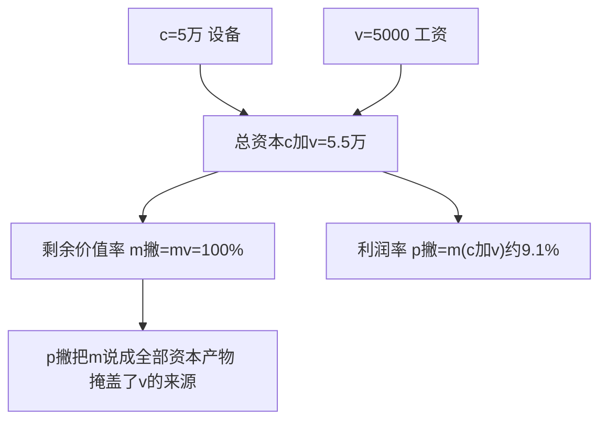
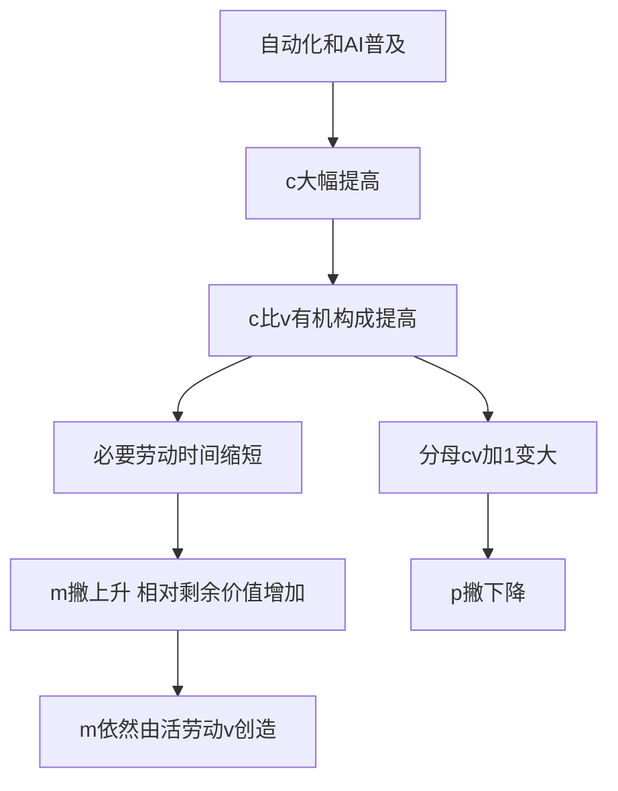

# 02 资本主义经济制度与生产 · 考研真题集（首经贸 801）

<div style="text-align:right;margin:10px 0;"><a href="../../../exam.html" target="_blank" style="display:inline-block;padding:6px 16px;background:#2563eb;color:#fff;border-radius:6px;text-decoration:none;font-size:14px;">📝 开始做题</a></div>


> 本章共收录：简答题 12 道（每题 15 分，含 1 道计算题）｜论述题 5 道（每题 30 分）
> 配套选择题见 [[选择题集|本章选择题集]]
> 对应大纲：《马克思主义政治经济学概论》第二篇 资本主义经济制度及其演变、资本主义生产（第 4–5 章）

## 📋 本题集目录

### 简答题
1. [[#简答 1：简述货币转化为资本的总公式及其矛盾。|简述货币转化为资本的总公式及其矛盾]]
2. [[#简答 2：为什么说劳动力成为商品是货币转化为资本的根本条件？|为什么说劳动力成为商品是货币转化为资本的根本条件]]
3. [[#简答 3：简述劳动力商品的二因素及其使用价值的特殊性。|简述劳动力商品的二因素及其使用价值的特殊性]]
4. [[#简答 4：简述资本主义生产过程是劳动过程和价值增殖过程的统一。|简述资本主义生产过程是劳动过程和价值增殖过程的统一]]
5. [[#简答 5：简述不变资本和可变资本的划分及其意义。|简述不变资本和可变资本的划分及其意义]]
6. [[#简答 6：简述剩余价值率 m' 及其表示方法。|简述剩余价值率 m' 及其表示方法]]
7. [[#简答 7（计算题）：已知某资本家预付不变资本 c = 8000 元，可变资本 v = 2000 元，工人一天劳动 12 小时，其中必要劳动时间 6 小时。求：①剩余价值率 m'；②剩余价值量 m；③一天总产品价值 W；④若工作日延长到 15 小时，求绝对剩余价值生产下的 m'。|计算题：已知 c、v、工作日，求 m'、m、W 及绝对剩余价值]]
8. [[#简答 8：比较绝对剩余价值和相对剩余价值。|比较绝对剩余价值和相对剩余价值]]
9. [[#简答 9：简述超额剩余价值与相对剩余价值的关系。|简述超额剩余价值与相对剩余价值的关系]]
10. [[#简答 10：简述资本主义工资的本质及其基本形式。|简述资本主义工资的本质及其基本形式]]
11. [[#简答 11：简述资本积累的本质、源泉和影响因素。|简述资本积累的本质、源泉和影响因素]]
12. [[#简答 12：简述资本有机构成提高及其后果。|简述资本有机构成提高及其后果]]

### 论述题
1. [[#论述 1：试述剩余价值生产过程，并运用马克思主义政治经济学分析"996"工作制的本质。|试述剩余价值生产过程，并运用马克思主义政治经济学分析"996"工作制的本质]]
2. [[#论述 2：运用马克思主义政治经济学分析外卖骑手的剩余价值榨取。|运用马克思主义政治经济学分析外卖骑手的剩余价值榨取]]
3. [[#论述 3：试述资本积累、资本有机构成提高与相对过剩人口的关系，并分析 AI/自动化对当代就业的影响。|试述资本积累、资本有机构成提高与相对过剩人口的关系，并分析 AI/自动化对当代就业的影响]]
4. [[#论述 4：试述资本主义工资的本质，并分析当代工资形式的新变化。|试述资本主义工资的本质，并分析当代工资形式的新变化]]
5. [[#论述 5：试述剩余价值学说的创立及其在马克思主义政治经济学中的地位。|试述剩余价值学说的创立及其在马克思主义政治经济学中的地位]]

---

## 一、简答题（每题 15 分，建议 450–700 字）

### <a id="s1"></a>简答 1：简述货币转化为资本的总公式及其矛盾。

**【建议字数】450–700 字 ｜ 【建议时间】15 分钟 ｜ 【题型】概念简答**

**【考什么】** 对应知识点 [[知识点/KP02_货币转化为资本|KP02 货币转化为资本]]，题型属于概念简答。

**【核心推导】**
**第一步：先写两个公式（这是本题的骨架）。**

（1）**货币流通公式（简单商品流通）**：
$$W-G-W$$

（2）**资本总公式**：
$$G-W-G'=G+\Delta G$$

（3）**$\Delta G$ 就是剩余价值 $m$**，**所以资本总公式可写为 $G-W-G'$，其中 $G'=G+m$。**

**第二步：先排除"流通中产生剩余价值"的可能（这一步是矛盾的第一层）。**

（1）**等价交换**：**$W-G-W$ 中，商品按价值出售，买者与卖者所得与所失相等，价值总量不变 → 无增量。**

（2）**不等价交换**：**假设有人总能贱买贵卖** → **但一个人的所得恰是另一个人的所失** → **全社会的价值总量不变** → **不能说明剩余价值的社会来源。**

（3）**结论**：**流通领域（无论是等价还是不等价交换）都不能创造价值。**

**第三步：再排除"流通之外产生剩余价值"的可能（矛盾的第二层）。**

（1）**流通之外**：**商品生产者只与自己的商品发生关系** → **他的劳动形成价值，但不形成剩余价值**（**价值量 = 劳动量，没有增量）。**

（2）**如果资本家离开流通，把货币贮藏起来** → **货币不会增殖。**

（3）**结论**：**剩余价值"不能从流通中产生，又不能不在流通中产生"** —— **这就是总公式的矛盾。**

**第四步：矛盾的解决——劳动力成为商品（这是本题的核心）。**

（1）**突破口**：**资本家在流通中买到一种特殊商品** —— **它的使用价值本身具有成为价值源泉的属性，并且是其使用价值的使用能创造出比自身价值更大的价值。**

（2）**这个商品就是劳动力。**

（3）**关键区分**：**劳动力的价值（工资）与劳动力的使用价值（劳动）不是一回事。**
- **劳动力价值 = 维持劳动者及其家庭生存和发展所需的生活资料价值**（**由再生产劳动力的费用决定**）；
- **劳动力使用价值 = 劳动，它创造的价值可以大于自身价值。**

（4）**于是**：**$G-W$ 阶段按等价交换买到劳动力（公平），$W-G'$ 阶段卖出包含剩余价值的产品（也公平）** —— **剩余价值产生于流通中购买的劳动力的使用过程，而在生产领域中实现** —— **等价交换与价值增殖并不矛盾。**

（5）**所以马克思说**：**"货币转化为资本，必须在流通领域中进行，又不在流通领域中进行。"**

**第五步：生产过程的具体机制（把矛盾"解决"到底）。**

（1）**劳动过程**：**工人用具体劳动把生产资料的价值转移到新产品中去（$c$ 不变，仅转移）。**

（2）**价值增殖过程**：**工人的抽象劳动创造新价值，只要劳动时间超过必要劳动时间，就产生剩余价值。**

（3）**数值演示**：**必要劳动时间 6 小时创造 $v$，工作日 12 小时 → 剩余劳动 6 小时 → $m'=100\%$。**

（4）**结论**：**剩余价值既不在流通中产生（因为交换是等价的），又离不开流通（因为必须买到劳动力这种特殊商品）。**

**第六步：结论。**

**一句话**：**资本总公式 $G-W-G'$ 的矛盾是：剩余价值不能从流通中产生（等价交换不产生增量，不等价交换也只是价值的转移而非创造），又不能不在流通中产生（离开流通，货币不会自行增殖）。这个矛盾在劳动力成为商品后得到解决：资本家在流通中按等价买到的劳动力，其使用价值（劳动）能创造出大于自身价值的价值；劳动力的价值由再生产劳动力的生活资料价值决定，而劳动力的使用所创造的价值则由劳动时间的长短决定，二者的差额就是剩余价值。因此剩余价值在生产领域中创造、通过流通领域实现，总公式的矛盾得以解决——"必须在流通中，又不在流通中"。**

**【为什么要答这几点】**
**【满分 15 分的分点逻辑】**

**第一段：两个公式（3 分）。** **$W-G-W$ 与 $G-W-G'$**（2 分）+ **$\Delta G = m$**（1 分）。

**第二段：矛盾的第一层——流通中不能产生（3 分）。** **等价交换无增量**（1.5 分）+ **不等价交换只是价值转移，社会总量不变**（1.5 分）。

**第三段：矛盾的第二层——流通外也不能产生（2 分）。** **生产者在流通外只与自己的商品发生关系，劳动形成价值但不形成剩余价值**（1.5 分）+ **贮藏货币不增殖**（0.5 分）。

**第四段：矛盾的表述（1.5 分）。** **"不能从流通中产生，又不能不在流通中产生"**（原文表述拿分）。

**第五段：矛盾的解决（4 分，核心）。** **劳动力成为商品、其使用价值能创造大于自身价值的价值**（2 分）+ **劳动力价值与劳动力使用价值的区分**（2 分）。

**第六段：生产过程与结论（1.5 分）。** **具体劳动转移 $c$、抽象劳动创造 $v+m$**（1 分）+ **"必须在流通中，又不在流通中"**（0.5 分）。

**易失分点。** ①**只写 $G-W-G'$ 不写矛盾的两层**（本题的"矛盾"才是重点）；②**说"剩余价值来自贱买贵卖"**（这是典型的资产阶级经济学解释，必须批判）；③**不区分劳动力价值与劳动创造的价值**（这是解决矛盾的全部关键，丢了最多给 8 分）；④**说"剩余价值在流通中产生"**（错，流通只是实现）。

**加分点。** ①**"等价交换与价值增殖并不矛盾"** 的明确表态（很多人不敢说这句）；②**"一个人的所得恰是另一个人的所失，社会总量不变"** 论证不等价交换不成立；③**数值演示 $m'=100\%$**；④**"必须在流通中，又不在流通中"** 的原文；⑤**指出劳动力成为商品需要两个历史条件**（**人身自由 + 一无所有**）——这是"货币转化为资本"的历史前提。

**【阅卷心理】** 15 分简答**按"公式 3 + 流通中 3 + 流通外 2 + 矛盾表述 1.5 + 解决 4 + 结论 1.5"给分**。**判卷分水岭在"劳动力价值 vs 劳动创造的价值"这一区分：说清了给 13 分以上，说不清最多 8 分。** 记住：**"矛盾不在流通里解决，也不在流通外解决——它在'买到一种能创造价值的商品'这件事上解决。资本家买的不是劳动，是劳动力。"**

**【如何分析题目】**
**第一步：审题——"总公式 + 矛盾"，重心在"矛盾如何被解决"。**

**第二步：先写两个公式。** $W-G-W$ 与 $G-W-G'$，并指出 $\Delta G$ 就是 $m$。

**第三步：分层排除。** 先说流通中不产生（等价 + 不等价两种情况），再说流通外也不产生。

**第四步：给出矛盾的标准表述。** "不能从流通中产生，又不能不在流通中产生"。

**第五步：解决矛盾。** 关键在劳动力商品的特殊性——区分劳动力价值与劳动创造的价值。

**第六步：把生产过程走一遍。** 具体劳动转移 $c$、抽象劳动创造 $v+m$，配数值。

**第七步：字数与时间。** 15 分约 450–700 字，15 分钟。**公式 80 字、两层排除 200 字、解决 250 字、结论 100 字。**

**【答题框架】**
- 第 1 段：简单商品流通公式（3 分）
- 第 2 段：资本总公式（5 分）
- 第 3 段：总公式的矛盾（5 分）
- 第 4 段：解决矛盾的条件（2 分）

**【参考答案】**

一、简单商品流通公式
简单商品流通公式是 **W—G—W**（商品—货币—商品）。商品生产者先卖后买，为买而卖，目的是获取使用价值。货币在这里只是交换媒介。

二、资本总公式
资本的流通公式是 **G—W—G'**（货币—商品—货币'）。其中 $G' = G + \Delta G$，即预付货币经过流通后带来了一个增殖额 $\Delta G$（剩余价值）。
(一) 资本家先买后卖，为卖而买，目的是获取交换价值的增殖。
(二) 这个公式概括了产业资本、商业资本、借贷资本的共同特征，所以叫**资本总公式**。

三、总公式的矛盾
(一) 从形式上看，资本总公式与价值规律相矛盾：价值规律要求等价交换，等价交换不能产生价值增殖。
(二) 但资本流通的结果确实带来了 $\Delta G$。
(三) 剩余价值不能从流通中产生：①等价交换不产生增殖；②不等价交换（贵卖）也不产生增殖，因为资本家既是买者又是卖者，彼此欺诈得失相抵。
(四) 剩余价值又不能离开流通产生：如果把货币贮藏起来，不进入流通，永远不会增殖。

四、解决矛盾的条件
(一) 剩余价值的产生，必须用货币购买到一种特殊商品——它的使用价值本身具有创造价值的能力。
(二) 这种特殊商品就是**劳动力**。
(三) 劳动力成为商品，是货币转化为资本的根本条件。

**【解析·得分点】** 采分点：①W—G—W 与 G—W—G' 对比（5 分）；②总公式矛盾：等价交换不产生增殖，但资本确实增殖（5 分）；③剩余价值不在流通中产生又不能离开流通（3 分）；④解决条件是劳动力成为商品（2 分）。易丢分：把 G—W—G' 说成简单商品流通；忘记"不能在流通中产生又不能离开流通"这个辩证表述。

**【生活实例】** 王老板拿 1 万元进货奶茶原料，卖完收回 1.2 万元。多出来的 2000 元不是他"贵卖"来的（因为他买原料时也被别人贵卖），而是他在市场上买到了一种特殊商品——你的劳动力。

**【双链接】** 🔗 [[知识点/KP02_货币转化为资本|回知识点]] ｜ [[知识点/KP03_劳动力商品|劳动力商品]] ｜ 📖 [[../../../原文件/经济学/马克思主义政治经济学概论_全书|《概论》第五章第一节]]

---

### <a id="s2"></a>简答 2：为什么说劳动力成为商品是货币转化为资本的根本条件？

**【建议字数】450–700 字 ｜ 【建议时间】15 分钟 ｜ 【题型】原因分析**

**【考什么】** 对应知识点 [[知识点/KP03_劳动力商品|KP03 劳动力商品]]，题型属于原因分析。

**【核心推导】**
**第一步：破题——本题要回答的是"根本条件"为什么是根本，即没有它，货币就永远只能是货币。**

（1）**反面设问**：**如果不具备这个条件，货币还能增殖吗？** **不能。** **这正是论证"根本"的方法。**

**第二步：从总公式的矛盾出发，说明"必须有特殊商品"。**

（1）**矛盾**：**剩余价值不能从流通中产生（等价交换无增量），又不能不在流通中产生。**

（2）**唯一的出路**：**在流通中买到一种商品，它的使用价值本身是价值的源泉，且能创造出大于自身价值的价值。**

（3）**这种商品只能是劳动力。**

（4）**所以**：**货币转化为资本的关键，不是货币本身，也不是流通，而是"买到劳动力"这一条件是否具备。**

**第三步：劳动力成为商品的两个历史条件（这一条是采分重点）。**

**（一）劳动者有人身自由。**

（1）**含义**：**劳动者是自由人，能把自己的劳动力当作商品来出卖。**

（2）**历史意义**：**否定了人身依附（奴隶、农奴）** —— **奴隶的劳动力不是他的商品，而是别人支配的对象。**

（3）**同时**：**自由得只能出卖劳动力，且出卖是有限期的（不像奴隶被一次性卖掉）。**

**（二）劳动者丧失一切生产资料和生活资料。**

（1）**含义**：**"自由得一无所有"** —— **不能自己生产，只能靠出卖劳动力为生。**

（2）**历史意义**：**小生产者（手工业者、农民）拥有生产资料，其劳动产品归自己所有，不会出卖劳动力。**

（3）**由此**：**劳动力的买卖不是自然现象，而是"劳动者与生产资料分离"这一历史过程的结果。**

**第四步：为什么是"根本条件"（三层论证）。**

**（一）没有劳动力商品，剩余价值就没有来源。**

（1）**一切生产资料（$c$）只能转移价值，不能创造新价值。**

（2）**只有活劳动才能创造新价值，而活劳动只有在劳动力被购买后才能被支配。**

（3）**所以**：**劳动力商品是剩余价值的唯一源泉** —— **这是"根本"的第一层含义（价值源泉）。**

**（二）没有劳动力商品，等价交换与价值增殖无法并存。**

（1）**如果劳动力不是商品**，**资本家的所得就只能靠不等价交换（欺骗），而欺骗不创造价值，只转移价值。**

（2）**劳动力作为商品**，**买卖双方都是按价值交换（公平），而增殖发生在使用过程（劳动）中。**

（3）**所以**：**劳动力商品使资本主义剥削表现为"公平交换"** —— **这是"根本"的第二层含义（制度合法性）。**

**（三）没有劳动力商品，货币就只是货币。**

（1）**货币作为货币**：**执行价值尺度、流通手段、贮藏手段、支付手段、世界货币职能。**

（2）**货币作为资本**：**必须能带来剩余价值 $G-W-G'$。**

（3）**区别的唯一标志**：**是否购买了劳动力。**

（4）**所以**：**劳动力成为商品，是货币转化为资本的"分水岭"** —— **这是"根本"的第三层含义（身份转换）。**

**第五步：与"货币转化为资本的其他条件"作对比（显现"根本"）。**

（1）**货币量足够大**：**是前提之一**（**马克思：货币所有者成为资本家的最低限额**），**但只是量的条件，不是质的原因。**

（2）**商品流通与市场发育**：**是外部条件**，**没有市场也能通过不等价交换敛财，但不能产生剩余价值。**

（3）**劳动力成为商品**：**是唯一能解释"价值增殖从何而来"的条件** —— **故为根本。**

**第六步：历史与现实意义。**

（1）**历史**：**资本原始积累的两个方面** —— **一方面是货币财富的积累（殖民掠夺、国债制度、保护关税），另一方面是劳动者的"双重自由"（圈地运动使农民失去土地）。**

（2）**现实**：**今天劳动力成为商品表现为** —— **雇佣劳动制度、劳动合同、灵活就业（外卖骑手、网约车司机）**，**本质仍是"人身自由但无生产资料"的劳动者出卖劳动力。**

（3）**判断标准**：**看是否存在"自由的一无所有"，而非看货币多不多** —— **这是识别资本主义关系的政治经济学尺度。**

**第七步：结论。**

**一句话**：**货币转化为资本的总公式 $G-W-G'$ 要求出现价值增殖，而剩余价值既不能在流通中产生（等价交换不产生增量）、又不能不在流通中产生；唯一的可能是买到一种使用价值本身是价值源泉的商品——劳动力。劳动力成为商品需要两个历史条件：劳动者有人身自由（能自由出卖劳动力）和丧失一切生产资料与生活资料（自由得一无所有，只能靠出卖劳动力为生）。这两个条件一旦具备，货币所有者就能按等价买到劳动力，并在其使用过程中获得超过劳动力价值的价值，从而使货币转化为资本。因此劳动力成为商品之所以是"根本条件"，在于它是剩余价值的唯一源泉（只有活劳动创造新价值）、是等价交换与价值增殖得以并存的关键（使剥削表现为公平交换）、是货币与资本相互区别的唯一标志（是否购买劳动力）。历史上这一条件由资本的原始积累促成，当代则表现为雇佣劳动制度。**

**【为什么要答这几点】**
**【满分 15 分的分点逻辑】**

**第一段：从总公式矛盾引入（3 分）。** **剩余价值不能从流通中产生又不能不在流通中产生**（1.5 分）+ **只能靠"买到特殊商品"**（1.5 分）。

**第二段：两个历史条件（5 分，核心采分点）。** **人身自由**（2 分）+ **丧失一切生产资料与生活资料（双重自由、自由得一无所有）**（3 分）。**两个条件缺一扣 2 分以上。**

**第三段：为什么是"根本"——三层论证（5 分）。** **①剩余价值的唯一源泉（生产资料只转移价值）**（2 分）；**②使等价交换与价值增殖并存（剥削表现为公平交换）**（2 分）；**③货币与资本的分水岭**（1 分）。

**第四段：与其他条件对比（1 分）。** **货币量足够大只是量的前提，劳动力商品才是质的原因**。

**第五段：历史与现实（1 分）。** **资本原始积累（圈地运动）+ 当代雇佣劳动**。

**易失分点。** ①**只答"劳动力是商品"不答两个历史条件**（丢 5 分，这是本题最硬的采分点）；②**把"人身自由"说成"政治自由"**（应当是"能自由支配自己的劳动力"）；③**漏掉"一无所有"这一条件**（否则小生产者不会出卖劳动力）；④**只说"劳动力创造价值"，不点明"生产资料只转移价值"**（缺少对照，论证不完整）。

**加分点。** ①**"双重自由"** 的经典表述；②**"奴隶的劳动力不是他的商品，奴隶本身才是被卖的商品"** 的对比；③**"如果没有劳动力商品，剥削只能靠欺骗，而欺骗只转移价值不创造价值"**（这是极见功力的论证）；④**货币量足够大只是量的前提**；⑤**圈地运动与"羊吃人"** 的历史例证；⑥**当代灵活就业仍是"自由的一无所有"**。

**【阅卷心理】** 15 分简答**按"总公式 3 + 两条件 5 + 三层论证 5 + 对比 1 + 现实 1"给分**。**判卷看"两条件"与"为什么根本"两块；只讲"劳动力能创造价值"的给 8–9 分。** 记住：**"货币变资本，不是钱变多了，而是买到了一个'会创造价值的人'。这个人得是自由的（能卖），还得是一无所有的（只能卖）——两个条件缺一不可。"**

**【如何分析题目】**
**第一步：审题——"为什么是根本条件"，要论证，不要只复述结论。**

**第二步：先摆矛盾的出路。** 剩余价值不能从流通中产生又不能不在流通中产生 → 必须买到特殊商品。

**第三步：写两个历史条件。** 人身自由 + 一无所有。**这是采分重点，必须单独成段。**

**第四步：给三层"根本"论证。** 唯一源泉 → 等价交换与增殖并存 → 货币与资本的分水岭。

**第五步：作对比。** 货币量足够大只是量的前提。

**第六步：补历史与现实。** 圈地运动；当代雇佣劳动与灵活就业。

**第七步：字数与时间。** 15 分约 450–700 字，15 分钟。**条件 200 字、论证 300 字、历史现实 100 字。**

**【答题框架】**
- 第 1 段：货币本身不是资本（3 分）
- 第 2 段：劳动力成为商品的两个条件（5 分）
- 第 3 段：劳动力商品使用价值的特殊性（5 分）
- 第 4 段：小结（2 分）

**【参考答案】**

一、货币本身不是资本
货币是固定充当一般等价物的商品。作为流通媒介的货币，它只是 W—G—W 的交换手段，不会自行增殖。只有当货币能带来剩余价值时，它才转化为资本。

二、劳动力成为商品的两个条件
劳动力是人的劳动能力。劳动力要成为商品，必须同时具备两个条件：
(一) **劳动者有人身自由**。他在法律上是自己劳动力的所有者，可以把它出卖。这不同于奴隶——奴隶一次卖断，不是商品。
(二) **劳动者一无所有**。他不占有生产资料（土地、工具、厂房），不出卖劳动力就无法生存。
这两个条件是历史发展的产物（封建社会末期的资本原始积累，特别是圈地运动，使大批农民失去土地成为无产者）。

三、劳动力商品使用价值的特殊性
(一) 一般商品的使用价值在消费过程中被消耗掉，不创造新价值。
(二) **劳动力商品的使用价值就是劳动本身**。
(三) 劳动能创造价值，而且能创造出比劳动力自身价值更大的价值。
(四) 劳动力的价值 = 工资（养活工人及其家庭的费用）；但劳动力的使用（劳动）创造的新价值 > 工资。
(五) 这个差额就是**剩余价值**，被资本家无偿占有。

四、小结
正是因为买到了劳动力这种特殊商品，货币才能在生产过程中实现增殖，转化为资本。所以说，**劳动力成为商品是货币转化为资本的根本条件**。

**【解析·得分点】** 采分点：①货币本身不是资本（3 分）；②两个条件：人身自由+一无所有（5 分）；③使用价值特殊性：能创造大于自身价值的价值（5 分）；④小结（2 分）。易丢分：把劳动力和劳动混为一谈；忘记"一无所有"这个条件。

**【生活实例】** 王老板买茶叶（一般商品），茶叶消耗完就没了；他买你的劳动力，你干一个月做出 16500 元奶茶，工资只拿 5000 元——中间 11500 元就是剩余价值。这就是劳动力商品的特殊之处。

**【双链接】** 🔗 [[知识点/KP03_劳动力商品|回知识点]] ｜ [[知识点/KP02_货币转化为资本|货币转化为资本]] ｜ 📖 [[../../../原文件/经济学/马克思主义政治经济学概论_全书|《概论》第五章第一节]]

---

### <a id="s3"></a>简答 3：简述劳动力商品的二因素及其使用价值的特殊性。

**【建议字数】450–700 字 ｜ 【建议时间】15 分钟 ｜ 【题型】概念简答**

**【考什么】** 对应知识点 [[知识点/KP03_劳动力商品|KP03]]，题型属于概念简答。

**【核心推导】**
**第一步：先说清"二因素"的框架——劳动力作为商品，同样具有价值与使用价值。**

（1）**劳动力**：**人的劳动能力，即存在于人体中的体力与脑力的总和。**

（2）**劳动力商品**：**在劳动力成为商品的历史条件下，这种能力被当作商品买卖。**

（3）**二因素**：**劳动力的价值与劳动力的使用价值。**

**第二步：劳动力的价值（由什么决定）。**

（1）**一般原理**：**商品价值由生产（再生产）该商品所需的社会必要劳动时间决定。**

（2）**劳动力的价值**：**就是维持、延续和发展劳动力所必需的生活资料的价值。**

（3）**三个组成部分**：
- **维持劳动者本人所必需的生活资料的价值**（**衣食住行，保证他能继续劳动**）；
- **维持劳动者家属所必需的生活资料的价值**（**保证劳动力供给的延续，即代际再生产**）；
- **劳动者的教育训练费用**（**使劳动者获得特定技能，包括学费、培训成本**）。

（4）**一个重要补充：历史和道德的因素。**

（1）**与一般商品不同**，**劳动力的价值包含"历史的和道德的要素"** —— **即一个国家的文化水平、生活习惯、社会发展程度会影响生活资料的范围。**

（2）**所以**：**劳动力价值不是纯生理下限，而有一个"社会的"区间** —— **这也是不同国家工资水平差异的理论解释。**

（3）**但下限仍是生理界限**：**低于维持生存的费用，劳动力就无法正常再生产。**

**第三步：劳动力使用价值的特殊性（本题的重心）。**

（1）**一般商品的使用价值**：**在被消费时消失或转移到新产品中，不创造新价值。**

（2）**劳动力使用价值的独特之处**：**它的使用（即劳动）就是价值的源泉，并且能创造出比自身价值更大的价值。**

（3）**这是"特殊性"的第一层**：**使用价值是价值的源泉**（**一般商品的使用价值不是**）。

（4）**这是"特殊性"的第二层**：**它能创造出大于自身价值的价值**（**即剩余价值**）。

（5）**量的对照**：
$$\text{劳动力的价值（}v\text{）} < \text{劳动力使用所创造的价值（}v+m\text{）}$$

**第四步：用数值把特殊性讲透（这一步最能拉开分差）。**

（1）**假定劳动力日价值 $v=200$ 元**（**相当于 6 小时社会必要劳动时间创造的价值**）。

（2）**资本家购买一天劳动力，就有权支配一天的劳动。**

（3）**若工作日为 12 小时**：**工人 6 小时创造 200 元（补偿 $v$，必要劳动时间），另外 6 小时创造 200 元（剩余价值 $m$，剩余劳动时间）。**

（4）**结果**：**$m'=m/v=200/200=100\%$** —— **工人一半时间为自己劳动，一半时间为资本家劳动。**

（5）**关键**：**资本家支付的 200 元是按价值支付的（公平）**，**但他得到的是 12 小时的劳动支配权（也是合约约定的）** —— **增殖就发生在"使用价值"这一侧。**

**第五步：特殊性带来的三重理论后果。**

（1）**解开了总公式的矛盾**：**等价交换 + 价值增殖可以并存**（**见 s1**）。

（2）**说明了剩余价值的唯一来源**：**只有活劳动创造新价值，生产资料只转移旧价值**（**见 s5**）。

（3）**揭示了工资的本质**：**工资是劳动力价值（或价格的转化形式），不是"劳动的价格"**（**见 s10**）—— **若工资是"劳动的价格"，则等于全部劳动都得到报酬，剩余价值无从产生。**

**第六步：与一般商品使用价值的对比表。**

| 比较项 | 一般商品 | 劳动力商品 |
|---|---|---|
| **价值由什么决定** | **生产它的社会必要劳动时间** | **维持、延续、发展劳动力所需生活资料的价值** |
| **价值是否含历史道德因素** | **基本不含** | **含有（各国不同）** |
| **使用价值的作用** | **满足某种需要、转移或消失** | **是价值的源泉，能创造新价值** |
| **使用结果** | **价值量不增加** | **价值量增加，产生剩余价值** |

（1）**一句话**：**一般商品的使用"消耗价值"，劳动力商品的使用"创造价值"。**

**第七步：结论。**

**一句话**：**劳动力商品同其他商品一样具有价值和使用价值。其价值由维持、延续和发展劳动力所必需的生活资料的价值决定，包括劳动者本人的生活资料、家属的生活资料和劳动者的教育训练费用三部分，并包含历史的和道德的因素（故各国工资水平存在社会性差异，但生理下限仍是刚性约束）。其使用价值的特殊性在于：一般商品的使用价值被消费时不创造新价值，而劳动力的使用（即劳动）本身是价值的源泉，并且能够创造出大于劳动力自身价值的价值——工人 6 小时创造的价值补偿工资，另外 6 小时创造的剩余价值被资本家无偿占有。正是这一特殊性，使等价交换与价值增殖得以并存，从而解开了资本总公式的矛盾，也说明了剩余价值的唯一来源和资本主义工资的本质。**

**【为什么要答这几点】**
**【满分 15 分的分点逻辑】**

**第一段：二因素框架（1 分）。** 劳动力与劳动力商品的定义（0.5 分）+ **价值与使用价值二因素**（0.5 分）。

**第二段：劳动力价值的三个组成部分（4 分）。** 本人生存资料（1.5 分）+ **家属生存资料（代际延续）**（1.5 分）+ **教育训练费用**（1 分）。

**第三段：历史的和道德的因素（2 分）。** **与一般商品不同，含历史道德要素**（1 分）+ **故各国工资有社会性差异，但生理下限刚性**（1 分）。**这一点最容易被漏，却是区别一般商品的关键。**

**第四段：使用价值的特殊性（5 分，核心）。** **使用（劳动）是价值的源泉**（2 分）+ **能创造大于自身价值的价值**（2 分）+ **$v < v+m$ 的量的对照**（1 分）。

**第五段：数值演示（2 分）。** **$v=200$、6 小时补偿、另 6 小时创造 $m$、$m'=100\%$**（1.5 分）+ **"按价值支付、按合约支配劳动，增殖发生在使用侧"**（0.5 分）。

**第六段：理论后果与结论（1 分）。** 解开总公式矛盾 + 剩余价值唯一来源 + **工资是劳动力价值而非劳动价格**。

**易失分点。** ①**只答使用价值不答价值**（本题问"二因素"，漏一半）；②**漏掉"教育训练费用"**（丢 1 分）；③**漏掉"历史的道德的因素"**（这是马经的标志性论断，丢 2 分）；④**把"特殊性"只说成"能创造价值"，不说"能创造大于自身价值的价值"**（后半句才是剩余价值的来源）；⑤**把工资说成"劳动的价格"**（与本题结论矛盾，自相矛盾要扣分）。

**加分点。** ①**"一般商品的使用消耗价值，劳动力商品的使用创造价值"** 的对照金句；②**"历史的道德的因素"解释各国工资差异**；③**数值演示 $m'=100\%$**；④**"资本家按价值支付、按合约支配，增殖发生在使用侧"** 的严谨表述；⑤**"若工资是劳动的价格，则全部劳动都得到报酬，剩余价值无从产生"** 的反证；⑥**对照表**（四个维度）。

**【阅卷心理】** 15 分简答**按"二因素 1 + 价值三部分 4 + 历史道德 2 + 使用特殊性 5 + 数值 2 + 后果 1"给分**。**判卷重点在"使用价值能创造大于自身价值的价值"这句：说全了 12 分以上，只说"能创造价值"的 9 分左右。** 记住：**"其他商品用一次就没了，劳动力用一次还能多出东西来——这'多出来的部分'就是马克思全部剩余价值理论的起点。"**

**【如何分析题目】**
**第一步：审题——两问：二因素（价值 + 使用价值），重心在"使用价值的特殊性"。**

**第二步：先立框架。** 劳动力与劳动力商品的定义，指出同样是二因素。

**第三步：写劳动力价值。** 三个组成部分（本人、家属、教育训练），补一句"历史的道德的因素"。

**第四步：重点写使用价值特殊性。** 两层：是价值的源泉；能创造大于自身价值的价值。

**第五步：配数值演示。** $v=200$、12 小时工作、$m'=100\%$。**数值让抽象变具体。**

**第六步：收理论后果。** 解总公式矛盾、剩余价值唯一来源、工资不是劳动的价格。

**第七步：可加对照表。** 四个维度对比一般商品。

**第八步：字数与时间。** 15 分约 450–700 字，15 分钟。**价值 200 字、特殊性 250 字、数值与后果 150 字。**

**【答题框架】**
- 第 1 段：劳动力商品的定义（2 分）
- 第 2 段：劳动力的价值（6 分）
- 第 3 段：劳动力的使用价值（6 分）
- 第 4 段：历史和道德因素（1 分）

**【参考答案】**

一、劳动力商品的定义
劳动力是人的劳动能力，即存在于活的人体中的、生产使用价值时运用的体力和智力的总和。劳动力作为商品，也具有价值和使用价值二因素。

二、劳动力的价值
(一) 劳动力的价值是由生产和再生产劳动力所必需的生活资料的价值决定的。
(二) 它包括三个组成部分：
1. 维持劳动者本人生存所必需的生活资料价值（吃饭、租房、穿衣）；
2. 维持劳动者家属生存所必需的生活资料价值（养孩子，即未来劳动力的再生产）；
3. 劳动者的教育训练费用（培训成会做奶茶、会写代码的人）。
(三) 与其他商品不同，劳动力价值的决定还包含**历史的和道德的因素**。在不同国家、不同时代，"必需生活资料"的范围不同。19 世纪英国工人只要面包；21 世纪中国城市劳动力要手机、通勤、社交。发达国家工资高，不是资本家仁慈，而是那里劳动力再生产的费用本来就高。

三、劳动力的使用价值
(一) 劳动力的使用价值就是**劳动本身**。
(二) 一般商品的使用价值被消费时，其价值随之消失或转移；而劳动力的使用价值在被消费（劳动）时，能**创造出新价值**。
(三) 而且创造的新价值**大于劳动力自身的价值**。
(四) 这就是劳动力商品使用价值的特殊性——它是价值的源泉，而且是大于自身价值的价值源泉。
(五) 资本家购买劳动力，正是看中了这一点：他支付劳动力价值（工资），却获得劳动创造的全部新价值，两者的差额就是剩余价值。

四、小结
劳动力商品的特殊性不在于它的价值（与一般商品一样由生产它的社会必要劳动时间决定），而在于它的使用价值——它是剩余价值的源泉。

**【解析·得分点】** 采分点：①劳动力价值三组成部分（6 分）；②使用价值就是劳动、能创造大于自身价值的价值（6 分）；③历史和道德因素（1 分）；④定义（2 分）。易丢分：忘记劳动力价值包含历史和道德因素；把使用价值说成"劳动的产品"。

**【生活实例】** 程序员月薪 2 万，这是他的劳动力价值（包括他 16 年教育投入、北京生活成本、养孩子费用）。但他一个月给公司写的代码创造的价值可能是 20 万——差额 18 万就是剩余价值。

**【双链接】** 🔗 [[知识点/KP03_劳动力商品|回知识点]] ｜ 📖 [[../../../原文件/经济学/马克思主义政治经济学概论_全书|《概论》第五章第一节]]

---

### <a id="s4"></a>简答 4：简述资本主义生产过程是劳动过程和价值增殖过程的统一。

**【建议字数】450–700 字 ｜ 【建议时间】15 分钟 ｜ 【题型】概念简答**

**【考什么】** 对应知识点 [[知识点/KP04_劳动过程与价值增殖过程|KP04 劳动过程与价值增殖过程]]，题型属于概念简答。

**【核心推导】**
**第一步：破题——"统一"二字是关键：不是两个并列的过程，而是同一过程的两个侧面。**

（1）**资本主义生产过程的二重性**：**它既是劳动过程（生产使用价值），又是价值增殖过程（生产剩余价值）。**

（2）**"统一"的含义**：**不是"先劳动再增殖"，而是"劳动过程同时就是价值增殖过程"** —— **同一过程、两个角度。**

**第二步：第一面——劳动过程（一切社会共有的一般性质）。**

（1）**劳动过程的三个简单要素**：
- **劳动者**（**有目的的活动**）；
- **劳动对象**（**被加工的东西**）；
- **劳动资料**（**主要是生产工具**）。

（2）**劳动过程的一般性质**：**人以自身的活动引起、调整和控制人与自然之间的物质变换** —— **这是任何社会都存在的永恒条件。**

（3）**资本主义劳动过程的两个特点**：
- **工人在资本家的监督下劳动，劳动属于资本家**（**因为劳动力的使用权已卖出**）；
- **劳动产品归资本家所有**（**因为生产的三要素都由资本家支配**）。

（4）**注意**：**这两点并不改变劳动过程的一般性质，只改变它的社会形式。**

**第三步：第二面——价值增殖过程（资本主义生产的特殊性质）。**

（1）**价值形成过程**：**具体劳动转移生产资料旧价值 $c$，抽象劳动创造新价值（相当于 $v$）。**

（2）**价值增殖过程**：**超过一定点（必要劳动时间）而延长了的价值形成过程。**

（3）**关键**：**这个"一定点"就是劳动力价值的补偿点** —— **劳动时间超过这一点，就产生剩余价值。**

（4）**所以**：**价值增殖过程 = 价值形成过程 + 超过必要劳动时间的延长部分。**

**第四步：用数值把"统一"讲透（最有力的论证方式）。**

（1）**假定**：**生产一件商品需消耗生产资料 20 元（$c$），工人日工资 30 元（$v$），每 6 小时创造新价值 30 元，工作日 12 小时。**

（2）**劳动过程**：**工人用 12 小时把 40 元的棉花纺成 40 元的棉纱** —— **使用价值形态改变，具体劳动转移了 20 元的旧价值。**

（3）**价值形成**：**12 小时的抽象劳动创造 60 元新价值** —— **总价值 $=20+60=80$ 元。**

（4）**价值增殖**：**资本家预付 $=20+30=50$ 元；商品价值 80 元；$m=80-50=30$ 元；$m'=30/30=100\%$。**

（5）**"统一"的证明**：**如果工作日只有 6 小时，新价值 30 元恰好补偿工资，$m=0$** —— **这时生产过程只是劳动过程与价值形成过程的统一，还不是资本主义生产过程；** **只有超过 6 小时，才是劳动过程与价值增殖过程的统一。**

（6）**所以**：**资本主义生产不是"另外多做一件事"，而是"把同一个劳动过程延长到超过补偿点"** —— **这就是"统一"的实质。**

**第五步：为什么必须"统一"（三层意义）。**

**（一）从使用价值看，资本主义生产必须生产使用价值。**

（1）**资本家不是为了自己消费而生产，而是为了交换价值**；

（2）**但使用价值是价值的物质承担者** —— **没有合格的使用价值，价值就实现不了**；

（3）**所以资本家必须组织现实的劳动过程** —— **这使资本主义生产在物质技术层面与以往社会是连续的。**

**（二）从价值看，资本主义生产的目的是价值增殖。**

（1）**如果只生产使用价值而价值不增殖，资本家无利可图，生产就停止了**；

（2）**所以劳动过程只是手段，价值增殖才是目的** —— **这体现了资本主义生产的历史特殊性。**

**（三）统一是理解剥削的关键。**

（1）**若只看劳动过程**，**会得出"资本家也组织生产、也承担风险，利润是他的报酬"** 的结论（**这是西经的"三位一体公式"**）；

（2）**若只看价值增殖**，**会以为价值是凭空产生的**；

（3）**只有看到二者是同一过程**，**才能明白：剥削不是在生产之外强加的，而是内生于"劳动过程被延长到超过必要劳动时间"这一事实之中。**

**第六步：当代印证（论述题的落点）。**

（1）**"996"**：**劳动过程照常进行（写代码、开会、产出）**，**但工作日被延长到远超必要劳动时间** → **$m'$ 大幅提高** → **这就是"统一"在当代的直接体现**（**见 l1**）。

（2）**平台用工**：**算法把劳动过程拆解得极其精细（劳动过程的科学化）**，**目的却是把每一分钟都计入价值增殖** —— **"统一"被技术手段推到极致**（**见 l2**）。

**第七步：结论。**

**一句话**：**资本主义生产过程具有二重性：一方面它是劳动过程，即劳动者运用劳动资料作用于劳动对象、生产使用价值的过程，具有一切社会共有的一般性质，但在资本主义条件下表现为工人在资本家监督下劳动、产品归资本家所有；另一方面它是价值增殖过程，即超过必要劳动时间而延长了的价值形成过程。二者不是先后两个过程，而是同一过程的两个侧面——劳动过程是价值增殖的物质承担者，价值增殖是劳动过程在资本主义条件下被赋予的社会目的。若工作日只到补偿劳动力价值为止，就只是劳动过程与价值形成过程的统一，还不是资本主义生产；只有延长到超过这一点，才是劳动过程与价值增殖过程的统一。这一"统一"既是理解资本主义生产历史特殊性的关键，也是理解剥削内生于生产过程（而非外部强加）的关键。**

**【为什么要答这几点】**
**【满分 15 分的分点逻辑】**

**第一段：二重性与"统一"的含义（2 分）。** **既是劳动过程又是价值增殖过程**（1 分）+ **"不是先后两个过程，而是同一过程两个侧面"**（1 分）。**这一句表明真懂"统一"。**

**第二段：劳动过程（4 分）。** **三要素（劳动者、劳动对象、劳动资料）**（2 分）+ **一般性质：人与自然物质变换的永恒条件**（1 分）+ **资本主义条件下的两个特点（监督劳动、产品归资本家）**（1 分）。

**第三段：价值增殖过程（4 分）。** **价值形成：$c$ 转移 + $v$ 创造**（1.5 分）+ **价值增殖：超过必要劳动时间而延长的价值形成过程**（2 分）+ **$m$ 的定义**（0.5 分）。

**第四段：数值演示（3 分）。** $c=20$、$v=30$、12 小时创造 60、$W=80$、$m=30$、$m'=100\%$（2 分）+ **"若只做 6 小时则 $m=0$，不是资本主义生产"**（1 分）。

**第五段：统一的三层意义（2 分）。** 使用价值是物质承担者（0.5 分）+ **价值增殖是目的，劳动过程是手段**（1 分）+ **剥削内生于延长，不是外部强加**（0.5 分）。

**易失分点。** ①**把两个过程写成前后两阶段**（不懂"统一"，扣 3 分以上）；②**漏掉劳动过程三要素**（丢 2 分）；③**不点"资本主义劳动过程的两个特点"**（这是与一般劳动过程的区别，丢 1 分）；④**价值增殖只说"创造更多价值"，不说"超过必要劳动时间而延长的价值形成过程"**（定义不准）；⑤**不做数值演示**（论述不落地，难得高分）。

**加分点。** ①**"若工作日只到补偿点，就只是劳动过程与价值形成过程的统一，还不是资本主义生产"**（这一句最能体现"统一"的临界性）；②**数值演示完整链条**；③**"剥削不是在生产之外强加的，而是内生于延长"**；④**批评"三位一体公式"**（西经把利润说成资本的报酬）；⑤**当代印证：996 与平台算法**。

**【阅卷心理】** 15 分简答**按"二重性与统一 2 + 劳动过程 4 + 价值增殖 4 + 数值 3 + 意义 2"给分**。**判卷看第一句：说"同一过程两个侧面"的给 12 分以上；说"既是……又是……（两个过程）"的，8–10 分。** 记住：**"不是做完劳动再去做增殖，而是在做劳动的同时就把增殖做出来了——中间那条线，就是必要劳动时间。"**

**【如何分析题目】**
**第一步：审题——"统一"二字定生死，必须讲成"同一过程两个侧面"。**

**第二步：先立二重性。** 劳动过程 + 价值增殖过程，一句点明不是先后。

**第三步：写劳动过程。** 三要素 + 一般性质 + 资本主义两个特点。

**第四步：写价值增殖。** $c$ 转移、$v$ 创造、超过必要劳动时间的延长。

**第五步：数值演示。** 算一遍 $c$、$v$、$W$、$m$、$m'$，再指明"只做 6 小时则 $m=0$"。

**第六步：讲统一的三层意义。** 使用价值是承担者、增殖是目的、剥削内生于延长。

**第七步：加当代印证。** 996 与平台算法。

**第八步：字数与时间。** 15 分约 450–700 字，15 分钟。**劳动过程 180 字、增殖 180 字、数值 150 字、意义 100 字。**

**【答题框架】**
- 第 1 段：劳动过程（5 分）
- 第 2 段：价值形成过程（4 分）
- 第 3 段：价值增殖过程（4 分）
- 第 4 段：统一（2 分）

**【参考答案】**

一、劳动过程
(一) 劳动过程是劳动者运用劳动资料对劳动对象进行加工、创造使用价值的过程。
(二) 它有三个简单要素：有目的的活动（劳动）、劳动对象、劳动资料。
(三) 资本主义劳动过程有两个特点：
1. 工人的劳动属于资本家，工人在资本家监督下劳动；
2. 劳动产品归资本家所有，不归工人。

二、价值形成过程
(一) 生产商品的劳动具有二重性：具体劳动把生产资料价值（c）转移到新产品中；抽象劳动创造新价值。
(二) 如果工人劳动创造的新价值恰好等于劳动力价值（v），这就是单纯的**价值形成过程**——没有剩余价值，不是资本主义生产。

三、价值增殖过程
(一) 资本家把工作日延长到补偿劳动力价值所需的时间以上。
(二) 例如：工人一天劳动 8 小时，前 4 小时创造的价值 = 工资（v），这是必要劳动时间；后 4 小时继续劳动，这部分不拿工资，创造的价值全部归资本家，这是**剩余劳动时间**。
(三) 价值增殖过程就是**超过一定点而延长了的价值形成过程**。
(四) 用公式表示：
```
工作日 8 小时
├── 必要劳动时间 4 小时 → 再生产 v（工资）
└── 剩余劳动时间 4 小时 → 创造 m（剩余价值）
```

四、统一
(一) 资本主义生产过程是**劳动过程和价值增殖过程的统一**。
(二) 作为劳动过程，它生产使用价值；作为价值增殖过程，它生产剩余价值。
(三) 劳动过程是手段，价值增殖是目的。资本家关心的不是奶茶好不好喝，而是能不能赚到剩余价值。

**【解析·得分点】** 采分点：①劳动过程三要素+两特点（5 分）；②价值形成过程 = 新价值 = v（4 分）；③价值增殖 = 延长到 v 补偿点以上（4 分）；④统一（2 分）。易丢分：把劳动过程和价值增殖过程当成两个独立过程；忘记具体劳动转移 c、抽象劳动创造 v+m。

**【生活实例】** 王老板的奶茶店，从一面看是劳动过程（你烧水、泡茶、封口，做出奶茶）；从另一面看是价值增殖过程（你前 4 小时做的奶茶值你的工资，后 4 小时做的奶茶全归王老板）。

**【双链接】** 🔗 [[知识点/KP04_劳动过程与价值增殖过程|回知识点]] ｜ [[../01_商品与货币/知识点/KP02_劳动二重性|劳动二重性]] ｜ 📖 [[../../../原文件/经济学/马克思主义政治经济学概论_全书|《概论》第五章第二节]]

---

### <a id="s5"></a>简答 5：简述不变资本和可变资本的划分及其意义。

**【建议字数】450–700 字 ｜ 【建议时间】15 分钟 ｜ 【题型】概念简答**

**【考什么】** 对应知识点 [[知识点/KP05_不变资本与可变资本|KP05 不变资本与可变资本]]，题型属于概念简答/意义分析。

**【核心推导】**
**第一步：先给划分标准——划分的依据是什么。**

（1）**划分依据**：**资本的不同部分在价值增殖过程中的不同作用**（**这是唯一的划分标准**）。

（2）**一句话**：**不是按资本的实物形态划分，而是按它在剩余价值生产中"起什么作用"划分。**

**第二步：不变资本 $c$。**

（1）**定义**：**以生产资料形式存在的那部分资本。**

（2）**包括**：**厂房、机器设备、原材料、辅助材料、燃料等。**

（3）**在价值增殖中的作用**：**在生产过程中只转移旧价值，不改变自身的价值量** —— **故称"不变资本"。**

（4）**转移的方式**：**原材料、燃料在一次生产过程中全部转移；厂房、机器则按磨损程度逐步转移。**

（5）**注意**：**"不变"不是说价值绝对不变，而是说它在生产中不改变自己的价值量（只转移，不增殖）。**

**第三步：可变资本 $v$。**

（1）**定义**：**以劳动力形式存在的那部分资本，即用于购买劳动力的资本。**

（2）**在价值增殖中的作用**：**劳动力的使用（劳动）不仅再生产出自身的价值，而且生产出超过自身价值的剩余价值** —— **因此这部分资本的价值量发生了增殖，故称"可变资本"。**

（3）**注意**：**增殖的部分不是 $v$ 本身"变多了"，而是劳动力在生产中创造的新价值超过了 $v$。**

**第四步：划分的意义（本题主体，四条）。**

**（一）揭示了剩余价值的真正来源。**

（1）**由于 $c$ 只转移价值、$v$ 才增殖价值**，**所以剩余价值完全来自可变资本**，**与不变资本无关。**

（2）**这就彻底驳倒了"利润是全部资本的产物"** —— **西经把利润说成资本的报酬（三位一体公式：资本—利润、土地—地租、劳动—工资），正是靠抹去 $c$ 与 $v$ 的区别来完成的。**

（3）**所以**：**$c$、$v$ 的划分是剩余价值理论的基石。**

**（二）为准确计量剥削程度提供了科学依据（引出剩余价值率）。**

（1）**既然只有 $v$ 带来剩余价值**，**那么衡量剥削程度就必须用 $m$ 与 $v$ 的比率，而不是与全部资本的比率。**

（2）$$m'=\frac{m}{v}$$

（3）**如果用 $m/(c+v)$（即利润率 $p'$）**，**就会因 $c$ 的大小不同而低估或高估剥削程度** —— **$c$ 越大，$p'$ 越小，剥削被掩盖得越深。**

（4）**这解释了为什么资本家总是强调利润率**（**"投入 10 亿才赚 5%"**）**而回避剩余价值率**（**"工人一半时间白干"**）。

**（三）为资本有机构成理论奠定基础。**

（1）**资本有机构成**：**由资本技术构成决定并反映其变化的资本价值构成，即 $c/v$。**

（2）**资本有机构成提高** → **相对过剩人口** → **利润率趋向下降**（**通向 s12 与 l3**）。

（3）**没有 $c$、$v$ 的划分，就没有 $c/v$ 这个概念，也就没有整套资本积累与危机理论。**

**（四）为资本积累与再生产的分析提供工具。**

（1）**区分了"价值的转移"与"价值的创造"** → **可以准确计算年产品价值 $W=c+v+m$ 的构成。**

（2）**可用于分析两大部类再生产的实现条件** $I(v+m)=IIc$。

（3）**并说明：随着积累，$c$ 的绝对量增加、$v$ 的绝对量可能增加但相对比重下降** —— **这是理解工人"绝对生活改善、相对地位下降"的关键。**

**第五步：一个必须澄清的误区（答题加分点）。**

（1）**误区**：**"不变资本不重要，因为它不创造价值。"**

（2）**澄清**：**不变资本是剩余价值生产的必要物质条件** —— **没有生产资料，活劳动无法对象化，价值无从创造。**

（3）**正确表述**：**$c$ 是剩余价值生产的条件，$v$ 是剩余价值的源泉** —— **"条件"与"源泉"不是一回事，马克思从未否定 $c$ 的必要性。**

（4）**常见考题陷阱**：**问"机器能否创造价值"** —— **答：机器不创造价值，只转移价值；说机器创造价值（如"机器也会生产价值"论）是资产阶级经济学的辩护。**

**第六步：结论。**

**一句话**：**马克思按资本各部分在价值增殖中的不同作用，把资本划分为不变资本与可变资本：以生产资料形式存在的不变资本在生产中只转移旧价值、不改变自身价值量；以劳动力形式存在的可变资本则因劳动力的使用而增殖自身价值。这一划分的意义在于：①揭示了剩余价值的真正来源是可变资本而非全部资本，驳倒了"利润是全部资本产物"的辩护；②为剩余价值率 $m'=m/v$ 提供了科学依据，使剥削程度的计量成为可能（若用 $m/(c+v)$ 则会因 $c$ 的增大而低估剥削）；③为资本有机构成 $c/v$、相对过剩人口与利润率趋向下降规律奠定基础；④为资本积累和两大部类再生产的分析提供工具，说明了工人"绝对生活改善、相对地位下降"的机制。同时须明确：不变资本虽不创造价值，却是剩余价值生产的必要物质条件——$c$ 是条件，$v$ 是源泉。**

**【为什么要答这几点】**
**【满分 15 分的分点逻辑】**

**第一段：划分依据（2 分）。** **按资本各部分在价值增殖中的不同作用划分**（1.5 分）+ **不是按实物形态划分**（0.5 分）。

**第二段：不变资本（3 分）。** 定义与范围（1 分）+ **只转移旧价值、不改变自身价值量**（1.5 分）+ **转移方式（一次/逐步）**（0.5 分）。

**第三段：可变资本（3 分）。** 定义（1 分）+ **劳动力使用创造超过自身价值的价值**（1.5 分）+ **"不是 v 本身变多，而是创造的新价值超过 v"**（0.5 分）。

**第四段：四条意义（6 分，核心）。** ①**揭示剩余价值的真正来源、驳倒三位一体公式**（2 分）；②**为 $m'=m/v$ 提供依据、说明用 $p'$ 会掩盖剥削**（2 分）；③**为资本有机构成理论奠基**（1 分）；④**为资本积累与再生产分析提供工具**（1 分）。

**第五段：澄清误区（1 分）。** **$c$ 是条件、$v$ 是源泉，马克思不否定 $c$ 的必要性**。

**易失分点。** ①**把划分依据说成"物质形态（生产资料/劳动力）"**（这是划分的表现，不是依据）；②**只答定义不答意义**（本题"及其意义"才是主体，漏了丢 6 分）；③**说"不变资本不创造价值所以不重要"**（这是曲解，本题的常见陷阱）；④**不点明"用 $p'$ 会低估剥削"**（丢 2 分，这是最实用的意义）；⑤**漏掉与三位一体公式的对立**（马经的批判性所在）。

**加分点。** ①**"资本—利润、土地—地租、劳动—工资"三位一体公式是靠抹去 $c$ 与 $v$ 的区别完成的**；②**"资本家只强调利润率、回避剩余价值率"** 的现实观察；③**"$c$ 是条件、$v$ 是源泉"** 的精准表述；④**回答"机器能否创造价值"**；⑤**$c$ 绝对量增加、$v$ 相对比重下降 → 工人绝对生活改善但相对地位下降**。

**【阅卷心理】** 15 分简答**按"依据 2 + $c$ 3 + $v$ 3 + 四意 6 + 澄清 1"给分**。**判卷看"意义"是否成体系：只答概念的 7–8 分，能接到剩余价值率与资本有机构成的 12 分以上。** 记住：**"不变资本是'死'的——它只会搬家（转移价值）；可变资本是'活'的——它会长出新的价值。剩余价值只长在活的那一头。"**

**【如何分析题目】**
**第一步：审题——"划分及其意义"，两问，重心在"意义"的四条。**

**第二步：先给依据。** 按在价值增殖过程中的不同作用，不是按实物形态。

**第三步：写两个定义。** $c$ 只转移；$v$ 增殖。**各补一句"注意"，防止误解。**

**第四步：列四条意义。** 真正来源 → $m'$ 的计量 → 资本有机构成 → 积累与再生产。

**第五步：重点写第二条。** $m'=m/v$ 与 $p'=m/(c+v)$ 的对照，说明利润率如何掩盖剥削。

**第六步：补误区澄清。** $c$ 是条件不是源泉；机器不创造价值。

**第七步：字数与时间。** 15 分约 450–700 字，15 分钟。**依据与定义 200 字、意义 300 字、澄清 100 字。**

**【答题框架】**
- 第 1 段：划分依据（3 分）
- 第 2 段：不变资本 c（4 分）
- 第 3 段：可变资本 v（4 分）
- 第 4 段：划分意义（4 分）

**【参考答案】**

一、划分依据
马克思根据资本不同部分在**剩余价值生产过程中的不同作用**，把资本划分为不变资本和可变资本。这与古典政治经济学按价值周转方式划分固定资本和流动资本完全不同。

二、不变资本 c
(一) 以生产资料形式存在的资本（厂房、机器、原料、燃料）。
(二) 在生产过程中，它的价值通过具体劳动**转移**到新产品中，不改变自己的价值量。
(三) 例如茶叶值 4 元，做成奶茶后这 4 元原封不动转移到奶茶里；机器值 6 万元，能用 3 年，每年转移 2 万元。
(四) 它是活劳动的吸收器，但本身不创造新价值。

三、可变资本 v
(一) 以劳动力形式存在的资本（工资）。
(二) 在生产过程中，它的价值由工人的抽象劳动**再生产出来**，并且创造出剩余价值。
(三) 工人不仅再生产出相当于工资的价值，还额外创造剩余价值。
(四) 这部分资本在生产中改变了自己的价值量，所以叫可变资本。

四、划分意义
(一) **揭穿剩余价值的真正来源**。剩余价值不是全部资本生出来的，只是可变资本 v 雇来的工人创造的。这就批判了"资本也创造利润"的辩护论。
(二) **为计算剥削程度提供基础**。剩余价值率 $m' = m/v$，而不是 $m/(c+v)$。
(三) **为资本有机构成理论奠定基础**。c:v 的提高，反映了技术进步下不变资本比重增大、可变资本比重减小的趋势。
(四) 商品价值构成公式：$W = c + v + m$。

**【解析·得分点】** 采分点：①划分依据是在剩余价值生产中的作用（3 分）；②c 转移价值不增殖（4 分）；③v 再生产自身+创造 m（4 分）；④三点意义（4 分）。易丢分：把 c/v 划分与固定/流动资本划分混淆；忘记"划分依据"这个关键。

**【生活实例】** 王老板投 7400 元买机器原料（c）、5000 元雇你（v）。年底赚 4100 元。这 4100 元不是那 7400 元机器生的——机器只是把它的价值转移到奶茶里；它是你 5000 元工资雇来的你创造的。

**【双链接】** 🔗 [[知识点/KP05_不变资本与可变资本|回知识点]] ｜ 📖 [[../../../原文件/经济学/马克思主义政治经济学概论_全书|《概论》第五章第二节]]

---

### <a id="s6"></a>简答 6：简述剩余价值率 m' 及其表示方法。

**【建议字数】450–700 字 ｜ 【建议时间】15 分钟 ｜ 【题型】概念简答**

**【考什么】** 对应知识点 [[知识点/KP06_剩余价值率|KP06 剩余价值率]]，题型属于概念简答。

**【核心推导】**
**第一步：先给定义并写清三个公式。**

（1）**剩余价值率**：**剩余价值与可变资本的比率，表示资本家对工人的剥削程度。**

（2）**两种表示方法（本质相同）**：

$$m'=\frac{m}{v}=\frac{\text{剩余劳动}}{\text{必要劳动}}=\frac{\text{剩余劳动时间}}{\text{必要劳动时间}}$$

（3）**为什么两种表示等价**：**因为 $v$ 是必要劳动时间创造的价值、$m$ 是剩余劳动时间创造的价值，二者之比就是两种时间之比**（**假定价值创造与时间成正比**）。

（4）**另一组相关比率（易混，需辨析）**：
- **剥削率** $=m/v$（**即剩余价值率**）；
- **利润率** $p'=m/(c+v)$（**剩余价值与全部预付资本之比**）；
- **关系**：$p'=m' \cdot \dfrac{v}{c+v}=m'\cdot\dfrac{1}{1+c/v}$ —— **利润率恒小于剩余价值率**（**因为分母加了 $c$**）。

**第二步：物化劳动与活劳动两种表示的含义。**

（1）**物化劳动表示** $m/v$：**说明工人创造的新价值中，有多少被资本家无偿占有。**

（2）**活劳动表示** 剩余劳动/必要劳动：**说明工人的工作日中，有多少时间为资本家白干。**

（3）**两种表示的差别**：**前者从"成果分配"看，后者从"时间耗费"看** —— **一眼看成果，一眼看过程，本质是同一件事。**

**第三步：剩余价值率的实质——它衡量什么、不衡量什么。**

（1）**它衡量的是"剥削程度"，即资本对劳动的吮吸程度。**

（2）**它不衡量剥削的绝对量** —— **$m'$ 高不代表 $m$ 大**：**一个雇 2 人的小作坊 $m'$ 可以很高，但总剩余价值很小；一个大企业 $m'$ 一般，但 $m$ 巨大。**

（3）**它不衡量工人的绝对生活水平** —— **$m'$ 提高与工人实际工资上升可以并存**（**只要劳动生产率提高更快，$v$ 的绝对量增加而相对比重下降**）。

（4）**这正是马克思强调"相对贫困"而非只讲"绝对贫困"的原因**。

**第四步：为什么必须用 $m/v$ 而不是 $m/(c+v)$（本章的理论要害）。**

（1）**因为只有 $v$ 创造剩余价值，$c$ 只转移价值** —— **把 $c$ 放进分母，就等于让不创造价值的因素分担"贡献"，从而稀释剥削程度。**

（2）**这种做法在现象层面有掩护作用**：**资本家说"我投了 10 亿才赚 5%"（$p'=5\%$），工人实际被剥削的程度可能是 $m'=100\%$ 甚至更高。**

（3）**所以**：**$m'$ 是本质层面的范畴，$p'$ 是现象层面的范畴** —— **从 $m'$ 到 $p'$ 的转化，就是"剩余价值转化为利润"的过程（《资本论》第三卷的核心议题）。**

**第五步：剩余价值率的变化途径（连接 s7、s8）。**

（1）**延长工作日** → 剩余劳动时间增加 → $m'$ 上升 = **绝对剩余价值生产**。

（2）**提高劳动生产率（缩短必要劳动时间）** → 剩余劳动时间相对延长 → $m'$ 上升 = **相对剩余价值生产**。

（3）**提高劳动强度** → **相当于变相延长工作日** → $m'$ 上升（**隐蔽的绝对剩余价值**）。

（4）**压低工资（把 $v$ 降到劳动力价值以下）** → $m'$ 上升（**违反价值规律，属超经济剥削**）。

**第六步：结论。**

**一句话**：**剩余价值率是剩余价值与可变资本的比率，$m'=m/v$，由于 $m$ 是剩余劳动时间创造的价值、$v$ 是必要劳动时间创造的价值，故它又等于剩余劳动与必要劳动之比（或剩余劳动时间与必要劳动时间之比）。它的实质是衡量资本对劳动的剥削程度：从物化劳动看是"新价值中有多少被无偿占有"，从活劳动看是"工作日中有多少时间白干"。必须用 $v$ 而非 $c+v$ 作分母，因为只有可变资本创造剩余价值；若用 $m/(c+v)$（即利润率 $p'$），则会因不变资本的介入而系统性低估剥削程度，故 $p'=m'\cdot\frac{v}{c+v}<m'$。同时须注意：$m'$ 只衡量剥削程度、不衡量剥削绝对量，也不衡量工人的绝对生活水平——这与"相对贫困"的论断直接相关。提高 $m'$ 的途径有延长工作日、提高劳动生产率、提高劳动强度与压低工资四条，前两条构成绝对剩余价值与相对剩余价值两种基本方法。**

**【为什么要答这几点】**
**【满分 10–15 分的分点逻辑】**

**第一段：定义与公式（3 分）。** **$m'=m/v$**（1.5 分）+ **$=$ 剩余劳动/必要劳动 $=$ 剩余劳动时间/必要劳动时间**（1.5 分）。

**第二段：两种表示的含义（2 分）。** **物化劳动看成果分配**（1 分）+ **活劳动看时间耗费**（1 分）。

**第三段：与利润率的辨析（3 分）。** $p'=m/(c+v)$（1 分）+ **$p'=m'\frac{v}{c+v}<m'$**（1.5 分）+ **利润率掩盖剥削**（0.5 分）。

**第四段：衡量什么、不衡量什么（2 分）。** **衡量剥削程度**（1 分）+ **不衡量绝对量、不衡量生活水平**（1 分）。

**第五段：提高途径（2 分）。** **延长工作日（绝对）**、**提高劳动生产率（相对）**（1.5 分）+ **提高强度、压低工资**（0.5 分）。

**易失分点。** ①**只写 $m/v$ 不写"剩余劳动/必要劳动"的等价形式**（丢 1.5 分，这是"两种表示方法"的要求）；②**把 $c+v$ 放进分母**（概念性错误）；③**说"$m'$ 高说明工人生活差"**（错，脱离了劳动生产率的变动）；④**漏掉"不衡量剥削绝对量"**（这是最容易被追问的点）；⑤**提高途径只答两条**（漏强度与工资）。

**加分点。** ①**推导 $p'=m'\cdot\frac{v}{c+v}$ 并指出 $p'<m'$ 恒成立**；②**"资本家说投了 10 亿才赚 5%，而工人实际被剥削 100%"**；③**"$p'$ 是现象层面、$m'$ 是本质层面，从 $m'$ 到 $p'$ 的转化就是剩余价值转化为利润"**；④**"$m'$ 上升与工人实际工资上升可以并存 → 相对贫困"**；⑤**把提高途径与 s8 的两种剩余价值生产方法接起来**。

**【阅卷心理】** 10 分简答**按"定义公式 3 + 两种表示 2 + 利润率辨析 3 + 范围 2"给分**；15 分的再加"提高途径 2"。**判卷看公式分母：写成 $v$ 的对；写成 $c+v$ 的直接判概念错误，扣 3 分。** 记住：**"分母只能是可变资本——因为只有'活'的那部分资本会带来剩余价值；把机器也算进分母，等于让机器替资本家分担罪名。"**

**【如何分析题目】**
**第一步：先写两个公式。** $m'=m/v$，再立刻补上等价形式 剩余劳动/必要劳动。

**第二步：解释为什么等价。** $v$ 对应必要劳动时间、$m$ 对应剩余劳动时间，价值与时间成正比。

**第三步：辨析利润率。** $p'=m/(c+v)$，并推出 $p'=m'\frac{v}{c+v}<m'$。

**第四步：说明它衡量什么、不衡量什么。** 剥削程度 vs 剥削绝对量 vs 工人生活水平。

**第五步：列提高途径。** 绝对剩余价值、相对剩余价值、提高强度、压低工资，四条分别对应。

**第六步：字数与时间。** 10 分约 300–450 字，10 分钟；15 分约 500–700 字。

**【答题框架】**
- 第 1 段：剩余价值率的定义（3 分）
- 第 2 段：两种表示方法（6 分）
- 第 3 段：m' 与 p' 的区别（4 分）
- 第 4 段：意义（2 分）

**【参考答案】**

一、剩余价值率的定义
剩余价值率是剩余价值与可变资本的比率，表示资本家对工人的剥削程度。

$$m' = \frac{m}{v}$$

二、两种表示方法
(一) **价值形式**：$m' = m/v$。剩余价值与可变资本（工资）的比率。
(二) **劳动时间形式**：

$$m' = \frac{\text{剩余劳动时间}}{\text{必要劳动时间}}$$

必要劳动时间是工人再生产劳动力价值（工资）所需的时间；剩余劳动时间是工人超出必要劳动时间、为资本家生产剩余价值的时间。
(三) 例如工作日 8 小时，必要劳动 4 小时、剩余劳动 4 小时，则 $m' = 4/4 = 100\%$。

三、m' 与 p' 的区别
(一) **剩余价值率**：$m' = m/v$，分母只有可变资本，准确反映剥削程度。
(二) **利润率**：$p' = m/(c+v)$，分母是全部预付资本。
(三) 由于 $c+v > v$，所以 $p' < m'$。
(四) 利润率掩盖了剥削程度——它看起来资本家投 12400 元赚 4100 元，利润率 33%，很正常；但 m' = 82%，意味着工人一天 8 小时里有 3.6 小时在白干。

四、意义
(一) m' 准确揭示了资本主义剥削程度。
(二) m' 越高，意味着工人新创造价值中被资本家占有的部分越大。
(三) 提高 m' 有两条途径：绝对剩余价值生产（延长工作日）和相对剩余价值生产（缩短必要劳动时间）。

**【解析·得分点】** 采分点：①m' = m/v 定义（3 分）；②两种表示方法（6 分）；③与 p' 对比（4 分）；④意义（2 分）。易丢分：把 m' 写成 m/(c+v)；忘记劳动时间形式。

**【生活实例】** 你一天干 8 小时，前 4 小时给自己赚工资，后 4 小时给王老板白干——这就是 m' = 100%。王老板跟你说"我投了 10 万开店才赚 3 万，利润率 30%"，他在隐藏 m' = 100% 这个真相。

**【双链接】** 🔗 [[知识点/KP06_剩余价值率|回知识点]] ｜ 📖 [[../../../原文件/经济学/马克思主义政治经济学概论_全书|《概论》第五章第二节]]

---

### <a id="s7"></a>简答 7（计算题）：已知某资本家预付不变资本 c = 8000 元，可变资本 v = 2000 元，工人一天劳动 12 小时，其中必要劳动时间 6 小时。求：①剩余价值率 m'；②剩余价值量 m；③一天总产品价值 W；④若工作日延长到 15 小时，求绝对剩余价值生产下的 m'。

**【建议字数】450–700 字 ｜ 【建议时间】15 分钟 ｜ 【题型】分析推导**

**【考什么】** 对应知识点 [[知识点/KP06_剩余价值率|KP06]] + [[知识点/KP07_绝对剩余价值与相对剩余价值|KP07]]，题型属于分析推导/计算。

**【核心推导】**
**第一步：先摆已知条件并理清变量。**

（1）**已知**：**不变资本 $c=8000$（元）、可变资本 $v=2000$（元）、工作日 12 小时、必要劳动时间 6 小时。**

（2）**待求**：**剩余价值 $m$、剩余价值率 $m'$、商品总价值 $W$；再求工作日延长至 15 小时后的 $m$、$m'$、$W$，并说明属于哪种剩余价值生产方法。**

（3）**关键前提（必须声明）**：**假定价值创造与劳动时间成正比，且劳动力价值等于 6 小时劳动创造的价值。**

**第二步：求剩余劳动时间与剩余价值。**

（1）**剩余劳动时间** = 工作日 − 必要劳动时间 $=12-6=6$（小时）。

（2）**因为劳动力价值就是 6 小时创造的价值，而 $v=2000$ 元，故每小时新创造价值为**：

$$\frac{2000}{6}\approx 333.33\ \text{元/小时}$$

（3）**剩余价值**：

$$m=6\times \frac{2000}{6}=2000\ \text{元}$$

（4）**注意**：**这一步其实不必算小时单价——既然必要劳动与剩余劳动时间相等（都是 6 小时），且两者创造价值的能力相同，则 $m=v=2000$ 元。**

**第三步：求剩余价值率 $m'$。**

$$m'=\frac{m}{v}=\frac{2000}{2000}=100\%$$

（2）**或用时间表示**：

$$m'=\frac{\text{剩余劳动时间}}{\text{必要劳动时间}}=\frac{6}{6}=100\%$$

（3）**含义**：**工人每工作 12 小时，其中 6 小时为自己干、6 小时为资本家白干，剥削程度 100%。**

**第四步：求商品总价值 $W$。**

（1）**价值构成**：$W=c+v+m$

（2）$$W=8000+2000+2000=12000\ \text{元}$$

（3）**注意**：**$c=8000$ 是转移的旧价值（由具体劳动转移），$v+m=4000$ 是 12 小时活劳动新创造的价值** —— **这一拆分是后面一切计算的基础。**

**第五步：工作日延长到 15 小时后的情形。**

（1）**必要劳动时间不变**（**劳动力价值未变，仍为 6 小时**），**剩余劳动时间** $=15-6=9$（小时）。

（2）**新创造的价值**（12 小时→15 小时，按每小时 333.33 元计）：

$$(v+m)'=15\times\frac{2000}{6}=5000\ \text{元}$$

（3）**剩余价值**：

$$m'=5000-2000=3000\ \text{元}$$

（4）**剩余价值率**：

$$m''=\frac{3000}{2000}=150\%\quad\left(=\frac{9}{6}\right)$$

（5）**商品总价值**：

$$W'=8000+2000+3000=13000\ \text{元}$$

（6）**结论**：**$m$ 从 2000 增到 3000（增加 50%），$m'$ 从 100% 升到 150%，$W$ 从 12000 增到 13000。**

**第六步：判断属于哪种剩余价值生产方法，并说明理由。**

（1）**属于绝对剩余价值生产。**

（2）**理由**：**必要劳动时间没有变（仍为 6 小时），剩余劳动时间的延长是靠绝对延长工作日取得的。**

（3）**对照**：**若是相对剩余价值生产，则应看到"工作日不变、必要劳动时间缩短"** —— **例如工作日仍 12 小时，但因劳动生产率提高使必要劳动时间从 6 小时缩到 4 小时，则剩余劳动 8 小时、$m'=200\%$。**

（4)**判断口诀**：**看工作日变不变——变则绝对，不变而必要劳动时间缩短则相对。**

**第七步：验算与拓展（加分内容）。**

（1）**验算**：$c+v+m=8000+2000+3000=13000$，与 $W'$ 一致 ✔。

（2）**利润率对照**：**延长前** $p'=2000/(8000+2000)=20\%$；**延长后** $p'=3000/10000=30\%$。

（3）**这印证了 $p'=m'\cdot\frac{v}{c+v}$**：**延长前 $100\%\times\frac{2000}{10000}=20\%$ ✔；延长后 $150\%\times\frac{2000}{10000}=30\%$ ✔。**

（4）**结论**：**在 $c$、$v$ 不变时，$p'$ 与 $m'$ 同比例变动，但 $p'$ 的绝对水平始终只有 $m'$ 的 $v/(c+v)=20\%$。**

**第八步：结论汇总（答题收尾）。**

**原始情形：$m=2000$ 元、$m'=100\%$、$W=12000$ 元、$p'=20\%$。工作日延长到 15 小时后：$m=3000$ 元、$m'=150\%$、$W=13000$ 元、$p'=30\%$。由于必要劳动时间未变（仍 6 小时），剩余劳动时间的增加完全来自工作日的绝对延长，故属于绝对剩余价值生产。**

**【为什么要答这几点】**
**【满分 15 分的分点逻辑】**

**第一步：列已知与前提（1 分）。** $c=8000$、$v=2000$、12 小时、必要 6 小时；**声明"价值创造与时间成正比"**。

**第二步：求 $m$（3 分）。** **剩余劳动时间 6 小时**（1 分）+ **$m=v=2000$ 元**（1.5 分）+ **说明理由（必要与剩余时间相等）**（0.5 分）。

**第三步：求 $m'$（2 分）。** **$m'=2000/2000=100\%$**（1.5 分）+ **$=6/6$**（0.5 分）。

**第四步：求 $W$（2 分）。** **$W=c+v+m=12000$ 元**（1.5 分）+ **区分旧价值转移与新价值创造**（0.5 分）。

**第五步：延长到 15 小时（4 分）。** **必要劳动仍 6 小时、剩余 9 小时**（1 分）+ **$m=3000$**（1 分）+ **$m'=150\%$**（1 分）+ **$W'=13000$**（1 分）。

**第六步：判断方法并说理（3 分）。** **绝对剩余价值生产**（2 分）+ **理由：必要劳动时间未变**（1 分）。

**易失分点。** ①**不写"价值与时间成正比"的前提**（严谨性丢分）；②**误以为 $v$ 是全部工资而 $m$ 要另算每小时单价**（其实必要与剩余时间相等时可直取 $m=v$）；③**把 $8000$ 也算进新创造价值**（$c$ 只是转移，不创造）；④**延长后仍用 $m'=100\%$**（漏了必要劳动时间不变这一关键）；⑤**判断方法时只说"延长了工作日"而不说"必要劳动时间未变"**（理由不完整）。

**加分点。** ①**用时间比验算 $150\%=9/6$**；②**算出 $p'$ 从 20% 到 30% 并可验证 $p'=m'\frac{v}{c+v}$**；③**给出相对剩余价值的对照（工作日不变、必要劳动时间缩到 4 小时则 $m'=200\%$）**；④**"看工作日变不变——变则绝对"的判断口诀**。

**【阅卷心理】** 计算题**按步给分**，结果错但步骤对能拿大半。**判卷重点看两处：①$m=v=2000$ 这一步是否理解"必要劳动时间与剩余劳动时间相等"；②延长后是否保持"必要劳动时间不变"。** 记住：**"延长工作日时，工人给自己干的那 6 小时一分不少，多出来的全是给资本家的——所以剥削率是跟着日子一起涨的。"**

**【如何分析题目】**
**第一步：审题。** 分问：求 $m$、$m'$、$W$；再求延长后的三个值；最后判断方法。

**第二步：列已知并声明前提。** 价值创造与时间成正比。

**第三步：先算时间。** 剩余劳动时间 $=12-6=6$ 小时。

**第四步：求 $m$。** 必要与剩余时间相等 → $m=v=2000$ 元。

**第五步：求 $m'$ 与 $W$。** $2000/2000=100\%$；$W=8000+2000+2000=12000$。

**第六步：处理延长情形。** 关键：**必要劳动时间不变** → 剩余 9 小时 → $m=3000$、$m'=150\%$、$W'=13000$。

**第七步：判断方法。** 工作日变、必要劳动时间不变 → 绝对剩余价值。

**第八步：验算与拓展。** $c+v+m$ 回代；$p'$ 对照 20%→30%。

**第九步：字数与时间。** 15 分计算题约 400–600 字（含算式），15 分钟。**务必写出每一步的算式，不要只写答案。**

**【答题框架】**
- 第 1 步：原 m'（3 分）
- 第 2 步：m 与 W（4 分）
- 第 3 步：延长工作日后的 m'（6 分）
- 第 4 步：结论（2 分）

**【参考答案】**

一、原剩余价值率 m'
(一) 工作日 12 小时，必要劳动时间 6 小时，则剩余劳动时间 = 12 - 6 = 6 小时。
(二) $m' = \frac{\text{剩余劳动时间}}{\text{必要劳动时间}} = \frac{6}{6} = 100\%$。

二、剩余价值量 m 与总产品价值 W
(一) $m = m' \times v = 100\% \times 2000 = 2000$ 元。
(二) $W = c + v + m = 8000 + 2000 + 2000 = 12000$ 元。
(三) 验证：新创造价值 = v + m = 4000 元；其中 2000 元补偿 v，2000 元是 m。

三、工作日延长到 15 小时后的 m'
(一) 必要劳动时间不变（仍为 6 小时，因为劳动力价值没变）。
(二) 剩余劳动时间 = 15 - 6 = 9 小时。
(三) 新的 $m' = \frac{9}{6} = 150\%$。
(四) 新的 $m = m' \times v = 150\% \times 2000 = 3000$ 元。
(五) 新的 $W = 8000 + 2000 + 3000 = 13000$ 元。

四、结论
(一) 工作日从 12 小时延长到 15 小时，必要劳动时间不变，剩余劳动时间从 6 小时增加到 9 小时。
(二) m' 从 100% 提高到 150%。
(三) 这就是**绝对剩余价值生产**——在必要劳动时间不变的条件下，通过延长工作日长度生产的剩余价值。

**【解析·得分点】** 采分点：①原 m' = 100%（3 分）；②m = 2000、W = 12000（4 分）；③延长后剩余劳动 9 小时、m' = 150%、m = 3000（6 分）；④指出这是绝对剩余价值（2 分）。易丢分：延长工作日后忘记必要劳动时间不变；把 m 算成 m' × c。

**【生活实例】** 你原来 12 小时班，6 小时给自己干、6 小时白干；老板说"今天忙，加到 15 小时"，你还是 6 小时赚工资，多出来的 3 小时全白干。这就是绝对剩余价值。

**【双链接】** 🔗 [[知识点/KP06_剩余价值率|KP06]] ｜ [[知识点/KP07_绝对剩余价值与相对剩余价值|KP07]] ｜ 📖 [[../../../原文件/经济学/马克思主义政治经济学概论_全书|《概论》第五章第二、三节]]

---

### <a id="s8"></a>简答 8：比较绝对剩余价值和相对剩余价值。

**【建议字数】450–700 字 ｜ 【建议时间】15 分钟 ｜ 【题型】关系对比**

**【考什么】** 对应知识点 [[知识点/KP07_绝对剩余价值与相对剩余价值|KP07 绝对剩余价值与相对剩余价值]]，题型属于关系对比。

**【核心推导】**
**第一步：先给定义，把两者的区分点先摆出来。**

（1）**绝对剩余价值**：**在必要劳动时间不变的条件下，由于工作日的绝对延长而生产的剩余价值。**

（2）**相对剩余价值**：**在工作日长度不变的条件下，由于缩短必要劳动时间、相应延长剩余劳动时间而生产的剩余价值。**

（3）**一句话区分**：**绝对靠"加长"，相对靠"变快"** —— **前者动的是工作日总长度，后者动的是必要劳动时间。**

**第二步：绝对剩余价值生产（机制与条件）。**

（1）**公式表达**：

$$m'=\frac{\text{工作日}-\text{必要劳动时间}}{\text{必要劳动时间}}\quad\text{（分子随工作日延长而增大）}$$

（2）**举例**：**必要劳动 6 小时、工作日 12 小时 → $m'=100\%$；工作日延到 15 小时 → 剩余 9 小时 → $m'=150\%$**（**见 s7**）。

（3）**历史条件**：**劳动在法律上完全从属于资本，工人无权拒绝延长工时** —— **因此早期资本主义靠立法强制延长工作日**（**英国 1833 年前的工厂法、14–16 小时工作日**）。

（4）**限度**：**一天只有 24 小时，且生理与道德界限不可逾越** —— **故绝对剩余价值生产有自然上限。**

（5）**当代形式**：**"996"、"大小周"、隐形加班** —— **本质仍是延长工作日**（**见 l1**）。

**第三步：相对剩余价值生产（机制与条件）。**

（1）**核心逻辑链**：**提高劳动生产率 → 生活资料价值下降 → 劳动力价值下降 → 必要劳动时间缩短 → 剩余劳动时间相对延长 → $m'$ 提高。**

（2）**关键约束**：**必须是"社会劳动生产率"提高，而非个别企业提高** —— **个别企业提高只带来超额剩余价值**（**见 s9**）。

（3）**举例**：**工作日仍 12 小时，必要劳动时间从 6 小时缩到 4 小时 → 剩余 8 小时 → $m'=200\%$。**

（4）**历史条件**：**机器大工业与技术进步** —— **资本主义从工场手工业进入机器大工业后，相对剩余价值生产成为主导方法。**

（5）**限度**：**理论上无上限** —— **只要劳动生产率还能提高，必要劳动时间就能继续缩短。**

**第四步：两者的联系（不是并列，而是层次关系）。**

（1）**绝对剩余价值生产是相对剩余价值生产的起点与基础。**

**理由**：**在资本主义初期，劳动生产率低下，只能靠延长工作日；只有劳动生产率发展到一定水平，缩短必要劳动时间才成为可能。**

（2）**相对剩余价值生产是资本主义发展到较高阶段的典型形式。**

**理由**：**当工作日延长受到法律与工人运动的限制（如 8 小时工作日立法），资本家不得不转向技术与管理革新。**

（3）**两者在现实中同时并存、互相补充。**

**如**：**今天既有 996（绝对），也有自动化替代与流程优化（相对）。**

（4）**共同本质**：**都是提高 $m'$、增加无偿劳动占有量的手段** —— **区别只在"从哪一头压缩"。**

**第五步：对照表（答题时最有效）。**

| 维度 | 绝对剩余价值 | 相对剩余价值 |
|---|---|---|
| **变动对象** | **工作日长度** | **必要劳动时间** |
| **不变前提** | **必要劳动时间不变** | **工作日长度不变** |
| **手段** | **延长劳动时间、提高劳动强度** | **提高社会劳动生产率、技术与管理革新** |
| **历史阶段** | **资本主义初期为主** | **机器大工业后为主** |
| **限度** | **有生理道德上限** | **理论上无上限** |
| **当代形式** | **996、隐形加班** | **自动化、算法管理、流程再造** |

**第六步：一个必须辨析的点——提高劳动强度属于哪一类。**

（1）**有教材把它归入绝对剩余价值**：**因为在同一时间内支出更多劳动，相当于把工作日"密度"延长了。**

（2）**也有教材把它单列**：**因为工作日的"外延"未变，变的是"内涵"。**

（3）**稳妥答法**：**指出它在效果上等于延长工作日（属绝对剩余价值范畴），但形式上表现为内涵 intensification，可视为绝对剩余价值的一种隐蔽形式。**

**第七步：结论。**

**一句话**：**绝对剩余价值是在必要劳动时间不变的条件下靠绝对延长工作日生产的剩余价值；相对剩余价值是在工作日长度不变的条件下靠缩短必要劳动时间（从而提高社会劳动生产率、降低劳动力价值）生产的剩余价值。前者是后者的起点与基础，后者是资本主义发展到较高阶段的典型形式；前者有生理与道德的自然上限，后者理论上无上限。两者在现实中并存互补，共同构成提高剩余价值率的两条基本途径，区别只在于"从工作日总长度那一头压缩"还是"从必要劳动时间那一头压缩"。**

**【为什么要答这几点】**
**【满分 15 分的分点逻辑】**

**第一段：两个定义（3 分）。** **绝对：必要劳动时间不变、工作日延长**（1.5 分）+ **相对：工作日不变、必要劳动时间缩短**（1.5 分）。

**第二段：绝对剩余价值机制（3 分）。** **公式与举例（$m'$ 从 100% 到 150%）**（1.5 分）+ **历史条件与法律强制**（1 分）+ **有自然上限**（0.5 分）。

**第三段：相对剩余价值机制（4 分）。** **完整逻辑链：劳动生产率↑→生活资料价值↓→劳动力价值↓→必要劳动时间↓**（2.5 分）+ **须是社会劳动生产率**（1 分）+ **无上限**（0.5 分）。

**第四段：两者联系（3 分）。** **绝对为基础与起点**（1 分）+ **相对为较高阶段的典型形式**（1 分）+ **现实并存互补**（1 分）。

**第五段：对照表（2 分）。** 至少写出"变动对象、前提、手段、限度"四项。

**易失分点。** ①**把"工作日不变"漏掉**（相对剩余价值的定义必含）；②**把"个别企业提高劳动生产率"当成相对剩余价值的来源**（这是超额剩余价值，概念错，扣 2 分）；③**只写两个定义不写联系**（丢 3 分）；④**不提前提条件（必要劳动时间不变）**；⑤**绝对剩余价值只举延长工时，不提提高强度**（漏一条手段）。

**加分点。** ①**完整逻辑链（劳动生产率→生活资料价值→劳动力价值→必要劳动时间）**，这是相对剩余价值推导的核心；②**"绝对有上限、相对无上限"** 的对照；③**历史阶段对应（工场手工业 vs 机器大工业）与法律背景（工厂法、8 小时工作制）**；④**当代形式：996=绝对，算法管理与自动化=相对**；⑤**辨析"提高劳动强度"的归属**。

**【阅卷心理】** 15 分**按"定义 3 + 绝对 3 + 相对 4 + 联系 3 + 对照 2"给分**。**判卷看相对剩余价值的逻辑链是否完整——只写"提高劳动生产率"而不接"劳动力价值下降"的，扣 2 分；写"个别企业"的，判概念错误。** 记住：**"绝对是从'日子的长度'上多榨，相对是从'填饱工人的那一段'上少给——一个加长尺子，一个缩短尺子上的刻度。"**

**【如何分析题目】**
**第一步：审题——两问：区别（机制）+ 联系（层次）。**

**第二步：先下两个定义，把"变什么、不变什么"点清。** 这是全部区分的基础。

**第三步：写绝对剩余价值的机制。** 公式 + 数值例 + 历史条件（法律强制）+ 上限。

**第四步：写相对剩余价值的机制。** 完整逻辑链要走完五步，并强调是"社会"劳动生产率。

**第五步：写联系。** 起点 vs 典型形式 vs 并存 vs 共同本质。

**第六步：画对照表。** 六行，考场上最省时间又显条理。

**第七步：补辨析。** 提高劳动强度归哪类。

**第八步：字数与时间。** 15 分约 450–700 字，15 分钟。**逻辑链与对照表是采分重点，务必写全。**

**【答题框架】**
- 第 1 段：定义对比（5 分）
- 第 2 段：实现方式对比（5 分）
- 第 3 段：历史阶段关系（5 分）

**【参考答案】**

一、定义对比
(一) **绝对剩余价值**：在必要劳动时间不变的条件下，通过**延长工作日长度**而生产的剩余价值。
(二) **相对剩余价值**：在工作日长度不变的条件下，通过**缩短必要劳动时间**、相对延长剩余劳动时间而生产的剩余价值。

二、实现方式对比
(一) 绝对剩余价值：延长工作日（加班、996），或提高劳动强度。必要劳动时间不变，剩余劳动时间随工作日延长而增加。
(二) 相对剩余价值：工作日长度不变，但通过提高社会劳动生产率，降低生活资料价值，从而降低劳动力价值，使必要劳动时间缩短。
(三) 图示（工作日 8 小时，原必要 4h、剩余 4h）：
```
绝对剩余价值（延长到 10h）：
[必要 4h][剩余 6h]  ← 多 2h

相对剩余价值（仍 8h，必要缩到 2h）：
[必要 2h][剩余 6h]  ← 必要少 2h
```

三、历史阶段关系
(一) **绝对剩余价值**是资本主义体系的**一般基础**——没有把工作日延长到必要劳动时间以上，就没有剩余价值。
(二) **相对剩余价值**是资本主义发展到机器大工业后的**主要方法**——工人斗争限制了工作日长度（8 小时工作制是工人斗争成果），资本家转而靠提高劳动生产率。
(三) 工场手工业时期主要靠绝对剩余价值；机器大工业时期主要靠相对剩余价值（流水线、泰勒制）；当代数字时代两者并用（算法监控 = 相对剩余价值，自愿加班 = 绝对剩余价值）。

**【解析·得分点】** 采分点：①定义对比（5 分）；②实现方式+图示（5 分）；③历史阶段关系（5 分）。易丢分：把相对剩余价值说成"个别企业提高生产率"——那是超额剩余价值；忘记两者是对立统一关系。

**【生活实例】** 老板想多赚，两条路：①让你从 8 小时加到 10 小时（绝对）；②引进自动封口机，让你原来 4 小时赚回工资，现在 2 小时就赚回，剩下 6 小时白干（相对）。

**【双链接】** 🔗 [[知识点/KP07_绝对剩余价值与相对剩余价值|回知识点]] ｜ 📖 [[../../../原文件/经济学/马克思主义政治经济学概论_全书|《概论》第五章第三节]]

---

### <a id="s9"></a>简答 9：简述超额剩余价值与相对剩余价值的关系。

**【建议字数】450–700 字 ｜ 【建议时间】15 分钟 ｜ 【题型】关系对比**

**【考什么】** 对应知识点 [[知识点/KP07_绝对剩余价值与相对剩余价值|KP07]]，题型属于关系对比。

**【核心推导】**
**第一步：先给两个定义，把层次摆清楚。**

（1）**超额剩余价值**：**个别企业由于提高劳动生产率、使自身商品的个别价值低于社会价值而多得的剩余价值。**

（2）**相对剩余价值**：**在工作日不变的条件下，因社会劳动生产率提高、必要劳动时间缩短而生产的剩余价值。**

（3）**一句话**：**超额是"个别领先"，相对是"全体进步"** —— **前者是点，后者是面。**

**第二步：先用数值把超额剩余价值讲透。**

（1）**假定**：**该行业生产一件商品的社会必要劳动时间为 10 小时（社会价值 10 元/小时的新价值折算为 10 元），某企业因技术改进只需 8 小时。**

（2）**该企业按社会价值出售**（**仍是 10 元**），**但个别价值只有 8 元** → **多得 2 元的超额剩余价值。**

（3）**注意**：**超额剩余价值不是通过"卖得贵"得到的** —— **恰恰是按社会价值（等价交换）出售才能得到** —— **这是它不违反价值规律的关键。**

（4）**另一个易混的表述**：**超额剩余价值也可以看作"个别生产价格低于社会生产价格"的差额**（**在《资本论》第三卷的转化形式下**）。

**第三步：超额剩余价值的来源（本质）。**

（1）**它仍来自本企业工人的剩余劳动** —— **因为该企业的工人用较少的劳动时间生产了与别人相同的社会价值。**

（2）**同时它也是"利用社会劳动生产率普遍水平"的结果** —— **所以它带有"超额"性质。**

（3）**所以**：**超额剩余价值不是"技术本身创造的"，而是技术使个别劳动时间低于社会必要劳动时间所形成的差额。**

**第四步：从超额到相对的转化（本题核心）。**

（1）**第一步：个别企业率先采用新技术** → **获得超额剩余价值。**

（2）**第二步：其他企业为追逐超额剩余价值而竞相模仿** → **新技术普及。**

（3）**第三步：社会劳动生产率普遍提高** → **社会必要劳动时间缩短** → **商品社会价值下降。**

（4）**第四步：原来的"超额"消失** → **但所有资本家都因商品价值降低而获得"相对剩余价值"**（**生活资料便宜了，劳动力价值下降，必要劳动时间缩短**）。

（5）**结论**：**相对剩余价值是"各个资本家追逐超额剩余价值的结果"，超额剩余价值是相对剩余价值的"起点与动力"。**

**第五步：两者的区别（对照表）。**

| 维度 | 超额剩余价值 | 相对剩余价值 |
|---|---|---|
| **主体** | **个别企业** | **整个社会（全体资本家）** |
| **劳动生产率** | **个别劳动生产率提高** | **社会劳动生产率提高** |
| **商品价值** | **个别价值低于社会价值** | **社会价值整体下降** |
| **是否稳定** | **暂时、不稳定（会被追平）** | **相对持久** |
| **获得方式** | **按社会价值出售即得** | **劳动力价值下降的结果** |
| **层次** | **微观、现象** | **宏观、本质** |

**第六步：为什么说"相对剩余价值是结果，超额剩余价值是手段"（理论的精妙处）。**

（1）**每个资本家主观上只想赚超额剩余价值**（**个别动机**）；

（2）**但客观上推动的是社会劳动生产率的普遍提高**（**社会结果**）；

（3）**结果是所有资本家都获得相对剩余价值，而最初的超额被抹平** —— **这就是"个别理性、整体结果"的典型结构。**

（4）**用一句话概括**：**"谁都想跑得比别人快，结果所有人一起跑起来——领先没了，但所有人都从中得到了相对好处。"**

**第七步：联系实际（当代印证）。**

（1）**新能源汽车**：**某车企先用一体化压铸降本 → 获得超额利润；全行业跟随后 → 车价普遍下降 → 劳动力价值（生活资料）相对便宜 → 相对剩余价值**。

（2）**AI 与自动化**：**率先用 AI 提效的企业拿超额剩余价值；普及后整个行业的必要劳动时间缩短。**

（3）**注意辩证看待**：**技术进步的成果在资本主义条件下主要表现为资本增殖，而非工人自由时间增加** —— **这是马克思批判的核心。**

**第八步：结论。**

**一句话**：**超额剩余价值是个别企业因个别劳动生产率提高、使个别价值低于社会价值而多得的剩余价值；相对剩余价值是社会劳动生产率普遍提高、必要劳动时间缩短而带来的剩余价值。二者不是并列的两种方法，而是同一过程的两端：个别企业为追逐超额剩余价值而改进技术，经竞争与模仿使社会劳动生产率普遍提高，超额被抹平，于是全体资本家获得相对剩余价值。所以超额剩余价值是相对剩余价值的起点、手段与动力，相对剩余价值是各资本家追逐超额剩余价值的社会结果。区别在于：前者是微观的、暂时的、按社会价值出售即可得；后者是宏观的、相对持久的、以劳动力价值下降为条件。**

**【为什么要答这几点】**
**【满分 15 分的分点逻辑】**

**第一段：两个定义（3 分）。** **超额：个别价值低于社会价值的差额**（1.5 分）+ **相对：社会劳动生产率提高、必要劳动时间缩短**（1.5 分）。

**第二段：数值演示（3 分）。** **社会必要劳动 10 小时 vs 个别 8 小时**（1.5 分）+ **按社会价值出售得 2 元差额**（1 分）+ **说明它不违反等价交换**（0.5 分）。

**第三段：来源（2 分）。** **仍来自本企业工人的剩余劳动**（1.5 分）+ **不是技术本身创造价值**（0.5 分）。

**第四段：转化链（4 分）。** **个别率先 → 超额 → 模仿普及 → 社会必要劳动时间缩短 → 超额消失 → 全体获得相对剩余价值**（3 分）+ **"结果是追逐超额造成的"**（1 分）。

**第五段：区别对照（2 分）。** 至少写出"主体、劳动生产率、稳定性"三项。

**第六段：当代印证（1 分）。** 新能源车或 AI 普及。

**易失分点。** ①**把超额剩余价值说成"卖得贵"**（错，恰是按社会价值出售）；②**说"技术创造超额剩余价值"**（混淆价值源泉）；③**不写转化链，只写两个定义并列**（丢 4 分，本题关键在"关系"）；④**把"社会劳动生产率提高"写成"个别"**（两概念互换）；⑤**漏掉"超额是暂时的、相对是持久的"**。

**加分点。** ①**"按社会价值出售才得到超额剩余价值"** —— 最能体现它不违反价值规律；②**"个别理性、整体结果"** 的结构性概括；③**"谁都想跑得比别人快，结果所有人一起跑起来"**；④**与 s8 的绝对/相对形成三层结构**；⑤**辩证评价：技术进步的成果主要表现为资本增殖而非工人自由时间**。

**【阅卷心理】** 15 分**按"定义 3 + 数值 3 + 来源 2 + 转化链 4 + 对照 2 + 实际 1"给分**。**判卷看转化链：能写出"个别→超额→普及→社会必要劳动时间缩短→相对"这条线的 12 分以上；只并列两个定义的 7–8 分。** 记住：**"超额是抢跑挣的奖金，相对是跑道整体修平后所有人省下的力气——抢跑的人挣到了奖金，但跑道修平是抢跑的人逼出来的。"**

**【如何分析题目】**
**第一步：审题——先定两个概念，再讲"关系"。**

**第二步：写定义。** 一句话对仗：超额是个别领先，相对是全体进步。

**第三步：数值示范超额。** 社会 10 小时、个别 8 小时，按社会价值卖，多得 2 元。

**第四步：讲来源。** 仍来自本企业工人的剩余劳动，技术只是条件。

**第五步：走转化链。** 四步：个别率先 → 超额 → 模仿普及 → 社会必要劳动时间缩短 → 相对。

**第六步：画对照表。** 六行，重点在"主体、个别 vs 社会、暂时 vs 持久"。

**第七步：加当代例。** 新能源车、AI 提效。

**第八步：字数与时间。** 15 分约 450–700 字，15 分钟。**转化链占 4 分，务必写成连续的步骤而不是并列的结论。**

**【答题框架】**
- 第 1 段：超额剩余价值定义（5 分）
- 第 2 段：二者的联系（5 分）
- 第 3 段：二者的区别（5 分）

**【参考答案】**

一、超额剩余价值的定义
(一) 超额剩余价值是**个别资本家**率先提高劳动生产率，使自己商品的**个别价值低于社会价值**，按社会价值出售，多得的那部分剩余价值。
(二) 例如：社会上做一杯奶茶的社会必要劳动时间是 5 分钟，王老板引进自动制茶机后个别劳动时间降到 3 分钟。但他的奶茶仍按社会价值（5 分钟劳动对应的价格）出售。
(三) 多得的部分 = 社会价值 - 个别价值 = 超额剩余价值。

二、二者的联系
(一) 超额剩余价值是**相对剩余价值的特殊形式**。
(二) 个别资本家追逐超额剩余价值的竞争，会迫使其他资本家都改进技术。
(三) 当新技术普及到整个社会部门时，社会劳动生产率普遍提高，生活资料价值下降，劳动力价值下降，必要劳动时间缩短——这就实现了**相对剩余价值**。
(四) 所以，每个资本家追逐超额剩余价值的私人动机，最终在全社会造成相对剩余价值的生产。

三、二者的区别
(一) **范围不同**：超额剩余价值是个别资本家获得的、暂时的；相对剩余价值是整个社会资本家阶级普遍获得的、持久的。
(二) **原因不同**：超额剩余价值来自个别企业劳动生产率高于社会水平；相对剩余价值来自社会劳动生产率普遍提高。
(三) **消失方式不同**：超额剩余价值在新技术普及后消失（大家都降到 3 分钟，个别价值 = 社会价值）；相对剩余价值一旦实现就持续存在，直到新一轮生产率提高。
(四) 资本家对超额剩余价值的追求，是推动技术进步和相对剩余价值生产的内在动力。

**【解析·得分点】** 采分点：①超额剩余价值定义（5 分）；②联系：超额是相对的特殊形式，追逐超额导致相对（5 分）；③区别：个别 vs 社会、暂时 vs 普遍（5 分）。易丢分：把超额剩余价值等同于绝对剩余价值；忘记它是"个别价值低于社会价值"。

**【生活实例】** 喜茶最先用自动制茶机，每杯成本比同行低 2 元，这 2 元是超额剩余价值。半年后奈雪、CoCo 都上了自动机，社会必要劳动时间下降，2 元超额消失——但整个奶茶行业的必要劳动时间缩短了，所有老板都获得了相对剩余价值。

**【双链接】** 🔗 [[知识点/KP07_绝对剩余价值与相对剩余价值|回知识点]] ｜ 📖 [[../../../原文件/经济学/马克思主义政治经济学概论_全书|《概论》第五章第三节]]

---

### <a id="s10"></a>简答 10：简述资本主义工资的本质及其基本形式。

**【建议字数】450–700 字 ｜ 【建议时间】15 分钟 ｜ 【题型】概念简答**

**【考什么】** 对应知识点 [[知识点/KP08_资本主义工资|KP08 资本主义工资]]，题型属于概念简答。

**【核心推导】**
**第一步：先给本质，一句话定调。**

（1）**本质**：**资本主义工资是劳动力价值或价格的转化形式** —— **不是劳动的价格。**

（2）**关键**：**"转化形式"四个字是说：工资表面上像"劳动的报酬"，实质是"劳动力的价格"。**

**第二步：为什么不是"劳动的价格"（三步反证，这是本题的理论内核）。**

**（一）商品的价格是价值的货币表现，而劳动没有价值。**

（1）**价值是凝结在商品中的人类劳动** ——**说"劳动有价值"，等于说"劳动是劳动创造的"，是同义反复（循环论证）。**

**（二）如果劳动是商品，就必须在出卖之前已经独立存在。**

（1）**但劳动是劳动力的使用，它在工人与资本家交易时还不存在** —— **交易时存在的只是劳动力。**

（2）**所以**：**工人出卖的是劳动力，不是劳动。**

**（三）如果劳动是商品，按等价交换就会消灭剩余价值；不按等价交换就消灭价值规律。**

（1）**若工资等于全部劳动创造的价值（等价交换）** → **$m=0$，资本无从增殖**；

（2）**若工资少于劳动创造的价值（不等价）** → **违反价值规律，且无法解释等量资本获得等量利润**；

（3）**所以**：**把工资看作"劳动的价格"必然陷入二律背反** —— **这是"古典经济学的一个无法解决的矛盾"，而马克思靠区分"劳动"与"劳动力"解决了它。**

**（四）补充：工资表现为"劳动的价格"是由假象造成的。**

（1）**因为工人总是先劳动、后领工资**（**工资支付在前在后，形式上都像"劳动的报酬"**）；

（2）**因为工资按时间（计时）或按件（计件）计算** —— **看上去是在给"劳动"付钱**；

（3）**这就是"工资的拜物教化"** —— **本质关系被现象形式掩盖。**

**第三步：工资的基本形式（两种）。**

**（一）计时工资。**

（1）**定义**：**按劳动时间支付的工资**（**小时工资、日工资、月工资**）。

（2）**实质**：**是劳动力日价值、周价值、月价值的转化形式。**

（3）**剥削的隐蔽手法**：**通过"提高劳动强度"或"延长工时却不提高工资"来降低单位时间的劳动力价格** —— **名义工资不变甚至上升，实际工资（每小时劳动力价格）却在下降。**

（4）**劳动价格**：**工人出卖劳动力一小时的等价物** = **日工资 / 工作日小时数** —— **这是揭示计时工资剥削的关键指标。**

（5）**例**：**日工资从 100 元涨到 110 元（+10%），但工作日从 10 小时延到 12 小时（+20%），则劳动价格从 10 元/小时降到 9.17 元/小时（−8.3%）** —— **工资涨了，劳动价格反而跌了。**

**（二）计件工资。**

（1）**定义**：**按合格产品件数支付的工资。**

（2）**实质**：**是计时工资的转化形式** —— **因为单位产品的工资额，本质上仍由"生产该产品的社会必要劳动时间 × 每小时劳动价格"决定。**

（3）**为什么它是最适合资本主义的工资形式（四点）**：
- **它是剥削的更好手段**：**质量与强度由计件标准控制，资本家不必直接监督劳动过程；**
- **它是"劳动强度与熟练程度的测量器"**：**雇主据此确定标准，工人自己压迫自己；**
- **它促使工人延长劳动时间、提高强度**（**多劳多得的形式掩盖了单位劳动价格的下降**）；
- **计件工资还使"家庭劳动"与"包工制"成为可能，扩大了被剥削的范围。**

（4）**计件工资的降价机制**：**当多数工人能在同一时间完成更多件时，资本家就下调"每件工资"** —— **结果与延长工作日殊途同归。**

**第四步：名义工资与实际工资（常见的延伸考点）。**

（1）**名义工资**：**以货币数量表示的工资。**

（2）**实际工资**：**工资所能购买的生活资料与服务的数量** $=$ **名义工资 / 生活资料价格指数。**

（3）**关系**：**名义工资上升，若物价涨得更快，实际工资下降** —— **所以只谈"工资涨了"没有意义。**

（4）**相对工资（比较工资）**：**工资在国民收入中所占的比重** —— **在资本主义发展中呈下降趋势**（**这也是"相对贫困"的表述方式**）。

**第五步：工资形式掩盖了什么（本题的落点）。**

（1）**掩盖了"必要劳动与剩余劳动的区分"** —— **看起来全部劳动都得到了报酬。**

（2）**掩盖了"有酬劳动与无酬劳动的对立"** —— **工资形式使剩余劳动表现为"资本的报酬"而非"无偿占有"。**

（3）**这是"三位一体公式"（资本—利润、土地—地租、劳动—工资）得以流行的现实基础。**

**第六步：结论。**

**一句话**：**资本主义工资的本质是劳动力价值或价格的转化形式，而非劳动的价格。之所以不是劳动的价格：①劳动没有价值（否则循环论证）；②劳动在交易时尚未独立存在；③若劳动是商品，等价交换会消灭剩余价值、不等价交换会消灭价值规律——两难无解。马克思通过区分"劳动"与"劳动力"解决了这一矛盾。工资表现为劳动的价格，是因为先劳动后付酬、计时计件等形式造成的假象，这使工资拜物教化，掩盖了必要劳动与剩余劳动的划分、掩盖了剥削。工资的基本形式是计时工资和计件工资：前者是劳动力日价值等的转化，可通过"提高劳动价格与降低劳动价格"的手法加强剥削；后者是计时工资的转化形式，因能把质量、强度与监督成本转嫁给工人而成为最适合资本主义的形式。**

**【为什么要答这几点】**
**【满分 15 分的分点逻辑】**

**第一段：本质（2 分）。** **劳动力价值的转化形式，不是劳动的价格**（2 分）。

**第二段：三条反证（6 分，核心）。** ①**劳动没有价值**（2 分）；②**劳动在交易时不存在**（2 分）；③**二律背反：等价交换消灭 $m$、不等价交换消灭价值规律**（2 分）。

**第三段：为何表现为劳动的价格（2 分）。** **先劳动后付酬、计时计件的形式**（1.5 分）+ **工资拜物教化**（0.5 分）。

**第四段：计时工资（2 分）。** 定义与实质（1 分）+ **劳动价格 = 日工资/工作日小时数，可通过延长工时降低劳动价格**（1 分）。

**第五段：计件工资（2 分）。** 定义与实质（1 分）+ **是最适合资本主义的形式（质量强度自控、免监督、自行加压）**（1 分）。

**第六段：掩盖了什么（1 分）。** **掩盖必要劳动与剩余劳动的划分、掩盖剥削**。

**易失分点。** ①**只说"工资是劳动力价值的转化形式"，不解释"为什么不是劳动的价格"**（漏掉 6 分主体）；②**不写"劳动没有价值"的循环论证**；③**计件工资只定义不分析"为什么最适合资本主义"**；④**不提"劳动价格"这一关键指标**；⑤**把计时/计件说成两种独立形式而非后者是前者的转化形式**。

**加分点。** ①**"劳动价格 = 日工资 / 工作日小时数"并给出数值例（工资涨 10%、工时不涨 20%）**；②**"先劳动后付酬"是假象来源**；③**四条计件工资的优点（免监督、测量器、自我加压、扩大剥削范围）**；④**补充名义/实际/相对工资三分**；⑤**点明工资形式是"三位一体公式"流行的现实基础**。

**【阅卷心理】** 15 分**按"本质 2 + 三条反证 6 + 形式假象 2 + 计时 2 + 计件 2 + 掩盖 1"给分**。**判卷看三条反证写了几条：写出一条 8 分、两条 10 分、三条 13 分以上。张冠李戴地把"劳动"当商品、说"工资是劳动的价格"直接判错。** 记住：**"工人卖的不是'干活'这件事，而是'能干活的能力'——前者还没有发生，后者已经在他身上。这一字之差，就是整个剩余价值理论的地基。"**

**【如何分析题目】**
**第一步：审题——两问：本质 + 基本形式，重心在"为什么不是劳动的价格"。**

**第二步：一句话给本质。** 劳动力价值的转化形式。

**第三步：三条反证。** 劳动无价值、劳动不独立存在、二律背反。

**第四步：解释假象来源。** 先劳动后付酬、计时计件。

**第五步：写计时工资。** 定义 + 实质 + "劳动价格"指标 + 数值例。

**第六步：写计件工资。** 定义 + 是计时工资的转化 + 四条最适合资本主义的理由 + 降价机制。

**第七步：补名义/实际/相对工资。** 这是常被追问的延伸。

**第八步：收尾。** 工资形式掩盖了什么。

**第九步：字数与时间。** 15 分约 500–750 字，15 分钟。**三条反证要写足，这是采分主干。**

**【答题框架】**
- 第 1 段：工资是劳动力价值或价格的转化形式（5 分）
- 第 2 段：工资为什么表现为"劳动的价格"（4 分）
- 第 3 段：两种基本形式（4 分）
- 第 4 段：名义工资与实际工资（2 分）

**【参考答案】**

一、工资的本质
(一) 资本主义工资的本质是**劳动力的价值或价格**，不是劳动的价值或价格。
(二) 工人出卖的是劳动力（一个月的干活能力），不是劳动。劳动是劳动力的使用，它本身不是商品，没有价值。
(三) 如果工资是"劳动的价格"，那工人干 8 小时就拿 8 小时的报酬，资本家就没有剩余价值了——这与资本主义现实矛盾。

二、工资为什么表现为"劳动的价格"
(一) 工人先劳动后拿工资，看起来是"为这一个月劳动付酬"；
(二) 工资随劳动时间长短、产品件数变化；
(三) 工人自己也以为拿的是劳动报酬。
(四) 但这是**假象**。工资形式把工作日分为必要劳动和剩余劳动、有酬劳动和无酬劳动的一切痕迹都抹掉了——看起来全部劳动都有酬，实际上一部分是无酬的。

三、两种基本形式
(一) **计时工资**：按劳动时间支付（月薪、时薪）。它是劳动力价值的直接转化形式。
(二) **计件工资**：按生产的产品件数支付。它是计时工资的转化形式。
(三) 计件工资更隐蔽：它把"多劳多得"包装成公平，但计件单价由资本家定，工人拼命做，资本家可以随时降单价；它还自动提高劳动强度，不需要监工。马克思说："计件工资是最适合资本主义生产方式的工资形式。"

四、名义工资与实际工资
(一) 名义工资是货币工资（拿到手 5000 元）。
(二) 实际工资是这些钱能买到的生活资料数量。
(三) 通货膨胀时名义工资可能涨，但实际工资可能跌。

**【解析·得分点】** 采分点：①工资是劳动力价值/价格（5 分）；②为什么表现为劳动价格（4 分）；③计时与计件（4 分）；④名义与实际（2 分）。易丢分：把工资说成"劳动的价格"；忘记计件工资更隐蔽。

**【生活实例】** 你月薪 5000，王老板说"这是你劳动的报酬"。实际上这 5000 是你一个月劳动力的价格。你干一个月做出 16500 元奶茶，多出的 11500 元是剩余价值。工资形式让你看不出这一点。

**【双链接】** 🔗 [[知识点/KP08_资本主义工资|回知识点]] ｜ [[知识点/KP03_劳动力商品|劳动力商品]] ｜ 📖 [[../../../原文件/经济学/马克思主义政治经济学概论_全书|《概论》第五章第四节]]

---

### <a id="s11"></a>简答 11：简述资本积累的本质、源泉和影响因素。

**【建议字数】450–700 字 ｜ 【建议时间】15 分钟 ｜ 【题型】概念简答**

**【考什么】** 对应知识点 [[知识点/KP09_资本积累|KP09 资本积累]]，题型属于概念简答。

**【核心推导】**
**第一步：先给定义，抓住三个关键词。**

（1）**定义**：**资本积累是把剩余价值再转化为资本，即剩余价值资本化。**

（2）**三个关键词**：**剩余价值是源泉、再转化为资本是形式、扩大再生产是结果。**

（3）**公式表达**：

$$G-W\cdots P\cdots W'-G'-W''\cdots P''\cdots$$

**其中 $G'=G+\Delta G$，$\Delta G$ 部分再作为资本投入，就是积累。**

**第二步：本质与源泉（第一问主体）。**

**（一）本质：资本家不断用无偿占有的剩余价值来扩大资本规模，从而占有更多的剩余价值。**

（1）**积累不是"资本家省吃俭用"** —— **西经把它解释为"节欲"（西尼尔）或"时间偏好"（庞巴维克）**，**马经认为是掩盖剥削来源的说法。**

（2）**即使最初资本来自资本家劳动，经过若干次积累后，原有资本会被不断增大的剩余价值所"淹没"** —— **"原罪"问题在逻辑上被消解。**

（3）**所以**：**积累的实质是"剩余价值资本化"，即用今天的无偿劳动去购买明天的无偿劳动。**

**（二）源泉：剩余价值是积累的唯一源泉。**

（1）**积累的规模取决于剩余价值的绝对量，而剩余价值的绝对量取决于 $m'$、$v$ 与资本总量。**

（2）**所以凡是能提高 $m'$ 的手段，都会同时成为扩大积累的手段** —— **这是"剩余价值生产"与"资本积累"互为因果的关系。**

**（三）一个重要推论：积累与消费的关系。**

（1）**剩余价值分割为积累基金与消费基金两部分**，**二者此消彼长。**

（2）**但资本家的消费可以随积累一同增长而不减少积累** —— **因为在 $m'$ 提高时，两者都能增加。**

（3）**这就反驳了"资本家节制消费才有积累"的说法。**

**第三步：影响资本积累规模的因素（第二问主体，六条）。**

**（一）对劳动力的剥削程度 $m'$。**

（1）**$m'$ 越高，同量 $v$ 带来的 $m$ 越多，可积累的部分越大。**

（2）**提高 $m'$ 的手段**：**延长工作日、提高劳动强度、提高劳动生产率、压低工资到劳动力价值以下**。

（3）**压低工资**是"把工人的必要消费基金转化为资本的积累基金" —— **这是最直接也最粗暴的方式。**

**（二）劳动生产率水平。**

（1）**劳动生产率提高 → 同量剩余价值能购买更多的生产资料与劳动力** → **实际积累规模扩大。**

（2）**同时**：**生产资料价值下降，同量资本能购买更多实物要素** —— **积累的"实物效率"提高。**

（3）**所以**：**即使 $m$ 的绝对量不变，劳动生产率提高也使积累的实际规模扩大。**

**（三）所用资本与所费资本的差额。**

- **所用资本**：**全部投入生产的资本（含未磨损的固定资本）**；
- **所费资本**：**实际消耗并转移价值的资本（折旧部分 + 原材料）**；
- **差额的来源**：**机器设备等固定资本是全部参加生产过程、但只部分转移价值。**

（4）**意义**：**差额越大，无偿利用的自然力与过去劳动越多** → **同量所费资本能推动更多生产要素** → **积累规模扩大。**

（5）**例**：**一台 1000 万元的机器用 10 年，每年只转移 100 万元** —— **但它整年都在为资本家服务，这就是"无偿服务"的部分。**

**（四）预付资本的大小。**

（1）**在其他条件相同的情况下，预付资本越大，雇佣工人越多，$m$ 的绝对量越大，积累越多。**

（2）**这也是"大鱼吃小鱼"的物质基础** —— **大资本天然更有积累优势。**

**（五）剩余价值分割为积累基金与消费基金的比例。**

（1）**在 $m$ 一定时，积累率越高，积累规模越大。**

（2）**但这一比例受资本家消费欲望与竞争压力的双重制约。**

**（六）（补充）自然资源的丰裕程度与要素价格。**

（1）**原材料、能源价格低廉** → **同量资本能推动更多实物生产** → **积累规模扩大。**

（2）**这解释了"殖民掠夺"与"资源红利"在资本积累早期的作用。**

**第四步：积累的后果（简要点出，为 s12 与 l3 铺垫）。**

（1）**资本有机构成提高** → **相对过剩人口** → **利润率趋向下降**。

（2）**财富与贫困的两极积累** —— **一极是财富的积累，另一极是贫困的积累。**

（3）**资本主义基本矛盾的激化** —— **生产能力无限扩大与有支付能力需求相对缩小的矛盾。**

**第五步：与西经的对照（论述加分点）。**

（1）**西经**：**积累来自"节欲"与"时间偏好"，是资本家的牺牲**（**西尼尔、庞巴维克**）。

（2）**马经**：**积累来自无偿占有的剩余价值，是剥削的扩大再生产。**

（3）**评价**：**"节欲论"无法解释"资本家消费与积累同步增长"的事实** —— **而"剩余价值资本化"能够解释。**

**第六步：结论。**

**一句话**：**资本积累是把剩余价值再转化为资本、即剩余价值资本化，其实质是资本家不断用无偿占有的剩余价值扩大资本规模，从而占有更多剩余价值，最终实现资本主义的扩大再生产；其唯一源泉是剩余价值。影响积累规模的因素主要有六条：对劳动力的剥削程度（$m'$ 的高低，可通过延长工时、提高强度、提高劳动生产率与压低工资实现）、社会劳动生产率水平（同量剩余价值可购买更多实物要素）、所用资本与所费资本的差额（差额越大，无偿利用的自然力与过去劳动越多）、预付资本的大小（决定雇佣规模与 $m$ 的绝对量）、剩余价值分割为积累基金与消费基金的比例，以及自然资源与要素价格状况。积累的后果是资本有机构成提高、相对过剩人口形成、利润率趋向下降以及两极积累，最终激化资本主义基本矛盾。**

**【为什么要答这几点】**
**【满分 15 分的分点逻辑】**

**第一段：定义与公式（2 分）。** **剩余价值资本化**（1.5 分）+ **扩大再生产**（0.5 分）。

**第二段：本质与源泉（4 分）。** **用无偿占有的剩余价值扩大资本、占有更多剩余价值**（2 分）+ **剩余价值是唯一源泉**（1.5 分）+ **积累与消费可同步增长，驳"节欲论"**（0.5 分）。

**第三段：影响因素（7 分，主体）。** **剥削程度 $m'$**（2 分）+ **劳动生产率水平**（1.5 分）+ **所用资本与所费资本的差额**（1.5 分）+ **预付资本大小**（1 分）+ **积累与消费的比例**（1 分）。

**第四段：后果（1 分）。** **有机构成提高 → 相对过剩人口 → 利润率下降 → 两极积累**。

**第五段：与西经对照（1 分）。** **驳"节欲论"**。

**易失分点。** ①**只答"剩余价值资本化"不展开实质**（丢 2 分）；②**影响因素只写"剥削程度、劳动生产率"两三条**（漏"所用与所费资本差额"这一最难的采分点）；③**把积累说成"资本家节欲"**（立场性错误）；④**不区分"所用资本"与"所费资本"**；⑤**不点"积累与消费可以同步增长"**（这是驳节欲论的关键）。

**加分点。** ①**$G-W\cdots P\cdots W'-G'$ 的公式表达**；②**"用今天的无偿劳动去购买明天的无偿劳动"**；③**"所用资本与所费资本的差额"数值例（1000 万机器用 10 年）**；④**"原罪被消解"** 这一精辟论断；⑤**"压低工资是把必要消费基金转化为积累基金"**。

**【阅卷心理】** 15 分**按"定义 2 + 实质源泉 4 + 五因素 7 + 后果 1 + 对照 1"给分**。**判卷看影响因素是否成体系地列出五条——写三条以内最多 10 分；能写出"所用资本与所费资本的差额"的，直接进 13 分档。** 记住：**"积累不是把吃剩的存下来，而是把别人的血汗重新押上赌桌——押得越多，下一轮占的就越多。"**

**【如何分析题目】**
**第一步：审题——两问："本质源泉" + "影响因素"，后者是重头。**

**第二步：先下定义写公式。** 剩余价值资本化，$G-W\cdots W'-G'$。

**第三步：写完实质。** 用无偿占有的剩余价值扩大资本、占有更多；剩余价值是唯一源泉。

**第四步：列影响因素。** 按 $m'$ → 劳动生产率 → 所用/所费差额 → 预付资本 → 分割比例 → 资源价格，六条依次展开，每条讲清"为什么影响"。

**第五步：重点攻第三条。** 定义所用/所费，举例说明差额如何扩大积累。

**第六步：点后果。** 有机构成提高、相对过剩人口、利润率下降、两极分化。

**第七步：接西经对照。** 驳"节欲论"。

**第八步：字数与时间。** 15 分约 500–750 字，15 分钟。**五因素各 100 字左右，不能偏科。**

**【答题框架】**
- 第 1 段：资本积累的定义（4 分）
- 第 2 段：简单再生产与扩大再生产（4 分）
- 第 3 段：积累的动因（4 分）
- 第 4 段：影响积累量的因素（3 分）

**【参考答案】**

一、资本积累的定义
(一) 资本积累是**剩余价值的资本化**，即把剩余价值的一部分转化为资本，而不是全部用于资本家个人消费。
(二) 资本家把 m 分成两部分：消费基金（个人挥霍）和积累基金（再投资）。
(三) 资本积累是扩大再生产的源泉。

二、简单再生产与扩大再生产
(一) **简单再生产**：资本家把剩余价值全部用于个人消费，生产在原有规模上重复。
(二) **扩大再生产**：资本家把一部分剩余价值转化为追加资本（追加 c 和 v），生产在扩大规模上重复。
(三) 资本主义再生产的特征是扩大再生产。

三、积累的动因
(一) **内在动力**：资本家追求剩余价值的无限贪欲。
(二) **外在压力**：竞争。大企业成本低、规模大，能打败小企业。不积累 = 被淘汰。
(三) 马克思说："积累啊，积累啊！这就是摩西和先知们！"资本积累不是资本家"节欲"的结果，而是资本主义生产方式的规律。

四、影响积累量的因素
(一) **剩余价值率 m'**：剥削越高，同量 v 带来的 m 越多，积累越多。
(二) **社会劳动生产率水平**：提高生活资料部门生产率，降低劳动力价值，相对剩余价值增加。
(三) **所用资本与所费资本的差额**：机器越耐用，差额越大，免费服务越多。
(四) **预付资本量的大小**：资本越大，带来的 m 越多，积累规模越大。

**【解析·得分点】** 采分点：①剩余价值资本化定义（4 分）；②简单 vs 扩大再生产（4 分）；③贪欲+竞争两个动因（4 分）；④四个影响因素（3 分）。易丢分：把资本积累说成"节欲"；忘记积累是扩大再生产的源泉。

**【生活实例】** 王老板一个月赚 4100 元剩余价值。他花 2000 元吃喝，拿 2100 元再开分店、再雇人。这 2100 元就从"剩余价值"变成了"资本"——下个月他能雇更多人、赚更多钱。这就是滚雪球。

**【双链接】** 🔗 [[知识点/KP09_资本积累|回知识点]] ｜ 📖 [[../../../原文件/经济学/马克思主义政治经济学概论_全书|《概论》第五章第五节]]

---

### <a id="s12"></a>简答 12：简述资本有机构成提高及其后果。

**【建议字数】450–700 字 ｜ 【建议时间】15 分钟 ｜ 【题型】影响结果**

**【考什么】** 对应知识点 [[知识点/KP10_资本有机构成|KP10 资本有机构成]]，题型属于概念简答/影响分析。

**【核心推导】**
**第一步：先给定义，要把"物质基础"与"价值表现"两层都说清。**

（1）**资本的构成可以从两方面考察**：

- **技术构成**：**由生产技术水平决定的生产资料与劳动力的数量比例**，即 $P_m/L$；
- **价值构成**：**不变资本与可变资本的价值比例**，即 $c/v$。

（2）**资本有机构成**：**由资本技术构成决定并且反映技术构成变化的资本价值构成，即 $c/v$。**

（3）**关键**：**不是任何 $c/v$ 都是资本有机构成** —— **只有当 $c/v$ 的变化由技术构成变化引起、并反映这种变化时，才是资本有机构成。**

（4）**反例（必考辨析）**：**若生产资料价格下降，$c$ 的价值变小，$c/v$ 下降，但技术构成未变** —— **这时只有价值构成变化，不叫有机构成的变化。**

**第二步：为什么有机构成必然提高（趋势的内在机制）。**

（1）**积累的动力**：**个别资本家为获得超额剩余价值而采用新技术。**

（2）**技术的偏向**：**新技术通常是"节约劳动"的，即提高每个工人所推动的生产资料数量** —— **技术构成 $P_m/L$ 上升。**

（3）**结果**：**$c$ 的增长快于 $v$ 的增长** → **$c/v$ 提高。**

（4）**数学表达**：**设 $c$ 年增长率 $g_c$、$v$ 年增长率 $g_v$，当 $g_c>g_v$ 时**

$$\frac{c}{v}\ \text{逐年上升}$$

（5）**注意**：**$c$ 与 $v$ 的绝对量都在增长，只是 $c$ 涨得更快** —— **"提高"是指比值，不是指 $v$ 减少。**

**第三步：后果一——相对过剩人口（本题核心）。**

**（一）机制：可变资本的相对减少 → 对劳动的需求相对减少。**

（1）**资本积累一方面扩大资本总量**（**可能增加雇佣**），**另一方面提高有机构成**（**减少单位资本所需的工人**）。

（2）**当有机构成提高的速度快于资本总量增长时** → **对劳动力的需求绝对减少。**

（3）**结果**：**一部分工人找不到工作，形成"相对过剩人口"。**

（4）**"相对"的含义**：**不是人口绝对多余，而是相对于资本增殖需要而言显得多余。**

**（二）三种形式。**

- **流动的过剩人口**：**暂时失业或半失业者**（**如周期性失业者**）；
- **潜在的过剩人口**：**农业等部门的隐蔽失业者，随时可能涌入城市**（**如农民工**）；
- **停滞的过剩人口**：**长期失业、就业极不规则者**（**如零工、伤残者**）。

**（三）产业后备军的功能（双重作用）。**

（1）**它是资本主义生产的"蓄水池"**：**繁荣时吸纳，危机时排出。**

（2）**它压低在业工人的工资**：**因为失业者的竞争使劳动力供给相对过剩** —— **这是"工资刚性下降"的结构性原因。**

（3）**它强化劳动纪律**：**"你不干有的是人干"** —— **这是资本对劳动的现实威慑。**

（4）**所以马克思说**：**相对过剩人口是资本主义积累的必然产物，又是资本主义生产方式存在和发展的必要条件。**

**第四步：后果二——利润率趋向下降（规律与反作用）。**

（1）**利润率**：

$$p'=\frac{m}{c+v}=\frac{m/v}{c/v+1}=\frac{m'}{c/v+1}$$

（2）**当 $m'$ 不变而 $c/v$ 上升时** → **$p'$ 下降。**

（3）**为什么叫"趋向"下降**：**因为有多种反作用因素**：
- **提高 $m'$**（**延长工时、提高强度、压低工资**）；
- **生产资料价值下降**（**使 $c$ 的实物效率提高**）；
- **相对过剩人口压低工资**；
- **对外贸易与资本输出**（**获取廉价原料与劳动力**）；
- **股份资本与虚拟资本**（**分享剩余价值但不参与利润率计算**）。

（4）**马克思的判断**：**这是一个"规律"，但表现为"趋势"** —— **它在长期中起作用，在短期中被反作用掩盖。**

**第五步：后果三——两极积累与基本矛盾激化。**

（1）**财富在一极积累**：**资本规模扩大、集中。**

（2）**贫困在另一极积累**：**相对过剩人口增加、工资相对下降。**

（3）**基本矛盾**：**生产社会化与生产资料私人占有的矛盾** → **生产能力无限扩大与有支付能力需求相对缩小的矛盾** → **周期性危机。**

**第六步：与当代现实的对接（论述题的落点）。**

（1）**AI 与自动化**：**正是"节约劳动型技术进步"的极端形式** —— **有机构成急剧提高**（**见 l3、l6**）。

（2）**平台经济**：**算法管理提高了人均产出，也压缩了用工需求**。

（3）**"机器换人"与结构性失业**：**这是有机构成提高的直接表现** —— **不是"技术性失业"的偶然，而是积累规律的表现形式。**

**第七步：结论。**

**一句话**：**资本有机构成是由资本技术构成决定并反映其变化的资本价值构成，即 $c/v$。由于资本积累中技术进步通常是节约劳动型的，生产资料数量增长快于劳动力数量增长，故有机构成必然提高。其后果主要有三：①可变资本相对减少，对劳动的需求相对（甚至绝对）减少，形成相对过剩人口——它既是积累的必然产物，又是资本主义生产得以存在的条件（产业后备军）；②在 $m'$ 不变时 $p'=m'/(c/v+1)$ 随 $c/v$ 上升而下降，形成利润率趋向下降的规律（但被提高 $m'$、生产资料价值下降、过剩人口压工资、对外贸易等反作用因素所抵消）；③造成财富与贫困的两极积累，激化资本主义基本矛盾。今天 AI 与自动化正是这一趋势的极端表现。**

**【为什么要答这几点】**
**【满分 15 分的分点逻辑】**

**第一段：定义（3 分）。** **技术构成 $P_m/L$、价值构成 $c/v$**（1.5 分）+ **有机构成 = 由技术构成决定并反映其变化的价值构成**（1.5 分）。

**第二段：为何提高（2 分）。** **积累中技术偏向节约劳动**（1 分）+ **$c$ 增长快于 $v$，"绝对都增、比值上升"**（1 分）。

**第三段：相对过剩人口（5 分，核心）。** **可变资本相对减少 → 劳动需求相对减少**（2 分）+ **三种形式（流动、潜在、停滞）**（2 分）+ **"相对"的含义**（1 分）。

**第四段：产业后备军的双重作用（2 分）。** **蓄水池 + 压低工资与强化纪律**（1.5 分）+ **既是产物又是存在条件**（0.5 分）。

**第五段：利润率趋向下降（2 分）。** **$p'=m'/(c/v+1)$**（1 分）+ **反作用因素**（1 分）。

**第六段：两极积累与基本矛盾（1 分）。**

**易失分点。** ①**把任何 $c/v$ 都当成资本有机构成**（漏"由技术构成决定"这一限定，必扣分）；②**说"$c$ 增加、$v$ 减少"**（错，两者绝对量通常都增加，是比值上升）；③**相对过剩人口只写"失业"**，不写三种形式；④**不写"既是产物又是条件"** 的双重地位；⑤**利润率公式写错（分母写成 $c$ 或 $c+v+m$）**。

**加分点。** ①**"生产资料降价导致 $c/v$ 下降但技术不变，不算有机构成变化"** 的反例（最见功力）；②**"相对"的含义：不是绝对多余，而是相对于资本增殖需要多余**；③**$p'=m'/(c/v+1)$ 的推导**（从 $m/(c+v)$ 分子分母同除 $v$）；④**"你不干有的是人干"作为产业后备军的现实功能**；⑤**AI 与"机器换人"作为有机构成提高的当代形态**。

**【阅卷心理】** 15 分**按"定义 3 + 提高 2 + 相对过剩人口 5 + 后备军 2 + 利润率 2 + 两极 1"给分**。**判卷看两处：①定义里有没有"由技术构成决定并反映其变化"；②相对过剩人口有没有三种形式。** 记住：**"机器越贵、人越便宜，厂里那个'人'的比重就越来越小——不是人变少了，是每个人要推动的机器变多了。"**

**【如何分析题目】**
**第一步：审题——三问：定义、为何提高、后果。**

**第二步：先写双重构成。** 技术构成 $P_m/L$、价值构成 $c/v$、有机构成是二者的统一。

**第三步：解释未来趋势。** 节约劳动型技术进步 → $c$ 快于 $v$ → 比值上升。

**第四步：写相对过剩人口。** 机制 → 三种形式 → "相对"含义 → 产业后备军功能。

**第五步：写利润率下降。** $p'=m'/(c/v+1)$ + 五条反作用。

**第六步：写两极分化。** 财富与贫困的积累 + 基本矛盾。

**第七步：接现实。** AI 与平台经济、机器换人。

**第八步：字数与时间。** 15 分约 500–750 字，15 分钟。**定义与相对过剩人口是主战场，各占 3–5 分。**

**【答题框架】**
- 第 1 段：资本有机构成定义（5 分）
- 第 2 段：有机构成提高的趋势（4 分）
- 第 3 段：三大后果（6 分）

**【参考答案】**

一、资本有机构成的定义
(一) 资本的构成从两个角度看：
1. **技术构成**：生产资料数量与使用这些生产资料的劳动力数量的比例（反映技术水平）；
2. **价值构成**：不变资本价值与可变资本价值的比例，即 $c:v$。
(二) **资本有机构成**是由资本技术构成决定、并反映技术构成变化的资本价值构成，即 $c:v$。

二、有机构成提高的趋势
(一) 资本家为了追逐超额剩余价值，竞相采用新技术。
(二) 新技术使每个工人推动的生产资料更多，c 比重增大、v 比重减小。
(三) 因此，随着资本积累和技术进步，资本有机构成有**不断提高的趋势**。
(四) 早期奶茶店 1 台封口机 + 3 个员工（c:v = 1:3）；现代奶茶店全自动制茶机 + 1 个员工（c:v = 5:1）。

三、三大后果
(一) **利润率下降趋势**：$p' = m/(c+v) = m'/(c/v+1)$。c:v 越大，p' 越小。但注意：p' 下降不代表利润量减少——总资本在增大，m 总量在增加。这是"利润率下降而利润量同时增加"。
(二) **相对过剩人口形成**：资本对劳动力的需求不是由总资本决定，而是由 v 决定。c:v 提高，v 增长比 c 慢，新劳动力进入 + 被机器排挤的工人 = 相对过剩人口（产业后备军）。
(三) **资本积聚和集中**：单个资本通过积累（积聚）和并购（集中）不断增大。大鱼吃小鱼，中小企业被排挤。

**【解析·得分点】** 采分点：①技术构成/价值构成/有机构成三者关系（5 分）；②c:v 提高趋势（4 分）；③三大后果（6 分）。易丢分：把有机构成直接等同于 c:v，忘记它是"由技术构成决定的"；忘记"利润率下降但利润量增加"这个辩证关系。

**【生活实例】** 奶茶店从 3 个员工变 1 个员工，不是老板变仁慈了，是自动制茶机取代了人。被辞退的人去送外卖——这就是相对过剩人口。互联网公司 c:v 极高（服务器、数据中心贵），但工程师是复杂劳动，单位 v 创造的 m 大。

**【双链接】** 🔗 [[知识点/KP10_资本有机构成|回知识点]] ｜ [[知识点/KP09_资本积累|资本积累]] ｜ 📖 [[../../../原文件/经济学/马克思主义政治经济学概论_全书|《概论》第五章第五节]]

---


### <a id="s13"></a>简答 13：（逻辑链·分析）某奶茶店老板投入 5 万元购买封口机、冰箱等设备（不变资本 $c$），雇 1 名店员月工资 5000 元（可变资本 $v$），一个月榨取剩余价值 5000 元（$m$）。①计算剩余价值率 $m'$ 和利润率 $p'$；②说明为什么 $m'$ 远大于 $p'$，利润率是如何掩盖剥削的；③画出逻辑链图

**【建议字数】450–700 字 ｜ 【建议时间】15 分钟 ｜ 【题型】公式计算 + 逻辑链分析**

**【考什么】** 对应知识点 [[知识点/KP06_剩余价值率|剩余价值率]]、[[知识点/KP05_不变资本与可变资本|不变资本与可变资本]]、[[知识点/KP10_资本有机构成|资本有机构成]]；题型属于公式推导。

**【核心推导】**
**第一步：先列已知，划清三类数值。**

（1）**已知**：**不变资本 $c=50000$ 元（5 万）、可变资本 $v=5000$ 元、剩余价值 $m=5000$ 元。**

（2）**待求**：**剩余价值率 $m'$、利润率 $p'$，并说明 $p'$ 如何掩盖剥削。**

（3）**先区分三个比率（防止混淆）**：
- **剩余价值率** $m'=m/v$：**剥削程度**；
- **利润率** $p'=m/(c+v)$：**全部预付资本的增殖程度**；
- **（不考的）** **年剩余价值率** $M'=m' \cdot n$（**$n$ 为周转次数**）。

**第二步：求剩余价值率。**

$$m'=\frac{m}{v}=\frac{5000}{5000}=100\%$$

（2）**含义**：**工人每创造 2 元新价值，就有 1 元被资本家无偿占有** —— **即一半劳动时间为资本家白干。**

**第三步：求利润率。**

（1）**全部预付资本**：

$$c+v=50000+5000=55000\ \text{元}$$

（2）**利润率**：

$$p'=\frac{m}{c+v}=\frac{5000}{55000}\approx 9.09\%$$

（3）**验算（用转化公式）**：

$$p'=m'\cdot\frac{v}{c+v}=100\%\times\frac{5000}{55000}\approx 9.09\%\ ✔$$

（4）**或用资本有机构成表示**：**$c/v=10$，故**

$$p'=\frac{m'}{c/v+1}=\frac{100\%}{11}\approx 9.09\%\ ✔$$

**第四步：说明利润率如何掩盖剥削（本题核心，必答）。**

**（一）分母的变化是掩盖的根源。**

（1）**剩余价值率的分母是 $v=5000$**（**只算真正创造剩余价值的部分**）；

（2）**利润率的分母是 $c+v=55000$**（**把只转移价值的 $c$ 也算了进去**）；

（3）**结果**：**同样的 5000 元剩余价值，一个说"剥削 100%"，一个说"赚了 9%"** —— **相差 11 倍。**

**（二）具体掩盖了什么（三层）。**

**①掩盖了剩余价值的真正来源。**

（1）**$p'$ 把 $m$ 表现为"全部预付资本的产物"** —— **看起来 55000 元资本"生出"了 5000 元利润**；

（2）**这就为"资本自身具有增殖能力"的假象提供了基础** → **为"三位一体公式"（资本—利润、土地—地租、劳动—工资）铺路。**

**②掩盖了资本的不同部分在增殖中的不同作用。**

（1）**$c$ 只转移价值、$v$ 才创造价值** —— **但在 $p'$ 中二者被合并为"预付资本"。**

（2）**机器与工资被看作同质的"成本"** → **"机器也创造价值"的说法由此获得"数学上的支持"。**

**③掩盖了剥削程度，且掩盖程度随 $c$ 增大而加深。**

（1）**由 $p'=m'/(c/v+1)$**：**$c/v$ 越大，$p'$ 越小** —— **大企业对同一 $m'$ 报告的利润率越低。**

（2）**如**：**若 $c=95000$、$v=5000$、$m=5000$（$m'=100\%$ 不变）**，**则 $p'=5000/100000=5\%$** —— **资本越"重"，剥削看起来越轻。**

（3）**这解释了资本家为何偏爱用"投资回报率"说话** —— **"我投了 10 亿才赚 5%"听起来更像服务社会。**

**（三）进一步的"平均利润率"掩盖。**

（1）**在部门竞争中，剩余价值被重新分配，形成平均利润率 $\bar p'$** —— **各部门获得的利润与本部门工人创造的剩余价值不再相等。**

（2）**这是"掩盖"的第二重**：**不仅掩盖了本部门的剥削，还掩盖了部门之间剥削的转移**（**《资本论》第三卷的核心内容**）。

（3）**所以**：**越到现象层面，剥削越看不见** —— **从 $m'$ → $p'$ → $\bar p'$ → 企业利润，是一条"本质不断隐没"的链条。**

**第五步：结论与答题落点。**

（1）**计算结果**：**$m'=100\%$、$p'=9.09\%$。**

（2）**两者的关系**：**$p'=m'\cdot v/(c+v)=m'/(c/v+1)$**，**故 $p'<m'$ 恒成立，且 $c/v$ 越大差距越大。**

（3）**掩盖的实质**：**把"只有 $v$ 创造价值"转换为"全部资本都创造价值"，从而否定剥削的存在。**

（4）**一句话收尾**：**同样的 5000 元，站在工人角度看是"一半时间白干"，站在资本角度看是"投 5.5 万赚 9%"——同一笔钱，两副面孔。**

**第六步：拓展（加分内容）。**

（1）**年利润率**：**若该店一年周转 4 次，则年 $M'=m\cdot 4/v \cdot 100\%=400\%$**，**年利润率 $=9.09\%\times4=36.36\%$。**

（2）**这解释了"周转速度"为何是资本家的重要关注点** —— **加快周转等于提高年剩余价值率。**

（3）**奶茶店的实际情形**：**现实中 $c$ 中还有房租（属流通费用或不变资本），$v$ 中还有社保与培训费用** —— **计算时应分别归入。**

**第七步：结论汇总。**

**$m'=5000/5000=100\%$；$c+v=55000$；$p'=5000/55000\approx9.09\%$。利润率掩盖剥削的三层机制：①把 $m$ 表现为全部预付资本的产物（掩盖来源）；②抹去了 $c$ 与 $v$ 在增殖中的不同作用（掩盖机制）；③随 $c/v$ 增大而加深掩盖（大资本报告的利润率更低）。更进一步的"平均利润率"使部门间的剥削转移也被掩盖。**

**【为什么要答这几点】**
**【满分 15 分的分点逻辑】**

**第一段：列已知并区分三个比率（2 分）。** $c=5$ 万、$v=5000$、$m=5000$（1 分）+ **$m'=m/v$ 与 $p'=m/(c+v)$ 的不同分母**（1 分）。

**第二段：求 $m'$（2 分）。** **$100\%$**（1.5 分）+ **含义（一半时间白干）**（0.5 分）。

**第三段：求 $p'$（3 分）。** **$c+v=55000$**（1 分）+ **$p'=9.09\%$**（1.5 分）+ **用 $p'=m'/(c/v+1)$ 验算**（0.5 分）。

**第四段：掩盖的三层机制（6 分，核心）。** ①**表现为全部预付资本的产物，掩盖来源**（2 分）；②**抹去 $c$、$v$ 的不同作用**（2 分）；③**$c/v$ 越大掩盖越深（大资本利润率更低）**（2 分）。

**第五段：平均利润率的进一步掩盖（1 分）。**

**第六段：结论（1 分）。** **$p'<m'$ 恒成立。**

**易失分点。** ①**利润率分母写成 $v$ 或 $c$**（概念性错误）；②**算 $p'=5000/50000$ 漏掉 $v$**（结果 10%，实际 9.09%）；③**只算数不分析"如何掩盖"**（本题"并说明"才是重点，占 6 分）；④**不点"$c/v$ 越大掩盖越深"**；⑤**不区分剩余价值率与利润率**。

**加分点。** ①**两种验算路径（$m'\frac{v}{c+v}$ 与 $m'/(c/v+1)$）**；②**"同样 5000 元，工人看是一半白干，资本看是投 5.5 万赚 9%"**；③**$c=95000$ 时 $p'$ 只有 5% 的对照**；④**"$m'\to p'\to \bar p'$ 是本质不断隐没的链条"**；⑤**年剩余价值率与周转速度的拓展**。

**【阅卷心理】** 15 分**按"已知 2 + $m'$ 2 + $p'$ 3 + 掩盖 6 + 结论 2"给分**。**判卷第一眼看分母：$p'=5000/55000$ 才对。第二眼看有没有写"如何掩盖"的三层，只写一句"掩盖了剥削"的最多 10 分。** 记住：**"同一笔 5000 元，分母从 5000 变成 55000，剥削率就从 100% 缩成 9%——把机器的钱也算进分母，就等于让机器替资本家扛走了一大半罪名。"**

**【如何分析题目】**
**第一步：审题。** 两问：求 $m'$、$p'$；说明 $p'$ 如何掩盖剥削。**重心在第二问。**

**第二步：列已知、区分三个比率。** $m'=m/v$，$p'=m/(c+v)$。

**第三步：算 $m'$。** $5000/5000=100\%$，补一句含义。

**第四步：算 $p'$。** 先算 $c+v=55000$，再除，得 9.09%。用两种公式验算。

**第五步：写掩盖机制。** 三层：掩盖来源、抹去 $c$/$v$ 区别、$c/v$ 越大掩盖越深。

**第六步：补一层。** 平均利润率使部门间转移也被掩盖。

**第七步：拓展可选。** 年剩余价值率与周转。

**第八步：字数与时间。** 15 分约 450–650 字，15 分钟。**算式 150 字、掩盖分析 300 字以上。**

**【答题框架】**
- 第 1 段：写出 $m' = m/v$ 和 $p' = m/(c+v)$ 两个公式（4 分）
- 第 2 段：代入数值计算（6 分）
- 第 3 段：解释两率差异及掩盖剥削的机制（5 分）

**【参考答案】**

一、写出公式。剩余价值率：

$$m' = \frac{m}{v} = \frac{\text{剩余劳动时间}}{\text{必要劳动时间}}$$

利润率：

$$p' = \frac{m}{c+v}$$

二、代入数值。$c = 50000$ 元，$v = 5000$ 元，$m = 5000$ 元。

$$m' = \frac{5000}{5000} = 100\%$$

$$p' = \frac{5000}{50000 + 5000} = \frac{5000}{55000} \approx 9.1\%$$

三、两率差异。$m'$ 分母只有可变资本 $v$，表示工人受剥削的真实程度——一半劳动时间白干。$p'$ 分母是全部资本 $c+v$，把剩余价值说成是全部预付资本的产物，模糊了它真正来自 $v$。老板对外说"我投 5.5 万一个月才赚 9%"，显得很辛苦；实际上店员被剥削了 100%。



**【解析·得分点】** 采分点：① 正确写出两个公式（4 分）；② 数值计算 $m'=100\%$、$p'\approx 9.1\%$（6 分）；③ 解释分母差异如何掩盖剥削（5 分）。易丢分处：把 $p'$ 分母写成 $v$，或把 $m'$ 分母写成 $c+v$。

**【生活实例】** 老板对外哭诉"投 5 万开奶茶店，一个月才赚 5000"，听起来利润率 9% 很辛苦；但店员一天干 8 小时，4 小时给自己挣工资、4 小时白干——$m'=100\%$ 才是真相。

---

## 二、论述题（每题 30 分，建议 900–1200 字）

### <a id="l1"></a>论述 1：试述剩余价值生产过程，并运用马克思主义政治经济学分析"996"工作制的本质。

**【建议字数】900–1200 字 ｜ 【建议时间】30 分钟 ｜ 【题型】现象类**

**【考什么】** 跨 [[知识点/KP03_劳动力商品|KP03]] + [[知识点/KP04_劳动过程与价值增殖过程|KP04]] + [[知识点/KP06_剩余价值率|KP06]] + [[知识点/KP07_绝对剩余价值与相对剩余价值|KP07]]，题型属于现象类。

**【核心推导】**
**第一步：先划定论述结构（30 分必须有框架）。**

**六段走**：① 剩余价值生产过程的理论骨架；② 996 的制度特征与数据；③ 用理论解剖 996 的四条剥削路径；④ 为什么 996 是"相对剩余价值"与"绝对剩余价值"的混合；⑤ 996 的后果与资本积累；⑥ 结论与治理。

**第二步：第①段——剩余价值生产过程的理论骨架（简练而完整）。**

（1）**前提**：**劳动力成为商品**（**人身自由 + 一无所有**）。

（2）**关键**：**劳动力的使用价值（劳动）能创造大于自身价值的价值** —— **这是剩余价值的源泉。**

（3）**过程**：**劳动过程与价值增殖过程的统一**；**工作日分为必要劳动时间与剩余劳动时间。**

（4）**结果**：**$m$ 被无偿占有，$m'=m/v$ 衡量剥削程度。**

（5）**两种基本方法**：**绝对剩余价值（延长工作日）与相对剩余价值（缩短必要劳动时间）。**

**第三步：第②段——996 的制度特征与数据。**

（1）**含义**：**早 9 点到晚 9 点、每周 6 天，即每周 72 小时**。

（2）**对照法定标准**：**《劳动法》规定每日不超过 8 小时、平均每周不超过 44 小时**（**后经国务院规定为 40 小时标准工时**）。

（3）**超额幅度**：

$$\frac{72-40}{40}=80\%$$

**即法定工时之外多干 80% 的时间。**

（4）**普遍性数据**：**2019 年"996.ICU"项目曝光；2021 年最高人民法院与人力资源社会保障部明确"996"严重违反法定工时制度；某招聘平台调查显示互联网行业超六成从业者周工时超过 48 小时。**

（5）**隐性化趋势**：**2021 年后明面上的 996 减少，但"隐形加班"（下班后线上待命、周末处理消息）普遍存在** —— **工时统计难以覆盖。**

**第四步：第③段——用理论解剖 996 的四条剥削路径（本题的重头戏）。**

**路径一：绝对剩余价值生产——直接延长工作日。**

（1）**从 8 小时到 12 小时**，**若必要劳动时间仍为 4 小时，则剩余劳动时间从 4 小时增到 8 小时，$m'$ 从 100% 升到 200%**。

（2）**这是最直接的"从日子长度上多榨"。**

（3）**法律规避手段**：**"自愿加班协议"、"奋斗者协议"、"弹性工时"** —— **形式上自愿，实质上是不加班的淘汰压力。**

**路径二：相对剩余价值生产——把"必要劳动时间"压到最低。**

（1）**互联网行业的"高薪"往往被高工时摊薄**：**月薪 3 万、每周 72 小时，折合时薪约 104 元；若按 40 小时计，同等月薪的时薪为 187 元。**

（2）**用"劳动价格"公式**：

$$\text{劳动价格}=\frac{\text{日工资}}{\text{工作日小时数}}$$

**工时延长 80%，劳动价格下降 44%** —— **这是计时工资剥削的典型手法。**

（3）**"包月制"下的免费延长**：**工资按时间包干，延长工时相当于无偿增加剩余劳动。**

**路径三：提高劳动强度——隐蔽的绝对剩余价值。**

（1）**互联网行业的强度特征**：**多任务并行、即时响应（IM 待命）、绩效考核驱动的高压。**

（2）**同等时间支出更多劳动** → **相当于工作日"密度"延长** → **属绝对剩余价值的隐蔽形式。**

（3）**"大小周"、"值班式加班"** 正是强度与时长双重加压。

**路径四：压低工资至劳动力价值以下——违反价值规律的超经济剥削。**

（1）**在"末位淘汰"、"绩效打折"、"期权画饼"下，实际报酬可能低于劳动力价值**（**含教育培训费用与家庭赡养费用**）。

（2）**这已不是剩余价值生产，而是对必要劳动时间的侵占** —— **马克思明确称之为违反价值规律的例外。**

**第五步：第④段——为什么 996 是"混合形态"（理论深度所在）。**

（1）**表面看是绝对剩余价值**（**工时延长**），**实质上是相对剩余价值的载体**：

（2）**因为延长工时降低了单位产品/单位项目的劳动成本** → **企业在同等时间内完成更多迭代** → **在竞争中取得成本优势。**

（3）**而这又以"软件行业的边际成本近零"为前提** —— **人力是主要可变资本，延长工时直接放大产出。**

（4）**所以**：**996 是"以绝对剩余价值的形式，实现相对剩余价值的效果"** —— **这是当代知识劳动剥削的特征。**

（5）**另一层**：**"996"提供的"高薪"部分来源于行业垄断租金与技术红利** —— **一旦红利消退（如 2022 年后互联网裁员潮），工时压力反而加剧。**

**第六步：第⑤段——996 的后果（接资本积累理论）。**

**（一）对劳动力自身的损害（劳动力价值的过度耗费）。**

（1）**长期超时劳动损害健康，缩短劳动力寿命** —— **这是"提前消耗劳动力"，损害的是资本自身的长期利益。**

（2）**数据**：**互联网从业者亚健康比例高、35 岁"职业悬崖"现象。**

**（二）相对过剩人口的形成（"35 岁现象"）。**

（1）**企业偏好年轻劳动力** → **35 岁以上者被结构性排斥** → **形成"停滞的过剩人口"。**

（2）**这正是资本有机构成提高与劳动力"快速折旧"的双重结果**。

**（三）消费能力被压缩，加剧宏观矛盾。**

（1）**工时过长 → 无暇消费 → 服务消费受限** → **与"扩大内需"的政策目标冲突。**

（2）**这是"生产与消费矛盾"在微观层面的表现。**

**（四）生育率与人力资本再生产受损。**

（1）**超时劳动降低生育意愿** → **长期影响劳动力供给** → **反过来加剧未来的劳动力短缺。**

**第七步：第⑥段——结论与治理路径。**

（1）**理论结论**：**996 是剩余价值生产规律在当代知识劳动领域的表现形式，它同时运用了延长工作日（绝对）、降低劳动价格、提高强度（隐蔽绝对）三种手段，并通过"高薪"包装掩盖了剥削程度。**

（2）**治理路径（四条）**：
- **严格执法**：**落实工时上限与加班工资，明确"隐形加班"的认定标准；**
- **提高劳动价格透明度**：**推动"时薪"公示，破解"包月制"掩盖；**
- **工会与集体协商**：**改变单个劳动者面对资本的弱势地位；**
- **转变增长方式**：**从"工时投入驱动"转向"技术与效率驱动"** —— **这才是提高相对剩余价值的正当路径。**

（3）**辩证看待**：**我国仍处于社会主义初级阶段，多种所有制并存，非公有制经济中的雇佣劳动关系仍需依法规范** —— **既承认其在生产力发展中的作用，也坚持依法保护劳动者权益。**

（4）**收尾一句**：**"996 的本质不是'奋斗'，而是把工人给自己干的那一段时间不断压缩、把给资本干的那一段时间不断拉长——当'奋斗'被用来命名这一过程时，剥削就完成了它最成功的一次伪装。"**

**【为什么要答这几点】**
**【满分 30 分的分点逻辑】**

**第一段：理论骨架（4 分）。** **劳动力成为商品**（1 分）+ **劳动二重性与价值增殖**（1.5 分）+ **两种剩余价值生产方法**（1.5 分）。

**第二段：996 特征与数据（5 分）。** **每周 72 小时 vs 法定 40 小时**（2 分）+ **超 80%**（1 分）+ **法律认定（2021 年最高法）**（1 分）+ **隐形加班趋势**（1 分）。

**第三段：四条剥削路径（10 分，核心）。** **绝对剩余价值（延长工时，$m'$ 100%→200%）**（3 分）+ **降低劳动价格（高薪被工时摊薄，时薪降 44%）**（3 分）+ **提高强度（隐蔽的绝对剩余价值）**（2 分）+ **低于劳动力价值（末位淘汰、期权画饼）**（2 分）。

**第四段：混合形态的理论判断（5 分）。** **"以绝对剩余价值的形式实现相对剩余价值的效果"**（3 分）+ **软件业边际成本近零、人力是主要可变资本**（2 分）。

**第五段：后果（4 分）。** **劳动力过度耗费**（1 分）+ **35 岁现象=停滞的过剩人口**（1.5 分）+ **压缩消费、加剧宏观矛盾**（1 分）+ **生育率与人力资本**（0.5 分）。

**第六段：治理与结论（2 分）。** **四条路径 + 辩证立场**。

**易失分点。** ①**只罗列现象不做理论分析**（论述题必须"理论—现象"双向印证，否则最多 18 分）；②**把 996 简单归为"绝对剩余价值"**（漏掉相对剩余价值的实质）；③**不算"劳动价格"与时薪摊薄**（缺少量化，丢 3 分）；④**不接资本积累与相对过剩人口**（理论链条断裂）；⑤**立场失衡**：**要么全盘否定非公经济，要么完全否认剥削存在**（马经论述题必须落在"依法规范"）。

**加分点。** ①**"劳动价格 = 日工资 / 工作日小时数"的量化**，把"高薪"拆穿；②**"以绝对剩余价值的形式实现相对剩余价值的效果"** 这一双向判断；③**"35 岁现象"对接"停滞的过剩人口"**；④**消费压缩与扩内需政策的矛盾**；⑤**"剥削最成功的一次伪装"** 的收尾（有力度但需克制，不宜过多抒情）。

**【阅卷心理】** 30 分论述**按"4 + 5 + 10 + 5 + 4 + 2"给分**，**采分点极多，写满是第一位。** **判卷看三点：①有没有把 996 拆成"延长工时 / 降低劳动价格 / 提高强度"三条并各自定量；②有没有接上资本积累与相对过剩人口；③立场是否辩证。** 记住：**"996 不是新东西，它是绝对剩余价值的老办法穿上了'奋斗'的新衣服——理论工作就是把这件衣服脱下来。"**

**【如何分析题目】**
**第一步：审题。** 这是"理论 + 现实"的论述题，必须双向印证：**用理论解剖现象，用现象验证理论**。

**第二步：定六段框架。** 理论骨架 → 996 特征数据 → 四条剥削路径 → 混合形态判断 → 后果 → 治理。

**第三步：理论骨架写简。** 只需 4 个要点，不要展开成教科书。

**第四步：数据要硬。** 72 小时 vs 40 小时、超 80%、2021 年最高法认定。

**第五步：四条路径逐条定量。** 这是 10 分主战场，每条都要有"机制 + 数字"。

**第六步：写出理论判断。** "以绝对剩余价值的形式实现相对剩余价值的效果"。

**第七步：后果接积累理论。** 35 岁现象 = 停滞的过剩人口，这是最容易得分又最容易被忽略的对接。

**第八步：治理要具体。** 执法、时薪公示、集体协商、增长方式转变。

**第九步：字数与时间。** 30 分约 1000–1500 字，30–35 分钟。**四六开：理论 40%、现实分析 60%。**

**【答题框架】**
- 第 1 段：破题（4 分）
- 第 2 段：剩余价值生产的基本原理（10 分）
- 第 3 段：996 的剩余价值分析（10 分）
- 第 4 段：当代变化与评价（4 分）
- 第 5 段：小结（2 分）

**【参考答案】**

一、破题
"996"（早 9 点上班、晚 9 点下班、一周 6 天）曾在中国互联网行业盛行。马云说"996 是福气"，法律说"996 是违法"。用马克思主义政治经济学看，996 不是个人选择问题，而是绝对剩余价值生产在当代的复活。

二、剩余价值生产的基本原理
(一) **劳动力商品**。工人出卖的是劳动力，不是劳动。劳动力价值 = 工资（养活工人及其家庭的费用）。但劳动力的使用（劳动）能创造比自身价值更大的价值。
(二) **资本主义生产过程是劳动过程和价值增殖过程的统一**。工人工作日分为两部分：
1. **必要劳动时间**：再生产劳动力价值（工资）；
2. **剩余劳动时间**：创造剩余价值 m，被资本家无偿占有。
(三) **剩余价值率** $m' = m/v = $ 剩余劳动时间/必要劳动时间，准确反映剥削程度。
(四) **提高 m' 的两条途径**：
1. **绝对剩余价值生产**：必要劳动时间不变，延长工作日长度；
2. **相对剩余价值生产**：工作日长度不变，提高社会劳动生产率，缩短必要劳动时间。

三、996 的剩余价值分析
(一) 标准 8 小时工作制下，假设必要劳动时间 4 小时、剩余劳动时间 4 小时，$m' = 100\%$。
(二) 996 意味着一天工作 12 小时、一周 72 小时（而不是 40 小时）。
(三) 必要劳动时间不变（工资没变），但工作日从 8 小时延长到 12 小时：
- 原剩余劳动时间 4 小时；
- 996 下剩余劳动时间 = 12 - 4 = 8 小时；
- $m'$ 从 100% 提高到 200%。
(四) 如果再算上"自愿加班""大小周""随时在线"，实际剩余劳动时间更长。
(五) 这就是**绝对剩余价值生产**——在必要劳动时间不变的条件下，通过延长工作日榨取更多剩余价值。
(六) 为什么 996 在 2015–2020 年盛行？因为互联网行业高速增长，竞争激烈，每个公司都想在窗口期榨取更多剩余价值。996 不是"奋斗者的选择"，而是资本竞争迫使每个资本家延长工人剩余劳动时间的必然结果。

四、当代变化与评价
(一) **从绝对剩余价值到相对剩余价值**。随着法律对 996 的限制和工人意识觉醒，资本家更多转向相对剩余价值生产：
1. 流水线、泰勒制让工人动作更快；
2. 算法监控（外卖骑手、程序员 OKR）自动提高劳动强度；
3. "扁平化管理""弹性工作制"让工人主动延长劳动时间。
(二) **"奋斗者协议""股权激励"**把工人和企业"绑定"，让你觉得自己是合伙人，弱化工资是劳动力价格的本质。
(三) **法律立场**：我国劳动法规定每日工作不超过 8 小时、每月加班不超过 36 小时。996 违法。这是国家通过上层建筑限制绝对剩余价值生产的界限。

五、小结
996 的本质是绝对剩余价值生产在当代数字经济中的复活。它不是"福报"，而是资本家把工作日延长到必要劳动时间以上、榨取更多剩余价值的手段。马克思主义政治经济学让我们看穿：所谓"奋斗者文化"，不过是剩余价值规律的意识形态包装。

**【解析·得分点】** 采分点：①劳动力商品+剩余价值生产原理（10 分）；②996 下 m' 从 100% 到 200% 的计算分析（10 分）；③绝对 vs 相对剩余价值当代变化（4 分）；④法律立场与小结（6 分）。易丢分：只做道德批判不说剩余价值生产机制；忘记计算 m'。

**【生活实例】** 你原来 996，一天干 12 小时，前 4 小时给自己赚工资，后 8 小时白干。老板跟你说"年轻人要奋斗"，实际上他把你的剩余劳动时间从 4 小时拉到 8 小时，m' 翻倍。

**【双链接】** 🔗 [[知识点/KP07_绝对剩余价值与相对剩余价值|KP07]] ｜ [[知识点/KP03_劳动力商品|KP03]] ｜ 📖 [[../../../原文件/经济学/马克思主义政治经济学概论_全书|《概论》第五章]]

---

### <a id="l2"></a>论述 2：运用马克思主义政治经济学分析外卖骑手的剩余价值榨取。

**【建议字数】900–1200 字 ｜ 【建议时间】30 分钟 ｜ 【题型】现象类**

**【考什么】** 跨 [[知识点/KP03_劳动力商品|KP03]] + [[知识点/KP07_绝对剩余价值与相对剩余价值|KP07]] + [[知识点/KP10_资本有机构成|KP10]]，题型属于现象类。

**【核心推导】**
**第一步：先给分析框架——骑手劳动的三重特殊性。**

（1）**形式上的"独立承包人"**，**实质上的雇佣劳动** —— **这是理解骑手剥削的第一个关口。**

（2）**劳动过程被算法拆解与支配** —— **这是第二个关口。**

（3）**计件工资与"自愿加班"的结合** —— **这是第三个关口。**

**第二步：第一关口——用工形式与实质的分离。**

**（一）形式：众包、外包、个体工商户注册。**

（1）**平台常用"众包骑手"（自主接单）与"专送骑手"（站点管理）两种形式；**

（2）**部分平台要求骑手注册为"个体工商户"，签"合作协议"而非劳动合同** —— **以此规避社保、工伤与最低工资义务。**

（3）**法律争议**：**2021 年人社部等八部门《关于维护新就业形态劳动者劳动保障权益的指导意见》提出"不完全符合确立劳动关系情形"的第三类，要求平台承担相应责任。**

**（二）实质：仍具备雇佣劳动的基本特征。**

（1）**人格从属性**：**算法派单、规定路线与时限、考核评分、封号处罚** —— **骑手无实质议价权。**

（2）**经济从属性**：**收入几乎全部来自平台、生产工具（电动车）多由骑手自备但被平台调度。**

（3）**组织从属性**：**骑手被纳入平台的配送体系，成为其价值链的一环。**

（4）**所以**：**形式上的"合作"掩盖了实质上的"雇佣"** —— **这正是马经所说的"资本关系的伪装"。**

**第三步：第二关口——算法如何支配劳动过程（当代的"劳动过程控制"）。**

**（一）算法把劳动过程拆解到"秒"。**

（1）**派单算法决定骑手接什么单、走什么路线、必须在几分钟内送达；**

（2）**配送时限由历史数据的最快值动态生成** → **形成"不断收紧的紧箍咒"** —— **这是泰勒制在数字时代的极端形态。**

（3）**马克思所指出的"劳动过程从属于资本"**在这里表现为**"劳动过程从属于算法"。**

**（二）算法的三重控制手段。**

- **规则控制**：**超时扣款、差评罚款、等级与派单优先级挂钩；**
- **信息控制**：**骑手看不到全局，只能被动响应推送；**
- **竞争控制**：**同一区域的骑手互相竞争订单，形成"自我加压"** —— **这是计件工资"自我剥削"机制的升级版。**

**（三）"自愿加班"的实质。**

（1）**骑手为多挣钱主动延长在线时长** —— **表面上"自愿"，实质上是在计件单价被压低后的必然选择。**

（2）**这正是马克思所说的"计件工资是最适合资本主义的工资形式"** —— **它把劳动强度与工时的决定权"交给"工人自己。**

**第四步：第三关口——剩余价值的具体榨取路径。**

**（一）绝对剩余价值：延长在线时长。**

（1）**骑手日均在线 10–12 小时，旺季可达 14 小时**（**各类调研报告的区间**）。

（2）**以每小时 25–35 元计，日均 250–400 元毛收入**，**但需扣除电动车折旧、充电、维修、餐费等** → **净收入明显下降。**

（3）**这就是"名义收入不低、实际劳动价格被摊薄"的结构。**

**（二）相对剩余价值：算法提升效率的成果归平台。**

（1）**算法优化使单位时间配送单量上升** → **单均人力成本下降** → **这部分效率红利主要归平台与消费者（低价），而非骑手。**

（2）**"配送时限越来越短、单价越来越低"正是效率红利的分配方式。**

（3）**理论上**：**社会劳动生产率提高应使生活资料便宜、进而降低劳动力价值** —— **但实际上骑手的必要劳动时间并未缩短，反而因单价下调而延长。**

**（三）超经济手段：罚款、押金、以罚代管。**

（1）**超时扣款、差评罚款实质上是"克扣工资"** —— **部分情形下使实际报酬低于劳动力价值。**

（2）**这是违反价值规律的例外形式**，**也是劳资冲突最集中的环节。**

**（四）风险的转移。**

（1）**交通事故风险、恶劣天气风险、平台规则变动风险，主要由骑手承担；**

（2）**社保缺失（尤其众包骑手）意味着劳动力再生产的部分成本被转嫁给社会与骑手自身。**

（3）**这是"资本成本社会化、剩余价值私有化"的典型。**

**第五步：为什么这是"当代剩余价值榨取的新形式"（理论升华）。**

（1）**榨取的实质未变**：**仍是无偿占有剩余劳动，$m'=m/v$ 仍是核心指标。**

（2）**榨取的形式变了三处**：
- **从工厂的"监工"变为算法的"派单"**；
- **从"固定工资"变为"计件 + 罚款"**；
- **从"劳动合同"变为"合作协议"。**

（3）**所以**：**技术形态的现代化不等于生产关系的中和化** —— **这是马经区别于西方"人力资源管理"理论的根本判断。**

（4）**西方理论的说法**：**"零工经济提高了灵活性、增加了就业机会"** —— **这只描述了现象的一个侧面。**

**第六步：后果与治理。**

**（一）后果。**

（1）**劳动力过度消耗与职业伤害**（**交通事故率高、职业寿命短**）；

（2）**技能积累困难**（**算法支配下无技能提升空间，形成"去技能化"**）；

（3）**社会保障缺口**（**工伤、养老、医疗覆盖不足**）；

（4）**社会风险外部化**（**交通事故、交通秩序问题由社会承担**）。

**（二）治理路径（四条）。**

- **分类认定劳动关系**：**对受算法强支配的专送骑手，应实质认定劳动关系；**
- **算法透明与规则协商**：**派单规则、时限生成机制应向骑手代表公开，纳入集体协商；**
- **职业伤害保障试点**：**2022 年起多部门推动新就业形态职业伤害保障试点；**
- **约束单价下行**：**建立最低单价与计件工资的集体议价机制。**

**（三）辩证立场。**

（1）**平台经济在吸纳就业、方便生活方面有积极作用**，**不能简单否定；**

（2）**但其用工关系必须依法规范** —— **"不规范"不是"新业态"的必然代价。**

**第七步：结论。**

**一句话**：**外卖骑手的剩余价值榨取，形式上已从工厂的"监工 + 固定工资"转变为平台的"算法 + 计件 + 罚款"，用工关系被包装为"合作协议"。但实质未变：平台通过众包/外包/个体户注册规避雇佣责任，通过算法把劳动过程的控制权牢牢握在手中，通过计件单价与罚款机制把劳动强度与工时的决定权"转交"给骑手自己，最终实现"绝对剩余价值（延长在线时长）+ 相对剩余价值（效率红利归平台）+ 超经济手段（罚款克扣）"的三重榨取，并把事故风险与社保成本外部化。因此，当代技术进步改变的是剥削的技术形态而非剥削的实质，治理方向应是实质认定劳动关系、算法规则协商、职业伤害保障与最低单价约束，而非以"新业态"为由免除资本的责任。**

**【为什么要答这几点】**
**【满分 30 分的分点逻辑】**

**第一段：三重特殊性框架（4 分）。** **形式合作、实质雇佣**（1.5 分）+ **算法支配劳动过程**（1.5 分）+ **计件 + 自愿加班**（1 分）。

**第二段：形式与实质分离（5 分）。** **众包/外包/个体户注册**（1.5 分）+ **人格、经济、组织三重从属性**（2.5 分）+ **2021 年八部门"第三类"**（1 分）。

**第三段：算法支配（6 分）。** **派单、路线、时限由数据动态生成**（2 分）+ **规则/信息/竞争三重控制**（3 分）+ **"自我加压"是计件工资的升级**（1 分）。

**第四段：三条榨取路径（9 分，核心）。** **绝对：日均 10–12 小时、净收入被摊薄**（3 分）+ **相对：效率红利归平台、单价下行**（3 分）+ **超经济：罚款、押金、以罚代管**（2 分）+ **风险转移与社保缺口**（1 分）。

**第五段：理论升华（3 分）。** **实质未变、形式三变（监工→算法、固定→计件、劳动→合作协议）**（3 分）。

**第六段：后果与治理（3 分）。** **过度消耗、去技能化、社保缺口**（1.5 分）+ **四条治理路径**（1.5 分）。

**易失分点。** ①**只讲"骑手辛苦"不讲理论**（30 分论述必须落到剩余价值、$m'$、劳动过程从属）；②**把"众包"直接说成雇佣关系而不辨析**（需讲形式与实质的分离）；③**不写算法控制的具体机制**（只写"算法剥削"是空话）；④**漏掉"计件工资使工人自己压迫自己"** 这一关键理论工具；⑤**立场一边倒**（否定平台经济或否认剥削都存在）。

**加分点。** ①**"配送时限由历史最快值动态生成"** 这一具体机制，最能体现算法控制；②**"形式合作、实质雇佣"** 的判断框架；③**"效率红利归平台而非骑手"** 对应相对剩余价值的分配；④**"去技能化"** 与人力资本受损；⑤**"资本成本社会化、剩余价值私有化"**；⑥**辩证立场 + 具体治理路径（职业伤害保障试点、算法协商）**。

**【阅卷心理】** 30 分**按"4 + 5 + 6 + 9 + 3 + 3"给分**。**判卷看：①有没有区分"形式用工"与"实质关系"；②有没有把榨取拆成三条（绝对/相对/超经济）；③有没有落到理论范畴而非仅社会评论。** 记住：**"工厂里的监工变成了手机里的派单，计件的牌子变成了罚款规则——控制的手段升级了，控制这件事没有变。"**

**【如何分析题目】**
**第一步：审题。** 这是"新业态 + 马经理论"的论述题，要防止两个坑：**写成社会评论**（无理论）、**写成教科书复述**（无现实）。

**第二步：定框架。** 三重特殊性 → 形式与实质 → 算法控制 → 三条榨取路径 → 理论升华 → 后果治理。

**第三步：先破"形式"。** 众包/外包/个体户 → 三重从属性 → 实质雇佣。

**第四步：写透算法。** 派单、路线、时限如何生成，规则/信息/竞争三重控制。

**第五步：三条榨取路径逐条落地。** 每条配一个具体机制 + 数字区间。

**第六步：理论升华。** "实质未变、形式三变"，这是拿分的制高点。

**第七步：后果与治理。** 别停在批判，要给路径且立场辩证。

**第八步：字数与时间。** 30 分约 1000–1500 字，30–35 分钟。**建议 40% 理论 + 60% 现实。**

**【答题框架】**
- 第 1 段：破题（4 分）
- 第 2 段：骑手的劳动力商品属性（6 分）
- 第 3 段：算法榨取相对剩余价值（10 分）
- 第 4 段：零工经济掩盖雇佣关系（6 分）
- 第 5 段：政策含义与小结（4 分）

**【参考答案】**

一、破题
中国有超过 700 万外卖骑手。他们感觉"跑得多却赚得少""算法不让我停下来""出事故自己担"。用马克思主义政治经济学看，外卖平台不是"科技公司"，而是通过算法榨取骑手剩余价值的新型资本。

二、骑手的劳动力商品属性
(一) 骑手有人身自由，可以自由接单；但他们大多不占有生产资料（没有自己的餐厅、没有稳定工作），不出卖劳动力就活不下去。
(二) 这两个条件使骑手的劳动力成为商品。
(三) 骑手的劳动力价值 = 维持本人及家庭生活的费用（约每月 5000–8000 元，取决于城市）。
(四) 但骑手劳动创造的价值远大于此：用户付 20–30 元一单，平台抽成 8–12 元，商家得 8–10 元，骑手拿 4–6 元。

三、算法榨取相对剩余价值
(一) 平台算法把骑手的劳动时间**抽象为"几分钟一单"**。取餐、送餐、爬楼、等电梯，全被压缩成一个数字。
(二) 算法不断压缩配送时间：原来 30 分钟一单，后来 25 分钟、20 分钟。骑手为了不超时、不罚款，必须闯红灯、爬楼不乘电梯、超速。
(三) 这就是**相对剩余价值生产**——工作日长度不变（你在线 10 小时），但劳动强度被算法自动拉高，必要劳动时间被压缩。
(四) 同时平台通过"差评罚款""超时扣款""峰时奖励"等机制，把绝对剩余价值和相对剩余价值结合起来：
1. 你在线时间越长（绝对），平台抽成越多；
2. 你每单跑得越快（相对），单位时间送的单数越多，平台抽成越多。
(五) 与传统工厂不同，平台不雇骑手（不签劳动合同），所以它不承担社保、工伤、最低工资。骑手看起来是"个体户"，实际上被算法严密控制。

四、零工经济掩盖雇佣关系
(一) 平台说"骑手不是员工，是独立承包商"。
(二) 这是对劳动力商品关系的**遮蔽**：
1. 传统工厂：资本家监督工人，工人知道自己被剥削；
2. 平台：算法监督骑手，骑手以为自己是"自由的"，实际上被数据严密控制。
(三) 马克思说工资形式掩盖剥削——骑手的"按单计酬"更隐蔽：看起来"多劳多得"，但单价由平台定，平台随时降补贴、改规则。
(四) 这就是当代资本主义工资形式的新变化：从计时/计件工资，变成"算法计价工资"。

五、政策含义与小结
(一) 我国 2021 年以来要求平台为骑手交社保、算法备案、合理设定配送时间。
(二) 这本质上是国家通过上层建筑，限制平台资本对骑手剩余价值的过度榨取，让劳动力价值更接近劳动创造的价值。
(三) 外卖骑手问题的政治经济学答案：平台不是科技中立的，它是新型的剩余价值榨取机器。看穿这一点，才能理解为什么要规范平台。

**【解析·得分点】** 采分点：①劳动力商品两个条件（6 分）；②算法 = 相对剩余价值机器（10 分）；③零工经济遮蔽雇佣关系（6 分）；④政策含义（4 分）；⑤结构（4 分）。易丢分：只做道德批判（"平台黑心"），不说剩余价值生产机制；忘记算法是相对剩余价值的新工具。

**【生活实例】** 你跑一单 5 元，用户付 25 元。你以为你只赚了 5 元，没看到你跑这单创造的 25 元里，平台拿走 12 元、商家拿 8 元。你的劳动力价值是 5 元，但你创造了 25 元——中间差额就是剩余价值。

**【双链接】** 🔗 [[知识点/KP07_绝对剩余价值与相对剩余价值|KP07]] ｜ [[知识点/KP03_劳动力商品|KP03]] ｜ [[知识点/KP10_资本有机构成|KP10]] ｜ 📖 [[../../../原文件/经济学/马克思主义政治经济学概论_全书|《概论》第五章]]

---

### <a id="l3"></a>论述 3：试述资本积累、资本有机构成提高与相对过剩人口的关系，并分析 AI/自动化对当代就业的影响。

**【建议字数】900–1200 字 ｜ 【建议时间】30 分钟 ｜ 【题型】理论类**

**【考什么】** 跨 [[知识点/KP09_资本积累|KP09]] + [[知识点/KP10_资本有机构成|KP10]]，题型属于现象类/理论类。

**【核心推导】**
**第一步：定框架（30 分论述，五段）。**

① 资本积累与有机构成提高的理论逻辑；② AI 的技术性质：节约劳动型技术进步的极端形式；③ AI 如何加剧相对过剩人口（三条途径）；④ AI 时代的"新"现象与"旧"本质；⑤ 结论与政策应对。

**第二步：第①段——理论逻辑（简练还原）。**

（1）**资本积累 = 剩余价值资本化** → **资本总量扩大。**

（2）**积累中技术偏向节约劳动** → **技术构成 $P_m/L$ 上升** → **$c$ 增长快于 $v$** → **资本有机构成 $c/v$ 提高。**

（3）**后果链**：

$$\frac{c}{v}\uparrow\ \Rightarrow\ \frac{v}{c+v}\downarrow\ \Rightarrow\ \text{对劳动的需求相对减少}\ \Rightarrow\ \text{相对过剩人口}$$

（4）**同时**：

$$p'=\frac{m'}{c/v+1}\ \downarrow\ \text{（有反作用因素抵消）}$$

**第三步：第②段——AI 的技术性质（为什么它是"极端形式"）。**

**（一）AI 是典型的"节约劳动型"技术进步。**

（1）**它替代的是"可标准化的认知劳动"** —— **过去自动化替代体力，现在替代脑力中可被规则化、可被数据训练的部分。**

（2）**这意味着替代范围从制造业扩展到白领、客服、翻译、初级编程、法务文书等领域。**

**（二）AI 的"资本属性"极强。**

（1）**大模型的训练需要巨额算力与数据** → **进入门槛高、规模效应显著** → **资本向少数平台集中。**

（2）**模型是"生产资料"** —— **厂商购买算力（$c$），雇佣少量高技能劳动者（$v$）** → **$c/v$ 急剧上升。**

（3）**这正对应马克思所说的"机器体系"：生产资料规模巨大、活劳动比重下降。**

**（三）AI 还有"边际成本近零"的特征。**

（1）**一次训练、无限复制** → **边际成本趋零** → **单位产出所需劳动大幅下降。**

（2）**这使"劳动生产率提高"以极快速度发生** → **有机构成提高的速度也被压缩到极短周期。**

**第四步：第③段——AI 如何加剧相对过剩人口（三条途径）。**

**（一）直接替代：既有岗位被技术取代。**

（1）**客服、数据录入、基础翻译、初级设计、标准化文案等岗位被直接压缩。**

（2）**经济学估计**：**多种研究表明生成式 AI 对"高暴露职业"的任务替代率可达 20%–50%**（**注意是"任务"而非"岗位"**）。

（3）**理论上**：**这是"可变资本相对减少"最直接的形式** —— **同量产出所需 $v$ 下降。**

**（二）结构性错配：技能供给跟不上需求结构变化。**

（1）**被替代的是"中等技能、可规则化"岗位**，**新增的是"高技能（算法、数据）"与"低技能（护理、配送）"两端岗位。**

（2）**结果**：**就业"极化"** —— **中间塌陷、两端扩张。**

（3）**这正是"流动的过剩人口"与"停滞的过剩人口"同时扩张的结构。**

**（三）年龄与经验的贬值："35 岁现象"的技术强化。**

（1）**经验型、流程型的熟练劳动最易被模型吸收** → **资历优势减弱。**

（2）**企业偏好低成本年轻劳动力 + AI 工具** → **中年白领成为结构性过剩人口。**

（3）**注意**：**这不是"AI 让人失业"的简单技术决定论，而是"技术的资本主义应用方式"造成的** —— **同一技术若以缩短工时为方向应用，结果会不同。**

**第五步：第④段——"新现象"与"旧本质"的辨析（本题制高点）。**

**（一）看起来是新的三件事。**

（1）**替代对象从"蓝领"变为"白领"**；

（2）**失业形式从"显性裁员"变为"隐性冻结招聘、自然减员"**；

（3）**劳动形态从"在岗"变为"零工 + 平台接单"。**

**（二）本质未变的三件事。**

（1）**剩余价值仍来自活劳动** —— **AI 不创造价值，它只转移价值（算力、折旧）并极大地提高劳动生产率；**

（2）**相对过剩人口仍是积累的必然产物与存在条件** —— **只是"后备军"的构成从体力劳动者扩展到脑力劳动者；**

（3）**两极积累仍在发生** —— **AI 红利的分配高度不均，资本收益快于劳动收入。**

**（三）一个关键的理论辨析。**

（1）**"AI 会创造新岗位，所以不会失业"** 的说法：**在总量上可能成立，但在结构上必然伴随摩擦与错配** —— **且新岗位的技能门槛与旧岗位不匹配。**

（2）**马克思的判断不是"机器必然导致失业"，而是"机器的资本主义应用导致失业"** —— **这一点必须写清，否则会滑向技术决定论。**

**第六步：第⑤段——政策应对（落到中国语境）。**

**（一）劳动力侧。**

（1）**职业技能重塑**：**面向被替代群体的转岗培训，重点在"AI 协作能力"而非"与 AI 竞争"。**

（2）**终身学习与教育体系调整**：**减少可被模型替代的机械记忆型训练。**

**（二）资本与分配侧。**

（1）**数据与算力的公共供给**（**降低中小企业的 $c$ 门槛**）→ **减缓资本集中。**

（2）**完善社会保障与失业托底**，**探索对高度自动化收益的再分配（如数字税讨论）。**

**（三）劳动关系侧。**

（1）**工时制度创新**：**让劳动生产率提高的成果部分转化为劳动时间缩短** —— **这正是马克思所强调的"自由时间"的应有含义。**

（2）**新就业形态劳动者权益保障**（**见 l2**）。

**（四）辩证立场。**

（1）**AI 是新质生产力的重要构成**，**不能因噎废食；**

（2）**但必须通过制度安排使技术进步的红利更广泛地分享** —— **"让技术服务于人的全面发展，而非仅服务于资本增殖"。**

**第七步：结论。**

**一句话**：**按马克思的资本积累理论，资本积累必然伴随技术构成的提高与资本有机构成的上升，从而在造成利润率趋向下降的同时形成相对过剩人口。AI 作为典型的"节约劳动型"技术进步，其资本属性极强（算力与数据是巨额生产资料）、边际成本近零，使 $c/v$ 以极短周期急剧上升，从三条途径加剧相对过剩人口：直接替代可规则化的认知劳动、造成就业结构的"中间塌陷"式极化、加速经验与资历的贬值（"35 岁现象"）。但技术形态的变化不改变剩余价值的源泉仍是活劳动这一实质——AI 只转移价值、极大提高劳动生产率，它造成失业的根本原因在于其资本主义应用方式，而非技术本身。因此应对之道在于技能重塑、算力与数据的公共供给、社会保障托底、以及把生产率提升部分转化为劳动时间缩短。**

**【为什么要答这几点】**
**【满分 30 分的分点逻辑】**

**第一段：理论链条（5 分）。** **积累 → 技术构成上升 → $c/v$ 上升 → $v/(c+v)$ 下降 → 劳动需求相对减少 → 相对过剩人口**（4 分）+ **利润率 $p'=m'/(c/v+1)$ 趋向下降**（1 分）。

**第二段：AI 的技术性质（7 分）。** **替代可规则化认知劳动（从蓝领到白领）**（2.5 分）+ **资本属性极强、算力与数据是巨额 $c$**（2.5 分）+ **边际成本近零使有机构成急速提高**（2 分）。

**第三段：三条路径（9 分，核心）。** **直接替代（高暴露职业任务替代率 20%–50%）**（3 分）+ **结构性错配与就业极化（中间塌陷）**（3 分）+ **经验贬值与 35 岁现象**（3 分）。

**第四段：新现象与旧本质（5 分）。** **三新（对象/形式/形态）**（2 分）+ **三不变（价值来源、相对过剩人口、两极积累）**（3 分）。

**第五段：政策应对（3 分）。** **技能重塑、算力公共供给、社保托底、工时缩短**（3 分）。

**第六段：辩证结论（1 分）。** **"机器的资本主义应用"而非机器本身**。

**易失分点。** ①**滑向技术决定论**（说"AI 必然导致失业"，漏掉"资本主义应用"这个限定，立场性扣分）；②**不说 AI 不创造价值**（这是马经的关键判断，漏了丢 2 分）；③**三条路径只写"替代"一条**（漏极化与经验贬值）；④**只讲后果不讲治理**（30 分论述必须落地）；⑤**把"相对过剩人口"与"绝对人口过剩"混为一谈**。

**加分点。** ①**"任务替代率"与"岗位替代"的区分**（显示对现实文献的了解）；②**"就业极化：中间塌陷、两端扩张"**；③**"AI 只转移价值、极大提高劳动生产率"**；④**"马克思不是技术决定论者，他批判的是机器的资本主义应用"**；⑤**"把生产率提升转化为劳动时间缩短"** —— 回到马克思的"自由时间"范畴，理论感最强。

**【阅卷心理】** 30 分**按"5 + 7 + 9 + 5 + 3 + 1"给分**。**判卷看三点：①理论链条是否完整（有机构成—相对过剩人口）；②有没有"AI 不创造价值"的判断；③有没有分清"技术本身"与"技术的资本主义应用"。** 记住：**"AI 不生产价值，它只是让同样的活劳动产出更多——所以它的效果是有机构成猛涨、可变资本猛缩，那支后备军就从车间门口排到了写字楼门口。"**

**【如何分析题目】**
**第一步：审题。** 这是三块理论的串联题（积累 + 有机构成 + 相对过剩人口），必须先把链条写通，再落到 AI。

**第二步：先画理论链条。** 积累 → 技术构成 → $c/v$ → 劳动需求 → 过剩人口，写成箭头式。

**第三步：分析 AI 的技术性质。** 三条：替代认知劳动、资本属性强、边际成本近零。

**第四步：展开三条路径。** 直接替代 / 结构极化 / 经验贬值，各配现象与数据。

**第五步：做"新与旧"的辨析。** 这是论述的制高点，务必单独成段。

**第六步：政策应对要具体。** 四条，分别对应劳动力、资本、劳动关系。

**第七步：守住立场。** "机器的资本主义应用"而非机器本身。

**第八步：字数与时间。** 30 分约 1000–1500 字，30–35 分钟。**理论链条 25%、AI 分析 30%、路径 30%、政策与立场 15%。**

**【答题框架】**
- 第 1 段：破题（4 分）
- 第 2 段：资本积累与有机构成提高（8 分）
- 第 3 段：相对过剩人口的形成（8 分）
- 第 4 段：AI/自动化的当代分析（8 分）
- 第 5 段：中国实际与小结（2 分）

**【参考答案】**

一、破题
马克思在《资本论》第一卷第二十三章预言：资本积累必然导致一极是资产阶级财富的积累，另一极是无产阶级贫困的积累。今天 AI、自动化浪潮引发"机器换人"恐慌，用马克思主义政治经济学看，这是资本有机构成提高规律在数字时代的重演。

二、资本积累与有机构成提高
(一) **资本积累**是剩余价值资本化。资本家把 m 的一部分再投资，生产规模扩大。
(二) 在积累过程中，资本家为了追逐超额剩余价值，竞相采用新技术。
(三) 新技术使每个工人推动的生产资料更多：c（机器、原料、数据中心）比重增大，v（工资）比重减小。
(四) **资本有机构成 c:v 有不断提高的趋势**。
(五) 举例：早期奶茶店 1 台封口机 + 3 个员工（c:v = 1:3）；现代奶茶店全自动设备 + 1 个员工（c:v = 5:1）；互联网公司服务器、数据中心、算法价值巨大，工程师工资相对小，c:v 极高。

三、相对过剩人口的形成
(一) 资本对劳动力的需求不是由总资本决定，而是由 v 决定。
(二) c:v 提高，v 增长比 c 慢。资本总量在涨，但雇的人增长慢甚至减少。
(三) 新劳动力进入市场（每年几百万大学毕业生）+ 被机器排挤的工人（流水线工人、客服、文员）= **相对过剩人口**。
(四) 之所以叫"相对"，不是社会真的养不起这些人，而是相对于资本增殖的需要来说，他们"多余"了。
(五) 相对过剩人口（产业后备军）是资本主义生产方式存在的条件：
1. 它随时可供资本雇用（经济扩张时招工）；
2. 它压低在职工人工资（你不干有的是人干）。
(六) 同时，利润率有下降趋势：$p' = m'/(c/v+1)$，c:v 越高，p' 越低。这是资本主义的内在矛盾。

四、AI/自动化的当代分析
(一) **AI 是最新的不变资本**。大模型、服务器、数据中心是巨额 c，它们通过具体劳动转移自身价值，但不创造新价值。
(二) **AI 对就业的双重影响**：
1. **排挤效应**：客服、基础文案、初级程序员、流水线工人被 AI 替代；
2. **创造效应**：AI 训练师、提示工程师、数据标注员等新岗位出现。
(三) 但马克思主义告诉我们：在资本主义生产关系下，技术进步的好处大部分被资本占有，代价由工人承担。
1. AI 提高了劳动生产率，缩短了必要劳动时间——这本来是好事（工人可以少干活）；
2. 但在资本主义下，缩短的必要劳动时间变成了相对剩余价值——资本家赚更多，工人反而失业。
(四) **与历史对比**：19 世纪机器大工业排挤手工业工人；20 世纪流水线排挤小生产者；21 世纪 AI 排挤白领。每次技术革命都重演同一过程：c:v 提高 → 相对过剩人口扩大。
(五) **互联网公司的高利润率**：虽然 c:v 高，但 m' 极高（算法压榨骑手、用户数据免费），抵消了 c:v 提高的影响。

五、中国实际与小结
(一) 我国发展 AI 和"新质生产力"，目的是提高社会生产率、满足人民需要，不是为了排挤工人。
(二) 社会主义制度可以通过再就业培训、社会保障、工时缩短、公共服务，让技术进步的好处由全体人民共享。
(三) 马克思主义政治经济学告诉我们：技术本身不是问题，问题是技术在什么生产关系下被使用。在资本主义下，技术进步表现为失业和剥削；在社会主义下，它可以表现为共同富裕。

**【解析·得分点】** 采分点：①资本积累与 c:v 提高（8 分）；②相对过剩人口形成机制（8 分）；③AI 是不变资本+双重效应（8 分）；④中国实际（2 分）；⑤结构（4 分）。易丢分：只讲"AI 会取代人"这种表层判断；忘记"相对"过剩人口不是绝对过剩；忘记技术本身中性、生产关系决定其后果。

**【生活实例】** 一个客服中心原来 1000 个客服，上了 AI 客服后只剩 50 个训练师。被裁的 950 人去送外卖、开网约车——这就是产业后备军。他们不是社会不需要，而是资本不需要那么多劳动力了。

**【双链接】** 🔗 [[知识点/KP10_资本有机构成|KP10]] ｜ [[知识点/KP09_资本积累|KP09]] ｜ 📖 [[../../../原文件/经济学/马克思主义政治经济学概论_全书|《概论》第五章第五节]]

---

### <a id="l4"></a>论述 4：试述资本主义工资的本质，并分析当代工资形式的新变化。

**【建议字数】900–1200 字 ｜ 【建议时间】30 分钟 ｜ 【题型】理论类**

**【考什么】** 跨 [[知识点/KP08_资本主义工资|KP08]] + [[知识点/KP03_劳动力商品|KP03]]，题型属于理论类。

**【核心推导】**
**第一步：定框架（五段）。**

① 工资本质的理论要点；② 当代工资形式的新变化（四条）；③ 变化的实质：形式变、本质未变；④ 新变化带来的新矛盾；⑤ 结论与判断。

**第二步：第①段——工资本质的理论要点（简练）。**

（1）**本质**：**工资是劳动力价值或价格的转化形式，不是劳动的价格。**

（2）**为什么不是劳动的价格**：**劳动没有价值（否则循环论证）；劳动在交易时尚未存在；若劳动是商品，等价交换消灭 $m$、不等价交换消灭价值规律。**

（3）**基本形式**：**计时工资与计件工资**，**后者是前者的转化形式。**

（4）**劳动价格**：

$$\text{劳动价格}=\frac{\text{日工资}}{\text{工作日小时数}}$$

**这是识破"工资上涨"假象的关键指标。**

（5）**三层工资概念**：**名义工资、实际工资、相对工资**。

**第三步：第②段——当代工资形式的新变化（四条，配数据）。**

**（一）工资构成的"福利化"与"延期化"。**

（1）**从"现金工资"扩展为"现金 + 社保 + 公积金 + 补充医疗 + 企业年金"**。

（2）**互联网与科技企业的"总包"结构**：**基本工资 + 绩效 + 期权/股票 + 补贴（餐补、房补）**。

（3）**实质**：**部分报酬被转化为"未来支付"或"与股价挂钩"的形式** → **风险由劳动者承担。**

（4）**期权的问题**：**若公司股价下跌或未上市，期权可能归零** —— **这是"用未来不确定的剩余价值支付今天的劳动"。**

**（二）绩效工资与"弹性工资"的扩张。**

（1）**绩效系数、OKR 考核、末位淘汰** → **工资与企业经营结果强绑定。**

（2）**这意味着**：**劳动者实际承担了部分经营风险** —— **理论上风险应由资本承担。**

（3）**"弹性"的实质**：**在经济下行时工资可向下调整**，**削弱了工资的刚性保障。**

**（三）平台计件工资的复兴与算法化。**

（1）**外卖、网约车、直播等平台普遍采用"按单计价"** —— **这是计件工资在数字时代的复活。**

（2）**算法动态调价**：**高峰期加价、平峰期压价** → **单价由平台单方面决定。**

（3）**"自我加压"机制**：**多劳多得的表象下，单位劳动价格随供给增加而下降**（**见 l2**）。

**（四）用工关系的"去劳动关系化"。**

（1）**众包、外包、劳务派遣、个体户注册** → **部分劳动者被排除在劳动法保护之外。**

（2）**结果**：**社保缺失、工伤无保障、最低工资不适用。**

（3）**这是"工资"范畴本身被部分消解的现象** —— **不是不给钱，而是不给"工资"这个名分。**

**（五）（补充）工资与"人力资本投资"的捆绑。**

（1）**培训费、竞业协议、服务期违约金** → **工资被用来"锁定"劳动者。**

（2）**实质**：**企业把人力资本投资成本转由劳动者承担，同时限制其流动性。**

**第四步：第③段——变化的实质（本题的制高点）。**

**（一）形式上变了四处。**

（1）**支付形式**：**现金 → 现金 + 期权 + 福利；**

（2）**确定形式**：**固定 → 绩效弹性；**

（3）**计量形式**：**计时/计件 → 算法动态计价；**

（4）**关系形式**：**劳动合同 → 合作协议/外包。**

**（二）本质上未变三处。**

**①工资仍是劳动力价值的转化形式。**

（1）**无论怎么包装（期权、绩效、补贴），工资总额的底线仍由劳动力价值决定** —— **即由维持劳动者本人及家庭生存、教育训练所需的生活资料价值决定。**

（2）**数据印证**：**我国劳动报酬占 GDP 比重长期在 50% 上下波动**，**低于发达国家 55%–60% 的水平** —— **说明工资的"分配地位"并未因形式变化而根本改善。**

**②剩余价值的源泉仍是活劳动。**

（1）**期权的价值最终来自企业占有的剩余价值**；**绩效奖金来自超额剩余价值的再分配。**

（2）**形式越复杂，来源越隐蔽** —— **这是"掩盖"的加深，不是"剥削"的消失。**

**③两种基本剥削手法仍在使用。**

（1）**延长工时（绝对）**：**996 与隐形加班；**

（2）**降低劳动价格（相对）**：**绩效打折、单价下调、时薪摊薄。**

（3）**"工资的支付形式越复杂，劳动价格就越难计算"** —— **这本身就是一种掩盖。**

**（三）一个关键判断。**

（1）**当代工资形式的变化，本质上是"工资的进一步拜物教化"** —— **工资与劳动的联系被各种中介形式切断。**

（2）**劳动者看到的是"总包"、"绩效系数"、"期权价值"，看不到"我这一小时值多少钱"。**

（3）**这比计时工资时代的掩盖更彻底。**

**第五步：第④段——新变化带来的新矛盾（四条）。**

**（一）收入的不稳定性上升。**

（1）**绩效与期权使收入波动加大** → **劳动者难以做长期生活安排**（**房贷、育儿**）。

（2）**这在经济下行期尤其明显** —— **"降本增效"直接反映为绩效系数下调。**

**（二）社会保障的碎片化。**

（1）**众包骑手、网约车司机、灵活就业者社保覆盖不足；**

（2）**2021 年八部门指导意见提出"第三类"劳动者，但落地仍在推进。**

**（三）劳动关系的认定困难。**

（1）**"合作协议"掩盖雇佣实质** → **劳动争议举证困难、维权成本高。**

（2）**这与"工资是劳动力价格"的理论判断直接冲突** —— **理论上的雇佣关系在形式上被否认。**

**（四）人力资本的"过度投资"与"快速贬值"。**

（1）**学历军备竞赛 + 35 岁现象** → **教育投资的回收期缩短。**

（2）**这与"劳动力价值包含教育训练费用"的理论形成张力** —— **投入增加而回报下降。**

**第六步：第⑤段——结论。**

（1）**理论结论**：**当代工资形式的新变化（福利化、期权化、绩效化、算法计件化、去劳动关系化）改变了工资的支付与计量方式，但没有改变工资是劳动力价值转化形式这一本质，反而通过形式复杂化加深了"工资拜物教化"，使劳动价格更难计算、剥削更难识别。**

（2）**现实判断**：**我国劳动报酬占比偏低、灵活就业群体保障不足、劳动关系认定困难，是当代工资问题的三个集中表现。**

（3）**政策方向**：**提高劳动报酬在初次分配中的比重、完善灵活就业者社会保障、实质认定劳动关系、推动工资集体协商与时薪透明。**

（4）**收尾**：**"工资的形式越来越花哨，但它始终是那条线——线的一边是工人养活自己，线的另一边是替资本白干。形式变得再复杂，这条线不会消失。"**

**【为什么要答这几点】**
**【满分 30 分的分点逻辑】**

**第一段：本质要点（5 分）。** **劳动力价值的转化形式，不是劳动的价格**（2 分）+ **三条反证简述**（1.5 分）+ **劳动价格公式**（1 分）+ **名义/实际/相对三分**（0.5 分）。

**第二段：新变化四条（10 分）。** **福利化与期权化（风险转嫁）**（3 分）+ **绩效弹性化（劳动者承担经营风险）**（2.5 分）+ **算法计件化（单价平台单方决定）**（2.5 分）+ **去劳动关系化（社保/最低工资失效）**（2 分）。

**第三段：实质判断（8 分，核心）。** **形式四变**（2 分）+ **本质三不变（仍是劳动力价值转化形式、剩余价值仍来自活劳动、两种基本手法仍在）**（4.5 分）+ **"进一步拜物教化"**（1.5 分）。

**第四段：新矛盾（5 分）。** **收入不稳、社保碎片化、关系认定难、人力资本贬值**（各 1–1.5 分）。

**第五段：结论与政策（2 分）。** **提高劳动报酬占比、完善灵活就业保障、实质认定劳动关系**。

**易失分点。** ①**只写"工资本质"不写"当代新变化"**（本题两问并重，各占一半）；②**把期权、绩效说成"劳动者待遇改善"**（漏掉风险转嫁的实质）；③**认为形式变化改变了本质**（立场性错误）；④**不引数据**（劳动报酬占 GDP 比重、灵活就业规模）；⑤**不提"去劳动关系化"**（这是最具当代性的变化）。

**加分点。** ①**"期权是用未来不确定的剩余价值支付今天的劳动"**；②**"风险本应由资本承担，现在转嫁给劳动者"**；③**"工资的支付形式越复杂，劳动价格就越难计算——这本身就是一种掩盖"**；④**"进一步拜物教化"** 的理论定位；⑤**把"35 岁现象"与"劳动力价值包含教育训练费用"形成张力**。

**【阅卷心理】** 30 分**按"5 + 10 + 8 + 5 + 2"给分**。**判卷看两点：①有没有把"新变化"具体化为四五条（泛泛而谈的给 15 分以下）；②有没有明确判断"本质未变"。** 记住：**"工资从'一月多少钱'变成了'总包、绩效、期权、补贴'——名词变多了，那条'多少时间是给自己的'的线反而看不见了。"**

**【如何分析题目】**
**第一步：审题。** 两问：本质 + 当代新变化。**新变化要具体，不能只说"更加复杂"。**

**第二步：先写本质。** 转化形式、三条反证、劳动价格公式、三层工资概念。

**第三步：列新变化。** 四到五条，每条"现象 + 实质"，各配数据或例子。

**第四步：做形式与本质的对照。** 用表格或分点：形式四变、本质三不变。

**第五步：写新矛盾。** 收入不稳、社保碎片、认定困难、资本贬值。

**第六步：给政策方向。** 三条，要具体可操作。

**第七步：字数与时间。** 30 分约 1000–1500 字，30–35 分钟。**本质部分 30%、新变化 40%、矛盾与政策 30%。**

**【答题框架】**
- 第 1 段：工资的本质（6 分）
- 第 2 段：工资形式掩盖剥削（6 分）
- 第 3 段：传统工资形式（6 分）
- 第 4 段：当代新变化（10 分）
- 第 5 段：小结（2 分）

**【参考答案】**

一、工资的本质
(一) 资本主义工资的本质是**劳动力的价值或价格**，不是劳动的价值或价格。
(二) 工人出卖的是劳动力（一个月的干活能力），不是劳动。
(三) 劳动是劳动力的使用，它本身不是商品，没有价值。说"劳动的价值"是循环论证——劳动是价值的源泉，它本身不能有价值。
(四) 劳动力价值由生产和再生产劳动力所必需的生活资料价值决定，包括：①劳动者本人生活费用；②劳动者家属生活费用；③教育训练费用。它还包含历史和道德因素。

二、工资形式掩盖剥削
(一) 工资表现为"劳动的报酬"：工人先劳动后拿工资，工资随劳动时间和产品件数变化。
(二) 但这是假象。工作日实际上分为必要劳动时间和剩余劳动时间，工资只补偿必要劳动时间，剩余劳动时间是无酬的。
(三) 马克思说："工资的形式消灭了工作日分为必要劳动和剩余劳动、分为有酬劳动和无酬劳动的一切痕迹。全部劳动都表现为有酬劳动。"
(四) 与奴隶制对比：奴隶的劳动分为有偿（维持自己）和无偿（为主人），但公开表现为全部无偿——奴隶主给奴隶饭吃是"仁慈"。雇佣劳动则相反：全部劳动都表现为有酬，无偿劳动被掩盖。这是雇佣劳动剥削更隐蔽的地方。

三、传统工资形式
(一) **计时工资**：按劳动时间支付（月薪、时薪）。它是劳动力价值的直接转化形式。
(二) **计件工资**：按产品件数支付。它是计时工资的转化形式，更隐蔽：
1. 计件单价由资本家定；
2. 工人拼命做，资本家可以随时降单价；
3. 它自动提高劳动强度，不需要监工。
(三) 马克思说："计件工资是最适合资本主义生产方式的工资形式。"

四、当代工资形式的新变化
(一) **股权激励、年薪制**：
1. 给员工期权、限制性股票，让你觉得自己是"合伙人"；
2. 实际上它把工资的一部分推迟到未来，并与公司股价绑定，弱化工资是劳动力价格的本质；
3. 它还通过"金手铐"减少工人流动，压低产业后备军的谈判力。
(二) **零工经济的按单计酬**：
1. 外卖骑手、网约车司机按单结算；
2. 平台说他们是"独立承包商"，不是员工；
3. 实际上算法严密控制劳动过程，这是计件工资在数字时代的变种——更隐蔽、更严酷。
(三) **弹性工作制、远程办公**：
1. 看起来灵活，实际上让工人在家也随时在线，模糊工作时间和生活时间；
2. 它延长了剩余劳动时间（绝对剩余价值的新形式）。
(四) **"奋斗者文化"、996 是福报**：
1. 意识形态包装，让工人主动接受低工资和长工时；
2. 它是工资形式的观念补充。
(五) **国际工资差异**：
1. 发达国家工资高，不是因为资本家仁慈，而是那里劳动生产率高、劳动力价值高（教育培训、生活成本高）；
2. 跨国公司把生产转移到发展中国家，利用那里低劳动力价值获取超额剩余价值。

五、小结
工资形式无论怎么变化——计时、计件、股权、按单、弹性——本质都是劳动力的价值或价格。看穿这一点，就不会被"合伙人""自由职业""奋斗者"等新说法迷惑。

**【解析·得分点】** 采分点：①工资是劳动力价值/价格（6 分）；②工资掩盖剥削（6 分）；③传统形式（6 分）；④当代新变化四点（10 分）；⑤小结（2 分）。易丢分：把当代新变化只列一两个；忘记"劳动力价值包含历史道德因素"。

**【生活实例】** 字节跳动给你期权，说"你是合伙人"。但你本质上还是出卖劳动力的工人——你的劳动力价值是每年 50 万工资，你创造的价值可能是 500 万。期权只是让你心甘情愿接受这个差额。

**【双链接】** 🔗 [[知识点/KP08_资本主义工资|KP08]] ｜ [[知识点/KP03_劳动力商品|KP03]] ｜ 📖 [[../../../原文件/经济学/马克思主义政治经济学概论_全书|《概论》第五章第四节]]

---

### <a id="l5"></a>论述 5：试述剩余价值学说的创立及其在马克思主义政治经济学中的地位。

**【建议字数】900–1200 字 ｜ 【建议时间】30 分钟 ｜ 【题型】理论类**

**【考什么】** 跨 [[知识点/KP02_货币转化为资本|KP02]] + [[知识点/KP03_劳动力商品|KP03]] + [[知识点/KP05_不变资本与可变资本|KP05]]，题型属于理论类。

**【核心推导】**
**第一步：定框架（五段）。**

① 创立前的理论困境；② 剩余价值学说的创立过程与两大基石；③ 学说的核心内容（四点）；④ 理论地位：政治经济学的"枢纽"与"第二个伟大发现"；⑤ 现实生命力与结论。

**第二步：第①段——创立前的理论困境（为什么"必须"有剩余价值学说）。**

**（一）古典经济学的贡献与停滞。**

（1）**威廉·配第、亚当·斯密、大卫·李嘉图已提出劳动价值论** —— **价值由劳动决定。**

（2）**斯密区分了"使用价值"与"交换价值"，提出"劳动是衡量一切商品交换价值的真实尺度"。**

（3）**李嘉图坚持劳动价值论并试图用它解释利润** —— **但遇到了两难。**

**（二）三大无法解决的矛盾。**

**①无法说明"劳动与资本交换"何以产生利润。**

（1）**若等价交换，利润无来源；若不等价，价值规律失效** —— **这是"李嘉图体系的解体点"。**

（2）**"劳动的价格"这一说法使价值规律与资本增殖直接冲突。**

**②无法说明等量资本获得等量利润。**

（1）**劳动价值论推出的"价值"与现实中"生产价格"不一致；**

（2）**李嘉图学派（詹姆斯·穆勒、麦克库洛赫）用"让渡利润"等说法勉强弥合，最终导致体系瓦解。**

**③无法说明地租、利息与利润的实质区别。**

（1）**"三位一体公式"（资本—利润、土地—地租、劳动—工资）把这些收入说成三种要素各自的报酬** —— **掩盖了统一的来源。**

（2）**这是"庸俗经济学"的起点。**

**第三步：第②段——创立过程与两大基石。**

**（一）过程（三次关键推进）。**

（1）**1840 年代**：**《1844 年经济学哲学手稿》提出异化劳动，触及但未达剩余价值。**

（2）**1857–1858 年**：**《政治经济学批判大纲》首次系统提出剩余价值概念，区分劳动与劳动力。**

（3）**1867 年**：**《资本论》第一卷出版，剩余价值学说以完整形式确立。**

**（二）两大基石。**

**①劳动价值论。**

（1）**价值是凝结的无差别人类劳动，由社会必要劳动时间决定。**

（2）**它是剩余价值学说的前提** —— **没有价值概念，就无法说明"多出来的价值从哪来"。**

**②劳动与劳动力的区分（关键突破）。**

（1）**工人出卖的是"劳动力"（能干活的能力），不是"劳动"（正在干的活动）。**

（2）**劳动力是商品，其价值由再生产它的社会必要劳动时间决定；而它的使用价值（劳动）能创造大于自身价值的价值。**

（3）**这一区分一举解决了"价值规律与资本增殖的矛盾"** —— **因为整个交换过程完全等价，剩余价值却产生了。**

（4）**恩格斯评价**：**"这是马克思著作中最重要的发现之一。"**

**第四步：第③段——学说的核心内容（四点）。**

**（一）剩余价值的源泉是雇佣工人的剩余劳动。**

（1）**工作日分为必要劳动时间与剩余劳动时间；**

（2）**$m$ 是剩余劳动创造、被资本家无偿占有的价值。**

**（二）资本划分为不变资本与可变资本。**

（1）**只有 $v$ 创造剩余价值，$c$ 只转移价值；**

（2）**故 $m'=m/v$ 才是剥削程度的科学计量。**

**（三）剩余价值的生产有两种基本方法。**

（1）**绝对剩余价值（延长工作日）；**

（2）**相对剩余价值（缩短必要劳动时间）**，**其起点与动力是超额剩余价值。**

**（四）剩余价值转化为利润，掩盖了剥削。**

（1）**$p'=m/(c+v)=m'/(c/v+1)<m'$**；

（2）**经部门竞争形成平均利润率 $\bar p'$**，**剩余价值在部门间重新分配** → **剥削进一步被掩盖。**

**（五）（延伸）剩余价值的分割。**

**产业利润、商业利润、利息、地租都是剩余价值的转化形式** —— **这就统一说明了各种非劳动收入的来源。**

**第五步：第④段——理论地位（为什么"创立与地位"是并列的两问）。**

**（一）在马克思主义政治经济学中的地位：基石与枢纽。**

（1）**恩格斯在《反杜林论》中指出**：**"剩余价值问题的解决是马克思著作的划时代功绩"，"唯物主义历史观和通过剩余价值揭开资本主义生产的秘密"是马克思的两大发现。**

（2）**列宁把剩余价值学说称为"马克思经济理论的基石"。**

（3）**因为**：**它把劳动价值论贯彻到底，把资本积累、资本循环、平均利润、地租等全部理论串成一个体系** —— **没有它，整个体系散架。**

**（二）在整个马克思主义理论中的地位。**

（1）**它使社会主义从空想变为科学** —— **因为找到了资本主义的"自我否定"的经济根源。**

（2）**它揭示了资本主义的历史暂时性** —— **不是道德批判，而是经济规律的结论。**

（3）**它为阶级斗争提供了经济基础的解释** —— **不是"穷人恨富人"，而是"无偿占有剩余劳动"。**

**（三）在经济学说史上的地位。**

（1）**它是古典政治经济学的批判继承与革命变革** —— **继承劳动价值论，变革其方法（区分劳动与劳动力、引入历史性）。**

（2）**它与西方经济学的根本分歧**：**剩余价值的来源（劳动 vs 各要素的边际生产力）。**

（3）**萨缪尔森的"转移问题"批评与马克思主义经济学的回应**（**转形问题是学术争论的焦点**）—— **可提及但不必展开。**

**第六步：第⑤段——现实生命力与结论。**

**（一）现实解释力（三条）。**

（1）**解释劳动报酬占比下降**：**资本有机构成提高 + 全球化压低工资。**

（2）**解释平台经济的新剥削形式**：**算法控制 + 计件单价 + 去劳动关系化。**

（3）**解释金融化**：**利息、股息、资本利得都是剩余价值的再分割。**

**（二）当代发展。**

（1）**中国实践**：**在社会主义市场经济中，剩余价值范畴仍适用于非公有制经济中的雇佣劳动关系** —— **同时通过劳动法、最低工资、集体协商等制度规范分配。**

（2）**理论发展**：**劳动价值论在数字劳动、数据要素、平台经济中的适用性讨论**（**如"数字劳动"是否创造价值**）。

**（三）结论。**

**一句话**：**剩余价值学说是马克思在劳动价值论基础上、通过区分"劳动"与"劳动力"而创立的，其核心是揭示剩余价值来源于雇佣工人的剩余劳动，并由此建立起不变资本与可变资本的划分、两种剩余价值生产方法、剩余价值转化为利润与平均利润、以及剩余价值在各剥削集团间分割的完整体系。它在马克思主义政治经济学中是基石与枢纽，在整个马克思主义中是使社会主义从空想变为科学的理论前提，在经济学说史上则是对古典政治经济学的革命变革。今天它依然是分析劳动报酬占比、平台用工、金融化等问题的有力工具。**

**【为什么要答这几点】**
**【满分 30 分的分点逻辑】**

**第一段：创立前的困境（6 分）。** **古典经济学已有劳动价值论但停滞**（1.5 分）+ **三矛盾：劳动与资本交换的利润来源、等量资本等量利润、三位一体公式**（4.5 分）。

**第二段：创立过程与两大基石（8 分）。** **三次推进（1844 手稿→1857–58 大纲→1867《资本论》第一卷）**（2 分）+ **劳动价值论**（2 分）+ **劳动与劳动力的区分**（4 分，最核心）。

**第三段：核心内容（8 分）。** **$m$ 来自剩余劳动**（2 分）+ **$c$/$v$ 划分与 $m'$**（2 分）+ **两种生产方法**（2 分）+ **$m\to p\to \bar p$ 的转化与分割**（2 分）。

**第四段：理论地位（6 分）。** **政治经济学的基石与枢纽（列宁语）**（2.5 分）+ **使社会主义从空想变科学**（2 分）+ **对古典经济学的革命变革**（1.5 分）。

**第五段：现实生命力（2 分）。** **劳动报酬占比、平台用工、金融化**。

**易失分点。** ①**只讲内容不讲"创立过程"与"地位"**（本题三问：创立、内容、地位）；②**不强调"劳动与劳动力的区分"**（这是创立的关键突破，漏了扣 4 分）；③**引不出经典评价（恩格斯、列宁）**（论述题引经典是加分基础）；④**不讲创立前的困境**（没有困境就没有创立的意义）；⑤**把剩余价值学说等同于"剥削理论"**（它同时是分配理论、危机理论的基础）。

**加分点。** ①**"李嘉图体系的解体点"** 这一学说史判断；②**"整个交换完全等价，剩余价值却产生了"** —— 一句话点出区分劳动与劳动力的威力；③**恩格斯"两大发现"与列宁"基石"的经典引证**；④**"剩余价值的分割统一说明了各种非劳动收入的来源"**；⑤**提"转形问题"但不纠缠**，显示学术视野。

**【阅卷心理】** 30 分**按"6 + 8 + 8 + 6 + 2"给分**。**判卷看两点：①有没有讲清"劳动与劳动力的区分"如何解决古典经济学的两难；②有没有引经典评价说明地位。** 记住：**"李嘉图证明了价值来自劳动，却解释不了利润从哪来；马克思只改了一个字——工人卖的不是'劳动'而是'劳动力'——整个难题就解开了。"**

**【如何分析题目】**
**第一步：审题。** 三问：创立（过程与突破）+ 内容（核心）+ 地位（评价）。**缺一则结构不完整。**

**第二步：先写困境。** 古典经济学已有劳动价值论，但卡在三处，这是"为什么需要创立"的铺垫。

**第三步：写创立。** 三次推进 + 两大基石，重点铺开"劳动与劳动力的区分"。

**第四步：写内容四点。** 源泉 → $c$/$v$ 划分 → 两种方法 → 转化与分割。

**第五步：写地位三条。** 政治经济学基石、科学社会主义前提、经济学说史变革。

**第六步：写现实。** 三条解释力 + 中国实践的适用性。

**第七步：引经典。** 恩格斯"两大发现"、列宁"基石"，各一句。

**第八步：字数与时间。** 30 分约 1000–1500 字，30–35 分钟。**困境 20%、创立 30%、内容 30%、地位与现时 20%。**

**【答题框架】**
- 第 1 段：古典政治经济学的困境（6 分）
- 第 2 段：马克思的突破（8 分）
- 第 3 段：剩余价值生产的完整机制（8 分）
- 第 4 段：剩余价值学说的理论地位（6 分）
- 第 5 段：现实意义（2 分）

**【参考答案】**

一、古典政治经济学的困境
(一) 斯密、李嘉图提出了劳动价值论：劳动创造价值。
(二) 但他们遇到一个绕不出去的矛盾：
1. 如果工人劳动全部创造价值，工资 = 劳动创造的价值；
2. 那资本家的利润从哪来？
3. 如果商品按价值等价交换，资本家就没利润；如果资本家有利润，那就有不等价交换，违背价值规律。
(三) 古典派最后只能含糊地说"资本也创造价值""土地也创造价值"——这就是庸俗经济学的"三位一体公式"（劳动-工资、资本-利润、土地-地租）。
(四) 他们还有一个根本局限：把资本主义看成永恒的自然秩序，不理解它的历史暂时性。

二、马克思的突破
(一) 马克思区分了**劳动和劳动力**。
(二) 工人出卖的不是劳动，而是**劳动力**——一个月的干活能力。
(三) 劳动力的价值 = 工资（养活工人及其家庭的费用）。
(四) 但劳动力的**使用**（劳动）能创造出比劳动力自身价值更大的价值。
(五) 这个差额就是**剩余价值**。
(六) 恩格斯说："这个问题的解决是马克思著作的划时代的功绩。它使明亮的阳光照进了经济学领域，而在这个领域中，从前社会主义者像资产阶级经济学家一样曾在深沉的黑暗中摸索。"

三、剩余价值生产的完整机制
(一) **货币转化为资本**：货币所有者购买到劳动力这种特殊商品。
(二) **劳动过程与价值增殖过程的统一**：工人工作日分为必要劳动时间（再生产 v）和剩余劳动时间（创造 m）。
(三) **不变资本与可变资本划分**：c 转移价值，v 创造新价值。剩余价值只由 v 雇来的工人创造。
(四) **剩余价值率** $m' = m/v$ 准确反映剥削程度。
(五) **提高 m' 的途径**：绝对剩余价值（延长工作日）和相对剩余价值（提高劳动生产率）。
(六) **资本积累**：剩余价值资本化，导致 c:v 提高、相对过剩人口形成、资本主义矛盾深化。

四、剩余价值学说的理论地位
(一) 剩余价值学说是马克思经济理论的**基石**。
(二) 它揭穿了利润、利息、地租的共同源泉——都是剩余价值的转化形式。
(三) 它科学地说明了资本主义剥削的秘密，而不是道德谴责。
(四) 它与唯物史观一起，使社会主义从空想变成科学。
(五) 列宁说："剩余价值学说是马克思经济理论的基石。"
(六) 没有剩余价值论，就没有资本积累理论、利润率下降理论、帝国主义理论、世界市场理论——整个马克思主义政治经济学大厦都建立在它之上。

五、现实意义
(一) 今天讨论"996 是不是剥削""外卖骑手社保""平台利润来自哪"，答案都在剩余价值论里。
(二) 剩余价值论不是让我们仇恨资本家个人，而是让我们看到：剥削不是个人道德问题，而是资本主义生产关系的必然产物。
(三) 只要存在劳动力成为商品、生产资料私有制，剩余价值生产就不会停止。

**【解析·得分点】** 采分点：①古典派困境（6 分）；②劳动与劳动力的区分（8 分）；③剩余价值生产完整机制（8 分）；④理论地位（6 分）；⑤现实意义（2 分）。易丢分：只讲剩余价值定义，不讲它如何解决古典派矛盾；忘记它与唯物史观一起使社会主义从空想变科学。

**【生活实例】** 斯密看到王老板拿利润，说"这是他节欲、冒险的报酬"；马克思说"不对，王老板买到的不是工人的劳动，而是工人的劳动力。劳动力一个月值 5000，但让他干活一个月能做出 16500 的价值。差的 11500 就是剩余价值"。

**【双链接】** 🔗 [[知识点/KP03_劳动力商品|KP03]] ｜ [[知识点/KP05_不变资本与可变资本|KP05]] ｜ 📖 [[../../../原文件/经济学/马克思主义政治经济学概论_全书|《概论》第五章]]

---


### <a id="l6"></a>论述 6：（逻辑链·大综合）试运用"资本有机构成提高 → 利润率下降趋势规律"，分析自动化、AI 普及对资本主义剥削方式的影响，并说明它为什么没有消除剩余价值生产

**【建议字数】900–1200 字 ｜ 【建议时间】30 分钟 ｜ 【题型】大模型逻辑链论述**

**【考什么】** 对应知识点 [[知识点/KP10_资本有机构成|资本有机构成]]、[[知识点/KP09_资本积累|资本积累]]、[[知识点/KP07_绝对剩余价值与相对剩余价值|相对剩余价值]]；题型属于规律贯通分析。

**【核心推导】**
**第一步：定框架（五段大综合）。**

① 前提：剩余价值的生产（$m$ 从哪来）；② 积累：剩余价值资本化与有机构成提高；③ 规律：利润率趋向下降；④ 现实：AI 普及如何重演这一逻辑；⑤ 结论与边界（规律不等于宿命）。

**第二步：第①段——前提：剩余价值的生产。**

（1）**理论链**：**劳动力成为商品 → 劳动过程与价值增殖过程统一 → 工作日分为必要与剩余劳动 → $m$ 被无偿占有。**

（2）**两种方法**：**绝对剩余价值（延长工作日）与相对剩余价值（缩短必要劳动时间）。**

（3）**量化指标**：

$$m'=\frac{m}{v},\qquad p'=\frac{m}{c+v}=\frac{m'}{c/v+1}$$

（4）**关键**：**只有 $v$ 创造剩余价值，$c$ 只转移价值。**

**第三步：第②段——积累：剩余价值资本化与有机构成提高。**

（1）**积累**：**$m$ 不全部消费，部分再转化为资本** → **资本总量扩大。**

（2）**技术偏向**：**积累中采用的新技术普遍是"节约劳动型"的** → **生产资料数量增长快于劳动力数量增长。**

（3）**结果**：

$$\text{技术构成}\ \frac{P_m}{L}\uparrow\ \Rightarrow\ \frac{c}{v}\uparrow\ \Rightarrow\ \frac{v}{c+v}\downarrow$$

（4）**后果一**：**对劳动需求相对减少 → 相对过剩人口（产业后备军）。**

（5）**后果二**：**财富与贫困的两极积累 → 基本矛盾激化。**

**第四步：第③段——规律：利润率趋向下降及其反作用。**

（1）**公式**：

$$p'=\frac{m}{c+v}=\frac{m'}{c/v+1}$$

（2）**当 $m'$ 不变、$c/v$ 上升时** → **$p'$ 下降。**

（3）**"趋向"而非"直线下降"的原因（反作用因素）**：

- **提高 $m'$**（**延长工时、提高强度、压低工资**）；
- **生产资料价值下降**（**机器更便宜，$c$ 的实物效率提高**）；
- **相对过剩人口压低工资**；
- **对外贸易与资本输出**（**获取廉价原料与劳动力**）；
- **股份公司与虚拟资本**（**分享剩余价值但不进入利润率的分母**）。

（4)**马克思的表述**：**这是"规律"，但表现为"趋势"** —— **长期起作用，短期被掩盖。**

**第五步：第④段——AI 普及如何重演这一逻辑（本题的现实制高点）。**

**（一）AI 使有机构成以极短周期急剧上升。**

（1）**训练大模型需要巨额算力与数据** → **$c$ 极大；**

（2）**模型一次训练、无限复制** → **边际成本近零** → **单位产出所需活劳动大幅下降** → **$v/(c+v)$ 急剧下降。**

（3）**这比历史上任何一次技术革命都更"资本密集"** —— **因为数据与算力都具有强规模效应。**

**（二）相对过剩人口的新形态。**

（1）**替代对象从体力劳动扩展到可规则化的认知劳动**（**客服、翻译、初级编程、文书**）；

（2）**就业极化：中间技能岗位塌陷，高技能与低技能两端扩张；**

（3）**经验贬值 → "35 岁现象" → 停滞的过剩人口扩大。**

**（三）利润率下降压力的现实表现。**

（1）**AI 行业的"高投入低回报"**：**巨额资本开支 + 盈利模式不清** → **短期内利润率承压。**

（2）**但反作用因素也在起作用**：**AI 大幅提高 $m'$（裁员降本）、替代昂贵人力、压低人力成本** → **部分抵消 $p'$ 的下降。**

（3）**所以现实是"结构性分化"**：**掌握算力与数据的头部企业利润率尚可，中小企业被挤压。**

**（四）一个必须讲清的辩证关系。**

（1）**AI 本身不创造价值** —— **它只转移价值（算力、折旧）并极大地提高劳动生产率。**

（2）**因此 AI 提高的是"使用价值量"，剩余价值的源泉仍是活劳动。**

（3）**AI 使"相对剩余价值"的生产变得极其高效** —— **因为必要劳动时间被大幅压缩。**

（4）**但若劳动者的工资不随之调整，效率红利就全部归资本** → **这正是"劳动报酬占比下降"的技术根源。**

**第六步：第⑤段——结论与边界（防止宿命论）。**

**（一）三条理论结论。**

（1）**"有机构成提高 → 相对过剩人口 → 利润率趋向下降"是一个统一的逻辑链，不是三个孤立规律。**

（2）**反作用因素的存在说明这是"趋势"而非"必然崩溃"** —— **马克思本人也未主张"自动崩溃论"。**

（3）**AI 是这一逻辑链在当代的极端实例，但技术形态的变化不改变剩余价值的源泉。**

**（二）两条边界（必须写，否则失分）。**

（1）**规律的社会条件**：**"机器的资本主义应用"才是问题所在，而非机器本身** —— **同一技术若以缩短工时为方向应用，结果不同。**

（2）**利润率下降的趋势不等于资本主义立即灭亡** —— **它表现为周期性危机、资本集中、金融化与地理扩张等一系列现象。**

**（三）政策含义（三条）。**

（1）**提高劳动报酬在初次分配中的比重**（**让效率红利部分转化为工资**）；

（2）**算力与数据的公共供给**（**降低中小企业 $c$ 门槛，减缓资本集中**）；

（3）**工时制度与社保托底**（**把生产率提高部分转化为自由时间**）。

**（四）收尾。**

**"AI 并没有推翻马克思，它只是把马克思描述的那条曲线画得更陡——机器越来越贵、人越来越'少'，后备军越来越长，利润率越来越薄。真正需要选择的不是要不要 AI，而是让这条曲线在谁的坐标系里画。"**

**【为什么要答这几点】**
**【满分 30 分的分点逻辑】**

**第一段：剩余价值生产（5 分）。** **劳动力商品 + 两过程统一 + 两方法**（3 分）+ **$m'$ 与 $p'$ 公式**（2 分）。

**第二段：积累与有机构成（7 分）。** **积累=剩余价值资本化**（2 分）+ **节约劳动型技术偏向**（2 分）+ **$P_m/L\uparrow\to c/v\uparrow\to v/(c+v)\downarrow$**（2 分）+ **相对过剩人口**（1 分）。

**第三段：利润率趋向下降（7 分）。** **$p'=m'/(c/v+1)$**（2 分）+ **反作用因素五条**（3 分）+ **"趋势"而非直线**（2 分）。

**第四段：AI 的印证（8 分，核心）。** **算力与数据是巨额 $c$、边际成本近零**（3 分）+ **替代认知劳动、就业极化、35 岁现象**（3 分）+ **"AI 不创造价值"的判断**（2 分）。

**第五段：边界与结论（3 分）。** **"机器的资本主义应用"**（1.5 分）+ **非自动崩溃论**（1.5 分）。

**易失分点。** ①**把三个规律孤立罗列，不写内在逻辑链**（本题"大综合"的核心就是串链条）；②**漏掉反作用因素**（写成"利润率必然下降"，判定为绝对化）；③**说"AI 创造价值"**（概念性错误）；④**滑向"自动崩溃论"**（立场性偏差）；⑤**只讲理论不讲 AI**（本题的现实落点是 AI）。

**加分点。** ①**"统一逻辑链，不是三个孤立规律"**；②**"AI 只转移价值、极大提高劳动生产率，故它提高的是使用价值量"**；③**"同一技术若以缩短工时为方向应用，结果不同"** —— 精准的辩证判断；④**"结构性分化：头部利润率尚可、中小企业被挤压"** 的现实描述；⑤**"不是要不要 AI，而是让这条曲线在谁的坐标系里画"** 的收尾。

**【阅卷心理】** 30 分**按"5 + 7 + 7 + 8 + 3"给分**，采分点密集，写满是第一位。**判卷看两点：①有没有把"生产—积累—有机构成—过剩人口—利润率下降"串成一条链；②有没有落到 AI 且判断准确（不创造价值、不自动崩溃）。** 记住：**"三个规律其实是一条绳：多榨出来的剩余价值被拿去换更多机器，机器把人挤成后备军，机器越重利润率越薄——AI 只是把这条绳拉紧了一下。"**

**【如何分析题目】**
**第一步：审题。** "大综合"意味着必须串链条，不能分点罗列。**主线：剩余价值 → 资本积累 → 有机构成 → 利润率下降 → AI 印证。**

**第二步：先写前提。** 剩余价值从哪来，$m'$ 与 $p'$ 两个公式。

**第三步：写积累。** 资本化 → 节约劳动偏向 → $c/v$ 上升 → 相对过剩人口。

**第四步：写利润率规律。** 公式 + 五条反作用 + "趋势"表述。

**第五步：落到 AI。** 三条：$c$ 极大、替代认知劳动、效率红利归资本。

**第六步：守边界。** 机器的资本主义应用 + 非自动崩溃。

**第七步：给政策。** 三条，对应分配、算力、工时。

**第八步：字数与时间。** 30 分约 1000–1500 字，30–35 分钟。**理论四成、AI 三成、边界与政策三成。**

**【答题框架】**
- 第 1 段：写出利润率公式并变形（6 分）
- 第 2 段：自动化如何提高 $c:v$（6 分）
- 第 3 段：利润率下降与剥削率上升并存（10 分）
- 第 4 段：AI 为什么不消除 $m$、现实意义（8 分）

**【参考答案】**

一、公式变形。利润率：

$$p' = \frac{m}{c+v}$$

代入 $m = m' \cdot v$：

$$p' = \frac{m' \cdot v}{c+v} = \frac{m'}{c/v + 1}$$

二、自动化提高有机构成。资本家为竞争不断改进技术、采用自动化设备和 AI 系统，不变资本 $c$ 占比急剧上升，可变资本 $v$ 占比下降——$c/v$ 提高。分母变大，在 $m'$ 不变时 $p'$ 下降。

三、利润率下降与剥削率上升并存。$p'$ 下降绝不意味着 $m$ 减少或工人受剥削减轻。相反，自动化通过提高社会劳动生产率，缩短必要劳动时间，使 $m'$ 反而上升——这是相对剩余价值生产。例：$c$ 从 5 万涨到 20 万，$v$ 仍 5000，$m'$ 从 100% 升到 200%，$p' = 1/(40+1) \approx 4.9\%$——剥削加重，利润率却变薄。



四、AI 不消除 $m$。机器人、AI 是不变资本 $c$，只转移旧价值，不创造新价值；新价值 $v+m$ 永远只能由活劳动创造——哪怕是设计 AI、训练模型、看管机器的工程师和工人，他们的抽象劳动仍然是价值的唯一源泉。自动化只是把现场工人换成研发、运维、算法工人，剥削的形式变了，本质没变。

**【解析·得分点】** 采分点：① $p' = m'/(c/v+1)$ 变形（6 分）；② $c/v$ 提高的机制（6 分）；③ $p'$ 下降与 $m'$ 上升并存的悖论（10 分）；④ 自动化不消除 $m$、活劳动仍是唯一源泉（8 分）。易丢分处：以为"机器自动化创造价值"或"自动化后工人被消灭所以 $m$ 消失"。

**【生活实例】** 无人奶茶店看起来没有店员，但背后是研发算法的工程师、维护设备的技师、配送员——他们的抽象劳动凝结进每杯奶茶。老板利润率变薄了，对每一个活劳动的剥削率却在上升。
