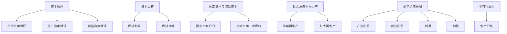

# 03 资本流通与剩余价值分配 · 章节总结

> 对应原书：第二篇 资本主义流通、剩余价值分配（第 6-7 章）
> 📖 原书原文：[[../../../原文件/经济学/马克思主义政治经济学概论_全书|《概论》第6-7章]]

## 这一篇在回答什么问题

前一篇讲了剩余价值**怎么生产出来**。这一篇讲两件事：

1. **资本怎么转圈圈**——资本不能停下来，它必须不断从货币变商品、从商品变货币，否则就死了。这就是资本循环和周转。
2. **剩余价值怎么分**——产业资本家拿到 m 后，不是独吞。商业资本家分走商业利润，银行家分走利息，地主分走地租。所有人都来分一杯羹。

## 本篇框架图

## 核心公式

$$\text{资本循环}：G—W\underbrace{\begin{matrix}A\\Pm\end{matrix}} \cdots P \cdots W'—G'$$

$$n = \frac{U}{u} \quad (n = 周转次数，U = 1 年，u = 周转一次时间)$$

$$p' = \frac{m}{c+v}, \quad \bar p' = \frac{\sum m}{\sum (c+v)}$$

$$\text{生产价格} = k + \bar p = (c+v) + \text{平均利润}$$

## 核心概念速查

| 概念 | 一句话 | 详细 KP |
|---|---|---|
| 资本循环 | 资本从货币出发，经过购买、生产、售卖，回到货币并增殖 | [[知识点/KP01_资本循环]] |
| 资本周转 | 不断重复的循环 | [[知识点/KP02_资本周转]] |
| 固定资本 | 机器、厂房，价值多次逐步转移 | [[知识点/KP03_固定资本与流动资本]] |
| 流动资本 | 原料、工资，价值一次周转 | [[知识点/KP03_固定资本与流动资本]] |
| 社会总资本再生产 | 全社会各部门之间的比例关系 | [[知识点/KP04_社会总资本再生产]] |
| 利润 p | m 的转化形式（被看成全部资本的产物） | [[知识点/KP05_平均利润与生产价格]] |
| 平均利润 | 不同部门之间竞争使利润趋于平均 | [[知识点/KP05_平均利润与生产价格]] |
| 生产价格 | 成本价格 + 平均利润 | [[知识点/KP05_平均利润与生产价格]] |
| 商业利润 | 商业资本家瓜分的那部分 m | [[知识点/KP06_商业利润]] |
| 利息 | 借贷资本家瓜分的那部分 m | [[知识点/KP07_利息与银行利润]] |
| 地租 | 土地所有者瓜分的那部分 m | [[知识点/KP08_地租]] |

## 思考题（原书）

1. 什么是资本循环？产业资本循环的三种形式是什么？
2. 划分固定资本和流动资本与划分不变资本和可变资本有什么不同？
3. 社会总资本简单再生产和扩大再生产的实现条件是什么？
4. 利润是怎样转化为平均利润的？生产价格和价值的关系怎样？
5. 商业利润、利息、地租的本质是什么？

## 🔗 相关知识点

**本篇：** [[知识点/KP01_资本循环]] ｜ [[知识点/KP02_资本周转]] ｜ [[知识点/KP03_固定资本与流动资本]] ｜ [[知识点/KP04_社会总资本再生产]] ｜ [[知识点/KP05_平均利润与生产价格]] ｜ [[知识点/KP06_商业利润]] ｜ [[知识点/KP07_利息与银行利润]] ｜ [[知识点/KP08_地租]]

**跨章：** [[../04_经济危机与历史趋势/00_章节总结|04 经济危机（再生产比例破坏）]]

**跨课对照：** 西方经济学的"资本时间价值""利息理论"对应这里的利息、利润分配。

