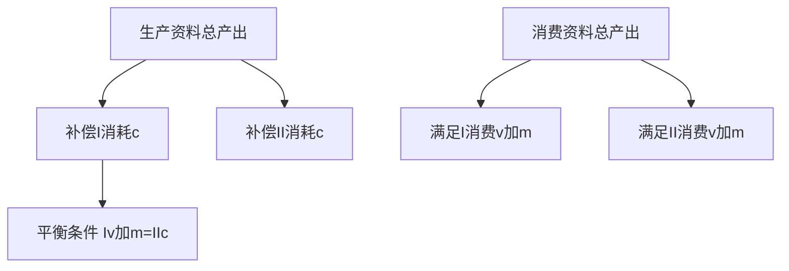

# KP04 · 社会总资本再生产

<a href="../../../../exam.html" target="_blank" style="display:inline-block;padding:6px 16px;background:#2563eb;color:#fff;border-radius:6px;text-decoration:none;font-size:14px;">📝 开始做题</a>

> 所属：[[../00_章节总结|第6章 资本主义流通]] ｜ 节：原书第六章第三节

## 1. 一句话先懂（小白版）

前面看的是**单个奶茶店**怎么循环周转。现在换个视角，看**全社会所有企业**怎么互相配合。

全社会分成两大部类：
- **第Ⅰ部类**：生产生产资料的（机器厂、煤矿、钢厂）；
- **第Ⅱ部类**：生产消费资料的（食品厂、服装厂、奶茶店）。

两大部类之间必须按比例交换：
- 第Ⅰ部类生产的机器不能全自己用，要卖给第Ⅱ部类；
- 第Ⅱ部类生产的奶茶不能全自己喝，要卖给第Ⅰ部类工人。

**如果比例协调，再生产顺利进行；如果比例破坏，就爆发经济危机。**

## 2. 严格定义

**社会总产品**：社会在一定时期内（通常一年）生产的全部物质资料总和。

**价值构成**：$W = c + v + m$。

**实物构成**：分为生产资料（生产消费用）和消费资料（个人生活用）。

**两大部类**：
- **第Ⅰ部类（Ⅰ）**：生产生产资料的部门；
- **第Ⅱ部类（Ⅱ）**：生产消费资料的部门。

**简单再生产的实现条件**（剩余价值全消费，不扩大）：

$$Ⅰ(v+m) = Ⅱc$$

意思：第Ⅰ部类工人和资本家需要的消费资料，正好等于第Ⅱ部类需要的生产资料。两边交换，谁也不缺。

由此派生出：
- $Ⅰ(c+v+m) = Ⅰc + Ⅱc$（第Ⅰ部类总产品 = 两部类补偿的生产资料）；
- $Ⅱ(c+v+m) = Ⅰ(v+m) + Ⅱ(v+m)$（第Ⅱ部类总产品 = 两部类的消费资料需求）。

**扩大再生产的前提条件**（剩余价值一部分积累）：

$$Ⅰ(v+m) > Ⅱc$$

意思：第Ⅰ部类生产的生产资料，在补偿了两部类消耗之后，还有剩余可以用来扩大生产。

**扩大再生产的实现条件**：

$$Ⅰ(v+\Delta v + m/x) = Ⅱ(c+\Delta c)$$

其中：
- $\Delta v$：追加的可变资本；
- $\Delta c$：追加的不变资本；
- $m/x$：资本家个人消费的 m。

## 3. 为什么（原理/机制）——完整推导

### 为什么要研究社会总资本？

单个资本循环顺利不代表全社会顺利。比如：
- 王老板奶茶店做了 1100 杯奶茶，想卖给工人；
- 但如果钢厂、煤矿的工人失业了，他们没钱买奶茶；
- 奶茶卖不出去，王老板资金链断；
- 王老板倒闭，他不买茶叶了，茶农收入下降；
- 茶农不买衣服，服装厂倒闭……

**一个部门的失衡，会传导到全社会**。这就是为什么要研究社会总资本再生产。

### 简单再生产的实现条件怎么推？

假设数字（每年）：

| | c | v | m | 总产品 |
|---|---|---|---|---|
| Ⅰ（生产资料） | 4000 | 1000 | 1000 | 6000 |
| Ⅱ（消费资料） | 2000 | 500 | 500 | 3000 |

**三个交换关系**：

1. **Ⅰc = 4000**：在第Ⅰ部类内部交换（机器厂卖给煤矿、煤矿卖给钢厂），补偿本部类消耗的生产资料。
2. **Ⅱ(v+m) = 1000**：在第Ⅱ部类内部交换（食品厂卖给服装厂工人），本部类工人和资本家消费。
3. **Ⅰ(v+m) = 2000 vs Ⅱc = 2000**：两大部类之间交换——第Ⅰ部类工人和资本家需要 2000 消费资料（奶茶），第Ⅱ部类需要 2000 生产资料（机器）。两边正好相等，交换完成。

**这就是 $Ⅰ(v+m) = Ⅱc$ 的意思。**

### 扩大再生产怎么实现？

如果 $Ⅰ(v+m) > Ⅱc$，说明第Ⅰ部类多生产了生产资料，可以用来扩大。资本家把 m 一部分积累：
- Ⅰ 部类：$m = 1000$，拿 500 积累（400 Δc + 100 Δv），500 消费；
- Ⅱ 部类：相应拿出 100 积累（Δc = 100，Δv = 50）。

第二年：
- Ⅰ：c = 4400，v = 1100，m = 1100；
- Ⅱ：c = 2100，v = 550，m = 550。

生产规模扩大了。

## 4. 来源（理论怎么来的）

魁奈《经济表》最早尝试分析社会总资本再生产；马克思在《资本论》第二卷第三篇建立了完整的再生产图式。列宁后来把它发展成"生产资料生产优先增长"理论（技术进步下 c 占比提高，Ⅰ部类增长快于Ⅱ部类）。

## 5. 怎么用（现实例子）

**看 2008 年金融危机：**

- 美国房地产（Ⅱ部类下游）泡沫破裂 → 居民没钱消费；
- 汽车、家电（Ⅱ部类）卖不动 → 减产；
- 钢铁、建材（Ⅰ部类）订单减少 → 减产；
- 连锁反应，全球衰退。

**这就是再生产比例破坏**：Ⅱ部类的消费需求不足，导致 Ⅰ 部类生产资料过剩。

**中国的"扩大内需"政策**，本质上就是在调整两大部类比例——过去靠投资（Ⅰ部类）拉动，现在要让消费（Ⅱ部类）跟上。

## 5.5 理论推导（一步步推）

**假设起点**：社会总产品在价值上分 $c+v+m$，在实物上分生产资料和消费资料。

**推导过程**：
- 第一步：第 $I$ 部类生产生产资料 $I(c+v+m)$，第 $II$ 部类生产消费资料 $II(c+v+m)$。
- 第二步：生产资料总产出必须满足两部类补偿不变资本：$I(c+v+m) = Ic + IIc$。
- 第三步：消费资料总产出必须满足两部类工人和资本家消费：$II(c+v+m) = I(v+m) + II(v+m)$。
- 第四步：化简得核心平衡条件 $I(v+m) = IIc$。
- 结论：两大部类必须保持比例，社会总资本才能顺利再生产。

## 5.6 数学推导（公式怎么来的）

> 每个符号第一次出现必须解释。

从 $I(c+v+m) = Ic + IIc$ 两边减 $Ic$：

$$I(v+m) = IIc$$

扩大再生产前提条件：

$$I(v+m) > IIc$$

即第 $I$ 部类产出在补偿消耗后还有剩余，可用于追加投资。

## 6. 什么时候不能用（边界条件）

- **这个模型抽象掉了货币流通、对外贸易、非物质生产部门**。现实中比例关系更复杂。
- **资本主义再生产是"自发"的**。比例经常破坏，通过危机强行恢复（不是计划调节）。
- **社会主义可以自觉利用再生产规律**，通过五年计划、产业政策安排两大部类比例——这是社会主义优越性之一。

## 7. 容易混淆什么

| 容易混 | 区别 |
|---|---|
| 单个资本 vs 社会总资本 | 单个 = 一个企业；社会总 = 所有企业互相联系的整体。 |
| 简单再生产 vs 扩大再生产 | 简单 = 规模不变；扩大 = 规模扩大。 |
| Ⅰ(v+m) = Ⅱc vs Ⅰ(v+m) > Ⅱc | 前者是简单再生产实现条件；后者是扩大再生产前提。 |
| 生产资料生产优先增长 vs 消费拉动 | 前者是技术进步下的趋势；后者是市场需求拉动。两者要协调。 |

## 8. 现实意义

- **为什么要"供给侧结构性改革"？** 因为生产结构（Ⅰ部类）和需求结构（Ⅱ部类）不匹配——一边是钢铁水泥过剩，一边是高品质消费品依赖进口。
- **为什么要"双循环"？** 让国内生产和国内消费互相匹配，降低对外需的依赖。
- **为什么会有产能过剩？** 因为 Ⅰ 部类盲目扩张，超过了 Ⅱ 部类的消化能力——再生产比例破坏。

---

## 🔗 相关知识点

**同章关联：** [[KP01_资本循环]] ｜ [[KP02_资本周转]] ｜ [[KP05_平均利润与生产价格]]

**跨章关联：** [[../../04_经济危机与历史趋势/知识点/KP01_资本主义经济危机|经济危机（再生产比例强制恢复）]] ｜ [[../../06_社会主义市场经济与发展/知识点/KP01_政府与市场关系|宏观调控]]

**跨课对照：** 宏观经济学的总供给-总需求（AS-AD）模型是再生产图式的现代表述。

**📖 原书原文：** [[../../../../原文件/经济学/马克思主义政治经济学概论_全书#第三节 社会总资本的再生产|《概论》第六章第三节]]

---

## 📝 考研真题（首经贸 801）

**配套主观题：** 见同目录 [[../考研真题集|本章考研真题集]]
**配套选择题：** 见同目录 [[../选择题集|本章选择题集]]

### 高频简答
- 试述社会总资本简单再生产实现条件，并计算 II(c) → 见 [[../考研真题集#s6|真题集·简答 6]]

### 高频论述
- 用社会总资本再生产理论分析扩大内需与供给侧结构性改革 → 见 [[../考研真题集#l4|真题集·论述 4]]

### 易错选择
- 本知识点选择题见 [[../选择题集#KP04 社会总资本再生产|选择题集·KP04]]
