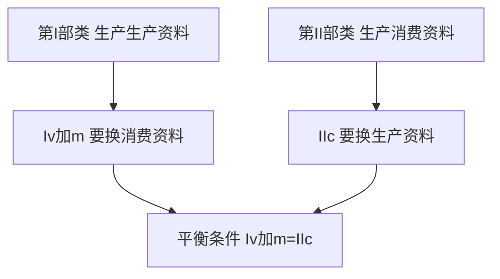
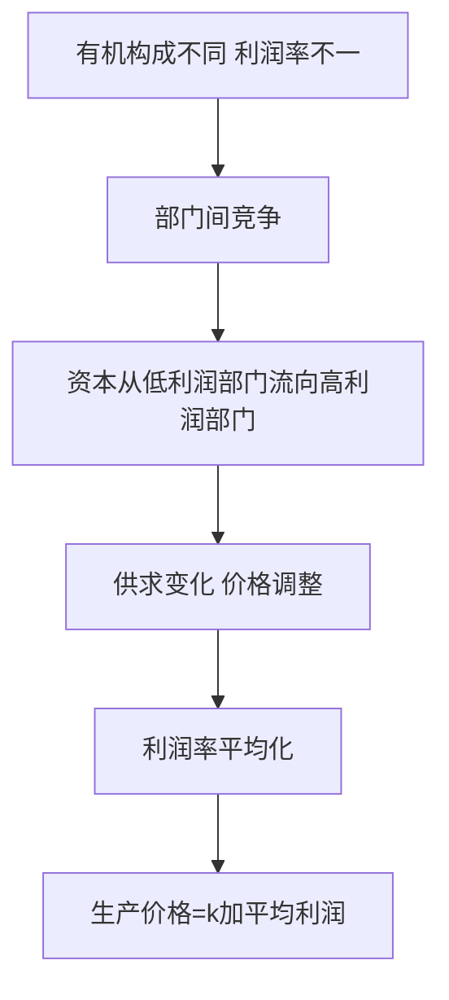

# 第 03 章 资本流通与剩余价值分配 · 考研真题集（首经贸 801）

<a href="../../../exam.html" target="_blank" style="display:inline-block;padding:6px 16px;background:#2563eb;color:#fff;border-radius:6px;text-decoration:none;font-size:14px;">📝 开始做题</a>

> 本章共收录：简答题 10 道（每题 15 分）｜论述题 4 道（每题 30 分）
> 配套选择题见 [[选择题集|本章选择题集]]
> 对应大纲：马克思主义政治经济学概论 第二篇 第 6—7 章（资本循环与周转、社会总资本再生产、平均利润与生产价格、商业利润、利息与银行利润、地租）

## 📋 本题集目录

### 简答题
1. [[#简答 1：简述产业资本循环经历的三个阶段和采取的三种职能形式。|产业资本循环三阶段与三种职能形式]]
2. [[#简答 2：为什么说产业资本的连续循环是三种循环形式的统一？需要具备哪些条件？|产业资本连续循环的两个条件]]
3. [[#简答 3：某产业资本家预付总资本 100 万元，其中不变资本 $c$ 与可变资本 $v$ 之比为 $4:1$，剩余价值率 $m'=100\%$，该资本一年周转 $2$ 次。试计算年剩余价值量 $M$ 与年剩余价值率 $M'$，并说明年剩余价值率与剩余价值率的区别。|资本周转与年剩余价值量计算]]
4. [[#简答 4：划分固定资本与流动资本同划分不变资本与可变资本有何区别？为什么说这种区别是政治经济学的重要问题？|固定资本/流动资本 vs 不变资本/可变资本]]
5. [[#简答 5：什么是固定资本折旧？影响固定资本折旧快慢的因素有哪些？|固定资本折旧及其影响因素]]
6. [[#简答 6：试述社会总资本简单再生产的实现条件，并计算已知条件下的 II(c) 及交换关系。|简单再生产实现条件（含计算）]]
7. [[#简答 7：简述社会总资本扩大再生产的前提条件与实现条件。|扩大再生产前提条件与实现条件]]
8. [[#简答 8：试述利润是怎样转化为平均利润的？商品价值怎样转化为生产价格？|利润转化为平均利润、价值转化为生产价格]]
9. [[#简答 9：简述商业利润的来源和本质。商业职工的剩余劳动是否受剥削？|商业利润的来源与本质]]
10. [[#简答 10：级差地租与绝对地租有何区别？试用马克思地租理论说明农产品价格决定的特点。|级差地租与绝对地租的区别]]

### 论述题
1. [[#论述 1：试用马克思的资本循环与资本周转理论，分析我国企业为什么高度重视现金流管理，并说明"双 11"等集中促销现象的政治经济学根源。|用资本循环与周转理论分析企业现金流与"双11"现象]]
2. [[#论述 2：试用平均利润与生产价格理论，分析我国平台经济（电商、外卖、网约车）的利润来源及其与传统商业利润的异同。|用平均利润与生产价格理论分析平台经济利润来源]]
3. [[#论述 3：试用马克思的级差地租与绝对地租理论，分析我国城市高房价和土地财政现象，并说明其政治经济学后果。|用马克思地租理论分析房价高企与土地财政]]
4. [[#论述 4：试用马克思的社会总资本再生产理论，分析我国"扩大内需"战略与"供给侧结构性改革"的政治经济学依据。|用社会总资本再生产理论分析扩大内需与供给侧结构性改革]]

---

## 一、简答题（每题 15 分，建议 450—700 字）

### 简答 1：简述产业资本循环经历的三个阶段和采取的三种职能形式。

**【建议字数】450–700 字 ｜ 【建议时间】15 分钟 ｜ 【题型】模型分析**

**【考什么】** 对应知识点 [[知识点/KP01_资本循环|资本循环]]，对应大纲第 6 章第 1 节；题型属于概念简答。

**【答题框架】**
- 第 1 段：资本循环的总公式（2 分）
- 第 2 段：三阶段与三种职能形式一一对应（6 分）
- 第 3 段：三种循环形式的统一（4 分）
- 第 4 段：现实意义（3 分）

**【参考答案】**

一、产业资本循环的总公式

产业资本依次经过购买、生产、售卖三个阶段，相应采取货币资本、生产资本、商品资本三种职能形式，实现价值增殖，最后回到原来出发点的运动，就是资本循环。其总公式为：

$$G—W\begin{matrix}A\\Pm\end{matrix}\cdots P\cdots W'—G'$$

其中 $G$ 为货币，$W$ 为商品，$A$ 为劳动力，$Pm$ 为生产资料，$P$ 为生产过程，$W'$ 为包含剩余价值的新商品，$G'$ 为增殖了的货币。

二、三个阶段与三种职能形式

(一) 购买阶段：$G—W$。资本家用货币购买劳动力 $A$ 和生产资料 $Pm$，货币在这里执行**货币资本**职能，为剩余价值生产准备条件。

(二) 生产阶段：$\cdots P\cdots$。劳动力与生产资料结合生产出包含剩余价值的新商品 $W'$，生产资料与劳动力在这里采取**生产资本**职能形式，这是循环中具有决定意义的阶段，剩余价值就是在这里生产出来的。

(三) 售卖阶段：$W'—G'$。资本家把包含剩余价值的商品卖出换回货币，商品在这里采取**商品资本**职能形式，其职能是实现预付资本价值和剩余价值。马克思称之为"惊险的跳跃"。

三、三种循环形式的统一

产业资本连续循环是货币资本循环、生产资本循环、商品资本循环三种循环形式的统一。三种循环形式在时间上继起、在空间上并存，是产业资本正常循环的必要条件。

四、现实意义

资本循环任何一个阶段中断，都会导致资本停留在某种职能形式上而无法增殖。企业现金流断裂、库存积压、销售困难，本质上都是循环某一阶段卡住了。

**【解析·得分点】** 采分点：①总公式 ②三阶段顺序不能乱 ③三种职能形式与阶段一一对应 ④生产阶段是决定阶段 ⑤三种循环形式统一。易丢分：把"职能形式"与"循环形式"混为一谈；漏掉购买阶段中 $A$ 与 $Pm$ 的区分。

**【生活实例】** 一家奶茶店：老板先掏钱买茶叶、牛奶、杯子，再雇店员——这是购买阶段，钱是货币资本；店员在店里熬奶茶——这是生产阶段，原料和人是生产资本；顾客排队扫码买走奶茶——这是售卖阶段，一杯杯奶茶是商品资本。三步缺一不可：买不到原料开不了张，做不出奶茶卖不出去，卖不掉奶茶就没钱进下一轮原料。

**【双链接】** 🔗 [[知识点/KP01_资本循环|回知识点]] ｜ 📖 [[../../../原文件/经济学/马克思主义政治经济学概论_全书|《概论》第六章第一节]]

---

### 简答 2：为什么说产业资本的连续循环是三种循环形式的统一？需要具备哪些条件？

**【建议字数】450–700 字 ｜ 【建议时间】15 分钟 ｜ 【题型】模型分析**

**【考什么】** 对应知识点 [[知识点/KP01_资本循环|资本循环]]，对应大纲第 6 章第 1 节；题型属于关系对比。

**【答题框架】**
- 第 1 段：三种循环形式各有侧重（4 分）
- 第 2 段：空间上并存性（5 分）
- 第 3 段：时间上继起性（4 分）
- 第 4 段：两者互为条件（2 分）

**【参考答案】**

一、三种循环形式各有侧重

产业资本循环从不同角度看，表现为三种循环形式：货币资本循环 $G—W\cdots P\cdots W'—G'$，起点和终点都是货币，最醒目地暴露了资本生产剩余价值的目的；生产资本循环 $P\cdots W'—G'—W\cdots P$，表明生产是反复进行的再生产过程；商品资本循环 $W'—G'—W\cdots P\cdots W'$，表明商品的实现是资本运动的条件。三种循环形式并非三个独立资本，而是同一产业资本连续循环的三个侧面。

二、空间上的并存性

产业资本必须按照一定比例同时并存于货币资本、生产资本、商品资本三种形式上。一部分处于购买阶段，一部分处于生产阶段，一部分处于售卖阶段。如果全部资本都投在生产阶段，就没有货币去买原料；全部投在商品阶段，工厂就停工。

三、时间上的继起性

三种职能形式必须依次相继转化，货币资本不断转化为生产资本，生产资本不断转化为商品资本，商品资本不断回到货币资本。任何一种形式的循环发生停顿，其他两种循环也会相继卡住。

四、并存与继起互为条件

并存是继起的前提——没有同时并存，就谈不上依次继起；继起是并存的保证——没有连续继起，并存的比例就会被破坏。二者统一，产业资本循环才能连续不断。这就是资本主义生产连续性的条件，也是资本主义企业管理的核心问题。

**【解析·得分点】** 采分点：①三种循环形式各自的公式与特点 ②并存性的含义 ③继起性的含义 ④二者辩证关系。易丢分：把并存与继起割裂；只说"三种循环统一"而不说条件。

**【生活实例】** 一家外卖店：后厨同时要有人在炒菜（生产资本），前台同时要有人接单打包（商品资本），老板账上同时要留钱买菜发工资（货币资本）——三种钱同时在不同位置上，这叫"并存"；菜炒好立刻打包、打包立刻出餐、出餐立刻收到下一笔钱买新菜，一环扣一环，这叫"继起"。哪一段断了，店就停了。

**【双链接】** 🔗 [[知识点/KP01_资本循环|回知识点]] ｜ [[知识点/KP02_资本周转|资本周转]]

---

### 简答 3：某产业资本家预付总资本 100 万元，其中不变资本 $c$ 与可变资本 $v$ 之比为 $4:1$，剩余价值率 $m'=100\%$，该资本一年周转 $2$ 次。试计算年剩余价值量 $M$ 与年剩余价值率 $M'$，并说明年剩余价值率与剩余价值率的区别。

**【建议字数】450–700 字 ｜ 【建议时间】15 分钟 ｜ 【题型】分析推导**

**【考什么】** 对应知识点 [[知识点/KP02_资本周转|资本周转]]，对应大纲第 6 章第 2—3 节；题型属于分析推导（计算题）。

**【答题框架】**
- 第 1 段：拆分 $c$ 与 $v$（3 分）
- 第 2 段：计算一次周转的剩余价值（4 分）
- 第 3 段：计算年剩余价值量与年剩余价值率（5 分）
- 第 4 段：$M'$ 与 $m'$ 的区别（3 分）

**【参考答案】**

一、拆分不变资本与可变资本

预付总资本 $C=c+v=100$ 万元，$c:v=4:1$，故：

$$c=100\times\frac{4}{5}=80\text{ 万元},\qquad v=100\times\frac{1}{5}=20\text{ 万元}$$

二、一次周转获得的剩余价值

$$m=m'\cdot v=100\%\times 20=20\text{ 万元}$$

三、年剩余价值量与年剩余价值率

一年周转 $n=2$ 次，故年剩余价值量：

$$M=n\cdot m=2\times 20=40\text{ 万元}$$

年剩余价值率：

$$M'=\frac{M}{v}=\frac{40}{20}=200\%$$

或直接用公式 $M'=m'\cdot n=100\%\times 2=200\%$。

四、$M'$ 与 $m'$ 的区别

(一) 含义不同：剩余价值率 $m'=m/v$ 反映一次生产过程中资本家对工人的剥削程度；年剩余价值率 $M'=M/v$ 反映预付可变资本一年的增殖程度。

(二) 数量关系：只有当 $n=1$ 时 $M'=m'$；当 $n>1$ 时 $M'>m'$。加速资本周转，可以在不增加预付可变资本的情况下提高年剩余价值量和年剩余价值率，这是资本家拼命加快周转的根本动因。

(三) 掩盖剥削：$M'$ 看起来把剥削程度放大或缩小，实际上它把可变资本一年中被反复使用带来的增殖，算到了同一个 $v$ 的头上，进一步掩盖了剩余价值的真正来源。

**【解析·得分点】** 采分点：①正确拆分 $c=80,v=20$ ②$m=20$ 万 ③$M=40$ 万 ④$M'=200\%$ ⑤说明 $M'=m'\cdot n$ ⑥区分两个比率。易丢分：把 $M'$ 错算成 $M/(c+v)$；忘记 $n=2$ 要乘进去。

**【生活实例】** 你花 2000 元进一批水果，一周卖完赚 200 元（剩余价值率 10%）；如果这批水果一年能周转 50 次，一年下来你赚 10000 元，年剩余价值率就是 500%。同样 2000 元本钱，周转越快，一年赚得越多——这就是为什么水果店老板宁愿薄利多销也要加快流转。

**【双链接】** 🔗 [[知识点/KP02_资本周转|回知识点]] ｜ [[知识点/KP03_固定资本与流动资本|固定资本与流动资本]]

---

### 简答 4：划分固定资本与流动资本同划分不变资本与可变资本有何区别？为什么说这种区别是政治经济学的重要问题？

**【建议字数】450–700 字 ｜ 【建议时间】15 分钟 ｜ 【题型】关系对比**

**【考什么】** 对应知识点 [[知识点/KP03_固定资本与流动资本|固定资本与流动资本]]，对应大纲第 6 章第 3 节；题型属于关系对比（易混点）。

**【答题框架】**
- 第 1 段：两种划分的依据不同（5 分）
- 第 2 段：划分的内容不同（5 分）
- 第 3 段：划分的目的与意义不同（5 分）

**【参考答案】**

一、划分的依据不同

(一) 不变资本与可变资本的划分，依据是生产资本不同部分在**剩余价值生产中的不同作用**：以生产资料形式存在、其价值量不发生变化的部分叫不变资本 $c$；以劳动力形式存在、在生产过程中再生产出自身价值并生产出剩余价值的部分叫可变资本 $v$。

(二) 固定资本与流动资本的划分，依据是生产资本不同部分**价值周转方式的不同**：价值逐次转移、多次参加生产过程的部分叫固定资本；价值一次全部周转、一次生产过程中就全部转移并回收的部分叫流动资本。

二、划分的内容不同

不变资本中的厂房、机器、设备属于固定资本；不变资本中的原料、燃料、辅助材料属于流动资本；可变资本（工资）也属于流动资本。可用下表对照：

| 按在 m 生产中作用分 | 按价值周转方式分 |
|---|---|
| 不变资本 $c$：厂房、机器 | 固定资本 |
| 不变资本 $c$：原料、燃料 | 流动资本 |
| 可变资本 $v$：工资 | 流动资本 |

可见，不变资本与固定资本、流动资本与可变资本在外延上有交叉，但绝不能划等号。

三、划分的目的与意义不同

(一) 划分不变资本与可变资本，目的是揭示剩余价值的真正来源——只有可变资本才创造剩余价值，从而揭露资本主义剥削实质。

(二) 划分固定资本与流动资本，目的是考察资本周转速度对剩余价值生产的影响，说明生产资本构成如何影响年剩余价值量。

(三) 资产阶级经济学只讲固定资本与流动资本，不讲不变资本与可变资本，目的是把工资说成是流动资本、把利润说成是全部资本的产物，从而掩盖剩余价值的真正来源。这是马克思在《资本论》中反复批判的"混淆"。

**【解析·得分点】** 采分点：①两种划分依据不同 ②表格对照（原料既是不变资本又是流动资本）③划分目的不同 ④资产阶级经济学的混淆。易丢分：把"可变资本=流动资本"、"不变资本=固定资本"简单划等号；漏掉原料的双重身份。

**【生活实例】** 一家服装厂：缝纫机、厂房能用十年——这是固定资本（也是不变资本）；布料、线一次裁剪就变成衣服——这是流动资本（也是不变资本）；给工人发的工资——这是流动资本（但是可变资本，真正带来利润的就是它）。资产阶级只跟你说"机器是固定的、布料和工资是流动的"，却绝口不提"工资那一块才是赚钱的根源"。

**【双链接】** 🔗 [[知识点/KP03_固定资本与流动资本|回知识点]] ｜ [[知识点/KP05_平均利润与生产价格|平均利润与生产价格]]

---

### 简答 5：什么是固定资本折旧？影响固定资本折旧快慢的因素有哪些？

**【建议字数】450–700 字 ｜ 【建议时间】15 分钟 ｜ 【题型】因素影响**

**【考什么】** 对应知识点 [[知识点/KP03_固定资本与流动资本|固定资本与流动资本]]，对应大纲第 6 章第 3 节；题型属于概念简答。

**【答题框架】**
- 第 1 段：固定资本折旧的含义（4 分）
- 第 2 段：折旧费与折旧率公式（4 分）
- 第 3 段：有形磨损与无形磨损（4 分）
- 第 4 段：折旧的经济意义（3 分）

**【参考答案】**

一、固定资本折旧的含义

固定资本的价值按照其磨损程度，逐次转移到新产品中去，并通过产品销售以货币形式逐步回收，这一过程叫固定资本折旧。逐次提取的那部分价值叫折旧费（折旧基金）。

二、折旧费与折旧率

$$\text{折旧费}=\frac{\text{固定资本原始价值}}{\text{平均使用年限}}$$

$$\text{折旧率}=\frac{\text{折旧费}}{\text{固定资本原始价值}}\times 100\%$$

例如一台机器价值 10 万元，预计使用 10 年，则每年折旧费 1 万元，折旧率 10%。

三、固定资本磨损的两种形式

(一) 有形磨损（物质磨损）：一是因使用造成的磨损，如机器运转零件损耗；二是因自然力作用造成的磨损，如厂房风吹雨淋、金属生锈。

(二) 无形磨损（精神磨损）：一是由于生产技术进步、劳动生产率提高，生产同样机器所需社会必要劳动时间减少，使原有机器贬值；二是由于出现更先进、效率更高的新机器，使原机器在使用年限未满前就提前淘汰。无形磨损是资本家加速折旧、拼命赶工时的重要原因。

四、折旧的经济意义

折旧基金既是补偿基金，也是积累基金。资本家提高折旧率，可以在固定资本实物更新前提前收回货币，用于扩大再生产；在技术飞速进步的当代，加速折旧更是企业应对无形磨损、保持竞争力的普遍做法。

**【解析·得分点】** 采分点：①折旧含义 ②折旧费/折旧率公式 ③有形磨损两种原因 ④无形磨损两种原因 ⑤折旧既是补偿又是积累。易丢分：把无形磨损漏掉；忘记举例。

**【生活实例】** 你花 6000 元买了一台笔记本，预计用 6 年，每年要计提 1000 元折旧——这就是有形磨损；但第三年厂家出了 M 系列新芯片，旧电脑突然贬值一半，你提前换了新电脑——这就是无形磨损。企业财务报表上的"折旧费用"就是这个道理。

**【双链接】** 🔗 [[知识点/KP03_固定资本与流动资本|回知识点]] ｜ [[知识点/KP02_资本周转|资本周转]]

---

### 简答 6：试述社会总资本简单再生产的实现条件，并计算已知条件下的 II(c) 及交换关系。

**【建议字数】450–700 字 ｜ 【建议时间】15 分钟 ｜ 【题型】分析推导**

**【考什么】** 对应知识点 [[知识点/KP04_社会总资本再生产|社会总资本再生产]]，对应大纲第 6 章第 4 节；题型属于分析推导（计算题）。

**【答题框架】**
- 第 1 段：社会总资本再生产的核心问题（3 分）
- 第 2 段：两大部类划分（3 分）
- 第 3 段：三大交换关系与实现条件（6 分）
- 第 4 段：代入数字计算（3 分）

**【参考答案】**

一、核心问题

社会总资本再生产的核心问题是社会总产品的实现问题，即价值补偿和实物补偿。社会总产品在价值上分为 $c+v+m$，在实物上分为生产资料和消费资料，相应划分为两大部类：第 I 部类生产生产资料，第 II 部类生产消费资料。

二、简单再生产的三大交换关系

(一) I(c)：第 I 部类内部交换，本部类资本家相互购买生产资料。

(二) II(v+m)：第 II 部类内部交换，本部类工人和资本家购买消费资料。

(三) I(v+m) 与 II(c) 之间的交换：第 I 部类工人和资本家需要消费资料，第 II 部类资本家需要生产资料，二者必须相等。

三、实现条件

基本实现条件：

$$\mathrm{I}(v+m)=\mathrm{II}c$$

由此派生两个条件：

$$\mathrm{I}(c+v+m)=\mathrm{I}c+\mathrm{II}c$$

$$\mathrm{II}(c+v+m)=\mathrm{I}(v+m)+\mathrm{II}(v+m)$$

四、代入数字

已知：$I(c)=4000,\ I(v)=1000,\ I(m)=1000$。

由基本实现条件 $I(v+m)=IIc$，得：

$$IIc=I(v+m)=1000+1000=2000$$

假设第 II 部类资本有机构成 $c:v=4:1$，则 $IIv=2000/4=500$，简单再生产条件下 $IIm=IIv=500$（剩余价值率 100%）。

全年交换关系：

- $I(c)=4000$ 在第 I 部类内部交换（机器厂卖给钢厂、钢厂卖给煤矿）；
- $II(v+m)=500+500=1000$ 在第 II 部类内部交换（面包厂卖给服装厂工人）；
- $I(v+m)=2000$ 与 $II(c)=2000$ 相互交换：第 I 部类工人和资本家拿 2000 消费资料购买力，向第 II 部类购买面包衣服；第 II 部类拿 2000 货币向第 I 部类购买机器原料。

若 $I(v+m)>IIc$，则生产资料过剩、消费资料不足；若 $I(v+m)<IIc$，则消费资料过剩、生产资料不足——比例破坏就是经济危机的萌芽。

**【解析·得分点】** 采分点：①核心问题是实现 ②两大部类划分 ③基本公式 I(v+m)=IIc ④两个派生公式 ⑤算出 IIc=2000 ⑥说明比例破坏后果。易丢分：把 I(c) 与 II(v+m) 搞混；漏掉派生公式。

**【生活实例】** 全社会就两个村：东村造锄头（生产资料），西村种粮食（消费资料）。东村工人和资本家自己要吃粮，西村种地要换新锄头。东村一年造的新锄头扣除自己用掉的部分，剩下的恰好等于西村一年要换的锄头；东村一年工人和资本家拿到的钱，恰好够买西村一年种出来的粮——这个等式就是简单再生产的实现条件。

**【双链接】** 🔗 [[知识点/KP04_社会总资本再生产|回知识点]] ｜ [[../04_经济危机与历史趋势/知识点/KP01_资本主义经济危机|资本主义经济危机]]

---

### 简答 7：简述社会总资本扩大再生产的前提条件与实现条件。

**【建议字数】450–700 字 ｜ 【建议时间】15 分钟 ｜ 【题型】模型分析**

**【考什么】** 对应知识点 [[知识点/KP04_社会总资本再生产|社会总资本再生产]]，对应大纲第 6 章第 4 节；题型属于概念简答。

**【答题框架】**
- 第 1 段：扩大再生产的含义（2 分）
- 第 2 段：两个前提条件（6 分）
- 第 3 段：基本实现条件与派生条件（5 分）
- 第 4 段：现实意义（2 分）

**【参考答案】**

一、扩大再生产的含义

扩大再生产是资本家把剩余价值的一部分转化为追加资本，使生产在扩大规模上重复进行。扩大再生产包括外延扩大再生产（增加投资、增加劳动力和生产资料）和内涵扩大再生产（提高劳动生产率、改进技术）。

二、两个前提条件

(一) 要有追加的生产资料。第 I 部类一年生产的生产资料，必须在补偿两大部类已消耗的生产资料之后还有剩余，即：

$$\mathrm{I}(c+v+m)>\mathrm{I}c+\mathrm{II}c$$

简化为：

$$\mathrm{I}(v+m)>\mathrm{II}c$$

(二) 要有追加的消费资料。第 II 部类一年生产的消费资料，必须在补偿两大部类工人和资本家原有消费之后还有剩余，即：

$$\mathrm{II}(c+v+m)>\mathrm{I}(v+\frac{m}{x})+\mathrm{II}(v+\frac{m}{x})$$

其中 $m/x$ 表示资本家个人消费部分，$m-m/x$ 表示用于积累的部分。简化为：

$$\mathrm{II}(c+m-\frac{m}{x})>\mathrm{I}(v+\frac{m}{x})$$

三、实现条件

剩余价值要按一定比例分割为追加不变资本 $\Delta c$、追加可变资本 $\Delta v$ 和资本家个人消费 $m/x$。扩大再生产的基本实现条件是：

$$\mathrm{I}(v+\Delta v+\frac{m}{x})=\mathrm{II}(c+\Delta c)$$

派生条件：

$$\mathrm{I}(c+v+m)=\mathrm{I}(c+\Delta c)+\mathrm{II}(c+\Delta c)$$

$$\mathrm{II}(c+v+m)=\mathrm{I}(v+\Delta v+\frac{m}{x})+\mathrm{II}(v+\Delta v+\frac{m}{x})$$

四、现实意义

扩大再生产要顺利进行，两大部类之间、积累与消费之间必须保持合理比例。第 I 部类过快扩张而第 II 部类跟不上，会出现生产资料积压；第 II 部类过快而工人收入不提高，会出现消费资料过剩。这一原理对社会主义国家安排积累率、调整产业结构同样具有指导意义。

**【解析·得分点】** 采分点：①两个前提条件不等式 ②$m/x$ 的含义 ③基本实现条件等式 ④两个派生等式。易丢分：把前提条件写成等式；漏掉追加消费资料的前提。

**【生活实例】** 你家今年结余 10 万块想扩大养鸡规模：前提一是饲料市场上还能买到额外的小鸡崽（追加生产资料）；前提二是你老婆孩子加新雇的工人明年还能买到足够的大米（追加消费资料）。光有钱、没有这两样实物，扩大再生产就是空话。

**【双链接】** 🔗 [[知识点/KP04_社会总资本再生产|回知识点]] ｜ [[../04_经济危机与历史趋势/知识点/KP01_资本主义经济危机|资本主义经济危机]]

---

### 简答 8：试述利润是怎样转化为平均利润的？商品价值怎样转化为生产价格？

**【建议字数】450–700 字 ｜ 【建议时间】15 分钟 ｜ 【题型】分析推导**

**【考什么】** 对应知识点 [[知识点/KP05_平均利润与生产价格|平均利润与生产价格]]，对应大纲第 7 章第 1—2 节；题型属于理论分析。

**【答题框架】**
- 第 1 段：利润与利润率（3 分）
- 第 2 段：部门间竞争与利润率平均化（6 分）
- 第 3 段：生产价格的形成（4 分）
- 第 4 段：生产价格与价值的关系（2 分）

**【参考答案】**

一、利润与利润率

剩余价值本来是可变资本的产物，但资本家把它看作全部预付资本的产物时，剩余价值就取得了利润 $p$ 的转化形式。剩余价值率 $m'=m/v$ 转化为利润率 $p'=m/(c+v)=m/C$。利润率掩盖了剥削程度，因为分母由 $v$ 变成了全部资本 $C$。

二、部门间竞争与利润率平均化

不同生产部门由于资本有机构成不同、资本周转速度不同，即使剩余价值率相同，利润率也会高低不等。以等量资本为例：

| 部门 | 资本 | $c:v$ | $m'$ | $m$ | $p'$ |
|---|---|---|---|---|---|
| 机械 | 100 | 90:10 | 100% | 10 | 10% |
| 纺织 | 100 | 80:20 | 100% | 20 | 20% |
| 食品 | 100 | 70:30 | 100% | 30 | 30% |

资本家为了追逐更高利润率，不断把资本从低利润部门抽走、投向高利润部门。资本在部门间的自由转移引起商品供求变化和价格波动：原来高利润部门因资本涌入、供给增加而价格下跌；原来低利润部门因资本流出、供给减少而价格回升。这种竞争反复进行，使不同部门的利润率趋于平均化，形成**平均利润率**：

$$\bar p'=\frac{\text{社会剩余价值总额}}{\text{社会预付总资本}}$$

按照平均利润率归等量资本的利润，叫**平均利润**。

三、生产价格的形成

随着利润转化为平均利润，商品不再按价值 $w=c+v+m$ 出售，而是按**成本价格 + 平均利润**出售：

$$\text{生产价格}=k+\bar p=(c+v)+\bar p$$

其中 $k=c+v$ 为成本价格，$\bar p$ 为平均利润。

四、生产价格与价值的关系

生产价格是价值的转化形式。从全社会看，平均利润总额等于剩余价值总额，生产价格总额等于价值总额；生产价格的变动最终仍由价值变动决定。因此，价值规律并未被破坏，只是作用形式发生了变化——商品不再直接按价值交换，而是按生产价格交换。这一转化进一步掩盖了利润的真正来源，似乎利润多少只与垫支资本量有关，而与工人劳动无关。

**【解析·得分点】** 采分点：①$p'=m/(c+v)$ ②有机构成不同导致 p' 不同 ③部门间竞争与资本转移 ④平均利润率公式 ⑤生产价格=k+$\bar p$ ⑥生产价格总额=价值总额。易丢分：把部门内竞争（形成超额利润）与部门间竞争（形成平均利润）混为一谈。

**【生活实例】** 一条街开了三家店：咖啡馆利润率 30%，面馆 20%，理发店 10%。老板们眼红，纷纷把理发店的钱抽出去开咖啡馆。咖啡馆越开越多、打价格战，利润率跌到 15%；理发店没人开、涨价，利润率升到 15%。最后三家店利润率拉平——这就是平均利润化。商品不再按"成本+我自己赚的钱"卖，而是按"成本+社会平均该赚的钱"卖，这就是生产价格。

**【双链接】** 🔗 [[知识点/KP05_平均利润与生产价格|回知识点]] ｜ [[知识点/KP06_商业利润|商业利润]]

---

### 简答 9：简述商业利润的来源和本质。商业职工的剩余劳动是否受剥削？

**【建议字数】450–700 字 ｜ 【建议时间】15 分钟 ｜ 【题型】概念简答**

**【考什么】** 对应知识点 [[知识点/KP06_商业利润|商业利润]]，对应大纲第 7 章第 3 节；题型属于概念简答。

**【答题框架】**
- 第 1 段：商业资本的职能（3 分）
- 第 2 段：商业利润的来源（6 分）
- 第 3 段：商业利润量的决定（3 分）
- 第 4 段：商业职工受剥削（3 分）

**【参考答案】**

一、商业资本的职能

商业资本是从产业资本中分离出来、专门从事商品买卖、以攫取商业利润为目的的独立资本形式。它执行的是产业资本循环中商品资本的职能——实现价值和剩余价值。产业资本家把商品卖给商业资本家，由商业资本家卖给消费者，可以缩短流通时间、节省流通费用，因此产业资本家愿意把一部分剩余价值让渡给商业资本家。

二、商业利润的来源

商业利润不能在流通中产生（贱买贵卖只是重商主义错觉），其真正来源是**产业工人在生产过程中创造的剩余价值的一部分**。产业资本家按低于生产价格的价格把商品卖给商业资本家，商业资本家再按生产价格把商品卖给消费者，两者的差额就是商业利润。

例如：全社会产业资本 900，平均利润率 20%，剩余价值总额 180。商业资本家垫付 100 商业资本代产后，社会总资本变为 1000，平均利润率降为 $180/1000=18\%$。产业资本家按 $900\times(1+18\%)=1062$ 把商品卖给商业资本家，商业资本家再按 $1062+18=1080$（即生产价格）卖给消费者。商业资本家获得 18 商业利润。

三、商业利润量的决定

商业资本作为独立执行职能的资本，同样参与利润率平均化，获得平均利润。若商业利润率低于产业利润率，商业资本会转向产业；反之亦然。商业利润的实现使平均利润率公式修正为：

$$\bar p'=\frac{\text{产业工人创造的剩余价值总额}}{\text{产业资本}+\text{商业资本}}$$

四、商业职工同样受剥削

商业职工的劳动分为两部分：**必要劳动**实现相当于商业工资的那部分剩余价值；**剩余劳动**实现超过工资的那部分剩余价值，以商业利润形式被商业资本家占有。商业职工的剩余劳动虽不创造剩余价值，但它是商业资本家占有产业工人创造的剩余价值的必要条件。因此，商业职工和产业工人一样，都受资本家剥削，只是剥削形式不同。

**【解析·得分点】** 采分点：①商业资本是商品资本独立化 ②商业利润来自产业工人创造的 m ③按低于生产价格进货、按生产价格出售 ④商业资本参与平均利润化 ⑤商业职工剩余劳动实现 m。易丢分：把商业利润说成流通中加价得来；忘记商业职工也受剥削。

**【生活实例】** 苹果公司把手机按 7000 元批发给线下经销商，经销商按 8000 元卖给你。这 1000 元差价不是经销商"聪明"赚的，而是苹果公司把在中国工厂组装手机时工人创造的剩余价值，让了一块给经销商——因为经销商帮苹果把货铺到全国，省了苹果自己开店的钱。

**【双链接】** 🔗 [[知识点/KP06_商业利润|回知识点]] ｜ [[知识点/KP05_平均利润与生产价格|平均利润与生产价格]]

---

### 简答 10：级差地租与绝对地租有何区别？试用马克思地租理论说明农产品价格决定的特点。

**【建议字数】450–700 字 ｜ 【建议时间】15 分钟 ｜ 【题型】关系对比**

**【考什么】** 对应知识点 [[知识点/KP08_地租|地租]]，对应大纲第 7 章第 5 节；题型属于关系对比。

**【答题框架】**
- 第 1 段：资本主义地租本质（3 分）
- 第 2 段：级差地租（5 分）
- 第 3 段：绝对地租（4 分）
- 第 4 段：农产品价格决定（3 分）

**【参考答案】**

一、资本主义地租的本质

资本主义地租是农业资本家为取得土地使用权而交给土地所有者的、超过平均利润以上的那部分剩余价值，本质上是农业工人创造的剩余价值的转化形式，体现土地所有者、农业资本家共同剥削农业工人的关系。地租分为级差地租和绝对地租两种基本形式。

二、级差地租

级差地租是租种较好土地的农业资本家获得的、转归土地所有者的超额利润。

(一) 形成条件：土地肥力不同、土地位置不同、在同一块土地上连续投资的劳动生产率不同。

(二) 形成原因：土地的资本主义经营垄断。好地有限，被某些农业资本家租种后，别人无法再造出好地来竞争，因此农产品的社会生产价格由**劣等地**的生产条件决定（否则劣等地没人租）。中等地、优等地个别生产价格低于社会生产价格，获得稳定超额利润，转化为级差地租。

(三) 级差地租 I 由肥力和位置差别形成；级差地租 II 由同一块土地上连续追加投资的生产率差别形成。

三、绝对地租

绝对地租是租种任何土地（包括劣等地）都必须交纳的地租。

(一) 形成条件：农业资本有机构成低于社会平均资本有机构成，农产品价值高于社会生产价格。

(二) 形成原因：土地私有权的垄断。由于土地有限且被私人占有，资本不能自由投入农业，农产品不按生产价格而按**价值**出售，价值与生产价格的差额就留在农业部门，转化为绝对地租交给土地所有者。

四、农产品价格决定的特点

工业品按社会生产价格出售，农产品按高于社会生产价格的价值出售，这是农产品价格决定的重要特点。其结果是农产品价格天然偏高，城市居民要为农产品支付较高价格，而土地所有者仅凭土地私有权就能瓜分一部分剩余价值。在当代中国，理解这一原理对分析城市土地的级差地租（市中心地价远高于郊区）、房价构成中的地租成分，具有重要意义。

**【解析·得分点】** 采分点：①地租是 m 的转化形式 ②级差地租条件（肥力/位置/连续投资）+原因（经营垄断）+结果（劣等地决定生产价格）③绝对地租条件（农业有机构成低）+原因（土地私有权垄断）④农产品按价值出售。易丢分：把两种地租的原因和条件混为一谈；忘记级差地租 I 与 II 的区分。

**【生活实例】** 北京三环内一块地和河北农村一块地，都盖楼卖。三环内房子能卖 10 万/平，农村 5000 元/平——差价就是级差地租 I（位置不同）。开发商在同一块地上第一期盖普通住宅卖 8 万，第二期改豪宅卖 12 万——追加投资的差额是级差地租 II。哪怕是最偏的一块荒地，国家收储时也要给一笔土地出让金——这就是绝对地租。

**【双链接】** 🔗 [[知识点/KP08_地租|回知识点]] ｜ [[知识点/KP07_利息与银行利润|利息与银行利润]]

---

### 简答 11：（逻辑链·分析）什么是社会总资本简单再生产的实现条件？用 $I(v+m) = IIc$ 说明两大部类之间的交换平衡，并画图

**【建议字数】450–700 字 ｜ 【建议时间】15 分钟 ｜ 【题型】公式 + 逻辑链分析**

**【考什么】** 对应知识点 [[知识点/KP04_社会总资本再生产|社会总资本再生产]]；题型属于平衡条件推导。

**【答题框架】**
- 第 1 段：把社会生产分成两大部类（4 分）
- 第 2 段：写出简单再生产三个实现条件，重点 $I(v+m)=IIc$（6 分）
- 第 3 段：用例子说明不平衡的后果（5 分）

**【参考答案】**

一、两大部类。社会总产品按最终用途分：第 $I$ 部类生产生产资料（机器、原料），第 $II$ 部类生产消费资料（奶茶、衣服）。

二、实现条件。简单再生产要顺利进行，三大交换必须平衡：

$$I(c+v+m) = Ic + IIc$$

$$II(c+v+m) = I(v+m) + II(v+m)$$

化简得核心平衡条件：

$$I(v+m) = IIc$$

即：第 $I$ 部类工人和资本家需要的消费资料（$I(v+m)$），必须正好等于第 $II$ 部类需要补偿的生产资料（$IIc$）。

三、举例。包装材料厂（部类 I）要给奶茶厂（部类 II）提供杯盖吸管，奶茶厂要给包装厂工人提供口粮奶茶。两边交换必须正好对上：奶茶厂需要的包装材料，正好等于包装厂工人和老板要喝的奶茶。若 $I(v+m) > IIc$，包装厂工人的口粮买不够；若 $I(v+m) < IIc$，奶茶厂的杯盖补偿不完——两部类都有产品卖不掉或买不到。

**【解析·得分点】** 采分点：① 两大部类划分（4 分）；② $I(v+m)=IIc$（6 分）；③ 不平衡的后果（5 分）。易丢分处：写成 $Ic=IIc$ 或 $I(v+m)=II(v+m)$。

**【生活实例】** 杯盖厂（部类 I）一年要给奶茶厂（部类 II）供 1000 万个杯子；奶茶厂一年要给杯盖厂工人提供 500 万杯奶茶的口粮。两边数字对不上，一边积压一边短缺——这就是两大部类不平衡。

---

## 二、论述题（每题 30 分，建议 900—1200 字）

### 论述 1：试用马克思的资本循环与资本周转理论，分析我国企业为什么高度重视现金流管理，并说明"双 11"等集中促销现象的政治经济学根源。

**【建议字数】900–1200 字 ｜ 【建议时间】30 分钟 ｜ 【题型】现象类**

**【考什么】** 跨知识点 [[知识点/KP01_资本循环|KP01 资本循环]]、[[知识点/KP02_资本周转|KP02 资本周转]]、[[知识点/KP03_固定资本与流动资本|KP03 固定资本与流动资本]]，并联系 [[../04_经济危机与历史趋势/知识点/KP01_资本主义经济危机|04 经济危机]]；题型属于现象类。

**【答题框架】**
- 第 1 段：理论破题（4 分）
- 第 2—3 段：资本循环三阶段与现金流（8 分）
- 第 4 段：周转速度与年剩余价值（6 分）
- 第 5 段："双 11"集中促销的政治经济学解释（8 分）
- 第 6 段：评价与中国实际（4 分）

**【参考答案】**

一、理论破题

马克思在《资本论》第二卷中指出，资本只有在不断运动中才能增殖。资本循环是资本从货币出发、经过购买、生产、售卖、回到货币并增殖的过程；资本周转是周而复始、不断重复的资本循环。循环是否连续、周转是快是慢，直接决定企业能否生存和盈利。这一理论对理解我国企业的现金流管理和电商大促现象，具有很强的解释力。

二、资本循环三阶段与现金流

产业资本依次经过购买阶段 $G—W$、生产阶段 $\cdots P\cdots$、售卖阶段 $W'—G'$，相应采取货币资本、生产资本、商品资本三种职能形式。资本要连续循环，必须在空间上同时并存于三种形式，在时间上相继转化。任何一个阶段卡住，循环就会中断：

(一) 购买阶段卡住——没有货币买不到原料、付不出工资，工厂停工；
(二) 生产阶段卡住——产品做不出来，下一段无货可卖；
(三) 售卖阶段卡住——商品积压，$W'$ 变不成 $G'$，下一轮购买无钱可付。

我国企业之所以高度重视现金流管理，原因正在于此。利润表上盈利但现金流断裂的企业大批倒闭（如 2020 年疫情期间大量餐饮、旅游企业），就是因为售卖阶段停了，$W'—G'$ 这一"惊险的跳跃"失败了。资产负债表上的固定资产再多，也救不了现金链断裂的命。

三、周转速度与年剩余价值

资本周转速度用周转次数 $n=U/u$ 衡量。加速周转，可以在不增加预付资本的情况下提高年剩余价值量和年剩余价值率：

$$M'=m'\cdot n$$

固定资本比重高的行业（重化工、铁路、钢铁）周转慢；流动资本比重高的行业（零售、服装、餐饮）周转快。这就是为什么互联网电商、外卖平台拼命提升周转——库存周转天数从 60 天压到 30 天，同样本钱一年就能多周转一次，年利润就翻一番。

四、"双 11"集中促销的政治经济学解释

(一) 把商品资本快速转化为货币资本。家电、服装、快消品大量压在仓库里就是商品资本积压，每天都在贬值（电子设备还承受无形磨损）。"双 11"用价格折扣一次性把库存清掉，本质上是企业用让渡一部分利润的方式，换取 $W'—G'$ 阶段的快速完成，开启下一轮 $G—W$。

(二) 加速流动资本周转。集中促销使原本一年周转 4 次的服装，在"双 11"几天内完成几次周转，年剩余价值率显著提高。

(三) 平台商业资本的集中变现。电商平台本身就是独立化的商业资本，"双 11"把全国消费者的购买力在几天内集中释放，使平台商业资本在短时间内完成巨额周转，获得规模商业利润。

(四) 风险积累。集中促销也导致产能阶段性过剩、快递库存爆炸、消费者非理性消费，这是资本主义流通领域矛盾在数字时代的新表现。

五、评价与中国实际

马克思的循环周转理论告诉我们：企业不是因为"报表好看"才活着，而是因为"现金不断流"才活着。我国政府反复强调"保市场主体""保产业链供应链稳定"，本质上就是保千万个企业的资本循环不中断。"双 11"在促进流通的同时，也带来了虚假繁荣、过度包装、退货率高企等问题。在高质量发展阶段，需要从"拼周转速度"转向"拼供给质量"，使流通真正服务于满足人民美好生活需要，而不是服务于资本盲目增殖。

**【解析·得分点】** 采分点：①三阶段三种职能形式 ②并存性继起性 ③$n=U/u$ 与 $M'=m'\cdot n$ ④现金流断裂=循环中断 ⑤"双11"作为 W'—G' 加速机制 ⑥联系疫情保市场主体。易丢分：只描述现象不上升到理论；把"双11"说成单纯的营销手段而不说流通加速。

**【生活实例】** 你开个小杂货店，进货 1 万元压了一批货。货压一个月，房租、人工照付，钱变不回来，这就是商品资本积压。"双 11"打八折三天卖光，虽然每件少赚 2 块，但 1 万元现金马上回来，下周又能进新货——一年多转两轮，总利润反而更高。

**【双链接】** 🔗 [[知识点/KP01_资本循环|KP01 资本循环]] ｜ [[知识点/KP02_资本周转|KP02 资本周转]] ｜ [[../04_经济危机与历史趋势/知识点/KP01_资本主义经济危机|04 经济危机]] ｜ 📖 [[../../../原文件/经济学/马克思主义政治经济学概论_全书|《概论》第六章]]

---

### 论述 2：试用平均利润与生产价格理论，分析我国平台经济（电商、外卖、网约车）的利润来源及其与传统商业利润的异同。

**【建议字数】900–1200 字 ｜ 【建议时间】30 分钟 ｜ 【题型】理论类**

**【考什么】** 跨知识点 [[知识点/KP05_平均利润与生产价格|KP05 平均利润与生产价格]]、[[知识点/KP06_商业利润|KP06 商业利润]]、[[知识点/KP07_利息与银行利润|KP07 利息与银行利润]]，联系 [[../05_社会主义经济制度/知识点/KP02_中国特色社会主义所有制|05 中国特色社会主义所有制]]；题型属于政策效应类。

**【答题框架】**
- 第 1 段：理论破题（4 分）
- 第 2 段：平均利润与生产价格理论要点（6 分）
- 第 3 段：平台资本的职能定位（8 分）
- 第 4 段：平台利润的多重来源（8 分）
- 第 5 段：与传统商业利润的异同及中国实际（4 分）

**【参考答案】**

一、理论破题

马克思指出，部门间竞争使利润率平均化，商品价值转化为生产价格；商业资本从产业资本中独立出来，参与利润率平均化，分得一部分剩余价值。平台经济是数字时代商业资本与金融资本融合的新形态，其利润来源仍可在马克思的理论框架内得到说明。

二、平均利润与生产价格理论要点

不同部门因资本有机构成、周转速度不同而利润率不等。资本在部门间自由转移，使社会剩余价值总额除以社会预付总资本形成平均利润率 $\bar p'$。等量资本获得等量平均利润，商品按生产价格 $k+\bar p$ 出售。商业资本独立化后，社会平均利润率修正为：

$$\bar p'=\frac{\text{剩余价值总额}}{\text{产业资本}+\text{商业资本}}$$

三、平台资本的职能定位

电商平台（淘宝、京东）、外卖平台（美团）、网约车平台（滴滴）本质上是数字时代独立化的商业资本，其职能是：

(一) 替代产业资本家和线下商户执行商品资本实现职能，把全国生产者和消费者撮合到一个数字空间；
(二) 缩短流通时间、节省门店租金和人员成本，使产业资本周转加快；
(三) 因此，产业资本家和线下商户愿意把一部分剩余价值让渡给平台，以平台佣金、广告费、技术服务费形式支付。

四、平台利润的多重来源

(一) 传统商业利润：平台从产业工人和线下商户创造的剩余价值中分一块。佣金抽成 20%—30% 的外卖、电商，本质上就是商业利润。

(二) 金融资本利润：平台通过余额宝、花呗、白条、供应链金融，吸收沉淀资金、发放消费贷和经营贷，获得利息收入。这部分对应借贷资本瓜分的剩余价值。

(三) 数据垄断租金：平台凭借用户数据和网络效应形成垄断地位，对商家收取"流量费""竞价排名费"。这部分收入已超出正常商业利润，带有垄断地租性质——平台垄断了数字"土地"，商家要进来做生意必须交"地租"。

(四) 对劳动者的二次剥削：外卖骑手、网约车司机在算法控制下超长工时劳动，平台不承担社保成本，把风险转嫁给劳动者，进一步压低可变资本支出、提高剩余价值率。

五、与传统商业利润的异同及中国实际

相同点：平台利润最终来源仍是生产领域工人创造的剩余价值，流通本身不创造价值。

不同点：一是范围全球化、速度极快，平台一年周转次数远超传统商场；二是垄断性更强，赢家通吃使平均利润率规律在平台领域被打破，头部平台获得垄断超额利润；三是融合了商业资本、借贷资本、数据资本多重身份。

我国对平台经济采取"规范健康持续发展"方针，反垄断、防止资本无序扩张、保障骑手权益，正是要把平台利润中合理的商业利润与垄断租金、过度剥削区分开，让平台回归服务实体经济和人民生活的本位，而不是成为虹吸社会财富的垄断机器。

**【解析·得分点】** 采分点：①平均利润率公式 ②平台=独立化商业资本 ③四类利润来源 ④与传统商业的异同 ⑤联系反垄断与骑手权益。易丢分：把平台利润说成"数字创造价值"；忘记垄断租金维度。

**【生活实例】** 一家餐馆一年赚 50 万利润，其中 15 万被美团以佣金、推广费抽走，5 万被银行以经营贷利息收走，自己只剩 30 万。餐馆老板骂美团"吸血"，但美团不抽成就没人在上面开店——这就是商业资本、借贷资本从产业剩余价值中分肥的当代版本。

**【双链接】** 🔗 [[知识点/KP05_平均利润与生产价格|KP05 平均利润]] ｜ [[知识点/KP06_商业利润|KP06 商业利润]] ｜ [[知识点/KP07_利息与银行利润|KP07 利息]] ｜ [[../05_社会主义经济制度/知识点/KP02_中国特色社会主义所有制|05 所有制]]

---

### 论述 3：试用马克思的级差地租与绝对地租理论，分析我国城市高房价和土地财政现象，并说明其政治经济学后果。

**【建议字数】900–1200 字 ｜ 【建议时间】30 分钟 ｜ 【题型】现象类**

**【考什么】** 跨知识点 [[知识点/KP08_地租|KP08 地租]]、[[知识点/KP07_利息与银行利润|KP07 利息与银行利润]]，联系 [[../04_经济危机与历史趋势/知识点/KP01_资本主义经济危机|04 经济危机]]；题型属于现象类。

**【答题框架】**
- 第 1 段：理论破题（4 分）
- 第 2 段：级差地租 I 与城市区位（6 分）
- 第 3 段：级差地租 II 与房地产开发（6 分）
- 第 4 段：绝对地租与土地出让金（6 分）
- 第 5 段：土地财政的金融化与后果（8 分）

**【参考答案】**

一、理论破题

马克思在《资本论》第三卷指出，资本主义地租是农业资本家交给土地所有者的、超过平均利润以上的剩余价值，分为级差地租和绝对地租。这一理论虽以农业为原型，但完全适用于分析城市土地——城市土地同样有位置优劣、连续投资、私有权（或国家所有权）垄断。我国城市土地属于国家所有，地方政府实际行使土地所有者职能，土地出让收入本质上就是城市地租的资本化形式。

二、级差地租 I 与城市区位

级差地租 I 由土地肥力和位置差别形成。在城市中，"肥力"转化为基础设施配套（地铁、学校、医院、商圈），"位置"转化为距市中心远近。北京三环内房价 10 万元/平方米，远郊密云 1.5 万元/平方米，其差额就是城市级差地租 I。

这种级差地租并非开发商或购房者创造，而是由整个城市长期公共投资（地铁、学校、政务中心外迁）和集聚效应形成的。按马克思理论，这部分超额利润应归土地所有者——在我国即国家（全民）所有，而不是归开发商或炒房者。

三、级差地租 II 与房地产开发

级差地租 II 由同一块土地上连续追加投资的生产率差别形成。开发商在同一块地上先盖普通住宅卖 8 万元/平方米，再加价改大平层、精装修卖 15 万元/平方米——追加投资带来的超额利润就是级差地租 II。这部分地租在地价招拍挂时被地方政府一次性收走大部分，剩余部分被开发商攫取。

四、绝对地租与土地出让金

绝对地租是租种任何土地都必须缴纳的地租，源于土地私有权（或所有权）垄断。我国城市土地归国家所有，任何单位和个人使用城市土地都必须向国家缴纳土地出让金——这是绝对地租的制度化形式。即使是城市最偏远、最不具备开发价值的地块，只要国有土地要转为建设用地，就必须缴纳出让金。

土地出让金的本质，是国家作为土地所有者，把未来 70 年的地租一次性贴现到今天收取。其资本化公式可粗略表示为：

$$\text{土地出让金}=\frac{\text{年地租}}{\text{平均利息率}}$$

当银行利率下行时，同样年地租对应的资本化地价就上涨——这是 2015 年后我国房价地价持续上涨的重要金融原因。

五、土地财政的金融化与后果

(一) 地方政府以土地抵押向银行贷款，形成地方融资平台债务。土地既是地租索取权，又是信用扩张的抵押品。地租由此与借贷资本结合，形成"土地金融"。

(二) 高房价的后果：一是居民部门杠杆率高企，六个钱包供房压制消费，对应马克思所说的劳动人民有支付能力需求相对缩小；二是实体经济成本上升，企业租金、工资上涨；三是财富分配向房产持有者集中，加剧两极分化；四是地方财政被土地绑架，房价下跌就触发财政和金融风险。

(三) 马克思主义的政策结论：城市级差地租本质上是社会公共投资的产物，应通过房地产税、土地增值税等形式收归全民，用于保障房建设和公共服务，而不是任由开发商和炒房者攫取。我国推行房地产税立法、探索集体经营性建设用地入市、构建"人地钱挂钩"机制，正是要把城市地租从少数人暴利的工具，转变为服务共同富裕的公共资源。

**【解析·得分点】** 采分点：①级差地租 I 对应区位 ②级差地租 II 对应连续投资 ③绝对地租=土地出让金 ④地租资本化公式 ⑤土地金融化后果 ⑥联系房地产税与共同富裕。易丢分：把房价上涨简单归因为"供需"；忘记地租资本化与利率的关系。

**【生活实例】** 北京中关村一套房为什么比河北燕郊贵 10 倍？不是因为砖头更好，而是因为中关村紧挨清华北大、软件园、地铁——这些都是政府和全社会几十年投出来的。这部分"位置红利"本来就该归全民所有，现在却成了房东账面财富。这就是马克思说的级差地租被私人占有的当代版本。

**【双链接】** 🔗 [[知识点/KP08_地租|KP08 地租]] ｜ [[知识点/KP07_利息与银行利润|KP07 利息]] ｜ [[../05_社会主义经济制度/知识点/KP04_共同富裕|05 共同富裕]]

---

### 论述 4：试用马克思的社会总资本再生产理论，分析我国"扩大内需"战略与"供给侧结构性改革"的政治经济学依据。

**【建议字数】900–1200 字 ｜ 【建议时间】30 分钟 ｜ 【题型】政策效应类**

**【考什么】** 跨知识点 [[知识点/KP04_社会总资本再生产|KP04 社会总资本再生产]]、[[../04_经济危机与历史趋势/知识点/KP01_资本主义经济危机|04 经济危机]]，联系 [[../05_社会主义经济制度/知识点/KP04_共同富裕|05 共同富裕]]；题型属于政策效应类。

**【答题框架】**
- 第 1 段：理论破题（4 分）
- 第 2 段：社会总资本再生产实现条件（6 分）
- 第 3 段：资本主义下比例破坏与经济危机（6 分）
- 第 4 段：扩大内需=实现第 II 部类产品价值（8 分）
- 第 5 段：供给侧结构性改革=调整两大部类比例（6 分）

**【参考答案】**

一、理论破题

马克思在《资本论》第二卷中指出，社会总资本再生产的核心问题是社会总产品的实现，即两大部类之间、各部门之间必须保持合理比例。简单再生产的基本实现条件是 $I(v+m)=IIc$，扩大再生产则要求追加的生产资料和消费资料都有来源。这一原理虽然揭示的是资本主义再生产的矛盾，但对于社会主义国家自觉按比例安排国民经济，具有直接指导意义。

二、社会总资本再生产实现条件

(一) 第 I 部类生产生产资料，第 II 部类生产消费资料。

(二) 简单再生产实现条件：$I(v+m)=IIc$，即第 I 部类工人和资本家对消费资料的需求，要恰好等于第 II 部类对生产资料的补偿需求。

(三) 扩大再生产前提：$I(v+m)>IIc$（有追加生产资料）、$II(c+m-m/x)>I(v+m/x)$（有追加消费资料）。

(四) 扩大再生产实现条件：$I(v+\Delta v+m/x)=II(c+\Delta c)$。

三、资本主义下比例破坏与经济危机

在资本主义私有制下，个别企业生产有组织，整个社会生产无政府。资本家追逐剩余价值，一方面盲目扩大生产，另一方面通过压低工资限制工人消费。结果：生产无限扩大的趋势与劳动人民有支付能力需求相对缩小的矛盾尖锐化，第 II 部类生产的消费资料卖不出去，第 I 部类为第 II 部类提供的机器设备也卖不出去——两大部类比例强制破坏，爆发生产相对过剩的经济危机。

四、扩大内需=实现第 II 部类产品价值

我国提出"扩大内需特别是消费需求"，从再生产理论看：

(一) 长期以来我国经济增长过度依赖出口和投资，第 I 部类（投资品、重工业）扩张过快，第 II 部类（消费资料）产能相对国内需求过剩，只能靠出口消化。

(二) 中美摩擦、外需下行后，这部分过剩产能必须由国内消费吸收。要让第 II 部类产品价值实现，必须提高居民收入、完善社会保障、解除教育医疗住房后顾之忧——本质上就是提高 $II(v+m)$ 中工人和居民的购买能力，使 $I(v+\Delta v+m/x)$ 与 $II(c+\Delta c)$ 在更高水平上平衡。

(三) 共同富裕示范区（浙江）的政治经济学含义：只有中等收入群体壮大，第 II 部类产品才能被国内市场吸收，再生产才能良性循环。否则，一边是工厂产能过剩卖不掉，一边是老百姓没钱消费——这就是资本主义经济危机的萌芽状态。

五、供给侧结构性改革=调整两大部类比例

(一) "三去一降一补"（去产能、去库存、去杠杆、降成本、补短板）：去产能就是压缩第 I 部类中已经过剩的钢铁、水泥；去库存就是消化房地产和三、四线城市过剩的消费资料和居住产品。

(二) 提高供给体系质量：从低端产能转向高端产能、绿色产能、数字产能，使第 I 部类生产的生产资料能够匹配消费升级后的第 II 部类需求。

(三) 最终目标：在社会主义公有制为主体的基础上，自觉运用再生产比例规律，避免资本主义下那种通过危机强制恢复比例的破坏性方式，实现国民经济按比例、高质量发展。这是社会主义制度优越性的重要体现——我们可以通过宏观调控主动调整两大部类比例，而不是等待危机爆发。

**【解析·得分点】** 采分点：①两大部类划分 ②基本实现条件 ③资本主义下比例破坏机制 ④扩大内需=提高 II(v+m) 购买力 ⑤供给侧改革=调整两大部类比例 ⑥社会主义自觉按比例优越性。易丢分：把扩大内需说成"多发钱"；忘记联系共同富裕。

**【生活实例】** 一个村里一半人种稻子（消费资料），一半人打锄头（生产资料）。打锄头的人越来越多，稻子却因为种稻的人吃不饱、买不起，卖不动——这就是比例失调。国家一边让打锄头的人转行去种高品质水果（供给侧改革），一边给种稻的人发补贴、涨工资让他们能买水果（扩大内需），两边重新对上账，村子就能继续转。

**【双链接】** 🔗 [[知识点/KP04_社会总资本再生产|KP04 社会总资本再生产]] ｜ [[../04_经济危机与历史趋势/知识点/KP01_资本主义经济危机|04 经济危机]] ｜ [[../05_社会主义经济制度/知识点/KP04_共同富裕|05 共同富裕]] ｜ 📖 [[../../../原文件/经济学/马克思主义政治经济学概论_全书|《概论》第六章]]

---

---

### 论述 5：（逻辑链·大综合）试运用平均利润和生产价格理论，论述部门间竞争如何使利润率平均化，并说明价值规律在这一过程中如何作用

**【建议字数】900–1200 字 ｜ 【建议时间】30 分钟 ｜ 【题型】大模型逻辑链论述**

**【考什么】** 对应知识点 [[知识点/KP05_平均利润与生产价格|平均利润与生产价格]]、[[../02_资本主义经济制度与生产/知识点/KP10_资本有机构成|资本有机构成]]；题型属于规律贯通。

**【答题框架】**
- 第 1 段：各部门有机构成不同 → 利润率高低不一（6 分）
- 第 2 段：部门间竞争与资本转移（8 分）
- 第 3 段：平均利润形成、生产价格出现（8 分）
- 第 4 段：总量相等、价值规律的作用形式变化（8 分）

**【参考答案】**

一、各部门有机构成不同。剩余价值率相同，但有机构成 $c/v$ 不同：重化工业 $c/v$ 高，餐饮服务业 $c/v$ 低。由 $p' = m'/(c/v+1)$，有机构成高的部门利润率低，有机构成低的部门利润率高。

二、部门间竞争。资本家为追逐更高利润，把资本从利润率低的部门抽出，涌入利润率高的部门。资本转移改变各部门供求：低利润部门供给减少、价格回升；高利润部门供给增加、价格下降。

三、平均利润形成。资本不断流动，直到各部门利润率大体平均，形成平均利润率：

$$\bar p' = \frac{\sum m}{\sum (c+v)}$$

商品不再按价值出售，而按生产价格 $= k + \bar p' \cdot C$ 出售。生产价格是价值的转化形式。

四、价值规律的作用形式变化。从全社会看：生产价格总额 $=$ 价值总额，平均利润总额 $=$ 剩余价值总额。生产价格只是剩余价值在部门间重新分配——有机构成高的部门按高于价值的生产价格出售，有机构成低的按低于价值的出售，总量不变。价值规律没有被否定，只是作用形式从"价格围绕价值波动"变成"生产价格的运动"。

**【解析·得分点】** 采分点：① 有机构成不同导致利润率差异（6 分）；② 资本转移机制（8 分）；③ 平均利润率公式与生产价格（8 分）；④ 总量相等（8 分）。易丢分处：以为生产价格脱离了价值。

**【生活实例】** 钢铁厂投 90 亿设备、雇 10 亿工人，利润率低；奶茶店投 10 万设备、雇 10 万厨师，利润率高。热钱从钢铁流向奶茶，奶茶店越开越多、利润率下降，直到两个行业赚钱差不多——这就是平均利润规律在现实中起作用。
