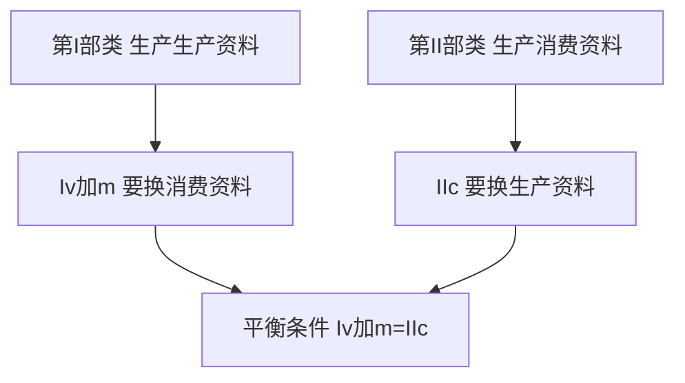
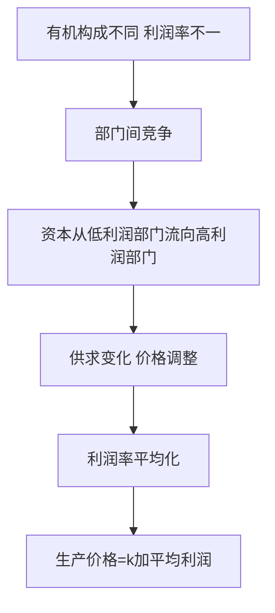

# 第 03 章 资本流通与剩余价值分配 · 考研真题集（首经贸 801）

<a href="../../../exam.html" target="_blank" style="display:inline-block;padding:6px 16px;background:#2563eb;color:#fff;border-radius:6px;text-decoration:none;font-size:14px;">📝 开始做题</a>

> 本章共收录：简答题 10 道（每题 15 分）｜论述题 4 道（每题 30 分）
> 配套选择题见 [[选择题集|本章选择题集]]
> 对应大纲：马克思主义政治经济学概论 第二篇 第 6—7 章（资本循环与周转、社会总资本再生产、平均利润与生产价格、商业利润、利息与银行利润、地租）

## 📋 本题集目录

### 简答题
1. [[#简答 1：简述产业资本循环经历的三个阶段和采取的三种职能形式。|产业资本循环三阶段与三种职能形式]]
2. [[#简答 2：为什么说产业资本的连续循环是三种循环形式的统一？需要具备哪些条件？|产业资本连续循环的两个条件]]
3. [[#简答 3：某产业资本家预付总资本 100 万元，其中不变资本 $c$ 与可变资本 $v$ 之比为 $4:1$，剩余价值率 $m'=100\%$，该资本一年周转 $2$ 次。试计算年剩余价值量 $M$ 与年剩余价值率 $M'$，并说明年剩余价值率与剩余价值率的区别。|资本周转与年剩余价值量计算]]
4. [[#简答 4：划分固定资本与流动资本同划分不变资本与可变资本有何区别？为什么说这种区别是政治经济学的重要问题？|固定资本/流动资本 vs 不变资本/可变资本]]
5. [[#简答 5：什么是固定资本折旧？影响固定资本折旧快慢的因素有哪些？|固定资本折旧及其影响因素]]
6. [[#简答 6：试述社会总资本简单再生产的实现条件，并计算已知条件下的 II(c) 及交换关系。|简单再生产实现条件（含计算）]]
7. [[#简答 7：简述社会总资本扩大再生产的前提条件与实现条件。|扩大再生产前提条件与实现条件]]
8. [[#简答 8：试述利润是怎样转化为平均利润的？商品价值怎样转化为生产价格？|利润转化为平均利润、价值转化为生产价格]]
9. [[#简答 9：简述商业利润的来源和本质。商业职工的剩余劳动是否受剥削？|商业利润的来源与本质]]
10. [[#简答 10：级差地租与绝对地租有何区别？试用马克思地租理论说明农产品价格决定的特点。|级差地租与绝对地租的区别]]

### 论述题
1. [[#论述 1：试用马克思的资本循环与资本周转理论，分析我国企业为什么高度重视现金流管理，并说明"双 11"等集中促销现象的政治经济学根源。|用资本循环与周转理论分析企业现金流与"双11"现象]]
2. [[#论述 2：试用平均利润与生产价格理论，分析我国平台经济（电商、外卖、网约车）的利润来源及其与传统商业利润的异同。|用平均利润与生产价格理论分析平台经济利润来源]]
3. [[#论述 3：试用马克思的级差地租与绝对地租理论，分析我国城市高房价和土地财政现象，并说明其政治经济学后果。|用马克思地租理论分析房价高企与土地财政]]
4. [[#论述 4：试用马克思的社会总资本再生产理论，分析我国"扩大内需"战略与"供给侧结构性改革"的政治经济学依据。|用社会总资本再生产理论分析扩大内需与供给侧结构性改革]]

---

## 一、简答题（每题 15 分，建议 450—700 字）

### 简答 1：简述产业资本循环经历的三个阶段和采取的三种职能形式。

**【建议字数】450–700 字 ｜ 【建议时间】15 分钟 ｜ 【题型】模型分析**

**【考什么】** 对应知识点 [[知识点/KP01_资本循环|资本循环]]，对应大纲第 6 章第 1 节；题型属于概念简答。

**【核心推导】**
**第一步：把总公式写出来，矛盾就浮出水面**

产业资本循环的总公式是
$$G-W\begin{matrix}A\\Pm\end{matrix}\cdots P\cdots W'-G'$$
其中 $G$ 为货币，$W$ 为商品，$A$ 为劳动力，$Pm$ 为生产资料，$P$ 为生产过程，$W'$ 为包含剩余价值的新商品，$G'$ 为增殖了的货币。

**第二步：拆开三个阶段，看每个阶段资本采取什么职能形式**

**(一) 购买阶段 $G-W$**：资本家用货币购买劳动力 $A$ 和生产资料 $Pm$。这里的货币不是普通货币，而是**货币资本**——它的职能是为剩余价值生产准备条件（人和物的条件必须按技术比例配套）。

**(二) 生产阶段 $\cdots P\cdots$**：劳动力与生产资料结合，生产出包含剩余价值的新商品 $W'$。此时资本采取**生产资本**职能形式。这是整个循环中**具有决定意义的阶段**——剩余价值只在这里被创造出来。前一个阶段只准备条件，后一个阶段只实现价值，都不生产一分新价值。

**(三) 售卖阶段 $W'-G'$**：把商品卖出去换回货币，资本采取**商品资本**职能形式，职能是实现预付资本价值和剩余价值。马克思把这一步称为"**惊险的跳跃**"——跳不过去，摔坏的不是商品，而是商品所有者。

**第三步：区分"三种职能形式"与"三种循环形式"**

这是本题最容易混淆的两组概念，必须严格分开：

| 维度 | 三种职能形式 | 三种循环形式 |
|---|---|---|
| 是什么 | 资本在**同一循环内部**依次采取的形态 | 从**不同起点**考察同一资本得到的三个循环 |
| 内容 | 货币资本、生产资本、商品资本 | 货币资本循环 $G\cdots G'$、生产资本循环 $P\cdots P$、商品资本循环 $W'\cdots W'$ |
| 关系 | 与三个阶段一一对应 | 三种循环形式的统一 |

一句话：**职能形式是"横切面"（同一时刻资本处在哪个阶段），循环形式是"纵切面"（从哪个环节起笔画完整一圈）。**

**第四步：为什么连续循环必须是三种循环形式的统一**

三种循环形式并非三个独立的资本，而是**同一产业资本连续运动**的三个侧面：

- 货币资本循环 $G-W\cdots P\cdots W'-G'$：起点终点都是货币，最醒目地暴露了资本运动的目的就是赚钱（增殖）。
- 生产资本循环 $P\cdots W'-G'-W\cdots P$：起点终点都是生产资本，表明生产是反复进行的再生产过程。
- 商品资本循环 $W'-G'-W\cdots P\cdots W'$：起点是已经包含剩余价值的商品，表明**商品的实现**是资本运动得以继续的条件。

单独看任何一种循环都会产生片面认识：只看 $G\cdots G'$ 会以为赚钱发生在流通中（重商主义错觉）；只看 $P\cdots P$ 会以为生产可以脱离市场无限进行。三者合起来才还原完整画面。

**第五步：连续循环的两个条件——并存性与继起性**

**(一) 空间上的并存性**：全部资本必须按一定比例**同时**存在于货币资本、生产资本、商品资本三种形式上。一部分钱在买原料，一部分钱在厂房机器和半成品上，一部分钱压在待售商品上。若全部资本都投在生产阶段，就没有货币去买原料，下一年开不了工。

**(二) 时间上的继起性**：三种职能形式必须**依次相继**转化：货币资本不断转化为生产资本，生产资本不断转化为商品资本，商品资本不断回到货币资本。任何一个环节停顿，其他两个环节也会相继卡住。

**(三) 二者互为条件**：并存是继起的前提（不并存就无从依次转化），继起是并存的保证（不继起，并存的比例很快被打破）。这是产业资本连续循环的必要条件，也是资本主义企业管理的核心问题。

**第六步：比例失衡会怎样——用一组数字算一遍**

设某企业资本 300 万元，按 1:1:1 并存：100 万货币资本、100 万生产资本、100 万商品资本，每阶段耗时 1 个月，月产剩余价值 10 万元。

- 正常情况：每月完成一轮，年剩余价值 120 万元。
- 若售卖阶段卡住（商品资本停在 100 万卖不出去）：下个月货币资本收不回来，只剩 100 万货币资本要同时承担购买原料和发工资，生产规模被迫压缩；持续两个月，生产阶段无料可加工，货币资本耗尽，循环**完全中断**。
- 若购买阶段卡住（原材料断供）：生产资本闲置，固定资本照样折旧，商品资本卖完后无货可补，同样中断。

**第七步：结论**

产业资本循环是**购买、生产、售卖三阶段的统一**，是**货币资本、生产资本、商品资本三种职能形式的统一**，也是**货币资本循环、生产资本循环、商品资本循环三种循环形式的统一**；其连续进行的条件是三种职能形式在空间上并存、在时间上继取。一句话概括：**剩余价值在生产阶段被创造、在售卖阶段被实现，而这两件事能否接上，取决于三个阶段是否首尾相咬、三种形态是否同时在场。**

**【为什么要答这几点】**
**【满分 15 分的分点逻辑】**

**第一段：总公式与三阶段（4 分）**
写出 $G-W\cdots P\cdots W'-G'$，并点明购买、生产、售卖三个阶段。漏一个阶段扣 1 分；公式写错（如把 $W'$ 写成 $W$）扣 1 分。

**第二段：三种职能形式与阶段对应（4 分）**
货币资本—购买阶段、生产资本—生产阶段、商品资本—售卖阶段，三者必须一一对应。这里必须强调**生产阶段是决定性阶段**（剩余价值在这里产生），这是 1 分的采分点。

**第三段：三种循环形式的统一（4 分）**
写出三种循环形式的公式，并说明它们不是三个独立资本，而是同一资本运动的三个侧面。只写"三种循环统一"六个字而无内容，最多 1 分。

**第四段：连续循环的条件（3 分）**
并存性（空间）+ 继起性（时间），二者互为条件。少一个扣 1.5 分。

**易失分点（五条）**
1. 把"三种职能形式"和"三种循环形式"混为一谈——这是本题最高频的错误，两类概念必须分开写。
2. 漏掉购买阶段中 $A$（劳动力）与 $Pm$（生产资料）的区分——货币买的东西不一样，这恰恰是后面能生产剩余价值的关键。
3. 只写"生产阶段重要"而不说为什么重要（因为只有活劳动创造新价值）。
4. 把售卖阶段说成"实现利润"却不提"实现预付资本价值"——两件事一起实现才对。
5. 并存与继起割裂成两条并列条件，不写二者互为条件。

**加分点（五条）**
1. 引用"惊险的跳跃"这一原文表述，说明售卖阶段的市场风险。
2. 点出重商主义错觉：只看 $G\cdots G'$ 会误以为剩余价值来自流通。
3. 用具体数字演示某一阶段卡住导致循环中断（300 万资本、1:1:1 并存的例子）。
4. 指出资本循环理论对现实企业管理的意义：现金流（货币资本）、产能利用（生产资本）、库存与销售（商品资本）三条线必须同时健康。
5. 指出这一理论与后面资本周转理论的关系：循环讲"能不能转通"，周转讲"转得多快"。

**【阅卷心理】**
判卷老师只看两处：**三阶段与三种职能形式是否严格对应并点明生产阶段的决定性**；**是否把"职能形式"和"循环形式"分开讲**。这两处做到，基本分就稳了。
记忆金句：**钱买人料（货币资本）→ 人料生钱（生产资本）→ 货卖回钱（商品资本），三形并存、三段继起，圈才转得下去。**

**【如何分析题目】**
**第一步：审题，锁定考点**
题干出现"产业资本循环""三阶段""三种职能形式""连续循环的条件"，考点就是资本循环理论。注意区分问的是"循环"还是"周转"——循环讲形态变化，周转讲速度。

**第二步：先搭骨架再填肉**
骨架四块：总公式 → 三阶段三职能 → 三种循环形式 → 连续循环条件。下笔前在草稿纸上写这四个小标题，正文按标题展开，绝不打乱顺序。

**第三步：写总公式**
$G-W\cdots P\cdots W'-G'$，并把 $A$、$Pm$、$P$、$W'$、$G'$ 的含义交代清楚（每个符号 0.5 分的感觉）。

**第四步：逐阶段展开**
购买、生产、售卖各写三句——干什么（内容）、采取什么职能形式、在整个循环中起什么作用。生产阶段要单独强调"剩余价值在这里产生"。

**第五步：补一块概念辨析**
明确写出"三种职能形式是横切面、三种循环形式是纵切面"，并给出三种循环形式的公式。这一块是拉开分差的地方。

**第六步：写连续循环的条件**
并存性、继起性、互为条件，三句写完，最好各配一句解释。

**第七步：加一句现实落点**
企业现金流断裂、库存积压、销售困难，本质上都是某一阶段卡住了循环——这一句 1 分钟能换来不错的印象分。

**第八步：字数与时间控制**
15 分约 700–900 字，建议 14–16 分钟：骨架 2 分钟、正文 9 分钟、现实落点与检查 3 分钟。若时间紧，先保住三阶段三职能与两个条件，概念辨析可压缩成两行表格。

**【答题框架】**
- 第 1 段：资本循环的总公式（2 分）
- 第 2 段：三阶段与三种职能形式一一对应（6 分）
- 第 3 段：三种循环形式的统一（4 分）
- 第 4 段：现实意义（3 分）

**【参考答案】**

一、产业资本循环的总公式

产业资本依次经过购买、生产、售卖三个阶段，相应采取货币资本、生产资本、商品资本三种职能形式，实现价值增殖，最后回到原来出发点的运动，就是资本循环。其总公式为：

$$G—W\begin{matrix}A\\Pm\end{matrix}\cdots P\cdots W'—G'$$

其中 $G$ 为货币，$W$ 为商品，$A$ 为劳动力，$Pm$ 为生产资料，$P$ 为生产过程，$W'$ 为包含剩余价值的新商品，$G'$ 为增殖了的货币。

二、三个阶段与三种职能形式

(一) 购买阶段：$G—W$。资本家用货币购买劳动力 $A$ 和生产资料 $Pm$，货币在这里执行**货币资本**职能，为剩余价值生产准备条件。

(二) 生产阶段：$\cdots P\cdots$。劳动力与生产资料结合生产出包含剩余价值的新商品 $W'$，生产资料与劳动力在这里采取**生产资本**职能形式，这是循环中具有决定意义的阶段，剩余价值就是在这里生产出来的。

(三) 售卖阶段：$W'—G'$。资本家把包含剩余价值的商品卖出换回货币，商品在这里采取**商品资本**职能形式，其职能是实现预付资本价值和剩余价值。马克思称之为"惊险的跳跃"。

三、三种循环形式的统一

产业资本连续循环是货币资本循环、生产资本循环、商品资本循环三种循环形式的统一。三种循环形式在时间上继起、在空间上并存，是产业资本正常循环的必要条件。

四、现实意义

资本循环任何一个阶段中断，都会导致资本停留在某种职能形式上而无法增殖。企业现金流断裂、库存积压、销售困难，本质上都是循环某一阶段卡住了。

**【解析·得分点】** 采分点：①总公式 ②三阶段顺序不能乱 ③三种职能形式与阶段一一对应 ④生产阶段是决定阶段 ⑤三种循环形式统一。易丢分：把"职能形式"与"循环形式"混为一谈；漏掉购买阶段中 $A$ 与 $Pm$ 的区分。

**【生活实例】** 一家奶茶店：老板先掏钱买茶叶、牛奶、杯子，再雇店员——这是购买阶段，钱是货币资本；店员在店里熬奶茶——这是生产阶段，原料和人是生产资本；顾客排队扫码买走奶茶——这是售卖阶段，一杯杯奶茶是商品资本。三步缺一不可：买不到原料开不了张，做不出奶茶卖不出去，卖不掉奶茶就没钱进下一轮原料。

**【双链接】** 🔗 [[知识点/KP01_资本循环|回知识点]] ｜ 📖 [[../../../原文件/经济学/马克思主义政治经济学概论_全书|《概论》第六章第一节]]

---

### 简答 2：为什么说产业资本的连续循环是三种循环形式的统一？需要具备哪些条件？

**【建议字数】450–700 字 ｜ 【建议时间】15 分钟 ｜ 【题型】模型分析**

**【考什么】** 对应知识点 [[知识点/KP01_资本循环|资本循环]]，对应大纲第 6 章第 1 节；题型属于关系对比。

**【核心推导】**
**第一步：先看清三种循环形式各自的公式与侧重**

| 循环形式 | 公式 | 起点/终点 | 最突出地说明了什么 |
|---|---|---|---|
| 货币资本循环 | $G-W\cdots P\cdots W'-G'$ | 都是货币 | 资本运动的目的就是增殖（$G'>G$） |
| 生产资本循环 | $P\cdots W'-G'-W\cdots P$ | 都是生产资本 | 生产是反复进行的再生产过程 |
| 商品资本循环 | $W'-G'-W\cdots P\cdots W'$ | 都是包含剩余价值的商品 | 商品能否卖出、价值能否实现 |

三种循环形式不是三个不同的资本，而是**同一产业资本连续运动从不同起点考察得到的三个侧面**。

**第二步：为什么必须统一——单独看任何一种都会产生错觉**

- 只看货币资本循环 $G\cdots G'$：会误以为货币自身能生出货币，把剩余价值的来源归到流通领域（重商主义错觉）。
- 只看生产资本循环 $P\cdots P$：会以为生产可以脱离市场无限扩大，忽视商品能不能卖掉（传统计划经济思维）。
- 只看商品资本循环 $W'\cdots W'$：会以为关键只是把东西卖出去，忽视生产中是否创造了新价值（销售至上论）。

三者合起来才是完整画面：**价值在生产中创造、在流通中实现，再回到生产**。这就是"统一"的第一层含义——认识论上的统一。

**第三步：统一的第一层含义——三种形式在同一个资本身上同时成立**

设某产业资本总量 300 万元，按 1:1:1 分成三份：
- 100 万处于货币资本形态（正在购买 $A$、$Pm$）；
- 100 万处于生产资本形态（正在加工）；
- 100 万处于商品资本形态（正在销售）。

在任何一个时刻，把这三份分别"倒着看"，都能读出一个完整的循环：从货币那 100 万起笔，是货币资本循环；从生产那 100 万起笔，是生产资本循环；从商品那 100 万起笔，是商品资本循环。**同一条资本的三个切片，就是三个循环**。

**第四步：统一的第二层含义——这才是答案的核心：并存与继起**

**(一) 空间上的并存性（三种职能形式同时在场）**

产业资本必须按一定比例**同时**存在于货币资本、生产资本、商品资本三种形式上。设比例为 $g_1:g_2:g_3$，须有 $g_1+g_2+g_3=1$，且各部分的规模要能满足各自阶段的技术需要。

反证：若全部资本都投在生产阶段（$g_1=0$），则没有货币去买原料、发工资，下一轮无从开始；若全部投在商品阶段（$g_2=0$），则工厂停工，无货可卖。所以**并存是硬约束，不是选择**。

**(二) 时间上的继起性（三种职能形式依次转化）**

三种职能形式必须依次相继转化：
$$G\to P\to W'\to G'$$
即货币资本不断转化为生产资本，生产资本不断转化为商品资本，商品资本不断回到货币资本，一轮接一轮不停顿。

反证：若商品资本不能及时回到货币资本（卖不出去），则货币资本无钱购买，生产资本无料可加工，三者相继卡死。

**(三) 二者互为条件**

- **并存是继起的前提**：如果没有同时并存的三部分资本，就根本谈不上"依次转化"——只有一份资本时，它在任何时刻只能处在一个阶段，转化只能是断续的。
- **继起是并存的保证**：如果转化不能连续进行，各部分停留的时间就会错位。比如商品长期卖不出，商品资本占比不断膨胀、货币资本占比不断缩小，原有的 1:1:1 并存比例被打破，并存也就瓦解了。

一句话：**并存提供"结构"，继起提供"流动"；结构不稳则流动不畅，流动不畅则结构坍缩。**

**第五步：用时间比例算一遍并存比例**

设购买阶段耗时 $t_1$、生产阶段 $t_2$、售卖阶段 $t_3$，总循环时间 $T=t_1+t_2+t_3$。要使循环不间断，三部分资本的比例必须满足：
$$g_1:g_2:g_3=t_1:t_2:t_3$$
即**停留在某一阶段的资本量，必须与该阶段耗时成正比**。

例：某企业购买 1 个月、生产 3 个月、售卖 2 个月，$T=6$ 个月。若总资本 600 万元，则货币资本 100 万、生产资本 300 万、商品资本 200 万。若企业误按 1:1:1 配置（各 200 万），则生产阶段只有 200 万却要占用 3 个月，产能吃不饱，产能利用率只有 2/3。

**第六步：卡住会怎样——用数字演示中断**

仍设 600 万资本，按 100/300/200 配置，每月创造剩余价值率 100%、生产资本月产剩余价值 30 万元。

- 正常：每 6 个月一轮，年周转 2 次，年剩余价值 = 2 × 6 × 30 = 360 万元（口径为示例）。
- 售卖卡住（商品卖不出）：第 4 个月起商品资本膨胀到 400 万，货币资本被抽干，第 6 个月无钱购买原料，**生产阶段被迫停车**；此时固定资本照旧折旧，损失叠加。
- 购买卡住（原料断供）：生产资本闲置，2 个月后商品资本售罄，货币资本虽充足却买不到东西，循环同样中断。

这正是 2022 年一些制造业企业的真实处境：订单在（商品资本要变现）、产能在（生产资本已投）、但现金流断了（货币资本枯竭）。

**第七步：结论**

产业资本连续循环之所以必须是**三种循环形式的统一**，是因为：从**认识**上，单独任何一种循环形式都会产生片面错觉；从**存在**上，同一资本在任何一个时刻都以三种职能形式并存，各自都能读出一个完整循环；从**运行**上，唯有三种职能形式在空间上**并存**、在时间上**继起**、且二者互为条件，循环才能连续不断。用一句话记住：**资本必须"分身三处、依次轮转"，既要同时在三个位置上，又要让每一份不断往下传，缺一即断。**

**【为什么要答这几点】**
**【满分 15 分的分点逻辑】**

**第一段：三种循环形式的公式与侧重（4 分）**
三个公式各 1 分，各配一句"最突出说明了什么"共 1 分。公式写错扣分，漏掉任何一个循环形式直接失掉 1 分以上。

**第二段：三者不是三个资本而是同一资本的三个侧面（3 分）**
这一句是理解题意的门槛。只说"统一"不讲"同一资本"，最多 1 分。

**第三段：空间并存性（3 分）**
必须写明"按一定比例同时存在于三种职能形式上"，并给出反证（全部投在生产阶段则无钱买料）。只写"并存"两个字得 0.5 分。

**第四段：时间继起性（3 分）**
三种职能形式依次相继转化，任一环节停顿则其他环节相继卡住。最好把转化链 $G\to P\to W'\to G'$ 写出来。

**第五段：二者互为条件（2 分）**
并存是继起的前提，继起是并存的保证。二者割裂写，扣 1 分。

**易失分点（五条）**
1. 只答"三种循环形式统一"却不答"条件"——题干问的是"为什么必须统一及条件"，两半都要答。
2. 把并存与继起写成两条并列条件而不讲互为条件。
3. 漏掉"三种循环形式分别是什么"直接跳到条件，逻辑断层。
4. 混淆"职能形式"（货币/生产/商品资本）与"循环形式"（$G\cdots G'$/$P\cdots P$/$W'\cdots W'$）。
5. 用"资本必须同时存在三种形态"一句带过，不解释比例从哪来。

**加分点（五条）**
1. 指出单独看某种循环形式会产生的错觉（重商主义、计划经济思维、销售至上论），说明统一的**认识论**意义。
2. 用 $g_1:g_2:g_3=t_1:t_2:t_3$ 给出并存比例的定量表达——停留资本量与该阶段耗时成正比。
3. 用具体数字演示某一阶段卡住如何引发循环中断（600 万资本、1/3/2 个月的例子）。
4. 指出资本循环理论与资本周转理论的分工：循环讲"通不通"，周转讲"快不快"。
5. 联系现实：现金流、产能利用率、库存周转率分别对应三种资本形态，三者要一起看。

**【阅卷心理】**
判卷老师主要看两处：**是否明确写出并存性与继起性并说明二者互为条件**；**是否把三种循环形式与三种职能形式区分清楚**。
记忆金句：**三个位置同时在（并存），每份不断往下传（继起）；位置一挤就堵，传递一停就散。**

**【如何分析题目】**
**第一步：审题，抓两个关键词**
题干里"三种循环形式的统一"和"条件"是两个必须分别作答的部分。看到"为什么……及条件"，就知道要写"理由 + 条件"两块。

**第二步：先把三个循环形式的公式列成表**
表格三列：循环形式、公式、它最突出地说明了什么。这一步只需 2 分钟，却是全题的骨架。

**第三步：立起"同一资本的三个侧面"这一句**
紧接着写：三种循环形式不是三个独立的资本，而是同一产业资本连续运动从不同起点考察得到的三个侧面。这句是连接"形式"与"条件"的桥。

**第四步：写并存性**
定义（同时存在于三种职能形式并按一定比例）+ 反证（全投生产则无钱买料）。两句话即可，但要写清"按比例"。

**第五步：写继起性**
定义（依次转化 $G\to P\to W'\to G'$）+ 反证（售卖卡住则三者连锁卡死）。

**第六步：写二者互为条件**
两句对偶：并存是继起的前提，继起是并存的保证。这一块如果时间充裕，可以加一句"结构不稳则流动不畅，流动不畅则结构坍缩"。

**第七步：加定量或实例**
时间允许就写 $g_1:g_2:g_3=t_1:t_2:t_3$，以及一个"售卖卡住两个月导致停车"的数字例子。这一块是区分 12 分与 14 分的地方。

**第八步：收尾一句**
用一句话把认识层面与运行层面的统一合起来收束。

**第九步：字数与时间控制**
15 分约 700–900 字，建议 15 分钟：列表 2 分钟、三块正文 9 分钟、互为条件与实例 3 分钟、检查 1 分钟。若时间紧，先保并存、继起、互为条件这三块（共 8 分），再补公式与实例。

**【答题框架】**
- 第 1 段：三种循环形式各有侧重（4 分）
- 第 2 段：空间上并存性（5 分）
- 第 3 段：时间上继起性（4 分）
- 第 4 段：两者互为条件（2 分）

**【参考答案】**

一、三种循环形式各有侧重

产业资本循环从不同角度看，表现为三种循环形式：货币资本循环 $G—W\cdots P\cdots W'—G'$，起点和终点都是货币，最醒目地暴露了资本生产剩余价值的目的；生产资本循环 $P\cdots W'—G'—W\cdots P$，表明生产是反复进行的再生产过程；商品资本循环 $W'—G'—W\cdots P\cdots W'$，表明商品的实现是资本运动的条件。三种循环形式并非三个独立资本，而是同一产业资本连续循环的三个侧面。

二、空间上的并存性

产业资本必须按照一定比例同时并存于货币资本、生产资本、商品资本三种形式上。一部分处于购买阶段，一部分处于生产阶段，一部分处于售卖阶段。如果全部资本都投在生产阶段，就没有货币去买原料；全部投在商品阶段，工厂就停工。

三、时间上的继起性

三种职能形式必须依次相继转化，货币资本不断转化为生产资本，生产资本不断转化为商品资本，商品资本不断回到货币资本。任何一种形式的循环发生停顿，其他两种循环也会相继卡住。

四、并存与继起互为条件

并存是继起的前提——没有同时并存，就谈不上依次继起；继起是并存的保证——没有连续继起，并存的比例就会被破坏。二者统一，产业资本循环才能连续不断。这就是资本主义生产连续性的条件，也是资本主义企业管理的核心问题。

**【解析·得分点】** 采分点：①三种循环形式各自的公式与特点 ②并存性的含义 ③继起性的含义 ④二者辩证关系。易丢分：把并存与继起割裂；只说"三种循环统一"而不说条件。

**【生活实例】** 一家外卖店：后厨同时要有人在炒菜（生产资本），前台同时要有人接单打包（商品资本），老板账上同时要留钱买菜发工资（货币资本）——三种钱同时在不同位置上，这叫"并存"；菜炒好立刻打包、打包立刻出餐、出餐立刻收到下一笔钱买新菜，一环扣一环，这叫"继起"。哪一段断了，店就停了。

**【双链接】** 🔗 [[知识点/KP01_资本循环|回知识点]] ｜ [[知识点/KP02_资本周转|资本周转]]

---

### 简答 3：某产业资本家预付总资本 100 万元，其中不变资本 $c$ 与可变资本 $v$ 之比为 $4:1$，剩余价值率 $m'=100\%$，该资本一年周转 $2$ 次。试计算年剩余价值量 $M$ 与年剩余价值率 $M'$，并说明年剩余价值率与剩余价值率的区别。

**【建议字数】450–700 字 ｜ 【建议时间】15 分钟 ｜ 【题型】分析推导**

**【考什么】** 对应知识点 [[知识点/KP02_资本周转|资本周转]]，对应大纲第 6 章第 2—3 节；题型属于分析推导（计算题）。

**【核心推导】**
**第一步：先拆资本构成——这是本题的第一道门槛**

预付总资本 $100$ 万元，$c:v=4:1$，则
$$c=100\times\frac{4}{5}=80\text{ 万元},\qquad v=100\times\frac{1}{5}=20\text{ 万元}$$

注意：$m'$ 只与 $v$ 挂钩，$c=80$ 万在本题中除了参与 $p'$ 的计算外，对剩余价值量没有任何贡献。**第一步就要把"谁带来剩余价值"这个问题摆正。**

**第二步：算一次周转获得的剩余价值量**

剩余价值率 $m'=m/v=100\%$，所以
$$m=m'\cdot v=100\%\times 20=20\text{ 万元}$$

含义：这 20 万元是 20 万可变资本在一个生产周期内"生"出来的新价值，与 80 万不变资本无关（$c$ 只是被转移，不增殖）。

**第三步：算年剩余价值量**

一年周转 $n=2$ 次，同一个 $v$ 被反复使用两次，于是
$$M=n\cdot m=2\times 20=40\text{ 万元}$$

关键理解：这 40 万元**不是**"资本变多了"，而是**同一笔 20 万可变资本在一年中被使用了两次**，每次各榨出 20 万剩余价值。

**第四步：算年剩余价值率**

$$M'=\frac{M}{v}=\frac{40}{20}=200\%$$
或直接用等价公式：
$$M'=m'\cdot n=100\%\times 2=200\%$$

**这里必须做一次易错提醒**：分母是 $v=20$ 万，不是 $c+v=100$ 万。若误用总资本作分母，得 $40/100=40\%$，那是**利润率**口径 $p'=m/(c+v)$，不是年剩余价值率。

**第五步：把两个公式的等价性证明一遍**

设一次周转剩余价值 $m=m'v$，一年周转 $n$ 次，则
$$M=n\cdot m=n\cdot m'\cdot v$$
两边同除 $v$：
$$M'=\frac{M}{v}=\frac{n\cdot m'\cdot v}{v}=m'\cdot n$$
等价性成立。这个推导只用两行，但在考场上能证明你不是死记结论。

**第六步：$M'$ 与 $m'$ 的三点区别（本题的第二道门槛）**

| 维度 | 剩余价值率 $m'=m/v$ | 年剩余价值率 $M'=M/v$ |
|---|---|---|
| 含义 | 一次生产过程中对工人的**剥削程度** | 预付可变资本**一年的增殖程度** |
| 数量关系 | 基准 | $n=1$ 时 $M'=m'$；$n>1$ 时 $M'>m'$ |
| 作用 | 直接暴露剥削 | 把同一 $v$ 反复使用的效果也算到 $v$ 头上，**进一步掩盖剥削来源** |

**第七步：数字延伸——周转速度的作用有多大**

同一企业若把周转次数从 $n=2$ 提高到 $n=3$（比如压缩库存、加快回款），在 $m'$、$v$ 都不变的情况下：
$$M'=100\%\times 3=300\%,\qquad M=3\times 20=60\text{ 万元}$$

预付资本一分没多，年剩余价值却从 40 万涨到 60 万，涨幅 50%。这就是马克思所说"资本周转速度本身成为一种独立的剥削手段"的定量含义——**资本家为什么拼命加快周转，是因为加快周转能在不增加预付资本的前提下提高年剩余价值率。**

**第八步：结论**

本题三问的答案是：$m=20$ 万元，$M=n\cdot m=2\times20=40$ 万元，$M'=M/v=200\%$。其理论意义在于：年剩余价值率通过 $M'=m'\cdot n$ 把**周转速度**引入了剩余价值量的决定，说明剥削程度（$m'$）与剥削总量（$M$）之间隔着一个资本周转变量；同时 $M'$ 以 $v$ 为分母却把多次使用的效果叠加到同一 $v$ 上，使剥削来源更加模糊。一句话：**剩余价值率是"一次榨多少"，年剩余价值率是"一年榨多少"，两者之间隔着一个周转次数 $n$。**

**【为什么要答这几点】**
**【满分 15 分的分点逻辑】**

**第一段：拆分 $c$ 与 $v$（3 分）**
写出 $c=80$ 万、$v=20$ 万并交代依据（$c:v=4:1$，总资本 100 万）。直接跳到算 $m$ 而不拆分的，扣 3 分——因为本题考的就是"$m$ 只由 $v$ 带来"这个判断。

**第二段：一次周转的剩余价值（2 分）**
$m=m'\cdot v=20$ 万元。写出公式 1 分，算出结果 1 分。

**第三段：年剩余价值量（3 分）**
$M=n\cdot m=2\times 20=40$ 万元。漏乘 $n$ 直接得 20 万，是本卷最高频的错误，直接失 3 分。

**第四段：年剩余价值率（3 分）**
$M'=M/v=200\%$，或 $M'=m'\cdot n=200\%$。两个口径都给一遍更稳。

**第五段：$M'$ 与 $m'$ 的区别（4 分）**
含义、数量关系（仅 $n=1$ 时相等）、掩盖剥削三层，各 1 分；最好用表格呈现，另加 1 分给"$M'$ 进一步掩盖了剩余价值的真正来源"。

**易失分点（五条）**
1. **忘记乘周转次数 $n$**，把 $M$ 当成 $m$ 答（20 万而非 40 万）。
2. **用 $c+v$ 作分母**算年剩余价值率，得 40% 而非 200%——那是利润率口径。
3. 只给结果不给公式，阅卷时无法判断是算对还是蒙对。
4. 把 $M'$ 与 $m'$ 说成"前者更大所以剥削更重"——两者衡量的是不同对象（一次 vs 一年）。
5. 不区分 $m$ 与 $M$：$m$ 是"一次周转"的量，$M$ 是"一年累计"的量。

**加分点（五条）**
1. 用两行推导证明 $M'=m'\cdot n$ 的等价性，展示理解而非记忆。
2. 明确指出 $c=80$ 万在 $m$ 的计算中不起作用（不变资本只转移价值、不创造价值），呼应剩余价值理论的核心。
3. 做一次数字延伸：$n$ 从 2 提到 3，$M'$ 从 200% 提到 300%，说明加快周转本身就是提高剥削量的独立手段。
4. 指出这是资本家加快资本周转、压缩库存、加速回款的根本动因——把计算题接回理论。
5. 指出 $M'$ 掩盖剥削的机理：同一笔 $v$ 被反复使用多次，效果全算到一个 $v$ 头上，看起来像"钱自己生钱"。

**【阅卷心理】**
判卷老师主要看两处：**是否先拆 $c$、$v$ 再算 $m$**；**是否乘了周转次数 $n$ 且分母用的是 $v$**。这两处对了，基本分全拿。
记忆金句：**$m'$ 看一次（$m/v$），$M'$ 看一年（$m'\cdot n$）；分母永远只有 $v$，不是 $c+v$。**

**【如何分析题目】**
**第一步：审题，圈出三个数字**
$100$ 万元（预付总资本）、$c:v=4:1$、$m'=100\%$、$n=2$ 次/年。四个已知量对应四个计算环节，先在草稿上排好顺序。

**第二步：先拆构成**
$c=80$ 万、$v=20$ 万。这一步不写，后面全错，务必落在卷面上。

**第三步：按顺序算三问**
$m\to M\to M'$ 三步依次算，每步都写公式 + 代入 + 结果三件套。切忌跳步只写数字。

**第四步：做分母自查**
看到 $M'=M/v$ 时立刻问自己一句："分母是 $v$ 还是 $c+v$？"若是 $c+v$，那是利润率。

**第五步：补一段概念辨析**
写 $M'$ 与 $m'$ 的三点区别（含义、数量关系、掩盖剥削），最好用表格。这一块 4 分，是从 10 分到 14 分的关键。

**第六步：加一句周转速度的作用**
"若 $n$ 从 2 提到 3，则 $M'=300\%$、$M=60$ 万，预付资本不变而剥削量增加"——一句话就能体现实质理解。

**第七步：收尾接回理论**
点明 $M'=m'\cdot n$ 说明周转速度是决定剩余价值量的独立变量，这是资本家追逐周转速度的根本动因。

**第八步：字数与时间控制**
15 分约 500–700 字，建议 12–14 分钟：拆分与计算 5 分钟、辨析表 4 分钟、延伸与收尾 3 分钟。计算题先保三个结果（共 8 分），辨析块若时间紧就压缩成三条短句。

**【答题框架】**
- 第 1 段：拆分 $c$ 与 $v$（3 分）
- 第 2 段：计算一次周转的剩余价值（4 分）
- 第 3 段：计算年剩余价值量与年剩余价值率（5 分）
- 第 4 段：$M'$ 与 $m'$ 的区别（3 分）

**【参考答案】**

一、拆分不变资本与可变资本

预付总资本 $C=c+v=100$ 万元，$c:v=4:1$，故：

$$c=100\times\frac{4}{5}=80\text{ 万元},\qquad v=100\times\frac{1}{5}=20\text{ 万元}$$

二、一次周转获得的剩余价值

$$m=m'\cdot v=100\%\times 20=20\text{ 万元}$$

三、年剩余价值量与年剩余价值率

一年周转 $n=2$ 次，故年剩余价值量：

$$M=n\cdot m=2\times 20=40\text{ 万元}$$

年剩余价值率：

$$M'=\frac{M}{v}=\frac{40}{20}=200\%$$

或直接用公式 $M'=m'\cdot n=100\%\times 2=200\%$。

四、$M'$ 与 $m'$ 的区别

(一) 含义不同：剩余价值率 $m'=m/v$ 反映一次生产过程中资本家对工人的剥削程度；年剩余价值率 $M'=M/v$ 反映预付可变资本一年的增殖程度。

(二) 数量关系：只有当 $n=1$ 时 $M'=m'$；当 $n>1$ 时 $M'>m'$。加速资本周转，可以在不增加预付可变资本的情况下提高年剩余价值量和年剩余价值率，这是资本家拼命加快周转的根本动因。

(三) 掩盖剥削：$M'$ 看起来把剥削程度放大或缩小，实际上它把可变资本一年中被反复使用带来的增殖，算到了同一个 $v$ 的头上，进一步掩盖了剩余价值的真正来源。

**【解析·得分点】** 采分点：①正确拆分 $c=80,v=20$ ②$m=20$ 万 ③$M=40$ 万 ④$M'=200\%$ ⑤说明 $M'=m'\cdot n$ ⑥区分两个比率。易丢分：把 $M'$ 错算成 $M/(c+v)$；忘记 $n=2$ 要乘进去。

**【生活实例】** 你花 2000 元进一批水果，一周卖完赚 200 元（剩余价值率 10%）；如果这批水果一年能周转 50 次，一年下来你赚 10000 元，年剩余价值率就是 500%。同样 2000 元本钱，周转越快，一年赚得越多——这就是为什么水果店老板宁愿薄利多销也要加快流转。

**【双链接】** 🔗 [[知识点/KP02_资本周转|回知识点]] ｜ [[知识点/KP03_固定资本与流动资本|固定资本与流动资本]]

---

### 简答 4：划分固定资本与流动资本同划分不变资本与可变资本有何区别？为什么说这种区别是政治经济学的重要问题？

**【建议字数】450–700 字 ｜ 【建议时间】15 分钟 ｜ 【题型】关系对比**

**【考什么】** 对应知识点 [[知识点/KP03_固定资本与流动资本|固定资本与流动资本]]，对应大纲第 6 章第 3 节；题型属于关系对比（易混点）。

**【核心推导】**
**第一步：先分清两组划分各自的依据——这是全题的骨架**

| 划分 | 依据 | 划分结果 |
|---|---|---|
| 不变资本 / 可变资本 | 各部分在**剩余价值生产中的不同作用** | 生产资料 $c$ / 劳动力 $v$ |
| 固定资本 / 流动资本 | 各部分**价值周转方式的不同** | 价值逐次转移 / 价值一次全部转移 |

一句话记住两条依据的性质差别：前者的划分标准是**"创不创造新价值"**（质的问题），后者的划分标准是**"价值怎么回来"**（周转形式的问题）。

**第二步：把两条依据分别讲透**

**(一) 不变资本与可变资本**

- 以生产资料形式存在的资本（厂房、机器、原料、燃料），在生产过程中只**转移**自身价值，价值量不发生变化，故称不变资本 $c$。
- 以劳动力形式存在的资本（工资），在生产过程中不仅再生产出自身价值 $v$，还生产出剩余价值 $m$，价值量发生了变化，故称可变资本 $v$。

判别标准只有一个：**它在生产过程中是否发生了价值增殖。**发生增殖的只有劳动力，所以 $v$ 是剩余价值的唯一源泉。

**(二) 固定资本与流动资本**

- 固定资本：厂房、机器设备等，可以在多次生产过程中反复使用，价值按磨损程度**逐次**转移到新产品中，逐次回收（例：10 万元机器用 10 年，每年转移 1 万元）。
- 流动资本：原料、燃料、辅助材料等，在一次生产过程中就全部被消耗，价值**一次全部**转移到新产品中；工资虽然不是被"消耗"的物，但它对应的价值在一次周转中一次全部收回，故也归入流动资本。

判别标准只有一个：**价值是一次全部周转，还是分多次逐次周转。**

**第三步：做内容交叉的对照表——这是本题必拿分的部分**

| 物资项目 | 按在 m 生产中的作用分 | 按价值周转方式分 |
|---|---|---|
| 厂房、机器设备 | 不变资本 $c$ | 固定资本 |
| 原料、燃料、辅助材料 | 不变资本 $c$ | 流动资本 |
| 工资（劳动力） | 可变资本 $v$ | 流动资本 |

从表里能读出三个结论：
1. **不变资本 ⊃ 固定资本**：固定资本全部属于不变资本，但不变资本还包括流动的那部分原料燃料。
2. **流动资本 ⊃ 可变资本**：工资属于流动资本，但流动资本还包括原料燃料。
3. **"固定"与"不变"、"流动"与"可变"绝不能划等号**：这是最高频的概念错误。"不变"说的是**不增殖**，"固定"说的是**多次转移**；"可变"说的是**能增殖**，"流动"说的是**一次周转**。

**第四步：说明为什么会有"交叉"——根源在于分类维度不同**

用一组数字看最清楚。设某企业：厂房机器 500 万元（用 10 年）、原材料 100 万元（一次消耗）、工资 100 万元（一次周转），总资本 700 万元。

- 按第一种划分：$c=500+100=600$ 万元、$v=100$ 万元，$c:v=6:1$（资本有机构成）。
- 按第二种划分：固定资本 $=500$ 万元、流动资本 $=100+100=200$ 万元，固定:流动 $=5:2$。
- 交叉点：那 100 万元原材料，在第一种划分里是 $c$，在第二种划分里是流动资本；那 100 万元工资，在第一种划分里是 $v$，在第二种划分里也是流动资本。

**同一笔钱在两个坐标系里的坐标不同，这不是矛盾，而是两个分类问题本来就问的不是同一件事。**

**第五步：说明两种划分的不同意义**

**(一) 划分不变资本与可变资本的意义**
揭示剩余价值的**真正来源**——只有可变资本才带来剩余价值，$c$ 只是转移价值。这一划分是马克思的原创，是剩余价值理论的基础，直接揭穿了"资本自身生利息、土地自身生地租、劳动自身得工资"的"三位一体公式"。

**(二) 划分固定资本与流动资本的意义**
考察**资本周转速度**及其对年剩余价值量的影响。固定资本占比高（重资产行业），周转慢、回收期长；流动资本占比高（商贸行业），周转快。这直接决定年剩余价值率 $M'=m'\cdot n$ 中的 $n$。

同时，这一划分还派生出**折旧**问题：固定资本价值逐次转移，需要按磨损程度提取折旧费逐步收回；技术飞速进步时还会遭遇无形磨损，因此现代企业普遍采用加速折旧。

**第六步：批判资产阶级经济学的"混淆"**

资产阶级经济学只讲固定资本与流动资本，不讲不变资本与可变资本，其后果是：
- 把工资说成"流动资本"，与原料并列——**抹掉了工资的增殖属性**，把 $v$ 混同于 $c$；
- 由此把利润说成"全部资本的产物"（$p'=m/(c+v)$），**掩盖了剩余价值的真正来源**；
- 最终得出"资本自身创造利润"的结论，为"资本—利息、土地—地租、劳动—工资"的三位一体公式提供辩护。

马克思在《资本论》第二卷中反复批判这种混淆，指出：**固定资本与流动资本的划分只涉及价值的周转形式，触及不到价值的创造问题；只有不变资本与可变资本的划分才触及资本主义剥削的实质。**

**第七步：结论**

两种划分依据不同（作用 vs 周转方式）、内容交叉（原料燃料、工资都是交叉项）、意义不同（揭示剥削来源 vs 考察周转速度）。一句话：**不变/可变回答"钱从哪来（剩余价值由谁创造）"，固定/流动回答"钱怎么回来（价值怎样周转）"；前者是本质问题，后者是形式问题。**

**【为什么要答这几点】**
**【满分 15 分的分点逻辑】**

**第一段：两种划分的依据（3 分）**
不变/可变按"在剩余价值生产中的作用"划分，固定/流动按"价值周转方式"划分。两个依据必须写准，写反或含糊（如"按性质划分"）不给分。

**第二段：内容对照表（5 分）**
表格三行：厂房机器（$c$ / 固定）、原料燃料（$c$ / 流动）、工资（$v$ / 流动）。表格本身 3 分，写清"原料燃料与工资是交叉项"再得 2 分。**这是本题最能拉开分差的部分。**

**第三段：划分目的与意义（4 分）**
不变/可变——揭示剩余价值真正来源，揭穿三位一体公式（2 分）；固定/流动——考察周转速度及其对年剩余价值率的影响，派生折旧问题（2 分）。

**第四段：对资产阶级经济学混淆的批判（3 分）**
只讲固定/流动不讲不变/可变，把工资混同于原料，进而把利润说成全部资本的产物。写出这一层是 13 分以上的标志。

**易失分点（五条）**
1. **把"不变资本=固定资本""可变资本=流动资本"划等号**——本题最致命的错误，直接失掉表格分。
2. 两条依据写反或混淆（如说不含/可变按"是否被消耗"划分）。
3. 漏掉"原料、燃料既是不变资本又是流动资本"这个交叉项。
4. 只做并列罗列而不写两种划分的**意义差别**——题干问"区别及意义"，两半都要答。
5. 漏掉工资属于流动资本（很多人以为工资"不流动"）。

**加分点（五条）**
1. 用一组数字（总资本 700 万：厂房 500、原料 100、工资 100）演示同一笔钱在两个坐标系中的不同坐标，说明交叉的根源是分类维度不同。
2. 指出两种划分分别对应两个不同理论目的：本质分析（剥削来源）与形式分析（周转速度），"本质 vs 形式"这一对立是最漂亮的概括。
3. 联系资本有机构成 $c:v$（用第一种划分）与周转速度（用第二种划分）两个后续考点。
4. 提到折旧与无形磨损，说明固定/流动划分的现实派生意义。
5. 引用马克思对"混淆"的批判，指出这种混淆如何服务于"资本自身创造利润"的辩护。

**【阅卷心理】**
判卷老师主要看两处：**是否有那张三行对照表**；**是否明确写出"两种划分不能划等号"并说清交叉项**。这两处做到，基本分就封顶。
记忆金句：**不变/可变看"创不创造新价值"（本质），固定/流动看"价值一次还是多次回来"（形式）；原料是"不变 + 流动"，工资是"可变 + 流动"，两个标签各贴各的。**

**【如何分析题目】**
**第一步：审题，注意"区别及意义"两问**
题干通常问"两种划分有什么区别及意义"，必须答"区别"和"意义"两块。只答区别最多得一半分。

**第二步：先并排写出两条依据**
一句话一条，绝不合并。写完后立刻加一句性质判断："前者是本质问题（创不创造新价值），后者是形式问题（价值怎么周转）"。

**第三步：立刻画对照表**
三行三列（物资项目 / 第一种划分 / 第二种划分）。表格是本题的核心得分载体，先画表再展开文字，防止遗漏交叉项。

**第四步：逐项解释交叉**
专门点出"原料燃料既是不变资本又是流动资本""工资是可变资本但属流动资本"，并说明这不是矛盾而是分类维度不同。

**第五步：各写一段意义**
不变/可变：揭示剩余价值来源、揭穿三位一体公式。固定/流动：考察周转速度与年剩余价值率、派生折旧与无形磨损。两段各三四句。

**第六步：补一段批判**
资产阶级经济学只讲固定/流动、不讲不变/可变，把工资混同于原料，把利润说成全部资本的产物。这一段是提分点。

**第七步：加例子或数字**
时间允许就写 700 万资本的例子（厂房 500 / 原料 100 / 工资 100），展示同一笔钱在两套坐标下的不同归属。

**第八步：字数与时间控制**
15 分约 800–1000 字，建议 16 分钟：两条依据 3 分钟、表格 4 分钟、意义 5 分钟、批判 3 分钟、检查 1 分钟。若时间紧，先保表格与两条依据（共 8 分），批判段落压成两句。

**【答题框架】**
- 第 1 段：两种划分的依据不同（5 分）
- 第 2 段：划分的内容不同（5 分）
- 第 3 段：划分的目的与意义不同（5 分）

**【参考答案】**

一、划分的依据不同

(一) 不变资本与可变资本的划分，依据是生产资本不同部分在**剩余价值生产中的不同作用**：以生产资料形式存在、其价值量不发生变化的部分叫不变资本 $c$；以劳动力形式存在、在生产过程中再生产出自身价值并生产出剩余价值的部分叫可变资本 $v$。

(二) 固定资本与流动资本的划分，依据是生产资本不同部分**价值周转方式的不同**：价值逐次转移、多次参加生产过程的部分叫固定资本；价值一次全部周转、一次生产过程中就全部转移并回收的部分叫流动资本。

二、划分的内容不同

不变资本中的厂房、机器、设备属于固定资本；不变资本中的原料、燃料、辅助材料属于流动资本；可变资本（工资）也属于流动资本。可用下表对照：

| 按在 m 生产中作用分 | 按价值周转方式分 |
|---|---|
| 不变资本 $c$：厂房、机器 | 固定资本 |
| 不变资本 $c$：原料、燃料 | 流动资本 |
| 可变资本 $v$：工资 | 流动资本 |

可见，不变资本与固定资本、流动资本与可变资本在外延上有交叉，但绝不能划等号。

三、划分的目的与意义不同

(一) 划分不变资本与可变资本，目的是揭示剩余价值的真正来源——只有可变资本才创造剩余价值，从而揭露资本主义剥削实质。

(二) 划分固定资本与流动资本，目的是考察资本周转速度对剩余价值生产的影响，说明生产资本构成如何影响年剩余价值量。

(三) 资产阶级经济学只讲固定资本与流动资本，不讲不变资本与可变资本，目的是把工资说成是流动资本、把利润说成是全部资本的产物，从而掩盖剩余价值的真正来源。这是马克思在《资本论》中反复批判的"混淆"。

**【解析·得分点】** 采分点：①两种划分依据不同 ②表格对照（原料既是不变资本又是流动资本）③划分目的不同 ④资产阶级经济学的混淆。易丢分：把"可变资本=流动资本"、"不变资本=固定资本"简单划等号；漏掉原料的双重身份。

**【生活实例】** 一家服装厂：缝纫机、厂房能用十年——这是固定资本（也是不变资本）；布料、线一次裁剪就变成衣服——这是流动资本（也是不变资本）；给工人发的工资——这是流动资本（但是可变资本，真正带来利润的就是它）。资产阶级只跟你说"机器是固定的、布料和工资是流动的"，却绝口不提"工资那一块才是赚钱的根源"。

**【双链接】** 🔗 [[知识点/KP03_固定资本与流动资本|回知识点]] ｜ [[知识点/KP05_平均利润与生产价格|平均利润与生产价格]]

---

### 简答 5：什么是固定资本折旧？影响固定资本折旧快慢的因素有哪些？

**【建议字数】450–700 字 ｜ 【建议时间】15 分钟 ｜ 【题型】因素影响**

**【考什么】** 对应知识点 [[知识点/KP03_固定资本与流动资本|固定资本与流动资本]]，对应大纲第 6 章第 3 节；题型属于概念简答。

**【核心推导】**
**第一步：先给出定义**

固定资本在生产过程中因使用和自然力作用而逐渐损耗，其价值按损耗程度逐次转移到新产品中去，并通过商品销售以货币形式逐步收回，这一过程叫**固定资本折旧**；逐次提取并按折旧率积累起来的那部分货币叫**折旧费（折旧基金）**。

注意定义里三个要素：**损耗 → 价值逐次转移 → 货币逐次回收**。三者缺一，就不是完整的折旧含义。

**第二步：给出折旧费与折旧率的公式**

$$\text{折旧费}=\frac{\text{固定资本原始价值}}{\text{平均使用年限}}$$

$$\text{折旧率}=\frac{\text{折旧费}}{\text{固定资本原始价值}}\times 100\%$$

两式联立可得：$\text{折旧率}=1/\text{平均使用年限}\times 100\%$（直线折旧法下）。

**第三步：代入数字算一遍**

一台机器原始价值 $10$ 万元，预计使用年限 $10$ 年：

- 年折旧费 $=10/10=1$ 万元/年；
- 年折旧率 $=1/10\times100\%=10\%$；
- 10 年累计折旧 $=10$ 万元，正好等于原始价值，价值全部收回。

再设一台精密机床 200 万元、使用 8 年：年折旧费 25 万元、折旧率 12.5%。可见**使用年限越短、折旧率越高**，这也解释了为什么高技术设备折旧率远高于厂房。

**第四步：讲清固定资本磨损的两种形式——这是本题的核心**

**(一) 有形磨损（物质磨损）**

指固定资本在实物形态上的损耗，有两种原因：

1. **因使用而磨损**：机器运转、零件磨蚀、精度下降。使用强度越大、班次越多，磨损越快。
2. **因自然力作用而磨损**：厂房风吹雨淋、金属生锈、木材腐朽、电子元件老化。哪怕机器闲置不用，自然力照样侵蚀它——这是"不用的机器也会贬值"的道理。

**(二) 无形磨损（精神磨损）**

指固定资本在实物形态完好、使用价值尚存的情况下发生的**价值贬值**，有两种原因：

1. **劳动生产率提高导致的贬值**：生产同样机器所需的社会必要劳动时间减少，机器本身的价值下降，原有机器随之贬值。例：去年 100 万元买的设备，今年因工艺改进只需 80 万元就能造出同样性能的新设备，手里这台在账面和社会评价上都只值 80 万元。
2. **新技术、新设备出现导致的提前淘汰**：出现了效率更高、成本更低的新机器，原机器在使用年限未满前就被迫退出使用。例：数码相机淘汰胶卷相机、五轴机床淘汰普通机床。

**第五步：区分两种磨损的关键差异**

| 维度 | 有形磨损 | 无形磨损 |
|---|---|---|
| 实物形态 | 受损、精度下降 | 完好如初 |
| 使用价值 | 下降 | 不变（仍能正常生产） |
| 价值 | 随实物损耗转移 | 因社会必要劳动时间减少或新技术出现而贬值 |
| 可否通过保养避免 | 部分可以（维护、润滑） | **完全无法避免** |
| 对策 | 保养、检修、更新零件 | 加速折旧、提前回收、加快周转 |

核心洞察：**有形磨损是"用坏了"，无形磨损是"过时了"。前者能修，后者修不了——这正是现代企业普遍采用加速折旧的根本原因。**

**第六步：折旧的经济意义——它不只是"补偿"，也是"积累"**

**(一) 折旧基金是补偿基金**：用于在固定资本报废时进行实物更新，保证简单再生产不间断。

**(二) 折旧基金在实物更新之前是闲置的货币，可作为积累基金使用**：机器用 10 年，前 9 年提取的折旧费实物上无需支出，这部分货币可以被企业用于扩大再生产、购买新设备、甚至投资。马克思称之为"折旧基金可以充当积累基金"。

**(三) 加速折旧的双重作用**：
- 对企业有利：提前收回投资，规避无形磨损风险，改善当期现金流；在会计上还能减少当期账面利润、延迟纳税（税收挡板效应）。
- 对社会有代价：加速折旧会抬高当期成本、压低会计利润，若过度使用会成为企业调节利润的工具。

**(四) 现实印证**：中国《企业所得税法实施条例》规定，由于技术进步产品更新换代较快的固定资产可以缩短折旧年限或采取加速折旧方法；集成电路等行业的设备最低折旧年限已多次下调。这正是国家用税法承认无形磨损存在的表现。

**第七步：结论**

固定资本折旧是按磨损程度逐次转移价值并逐次回收货币的过程，其量由原始价值和使用年限决定（折旧率 $=1/\text{年限}$）；磨损分有形磨损（使用与自然力）与无形磨损（劳动生产率提高与新技术淘汰）两类。一句话：**折旧是把"一次性砸下去的大钱"摊成"每年回来一点的小钱"；而有形磨损可以修、无形磨损只能靠加速折旧躲，这就是现代企业拼命加速折旧的经济学理由。**

**【为什么要答这几点】**
**【满分 15 分的分点逻辑】**

**第一段：折旧的定义（3 分）**
必须写出"按磨损程度逐次转移价值 + 通过销售逐次以货币形式收回"这两个环节。只说"固定资产价值分摊"得 1 分。

**第二段：折旧费与折旧率公式（3 分）**
两个公式各 1.5 分。若能加一句"折旧率 $=1/$ 使用年限"再补 0.5 分。

**第三段：两种磨损的分类（4 分）**
有形磨损两种原因（使用、自然力）2 分；无形磨损两种原因（劳动生产率提高致贬值、新技术提前淘汰）2 分。**漏掉无形磨损的第二种原因是最大失分点。**

**第四段：两种磨损的差异与对策（2 分）**
有形可修、无形不可修，因此对策不同（保养 vs 加速折旧）。

**第五段：折旧的经济意义（3 分）**
补偿基金 + 在实物更新前可充当积累基金 + 加速折旧对企业现金流与税收的作用。

**易失分点（五条）**
1. 把折旧只当成"会计处理"，不提它在价值转移与回收上的理论含义。
2. **漏掉无形磨损的第二种原因**（新技术出现导致设备提前淘汰），只写"技术进步使机器贬值"。
3. 折旧率公式写反（写成 折旧费/使用年限 或 原始价值/折旧费）。
4. 不提"折旧基金可以充当积累基金"这一马克思的原创观点，答案就停在财务层面。
5. 不区分折旧与减值准备：折旧是"正常使用导致的逐次转移"，与市场价格波动导致的减值不是一回事。

**加分点（五条）**
1. 举一组数字把公式走通（10 万元 10 年 → 年折旧 1 万、折旧率 10%），再举一台高折旧率的精密机床作对照。
2. 指出"机器闲置不用也会因自然力而磨损"，说明有形磨损与使用并非完全相关。
3. 明确"无形磨损无法通过保养避免"——这一点是理解加速折旧必要性的关键。
4. 举中国的税法规定（技术更新快的设备可缩短折旧年限或加速折旧）作为现实印证。
5. 指出加速折旧的税收挡板效应，以及它可能被用来调节利润的负面一面，体现辩证思维。

**【阅卷心理】**
判卷老师主要看两处：**两种磨损各自是否写出了两个原因**；**是否提到折旧基金的"补偿 + 积累"双重性质**。这两处做到，基本分就稳。
记忆金句：**有形磨损是"用坏了"（能修），无形磨损是"过时了"（修不了）；折旧就是把大钱摊成小钱，加速折旧就是抢在过时之前把小钱收回来。**

**【如何分析题目】**
**第一步：审题，拆出三个小问**
题干通常含"含义 + 折旧费与折旧率 + 磨损的两种形式"，可能就是三问，先在草稿上标 1/2/3，防止漏答。

**第二步：先写定义**
三要素齐上：损耗 → 逐次转移 → 逐次以货币收回。两行足够，不要展开。

**第三步：列公式并代入数字**
两个公式 + 一组数字（10 万元 / 10 年）。数字代入这一步几乎必出，且是白送的 3 分。

**第四步：分两类讲磨损**
有形（使用 + 自然力）、无形（劳动生产率提高 + 新技术淘汰），每类两个原因。**每个原因配一个小例子**（生锈 / 胶卷相机被淘汰），例子能让答案立体。

**第五步：做一次对照**
用表格或两句话对比：实物形态、使用价值、可避免性、对策。这一段是拉开分差处，也是最容易体现理解深度的地方。

**第六步：写经济意义**
补偿基金 + 更新前可充当积累基金 + 加速折旧的双重效应。若时间允许加中国税法实例。

**第七步：收尾一句**
用"大钱摊成小钱、抢在过时前收回"这类形象句收束。

**第八步：字数与时间控制**
15 分约 800–900 字，建议 15 分钟：定义与公式 4 分钟、两种磨损 6 分钟、意义 4 分钟、检查 1 分钟。若时间紧，优先保"两种磨损各两个原因"（4 分）和公式代入（3 分），意义可压成两句。

**【答题框架】**
- 第 1 段：固定资本折旧的含义（4 分）
- 第 2 段：折旧费与折旧率公式（4 分）
- 第 3 段：有形磨损与无形磨损（4 分）
- 第 4 段：折旧的经济意义（3 分）

**【参考答案】**

一、固定资本折旧的含义

固定资本的价值按照其磨损程度，逐次转移到新产品中去，并通过产品销售以货币形式逐步回收，这一过程叫固定资本折旧。逐次提取的那部分价值叫折旧费（折旧基金）。

二、折旧费与折旧率

$$\text{折旧费}=\frac{\text{固定资本原始价值}}{\text{平均使用年限}}$$

$$\text{折旧率}=\frac{\text{折旧费}}{\text{固定资本原始价值}}\times 100\%$$

例如一台机器价值 10 万元，预计使用 10 年，则每年折旧费 1 万元，折旧率 10%。

三、固定资本磨损的两种形式

(一) 有形磨损（物质磨损）：一是因使用造成的磨损，如机器运转零件损耗；二是因自然力作用造成的磨损，如厂房风吹雨淋、金属生锈。

(二) 无形磨损（精神磨损）：一是由于生产技术进步、劳动生产率提高，生产同样机器所需社会必要劳动时间减少，使原有机器贬值；二是由于出现更先进、效率更高的新机器，使原机器在使用年限未满前就提前淘汰。无形磨损是资本家加速折旧、拼命赶工时的重要原因。

四、折旧的经济意义

折旧基金既是补偿基金，也是积累基金。资本家提高折旧率，可以在固定资本实物更新前提前收回货币，用于扩大再生产；在技术飞速进步的当代，加速折旧更是企业应对无形磨损、保持竞争力的普遍做法。

**【解析·得分点】** 采分点：①折旧含义 ②折旧费/折旧率公式 ③有形磨损两种原因 ④无形磨损两种原因 ⑤折旧既是补偿又是积累。易丢分：把无形磨损漏掉；忘记举例。

**【生活实例】** 你花 6000 元买了一台笔记本，预计用 6 年，每年要计提 1000 元折旧——这就是有形磨损；但第三年厂家出了 M 系列新芯片，旧电脑突然贬值一半，你提前换了新电脑——这就是无形磨损。企业财务报表上的"折旧费用"就是这个道理。

**【双链接】** 🔗 [[知识点/KP03_固定资本与流动资本|回知识点]] ｜ [[知识点/KP02_资本周转|资本周转]]

---

### 简答 6：试述社会总资本简单再生产的实现条件，并计算已知条件下的 II(c) 及交换关系。

**【建议字数】450–700 字 ｜ 【建议时间】15 分钟 ｜ 【题型】分析推导**

**【考什么】** 对应知识点 [[知识点/KP04_社会总资本再生产|社会总资本再生产]]，对应大纲第 6 章第 4 节；题型属于分析推导（计算题）。

**【核心推导】**
**第一步：先把题目条件翻译成三个已知量**

已知：$I(c)=4000$、$I(v)=1000$、$I(m)=1000$，剩余价值率 $m'=m/v=100\%$（隐含）。

要求的是第 II 部类的不变资本 $IIc$。社会总资本再生产的核心问题是**社会总产品的实现问题**，即价值补偿与实物补偿同时完成。

**第二步：写出简单再生产的基本实现条件**

简单再生产的核心平衡条件是：
$$\mathrm{I}(v+m)=\mathrm{II}c$$

推导思路（三步）：
1. 第 I 部类工人和资本家拿到 $I(v+m)=2000$ 的收入，但他们需要的是**消费资料**，不是自己生产的生产资料；
2. 第 II 部类资本家需要补偿已消耗的**生产资料** $IIc$，但第 II 部类自己不生产生产资料；
3. 两者必须互相交换，且交换总量必须相等，故 $I(v+m)=IIc$。

**第三步：代入得 $IIc$**

$$\mathrm{II}c=\mathrm{I}(v+m)=1000+1000=2000$$

**第四步：补全第 II 部类的其他项目**

设第 II 部类资本有机构成 $c:v=4:1$，则
$$\mathrm{II}v=\mathrm{II}c\times\frac{1}{4}=2000\times\frac{1}{4}=500$$

简单再生产假设资本家把剩余价值全部用于个人消费（不积累），且 $m'=100\%$，故
$$\mathrm{II}m=\mathrm{II}v\cdot m'=500$$

于是第 II 部类的产品价值为：
$$\mathrm{II}(c+v+m)=2000+500+500=3000$$

**第五步：验证三组交换关系是否全部闭合**

社会总产品共三块交换，必须逐块核对：

| 交换 | 内容 | 数额 | 平衡状态 |
|---|---|---|---|
| ① 第 I 部类内部 | $I(c)$：机器厂卖给钢厂、钢厂卖给煤矿 | 4000 | 内部互相实现 |
| ② 第 II 部类内部 | $II(v+m)$：面包厂卖给服装厂工人和老板 | 500+500=1000 | 内部互相实现 |
| ③ 两大部类之间 | $I(v+m)\leftrightarrow IIc$ | 2000 ↔ 2000 | 相等，闭合 |

三块全闭合，社会总产品全部得到实现。

**第六步：写出派生的两个实现条件**

由基本条件 $I(v+m)=IIc$ 两边同加 $Ic$：
$$\mathrm{I}(c+v+m)=\mathrm{I}c+\mathrm{II}c$$
即第 I 部类总产品价值 = 两大部类对生产资料的需求总量。

两边同加 $II(v+m)$：
$$\mathrm{II}(c+v+m)=\mathrm{I}(v+m)+\mathrm{II}(v+m)$$
即第 II 部类总产品价值 = 两大部类对消费资料的需求总量。

这两个条件分别说明：**生产资料的生产必须与全社会对生产资料的需求相适应；消费资料的生产必须与全社会对消费资料的需求相适应。**

**第七步：讨论比例失衡的后果——经济危机的萌芽**

- 若 $I(v+m)>IIc$：第 I 部类工人和资本家的消费资料购买力超过了第 II 部类提供的生产资料价值，结果是**生产资料过剩、消费资料不足**，第 I 部类产品卖不掉，第 II 部类产品被抢购。
- 若 $I(v+m)<IIc$：结果是**消费资料过剩、生产资料不足**，第 II 部类产能闲置，第 I 部类订单排队。

马克思指出：简单再生产条件下两大部类的比例关系本身就是脆弱的平衡，在资本主义私有制与盲目竞争中，这种平衡只能通过**周期性的比例破坏（即经济危机）**强制恢复。这就是"经济危机的最深刻的可能性"。

**第八步：结论**

第 II 部类的不变资本 $IIc=I(v+m)=1000+1000=2000$。完整实现条件为 $I(v+m)=IIc$，派生出 $I(c+v+m)=Ic+IIc$ 与 $II(c+v+m)=I(v+m)+II(v+m)$。一句话：**简单再生产要转得下去，第 I 部类工人和老板要花的 2000（$I(v+m)$）必须正好等于第 II 部类要补的机器原料 2000（$IIc$）——一边要消费、一边要生产资料，两笔账必须对上。**

**【为什么要答这几点】**
**【满分 15 分的分点逻辑】**

**第一段：交代核心问题与两大部类划分（3 分）**
社会总资本再生产的核心是社会总产品的实现（价值补偿 + 实物补偿），社会生产分第 I 部类（生产资料）与第 II 部类（消费资料）。这一句不给钱，但它是全题的前提，缺了显得没理论意识。

**第二段：写出基本实现条件 $I(v+m)=IIc$（4 分）**
公式 2 分，三组交换关系的推导（为什么必须是这两块相等）2 分。

**第三段：代入数字求 $IIc=2000$（3 分）**
必须写出过程 $IIc=I(v+m)=1000+1000$，只写结果得 1 分。

**第四段：补全第 II 部类并验证（3 分）**
若题干给了 $c:v$，要算出 $IIv=500$、$IIm=500$；若不要求，则用三组交换闭合表验证一遍。**验证这一步是体现"真的算通了"的关键。**

**第五段：派生条件与失衡后果（2 分）**
两个派生条件各 0.5 分，比例失衡导致危机的萌芽 1 分。

**易失分点（五条）**
1. 把基本条件写成 $I(c+v+m)=II(c+v+m)$ 或 $Ic=IIv$——都是错的，正确只有 $I(v+m)=IIc$。
2. 忘记只有 $I(v+m)$ 与 $IIc$ **在两大部类之间**交换，$Ic$ 与 $II(v+m)$ 是部类内部交换。
3. 算出 $IIc=2000$ 后不补全 $IIv$、$IIm$，导致第 II 部类产品价值无法给出。
4. 把"剩余价值率"当成"利润率"来算 $IIm$。
5. 只给数字不给三组交换关系，阅卷时无法判断是否理解实现过程。

**加分点（五条）**
1. 用"三大交换关系"表格把 $Ic$、$II(v+m)$、$I(v+m)\leftrightarrow IIc$ 三块一次列清，闭合状态一目了然。
2. 指出核心问题是"价值补偿 + 实物补偿"双重补偿，而不只是数值相等。
3. 讨论 $I(v+m)$ 大于或小于 $IIc$ 两种失衡的具体后果（哪一部类过剩、哪一部类短缺）。
4. 点出比例失衡是经济危机的**可能性**（马克思的措辞），体现理论分寸感。
5. 联系中国现实：供给侧结构性改革要解决的正是"生产资料部类（上游）与消费资料部类（下游）比例不匹配"的问题。

**【阅卷心理】**
判卷老师主要看两处：**基本实现条件是否写对为 $I(v+m)=IIc$**；**数字代入是否呈现三组交换的闭合关系**。这两处到位，基本分全拿。
记忆金句：**第 I 部类的"工人加老板的一碗饭"（$I(v+m)$），正好等于第 II 部类的"机器原料钱"（$IIc$）——一边要吃、一边要用，两本账必须对上。**

**【如何分析题目】**
**第一步：审题，识别这是"实现条件 + 计算"的复合题**
看到"已知 $Ic$、$Iv$、$Im$ 求 $IIc$"，先想起基本实现条件，不要急着加减。

**第二步：先写核心问题与两大部类**
两句话：核心是社会总产品的实现（价值补偿 + 实物补偿）；社会生产分两大部类。这是理论帽子，必写但简短。

**第三步：写基本条件并当场推一遍**
$I(v+m)=IIc$，用三句话说明为什么（第 I 部类要消费资料、第 II 部类要生产资料、两者必须相等）。推导比结论更值分。

**第四步：代入算 $IIc$**
$IIc=1000+1000=2000$，写出完整的代入式。

**第五步：补全第 II 部类**
若题目给了 $c:v$ 就按比例求出 $IIv$、$IIm$，并算出 $II(c+v+m)$。这一步是把题"做完"而不是"答一半"。

**第六步：画三组交换闭合表**
三行：$Ic$、$II(v+m)$、$I(v+m)\leftrightarrow IIc$，每行给出数额与平衡状态。这是最能体现理解的版面。

**第七步：写派生条件与失衡后果**
两个派生条件各一行；再写"若 $I(v+m)$ 大于或小于 $IIc$ 会怎样"两行。

**第八步：字数与时间控制**
15 分约 600–800 字，建议 14 分钟：理论帽子 2 分钟、条件推导 3 分钟、计算与补全 5 分钟、闭合表与失衡 3 分钟、检查 1 分钟。计算题务必先保数字（共 6 分），理论展开可后补。

**【答题框架】**
- 第 1 段：社会总资本再生产的核心问题（3 分）
- 第 2 段：两大部类划分（3 分）
- 第 3 段：三大交换关系与实现条件（6 分）
- 第 4 段：代入数字计算（3 分）

**【参考答案】**

一、核心问题

社会总资本再生产的核心问题是社会总产品的实现问题，即价值补偿和实物补偿。社会总产品在价值上分为 $c+v+m$，在实物上分为生产资料和消费资料，相应划分为两大部类：第 I 部类生产生产资料，第 II 部类生产消费资料。

二、简单再生产的三大交换关系

(一) I(c)：第 I 部类内部交换，本部类资本家相互购买生产资料。

(二) II(v+m)：第 II 部类内部交换，本部类工人和资本家购买消费资料。

(三) I(v+m) 与 II(c) 之间的交换：第 I 部类工人和资本家需要消费资料，第 II 部类资本家需要生产资料，二者必须相等。

三、实现条件

基本实现条件：

$$\mathrm{I}(v+m)=\mathrm{II}c$$

由此派生两个条件：

$$\mathrm{I}(c+v+m)=\mathrm{I}c+\mathrm{II}c$$

$$\mathrm{II}(c+v+m)=\mathrm{I}(v+m)+\mathrm{II}(v+m)$$

四、代入数字

已知：$I(c)=4000,\ I(v)=1000,\ I(m)=1000$。

由基本实现条件 $I(v+m)=IIc$，得：

$$IIc=I(v+m)=1000+1000=2000$$

假设第 II 部类资本有机构成 $c:v=4:1$，则 $IIv=2000/4=500$，简单再生产条件下 $IIm=IIv=500$（剩余价值率 100%）。

全年交换关系：

- $I(c)=4000$ 在第 I 部类内部交换（机器厂卖给钢厂、钢厂卖给煤矿）；
- $II(v+m)=500+500=1000$ 在第 II 部类内部交换（面包厂卖给服装厂工人）；
- $I(v+m)=2000$ 与 $II(c)=2000$ 相互交换：第 I 部类工人和资本家拿 2000 消费资料购买力，向第 II 部类购买面包衣服；第 II 部类拿 2000 货币向第 I 部类购买机器原料。

若 $I(v+m)>IIc$，则生产资料过剩、消费资料不足；若 $I(v+m)<IIc$，则消费资料过剩、生产资料不足——比例破坏就是经济危机的萌芽。

**【解析·得分点】** 采分点：①核心问题是实现 ②两大部类划分 ③基本公式 I(v+m)=IIc ④两个派生公式 ⑤算出 IIc=2000 ⑥说明比例破坏后果。易丢分：把 I(c) 与 II(v+m) 搞混；漏掉派生公式。

**【生活实例】** 全社会就两个村：东村造锄头（生产资料），西村种粮食（消费资料）。东村工人和资本家自己要吃粮，西村种地要换新锄头。东村一年造的新锄头扣除自己用掉的部分，剩下的恰好等于西村一年要换的锄头；东村一年工人和资本家拿到的钱，恰好够买西村一年种出来的粮——这个等式就是简单再生产的实现条件。

**【双链接】** 🔗 [[知识点/KP04_社会总资本再生产|回知识点]] ｜ [[../04_经济危机与历史趋势/知识点/KP01_资本主义经济危机|资本主义经济危机]]

---

### 简答 7：简述社会总资本扩大再生产的前提条件与实现条件。

**【建议字数】450–700 字 ｜ 【建议时间】15 分钟 ｜ 【题型】模型分析**

**【考什么】** 对应知识点 [[知识点/KP04_社会总资本再生产|社会总资本再生产]]，对应大纲第 6 章第 4 节；题型属于概念简答。

**【核心推导】**
**第一步：先明确扩大再生产的含义与两种形式**

扩大再生产是资本家把剩余价值的一部分转化为**追加资本**，使生产在扩大规模上重复进行。

- **外延扩大再生产**：追加投资、增加劳动力和生产资料，靠"铺摊子"扩大规模；
- **内涵扩大再生产**：提高劳动生产率、改进技术和管理，靠"提效率"扩大规模。

能否扩大，从根本上取决于社会总产品中是否有**多余的生产资料和消费资料**——这就引出两个前提条件。

**第二步：前提条件一——要有追加的生产资料**

第 I 部类一年生产的生产资料，必须在补偿两大部类已消耗的生产资料之后还有剩余：

$$\mathrm{I}(c+v+m)>\mathrm{I}c+\mathrm{II}c$$

两边消去 $Ic$，化简为：

$$\mathrm{I}(v+m)>\mathrm{II}c$$

**含义**：第 I 部类的 $v+m$ 原本是用来和第 II 部类交换消费资料的，若要扩大再生产，就不能全部换成消费资料，必须留出一部分（$\Delta c$）作为追加的生产资料，用于两个部类扩大生产规模。于是原来的简单再生产等式 $I(v+m)=IIc$ 变成不等式：

$$\mathrm{I}(v+m)=\mathrm{II}c+\Delta c$$

**第三步：前提条件二——要有追加的消费资料**

第 II 部类一年生产的消费资料，必须在补偿两大部类原有工人和资本家消费之后还有剩余：

$$\mathrm{II}(c+v+m)>\mathrm{I}\left(v+\frac{m}{x}\right)+\mathrm{II}\left(v+\frac{m}{x}\right)$$

其中 $m/x$ 表示资本家个人消费的部分，$m-m/x$ 表示用于积累的部分。化简为：

$$\mathrm{II}\left(c+m-\frac{m}{x}\right)>\mathrm{I}\left(v+\frac{m}{x}\right)$$

**含义**：第 II 部类扣除本部类工人和资本家消费后剩余的消费资料，必须多于第 I 部类工人和资本家原有的消费，多出的部分才能供新增的工人消费。

**第四步：两个前提条件为什么缺一不可**

- 只有追加的生产资料而没有追加的消费资料：新增工人没饭吃，扩大再生产无法进行（苏联早期优先发展重工业、忽视轻工业与农业的教训）。
- 只有追加的消费资料而没有追加的生产资料：无机器无原料，新增劳动力无处安置，只能变成消费性膨胀（一些拉美国家进口替代战略的困境）。

一句话：**扩大再生产必须"钱、机器、饭碗"三样同时到位——追加资本是钱，添加生产资料是机器，添加消费资料是饭碗。**

**第五步：基本实现条件**

两大部类之间交换仍须相等，但等式两边要加上追加部分：

$$\mathrm{I}\left(v+\Delta v+\frac{m}{x}\right)=\mathrm{II}(c+\Delta c)$$

其中 $\Delta v$、$\Delta c$ 为追加的可变资本和不变资本。

**第六步：派生实现条件**

$$\mathrm{I}(c+v+m)=\mathrm{I}(c+\Delta c)+\mathrm{II}(c+\Delta c)$$

（第 I 部类总产品 = 两大部类原有加追加的生产资料需求）

$$\mathrm{II}(c+v+m)=\mathrm{I}\left(v+\Delta v+\frac{m}{x}\right)+\mathrm{II}\left(v+\Delta v+\frac{m}{x}\right)$$

（第 II 部类总产品 = 两大部类原有加追加的消费资料需求）

**第七步：用数字演示一次**

设 $I(c)=4000$、$I(v)=1000$、$I(m)=1000$，$m'=100\%$。若第 I 部类只简单再生产，则 $I(v+m)=2000=IIc$。现在假定第 I 部类把剩余价值的一半积累起来，按 $c:v=4:1$ 追加：

- 追加资本 $\Delta=500$，其中 $\Delta c=400$、$\Delta v=100$；
- 资本家个人消费 $m/x=500$；
- 新交换关系：$I(v+\Delta v+m/x)=1000+100+500=1600$，要求 $II(c+\Delta c)=1600$；
- 若第 II 部类原 $IIc=1500$，则正好追加 $\Delta c=100$，与第 I 部类的 $\Delta v+\Delta$ 需求匹配（本例为示意，实际按题给条件配平）。

数字演示的意义：**扩大再生产的实现条件不是"更大"，而是"重新配平"——追加的每一块都必须有对应的实物承接。**

**第八步：结论**

扩大再生产必须以两个前提条件为基础：$I(v+m)>IIc$（追加的生产资料）与 $II(c+m-m/x)>I(v+m/x)$（追加的消费资料），其基本实现条件为 $I(v+\Delta v+m/x)=II(c+\Delta c)$。一句话：**简单再生产要求"两账相等"，扩大再生产要求"两账相等且有余额可投"——余额落在生产资料上是产能，落在消费资料上是饭碗，二者必须同步增长。**

**【为什么要答这几点】**
**【满分 15 分的分点逻辑】**

**第一段：扩大再生产的含义与两种形式（2 分）**
剩余价值资本化、外延与内涵两种形式。仅写"扩大规模"得 1 分。

**第二段：前提条件一（4 分）**
$I(v+m)>IIc$，2 分给公式，2 分给"为什么必须大于"的解释（第 I 部类要留出追加的生产资料 $\Delta c$）。

**第三段：前提条件二（4 分）**
$II(c+m-m/x)>I(v+m/x)$，公式 2 分，解释 2 分（第 II 部类要留出追加的消费资料供新增工人消费）。**漏掉 $m/x$（资本家个人消费）这一项是最常见错误。**

**第四段：基本实现条件（3 分）**
$I(v+\Delta v+m/x)=II(c+\Delta c)$，写出追加项 $\Delta v$、$\Delta c$ 各 1 分，整式 1 分。

**第五段：两个前提缺一不可（2 分）**
只有生产资料无消费资料 → 新增工人没饭吃；只有消费资料无生产资料 → 新增劳动力无处安置。用两个正面案例（苏联重工业、拉美进口替代）说明更好。

**易失分点（五条）**
1. 把前提条件写成等式 $I(v+m)=IIc$——那是简单再生产条件，扩大再生产必须是**不等式**。
2. 漏掉 $m/x$ 项（资本家个人消费），把条件写成 $II(c+m)>Iv$，少了"扣掉资本家消费"这一步。
3. 混淆"前提条件"（不等式）与"实现条件"（等式含追加项），两问混在一起答。
4. 只写公式不解释经济含义，阅卷无法确认理解。
5. 不区分外延与内涵扩大再生产。

**加分点（五条）**
1. 指出简单再生产的等式 $I(v+m)=IIc$ 在扩大再生产下变为 $I(v+m)=IIc+\Delta c$，用一条式子把两套理论的递进关系讲清楚。
2. 用"钱、机器、饭碗"三分法把追加资本、追加生产资料、追加消费资料一一对应。
3. 用数字演示一次追加资本的分配（$\Delta=500$，$\Delta c=400$、$\Delta v=100$、$m/x=500$），说明"重新配平"的含义。
4. 联系现实：中国长期存在的"重工业产能过剩 + 消费不足"，本质上就是第一部类扩张快于第二部类、实现条件被破坏。
5. 指出这一理论对供给侧结构性改革的方法论意义：结构平衡比总量增长更根本。

**【阅卷心理】**
判卷老师主要看两处：**两个前提条件是否都写成不等式且带 $m/x$**；**基本实现条件是否把 $\Delta c$、$\Delta v$ 加进去了**。这两处对了，基本分全拿。
记忆金句：**扩大再生产就是"两账相等之外还要有余额"——余额落在机器上是产能（$I(v+m)>IIc$），落在饭碗上是人工（$II(c+m-m/x)>I(v+m/x)$）。**

**【如何分析题目】**
**第一步：审题，区分"前提条件"与"实现条件"**
题干若问"前提条件与实现条件"，是两问。前提是**不等式**（有没有余额），实现是**等式**（余额怎么配平），先在草稿上分两栏。

**第二步：先写含义与两种形式**
两句话交代外延与内涵扩大再生产。简短，但体现概念的完整性。

**第三步：推第一个前提**
从简单再生产条件 $I(v+m)=IIc$ 出发，说明"要追加生产资料就必须留一部分不换成消费资料"，得 $I(v+m)>IIc$，并写出 $I(v+m)=IIc+\Delta c$ 这个过渡式。

**第四步：推第二个前提**
关键是 $m/x$：资本家个人消费要先扣掉，剩下的 $m-m/x$ 才能用于积累。写出 $II(c+m-m/x)>I(v+m/x)$ 并解释。

**第五步：写基本实现条件**
$I(v+\Delta v+m/x)=II(c+\Delta c)$。写出后立刻解释：追加的可变资本和资本家消费构成第 I 部类对消费资料的新需求，追加的不变资本构成第 II 部类对生产资料的新需求。

**第六步：写派生条件**
两条，各自配一句含义。时间紧可只写第一条。

**第七步：补"缺一不可"与实例**
缺生产资料 → 无机器无原料；缺消费资料 → 新增工人没饭吃。用一个历史案例（苏联重工业优先）或中国现实（产能过剩 + 消费不足）落地。

**第八步：字数与时间控制**
15 分约 800–900 字，建议 15 分钟：含义 2 分钟、两个前提 7 分钟、实现条件 4 分钟、实例 1 分钟、检查 1 分钟。前提条件共 8 分，是必保部分，实现条件写不完也要先把两个前提写全。

**【答题框架】**
- 第 1 段：扩大再生产的含义（2 分）
- 第 2 段：两个前提条件（6 分）
- 第 3 段：基本实现条件与派生条件（5 分）
- 第 4 段：现实意义（2 分）

**【参考答案】**

一、扩大再生产的含义

扩大再生产是资本家把剩余价值的一部分转化为追加资本，使生产在扩大规模上重复进行。扩大再生产包括外延扩大再生产（增加投资、增加劳动力和生产资料）和内涵扩大再生产（提高劳动生产率、改进技术）。

二、两个前提条件

(一) 要有追加的生产资料。第 I 部类一年生产的生产资料，必须在补偿两大部类已消耗的生产资料之后还有剩余，即：

$$\mathrm{I}(c+v+m)>\mathrm{I}c+\mathrm{II}c$$

简化为：

$$\mathrm{I}(v+m)>\mathrm{II}c$$

(二) 要有追加的消费资料。第 II 部类一年生产的消费资料，必须在补偿两大部类工人和资本家原有消费之后还有剩余，即：

$$\mathrm{II}(c+v+m)>\mathrm{I}(v+\frac{m}{x})+\mathrm{II}(v+\frac{m}{x})$$

其中 $m/x$ 表示资本家个人消费部分，$m-m/x$ 表示用于积累的部分。简化为：

$$\mathrm{II}(c+m-\frac{m}{x})>\mathrm{I}(v+\frac{m}{x})$$

三、实现条件

剩余价值要按一定比例分割为追加不变资本 $\Delta c$、追加可变资本 $\Delta v$ 和资本家个人消费 $m/x$。扩大再生产的基本实现条件是：

$$\mathrm{I}(v+\Delta v+\frac{m}{x})=\mathrm{II}(c+\Delta c)$$

派生条件：

$$\mathrm{I}(c+v+m)=\mathrm{I}(c+\Delta c)+\mathrm{II}(c+\Delta c)$$

$$\mathrm{II}(c+v+m)=\mathrm{I}(v+\Delta v+\frac{m}{x})+\mathrm{II}(v+\Delta v+\frac{m}{x})$$

四、现实意义

扩大再生产要顺利进行，两大部类之间、积累与消费之间必须保持合理比例。第 I 部类过快扩张而第 II 部类跟不上，会出现生产资料积压；第 II 部类过快而工人收入不提高，会出现消费资料过剩。这一原理对社会主义国家安排积累率、调整产业结构同样具有指导意义。

**【解析·得分点】** 采分点：①两个前提条件不等式 ②$m/x$ 的含义 ③基本实现条件等式 ④两个派生等式。易丢分：把前提条件写成等式；漏掉追加消费资料的前提。

**【生活实例】** 你家今年结余 10 万块想扩大养鸡规模：前提一是饲料市场上还能买到额外的小鸡崽（追加生产资料）；前提二是你老婆孩子加新雇的工人明年还能买到足够的大米（追加消费资料）。光有钱、没有这两样实物，扩大再生产就是空话。

**【双链接】** 🔗 [[知识点/KP04_社会总资本再生产|回知识点]] ｜ [[../04_经济危机与历史趋势/知识点/KP01_资本主义经济危机|资本主义经济危机]]

---

### 简答 8：试述利润是怎样转化为平均利润的？商品价值怎样转化为生产价格？

**【建议字数】450–700 字 ｜ 【建议时间】15 分钟 ｜ 【题型】分析推导**

**【考什么】** 对应知识点 [[知识点/KP05_平均利润与生产价格|平均利润与生产价格]]，对应大纲第 7 章第 1—2 节；题型属于理论分析。

**【核心推导】**
**第一步：先写出两个起点公式**

**剩余价值**（本质层面的量）：
$$m'=\frac{m}{v}\quad\Longrightarrow\quad m=m'\cdot v$$

**利润率**（现象层面的量）：
$$p'=\frac{m}{c+v}$$

两个分母不同——$m'$ 只与 $v$ 比，$p'$ 与全部预付资本比。**这就是"利润掩盖剩余价值来源"的第一个数学机制。**

**第二步：引出问题——各生产部门利润率不同**

设社会有三个部门，$m'$ 均为 $100\%$，但资本有机构成不同：

| 部门 | $c$ | $v$ | $m=m'v$ | 商品价值 $c+v+m$ | $p'=m/(c+v)$ |
|---|---|---|---|---|---|
| A 食品 | 70 | 30 | 30 | 130 | 30\% |
| B 纺织 | 80 | 20 | 20 | 120 | 20\% |
| C 机械 | 90 | 10 | 10 | 110 | 10\% |

各部门若按本部门商品价值出售，利润率分别是 30%、20%、10%——**只要资本能自由流动，这种差异就不可能长期存在。**

**第三步：部门间竞争使利润率平均化**

**(一) 竞争机制**：资本追逐高利润率，纷纷从 C 部门撤出投入 A 部门。A 部门产品供过于求、价格下跌；C 部门产品供不应求、价格上涨。

**(二) 资本流动的方向**：从有机构成高（利润率低）的部门流向有机构成低（利润率高）的部门。

**(三) 结果**：各部门利润率趋于一致，形成**一般利润率（平均利润率）**：
$$\bar{p}'=\frac{\sum m}{\sum(c+v)}=\frac{30+20+10}{100+100+100}=\frac{60}{300}=20\%$$

**第四步：计算平均利润**

各部门按预付资本量分得平均利润：
$$\bar{p}=\bar{p}'\cdot(c+v)$$
- A：$20\%\times100=20$；
- B：$20\%\times100=20$；
- C：$20\%\times100=20$。

各部门实际创造的剩余价值不同（30、20、10），但按资本量拿到的利润完全相同（都是 20）——**剩余价值在部门之间重新分配了**。

**第五步：价值转化为生产价格**

$$\text{生产价格}=成本价格 k+\text{平均利润}\bar{p},\qquad k=c+v$$

| 部门 | $k=c+v$ | $\bar{p}$ | 生产价格 | 价值 $c+v+m$ | 差额 |
|---|---|---|---|---|---|
| A 食品 | 100 | 20 | 120 | 130 | $-10$ |
| B 纺织 | 100 | 20 | 120 | 120 | $0$ |
| C 机械 | 100 | 20 | 120 | 110 | $+10$ |

结论：**有机构成低的部门（A）生产价格低于价值，有机构成高的部门（C）生产价格高于价值，有机构成中等的部门（B）两者一致。**差额在部门之间互相抵消，全社会生产价格总额 = 价值总额（$360=360$），平均利润总额 = 剩余价值总额（$60=60$）。

**第六步：为什么必须用算术平均而不是加权平均——一个反证**

若各部门都按本部门价值出售，则 C 部门利润率仅 10%，资本必然撤出，机械产品供不应求、价格上涨，直到利润率回到 20%。**只有 $p'=\bar p'$ 时资本才停止流动**，这正是均衡条件。用反证说明平均利润率的必然性。

**第七步：三层转化关系图**

$$m\to p\quad\text{（剩余价值 → 利润：把 }m\text{ 看作全部资本的产物）}$$
$$p\to\bar p\quad\text{（利润 → 平均利润：部门间竞争重新分配）}$$
$$\text{价值}\to\text{生产价格}\quad\text{（成本价格} + \text{平均利润）}$$

三个转化层层递进：第一层是**观念上的转化**（同一笔 $m$ 换了个名字和分母），第二层是**分配上的转化**（利润在部门间重新分配），第三层是**形式上的转化**（价值的表现形式变成生产价格）。

**第八步：马克思这一理论的意义**

**(一) 解决了古典经济学的"价值规律与等量资本获得等量利润的矛盾"**：斯密和李嘉图都困在这里——若价值决定价格，有机构成高的部门利润就该更低；但现实中利润率趋于平均。马克思用"价值 → 生产价格"的转化解决了这个难题，同时说明生产价格总额等于价值总额，价值规律仍在最终意义上起作用。

**(二) 揭示了平均利润的本质**：平均利润不是资本自身创造的，而是**剩余价值在部门间重新分配的结果**——总量不变，只是分配变了。

**(三) 揭示了资本主义竞争的实质**：部门内竞争形成个别价值与社会价值的差别（超额剩余价值），部门间竞争形成平均利润率——两种竞争作用不同。

**第九步：结论**

利润转化为平均利润、价值转化为生产价格，是通过**部门之间的资本自由竞争与资本流动**实现的：资本从利润率低的部门撤出、投入利润率高的部门，直到各部门利润率趋于一致形成 $\bar p'=\sum m/\sum(c+v)$，各部门按 $\bar p=\bar p'(c+v)$ 获得平均利润，商品按 $k+\bar p$ 即生产价格出售。一句话：**剩余价值总量不变，只是按"资本的大小"而非"剥削的多少"重新分了一遍——这就是为什么看起来"资本越大赚得越多"，而不是"雇人越多赚得越多"。**

**【为什么要答这几点】**
**【满分 15 分的分点逻辑】**

**第一段：两个起点公式（3 分）**
$m'=m/v$ 与 $p'=m/(c+v)$，并点明分母不同——这是"利润掩盖来源"的第一个数学机制。

**第二段：设例展示各部门利润率不同（3 分）**
三部门表（有机构成 7:3、8:2、9:1，$m'=100\%$），算出 $p'$ 分别为 30%、20%、10%。没有例子，后面的"平均化"无从谈起。

**第三段：部门间竞争机制（4 分）**
资本从低利润率（有机构成高）部门流向高利润率部门 → 产品供求变化 → 价格变化 → 利润率趋同。写清流动方向是采分点。

**第四段：一般利润率公式与平均利润（3 分）**
$\bar p'=\sum m/\sum(c+v)$，代入得 20%；再写出 $\bar p=\bar p'(c+v)$，各部门平均利润都是 20。

**第五段：价值转化为生产价格（2 分）**
生产价格 $=k+\bar p$，并给出对照表说明"低构成部门生产价格低于价值、高构成部门高于价值"，最后点明总额相等。

**易失分点（五条）**
1. 把 $p'$ 的分母写成 $v$（那是 $m'$）。
2. 只说"竞争使利润率平均"而不说**资本流动的方向**（从低利润率/高构成流向高利润率/低构成）。
3. 不说明"生产价格总额 = 价值总额、平均利润总额 = 剩余价值总额"——这是价值规律仍然成立的证明，缺失会让答案失去批判性。
4. 混淆部门内竞争（形成超额剩余价值）与部门间竞争（形成平均利润）。
5. 漏掉"成本价格 $k=c+v$"这一环节，直接说"生产价格=价值+平均利润"。

**加分点（五条）**
1. 用 $\bar p'=\sum m/\sum(c+v)$ 的加总公式说明"平均利润率的形成不以部门内部剥削程度改变为前提"。
2. 明确指出三层转化：$m\to p$（观念转化）、$p\to\bar p$（分配转化）、价值→生产价格（形式转化）。
3. 说明马克思用这一理论解决了古典经济学（斯密、李嘉图）"价值规律与等量资本获得等量利润"的矛盾。
4. 强调平均利润的本质仍是剩余价值——总量不变、只是按资本量重新分配，这直接揭穿了"资本自身创造利润"的假象。
5. 联系现实：不同行业利润率趋同的现象（如资本从传统制造流向新能源、AI 行业）就是平均利润率规律的表现。

**【阅卷心理】**
判卷老师主要看两处：**是否有具体的三部门例子把利润率差异算出来**；**是否说清"两个总额相等"**。前者证明你会算，后者证明你懂价值规律的最终决定作用。
记忆金句：**剩余价值总量不变，只是从"按雇人多少分"改成"按出钱多少分"——这就是平均利润的全部秘密。**

**【如何分析题目】**
**第一步：审题，抓"如何转化"四个字**
题干问的是**机制**不是结论，所以必须先设例子展示差异，再讲竞争机制，最后给转化结果。顺序不能反。

**第二步：先写两个公式划清分母**
$m'=m/v$、$p'=m/(c+v)$。写完立刻加一句"分母不同是掩盖来源的起点"。

**第三步：设三部门例子**
有机构成 7:3、8:2、9:1，$m'=100\%$，算出 $m$=30/20/10、$p'$=30%/20%/10%。表格呈现最清晰。

**第四步：写竞争机制三句话**
资本从低利润率部门撤出 → 该部门产品涨价、高利润率部门产品跌价 → 利润率趋同。

**第五步：算一般利润率**
$\bar p'=60/300=20\%$，再算各部门 $\bar p=20$。**这一步必须落到数字**，否则"平均"是空的。

**第六步：算生产价格并做对照**
$k+\bar p$ 三部门都是 120，与价值 130/120/110 对照，点明"低构成低于价值、高构成高于价值"。

**第七步：写两个总额相等**
生产价格总额 = 价值总额，平均利润总额 = 剩余价值总额。这两句是理论分。

**第八步：收尾点意义**
解决古典经济学矛盾 + 平均利润本质仍是剩余价值 + 揭穿"资本创造利润"。

**第九步：字数与时间控制**
15 分约 800–1000 字，建议 16 分钟：公式 2 分钟、例子 4 分钟、竞争机制 3 分钟、平均利润率与生产价格 5 分钟、意义 2 分钟。表格是性价比最高的版面，务必画。

**【答题框架】**
- 第 1 段：利润与利润率（3 分）
- 第 2 段：部门间竞争与利润率平均化（6 分）
- 第 3 段：生产价格的形成（4 分）
- 第 4 段：生产价格与价值的关系（2 分）

**【参考答案】**

一、利润与利润率

剩余价值本来是可变资本的产物，但资本家把它看作全部预付资本的产物时，剩余价值就取得了利润 $p$ 的转化形式。剩余价值率 $m'=m/v$ 转化为利润率 $p'=m/(c+v)=m/C$。利润率掩盖了剥削程度，因为分母由 $v$ 变成了全部资本 $C$。

二、部门间竞争与利润率平均化

不同生产部门由于资本有机构成不同、资本周转速度不同，即使剩余价值率相同，利润率也会高低不等。以等量资本为例：

| 部门 | 资本 | $c:v$ | $m'$ | $m$ | $p'$ |
|---|---|---|---|---|---|
| 机械 | 100 | 90:10 | 100% | 10 | 10% |
| 纺织 | 100 | 80:20 | 100% | 20 | 20% |
| 食品 | 100 | 70:30 | 100% | 30 | 30% |

资本家为了追逐更高利润率，不断把资本从低利润部门抽走、投向高利润部门。资本在部门间的自由转移引起商品供求变化和价格波动：原来高利润部门因资本涌入、供给增加而价格下跌；原来低利润部门因资本流出、供给减少而价格回升。这种竞争反复进行，使不同部门的利润率趋于平均化，形成**平均利润率**：

$$\bar p'=\frac{\text{社会剩余价值总额}}{\text{社会预付总资本}}$$

按照平均利润率归等量资本的利润，叫**平均利润**。

三、生产价格的形成

随着利润转化为平均利润，商品不再按价值 $w=c+v+m$ 出售，而是按**成本价格 + 平均利润**出售：

$$\text{生产价格}=k+\bar p=(c+v)+\bar p$$

其中 $k=c+v$ 为成本价格，$\bar p$ 为平均利润。

四、生产价格与价值的关系

生产价格是价值的转化形式。从全社会看，平均利润总额等于剩余价值总额，生产价格总额等于价值总额；生产价格的变动最终仍由价值变动决定。因此，价值规律并未被破坏，只是作用形式发生了变化——商品不再直接按价值交换，而是按生产价格交换。这一转化进一步掩盖了利润的真正来源，似乎利润多少只与垫支资本量有关，而与工人劳动无关。

**【解析·得分点】** 采分点：①$p'=m/(c+v)$ ②有机构成不同导致 p' 不同 ③部门间竞争与资本转移 ④平均利润率公式 ⑤生产价格=k+$\bar p$ ⑥生产价格总额=价值总额。易丢分：把部门内竞争（形成超额利润）与部门间竞争（形成平均利润）混为一谈。

**【生活实例】** 一条街开了三家店：咖啡馆利润率 30%，面馆 20%，理发店 10%。老板们眼红，纷纷把理发店的钱抽出去开咖啡馆。咖啡馆越开越多、打价格战，利润率跌到 15%；理发店没人开、涨价，利润率升到 15%。最后三家店利润率拉平——这就是平均利润化。商品不再按"成本+我自己赚的钱"卖，而是按"成本+社会平均该赚的钱"卖，这就是生产价格。

**【双链接】** 🔗 [[知识点/KP05_平均利润与生产价格|回知识点]] ｜ [[知识点/KP06_商业利润|商业利润]]

---

### 简答 9：简述商业利润的来源和本质。商业职工的剩余劳动是否受剥削？

**【建议字数】450–700 字 ｜ 【建议时间】15 分钟 ｜ 【题型】概念简答**

**【考什么】** 对应知识点 [[知识点/KP06_商业利润|商业利润]]，对应大纲第 7 章第 3 节；题型属于概念简答。

**【核心推导】**
**第一步：先界定商业资本与商业利润**

**商业资本**是从产业资本中分离出来、专门从事商品买卖的独立资本形式，其职能是实现商品资本到货币资本的转化（即 $W'-G'$）。

**商业利润**是商业资本从商品销售中获得的、相当于平均利润的那部分剩余价值。

**第二步：关键判断——商业利润不来自流通领域**

商业资本家从事的是买卖活动，纯粹的买卖（低价买、高价卖）不创造任何新价值。若把商业利润看作"贱买贵卖"的差价，就等于承认流通能创造价值，这违背劳动价值论。

**正确解释**：产业资本家把商品**低于生产价格**的价格（即出厂价）卖给商业资本家，商业资本家再按**生产价格**卖给消费者，二者的差额就是商业利润。这笔钱本质上是产业工人创造的剩余价值的一部分，**由产业资本家让渡给商业资本家**。

**第三步：让渡的必然性——为什么产业资本家愿意让**

产业资本家若自己销售，需要追加一笔纯粹流通费用（店铺、仓储、销售人员工资），并且资本周转会变慢。把销售交给商业资本后：
- 产业资本可以专注生产，生产资本的周转加快；
- 商业资本专门经营，销售效率更高、流通费用更低；
- 由于商业资本也参与利润率的平均化，产业资本家并不吃亏。

**第四步：商业利润的量——商业资本参与平均利润率形成**

$$\bar p'=\frac{\sum m}{\sum(c+v)+\text{商业资本}}$$

商业资本虽不创造剩余价值，但它是社会总资本的一部分，**参与剩余价值的分配**，因此也按平均利润率取得利润。

**举例**：设产业资本总额 900（$c+v$），其中 $c=720$、$v=180$，$m'=100\%$，则 $m=180$。

- 若产业资本独立完成全部购销，$\bar p'=180/900=20\%$。
- 现有商业资本 100 加入，社会总资本 $=900+100=1000$，则
$$\bar p'=\frac{180}{1000}=18\%$$
- 产业利润 $=900\times18\%=162$；商业利润 $=100\times18\%=18$；二者之和 $162+18=180=m$，**剩余价值总量不变**。
- **出厂价（产业资本家卖给商业资本家的价格）**$=k+\text{产业利润}=720+180+162=1062$（成本价格含 $c+v$，即 $900$，加产业利润 $162$ 得 $1062$）；
- **零售价（商业资本家卖给消费者的价格，即生产价格）**$=1062+18=1080$，正好等于价值 $c+v+m=900+180=1080$。

**结论**：商业利润 18 来自剩余价值 180 的让渡，商业资本凭借"参与利润率平均化"分得了一杯羹，而**剩余价值总量一分未增**。

**第五步：商业职工是否受剥削——本题的难点**

这是本题最容易答错的地方，必须分层回答：

**(一) 商业职工同样受剥削，但剥削形式不同**

商业职工的劳动分为两部分：
- **必要劳动**：实现（销售）的剩余价值中相当于其工资的部分；
- **剩余劳动**：无偿为商业资本家实现的、被商业资本家占有的那部分剩余价值。

商业职工的工资也是劳动力价值，商业资本家同样以剩余价值的一部分来支付。

**(二) 但商业职工不创造剩余价值，只实现剩余价值**

生产工人创造剩余价值，商业职工通过劳动**帮助商业资本家占有产业工人创造的剩余价值**。
- 商业职工的**无偿劳动**本身不创造价值，但它使商业资本能够从产业资本那里分得剩余价值；
- 因此，商业职工受剥削，但受的是"**参与分配式的剥削**"，而不是"被直接榨取新价值"的剥削。

**(三) 商业职工数量与商业利润的关系**

商业职工越多、效率越高，同一笔商业资本实现的商品就越多。在剩余价值总量已定时，商业资本能分到的份额就越大，商业利润率就越高。**所以商业资本家也尽力提高商业职工的劳动强度、压缩其工资——这与产业资本家完全一致。**

**(四) 商业职工的双重地位**

商业职工既是被剥削者（工资被压到劳动力价值以下、剩余劳动被无偿占有），又是**实现剥削的中间环节**（他们替资本家把商品卖出去，从而让产业工人创造的剩余价值真正落到资本家口袋里）。这一双重地位，正是马克思所说"商业工人在资本主义生产中起双重作用"的含义。

**第六步：纯粹流通费用的补偿**

商业资本除购买商品外还要支出纯粹流通费用（店铺租金、广告、店员薪资等）：
- **生产性流通费用**（运输、保管）会增加商品价值，从新增价值中补偿；
- **纯粹流通费用**（与买卖相关的费用）不增加价值，从剩余价值的扣除中补偿——因为它也参与利润率的平均化，会压低一般利润率。

**第七步：结论**

商业利润的来源是**产业工人创造的剩余价值的一部分**，通过产业资本家按低于生产价格的价格让渡给商业资本家而实现；其量由参与利润率平均化决定（$\bar p'=\sum m/[\sum(c+v)+\text{商业资本}]$）。

关于商业职工：**商业职工同样受剥削，其无偿劳动为商业资本家实现了从产业资本那里分得的剩余价值，但商业职工不创造剩余价值，只实现剩余价值**——这是与产业工人最本质的区别。一句话：**产业工人生产剩余价值，商业职工帮着"把剩余价值变现"；前者被榨取，后者被分配的成果养活，但两者都在替资本家无偿劳动。**

**【为什么要答这几点】**
**【满分 15 分的分点逻辑】**

**第一段：商业资本与商业利润的定义（2 分）**
商业资本是从产业资本中分离出来专门从事买卖的独立资本形式；商业利润是商业资本获得的相当于平均利润的部分。

**第二段：商业利润的来源（5 分）**
核心一句：**商业利润不是来自"贱买贵卖"，而是产业工人创造的剩余价值的一部分**。产业资本家按低于生产价格的价格卖给商业资本家，商业资本家按生产价格卖出，差额即商业利润。写出"让渡"这一关键词得满分。

**第三段：让渡的必然性或商业资本参与平均利润率（3 分）**
$\bar p'=\sum m/[\sum(c+v)+\text{商业资本}]$，并给出一组数字（本例 18%）。写出公式可得分，配数字更稳。

**第四段：商业职工是否受剥削（5 分）**
必须分两层答：① 商业职工同样受剥削（其无偿劳动被商业资本家占有，工资同属劳动力价值）；② 但商业职工**不创造剩余价值，只实现剩余价值**。只答"受剥削"或只答"不受剥削"都会失掉 3 分以上。

**易失分点（五条）**
1. 把商业利润说成"来自流通领域贱买贵卖"——直接违背劳动价值论，本题最致命错误。
2. 说"商业职工不创造价值，所以不受剥削"——混淆了"创造剩余价值"与"受剥削"两件事。
3. 忘记商业资本参与利润率平均化，认为商业利润是产业资本家"恩赐"的固定返点。
4. 混淆生产性流通费用（运输、保管，创造价值）与纯粹流通费用（广告、店铺，不创造价值，从剩余价值扣除）。
5. 只写来源不写量的决定，答案残缺。

**加分点（五条）**
1. 用一组数字把 $\bar p'$ 从 20% 降到 18% 的变化算出来，展示商业资本的加入如何压低一般利润率。
2. 明确指出商业资本参与平均化是"分蛋糕"而非"做蛋糕"——剩余价值总量 180 一分未增。
3. 指出商业职工的双重地位：既是被剥削者，又是实现剥削的中间环节。
4. 分析商业职工的"参与分配式剥削"与产业工人的"直接榨取式剥削"的差别，体现理论精细度。
5. 联系现实：电商平台、渠道商的利润本质上也是从生产端分得的剩余价值，且平台往往凭借渠道垄断获得高于平均利润的收益。

**【阅卷心理】**
判卷老师主要看两处：**是否明确写出"商业利润来自产业工人创造的剩余价值的让渡"**；**是否把商业职工"受剥削但不创造剩余价值"这两层分清**。这两处做到，就是高分卷。
记忆金句：**商业资本不做蛋糕只切蛋糕；商业职工不被榨出新价值，却帮着把新价值送进资本家口袋——所以同受剥削，只是方式不同。**

**【如何分析题目】**
**第一步：审题，识别两个问题**
题干通常含"商业利润的来源和本质"+"商业职工是否受剥削"两问。第二问是本题的区分度所在，绝不能漏。

**第二步：先写定义**
商业资本（分离出来的、专门买卖的资本）+ 商业利润（相当于平均利润的部分）。两行，简洁。

**第三步：正面否定错误来源**
先写"商业利润不是来自贱买贵卖"，再写"真正的来源是产业工人创造的剩余价值的一部分"。反面先破、正面后立，逻辑更强。

**第四步：讲让渡机制**
产业资本家按低于生产价格的价格卖给商业资本家，商业资本家按生产价格卖出，差额即商业利润。这是核心得分句。

**第五步：算一组数字**
设产业资本 900、$m'=100\%$、商业资本 100，算 $\bar p'=18\%$，产业利润 162、商业利润 18，两者之和 180 = $m$。**数字是最有说服力的"总量不变"证明。**

**第六步：分层回答商业职工问题**
第一层：受剥削（无偿劳动被占有、工资是劳动力价值）；第二层：但不创造剩余价值，只实现剩余价值。**两句都写，缺一失分。**

**第七步：补费用补偿的区分**
生产性流通费用创造价值、纯粹流通费用从剩余价值扣除。这一句是加分点，时间紧可略。

**第八步：字数与时间控制**
15 分约 800–1000 字，建议 16 分钟：定义 2 分钟、来源与让渡 6 分钟、数字 4 分钟、商业职工 4 分钟、检查 1 分钟。若时间紧，先保"来源 + 商业职工两层"（共 10 分）。

**【答题框架】**
- 第 1 段：商业资本的职能（3 分）
- 第 2 段：商业利润的来源（6 分）
- 第 3 段：商业利润量的决定（3 分）
- 第 4 段：商业职工受剥削（3 分）

**【参考答案】**

一、商业资本的职能

商业资本是从产业资本中分离出来、专门从事商品买卖、以攫取商业利润为目的的独立资本形式。它执行的是产业资本循环中商品资本的职能——实现价值和剩余价值。产业资本家把商品卖给商业资本家，由商业资本家卖给消费者，可以缩短流通时间、节省流通费用，因此产业资本家愿意把一部分剩余价值让渡给商业资本家。

二、商业利润的来源

商业利润不能在流通中产生（贱买贵卖只是重商主义错觉），其真正来源是**产业工人在生产过程中创造的剩余价值的一部分**。产业资本家按低于生产价格的价格把商品卖给商业资本家，商业资本家再按生产价格把商品卖给消费者，两者的差额就是商业利润。

例如：全社会产业资本 900，平均利润率 20%，剩余价值总额 180。商业资本家垫付 100 商业资本代产后，社会总资本变为 1000，平均利润率降为 $180/1000=18\%$。产业资本家按 $900\times(1+18\%)=1062$ 把商品卖给商业资本家，商业资本家再按 $1062+18=1080$（即生产价格）卖给消费者。商业资本家获得 18 商业利润。

三、商业利润量的决定

商业资本作为独立执行职能的资本，同样参与利润率平均化，获得平均利润。若商业利润率低于产业利润率，商业资本会转向产业；反之亦然。商业利润的实现使平均利润率公式修正为：

$$\bar p'=\frac{\text{产业工人创造的剩余价值总额}}{\text{产业资本}+\text{商业资本}}$$

四、商业职工同样受剥削

商业职工的劳动分为两部分：**必要劳动**实现相当于商业工资的那部分剩余价值；**剩余劳动**实现超过工资的那部分剩余价值，以商业利润形式被商业资本家占有。商业职工的剩余劳动虽不创造剩余价值，但它是商业资本家占有产业工人创造的剩余价值的必要条件。因此，商业职工和产业工人一样，都受资本家剥削，只是剥削形式不同。

**【解析·得分点】** 采分点：①商业资本是商品资本独立化 ②商业利润来自产业工人创造的 m ③按低于生产价格进货、按生产价格出售 ④商业资本参与平均利润化 ⑤商业职工剩余劳动实现 m。易丢分：把商业利润说成流通中加价得来；忘记商业职工也受剥削。

**【生活实例】** 苹果公司把手机按 7000 元批发给线下经销商，经销商按 8000 元卖给你。这 1000 元差价不是经销商"聪明"赚的，而是苹果公司把在中国工厂组装手机时工人创造的剩余价值，让了一块给经销商——因为经销商帮苹果把货铺到全国，省了苹果自己开店的钱。

**【双链接】** 🔗 [[知识点/KP06_商业利润|回知识点]] ｜ [[知识点/KP05_平均利润与生产价格|平均利润与生产价格]]

---

### 简答 10：级差地租与绝对地租有何区别？试用马克思地租理论说明农产品价格决定的特点。

**【建议字数】450–700 字 ｜ 【建议时间】15 分钟 ｜ 【题型】关系对比**

**【考什么】** 对应知识点 [[知识点/KP08_地租|地租]]，对应大纲第 7 章第 5 节；题型属于关系对比。

**【核心推导】**
**第一步：先分清三种"价格"与两个"前提"**

| 概念 | 含义 |
|---|---|
| 成本价格 $k$ | $k=c+v$ |
| 生产价格 | $k+\bar p$（成本价格 + 平均利润） |
| 价值 | $c+v+m$ |

**两个前提**：① 农业资本有机构成低于社会平均资本有机构成（工业）；② 土地有限且被私人占有（土地私有权垄断）。

**第二步：级差地租的形成与两种形态**

**(一) 级差地租的定义**：租种**较好土地**（优等地、中等地）所获得的、归于土地所有者的超额利润。

**(二) 形成机理**：由于土地有限，仅靠优等地不能满足社会需求，必须耕种劣等地。农产品的社会生产价格由**劣等地的个别生产价格**决定。于是：

- 优等地产量高、单位成本低，个别生产价格低于社会生产价格，获得**超额利润**；
- 土地所有者凭借土地所有权，把这份超额利润以地租形式收走，这就是级差地租。

**(三) 级差地租 I**：由**土地肥力差别和位置差别**形成。肥力高、离市场近的地，运输成本低、单产高，个别生产价格低。

**(四) 级差地租 II**：由**同一块土地上连续追加投资的生产率差别**形成。在同一块地上追加投资，若追加投资的效率高于决定社会生产价格的那次投资，就产生新的超额利润，形成级差地租 II。

**举例**：三块地投入相同成本 100，产量分别为 60、50、40 单位，单价 1 元。决定社会生产价格的是劣等地（40 单位/100 元，单位成本 2.5 元）。则：
- 优等地收入 $60\times2.5=150$，超额利润 50 → 级差地租 I；
- 中等地收入 $50\times2.5=125$，超额利润 25 → 级差地租 I；
- 劣等地收入 $100$，超额利润 0 → 无级差地租。

**第三步：绝对地租的形成条件与原因——本题核心**

**(一) 定义**：租种**任何土地**（包括最劣等地）都必须交纳的地租。

**(二) 形成条件（为什么可能有）**：农业资本有机构成低于社会平均资本有机构成，因此在剩余价值率相同的条件下，**农产品的价值高于其生产价格**。
$$k_{\text{农}}=c+v,\quad m' \text{ 相同},\quad c/v \text{ 更低}\Rightarrow m/v \text{ 对应的} m \text{ 相对更大}\Rightarrow \text{价值}>\text{生产价格}$$

**(三) 形成原因（为什么会实现）**：**土地私有权的垄断**。由于土地有限且被私人占有，资本不能自由投入农业，农业部门的超额利润**不参与全社会的利润率平均化**，而是被保留在农业部门内，由农业资本家以地租形式交给土地所有者。

**(四) 关键对比**：

| 维度 | 级差地租 | 绝对地租 |
|---|---|---|
| 由什么地提供 | 优等地、中等地 | **一切土地**，包括劣等地 |
| 形成条件 | 土地肥力/位置差别、追加投资生产率差别 | 农业资本有机构成低于社会平均 |
| 形成原因 | 土地的**经营垄断**（有限土地被租用） | 土地的**私有权垄断** |
| 来源 | 农产品的**超额利润**（个别生产价格低于社会生产价格） | 农产品**价值高于生产价格**的差额 |
| 与平均利润的关系 | 超额利润部分 | 不参与平均化的那部分剩余价值 |

**第四步：农产品价格决定的特点**

**(一) 工业品的价格决定**：部门内部竞争使个别价值转化为社会价值，部门间竞争使价值转化为**生产价格**；工业品按**社会生产价格**出售。

**(二) 农产品的价格决定**：
- 由于土地有限、不能自由增加，农产品的社会生产价格由**劣等地**的个别生产价格决定（不是平均条件），因此农产品价格**天然偏高**；
- 由于土地私有权的垄断，农产品不按生产价格而按**价值**出售，价值高于生产价格的差额形成绝对地租。

**(三) 两层"偏高"的叠加**：① 由劣等地定价 → 高于平均成本；② 按价值而非生产价格出售 → 再高出绝对地租那一块。

**第五步：当代中国的印证**

- **城市级差地租**：市中心地价远高于郊区，本质是位置差别形成的级差地租 I 的资本化。房价 = 建筑成本 + 地租资本化 + 利润，其中地租占比在大城市可达一半以上。
- **土地财政**：地方政府作为城市土地所有者（所有权归国家）出让土地使用权，实际上是在收取"土地出让金"形式的级差地租，2021 年全国土地出让收入曾达 8.7 万亿元。
- **绝对地租的变形**：在我国，农业用地集体所有、城市土地国家所有，绝对地租以"土地有偿使用费""耕地占用税"等形式存在。

**第六步：结论**

级差地租由土地肥力与位置的差别（I）以及同一土地上连续追加投资生产率的差别（II）形成，来源于农产品的超额利润，根源是土地的**经营垄断**；绝对地租由农业资本有机构成低于社会平均所导致的"价值高于生产价格"形成，实现原因是土地的**私有权垄断**。农产品价格的特点是：由劣等地的个别生产价格决定社会生产价格，且按**价值**而不是生产价格出售，因而天然偏高。一句话：**级差地租是"好地多收的归地主"，绝对地租是"连荒地也要交钱"；前者源于地的差别，后者源于地的垄断。**

**【为什么要答这几点】**
**【满分 15 分的分点逻辑】**

**第一段：级差地租的定义与形成（4 分）**
必须写出关键一环：**农产品的社会生产价格由劣等地的个别生产价格决定**。缺这一环，"超额利润"就无从产生，直接失 2 分。级差地租 I（肥力 + 位置）与 II（追加投资）各 1 分。

**第二段：绝对地租的形成条件与原因（5 分）**
条件：农业资本有机构成低于社会平均 → 农产品价值高于生产价格（3 分）；原因：土地私有权的垄断 → 超额利润不参与平均化，留在农业部门（2 分）。**"条件"与"原因"必须分开答，混成一团会失分。**

**第三段：两者的对照（3 分）**
表格或分条：由哪类地提供、形成条件、形成原因、来源、与平均利润的关系。写全可得 3 分。

**第四段：农产品价格决定的特点（3 分）**
两层：由劣等地定价 → 高于平均成本；按价值而非生产价格出售 → 再高出绝对地租一块。工业品按社会生产价格出售，两者对照。

**易失分点（五条）**
1. 漏掉"社会生产价格由劣等地个别生产价格决定"这一关键前提。
2. 把级差地租的形成原因说成"土地私有权垄断"——那是绝对地租的原因；级差地租的原因是**土地经营垄断**。
3. 混淆级差地租 I 与 II：I 由肥力与位置差别形成（不同地块之间），II 由连续追加投资形成（同一地块内部）。
4. 说农产品按生产价格出售——恰恰相反，是按**价值**出售（这是绝对地租的来源）。
5. 只写"农业有机构成低"而不解释为什么这会导致价值高于生产价格。

**加分点（五条）**
1. 用一组数字（三块地产量 60/50/40、成本 100）把超额利润算成 50 与 25，让级差地租可见。
2. 用表格把两种地租做五维对照，尤其是"经营垄断 vs 私有权垄断"这一个本质区别。
3. 指出农产品价格的"两层偏高"（劣等地定价 + 按价值出售），这是最有理论感的概括。
4. 联系中国现实：城市级差地租与房价构成、土地出让金与土地财政、农地集体所有权下的绝对地租变形。
5. 指出级差地租 II 的现实意义——对同一地块追加投资（如提高复种指数、设施农业）带来的超额利润归属问题，正是租约期限设计的核心。

**【阅卷心理】**
判卷老师主要看两处：**是否写出"社会生产价格由劣等地决定"**；**是否把"经营垄断"与"私有权垄断"分给级差地租与绝对地租**。这两处对了，基本分封顶。
记忆金句：**级差地租怪地不一样（肥力、位置、投资），绝对地租怪地不让人随便进（私有权垄断）；农产品贵，既因为要靠最差的地定价，又因为要按价值而不是生产价格卖。**

**【如何分析题目】**
**第一步：审题，抓住"区别"与"价格决定特点"两问**
先答区别（级差 vs 绝对），再答农产品价格决定的特点。两问分栏写，不要混。

**第二步：先立前提**
一句话交代"农产品社会生产价格由劣等地个别生产价格决定"和"土地有限并被私人占有"。这是全题的地基。

**第三步：写级差地租**
定义 → 形成机理（劣等地定价带来超额利润）→ I 型（肥力 + 位置）→ II 型（追加投资）。四步走，配一个三块地的数字例子。

**第四步：写绝对地租**
条件（农业有机构成低 → 价值高于生产价格）→ 原因（土地私有权垄断 → 不参与平均化）→ 结果（按价值出售）。**条件和原因分开写。**

**第五步：立刻做对照表**
五维：由哪类地提供 / 形成条件 / 形成原因 / 来源 / 与平均利润的关系。表格是本题最能拿满分的版面。

**第六步：写农产品价格特点**
两层"偏高"：劣等地定价 + 按价值出售。与工业品按生产价格出售作对照。

**第七步：加现实落点**
城市级差地租与房价构成、土地出让金与土地财政。一两句即可，能显著提升答案的现实感。

**第八步：字数与时间控制**
15 分约 900–1000 字，建议 16 分钟：前提 2 分钟、级差 5 分钟、绝对 5 分钟、对照表 3 分钟、价格特点与检查 1 分钟。若时间紧，先保"劣等地定价"与"两种垄断的区分"（共 5 分以上）。

**【答题框架】**
- 第 1 段：资本主义地租本质（3 分）
- 第 2 段：级差地租（5 分）
- 第 3 段：绝对地租（4 分）
- 第 4 段：农产品价格决定（3 分）

**【参考答案】**

一、资本主义地租的本质

资本主义地租是农业资本家为取得土地使用权而交给土地所有者的、超过平均利润以上的那部分剩余价值，本质上是农业工人创造的剩余价值的转化形式，体现土地所有者、农业资本家共同剥削农业工人的关系。地租分为级差地租和绝对地租两种基本形式。

二、级差地租

级差地租是租种较好土地的农业资本家获得的、转归土地所有者的超额利润。

(一) 形成条件：土地肥力不同、土地位置不同、在同一块土地上连续投资的劳动生产率不同。

(二) 形成原因：土地的资本主义经营垄断。好地有限，被某些农业资本家租种后，别人无法再造出好地来竞争，因此农产品的社会生产价格由**劣等地**的生产条件决定（否则劣等地没人租）。中等地、优等地个别生产价格低于社会生产价格，获得稳定超额利润，转化为级差地租。

(三) 级差地租 I 由肥力和位置差别形成；级差地租 II 由同一块土地上连续追加投资的生产率差别形成。

三、绝对地租

绝对地租是租种任何土地（包括劣等地）都必须交纳的地租。

(一) 形成条件：农业资本有机构成低于社会平均资本有机构成，农产品价值高于社会生产价格。

(二) 形成原因：土地私有权的垄断。由于土地有限且被私人占有，资本不能自由投入农业，农产品不按生产价格而按**价值**出售，价值与生产价格的差额就留在农业部门，转化为绝对地租交给土地所有者。

四、农产品价格决定的特点

工业品按社会生产价格出售，农产品按高于社会生产价格的价值出售，这是农产品价格决定的重要特点。其结果是农产品价格天然偏高，城市居民要为农产品支付较高价格，而土地所有者仅凭土地私有权就能瓜分一部分剩余价值。在当代中国，理解这一原理对分析城市土地的级差地租（市中心地价远高于郊区）、房价构成中的地租成分，具有重要意义。

**【解析·得分点】** 采分点：①地租是 m 的转化形式 ②级差地租条件（肥力/位置/连续投资）+原因（经营垄断）+结果（劣等地决定生产价格）③绝对地租条件（农业有机构成低）+原因（土地私有权垄断）④农产品按价值出售。易丢分：把两种地租的原因和条件混为一谈；忘记级差地租 I 与 II 的区分。

**【生活实例】** 北京三环内一块地和河北农村一块地，都盖楼卖。三环内房子能卖 10 万/平，农村 5000 元/平——差价就是级差地租 I（位置不同）。开发商在同一块地上第一期盖普通住宅卖 8 万，第二期改豪宅卖 12 万——追加投资的差额是级差地租 II。哪怕是最偏的一块荒地，国家收储时也要给一笔土地出让金——这就是绝对地租。

**【双链接】** 🔗 [[知识点/KP08_地租|回知识点]] ｜ [[知识点/KP07_利息与银行利润|利息与银行利润]]

---

### 简答 11：（逻辑链·分析）什么是社会总资本简单再生产的实现条件？用 $I(v+m) = IIc$ 说明两大部类之间的交换平衡，并画图

**【建议字数】450–700 字 ｜ 【建议时间】15 分钟 ｜ 【题型】公式 + 逻辑链分析**

**【考什么】** 对应知识点 [[知识点/KP04_社会总资本再生产|社会总资本再生产]]；题型属于平衡条件推导。

**【核心推导】**
**第一步：把题目翻译成两句话**

社会总产品按**最终用途**分为两大部类：第 $I$ 部类生产生产资料（机器、原料、厂房），第 $II$ 部类生产消费资料（奶茶、衣服、面包）。

简单再生产的核心要求是：第 $I$ 部类工人和资本家要吃的奶茶，正好等于第 $II$ 部类要补的机器原料——$$
I(v+m)=IIc
$$

**第二步：三大交换关系必须逐块闭合**

| 交换 | 谁和谁换 | 数额 | 含义 |
|---|---|---|---|
| ① | 第 $I$ 部类内部 | $Ic$ | 机器厂把设备卖给钢厂，钢厂把钢材卖给机械厂 |
| ② | 第 $II$ 部类内部 | $II(v+m)$ | 奶茶店老板和店员的收入，用来买本部类的奶茶 |
| ③ | 两大部类之间 | $I(v+m)\leftrightarrow IIc$ | 第 $I$ 部类的人要喝奶茶，第 $II$ 部类要买杯盖吸管 |

**第三步：用奶茶与包装材料把三块账对上**

设包装材料厂属第 $I$ 部类、奶茶厂属第 $II$ 部类：
- 包装厂工人和老板一年要喝奶茶，价值 $I(v+m)$；
- 奶茶厂一年要消耗的杯盖、吸管、封膜，价值 $IIc$；
- 只有当 $I(v+m)=IIc$ 时，包装厂的人能买够奶茶、奶茶厂的耗材能补足，两边都不剩货。

若 $I(v+m)>IIc$：包装厂的人的奶茶购买力超过了奶茶厂要补的耗材价值，即**奶茶厂不需要那么多包装材料**——结果是包装材料过剩、奶茶不足。
若 $I(v+m)<IIc$：奶茶厂要的耗材多于包装厂能消化掉的奶茶——结果奶茶过剩（卖不出去）、包装材料短缺（停产待料）。

**第四步：从"实物"到"价值"，双重补偿**

实现条件之所以必须相等，是因为社会总产品的实现要同时完成两件事：
- **价值补偿**：产品卖出去，收回货币；
- **实物补偿**：收回的货币能买到再生产所需的生产资料和消费资料。

只有两笔账在**价值与实物两个维度同时对上**，再生产才能继续。这是与个别资本再生产最根本的区别——个别资本只需考虑自己能否卖掉产品、买到要素，社会总资本则要考虑全社会的供需是否配平。

**第五步：用 mermaid 画出逻辑链**
见下方图示（第 $I$ 部类产出生产资料 → 其中 $I(v+m)$ 要换成消费资料；第 $II$ 部类产出消费资料 → 其中 $IIc$ 要换成生产资料；二者必须相等）。

**第六步：派生条件与失衡的后果**

由 \(I(v+m)=IIc\) 两边同加 \(Ic\) 得 \(I(c+v+m)=Ic+IIc\)；同加 \(II(v+m)\) 得 \(II(c+v+m)=I(v+m)+II(v+m)\)。

失衡意味着比例破坏，马克思称这是**经济危机的可能性**：在资本主义私有制和盲目竞争中，比例平衡只能靠周期性危机强制恢复。

**第七步：结论**

简单再生产能够顺利进行的关键，是**第 $I$ 部类工人和资本家需要的消费资料 $I(v+m)$ 恰好等于第 $II$ 部类需要补偿的生产资料 $IIc$**。一句话：**包装厂的人要喝奶茶、奶茶厂要买包装，两笔账必须正好对上；对不上，一边剩货、一边待料，社会再生产就卡住了。**

**【为什么要答这几点】**
**【满分 15 分的分点逻辑】**

**第一段：两大部类的划分（3 分）**
第 $I$ 部类生产资料、第 $II$ 部类消费资料，按最终用途划分。这一句是前提，不写得 0 分起步。

**第二段：核心平衡条件（5 分）**
\(I(v+m)=IIc\)，公式本身 3 分。必须同时说明"为什么是这两块相等"（第 $I$ 部类要消费资料、第 $II$ 部类要生产资料），2 分。

**第三段：三大交换关系（4 分）**
$Ic$ 内部交换、$II(v+m)$ 内部交换、$I(v+m)\leftrightarrow IIc$ 之间交换，各 1 分；能配一个具体行业例子（包装厂/奶茶厂）再加 1 分。

**第四段：失衡后果（2 分）**
$I(v+m)>IIc$ → 生产资料过剩、消费资料不足；反之相反。两侧都写才拿满分。

**第五段：派生条件与危机可能性（2 分）**
两个派生条件 + 一句话点出"比例破坏是经济危机的可能性"。

**易失分点（五条）**
1. 把条件写成 $Ic=IIv$ 或 $I(c+v+m)=II(c+v+m)$——都是错的。
2. 忘记"部类内部交换"（$Ic$ 与 $II(v+m)$）两块，只写部类之间的交换。
3. 只讲价值平衡不讲实物补偿，缺"双重补偿"这一层。
4. 认为"总供给等于总需求"就够了——社会总资本要求的是**结构**平衡（两大部分各自平衡），不是总量平衡。
5. 把 mermaid 图画成三个孤立节点，不画出"两边指向同一平衡条件"的汇聚结构。

**加分点（五条）**
1. 用奶茶厂/包装厂这种日常例子把三块交换讲活，比单纯说"生产资料""消费资料"清楚得多。
2. 强调"社会总资本再生产的核心是社会总产品的实现（价值补偿 + 实物补偿）"，这一句体现理论功底。
3. 指出这与个别资本再生产的区别：个别资本只看自己能否卖、能否买，社会总资本要看全社会比例。
4. 联系现实：上游（钢铁、化工）产能过剩 + 下游消费不足，正是 $I(v+m)>IIc$ 的现代版本，直接对接供给侧结构性改革。
5. 点出"危机的可能性而非必然性"，用词准确，体现对马克思原意的把握。

**【阅卷心理】**
判卷老师主要看两处：**平衡条件是否写对为 \(I(v+m)=IIc\)**；**是否画出或写出三大交换关系的闭合结构**。这两处对了，加上一句"这是危机的可能性"，基本满分。
记忆金句：**包装厂的人要喝奶茶（$I(v+m)$），奶茶厂要买包装（$IIc$），两笔账正好对上，社会再生产才转得下去。**

**【如何分析题目】**
**第一步：审题，认出"逻辑链分析"题**
这类题不要求长篇论述，而要求**逻辑链完整、环节清晰**。答题关键是"节点 + 箭头 + 平衡条件"三件套。

**第二步：先划两大部类**
两句话交代第 $I$、第 $II$ 部类，按最终用途划分。

**第三步：写出核心平衡条件**
\(I(v+m)=IIc\)，并在旁边写一句通俗解释（第 $I$ 部类要消费资料、第 $II$ 部类要生产资料）。

**第四步：列出三大交换**
表格三行，$Ic$、$II(v+m)$、$I(v+m)\leftrightarrow IIc$，每行给数额或说明。

**第五步：举一个具体行业的例子**
包装材料厂 ↔ 奶茶厂是最贴题的例子，两句话讲完，能让抽象条件落地。

**第六步：讨论失衡**
两种方向各一行后果，体现"相等是平衡、不等就出问题"。

**第七步：补 mermaid 逻辑图**
必须体现"两个部类各自产出 → 各自需要对方的某一部分 → 汇聚到同一个平衡条件"。不要画成三个并列节点。

**第八步：字数与时间控制**
15 分约 600–800 字 + 一张图，建议 14 分钟：部类与条件 3 分钟、三大交换 5 分钟、例子与失衡 3 分钟、画图 2 分钟、检查 1 分钟。图不能省，画图本身就有分。

**【答题框架】**
- 第 1 段：把社会生产分成两大部类（4 分）
- 第 2 段：写出简单再生产三个实现条件，重点 $I(v+m)=IIc$（6 分）
- 第 3 段：用例子说明不平衡的后果（5 分）

**【参考答案】**

一、两大部类。社会总产品按最终用途分：第 $I$ 部类生产生产资料（机器、原料），第 $II$ 部类生产消费资料（奶茶、衣服）。

二、实现条件。简单再生产要顺利进行，三大交换必须平衡：

$$I(c+v+m) = Ic + IIc$$

$$II(c+v+m) = I(v+m) + II(v+m)$$

化简得核心平衡条件：

$$I(v+m) = IIc$$

即：第 $I$ 部类工人和资本家需要的消费资料（$I(v+m)$），必须正好等于第 $II$ 部类需要补偿的生产资料（$IIc$）。

三、举例。包装材料厂（部类 I）要给奶茶厂（部类 II）提供杯盖吸管，奶茶厂要给包装厂工人提供口粮奶茶。两边交换必须正好对上：奶茶厂需要的包装材料，正好等于包装厂工人和老板要喝的奶茶。若 $I(v+m) > IIc$，包装厂工人的口粮买不够；若 $I(v+m) < IIc$，奶茶厂的杯盖补偿不完——两部类都有产品卖不掉或买不到。

**【解析·得分点】** 采分点：① 两大部类划分（4 分）；② $I(v+m)=IIc$（6 分）；③ 不平衡的后果（5 分）。易丢分处：写成 $Ic=IIc$ 或 $I(v+m)=II(v+m)$。

**【生活实例】** 杯盖厂（部类 I）一年要给奶茶厂（部类 II）供 1000 万个杯子；奶茶厂一年要给杯盖厂工人提供 500 万杯奶茶的口粮。两边数字对不上，一边积压一边短缺——这就是两大部类不平衡。

---

## 二、论述题（每题 30 分，建议 900—1200 字）

### 论述 1：试用马克思的资本循环与资本周转理论，分析我国企业为什么高度重视现金流管理，并说明"双 11"等集中促销现象的政治经济学根源。

**【建议字数】900–1200 字 ｜ 【建议时间】30 分钟 ｜ 【题型】现象类**

**【考什么】** 跨知识点 [[知识点/KP01_资本循环|KP01 资本循环]]、[[知识点/KP02_资本周转|KP02 资本周转]]、[[知识点/KP03_固定资本与流动资本|KP03 固定资本与流动资本]]，并联系 [[../04_经济危机与历史趋势/知识点/KP01_资本主义经济危机|04 经济危机]]；题型属于现象类。

**【核心推导】**
**第一步：用循环理论拆解企业的"三笔钱"**

资本循环的三个阶段对应企业三类资金：

| 阶段 | 资本形态 | 企业对应 |
|---|---|---|
| 购买 | 货币资本 | 账上现金、可动用授信（买原料、发工资） |
| 生产 | 生产资本 | 在制品、设备产能、在岗人力 |
| 售卖 | 商品资本 | 库存、应收账款 |

单个企业的现金流断裂，本质就是**货币资本被抽干、三形态比例失衡**。

**第二步：并存性——现金流管理的理论依据**

并存性要求三种职能形式同时存在且按比例配置。设三阶段耗时 $t_1$（购买）、$t_2$（生产）、$t_3$（售卖），则最优资金比例为：
$$g_1:g_2:g_3=t_1:t_2:t_3$$

企业现金管理的三条铁律正由此而来：
- **不能把全部资金压在库存上**（商品资本占比过高 → 货币资本不足 → 断流）；
- **必须留安全现金**（备用货币资本，应对 $t_3$ 延长的冲击）；
- **产能投资要与订单节奏匹配**（生产资本过大 → 固定成本刚性 → 淡季巨亏）。

**第三步：继起性——账期与周转的关系**

继起性要求 $G\to P\to W'\to G'$ 不断转化，落到经营上就是**从付原料款到收到货款的时间不能超过资金承受能力**。

应收账款账期就是 $t_3$ 的长度。账期每延长一个月，就需要多准备一个月的货币资本，否则现金流断裂。

**第四步：用一组数字算"双 11"的资金压力**

设某服装电商：平时月销 1000 万元，购买（备货）1 个月、生产（代工）1 个月、售卖（回款）1 个月，$T=3$ 个月。

- 平时所需资本：货币资本 1000 万（备货）、生产资本 1000 万（在产）、商品资本 1000 万（库存+应收），共 3000 万。
- "双 11"提前两个月备货，销量集中到 11 月（占全年约 30%）。若 9 月、10 月各备货 3000 万，则这两个月商品资本骤增至 6000 万以上，货币资本被抽干。
- 结果：**必须外部融资**（借款或占用供应商账期），这解释了为什么电商在 618、双 11 前普遍出现"备货贷"高峰。

**第五步："双 11"集中促销对周转的双面影响**

**(一) 正面：缩短 $t_3$（售卖阶段）**

平时一件衣服从入库到卖出平均 45 天；"双 11"当天可卖出平时一个月的量，$t_3$ 被大幅压缩。由 \(M'=m'\cdot n\)（年剩余价值率 = 剩余价值率 × 年周转次数），$t_3$ 缩短使总循环时间 $T$ 下降，周转次数 \(n=V/T\) 上升，年利润随之提高。

**(二) 正面：规模效应摊薄固定成本**

一次大促集中生产、集中发货，单位物流成本、仓储摊销下降。

**(三) 负面：加剧并存性失衡**

备货期商品资本膨胀、现金被抽干，若预判失误（如 2022 年部分服装企业双 11 备货过剩），商品资本无法转化为货币资本，**库存积压 → 打折清仓 → 毛利崩塌**，周转反而变慢。

**(四) 负面：退货率上升**

服装类双 11 退货率可达 30%–50%，退货意味着 $W'\to G'$ 这一步必须重做，$t_3$ 实际被拉长，还增加逆向物流成本。

**第六步：理论结论与企业对策**

**理论结论**：资本循环理论给出的判据是——**任何经营动作都要问"它使哪个形态的资本增大、哪个缩短"，以及"三形态比例是否还能维持"**。集中促销的实质是"用商品资本的短时膨胀换取售卖时间的缩短"，其成败取决于预测精度与现金储备。

**企业对策（对应三形态）**：
1. 货币资本端：预留安全现金、争取供应链金融与授信额度、用好应付账款账期；
2. 生产资本端：柔性产能（小单快反）、避免过早重资产投入；
3. 商品资本端：预售模式（先收钱后生产，直接把 $W'$ 提前变现）、控制库存深度、提高退货处理效率。

**第七步：结论**

资本循环与周转理论主张"三形态并存、依次继起"，企业现金流管理的实质就是维持这一结构。以"双 11"为例：集中促销以商品资本短时膨胀、现金被占为代价，换取售卖阶段 $t_3$ 的缩短与周转次数 $n$ 的提升，从而提高年利润率 $M'=m'\cdot n$；但若备货失准、退货高企，则商品资本无法变现，并存性被彻底破坏，反而造成库存积压与资金链断裂。一句话：**促销的收益来自"卖得快"，风险来自"压得多"；能不能赚，取决于现金能否撑到货款回笼的那一刻。**

**【为什么要答这几点】**
**【满分 30 分的分点逻辑】**

**第一段：三阶段与三形态对应企业三笔钱（5 分）**
货币资本 = 现金/授信，生产资本 = 在制品/产能，商品资本 = 库存/应收。这个对应关系是全文的分析工具，写得越清楚，后面越省力。

**第二段：并存性 → 现金流管理的依据（6 分）**
$g_1:g_2:g_3=t_1:t_2:t_3$，并推出"不能把钱全压库存""必须留安全现金""产能要与订单匹配"三条铁律。

**第三段：继起性 → 账期与周转（5 分）**
账期即 $t_3$ 的长度，账期延长需要额外货币资本；任何一环卡住连锁停摆。

**第四段：双 11 的正负两面（8 分）**
正面：$t_3$ 缩短、$n$ 上升、$M'=m'\cdot n$ 提高；固定成本摊薄。负面：备货期商品资本膨胀、现金被抽干；退货率上升使 $t_3$ 实际拉长。**必须两面都写**，只写一面最多得 4 分。

**第五段：企业对策（6 分）**
按三形态各给一条：现金端（安全现金 + 供应链金融）、生产端（柔性产能）、商品端（预售 + 控库存 + 退货处理）。

**易失分点（五条）**
1. 通篇讲"促销好处"或"促销坏处"，不回到**资本循环三形态**这个理论框架——这是本题最致命的失分。
2. 只讲并存性不讲继起性，或反过来。
3. 不提 \(M'=m'\cdot n\) 这个公式，导致"周转快带来利润"只有结论没有机制。
4. 忘记应收账款的本质是**商品资本未完成向货币资本的转化**。
5. 对策与前面的问题不一一对应（前面说库存积压，对策却说降本增效）。

**加分点（五条）**
1. 用一组具体数字（3000 万资本、双 11 备货 6000 万）算出现金缺口，让抽象理论变成可感知的压力。
2. 指出"预售"的本质是**把商品资本提前转化为货币资本**，直接改善并存性——这是很有洞察力的一句。
3. 指出退货意味着 $W'\to G'$ 重做、$t_3$ 实际拉长，与"促销缩短周转"的直觉相反，体现辩证。
4. 指出服装双 11 退货率 30%–50% 这一现实数据，增强说服力。
5. 把"三形态比例"作为统一判据贯穿全文，收尾回到理论，形成闭环。

**【阅卷心理】**
判卷老师主要看两处：**是否用三阶段三形态框架贯穿分析（而不是泛泛谈现金流）**；**是否用 \(M'=m'\cdot n\) 把"周转加快"与"利润增加"接上**。这两处做到，就是 25 分以上的卷子。
记忆金句：**促销是用"压货"换"快卖"：卖得快，$n$ 上升、$M'$ 上升；压得狠，现金断、链条断。**

**【如何分析题目】**
**第一步：审题，锁定"用××理论分析××现象"的题型**
这类论述题的评分核心是**理论框架的运用**，不是现象描述。开头必须把理论框架摆出来，结尾必须收回理论。

**第二步：先把框架立起来**
三阶段 ↔ 三形态 ↔ 企业三笔钱（现金 / 在制品与产能 / 库存与应收）。画一张小表，5 分钟搞定，后面全程复用。

**第三步：并存性落一段**
先给比例公式 \(g_1:g_2:g_3=t_1:t_2:t_3\)，再推三条现金管理铁律。

**第四步：继起性落一段**
账期 = $t_3$，断链的连锁反应。可补一句"任何一环卡住，其他两环相继停摆"。

**第五步：双 11 分析写两面**
正面：$t_3$ 缩短 → $n$ 上升 → \(M'=m'\cdot n\) 提高、固定成本摊薄。
负面：备货期商品资本膨胀、现金被抽；退货率高使 $t_3$ 实际变长。
两面各配一个数字或案例，说服力立刻不同。

**第六步：对策按三形态各给一条**
现金端、生产端、商品端，一条一个动作，与前面问题严格对应。

**第七步：收尾回理论**
用"并存 + 继起"两句收束，并给出"促销的本质是压货换快卖"的判断句。

**第八步：字数与时间控制**
30 分约 1500–1800 字，建议 28–32 分钟：框架 5 分钟、并存与继起各 6 分钟、双 11 两面 10 分钟、对策 4 分钟、收尾 3 分钟。若时间紧，先保框架 + 两面分析（共约 20 分），对策可压缩成三行。

**【答题框架】**
- 第 1 段：理论破题（4 分）
- 第 2—3 段：资本循环三阶段与现金流（8 分）
- 第 4 段：周转速度与年剩余价值（6 分）
- 第 5 段："双 11"集中促销的政治经济学解释（8 分）
- 第 6 段：评价与中国实际（4 分）

**【参考答案】**

一、理论破题

马克思在《资本论》第二卷中指出，资本只有在不断运动中才能增殖。资本循环是资本从货币出发、经过购买、生产、售卖、回到货币并增殖的过程；资本周转是周而复始、不断重复的资本循环。循环是否连续、周转是快是慢，直接决定企业能否生存和盈利。这一理论对理解我国企业的现金流管理和电商大促现象，具有很强的解释力。

二、资本循环三阶段与现金流

产业资本依次经过购买阶段 $G—W$、生产阶段 $\cdots P\cdots$、售卖阶段 $W'—G'$，相应采取货币资本、生产资本、商品资本三种职能形式。资本要连续循环，必须在空间上同时并存于三种形式，在时间上相继转化。任何一个阶段卡住，循环就会中断：

(一) 购买阶段卡住——没有货币买不到原料、付不出工资，工厂停工；
(二) 生产阶段卡住——产品做不出来，下一段无货可卖；
(三) 售卖阶段卡住——商品积压，$W'$ 变不成 $G'$，下一轮购买无钱可付。

我国企业之所以高度重视现金流管理，原因正在于此。利润表上盈利但现金流断裂的企业大批倒闭（如 2020 年疫情期间大量餐饮、旅游企业），就是因为售卖阶段停了，$W'—G'$ 这一"惊险的跳跃"失败了。资产负债表上的固定资产再多，也救不了现金链断裂的命。

三、周转速度与年剩余价值

资本周转速度用周转次数 $n=U/u$ 衡量。加速周转，可以在不增加预付资本的情况下提高年剩余价值量和年剩余价值率：

$$M'=m'\cdot n$$

固定资本比重高的行业（重化工、铁路、钢铁）周转慢；流动资本比重高的行业（零售、服装、餐饮）周转快。这就是为什么互联网电商、外卖平台拼命提升周转——库存周转天数从 60 天压到 30 天，同样本钱一年就能多周转一次，年利润就翻一番。

四、"双 11"集中促销的政治经济学解释

(一) 把商品资本快速转化为货币资本。家电、服装、快消品大量压在仓库里就是商品资本积压，每天都在贬值（电子设备还承受无形磨损）。"双 11"用价格折扣一次性把库存清掉，本质上是企业用让渡一部分利润的方式，换取 $W'—G'$ 阶段的快速完成，开启下一轮 $G—W$。

(二) 加速流动资本周转。集中促销使原本一年周转 4 次的服装，在"双 11"几天内完成几次周转，年剩余价值率显著提高。

(三) 平台商业资本的集中变现。电商平台本身就是独立化的商业资本，"双 11"把全国消费者的购买力在几天内集中释放，使平台商业资本在短时间内完成巨额周转，获得规模商业利润。

(四) 风险积累。集中促销也导致产能阶段性过剩、快递库存爆炸、消费者非理性消费，这是资本主义流通领域矛盾在数字时代的新表现。

五、评价与中国实际

马克思的循环周转理论告诉我们：企业不是因为"报表好看"才活着，而是因为"现金不断流"才活着。我国政府反复强调"保市场主体""保产业链供应链稳定"，本质上就是保千万个企业的资本循环不中断。"双 11"在促进流通的同时，也带来了虚假繁荣、过度包装、退货率高企等问题。在高质量发展阶段，需要从"拼周转速度"转向"拼供给质量"，使流通真正服务于满足人民美好生活需要，而不是服务于资本盲目增殖。

**【解析·得分点】** 采分点：①三阶段三种职能形式 ②并存性继起性 ③$n=U/u$ 与 $M'=m'\cdot n$ ④现金流断裂=循环中断 ⑤"双11"作为 W'—G' 加速机制 ⑥联系疫情保市场主体。易丢分：只描述现象不上升到理论；把"双11"说成单纯的营销手段而不说流通加速。

**【生活实例】** 你开个小杂货店，进货 1 万元压了一批货。货压一个月，房租、人工照付，钱变不回来，这就是商品资本积压。"双 11"打八折三天卖光，虽然每件少赚 2 块，但 1 万元现金马上回来，下周又能进新货——一年多转两轮，总利润反而更高。

**【双链接】** 🔗 [[知识点/KP01_资本循环|KP01 资本循环]] ｜ [[知识点/KP02_资本周转|KP02 资本周转]] ｜ [[../04_经济危机与历史趋势/知识点/KP01_资本主义经济危机|04 经济危机]] ｜ 📖 [[../../../原文件/经济学/马克思主义政治经济学概论_全书|《概论》第六章]]

---

### 论述 2：试用平均利润与生产价格理论，分析我国平台经济（电商、外卖、网约车）的利润来源及其与传统商业利润的异同。

**【建议字数】900–1200 字 ｜ 【建议时间】30 分钟 ｜ 【题型】理论类**

**【考什么】** 跨知识点 [[知识点/KP05_平均利润与生产价格|KP05 平均利润与生产价格]]、[[知识点/KP06_商业利润|KP06 商业利润]]、[[知识点/KP07_利息与银行利润|KP07 利息与银行利润]]，联系 [[../05_社会主义经济制度/知识点/KP02_中国特色社会主义所有制|05 中国特色社会主义所有制]]；题型属于政策效应类。

**【核心推导】**
**第一步：先把理论装置摆出来——两个层级的竞争**

| 竞争层次 | 谁和谁争 | 结果 |
|---|---|---|
| 部门内部竞争 | 同一部门生产同种商品的不同企业 | 形成社会价值，个别价值低于社会价值者获**超额剩余价值** |
| 部门之间竞争 | 不同部门（不同有机构成）的资本 | 形成**平均利润率**，价值转化为**生产价格** |

平台经济的利润来源，必须放到这两个层级里分别考察，不能一概而论。

**第二步：平均利润率的形成公式与平台的介入**

$$\bar p'=\frac{\sum m}{\sum(c+v)+\text{平台资本}}$$

平台资本虽主要从事流通与撮合，不直接生产商品，但它参与社会总资本的利润率平均化。因此在总量剩余价值已定时，平台资本的加入会**摊薄一般利润率**，但平台自身按平均利润率获得平均利润。

**举例**：设社会产业资本总额 900（$c=720$、$v=180$、$m'=100\%$ → $m=180$），平台资本 100 加入：
$$\bar p'=\frac{180}{1000}=18\%$$
产业利润 $=900\times18\%=162$，平台利润 $=100\times18\%=18$，二者之和 \(162+18=180=m\)——**剩余价值总量不变，平台分得的部分来自生产部门创造的剩余价值的让渡**。

**第三步：平台的超额利润从何而来——部门内部竞争层**

现实中平台利润远高于 18% 的平均水平，原因在于平台通过以下机制获得了**超额利润**（相当于"个别生产价格低于社会生产价格"的差额）：

**(一) 撮合效率提升，降低纯粹流通费用**
传统零售要经过多级批发，每一级都占用资本、耗费流通费用；平台把撮合集中化、数字化，流通费用大幅下降。省下的这部分，本质上是社会剩余价值中原本被流通环节消耗的部分，转成了平台的超额收益。

**(二) 数据与算法带来的效率租**
平台通过数据匹配降低搜寻成本、减少库存积压，提高了社会资本周转速度 $n$。由 \(M'=m'\cdot n\)，周转加快提高年剩余价值率——平台凭借对周转效率的贡献，索取一部分效率收益。

**(三) 网络效应与规模报酬递增形成进入壁垒**
双边市场的交叉网络外部性使平台一旦形成规模就具备自我强化能力，后来者难以进入。这种壁垒使平台能够**长期维持高于平均利润的收益**，而不被部门间竞争拉平——这是关键：**平均利润率规律发挥作用的前提是资本能自由流动，而平台经济的壁垒恰恰阻断了流动。**

**第四步：平台凭借垄断地位索取"准地租"**

当平台取得渠道垄断地位（如"二选一"、流量分配权、排名规则），它就能向上游商家收取高于竞争水平的佣金、坑位费、推广费。这部分收益的性质已经**不是平均利润，而接近于地租**——类似于绝对地租：凭借对"通道"的垄断权，把生产部门的剩余价值再切走一块。

现实数据：某头部电商平台的货币化率（佣金+广告/GMV）从早期约 2% 升至 4% 以上；平台佣金与推广费常占中小商家成本的 20%–30%。2021 年某平台因"二选一"被罚 182.28 亿元（按上一年度中国境内销售额 4% 计）。

**第五步：用生产价格框架统一解释三层收益**

| 收益层次 | 理论对应 | 来源 |
|---|---|---|
| 平均利润 | $\bar p=\bar p'\cdot(c+v)$ | 参与利润率平均化所得，来自社会剩余价值的分配 |
| 超额利润 | 个别生产价格低于社会生产价格 | 撮合效率、降低流通费用、加快周转 |
| 准地租 | 类似绝对地租（垄断权的果实） | 渠道垄断地位对生产部门剩余价值的再切分 |

**第六步：平台利润的性质判断——是否创造价值**

**(一) 平台的服务劳动中有一部分是生产性的**：物流仓储、技术研发、数据处理，这些劳动创造价值。
**(二) 大量撮合、广告、流量运营属于纯粹流通领域**：不创造价值，只实现价值，其收益来源是生产部门让渡的剩余价值。
**(三) 垄断性收费部分**：既不创造价值，也不提高效率，纯粹是剩余价值的再分配，并会产生效率损失（商家成本上升、创新受抑）。

**第七步：结论**

平台经济的利润要分三层看：作为社会总资本的一部分，平台按平均利润率获得**平均利润**（来源是生产部门创造的剩余价值的让渡）；凭借撮合效率、降低流通费用与加快周转，平台获得**超额利润**；凭借网络效应与渠道垄断形成的壁垒，平台索取**准地租**，这部分近似绝对地租，是对生产部门剩余价值的再切分。一句话：**平台的"平均利润"是分来的、"超额利润"是省出来的、"准地租"是卡出来的——只有第一层的分配、第二层的效率是正当的，第三层的垄断租金正是反垄断要切除的部分。**

**【为什么要答这几点】**
**【满分 30 分的分点逻辑】**

**第一段：两个层级的竞争框架（6 分）**
部门内竞争 → 超额剩余价值；部门间竞争 → 平均利润率。这个框架是全文的分析工具，必须开头立起。

**第二段：平台参与利润率平均化（6 分）**
$\bar p'=\sum m/[\sum(c+v)+\text{平台资本}]$，配一组数字（18%）说明"总量不变、只是分法变了"。

**第三段：超额利润的三个来源（8 分）**
降低流通费用、数据算法提高撮合效率、加快社会资本周转（\(M'=m'\cdot n\)）。三条各 2 分，能配数字或案例再加 2 分。

**第四段：准地租与垄断壁垒（6 分）**
网络效应阻断资本自由流动 → 平均利润率规律失效 → 平台索取高于平均利润的部分，性质接近绝对地租。指出"平均利润率规律的前提是资本自由流动"，是本题最有理论含量的一句。

**第五段：三层收益的对照与性质判断（4 分）**
平均利润（分来的）、超额利润（省出来的）、准地租（卡出来的），并判断哪些创造价值、哪些只是再分配。

**易失分点（五条）**
1. 通篇只讲"平台靠垄断赚钱"，不回到平均利润与生产价格理论——本题考的就是理论运用。
2. 说"平台创造了全部利润"——混淆创造价值与实现价值、分配价值。
3. 忘记平台资本也参与利润率平均化，把它当成纯粹的"寄生虫"。
4. 不区分超额利润（效率所得）与准地租（垄断所得），把两者混为一谈。
5. 只讲理论不讲现实数据/案例，30 分的论述题会显得空。

**【加分点（五条）】**（续下）
1. 指出"超额利润"来自个别生产价格低于社会生产价格，与马克思分析级差地租的逻辑完全同构。
2. 指出"准地租"与绝对地租同构：都是凭借对某种"不可或缺的通道"的垄断，切走生产部门的剩余价值。
3. 引用真实数据（货币化率 2%→4%、佣金占商家成本 20%–30%、182.28 亿元罚款按销售额 4% 计）。
4. 指出网络效应阻断了资本自由流动，从而使平均利润率规律"失灵"——这是平台高利润的理论解释。
5. 结尾给出规范判断：哪些收益正当（效率）、哪些应被规制（垄断租金），体现批判性与政策含义。

**【阅卷心理】**
判卷老师主要看两处：**是否用"平均利润率—生产价格"这套框架分析平台，而不是泛泛谈商业模式**；**是否把平台收益分成"平均利润/超额利润/准地租"三层**。这两处做到，就是高分卷。
记忆金句：**平均利润是分来的，超额利润是省出来的，准地租是卡出来的——反垄断反的是第三层。**

**【如何分析题目】**
**第一步：审题，识别"用理论分析现象"型论述**
核心不是描述平台多赚钱，而是用平均利润与生产价格理论去**解释**它为什么赚钱、赚的是哪一部分钱。

**第二步：先立两级竞争框架**
一张两行表：部门内竞争 → 超额剩余价值；部门间竞争 → 平均利润率。5 分钟。

**第三步：写平均利润率公式并算一遍**
$\bar p'=\sum m/[\sum(c+v)+\text{平台资本}]$，代入 180/1000 = 18%，指出总量不变。

**第四步：解释超额利润三来源**
流通费用降低、撮合效率提高、周转加快（\(M'=m'\cdot n\)）。每条一句话 + 一个例子。

**第五步：讲清准地租**
网络效应 → 进入壁垒 → 资本不能自由流动 → 平均利润率规律失效 → 平台索取高于平均的水平。这一步是全题的"理论高潮"，务必写足。

**第六步：三层对照表**
平均利润 / 超额利润 / 准地租，三行各写"理论对应 + 来源"。

**第七步：规范判断**
哪些收益是效率应得、哪些是垄断租金应被规制。落一句反垄断的政策含义。

**第八步：字数与时间控制**
30 分约 1500–1800 字，建议 30 分钟：框架 5 分钟、平均利润率 5 分钟、超额利润 8 分钟、准地租 7 分钟、对照与判断 5 分钟。若时间紧，先保"平均利润率公式 + 准地租"两块（共约 12 分）。

**【答题框架】**
- 第 1 段：理论破题（4 分）
- 第 2 段：平均利润与生产价格理论要点（6 分）
- 第 3 段：平台资本的职能定位（8 分）
- 第 4 段：平台利润的多重来源（8 分）
- 第 5 段：与传统商业利润的异同及中国实际（4 分）

**【参考答案】**

一、理论破题

马克思指出，部门间竞争使利润率平均化，商品价值转化为生产价格；商业资本从产业资本中独立出来，参与利润率平均化，分得一部分剩余价值。平台经济是数字时代商业资本与金融资本融合的新形态，其利润来源仍可在马克思的理论框架内得到说明。

二、平均利润与生产价格理论要点

不同部门因资本有机构成、周转速度不同而利润率不等。资本在部门间自由转移，使社会剩余价值总额除以社会预付总资本形成平均利润率 $\bar p'$。等量资本获得等量平均利润，商品按生产价格 $k+\bar p$ 出售。商业资本独立化后，社会平均利润率修正为：

$$\bar p'=\frac{\text{剩余价值总额}}{\text{产业资本}+\text{商业资本}}$$

三、平台资本的职能定位

电商平台（淘宝、京东）、外卖平台（美团）、网约车平台（滴滴）本质上是数字时代独立化的商业资本，其职能是：

(一) 替代产业资本家和线下商户执行商品资本实现职能，把全国生产者和消费者撮合到一个数字空间；
(二) 缩短流通时间、节省门店租金和人员成本，使产业资本周转加快；
(三) 因此，产业资本家和线下商户愿意把一部分剩余价值让渡给平台，以平台佣金、广告费、技术服务费形式支付。

四、平台利润的多重来源

(一) 传统商业利润：平台从产业工人和线下商户创造的剩余价值中分一块。佣金抽成 20%—30% 的外卖、电商，本质上就是商业利润。

(二) 金融资本利润：平台通过余额宝、花呗、白条、供应链金融，吸收沉淀资金、发放消费贷和经营贷，获得利息收入。这部分对应借贷资本瓜分的剩余价值。

(三) 数据垄断租金：平台凭借用户数据和网络效应形成垄断地位，对商家收取"流量费""竞价排名费"。这部分收入已超出正常商业利润，带有垄断地租性质——平台垄断了数字"土地"，商家要进来做生意必须交"地租"。

(四) 对劳动者的二次剥削：外卖骑手、网约车司机在算法控制下超长工时劳动，平台不承担社保成本，把风险转嫁给劳动者，进一步压低可变资本支出、提高剩余价值率。

五、与传统商业利润的异同及中国实际

相同点：平台利润最终来源仍是生产领域工人创造的剩余价值，流通本身不创造价值。

不同点：一是范围全球化、速度极快，平台一年周转次数远超传统商场；二是垄断性更强，赢家通吃使平均利润率规律在平台领域被打破，头部平台获得垄断超额利润；三是融合了商业资本、借贷资本、数据资本多重身份。

我国对平台经济采取"规范健康持续发展"方针，反垄断、防止资本无序扩张、保障骑手权益，正是要把平台利润中合理的商业利润与垄断租金、过度剥削区分开，让平台回归服务实体经济和人民生活的本位，而不是成为虹吸社会财富的垄断机器。

**【解析·得分点】** 采分点：①平均利润率公式 ②平台=独立化商业资本 ③四类利润来源 ④与传统商业的异同 ⑤联系反垄断与骑手权益。易丢分：把平台利润说成"数字创造价值"；忘记垄断租金维度。

**【生活实例】** 一家餐馆一年赚 50 万利润，其中 15 万被美团以佣金、推广费抽走，5 万被银行以经营贷利息收走，自己只剩 30 万。餐馆老板骂美团"吸血"，但美团不抽成就没人在上面开店——这就是商业资本、借贷资本从产业剩余价值中分肥的当代版本。

**【双链接】** 🔗 [[知识点/KP05_平均利润与生产价格|KP05 平均利润]] ｜ [[知识点/KP06_商业利润|KP06 商业利润]] ｜ [[知识点/KP07_利息与银行利润|KP07 利息]] ｜ [[../05_社会主义经济制度/知识点/KP02_中国特色社会主义所有制|05 所有制]]

---

### 论述 3：试用马克思的级差地租与绝对地租理论，分析我国城市高房价和土地财政现象，并说明其政治经济学后果。

**【建议字数】900–1200 字 ｜ 【建议时间】30 分钟 ｜ 【题型】现象类**

**【考什么】** 跨知识点 [[知识点/KP08_地租|KP08 地租]]、[[知识点/KP07_利息与银行利润|KP07 利息与银行利润]]，联系 [[../04_经济危机与历史趋势/知识点/KP01_资本主义经济危机|04 经济危机]]；题型属于现象类。

**【核心推导】**
**第一步：先把两套理论摆出来，作为分析工具**

**地租理论的核心结论（三条）**：
1. 农产品（及土地产品）的社会生产价格由**劣等地/最差条件**决定，而非平均条件；
2. **级差地租**：好地（肥力高、位置好、追加投资效率高）获得的超额利润，归土地所有者；
3. **绝对地租**：凭借土地私有权垄断，连最劣等地也要交租，来源于"农产品价值高于生产价格"的差额。

**转换成城市土地语言**：土地价格 = **地租的资本化**，即
$$P_{\text{地}}=\frac{R}{r}$$
其中 $R$ 为年地租，$r$ 为利率（或资本化率）。地租越高、利率越低，地价越高。房价构成可写成：
$$P_{\text{房}}=\text{建安成本}+\text{地价}+\text{税费与利润}$$

**第二步：级差地租 I ——解释"市中心为什么这么贵"**

**(一) 位置差别是最强的级差因素**

城市土地的肥力差别被**位置差别**取代。市中心交通可达性高、商业集聚强、公共服务优质，同样的建筑面积能产生远高于郊区的营业额与租金。

**(二) 位置地租的量化直觉**

设某城市核心商圈商铺年租金 20 元/㎡/天，郊区 2 元/㎡/天，差 10 倍。若资本化率 5%，则核心区地价约是郊区的 10 倍。这不是"炒作"，而是**级差地租 I 的资本化**。

**(三) 位置地租由"最差地段"决定的社会成本定价**

如同农产品由劣等地定价：城市边缘地块的开发成本（拆迁、配套、通勤成本）构成"边际土地"的门槛，中心区由此获得超额收益。**地铁开通使沿线地价上涨，本质是"位置"这一级差因素被改善，超额利润增加。**

**第三步：级差地租 II ——解释"城市更新与容积率"**

在同一块地上追加投资（加高楼层、提高容积率、旧改），若追加投资的生产率高于决定边际的那次投资，就产生新的超额利润，即级差地租 II。

- 同一个地块，容积率从 2 提到 5，建筑面积增加 150%，地价随之跃升；
- 城市更新（旧改）本质是对同一地块追加投资，新增超额利润在政府（土地出让金）、开发商、原业主之间分配。

**第四步：绝对地租 ——解释"连郊区荒地也要收出让金"**

我国城市土地归国家所有，任何单位使用土地都必须有偿取得（出让金、年租金），这相当于**绝对地租**在社会主义条件下的变形：
- 形成条件：土地所有权与使用权分离，土地不能被无偿占用；
- 形成原因：**土地所有权垄断**（国家所有 / 集体所有），任何使用者都要交"门槛费"；
- 现实表现：耕地占用税、土地出让金、宅基地有偿使用费。

而房价中的绝对地租部分，就是"哪怕在最偏的地段买房也要支付的那块土地成本"。

**第五步：土地财政的形成机制——把未来的地租一次性折现**

地方政府是城市土地一级市场的唯一供给者，其收入可写成：
$$\text{土地出让收入}=\sum_{t}\frac{R_t}{(1+r)^t}\quad\text{（一次性收取未来 40–70 年地租的现值）}$$

**三个必要条件同时成立，土地财政才会出现**：
1. **土地供给垄断**：政府是一级市场唯一卖方，供给曲线近乎垂直 → 需求增加主要抬高**价格**而非数量；
2. **需求持续增长**：城镇化率从 2000 年 36% 升至 2023 年 66%，2 亿多人口进城，住房与商业用地需求急剧增加；
3. **地租资本化率高**：利率下行（10 年期国债收益率从 2013 年 4% 降至 2024 年 2% 附近）→ 资本化率下降 → $\frac{R}{r}$ 上升 → 地价上涨。

**供给近乎固定 + 需求快速上升 = 地租暴涨**，这正是马克思"土地价格是地租资本化"的直接推论。

**第六步：数据印证与失灵**

- 2021 年全国土地出让收入 8.7 万亿元，占地方一般公共预算收入比重超过 40%（部分省份超过 60%）；
- 2024 年土地出让收入降至约 4.5 万亿元，三年近乎腰斩；
- 一线城市房价中土地成本占比普遍在 40%–60%。

**失灵机制**：土地财政依赖"地价持续上涨"这一前提，而地价上涨依赖需求增长。当城镇化放缓、人口负增长（2022 年起）、住房需求见顶时：
- 地价下跌 → 土地出让收入萎缩 → 地方财政缺口 → 债务压力上升；
- 同时，高地价推高房价 → 挤压居民消费 → 抑制内需，形成"土地财政—房价—消费"的负反馈。

**第七步：政策含义**

1. **承认级差地租的存在，用税收而非一次性出让来收取**：如房地产税、土地增值税，把"位置改善带来的地租增值"部分归公，避免"涨价归私"；
2. **从"卖地"转向"经营城市"**：以产业与人口导入提升真实地租，而非依赖资本化率抬升；
3. **打破绝对地租的门槛效应**：保障性住房用地划拨供应，降低新市民的"入场费"；
4. **化解土地财政依赖**：培育稳定税源（消费税征收环节后移、房地产税），对应"土地财政向税收财政转型"。

**第八步：结论**

城市高房价的形成有两个地租来源：**级差地租**（位置差别、连续追加投资如容积率提升带来的超额利润，对应"市中心 vs 郊区"、"旧改 vs 新区"的价差）与**绝对地租**（土地所有权垄断下，任何使用都要支付的"入场费"）。土地财政的实质是**把未来 40–70 年的地租一次性资本化并折现**，其成立依赖"土地供给垄断 + 需求持续增长 + 资本化率走低"三个条件；一旦需求见顶，这套机制就会反噬。一句话：**房价高，一半是"地段值钱"（级差地租），一半是"土地进城要买门票"（绝对地租）；土地财政就是把这两笔未来租金一次性提前花掉。**

**【为什么要答这几点】**
**【满分 30 分的分点逻辑】**

**第一段：地租理论三条结论（5 分）**
劣等地定价、级差地租（I 与 II）、绝对地租（条件 + 原因）。这是分析工具，必须开篇立起。

**第二段：地价 = 地租资本化（5 分）**
$P_{\text{地}}=R/r$，以及房价构成公式。写出这个公式，"高地价"才有理论落点。

**第三段：级差地租 I（位置差别）（6 分）**
核心：城市土地以**位置**取代肥力；市中心与郊区的租金差 → 地价差；地铁开通使地价上涨即级差地租 I 的实证。

**第四段：级差地租 II（容积率与旧改）（5 分）**
同一地块追加投资 → 超额利润 → 地租增加。

**第五段：绝对地租（土地所有权垄断）（4 分）**
我国土地公有制下的变形：出让金、耕地占用税等"入场费"。

**第六段：土地财政的形成机制（8 分）**
三个条件缺一不可：供给垄断（垂直供给曲线）、需求增长（城镇化）、资本化率走低（利率下行）。**给出"供给固定 + 需求增长 = 地租暴涨"这一句推导，是本题的理论得分点。**

**第七段：失灵与政策含义（5 分）**
需求见顶 → 地价下跌 → 财政缺口；叠加高地价挤压消费。政策：从一次性出让转向税收（房地产税）、从卖地转向经营城市、保障房划拨用地。

**易失分点（五条）**
1. 通篇谈"房价高、地价贵、政策调控"，不回到级差/绝对地租框架——本题最大失分。
2. 把级差地租 I 与 II 混为一谈（不区分"不同地块之间"与"同一地块追加投资"）。
3. 忘记地价 = 地租资本化这一公式，导致无法解释"为什么利率下降会推高地价"。
4. 只讲需求侧（炒房）不讲供给侧（土地供给垄断），解释不完整。
5. 政策建议与理论脱节（说的是地租理论，建议却只有限购限贷）。

**加分点（五条）**
1. 用"核心商圈 20 元/㎡/天 vs 郊区 2 元/㎡/天、资本化率 5% → 地价差 10 倍"的算例，让级差地租变得可计算。
2. 指出"地铁开通 → 位置改善 → 级差地租增加 → 地价上涨"是一条完整因果链，理论感强。
3. 指出土地财政的本质是**未来地租的一次性折现**，并用 \(\sum R_t/(1+r)^t\) 表达——这是整篇最亮的观点。
4. 指出绝对地租在社会主义条件下的变形（出让金、耕地占用税），避免照搬资本主义范畴。
5. 指出政策方向应"用税收替代一次性出让"，把位置改善带来的地租增值部分归公，避免涨价归私。

**【阅卷心理】**
判卷老师主要看两处：**是否把房价拆成级差地租 + 绝对地租两块并各自举例**；**是否用"地租资本化"解释土地财政的机制与风险**。这两处做到，就是高分卷。
记忆金句：**地段值钱是级差地租，进城买票是绝对地租，土地财政是"把未来四十年的地租今天一次性花掉"。**

**【如何分析题目】**
**第一步：审题，确定"理论 + 现象"双层结构**
题干给的是"级差地租与绝对地租理论 + 城市高房价与土地财政"，答题必须是"先理论、后现象、再回到理论"的闭环。

**第二步：先摆理论三条结论**
劣等地定价、级差地租 I/II、绝对地租（条件 + 原因）。分条列，5 分钟。

**第三步：写地价公式**
$P_{\text{地}}=R/r$，并写房价构成。这一个是全篇的枢纽。

**第四步：级差地租 I 落一段**
位置取代肥力 → 市中心与郊区租金差 → 地价差 → 地铁例子。配一个算例。

**第五步：级差地租 II 落一段**
容积率、旧改、同一地块追加投资。简短但不可漏。

**第六步：绝对地租落一段**
土地所有权垄断 → 出让金、耕地占用税。指出这是社会主义条件下的变形。

**第七步：土地财政机制写足**
三条件：供给垄断、需求增长、资本化率走低。用 \(\sum R_t/(1+r)^t\) 表达"一次性折现"。

**第八步：失灵与对策**
需求见顶 → 收入腰斩 → 财政缺口；政策四条（房地产税、经营城市、保障房用地、税源转型）。

**第九步：字数与时间控制**
30 分约 1600–1900 字，建议 30 分钟：理论 7 分钟、级差两段 8 分钟、绝对地租 4 分钟、土地财政 8 分钟、对策与收尾 3 分钟。若时间紧，先保理论三条 + 土地财政三条件（共约 13 分）。

**【答题框架】**
- 第 1 段：理论破题（4 分）
- 第 2 段：级差地租 I 与城市区位（6 分）
- 第 3 段：级差地租 II 与房地产开发（6 分）
- 第 4 段：绝对地租与土地出让金（6 分）
- 第 5 段：土地财政的金融化与后果（8 分）

**【参考答案】**

一、理论破题

马克思在《资本论》第三卷指出，资本主义地租是农业资本家交给土地所有者的、超过平均利润以上的剩余价值，分为级差地租和绝对地租。这一理论虽以农业为原型，但完全适用于分析城市土地——城市土地同样有位置优劣、连续投资、私有权（或国家所有权）垄断。我国城市土地属于国家所有，地方政府实际行使土地所有者职能，土地出让收入本质上就是城市地租的资本化形式。

二、级差地租 I 与城市区位

级差地租 I 由土地肥力和位置差别形成。在城市中，"肥力"转化为基础设施配套（地铁、学校、医院、商圈），"位置"转化为距市中心远近。北京三环内房价 10 万元/平方米，远郊密云 1.5 万元/平方米，其差额就是城市级差地租 I。

这种级差地租并非开发商或购房者创造，而是由整个城市长期公共投资（地铁、学校、政务中心外迁）和集聚效应形成的。按马克思理论，这部分超额利润应归土地所有者——在我国即国家（全民）所有，而不是归开发商或炒房者。

三、级差地租 II 与房地产开发

级差地租 II 由同一块土地上连续追加投资的生产率差别形成。开发商在同一块地上先盖普通住宅卖 8 万元/平方米，再加价改大平层、精装修卖 15 万元/平方米——追加投资带来的超额利润就是级差地租 II。这部分地租在地价招拍挂时被地方政府一次性收走大部分，剩余部分被开发商攫取。

四、绝对地租与土地出让金

绝对地租是租种任何土地都必须缴纳的地租，源于土地私有权（或所有权）垄断。我国城市土地归国家所有，任何单位和个人使用城市土地都必须向国家缴纳土地出让金——这是绝对地租的制度化形式。即使是城市最偏远、最不具备开发价值的地块，只要国有土地要转为建设用地，就必须缴纳出让金。

土地出让金的本质，是国家作为土地所有者，把未来 70 年的地租一次性贴现到今天收取。其资本化公式可粗略表示为：

$$\text{土地出让金}=\frac{\text{年地租}}{\text{平均利息率}}$$

当银行利率下行时，同样年地租对应的资本化地价就上涨——这是 2015 年后我国房价地价持续上涨的重要金融原因。

五、土地财政的金融化与后果

(一) 地方政府以土地抵押向银行贷款，形成地方融资平台债务。土地既是地租索取权，又是信用扩张的抵押品。地租由此与借贷资本结合，形成"土地金融"。

(二) 高房价的后果：一是居民部门杠杆率高企，六个钱包供房压制消费，对应马克思所说的劳动人民有支付能力需求相对缩小；二是实体经济成本上升，企业租金、工资上涨；三是财富分配向房产持有者集中，加剧两极分化；四是地方财政被土地绑架，房价下跌就触发财政和金融风险。

(三) 马克思主义的政策结论：城市级差地租本质上是社会公共投资的产物，应通过房地产税、土地增值税等形式收归全民，用于保障房建设和公共服务，而不是任由开发商和炒房者攫取。我国推行房地产税立法、探索集体经营性建设用地入市、构建"人地钱挂钩"机制，正是要把城市地租从少数人暴利的工具，转变为服务共同富裕的公共资源。

**【解析·得分点】** 采分点：①级差地租 I 对应区位 ②级差地租 II 对应连续投资 ③绝对地租=土地出让金 ④地租资本化公式 ⑤土地金融化后果 ⑥联系房地产税与共同富裕。易丢分：把房价上涨简单归因为"供需"；忘记地租资本化与利率的关系。

**【生活实例】** 北京中关村一套房为什么比河北燕郊贵 10 倍？不是因为砖头更好，而是因为中关村紧挨清华北大、软件园、地铁——这些都是政府和全社会几十年投出来的。这部分"位置红利"本来就该归全民所有，现在却成了房东账面财富。这就是马克思说的级差地租被私人占有的当代版本。

**【双链接】** 🔗 [[知识点/KP08_地租|KP08 地租]] ｜ [[知识点/KP07_利息与银行利润|KP07 利息]] ｜ [[../05_社会主义经济制度/知识点/KP04_共同富裕|05 共同富裕]]

---

### 论述 4：试用马克思的社会总资本再生产理论，分析我国"扩大内需"战略与"供给侧结构性改革"的政治经济学依据。

**【建议字数】900–1200 字 ｜ 【建议时间】30 分钟 ｜ 【题型】政策效应类**

**【考什么】** 跨知识点 [[知识点/KP04_社会总资本再生产|KP04 社会总资本再生产]]、[[../04_经济危机与历史趋势/知识点/KP01_资本主义经济危机|04 经济危机]]，联系 [[../05_社会主义经济制度/知识点/KP04_共同富裕|05 共同富裕]]；题型属于政策效应类。

**【核心推导】**
**第一步：把理论装置摆出来——社会总资本再生产的核心命题**

**(一) 核心问题**：社会总产品的**实现**，即价值补偿（卖得出去）与实物补偿（买得回来）双重完成。

**(二) 两大部类**：第 $I$ 部类生产生产资料，第 $II$ 部类生产消费资料。

**(三) 简单再生产基本条件**：
$$\mathrm{I}(v+m)=\mathrm{II}c$$

**(四) 扩大再生产两个前提条件**：
$$\mathrm{I}(v+m)>\mathrm{II}c\quad\text{（追加的生产资料）}$$
$$\mathrm{II}\left(c+m-\frac{m}{x}\right)>\mathrm{I}\left(v+\frac{m}{x}\right)\quad\text{（追加的消费资料）}$$

**(五) 扩大再生产基本实现条件**：
$$\mathrm{I}\left(v+\Delta v+\frac{m}{x}\right)=\mathrm{II}(c+\Delta c)$$

**这三个式子，就是分析扩大内需与供给侧改革关系的全部工具。**

**第二步：扩大内需——从等式左边看缺口**

扩大内需的实质是扩大**消费需求**，在公式中对应 $\mathrm{I}(v+\Delta v+m/x)$ 与 $\mathrm{II}(v+\Delta v+m/x)$ 两项——即两大部类工人与资本家的**消费资料需求**。

$$\text{消费需求}=\mathrm{I}\left(v+\Delta v+\frac{m}{x}\right)+\mathrm{II}\left(v+\Delta v+\frac{m}{x}\right)$$

而这一项的大小取决于：
- $v+\Delta v$：就业规模与工资水平（劳动报酬份额）；
- $m/x$：资本家（企业主）个人消费；
- **关键**：我国的矛盾在于 $v$ 的份额偏低。居民消费占 GDP 比重长期约 38%，而全球平均约 58%，美国约 68%。

**第三步：结构性失衡的具体表现——用两部类语言翻译中国现实**

| 现象 | 用再生产公式翻译 |
|---|---|
| 钢铁、水泥、电解铝产能利用率长期 70% 左右 | $\mathrm{I}(v+m)>\mathrm{II}c$ 的现代版本：第 $I$ 部类（上游生产资料）产出超过第 $II$ 部类需求 |
| 居民消费率 38%，低于全球均值 20 个百分点 | $\mathrm{II}(v+\Delta v+m/x)$ 提供的消费资料未被充分购买 |
| 居民储蓄率高、超额储蓄 | 消费资料需求没有转化为实际支出，等价于 $\mathrm{II}$ 部类产品无法实现 |
| 出口依存度高（2006 年出口占 GDP 36%） | 用国外市场弥补 $\mathrm{II}$ 部类实现条件的不足 |

一句话：**中国的结构性问题不是"总量不足"，而是"第 $I$ 部类腿太粗、第 $II$ 部类腿太细"——生产资料生产能力强，消费资料需求承接不住。**

**第四步：供给侧结构性改革——从等式右边看调整**

供给侧结构性改革"三去一降一补"正是对再生产条件的直接修复：

| 措施 | 理论对应 |
|---|---|
| **去产能** | 压缩 $Ic$ 与 $\mathrm{I}(v+m)$ 中过剩的部分，使 $\mathrm{I}(v+m)$ 回落到与 $\mathrm{II}c$ 匹配的水平 |
| **去库存** | 加快商品资本向货币资本转化（实现问题） |
| **去杠杆** | 防止靠债务虚增 $\Delta c$，造成虚假扩大再生产 |
| **降成本** | 提高剩余价值率与实际购买力，使 $v$ 的实际含量上升 |
| **补短板** | 增加高质量消费资料供给（医疗、教育、养老），扩大 $\mathrm{II}$ 部类有效供给 |

**关键洞察**：供给侧改革不是"减少生产"，而是**让两大部类的比例重新配平**——去产能是砍掉第 $I$ 部类多余的腿，补短板是加粗第 $II$ 部类的腿。

**第五步：两者的辩证关系——同一枚硬币的两面**

**(一) 需求侧决定"能不能实现"**：没有消费需求，第 $II$ 部类产品卖不出去 → $W'\to G'$ 失败 → 循环中断 → 生产萎缩。这就是"扩大内需要打通国内大循环"。

**(二) 供给侧决定"能不能满足"**：有了需求但供给质量低（如高端医疗、优质教育、养老服务不足），居民的钱会流向国外或转化为储蓄。这就是"供给侧结构性改革要提升供给体系对国内需求的适配性"。

**(三) 二者在公式中交汇**：$\mathrm{I}(v+\Delta v+m/x)=\mathrm{II}(c+\Delta c)$ 这一个等式中，左边是需求（消费资料需求），右边是供给（生产资料补偿）。**等式两端必须同时调整，只调一端就永远不平。**

**第六步：政策落点**

1. **提高居民收入占比**：提高劳动报酬在初次分配中的比重，扩大中等收入群体 → 增大 $v$；
2. **完善社会保障**：降低预防性储蓄 → 使 $\mathrm{II}(v+m/x)$ 的潜在消费转化为实际支出；
3. **供给侧提质**：教育、医疗、养老、文旅等服务消费的供给扩容 → 匹配升级后的需求结构；
4. **打通循环堵点**：统一大市场、降低物流与制度成本 → 缩短流通时间、提高 $n$。

**第七步：结论**

社会总资本再生产理论表明，社会再生产的顺利进行取决于两大部类的**比例协调**，而不是单方面的总量扩张。扩大内需针对的是 $\mathrm{I}(v+\Delta v+m/x)$ 这一需求项不足（消费资料需求承接不住），供给侧结构性改革针对的是 $\mathrm{I}(v+m)$ 与 $\mathrm{II}c$ 的结构错配（上游产能过剩、下游优质供给不足）。二者不是对立的"需求管理 vs 供给管理"，而是**同一条再生产等式两端的同步修复**：一端扩需求使产品能实现，一端调供给使需求能满足。一句话：**光扩内需而不改供给，钱会买到国外去；光调供给而不扩内需，好货也卖不出去——必须两端同时使劲，等式才能配平。**

**【为什么要答这几点】**
**【满分 30 分的分点逻辑】**

**第一段：理论装置（7 分）**
核心问题（价值 + 实物双重补偿）、两大部类、简单再生产条件、扩大再生产两个前提条件 + 基本实现条件。公式每少一个扣 1.5 分。

**第二段：扩大内需在公式中的位置（5 分）**
消费需求 $=\mathrm{I}(v+\Delta v+m/x)+\mathrm{II}(v+\Delta v+m/x)$，并指出我国居民消费率 38% vs 全球 58% 的缺口。

**第三段：结构性失衡的两部类翻译（7 分）**
至少三组对照：产能利用率 70%（$\mathrm{I}(v+m)>\mathrm{II}c$）、消费率低（$\mathrm{II}$ 部类实现不足）、高储蓄（需求未转化）。**"第一部类腿太粗、第二部类腿太细"是本题的点睛句。**

**第四段：供给侧改革与公式的对应（7 分）**
三去一降一补逐条对应再生产条件。缺一条扣 1 分，能说清"去产能是砍掉第 $I$ 部类多余的腿"再加分。

**第五段：辩证关系（4 分）**
需求侧管"能不能实现"，供给侧管"能不能满足"，二者在同一条等式两端交汇。

**易失分点（五条）**
1. 只写政策罗列（扩大内需 + 供给侧改革）而不回到再生产公式——本题最大的失分。
2. 把扩大再生产的基本实现条件写成简单再生产条件 $I(v+m)=IIc$。
3. 说"扩大内需就是多发钱"——不区分实际购买力与名义货币。
4. 把供给侧改革理解成"减少生产"，与去产能的科学含义相悖。
5. 只讲需求或只讲供给，不做两者的关系分析（题干要求的是"关系"）。

**加分点（五条）**
1. 把"产能利用率 70%""居民消费率 38% vs 全球 58%""出口占 GDP 36%"三个数字放进公式解释，理论与数据咬合。
2. 用"第一部类腿太粗、第二部类腿太细"这一形象表达，让阅卷老师一眼看到理解。
3. 指出"只调一端等式永远不平"——这是本题最有穿透力的判断。
4. 指出供给侧改革是"重新配平"而非"压缩总量"，纠正常识误解。
5. 政策落点与公式项一一对应（提高劳动报酬 → 增大 $v$；完善社保 → 释放 $\mathrm{II}$ 部类需求）。

**【阅卷心理】**
判卷老师主要看两处：**是否用两大部类公式翻译中国的结构问题**；**是否说清需求与供给是同一条等式两端**。这两处做到，就是 25 分以上。
记忆金句：**上游腿粗下游腿细，是结构的病；一头扩需一头提质，才是治病的方。**

**【如何分析题目】**
**第一步：审题，抓"关系"二字**
题干问的是扩大内需与供给侧改革的**关系**，不是分别介绍两者。所以结构必须是"共同的理论基础 → 各自针对的问题 → 二者如何配合"。

**第二步：把公式一次性写全**
核心问题、两大部类、简单再生产条件、扩大再生产两个前提条件与基本实现条件。5–7 分钟，写在最前面。

**第三步：给扩大内需定位**
消费需求 = $\mathrm{I}(v+\Delta v+m/x)+\mathrm{II}(v+\Delta v+m/x)$，配中国消费率数据。

**第四步：用两部类语言翻译现实**
做一张三行对照表（产能过剩 / 消费率低 / 高储蓄），每行给公式对应。这一步是全题的核心。

**第五步：供给侧改革逐条对应**
三去一降一补 → 五个公式项。写成表格最清楚。

**第六步：讲辩证关系**
需求管实现、供给管满足、二者在等式两端交汇。用"只调一端永远不平"收束。

**第七步：政策落点四条**
提高劳动报酬、完善社保、供给提质、打通循环。

**第八步：字数与时间控制**
30 分约 1600–1900 字，建议 30 分钟：公式 7 分钟、定位与翻译 10 分钟、供给侧对应 8 分钟、辩证关系与政策 5 分钟。若时间紧，先保公式与"两部类翻译现实"两块（共约 14 分）。

**【答题框架】**
- 第 1 段：理论破题（4 分）
- 第 2 段：社会总资本再生产实现条件（6 分）
- 第 3 段：资本主义下比例破坏与经济危机（6 分）
- 第 4 段：扩大内需=实现第 II 部类产品价值（8 分）
- 第 5 段：供给侧结构性改革=调整两大部类比例（6 分）

**【参考答案】**

一、理论破题

马克思在《资本论》第二卷中指出，社会总资本再生产的核心问题是社会总产品的实现，即两大部类之间、各部门之间必须保持合理比例。简单再生产的基本实现条件是 $I(v+m)=IIc$，扩大再生产则要求追加的生产资料和消费资料都有来源。这一原理虽然揭示的是资本主义再生产的矛盾，但对于社会主义国家自觉按比例安排国民经济，具有直接指导意义。

二、社会总资本再生产实现条件

(一) 第 I 部类生产生产资料，第 II 部类生产消费资料。

(二) 简单再生产实现条件：$I(v+m)=IIc$，即第 I 部类工人和资本家对消费资料的需求，要恰好等于第 II 部类对生产资料的补偿需求。

(三) 扩大再生产前提：$I(v+m)>IIc$（有追加生产资料）、$II(c+m-m/x)>I(v+m/x)$（有追加消费资料）。

(四) 扩大再生产实现条件：$I(v+\Delta v+m/x)=II(c+\Delta c)$。

三、资本主义下比例破坏与经济危机

在资本主义私有制下，个别企业生产有组织，整个社会生产无政府。资本家追逐剩余价值，一方面盲目扩大生产，另一方面通过压低工资限制工人消费。结果：生产无限扩大的趋势与劳动人民有支付能力需求相对缩小的矛盾尖锐化，第 II 部类生产的消费资料卖不出去，第 I 部类为第 II 部类提供的机器设备也卖不出去——两大部类比例强制破坏，爆发生产相对过剩的经济危机。

四、扩大内需=实现第 II 部类产品价值

我国提出"扩大内需特别是消费需求"，从再生产理论看：

(一) 长期以来我国经济增长过度依赖出口和投资，第 I 部类（投资品、重工业）扩张过快，第 II 部类（消费资料）产能相对国内需求过剩，只能靠出口消化。

(二) 中美摩擦、外需下行后，这部分过剩产能必须由国内消费吸收。要让第 II 部类产品价值实现，必须提高居民收入、完善社会保障、解除教育医疗住房后顾之忧——本质上就是提高 $II(v+m)$ 中工人和居民的购买能力，使 $I(v+\Delta v+m/x)$ 与 $II(c+\Delta c)$ 在更高水平上平衡。

(三) 共同富裕示范区（浙江）的政治经济学含义：只有中等收入群体壮大，第 II 部类产品才能被国内市场吸收，再生产才能良性循环。否则，一边是工厂产能过剩卖不掉，一边是老百姓没钱消费——这就是资本主义经济危机的萌芽状态。

五、供给侧结构性改革=调整两大部类比例

(一) "三去一降一补"（去产能、去库存、去杠杆、降成本、补短板）：去产能就是压缩第 I 部类中已经过剩的钢铁、水泥；去库存就是消化房地产和三、四线城市过剩的消费资料和居住产品。

(二) 提高供给体系质量：从低端产能转向高端产能、绿色产能、数字产能，使第 I 部类生产的生产资料能够匹配消费升级后的第 II 部类需求。

(三) 最终目标：在社会主义公有制为主体的基础上，自觉运用再生产比例规律，避免资本主义下那种通过危机强制恢复比例的破坏性方式，实现国民经济按比例、高质量发展。这是社会主义制度优越性的重要体现——我们可以通过宏观调控主动调整两大部类比例，而不是等待危机爆发。

**【解析·得分点】** 采分点：①两大部类划分 ②基本实现条件 ③资本主义下比例破坏机制 ④扩大内需=提高 II(v+m) 购买力 ⑤供给侧改革=调整两大部类比例 ⑥社会主义自觉按比例优越性。易丢分：把扩大内需说成"多发钱"；忘记联系共同富裕。

**【生活实例】** 一个村里一半人种稻子（消费资料），一半人打锄头（生产资料）。打锄头的人越来越多，稻子却因为种稻的人吃不饱、买不起，卖不动——这就是比例失调。国家一边让打锄头的人转行去种高品质水果（供给侧改革），一边给种稻的人发补贴、涨工资让他们能买水果（扩大内需），两边重新对上账，村子就能继续转。

**【双链接】** 🔗 [[知识点/KP04_社会总资本再生产|KP04 社会总资本再生产]] ｜ [[../04_经济危机与历史趋势/知识点/KP01_资本主义经济危机|04 经济危机]] ｜ [[../05_社会主义经济制度/知识点/KP04_共同富裕|05 共同富裕]] ｜ 📖 [[../../../原文件/经济学/马克思主义政治经济学概论_全书|《概论》第六章]]

---

---

### 论述 5：（逻辑链·大综合）试运用平均利润和生产价格理论，论述部门间竞争如何使利润率平均化，并说明价值规律在这一过程中如何作用

**【建议字数】900–1200 字 ｜ 【建议时间】30 分钟 ｜ 【题型】大模型逻辑链论述**

**【考什么】** 对应知识点 [[知识点/KP05_平均利润与生产价格|平均利润与生产价格]]、[[../02_资本主义经济制度与生产/知识点/KP10_资本有机构成|资本有机构成]]；题型属于规律贯通。

**【核心推导】**
**第一步：把起点摆清楚——三个部门的利润率不一样**

设三个部门 $m'$ 均为 100%，资本有机构成不同：

| 部门 | $c$ | $v$ | $m=m'v$ | 价值 $c+v+m$ | 本部门 $p'=m/(c+v)$ |
|---|---|---|---|---|---|
| A 食品 | 70 | 30 | 30 | 130 | 30\% |
| B 纺织 | 80 | 20 | 20 | 120 | 20\% |
| C 机械 | 90 | 10 | 10 | 110 | 10\% |

**矛盾出现了**：A 部门雇人最多（$v=30$），创造的剩余价值最多（30）；C 部门雇人最少（$v=10$），创造的剩余价值最少（10）。若各部门按价值出售，A 的利润率是 C 的 3 倍。但现实是——**投入同样多的资本，长期看赚得差不多**。

**第二步：解释矛盾的前提——资本有机构成不同**

$$c:v\ \text{（资本有机构成）}:\quad A=70:30,\ B=80:20,\ C=90:10$$

有机构成越高，同量资本中用于购买劳动力的部分越少，创造的剩余价值越少，本部门利润率越低。**这就是"利润率不同"的根源。**

**第三步：部门间的资本流动——利润率平均化的动力机制**

**(一) 流动方向**：资本从利润率低的部门（C，有机构成高）流出，投入利润率高的部门（A，有机构成低）。

**(二) 价格信号**：A 部门投资涌入 → 产量增加 → 供过于求 → 价格下跌 → 利润率下降；C 部门投资撤出 → 产量减少 → 供不应求 → 价格上涨 → 利润率上升。

**(三) 停止条件**：当各部门利润率相等时，资本不再流动，达到均衡。这个均衡利润率就是**一般利润率**。

**第四步：算出一般利润率——算术平均**

$$\bar p'=\frac{\sum m}{\sum(c+v)}=\frac{30+20+10}{100+100+100}=\frac{60}{300}=20\%$$

**关键点：一般利润率是"总剩余价值 ÷ 总资本"，与各部门自身的有机构成无关。**各部门原有 30%、20%、10% 的差异被彻底抹平。

**第五步：平均利润与生产价格**

$$\bar p=\bar p'\cdot(c+v),\qquad \text{生产价格}=k+\bar p=(c+v)+\bar p$$

| 部门 | $k$ | $\bar p$ | 生产价格 | 价值 | 差额 |
|---|---|---|---|---|---|
| A 食品 | 100 | 20 | 120 | 130 | $-10$ |
| B 纺织 | 100 | 20 | 120 | 120 | $0$ |
| C 机械 | 100 | 20 | 120 | 110 | $+10$ |

**读法**：A 部门创造的剩余价值 30 中有 10 被转移给 C 部门（A 只拿到 20）；C 部门创造的 10 得到了 10 的"补贴"（拿到 20）。**剩余价值在部门之间重新分配了，总量一分未变。**

**第六步：两个"总额相等"——价值规律的最终决定作用**

$$\sum\text{生产价格}=\sum\text{价值}=130+120+110=360$$
$$\sum\bar p=\sum m=30+20+10=60$$

这两个等式是马克思解决古典经济学矛盾的钥匙：
- 生产价格总额 = 价值总额，说明**价值仍然是价格的基础**，生产价格只是价值的转化形式；
- 平均利润总额 = 剩余价值总额，说明**平均利润不是资本创造的，而是剩余价值的再分配**。

斯密和李嘉图卡在这里：若价值决定价格，高构成部门利润应更低；但现实中利润率趋于平均，二者矛盾。马克思用"价值 → 生产价格"的转化解决了它——**价格可以偏离价值，但偏离的部分互相抵消，总量不变。**

**第七步：从现象层看，这一转化如何"掩盖"了剩余价值来源**

$$m\to p\quad(\text{把 } m \text{ 看成全部资本的产物})$$
$$p\to\bar p\quad(\text{利润在部门间重新分配})$$
$$\text{价值}\to\text{生产价格}\quad(k+\bar p)$$

三层转化之后，资本家看到的是"我投了 100 万，赚了 20 万"，而不是"我雇了 10 个工人，榨取了 10 万剩余价值"。**这就是为什么看起来是"资本越大赚得越多"，而不是"雇人越多赚得越多"。**

**第八步：为什么这是"逻辑链大综合"——把前面所有环节串起来**

$$\text{劳动价值论}\to m\text{（剩余价值的生产）}\to p\text{（转化为利润）}\to\bar p\text{（部门间竞争平均化）}\to\text{生产价格}\to\text{资本流动}\to\text{结构转型}$$

这条链上每一环都依赖前一环：
- 若没有劳动价值论，$m$ 无从产生，后面的平均化就没有对象可分；
- 若没有资本有机构成概念，就无法解释"为什么各部门利润率不同"；
- 若没有部门间竞争与资本自由流动，平均利润率无从实现；
- 若没有"两个总额相等"，就无法证明价值规律仍然有效。

**第九步：当代印证**

资本从传统制造业流向新能源、AI、平台经济，正是部门间竞争与资本流动的现实版本。当一个行业利润率显著高于平均（如 2015–2021 年的互联网、2020–2022 年的新能源），资本蜂拥而入，最终导致产能过剩与利润率回落（光伏 2023–2025 年的价格战就是典型）。**平均利润率规律从未失效，只是周期比教科书描述得更长。**

**第十步：结论**

部门间竞争使利润率平均化的逻辑链是：**各生产部门 $m'$ 相同但有机构成不同 → 本部门利润率不同 → 资本从低利润率（高构成）部门流向高利润率（低构成）部门 → 产品供求与价格反向变动 → 各部门利润率趋于一致形成一般利润率 $\bar p'=\sum m/\sum(c+v)$ → 各部门按资本量获得平均利润 $\bar p=\bar p'(c+v)$ → 商品按生产价格 $k+\bar p$ 出售 → 剩余价值在部门间重新分配而总量不变。**一句话：**剩余价值总量不变，只是从"按雇人多少分"改成"按出钱多少分"；比价关系变了，价值规律仍在背后定盘。**

**【为什么要答这几点】**
**【满分 30 分的分点逻辑】**

**第一段：设例展示利润率不同（6 分）**
三部门表（70:30 / 80:20 / 90:10，$m'=100\%$），算出 $p'$ 为 30%/20%/10%。没有这张表，后面的"平均化"无对象，直接失 4 分以上。

**第二段：指出根源是有机构成不同（4 分）**
有机构成越高 → 同量资本中 $v$ 越少 → 创造的 $m$ 越少 → 本部门利润率越低。

**第三段：资本流动机制（7 分）**
方向（从低利润率/高构成流向高利润率/低构成）+ 价格信号（涌入→供过于求→降价）+ 停止条件（利润率相等）。**"流动方向"是采分核心。**

**第四段：一般利润率与平均利润（5 分）**
$\bar p'=\sum m/\sum(c+v)=20\%$；$\bar p=\bar p'(c+v)=20$。必须落到数字。

**第五段：生产价格与差额对照（4 分）**
$k+\bar p$ 三部门均为 120，与价值 130/120/110 对照，指出"低构成低于价值、高构成高于价值"。

**第六段：两个总额相等与理论意义（4 分）**
$\sum$ 生产价格 = $\sum$ 价值、$\sum\bar p=\sum m$，并说明这解决了古典经济学"价值规律与等量资本获得等量利润"的矛盾。**这一块是 25 分以上的分水岭。**

**易失分点（五条）**
1. 只说"竞争使利润率平均"而不说**资本流动的方向**（从高构成/低利润率流向低构成/高利润率）。
2. 不举例、不计算，全靠文字描述——逻辑链题没有数字就是空谈。
3. 漏掉"两个总额相等"，导致价值规律被架空，答案失去批判性。
4. 混淆部门内竞争（形成社会价值、超额剩余价值）与部门间竞争（形成平均利润）。
5. 把生产价格说成"价格由资本决定"——生产价格仍是价值的转化形式，价值仍是基础。

**加分点（五条）**
1. 用"剩余价值从按雇人多少分改成按出钱多少分"这一句，把复杂的转化讲透。
2. 指出三层转化（$m\to p\to\bar p$、价值→生产价格）层层递进，体现体系性理解。
3. 说明"价格偏离价值但偏离互相抵消、总量不变"，正面回应"价值规律是否失效"的质疑。
4. 用资本从传统制造流向新能源、AI 的当代现象印证，并指出光伏 2023–2025 年价格战是平均利润率规律的现实版。
5. 指出平均利润率规律发挥作用的前提是**资本能自由流动**，为分析平台经济垄断（障碍流动 → 高利润持续）埋伏笔。

**【阅卷心理】**
判卷老师主要看两处：**是否有三部门的具体计算把利润率差异算出来**；**是否写出"两个总额相等"并说明其理论意义**。这两处做到，基本就是满分卷。
记忆金句：**利润不是资本生出来的，是剩余价值换个分法——按出钱多少分，不按雇人多少分。**

**【如何分析题目】**
**第一步：审题，抓"逻辑链"三个字**
这类题的关键是**环节完整、箭头清晰**，不是长篇论述。每一环都要有"为什么能进入下一环"的衔接。

**第二步：从"利润率不同"起步**
设三部门例子，算出 30%/20%/10%。起步必须有数字，否则链条无起点。

**第三步：指出根源**
有机构成不同 → $v$ 占比不同 → $m$ 不同 → 利润率不同。三步推理，一句话一环。

**第四步：写竞争与资本流动**
方向、价格信号、停止条件。这三句是全链的发动机。

**第五步：算一般利润率**
$\bar p'=\sum m/\sum(c+v)=20\%$，再算 $\bar p=20$。

**第六步：算生产价格并对照**
$k+\bar p=120$ 三部门一致，与价值 130/120/110 对照，指出差额方向。

**第七步：写两个总额相等**
这是理论落点，也是回应"价值规律失效"质疑的关键。

**第八步：收尾给一句提炼**
"总量不变、分法改变"，并点出平均利润率规律的现实版本（资本流向高利润行业 → 产能过剩 → 利润率回落）。

**第九步：字数与时间控制**
30 分约 1500–1800 字，建议 28–30 分钟：例子 6 分钟、竞争机制 7 分钟、平均利润率与生产价格 9 分钟、两个总额与意义 6 分钟、收尾 2 分钟。若时间紧，先保例子 + 竞争机制 + 平均利润率（共约 18 分）。

**【答题框架】**
- 第 1 段：各部门有机构成不同 → 利润率高低不一（6 分）
- 第 2 段：部门间竞争与资本转移（8 分）
- 第 3 段：平均利润形成、生产价格出现（8 分）
- 第 4 段：总量相等、价值规律的作用形式变化（8 分）

**【参考答案】**

一、各部门有机构成不同。剩余价值率相同，但有机构成 $c/v$ 不同：重化工业 $c/v$ 高，餐饮服务业 $c/v$ 低。由 $p' = m'/(c/v+1)$，有机构成高的部门利润率低，有机构成低的部门利润率高。

二、部门间竞争。资本家为追逐更高利润，把资本从利润率低的部门抽出，涌入利润率高的部门。资本转移改变各部门供求：低利润部门供给减少、价格回升；高利润部门供给增加、价格下降。

三、平均利润形成。资本不断流动，直到各部门利润率大体平均，形成平均利润率：

$$\bar p' = \frac{\sum m}{\sum (c+v)}$$

商品不再按价值出售，而按生产价格 $= k + \bar p' \cdot C$ 出售。生产价格是价值的转化形式。

四、价值规律的作用形式变化。从全社会看：生产价格总额 $=$ 价值总额，平均利润总额 $=$ 剩余价值总额。生产价格只是剩余价值在部门间重新分配——有机构成高的部门按高于价值的生产价格出售，有机构成低的按低于价值的出售，总量不变。价值规律没有被否定，只是作用形式从"价格围绕价值波动"变成"生产价格的运动"。

**【解析·得分点】** 采分点：① 有机构成不同导致利润率差异（6 分）；② 资本转移机制（8 分）；③ 平均利润率公式与生产价格（8 分）；④ 总量相等（8 分）。易丢分处：以为生产价格脱离了价值。

**【生活实例】** 钢铁厂投 90 亿设备、雇 10 亿工人，利润率低；奶茶店投 10 万设备、雇 10 万厨师，利润率高。热钱从钢铁流向奶茶，奶茶店越开越多、利润率下降，直到两个行业赚钱差不多——这就是平均利润规律在现实中起作用。
