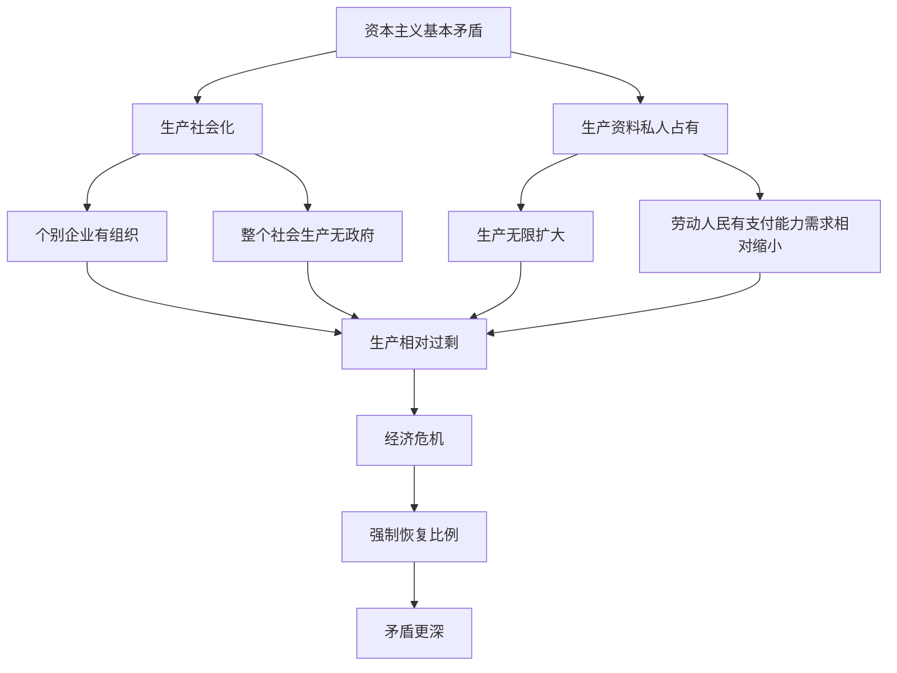

# 04 经济危机与历史趋势 · 章节总结

> 对应原书：第二篇 资本主义经济危机和历史趋势（第 8 章）
> 📖 原书原文：[[../../../原文件/经济学/马克思主义政治经济学概论_全书|《概论》第8章]]

## 这一章在回答什么问题

1. **为什么资本主义隔十几年就崩一次？** —— 不是偶然，是基本矛盾的强制爆发。
2. **资本主义的历史地位是什么？** —— 它比封建制进步，但必然被社会主义代替。
3. **资本主义发展的历史趋势是什么？** —— 它创造了代替自己的物质条件（生产力）和社会力量（工人阶级）。

## 框架图

## 核心概念

| 概念 | 一句话 | 详细 KP |
|---|---|---|
| 资本主义基本矛盾 | 生产社会化 vs 生产资料私人占有 | [[知识点/KP01_资本主义经济危机]] |
| 生产相对过剩 | 不是真的太多，而是穷人买不起 | [[知识点/KP01_资本主义经济危机]] |
| 资本主义历史地位 | 历史地进步，也历史地过渡 | [[知识点/KP02_资本主义的历史地位]] |
| 历史趋势 | 必然被社会主义代替 | [[知识点/KP03_资本主义发展的历史趋势]] |

## 🔗 相关知识点

**本章：** [[知识点/KP01_资本主义经济危机]] ｜ [[知识点/KP02_资本主义的历史地位]] ｜ [[知识点/KP03_资本主义发展的历史趋势]]

**跨章：** [[../03_资本流通与剩余价值分配/知识点/KP04_社会总资本再生产|社会总资本再生产比例]]

**跨课对照：** 西方经济学把危机看成"外生冲击""市场失灵"，马克思主义看成制度性必然。
