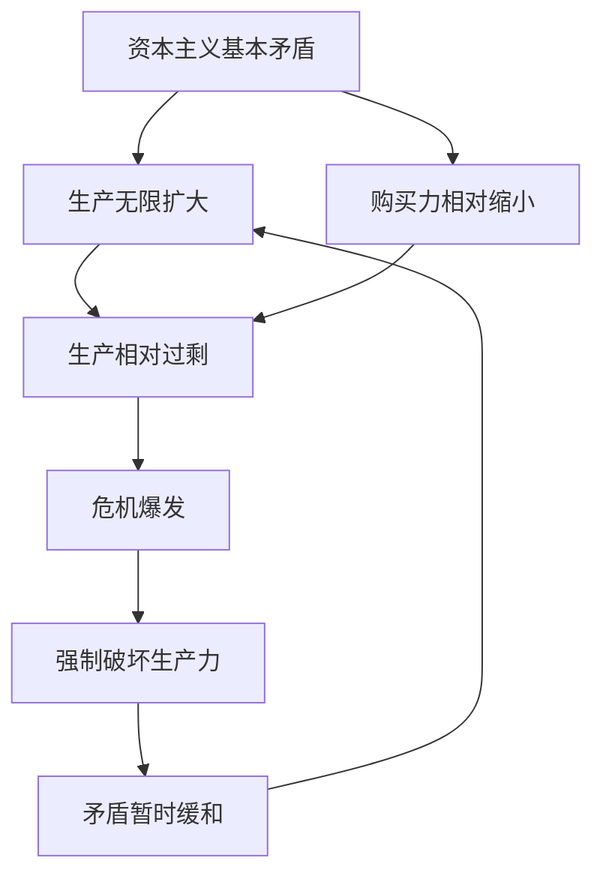

# KP01 · 资本主义经济危机

<div style="text-align:right;margin:10px 0;"><a href="../../../../exam.html" target="_blank" style="display:inline-block;padding:6px 16px;background:#2563eb;color:#fff;border-radius:6px;text-decoration:none;font-size:14px;">📝 开始做题</a></div>


> 所属：[[../00_章节总结|第8章]] ｜ 节：原书第八章第一节

## 1. 一句话先懂（小白版）

经济危机最荒诞的现象：**仓库里奶茶堆成山，工人却喝不起奶茶**。

不是奶茶真的太多了，而是**工人工资太低、买不起**。这叫**生产相对过剩**——相对于劳动人民有支付能力的需求来说，商品过剩了。

为什么会这样？因为资本主义有个治不好的矛盾：
- 一边是资本家拼命扩大生产（追逐剩余价值）；
- 一边是资本家拼命压低工人工资（提高 m'）；
- 结果生产出来的东西没人买，危机爆发。

## 2. 严格定义

**资本主义经济危机**：生产相对过剩的危机。商品产量相对于劳动人民有支付能力的需求显得过剩。

**资本主义基本矛盾**：生产社会化和生产资料资本主义私人占有之间的矛盾。这是危机的根本原因。

**基本矛盾的两个具体表现：**
1. **个别企业生产的有组织性 vs 整个社会生产的无政府状态**；
2. **生产无限扩大的趋势 vs 劳动人民有支付能力需求相对缩小**。

**危机的周期性**：危机 → 萧条 → 复苏 → 高涨 → 危机……每个周期大约 8-10 年（马克思时代），现在周期变长但破坏更大。

## 3. 为什么（原理/机制）——完整推导

### 危机怎么爆发？

```
资本家追逐 m
    ↓
不断扩大生产、提高 m'、压低工资
    ↓
社会生产无限扩大
    ↓
但工人工资增长慢于生产增长
    ↓
有支付能力的需求相对缩小
    ↓
商品卖不出去（生产相对过剩）
    ↓
W'—G' 这个"惊险的跳跃"失败
    ↓
企业连锁倒闭、银行坏账、工人失业
    ↓
危机爆发
```

### 为什么危机是"强制恢复平衡"？

危机中：
- 大量企业倒闭，生产能力被破坏；
- 商品被销毁（倒牛奶、烧衣服）；
- 价格下跌，库存出清；
- 幸存企业重新开始投资，经济复苏。

**这是用破坏性的方式恢复社会总资本再生产的比例**（见 [[../../03_资本流通与剩余价值分配/知识点/KP04_社会总资本再生产]]）。但它没有解决基本矛盾，只是暂时压制——下一次危机更猛烈。

### 货币信用危机为什么是先导？

危机首先表现为**支付链条断裂**（见 [[../../01_商品与货币/知识点/KP06_货币的五大职能]]）：
- A 还不上 B，B 还不上 C，C 还不上 D；
- 银行挤兑、股市崩盘；
- 然后才是生产下降、失业上升。

## 4. 来源（理论怎么来的）

马克思在《资本论》三卷中分析了危机的可能性（货币作为流通手段和支付手段已经包含危机的抽象可能）和必然性（基本矛盾）。后来恩格斯、列宁、当代西方马克思主义者（福斯特、大卫·哈维）发展了危机理论。

## 5. 怎么用（现实例子）

**1929 年大萧条**：美国生产过剩，穷人买不起，牛奶倒进河里。
**2008 年金融危机**：次贷危机——穷人还不起房贷，衍生品链条断裂。
**2020 年疫情危机**：疫情只是导火索，根本原因是全球生产过剩、需求不足。

## 5.5 理论推导（一步步推）

**假设起点**：资本主义基本矛盾贯穿始终。

**推导过程**：
- 第一步：基本矛盾 = 生产社会化 vs 生产资料资本主义私人占有。
- 第二步：表现为生产无限扩大趋势 vs 劳动人民购买力相对缩小。
- 第三步：商品堆积卖不出，工人没钱消费——生产相对过剩。
- 第四步：过剩积累到一定程度，危机爆发。
- 第五步：危机强制破坏生产力，使矛盾暂时缓和，再进入下一个周期。
- 结论：危机是基本矛盾尖锐化的强制爆发，具有周期性。



## 5.6 数学推导（公式怎么来的）

> 每个符号第一次出现必须解释。

设社会总产出 $W$，工人有支付能力需求 $D_w$，资本家消费投资 $D_c$。相对过剩条件：

$$W > D_w + D_c$$

工人需求被 $m'$ 压低：$v$ 占比下降 $\Rightarrow D_w$ 相对缩小。矛盾周期性爆发，周期约与固定资本更新周期（约 10 年）吻合。


## 6. 什么时候不能用（边界条件）

- **危机不是纯自然规律**。国家干预（凯恩斯主义、货币政策）可以缓和危机，但不能消除。
- **社会主义也有经济波动**，但那是比例失调、结构调整，不是基本矛盾导致的生产相对过剩。

## 7. 容易混淆什么

| 容易混 | 区别 |
|---|---|
| 生产相对过剩 vs 绝对过剩 | 相对 = 穷人买不起；绝对 = 真的太多用不完。资本主义危机是相对过剩。 |
| 危机 vs 衰退 | 危机是强制爆发；衰退是危机后的萧条阶段。 |
| 危机 vs 金融危机 | 金融危机是先导/表现；生产危机是本质。 |

## 8. 现实意义

- **为什么要"扩大内需"？** 就是为了缓和"生产扩大 vs 需求不足"的矛盾。
- **为什么要"共同富裕"？** 因为不提高劳动人民收入，生产过剩就会反复出现。
- **为什么要"供给侧改革"？** 因为不仅要扩需求，还要让供给结构匹配需求结构。

---

## 🔗 相关知识点

**同章关联：** [[KP02_资本主义的历史地位]] ｜ [[KP03_资本主义发展的历史趋势]]

**跨章：** [[../../03_资本流通与剩余价值分配/知识点/KP04_社会总资本再生产|再生产比例]] ｜ [[../../01_商品与货币/知识点/KP07_货币流通规律与通货膨胀|货币信用]]

**跨课对照：** 凯恩斯主义用"有效需求不足"解释危机，马克思主义用"基本矛盾"解释。

**📖 原书原文：** [[../../../../原文件/经济学/马克思主义政治经济学概论_全书#第一节 资本主义经济危机|《概论》第八章第一节]]

---

## 📝 考研真题（首经贸 801）

**配套主观题：** 见同目录 [[../考研真题集|本章考研真题集]]
**配套选择题：** 见同目录 [[../选择题集|本章选择题集]]

### 高频简答
- 简述资本主义经济危机的实质和根源 → 见 [[../考研真题集#s1|真题集·简答 1]]

### 高频论述
- 用马克思经济危机理论分析2008年国际金融危机与2020年疫情冲击 → 见 [[../考研真题集#l1|真题集·论述 1]]

### 易错选择
- 本知识点选择题见 [[../选择题集#KP01 资本主义经济危机|选择题集·KP01]]
