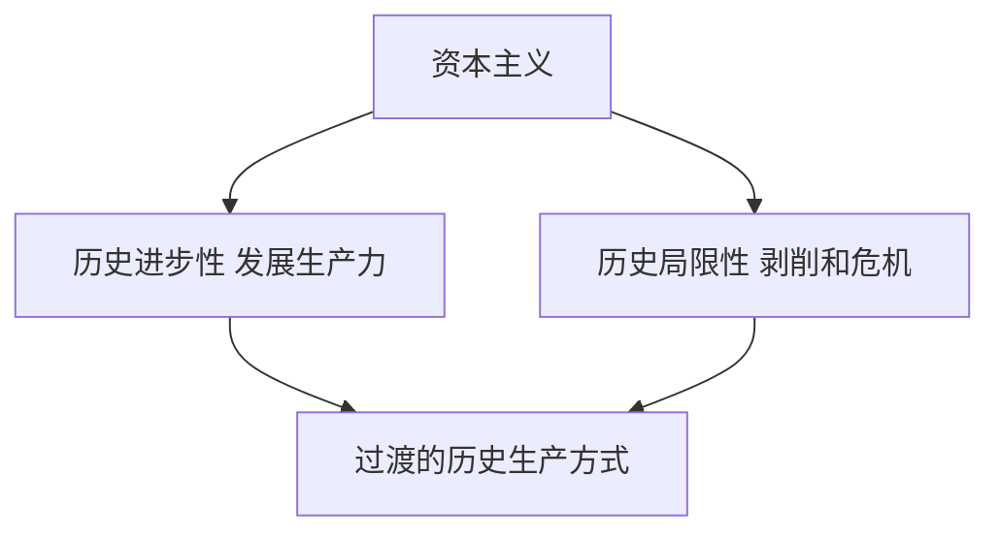

# KP02 · 资本主义的历史地位

<a href="../../../../exam.html" target="_blank" style="display:inline-block;padding:6px 16px;background:#2563eb;color:#fff;border-radius:6px;text-decoration:none;font-size:14px;">📝 开始做题</a>

> 所属：[[../00_章节总结|第8章]] ｜ 节：原书第八章第二节

## 1. 一句话先懂（小白版）

资本主义不是从来就有的，也不会永远存在。它在历史上起过巨大的进步作用——把生产力推到封建制想都不敢想的高度；但它同时创造了自己的掘墓人——无产阶级。

**它是历史的、暂时的、过渡的。**

## 2. 严格定义

**资本主义的历史进步性：**
1. 极大地推动了生产力发展（工业革命、全球化）；
2. 冲破了封建宗法关系，建立了世界市场；
3. 创造了现代科学技术和管理制度。

**资本主义的历史局限性：**
1. 生产目的是剩余价值，不是人的需要；
2. 贫富两极分化；
3. 周期性经济危机；
4. 人的异化（工人变成机器的附属）。

## 3. 为什么（原理/机制）

资本主义的矛盾：
- 它比封建制进步（解放了生产力）；
- 但它本身是建立在剥削基础上的；
- 它越发展，生产社会化程度越高，和私人占有的矛盾越尖锐；
- 它创造了代替自己的物质条件（发达的生产力）和社会力量（现代工人阶级）。

## 4. 怎么用（现实例子）

- 资本主义 300 年创造的生产力，超过过去几千年总和（马克思《共产党宣言》）；
- 但它同时造成了全球贫富分化、环境破坏、人的异化。

## 5. 容易混淆什么

| 容易混 | 区别 |
|---|---|
| 历史进步 vs 永恒 | 资本主义进步是历史的，不是永恒的。 |
| 必然灭亡 vs 自动灭亡 | 它必然被代替，但需要社会革命。 |

## 5.5 理论推导（一步步推）

**假设起点**：用历史唯物主义评价资本主义。

**推导过程**：
- 第一步：历史进步性——摧毁封建束缚，极大发展生产力。
- 第二步：历史局限性——建立在剥削雇佣劳动基础上，导致两极分化和周期性危机。
- 第三步：它不是永恒自然制度，而是历史上暂时的、过渡的生产方式。
- 结论：资本主义既推动了文明，又带着自己的矛盾。

## 5.6 数学推导（公式怎么来的）

> 每个符号第一次出现必须解释。

资本积累规律：

$$K_{t+1} = K_t + \alpha \cdot m_t$$

一端积累资本，另一端积累贫困——两极分化。这一矛盾随 $K$ 扩大而扩大，最终使资本主义成为过渡的生产方式。

## 6. 现实意义

- 不能简单骂资本主义"万恶"——它有历史进步性；
- 也不能把它当永恒——它必然被更高级的社会形态代替；
- 社会主义要继承资本主义创造的生产力，同时克服它的矛盾。

---

## 🔗 相关知识点

**同章：** [[KP01_资本主义经济危机]] ｜ [[KP03_资本主义发展的历史趋势]]

**跨章：** [[../../05_社会主义经济制度/00_章节总结|社会主义经济制度]]

**📖 原书原文：** [[../../../../原文件/经济学/马克思主义政治经济学概论_全书#第二节 资本主义的历史地位|《概论》第八章第二节]]

---

## 📝 考研真题（首经贸 801）

**配套主观题：** 见同目录 [[../考研真题集|本章考研真题集]]
**配套选择题：** 见同目录 [[../选择题集|本章选择题集]]

### 高频简答
- 如何认识资本主义的历史进步性和局限性 → 见 [[../考研真题集#s5|真题集·简答 5]]

### 高频论述
- 分析当代资本主义新变化（数字化、全球化、福利国家）及其历史趋势 → 见 [[../考研真题集#l3|真题集·论述 3]]

### 易错选择
- 本知识点选择题见 [[../选择题集#KP02 资本主义的历史地位|选择题集·KP02]]
