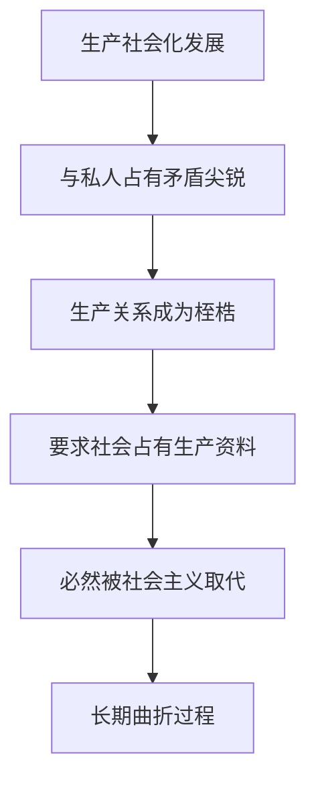

# KP03 · 资本主义发展的历史趋势

<a href="../../../../exam.html" target="_blank" style="display:inline-block;padding:6px 16px;background:#2563eb;color:#fff;border-radius:6px;text-decoration:none;font-size:14px;">📝 开始做题</a>

> 所属：[[../00_章节总结|第8章]] ｜ 节：原书第八章第三节

## 1. 一句话先懂（小白版）

资本主义从自由竞争 → 垄断 → 国家垄断 → 国际垄断。每一步都是它基本矛盾激化的表现，也都是向社会主义过渡的准备。

**它不是永恒的，它正在创造自己的对立面。**

## 2. 严格定义

**资本主义发展阶段：**
1. 自由竞争资本主义（19 世纪）；
2. 垄断资本主义（19 世纪末-20 世纪初，列宁《帝国主义论》）；
3. 国家垄断资本主义（20 世纪 30 年代大萧条后）；
4. 国际垄断/金融垄断资本主义（1970 年代后）。

**历史趋势**：资本主义必然被社会主义代替，这是生产关系一定要适应生产力性质规律决定的。但这是一个长期、曲折的历史过程。

## 3. 为什么

- 生产社会化程度越高，越和私人占有冲突；
- 国家垄断资本主义是社会主义的"前阶"——生产资料归社会占有只差一步；
- 全球化把矛盾推向世界，也把全世界工人阶级联合起来。

## 4. 怎么用

- 中国特色社会主义不是脱离世界文明大道，而是在继承资本主义生产力成果的基础上，克服其矛盾。
- 当代资本主义的新变化（福利制度、股权分散、全球化）没有改变其本质，只是缓和了矛盾。

## 5. 容易混淆什么

| 容易混 | 区别 |
|---|---|
| 必然代替 vs 立即代替 | 必然是趋势，立即是幻想。过程很长。 |
| 和平过渡 vs 暴力革命 | 不同国家道路不同，不能套用单一模式。 |

---

## 5.5 理论推导（一步步推）

**假设起点**：生产社会化不断发展。

**推导过程**：
- 第一步：生产越来越社会化，整个社会成了分工协作的大系统。
- 第二步：但生产资料仍归资本家私人占有——基本矛盾尖锐化。
- 第三步：社会化大生产客观上要求生产资料社会占有。
- 第四步：资本主义成为生产力发展桎梏，必然被社会主义取代。
- 第五步：但这一取代需要生产力高度发展、主客观条件成熟，是长期曲折过程。
- 结论：必然取代，但路径长期曲折。

## 5.6 数学推导（公式怎么来的）

> 每个符号第一次出现必须解释。

设生产社会化程度 $S$，私人占有 $P$。矛盾 $M = S - P$ 随资本积累 $K$ 扩大而扩大：

$$M(K) = S(K) - P, \qquad S(K) \uparrow \text{ 当 } K \uparrow$$

当 $M$ 突破资本主义外壳承受力，社会形态变革发生。过渡时期 $T = f(P, M)$ 取决于历史条件。

## 🔗 相关知识点

**同章：** [[KP01_资本主义经济危机]] ｜ [[KP02_资本主义的历史地位]]

**跨章：** [[../../05_社会主义经济制度/00_章节总结|社会主义]] ｜ [[../../07_民生开放与全球治理/00_章节总结|全球化与全球治理]]

**📖 原书原文：** [[../../../../原文件/经济学/马克思主义政治经济学概论_全书|《概论》第八章第三节]]

---

## 📝 考研真题（首经贸 801）

**配套主观题：** 见同目录 [[../考研真题集|本章考研真题集]]
**配套选择题：** 见同目录 [[../选择题集|本章选择题集]]

### 高频简答
- 为什么说资本主义必然被社会主义代替 → 见 [[../考研真题集#s6|真题集·简答 6]]

### 高频论述
- 结合资本主义基本矛盾，论述资本主义不是历史的终点 → 见 [[../考研真题集#l2|真题集·论述 2]]

### 易错选择
- 本知识点选择题见 [[../选择题集#KP03 资本主义发展的历史趋势|选择题集·KP03]]
