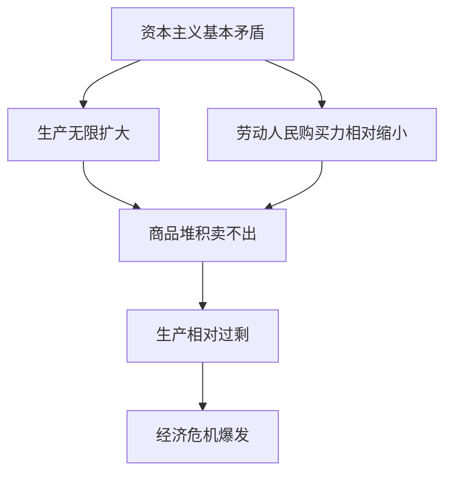
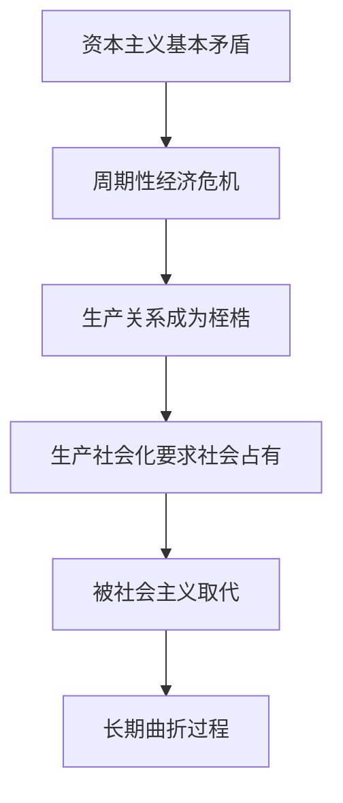

# 第 04 章 经济危机与历史趋势 · 考研真题集（首经贸 801）

<a href="../../../exam.html" target="_blank" style="display:inline-block;padding:6px 16px;background:#2563eb;color:#fff;border-radius:6px;text-decoration:none;font-size:14px;">📝 开始做题</a>

> 本章共收录：简答题 8 道（每题 15 分）｜论述题 3 道（每题 30 分）
> 配套选择题见 [[选择题集|本章选择题集]]
> 对应大纲：马克思主义政治经济学概论 第二篇 第 8 章（资本主义经济危机、历史地位、历史趋势）

## 📋 本题集目录

### 简答题
1. [[#简答 1：简述资本主义经济危机的实质和根源。|资本主义经济危机的实质与根源]]
2. [[#简答 2：简述资本主义经济危机的周期性及其阶段。|经济危机的周期性及阶段]]
3. [[#简答 3：为什么说经济危机是资本主义基本矛盾尖锐化的强制爆发？|经济危机与资本主义基本矛盾]]
4. [[#简答 4：简述第二次世界大战后资本主义经济危机的新特点。|战后资本主义经济危机的新特点]]
5. [[#简答 5：如何认识资本主义的历史进步性和历史局限性？|资本主义的历史进步性与局限性]]
6. [[#简答 6：为什么说资本主义必然被社会主义代替？|资本主义必然被社会主义代替的依据]]
7. [[#简答 7：资本主义为自身灭亡准备了哪些主客观条件？|资本主义为自身灭亡准备的主客观条件]]
8. [[#简答 8：如何正确认识当代资本主义的新变化？|如何认识当代资本主义的新变化]]

### 论述题
1. [[#论述 1：试用马克思主义经济危机理论，分析 2008 年国际金融危机与 2020 年新冠肺炎疫情冲击的异同，并说明对我国的启示。|用马克思经济危机理论分析2008年国际金融危机与2020年疫情冲击]]
2. [[#论述 2：结合资本主义基本矛盾，论述为什么说"资本主义不是历史的终点"，并分析当代资本主义向社会主义过渡的长期性与曲折性。|结合资本主义基本矛盾，论述"资本主义不是历史的终点"]]
3. [[#论述 3：试用马克思主义立场，分析当代资本主义的新变化（数字化、全球化、福利国家）及其历史趋势。|分析当代资本主义新变化及其历史趋势]]

---

## 一、简答题（每题 15 分，建议 450—700 字）

### 简答 1：简述资本主义经济危机的实质和根源。

**【建议字数】450–700 字 ｜ 【建议时间】15 分钟 ｜ 【题型】原因分析**

**【考什么】** 对应知识点 [[知识点/KP01_资本主义经济危机|资本主义经济危机]]，对应大纲第 8 章第 1 节；题型属于概念简答。

**【核心推导】**
**第一步：先分清三个层次——现象、实质、根源**

答这道题必须先建立三层结构，否则容易把现象当实质：

| 层次 | 内容 | 判断依据 |
|---|---|---|
| 现象层 | 商品滞销、物价暴跌、企业倒闭、工人失业、信用破坏 | 看得见 |
| 实质层 | **生产相对过剩** | 相对于有支付能力的需求过剩 |
| 根源层 | **资本主义基本矛盾** | 生产社会化 vs 私人占有 |

**关键判断**：危机不是"东西太多"，是"买得起的人太少"。这一步区分决定了后面所有论述的方向。

**第二步：证明"相对"而非"绝对"——两个并存**

$$ \text{过剩的定义}:\quad Q_s>D_{\text{有效}}\quad\text{而非}\quad Q_s>D_{\text{需要}} $$

- 一极：资本家仓库商品堆积如山、牛奶倒进河里、房屋炸掉；
- 另一极：工人失业、缺衣少食、无家可归。

若真是绝对过剩，商品多到人人吃饱穿暖还有剩余，那就不会有贫困并存。**两个现象的并存本身，就是"相对过剩"的证明。**这是本题最容易失分也最容易拿分的一处：写出"并存"，就不只是背定义。

**第三步：把基本矛盾拆成两句话**

资本主义基本矛盾 = **生产社会化** 与 **生产资料资本主义私人占有** 的矛盾。

- 生产社会化：生产资料由许多人共同使用、生产过程成为社会分工协作的过程、产品成为许多人共同劳动的成果；
- 私人占有：生产资料和产品归少数资本家私人所有。

**矛盾点**：生产已经是"社会的"，占有的结果却由"私人的"决定。**社会化的生产要求有计划的协调，私人占有使协调不可能。**

**第四步：矛盾的两个具体表现——这是采分核心**

**(一) 个别企业生产的有组织性 与 整个社会生产的无政府状态**

企业内部：为了追逐剩余价值，分工严密、工序衔接、管理科学，组织性极强；
全社会：生产什么、生产多少由无数资本家追逐利润盲目决定，谁也不知道别人在干什么。

$$ \text{企业内有序} + \text{社会内无序} \Rightarrow \text{部门比例失衡} $$

比例一旦失衡（比如钢铁生产远远超过机械工业能够吸收的量），就会在某个环节断裂。

**(二) 生产无限扩大的趋势 与 劳动人民有支付能力的需求相对缩小**

$$ \text{生产}:Q\uparrow\ (\text{资本积累} + \text{技术进步}) $$
$$ \text{消费}:D_{\text{有效}}\uparrow\ \text{得更慢}\ (\text{工资被压低} + \text{劳动强度提高} + \text{相对过剩人口}) $$

资本家为追逐超额剩余价值不断改进技术、扩大规模；同时压低工资、提高劳动强度、以机器替代工人（形成相对过剩人口），使工人收入增长远慢于生产增长。**两条曲线的剪刀差越大，矛盾的张力越大。**

**第五步：危机如何"强制"解决矛盾——破坏生产力**

$$ \text{矛盾激化} \to \text{商品卖不出去} \to \text{价格暴跌、企业破产、工人失业} \to \text{生产力被破坏} \to \text{供求重新平衡} $$

危机之所以是"强制的"解决：
- 价格暴跌使商品价值被强制贬值，等于把一部分生产力"毁掉"；
- 企业破产使过剩产能退出，产量被迫与社会需求重新匹配；
- 工人失业使工资水平下降、劳动纪律加强，为下一轮积累准备条件。

**核心论断**：危机不是矛盾的消除，而是矛盾的**暂时缓解**。它用破坏生产力的方式恢复比例，但社会化生产与私人占有的矛盾丝毫未变，所以下一轮积累到一定程度必然再爆。**这就是"周期性"的根源。**

**第六步：对比"绝对过剩"与"相对过剩"两种错误理解**

| 错误理解 | 表现 | 为什么错 |
|---|---|---|
| 绝对过剩说 | 商品太多，人人用不完 | 与"一边过剩一边贫困"的事实矛盾 |
| 消费不足说 | 工人工资低所以买不起，若能提高工资就没危机 | 工资提高会压缩剩余价值、减少积累，且利润率下降反而抑制投资，未必化解矛盾；消费不足是表现不是根源 |
| 比例失调说 | 只要计划好比例就没有危机 | 忽视私有制基础，计划在私人占有条件下不可能 |

**第七步：当代印证**

2008 年国际金融危机：美国次贷危机爆发前，一边是住房大量空置、房价泡沫堆积，一边是低收入家庭买不起房却被迫背上次级贷款——**相对过剩的典型形态从"商品过剩"变成了"债务支撑的虚假需求 + 资产过剩"**。2020 年新冠疫情初期，美国奶农倒奶、猪农安乐死生猪，同一时期食物银行门前排长队——这一现象在教科书里写了 150 年，形态没变。

**第八步：结论**

资本主义经济危机的实质是**生产相对过剩**，即相对于劳动人民有支付能力的需求而言的过剩；其根源是**资本主义基本矛盾**，即生产社会化和生产资料资本主义私人占有之间的矛盾；这一矛盾具体表现为个别企业生产的有组织性与整个社会生产的无政府状态的矛盾、生产无限扩大的趋势与劳动人民有支付能力的需求相对缩小的矛盾。危机用强制破坏生产力的方式暂时恢复比例，因而只能缓解而不能消除矛盾，最终表现为周期性爆发。**一句话：危机不是东西太多，是买得起的人太少；不是市场的病，是私有制的病。**

**【为什么要答这几点】**
**【满分 15 分的分点逻辑】**

**第一段：先写危机的表现（3 分）**
商品滞销、物价暴跌、企业破产、工人失业、信用关系破坏、经济混乱。要有 3–4 个具体现象词。

**第二段：实质——生产相对过剩（5 分）**
必须出现"相对"二字，并解释：不是商品真的太多，而是相对于劳动人民有支付能力的需求显得太多。**然后写出"一边商品堆积如山、一边劳动人民缺衣少食"的并存**，这是拿满 5 分的关键句。

**第三段：根源——资本主义基本矛盾（5 分）**
写出"生产社会化和生产资料资本主义私人占有之间的矛盾"这个完整表述，再展开两个具体表现：
(一) 个别企业生产的有组织性 vs 整个社会生产的无政府状态；
(二) 生产无限扩大的趋势 vs 劳动人民有支付能力的需求相对缩小。
**两个表现各占 2–3 分，缺一个必扣。**

**第四段：结论（2 分）**
经济危机是基本矛盾尖锐化的强制爆发，是资本主义制度的不治之症；要消灭危机必须消灭资本主义制度。

**易失分点（五条）**
1. 把"相对过剩"写成"绝对过剩"，或只写"过剩"不写"相对"——直接扣 3–4 分。
2. 只背"基本矛盾"五个字，不展开社会化与私人占有的具体含义。
3. 漏掉两个具体表现中的一个，只写"生产与消费的矛盾"这一条。
4. 把危机的根源说成"资本家太贪婪"或"工人工资太低"——这是现象不是根源。
5. 结论写成"加强宏观调控就能避免危机"，与马克思主义立场冲突。

**加分点（五条）**
1. 用"买得起的人太少"这一句把相对过剩讲透，比背定义更能说明理解。
2. 补一层"危机是强制解决而非消除"，为周期性埋伏笔。
3. 提出"绝对过剩说/消费不足说/比例失调说"三种错误理解并逐一辩驳，体现辨析能力。
4. 用 2008 年次贷危机与 2020 年倒奶杀猪的实例，说明相对过剩的当代形态。
5. 指出"消费不足是表现不是根源"，点出与凯恩斯有效需求不足的立场区别。

**【阅卷心理】**
判卷老师主要看两处：**有没有"相对"两个字并用并存现象解释它**；**基本矛盾有没有展开成两个具体表现**。这两处做到，15 分基本拿满。
记忆金句：**危机不是东西太多，是买得起的人太少；不是市场的病，是私有制的病。**

**【如何分析题目】**
**第一步：审题，锁定"实质"与"根源"两个词**
题目问的是一件事的两个层次：本质规定性（实质）与产生原因（根源）。答题结构必须分层，不能混着写。

**第二步：先写表现，用具体现象起笔**
商品滞销、物价暴跌、企业破产、工人失业、信用破坏。3–4 个词即可，不要展开。

**第三步：下判断句——实质是生产相对过剩**
一句话给出定义，紧接着用"一边……一边……"的并存句证明"相对"二字。

**第四步：写根源，先给全称再拆解**
"生产社会化和生产资料资本主义私人占有之间的矛盾"，然后分别说明社会化何指、私人占有何指，指出矛盾点在哪。

**第五步：展开两个具体表现**
每条写"本应在社会层面协调，实际由私人追逐利润决定"的机制。这是全题最实的内容。

**第六步：补一句强制解决**
危机用破坏生产力的方式暂时恢复比例，但不能消除矛盾。

**第七步：收尾落到制度判断**
"不治之症 → 要消灭危机必须消灭资本主义制度"，与马克思原意一致。

**第八步：自检**
检查是否出现"相对"、是否两个表现齐全、结论是否偏离马克思主义立场。

**第九步：字数与时间控制**
15 分约 500–700 字，建议 15 分钟：表现 2 分钟、实质 4 分钟、根源 6 分钟、结论 2 分钟，留 1 分钟通读。若时间紧，先保实质与根源两段（共 10 分）。

**【答题框架】**
- 第 1 段：危机的表现（3 分）
- 第 2 段：实质——生产相对过剩（5 分）
- 第 3 段：根源——资本主义基本矛盾（5 分）
- 第 4 段：结论（2 分）

**【参考答案】**

一、经济危机的表现

资本主义经济危机爆发时，大量商品卖不出去，物价暴跌，企业大批破产倒闭，工人大量失业，信用关系破坏，整个社会经济陷入瘫痪和混乱。这种现象每隔若干年就重复一次。

二、危机的实质：生产相对过剩

资本主义经济危机的实质是**生产相对过剩**，而不是绝对过剩。所谓相对过剩，不是说生产的商品真的太多了，社会上用不了，而是相对于劳动人民有支付能力的需求来说，商品显得"太多了"。一方面是资本家仓库里商品堆积如山，另一方面是广大劳动人民缺衣少食、无力购买。这种"过剩"与"贫困"并存的荒唐现象，正是资本主义制度特有的。

三、危机的根源：资本主义基本矛盾

经济危机的根源在于**资本主义的基本矛盾**，即生产的社会化和生产资料资本主义私人占有之间的矛盾。这一矛盾具体表现在两个方面：

(一) 个别企业生产的有组织性和整个社会生产的无政府状态之间的矛盾。每个企业内部为了追逐剩余价值精心组织生产，但全社会生产什么、生产多少由资本家追逐利润盲目决定，导致社会再生产比例经常遭到破坏。

(二) 资本主义生产无限扩大的趋势和劳动人民有支付能力的需求相对缩小之间的矛盾。资本家为了追逐剩余价值一方面拼命扩大生产、改进技术，另一方面又通过压低工资、提高劳动强度限制工人收入。生产越扩大，工人越买不起，矛盾尖锐到一定程度就必然爆发生产过剩危机。

四、结论

经济危机是资本主义基本矛盾尖锐化的强制爆发，是资本主义制度的不治之症。要消灭经济危机，就必须消灭资本主义制度本身。

**【解析·得分点】** 采分点：①表现（商品滞销、企业倒闭、失业）②实质是相对过剩不是绝对过剩 ③基本矛盾=生产社会化vs私人占有 ④两个具体表现 ⑤结论。易丢分：把"相对过剩"说成"绝对过剩"；漏掉基本矛盾的两个具体表现。

**【生活实例】** 2008 年金融危机时，美国底特律很多房子被银行收回、空置、甚至烧掉，而同时大量无家可归者流落街头。不是房子太多，而是穷人买不起——这就是生产相对过剩。

**【双链接】** 🔗 [[知识点/KP01_资本主义经济危机|回知识点]] ｜ [[../03_资本流通与剩余价值分配/知识点/KP04_社会总资本再生产|社会总资本再生产]]

---

### 简答 2：简述资本主义经济危机的周期性及其阶段。

**【建议字数】450–700 字 ｜ 【建议时间】15 分钟 ｜ 【题型】概念简答**

**【考什么】** 对应知识点 [[知识点/KP01_资本主义经济危机|资本主义经济危机]]，对应大纲第 8 章第 1 节；题型属于概念简答。

**【核心推导】**
**第一步：先给"周期性"下判断——不是偶然重演，是机制必然**

$$ \text{危机} \to \text{萧条} \to \text{复苏} \to \text{高涨} \to \text{危机} $$

周期性的根据只有一条：**基本矛盾不能被消除，只能被暂时缓解**。危机用破坏生产力的方式强行恢复比例，比例一旦恢复，积累重新开始，矛盾重新积累。

**第二步：四个阶段的完整刻画**

| 阶段 | 核心特征 | 数量表现 |
|---|---|---|
| 危机 | 商品滞销、价格暴跌、信用紧缩、企业破产、失业激增 | 生产骤降、失业率飙升 |
| 萧条 | 生产不再下降但停滞、物价低迷、失业仍大量存在、商业与信用徘徊 | 低位徘徊、投资不振 |
| 复苏 | 市场好转、生产恢复、就业增加、信用扩大、投资增长 | 回到危机前水平 |
| 高涨 | 生产继续扩大、市场兴旺、信用膨胀、物价上涨、利润丰厚 | 超过危机前水平 |

**关键判据**：萧条与复苏的分界在于**是否开始大规模更新固定资本**；复苏与高涨的分界在于**是否超过危机前的最高产量**。

**第三步：为什么萧条之后必然复苏——三重机制**

$$ \text{① 存货出清} \to \text{价格止跌} $$
$$ \text{② 固定资本贬值 + 利率下降} \to \text{更新成本降低} $$
$$ \text{③ 大规模设备更新} \to \text{生产资料需求回升} \to \text{就业与收入回升} $$

**危机把资本"打折"了**：设备、厂房、原材料价格暴跌， bankrupt 企业的资产被低价收购，更新固定资本的成本大幅下降，于是新投资的预期利润率回升——这是复苏的物质基础。

**第四步：固定资本更新是周期性的物质基础——这是本题的采分核心**

$$ \text{固定资本更新} \Rightarrow \text{周期性的物质基础} $$

两层含义：
- **对复苏的作用**：大规模更新需求拉动生产资料部门，进而带动消费资料部门，经济走出萧条；
- **对下一次危机的作用**：更新采用新技术、新设备，资本有机构成提高，产能进一步扩大；而工人被机器替代、有支付能力的需求跟不上，于是在更高水平上重新积累矛盾。

$$ \text{危机} \to \text{更新} \to \text{复苏高涨} \to \text{产能更高} \to \text{矛盾更尖锐} \to \text{危机} $$

**这就是"固定资本更新既是走出危机的出路，又是下一次危机的物质前提"的双重身份。**

**第五步：周期的长度为什么会变化**

$$ \text{战前}:\ \text{约 } 8\text{–}10\ \text{年一轮（与固定资本的平均使用年限接近）} $$
$$ \text{战后}:\ \text{周期缩短且形态改变（干预熨平、金融化加速）} $$

平均使用年限约 10 年，是周期长度约 10 年的直观解释。战后国家干预使萧条缩短、复苏加快，但 1970s 滞胀、2008 年危机显示周期并未消失，只是形态改变。

**第六步：结论**

资本主义经济危机的周期性根源于基本矛盾不能根除：危机只能通过强制破坏生产力暂时恢复比例，比例恢复之后矛盾重新积累，于是再次爆发。一个完整的周期包括危机、萧条、复苏、高涨四个阶段，各阶段以生产、价格、就业、信用的不同组合为特征。**固定资本更新是周期性的物质基础**：一方面它通过降低更新成本、拉动投资需求把经济带出萧条；另一方面它提高资本有机构成、扩大产能、加剧生产与消费的脱节，为下一次危机准备物质前提。**一句话：危机给资本打了折，资本趁机换新装备，换完新装备就更装不下它自己了。**

**【为什么要答这几点】**
**【满分 15 分的分点逻辑】**

**第一段：周期性原因（4 分）**
基本矛盾不能根除 → 危机只能暂时缓解 → 矛盾重新积累 → 再次爆发。**因果链必须完整。**

**第二段：四个阶段（8 分）**
危机 → 萧条 → 复苏 → 高涨，**顺序绝不能错**；每阶段给 2–3 个特征词（生产、价格、就业、信用）。顺序错扣 3 分以上。

**第三段：固定资本更新的作用（3 分）**
既是走出危机的出路（更新成本低、拉动投资），又是下一次危机的物质前提（提高有机构成、扩大产能）。**"双重身份"是满分点。**

**易失分点（五条）**
1. 四阶段顺序颠倒，或漏掉萧条阶段（很多人只写危机、复苏、高涨）。
2. 只描述阶段特征，不写周期性的原因。
3. 漏掉"固定资本更新是物质基础"这一条——这是本题最典型的采分点。
4. 把复苏与高涨混为一谈，不用"是否超过危机前最高产量"区分。
5. 说"国家干预已经消除了周期"，立场性错误。

**加分点（五条）**
1. 用"是否开始大规模更新固定资本"区分萧条与复苏，用"是否超过危机前最高产量"区分复苏与高涨，给出可操作的判据。
2. 说明固定资本平均使用年限约 10 年，解释周期长度。
3. 用"危机把资本打折了"解释复苏的物质基础，直观且准确。
4. 指出固定资本更新"既救经济又害经济"的双重身份。
5. 补一句 1970s 滞胀与 2008 年危机，说明周期未消失只是形态改变。

**【阅卷心理】**
判卷老师主要看两处：**四阶段顺序与特征**；**有没有写固定资本更新是物质基础**。前者是基础分，后者是 12 分以上的关键。
记忆金句：**危机给资本打了折，资本趁机换新装备，换完新装备就更装不下它自己了。**

**【如何分析题目】**
**第一步：审题，两问**
周期性及其阶段。因此先说"为什么周期"，再说"周期分几段"。

**第二步：写周期性原因**
从基本矛盾出发，说明危机只能暂时缓解矛盾，故必然重演。三句话。

**第三步：写四阶段，顺序不能错**
危机、萧条、复苏、高涨，每段给特征。可先在草稿写下四段标题再填内容。

**第四步：给阶段判据**
萧条→复苏看固定资本是否开始大规模更新；复苏→高涨看是否超过危机前最高产量。

**第五步：写固定资本更新的双重作用**
走出危机的出路 + 下一次危机的物质前提。这是本题的核心得分点。

**第六步：补周期长度**
固定资本平均使用年限约 10 年 → 周期约 10 年；战后形态改变但周期未消失。

**第七步：收尾**
一句话总结"强制性缓解 + 物质基础 → 周期性"。

**第八步：自检**
顺序是否对、是否写了物质基础、是否避免了"周期已消除"的错误判断。

**第九步：字数与时间控制**
15 分约 500–700 字，建议 15 分钟：原因 3 分钟、四阶段 8 分钟、物质基础 3 分钟、收尾 1 分钟。时间紧时四阶段与物质基础优先。

**【答题框架】**
- 第 1 段：周期性的原因（4 分）
- 第 2 段：四个阶段（8 分）
- 第 3 段：固定资本更新的作用（3 分）

**【参考答案】**

一、危机周期性的原因

资本主义经济危机每隔若干年爆发一次，具有周期性。其原因在于资本主义基本矛盾本身——危机只能暂时、强制地通过破坏生产力使矛盾得到缓解，但不能根除矛盾；危机过后，随着经济恢复和高涨，矛盾又重新激化，导致下一次危机爆发。

二、再生产周期的四个阶段

从一次危机到下一次危机之间，构成资本主义再生产周期，一般包括四个阶段：

(一) **危机阶段**：商品销售困难，物价下跌，企业破产，工人失业，信用紧缩，社会经济一片混乱。这是周期的决定性阶段。

(二) **萧条阶段**：危机过后，生产不再继续下降，但处于停滞状态，物价低迷，失业仍然大量存在，商业和货币信用关系徘徊不前。

(三) **复苏阶段**：市场开始好转，生产逐步恢复，就业增加，信用扩大，投资增长，经济逐渐恢复到危机前水平。

(四) **高涨阶段**：生产继续扩大，就业增加，市场兴旺，信用膨胀，物价上涨，利润丰厚，整个经济呈现一片繁荣景象。但高涨本身又在为下一次危机准备条件。

三、固定资本更新是周期性的物质基础

固定资本的大规模更新，既推动了生产的恢复和发展，又使社会再生产的比例在新的更高水平上重新遭到破坏，从而为下一次危机准备了物质前提。危机往往是大规模新投资的起点，这就决定了资本主义经济危机大约每隔十年左右爆发一次。

**【解析·得分点】** 采分点：①周期性原因（基本矛盾不能根除）②四阶段顺序不能乱 ③每阶段特征 ④固定资本更新是物质基础。易丢分：把四阶段顺序颠倒；漏掉萧条与复苏的区别。

**【生活实例】** 像春夏秋冬四季循环：危机是冬天（冻死一批弱企业），萧条是初春（乍暖还寒），复苏是春天（万物复苏），高涨是夏天（烈日炎炎，但秋天萧条已在酝酿）。

**【双链接】** 🔗 [[知识点/KP01_资本主义经济危机|回知识点]] ｜ [[../03_资本流通与剩余价值分配/知识点/KP03_固定资本与流动资本|固定资本更新]]

---

### 简答 3：为什么说经济危机是资本主义基本矛盾尖锐化的强制爆发？

**【建议字数】450–700 字 ｜ 【建议时间】15 分钟 ｜ 【题型】原因分析**

**【考什么】** 对应知识点 [[知识点/KP01_资本主义经济危机|资本主义经济危机]]，对应大纲第 8 章第 1 节；题型属于原因分析。

**【核心推导】**
**第一步：拆解题目中的三个关键词**

$$ \text{"基本矛盾"} + \text{"尖锐化"} + \text{"强制爆发"} $$

- **基本矛盾**：生产社会化 vs 生产资料私人占有；
- **尖锐化**：矛盾积累到再生产比例无法维持的程度；
- **强制爆发**：不是协商解决、不是计划调整，而是通过破坏生产力强行恢复比例。

**答题必须证明：为什么这个矛盾积累到一定程度后，只能用"强制"的方式解决。**

**第二步：基本矛盾的含义及其两个具体表现**

$$ \text{生产社会化} \not\equiv \text{生产资料私人占有} $$

| 表现 | 内容 | 对应断点 |
|---|---|---|
| 表现一 | 个别企业生产的有组织性 vs 整个社会生产的无政府状态 | 部门间比例失调 |
| 表现二 | 生产无限扩大的趋势 vs 有支付能力的需求相对缩小 | 总量供过于求 |

**第三步：为什么是"尖锐化"——两条曲线越拉越开**

**(一) 生产侧的扩张是加速度的**

$$ \text{剩余价值资本化} \to \text{资本积累} \to \text{有机构成提高} \to \text{产能扩张} $$

积累是资本的生存法则：不扩大就被淘汰。竞争强制每个资本家不断扩大规模、改进技术。**扩张没有内在刹车。**

**(二) 消费侧的增长是受限的**

$$ \text{工资} = \text{劳动力价值} \Rightarrow \text{消费能力受 } v \text{ 限制} $$

资本家压低工资、提高劳动强度、以机器替代工人（形成产业后备军），使工资增长始终慢于生产增长。

**(三) 缺口的数学表达**

$$ \text{生产增速} - \text{消费增速} > 0 \Rightarrow \text{缺口随积累扩大} $$

**这就是"尖锐化"的确切含义：不是某一天资本家突然变坏，而是机制本身在持续拉大缺口。**

**第四步：为什么只能是"强制"解决——三种"温和解决"为什么不可能**

| 温和方案 | 为什么不成立 |
|---|---|
| 计划协调 | 私人占有条件下无法对社会生产做统一计划，信息与决策权都分散在私人手中 |
| 主动提高工资扩大消费 | 会压缩剩余价值、降低利润率、抑制积累；且单个资本家提高工资会被竞争淘汰 |
| 无偿转移支付给穷人 | 触及私有产权，且需要超越资本逻辑的国家能力，与"总资本家"的角色冲突 |

$$ \text{任何在私人占有框架内的调整} \Rightarrow \text{只能改变矛盾的形式，不能消除矛盾} $$

**第五步："强制"如何具体实现——四条破坏性通道**

$$ \text{① 价格暴跌}: \text{商品价值被强制贬值} $$
$$ \text{② 企业破产}: \text{过剩产能被强制退出} $$
$$ \text{③ 工人失业}: \text{工资与劳动纪律被强制调整} $$
$$ \text{④ 生产力被毁}: \text{倒奶、毁田、炸高炉、闲置设备} $$

**这四条的共同点：不是"解决问题"，而是"消灭承载问题的载体"。**商品被销毁、企业被消灭、工人被抛出厂门——通过让一部分生产力消失，使剩下的生产力重新与需求匹配。

**第六步：为什么危机之后矛盾又积累起来**

$$ \text{强制平衡} \to \text{比例暂时恢复} \to \text{积累重新开始} \to \text{缺口重新扩大} \to \text{再次强制爆发} $$

**结论**：危机的"解决"是矛盾的消除吗？不是。它只是把矛盾推回到一个新的起点。**这就是为什么"强制爆发"必然周期性重复。**

**第七步：当代形态的印证**

2008 年金融危机中的"强制"形态不再表现为倒奶，而是表现为：
- 数万亿美元的资产价值蒸发（价值被强制贬值）；
- 雷曼等机构破产（产能与机构被强制退出）；
- 失业率翻倍、房屋被法拍（承载问题的载体被销毁）；
- 各国央行大规模救助（国家信用吸收矛盾）。

**形态现代化了，逻辑没变：用破坏一部分价值的方式，恢复资本增殖的条件。**

**第八步：结论**

经济危机之所以是资本主义基本矛盾尖锐化的强制爆发，是因为：基本矛盾（生产社会化与私人占有）决定了生产无限扩大的趋势与有支付能力需求相对缩小的趋势并存，缺口随资本积累不断扩大；由于在私人占有的框架内不存在计划协调、主动提薪或无偿再分配等温和解决渠道，比例失调只能通过价格暴跌、企业破产、工人失业、生产力被毁这四条破坏性通道强制恢复；危机恢复了比例却恢复了矛盾本身，因而必然周期性重演。**一句话：它解决不了问题，只能解决承载问题的人和企业。**

**【为什么要答这几点】**
**【满分 15 分的分点逻辑】**

**第一段：基本矛盾的含义（4 分）**
生产社会化与生产资料私人占有的矛盾；展开两者的具体内涵。

**第二段：第一个表现（5 分）**
个别企业生产的有组织性 vs 社会生产无政府状态 → 部门比例失调。

**第三段：第二个表现（4 分）**
生产无限扩大的趋势 vs 有支付能力需求相对缩小 → 总量供过于求。

**第四段：危机的强制解决（2 分）**
危机用价格暴跌、破产、失业、生产力被毁的方式强行恢复比例，故为"强制爆发"。

**易失分点（五条）**
1. 只写基本矛盾定义，不展开两个具体表现——丢 5 分以上。
2. 不解释"尖锐化"的机制（两条曲线越拉越开），只重复题目用语。
3. 不解释"强制"的含义（为什么不能用温和方式解决）。
4. 把危机的解决说成"矛盾的消除"。
5. 只举 19 世纪例子，不联系当代形态。

**加分点（五条）**
1. 用"生产增速 − 消费增速 > 0，缺口随积累扩大"给出尖锐化的数量表达。
2. 列出三种"温和解决方案"并逐一说明为何不成立——这是本题最强的论证，多数考生不会写。
3. 把"强制"拆成四条破坏性通道（价值贬值、产能退出、工资调整、生产力被毁）。
4. 指出"危机解决了载体，没解决矛盾"，为周期性埋伏笔。
5. 用 2008 年危机的资产蒸发、机构破产、房屋法拍说明当代"强制"形态。

**【阅卷心理】**
判卷老师主要看两处：**两个具体表现是否齐全**；**是否解释了"为什么是强制"**。前者给基础分，后者决定 12 分以上。
记忆金句：**它解决不了问题，只能解决承载问题的人和企业。**

**【如何分析题目】**
**第一步：审题，拆三个关键词**
基本矛盾、尖锐化、强制爆发。每个词都要在答案中有对应的论证段落。

**第二步：先写基本矛盾及其两个表现**
这是"是什么"，占 6–7 分，必须写实。

**第三步：写"尖锐化"的机制**
生产扩张没有刹车、消费增长受 v 限制、缺口随积累扩大。用一句话给出数学表达更有力。

**第四步：写"为什么只能强制"**
列举计划协调、主动提薪、无偿再分配三种温和方案并逐一否定。这是区分高分的段落。

**第五步：写"强制"的四条通道**
价值贬值、产能退出、工资调整、生产力被毁。每条一句。

**第六步：指出"强制"不等于"消除"**
危机恢复比例却恢复矛盾本身，故周期性重演。

**第七步：联系当代**
2008 年资产蒸发、机构破产、法拍房、央行救助。

**第八步：收尾**
一句话点出"解决载体而非解决矛盾"。

**第九步：字数与时间控制**
15 分约 500–700 字，建议 15 分钟：基本矛盾与两表现 6 分钟、尖锐化 3 分钟、为何强制 4 分钟、四通道与收尾 2 分钟。时间紧时优先保两个表现与"为何只能强制"。

**【答题框架】**
- 第 1 段：基本矛盾的含义（4 分）
- 第 2 段：矛盾的第一个表现（5 分）
- 第 3 段：矛盾的第二个表现（4 分）
- 第 4 段：危机的强制解决（2 分）

**【参考答案】**

一、资本主义基本矛盾的含义

生产的社会化和生产资料资本主义私人占有之间的矛盾，是资本主义的基本矛盾。生产社会化表现为生产过程由许多人共同协作、社会分工高度发展、整个国民经济结成一个有机整体；但生产资料和产品却归少数资本家私人占有。这种"生产已经社会化、占有仍然私人化"的矛盾，是资本主义制度本身无法克服的。

二、第一个表现：个别企业有组织 vs 社会生产无政府

在资本主义私有制下，每个企业内部为了追逐剩余价值，实行严密的组织和计划；但全社会生产什么、生产多少，由各个资本家根据自己追逐利润的私人决定来安排。谁也不知道社会需要多少商品、需要什么样的商品。当某些部门利润高时，大家一哄而上，生产迅速膨胀；当产品卖不出去时，又一哄而散。社会再生产的比例平衡经常被破坏，只能通过危机强制恢复。

三、第二个表现：生产无限扩大 vs 劳动人民有支付能力需求相对缩小

资本家为了在竞争中获胜、追逐更多剩余价值，一方面不断改进技术、扩大生产规模，使生产有无限扩大的趋势；另一方面又拼命压低工人工资、提高劳动强度，把广大劳动人民的购买力限制在狭小的范围内。生产越发展，与消费能力相对缩小的矛盾越尖锐。当这种矛盾发展到社会再生产的比例无法维持时，就必然爆发生产过剩危机。

四、危机的强制解决

危机通过大批企业破产、生产力被破坏、商品被销毁，强制地使生产和消费暂时达到平衡，使社会再生产的比例以破坏性的方式重新建立。但这只是把矛盾暂时压下去，并没有消除矛盾本身。危机过后，随着经济恢复和高涨，基本矛盾又重新激化，爆发新的危机。这就决定了经济危机的周期性不可避免。

**【解析·得分点】** 采分点：①基本矛盾=生产社会化vs私人占有 ②个别企业有组织vs社会无政府 ③生产无限扩大vs需求相对缩小 ④危机是暂时强制解决。易丢分：把两个表现只写一个。

**【生活实例】** 像一个班级里，每个同学都偷偷刷题想考高分（个别企业有组织），但没人知道全班最终考试要考什么、大家整体水平如何（社会无政府）；同时老师故意压低大家的零花钱（需求相对缩小），最后大家一起学崩——这就是危机。

**【双链接】** 🔗 [[知识点/KP01_资本主义经济危机|回知识点]] ｜ [[知识点/KP02_资本主义的历史地位|资本主义历史地位]]

---

### 简答 4：简述第二次世界大战后资本主义经济危机的新特点。

**【建议字数】450–700 字 ｜ 【建议时间】15 分钟 ｜ 【题型】影响结果**

**【考什么】** 对应知识点 [[知识点/KP01_资本主义经济危机|资本主义经济危机]]，对应大纲第 8 章第 1 节；题型属于影响结果。

**【核心推导】**
**第一步：先给背景——为什么战后危机"看起来不一样了"**

二战后国家垄断资本主义大发展，国家从"守夜人"变成"总资本家"：

$$ \text{国家干预工具}:\quad \text{财政政策} + \text{货币政策} + \text{福利制度} + \text{国有经济} + \text{计划化} $$

凯恩斯主义成为主流，用"逆周期调节"熨平波动。**危机的形态变了，但成因没变**——这是本题的第一句判断。

**第二步：五条新特点逐一展开**

**(一) 危机的频率、强度、破坏力相对减弱**

| 维度 | 战前（1825–1930s） | 战后（1945–） |
|---|---|---|
| 生产下降 | 骤降 30%–50% | 通常下降 5%–15% |
| 物价 | 暴跌 | 反而上涨（滞胀） |
| 失业 | 20%–25% | 一般 5%–10% |
| 企业破产 | 大批倒闭、银行挤兑 | 政府兜底、有序退出 |

机制：财政赤字托底需求、存款保险与最后贷款人阻断挤兑、福利制度提供自动稳定器。**1933 年美国失业 24.9%，2008 年危机峰值约 10%——政府干预把"急性病"变成了"慢性病"。**

**(二) 周期各阶段界限模糊，"中间型"危机增多**

战前：危机 → 萧条 → 复苏 → 高涨，四阶段界限分明、约 10 年一轮。
战后：由于反周期调节，萧条期被缩短甚至"跳过"，复苏与高涨难以区分，出现"增长型衰退"（growth recession）——增长没停，只是低于潜在增长率。

**(三) 出现"滞胀"——生产停滞与通货膨胀并存**

$$ \text{传统菲利普斯曲线}:\pi\uparrow \Leftrightarrow u\downarrow $$
$$ \text{1970s 现实}:\pi\uparrow \text{ 与 } u\uparrow \text{ 并存} $$

1973 年与 1979 年两次石油危机，油价从 3 美元涨到 12 美元再到 30 多美元。扩张性财政货币既压不住成本推动的通胀，又救不了停滞的产出。**凯恩斯主义由此失灵，货币主义、供给学派登台——这是"新特点"中最有理论冲击力的一条。**

**(四) 同期性与非同期性交错**

战前：各国经济紧密联系、危机大致同步（1857、1873、1929 都是世界性危机）。
战后：各国干预力度不同、发展不平衡加剧，危机爆发时间不同步。1970s 美国先陷、1980s 日本独强、1990s 日本独陷、2008 年则再度全球同步。

**(五) 危机更多从金融领域引爆，再传导至实体**

$$ \text{虚拟资本膨胀} \to \text{资产泡沫} \to \text{泡沫破裂} \to \text{信用链条断裂} \to \text{实体衰退} $$

1987 股灾、1994 墨西哥危机、1997 亚洲金融危机、2000 互联网泡沫、2008 次贷危机、2010 欧债危机、2020 疫情引发的流动性危机——**金融成为危机的"起爆点"**。这与马克思关于虚拟资本与实体经济脱离的分析一致。

**第三步：新特点为什么没有消除基本矛盾——三个反证**

**(一) 国家干预只是把矛盾"推迟和积累"**

$$ \text{赤字托底} \to \text{政府债务上升} \to \text{未来税收或通胀偿还} $$

美国联邦债务占 GDP 从 1980 年约 30% 升到 2024 年超 120%；日本超 250%。**干预把私人部门的过剩转成了公共部门的债务，矛盾换了个口袋装。**

**(二) 福利制度缓解分配矛盾，但同时抬高成本、削弱积累动力**

福利刚性一旦形成难以削减，企业税负与社会缴费上升，资本外流与产业空心化加剧——这本身又制造新的矛盾。

**(三) 金融化把矛盾推向更高的抽象层次**

产业利润率下降 → 资本转向金融投机 → 虚拟资本膨胀 → 泡沫破裂时破坏力更大。2008 年危机的实质仍是生产相对过剩，只是表现为"住房相对过剩 + 债务支撑的虚假需求"。

**第四步：结论——形态变化论，不是性质变化论**

$$ \text{变化的是}\quad\text{表现形式、周期形态、传导渠道} $$
$$ \text{不变的是}\quad\text{生产社会化与私人占有的矛盾} $$

**一句话**：新特点是资本主义基本矛盾在新的历史条件下的表现形式，是国家垄断资本主义为延缓危机而做的调整。承认变化、否认变质，是本题的立场底线。

**【为什么要答这几点】**
**【满分 15 分的分点逻辑】**

**第一段：先写背景（3 分）**
二战后国家垄断资本主义发展、凯恩斯主义成为主流、国家通过财政货币政策与福利制度干预经济。没有背景，"新特点"就成了无源之水。

**第二段：五条新特点（8 分）**
① 频率强度破坏力减弱；② 阶段界限模糊、中间型危机；③ 滞胀；④ 同期性与非同期性交错；⑤ 金融危机频发并传导实体。**每条 1.5 分左右，尽量五条写齐，少一条扣 1.5 分。**

**第三段：新特点没有消除基本矛盾（4 分）**
点明国家干预、福利制度只能缓和矛盾不能根治；举 1970s 滞胀、2008 年金融危机、2020 年后大放水引发通胀三例佐证。

**易失分点（五条）**
1. 把"新特点"说成"危机已被消除"或"资本主义已克服危机"——立场性错误，直接大扣分。
2. 只写"滞胀"一条，其余四条全缺。
3. 只描述现象不给机制（如只说"危机变轻了"，不说为什么变轻）。
4. 把 2008 年金融危机说成"金融家的贪婪"，不谈基本矛盾。
5. 结论没有回到"基本矛盾未变"的判断。

**加分点（五条）**
1. 用"急性病变成慢性病""退烧药"这类比喻，把国家干预的作用讲得形象。
2. 给出战前战后生产下降幅度、失业率的数量对比，胜过空泛描述。
3. 指出"干预把私人部门的过剩转成公共部门的债务"，说明矛盾只是转移。
4. 用"同期性—非同期性交错"解释 2008 年为何又全球同步。
5. 把 1970s 滞胀与凯恩斯主义失灵、货币主义登台串起来，体现理论史视野。

**【阅卷心理】**
判卷老师主要看两处：**五条新特点是否写齐**；**最后有没有落到"没有消除基本矛盾"**。前者决定基础分，后者决定能否上 13 分。
记忆金句：**退烧药治不了病，只是把高烧变成低烧；危机换了形态，没换病根。**

**【如何分析题目】**
**第一步：审题，抓"新特点"与"简述"**
题目要的是"变化了什么"，因此必须有明确的"战前 vs 战后"对照，不能只写战后现象。

**第二步：先写背景**
国家垄断资本主义、凯恩斯主义、财政货币政策与福利制度。一两句话交代清楚即可。

**第三步：逐条列新特点**
最好写五条，每条一句判断加一句机制。顺序上把"频率强度减弱""阶段模糊""滞胀"这三条最常考的放前面。

**第四步：每条补一句机制**
例如"破坏力减弱"要说明是财政托底 + 存款保险 + 福利自动稳定器共同作用。

**第五步：把滞胀单列并说清理论后果**
成本推动型通胀 + 扩张政策失效 + 货币主义兴起，这一条能体现理论深度。

**第六步：写"没有消除基本矛盾"**
用政府债务上升、福利刚性、金融化三条说明矛盾只是转移和积累。

**第七步：举例佐证**
1970s 滞胀、2008 年国际金融危机、2020 年后通胀。三例足够。

**第八步：收尾给判断句**
"变化的是表现形式，不变的是基本矛盾"，一句话定调。

**第九步：字数与时间控制**
15 分约 500–700 字，建议 15 分钟：背景 2 分钟、五条特点 8 分钟、矛盾未消 4 分钟、通读 1 分钟。若时间紧，先保五条特点（8 分）与结论段（4 分）。

**【答题框架】**
- 第 1 段：战后国家垄断资本主义发展（3 分）
- 第 2 段：危机的新特点（8 分）
- 第 3 段：新特点没有消除基本矛盾（4 分）

**【参考答案】**

一、背景：国家垄断资本主义的发展

二战后，各主要资本主义国家普遍推行国家干预经济的政策，凯恩斯主义成为主流，国家通过财政政策、货币政策、社会福利制度、反垄断立法等手段调节经济。这使经济危机出现了一些新特点。

二、战后经济危机的新特点

(一) 危机爆发的频率、强度和破坏力有所减弱。战前危机往往表现为生产骤降、物价暴跌、企业大批倒闭；战后危机多为生产缓慢下降、物价持续上涨（即"滞胀"），但破坏程度相对缓和。

(二) 危机阶段较短、萧条和复苏阶段的界限不明显。战前危机与高涨界限分明；战后各阶段交替模糊，呈现"中间型"危机。

(三) 出现了生产停滞与通货膨胀并存的"滞胀"局面。1970 年代后，资本主义国家同时面临经济增长缓慢、失业高企和物价上涨，传统凯恩斯政策失灵。

(四) 危机的同期性与非同期性交错出现。战前各国危机大致同步；战后由于各国干预政策和发展不平衡，危机爆发时间不完全一致。

(五) 金融危机、债务危机、货币危机频繁发生。随着虚拟资本膨胀，危机越来越多地从金融领域爆发，再传导到实体经济。

三、新特点没有消除基本矛盾

战后的新特点只是资本主义基本矛盾在新的历史条件下的表现形式，并不意味着基本矛盾已经消失。国家干预、福利制度、宏观调控只能缓和矛盾，不能从根本上解决生产社会化与生产资料私人占有之间的矛盾。1970 年代"滞胀"、2008 年国际金融危机、2020 年疫情冲击后各国大放水引发的通胀，都反复证明了这一点。

**【解析·得分点】** 采分点：①国家垄断资本主义背景 ②危机频率强度减弱 ③滞胀 ④同期性破坏 ⑤金融危机频发 ⑥没有消除基本矛盾。易丢分：把"新特点"说成"危机消失"。

**【生活实例】** 一个人感冒了，以前是高烧 39 度躺一周；现在吃退烧药后变成 37.5 度低烧不断——病没好，只是表现形式变了。国家干预就是退烧药。

**【双链接】** 🔗 [[知识点/KP01_资本主义经济危机|回知识点]] ｜ [[知识点/KP03_资本主义发展的历史趋势|历史趋势]]

---

### 简答 5：如何认识资本主义的历史进步性和历史局限性？

**【建议字数】450–700 字 ｜ 【建议时间】15 分钟 ｜ 【题型】关系对比**

**【考什么】** 对应知识点 [[知识点/KP02_资本主义的历史地位|资本主义的历史地位]]，对应大纲第 8 章第 2 节；题型属于关系对比。

**【核心推导】**
**第一步：先把评价标准立起来——历史唯物主义的两把尺子**

马克思主义评价一种社会制度，既不用道德义愤，也不用永恒正义，而是用两把尺子：

$$ \text{尺子一（生产力标准）}:\ \text{是否推动了生产力发展} $$
$$ \text{尺子二（历史尺度）}:\ \text{是否是历史过程中的必然环节} $$

**结论先行**：资本主义相对封建主义是巨大进步，但它本身是历史的、暂时的，必然被更高级的社会形态代替。**承认进步性不等于美化，指出局限性也不等于全盘否定。**

**第二步：历史进步性——四条**

**(一) 生产力上的空前解放**

马克思恩格斯在《共产党宣言》中写道：资产阶级在它的不到一百年的阶级统治中所创造的生产力，比过去一切世代创造的全部生产力还要多、还要大。

$$ \text{自然力的征服} + \text{机器的采用} + \text{化学的应用} + \text{轮船铁路电报} + \text{整个大陆的开垦} $$

机制上，资本主义用**商品交换取代人身依附**，用**雇佣劳动释放劳动力流动性**，用**市场竞争强制技术进步**——三者共同构成了前所未有的效率机器。

**(二) 创造了社会化大生产和现代科学技术，为社会主义准备物质基础**

机器大工业、工厂制度、铁路电报、现代信用体系，把分散的小生产变成社会化的协作生产。**社会化大生产本身，正是社会主义的物质前提**——这是资本主义"不自觉的历史功绩"。

**(三) 开拓世界市场，打破民族的孤立状态**

$$ \text{资本增殖的内在冲动} \to \text{不断扩大的市场} \to \text{世界市场与世界历史} $$

马克思称之为"使一切国家的生产和消费都成为世界性的"。今天的全球产业链、国际贸易体系，都是这一趋势的延续。

**(四) 政治与观念上的解放意义**

资产阶级革命提出自由、平等、人权，打破了封建等级与神权束缚；尽管这些观念在资本主义条件下是形式上的、有限的，但在人类政治文明史上仍具有进步意义。

**第三步：历史局限性——四条，每条对应一个内在矛盾**

| 局限性 | 内在机制 | 理论归属 |
|---|---|---|
| 生产目的不是满足需要而是追逐剩余价值 | $G-W-G'$ 中 $G'>G$ 是唯一目的 | 剩余价值规律 |
| 造成阶级对立与两极分化 | 一极财富积累、一极贫困积累 | 资本积累一般规律 |
| 周期性爆发相对过剩危机 | 基本矛盾的两个表现 | 经济危机理论 |
| 人的异化与金钱关系普遍化 | 一切社会关系变成交换关系 | 异化劳动理论 |

**展开要点**：
- **生产目的的颠倒**：使用价值只是价值的载体，生产什么取决于能否赚钱，而非是否需要。这解释了为什么会有"房子空置与无家可归并存"。
- **两极分化**：资本有机构成提高 → 相对过剩人口 → 产业后备军压低工资 → 财富向少数集中。法国巴黎经济学院的世界不平等报告显示，全球最富 10% 人口占有约 52% 的收入，最富 1% 占有约 19% 的财富。
- **危机与浪费**：危机期间生产力被强制破坏（倒奶、毁田、炸楼），是对生产力的直接浪费。
- **异化**：劳动者与劳动产品、劳动过程、类本质、他人四重异化；在平台经济中表现为"骑手被算法支配""数据劳动无偿化"。

**第四步：辩证统一——进步性与局限性是同一件事的两面**

$$ \text{推动生产力发展的机制} = \text{追逐剩余价值的机制} = \text{导致危机的机制} $$

这三者是**同一个机制的不同侧面**：
- 因为追逐剩余价值，所以拼命改进技术、扩大生产（进步性）；
- 因为改进技术、扩大生产，所以要压低工资、排斥工人（局限性：两极分化）；
- 因为压低工资、排斥工人，所以有支付能力的需求跟不上生产（局限性：危机）。

**这就是历史唯物主义的精髓**：资本主义的进步性与局限性不是两个可以分开评价的东西，而是同一矛盾的两种表现。**它越发展，就越是在为自己准备条件。**

**第五步：结论**

资本主义的历史进步性在于它空前地解放和发展了生产力、创造了社会化大生产与世界市场、推动了政治与观念的解放；它的历史局限性在于生产目的与满足需要相背离、造成两极分化与阶级对立、周期性爆发经济危机、造成人的普遍异化。二者不是相互外在的两个判断，而是同一基本矛盾的两种表现。因此，资本主义是历史的、暂时的社会形态，必然被更高级的社会形态所代替。**一句话：资本主义的伟大与罪孽是同一种机制的两种结果——它用追逐剩余价值的办法解放了生产力，也就用同一个办法给自己挖了坟。**

**【为什么要答这几点】**
**【满分 15 分的分点逻辑】**

**第一段：先立评价立场（2 分）**
历史唯物主义：既不全盘否定也不盲目美化，把它看作人类社会发展中的一个特定历史阶段。**立场句必须写，否则后面进步性与局限性会显得像随意列举。**

**第二段：历史进步性（6 分）**
四条：① 生产力空前发展（引《共产党宣言》"不到一百年……比过去一切世代还要多还要大"）；② 创造社会化大生产与现代科技，为社会主义准备物质基础；③ 开拓世界市场、打破民族孤立；④ 政治与观念上的解放意义。**四条各 1.5 分，第①条不可省。**

**第三段：历史局限性（5 分）**
四条：① 生产目的是剩余价值不是满足需要；② 阶级对立与两极分化；③ 周期性经济危机与生产力浪费；④ 人的异化与金钱关系普遍化。

**第四段：辩证结论（2 分）**
进步性与局限性是同一基本矛盾的两面，资本主义因此是历史的、暂时的，必然被代替。

**易失分点（五条）**
1. 只写进步性或只写局限性，缺一半——最多 8 分。
2. 把进步性写成"资本主义很好""私有制有效率"，丧失批判立场。
3. 局限性只写"剥削"，不展开成四条具体机制。
4. 引《共产党宣言》原文时记错，写错成"一百年创造的生产力超过以往一切世代的总和"而漏掉"还要多还要大"的准确表述。
5. 结论没有把两者统一起来，变成"有利有弊"的庸俗折中。

**加分点（五条）**
1. 指出"推动生产力发展的机制 = 追逐剩余价值的机制 = 导致危机的机制"，一句话把两面统一起来，是全题的最高分点。
2. 引《共产党宣言》加强理论权威性。
3. 用平台经济中的算法支配、数据劳动无偿化说明异化的当代形态。
4. 引世界不平等报告的收入份额数据，让两极分化有量化支撑。
5. 点出"社会化大生产为社会主义准备物质基础"，呼应后一题的"主客观条件"。

**【阅卷心理】**
判卷老师主要看两处：**进步性与局限性是否各给足四条**；**结论是否把两者统一到同一矛盾上，而不是"有利有弊"**。前者决定基础分，后者决定 13 分以上。
记忆金句：**它用追逐剩余价值的办法解放了生产力，也就用同一个办法给自己挖了坟。**

**【如何分析题目】**
**第一步：审题，注意"如何认识"三字**
这不是列举题，而是评价题。必须先把评价标准（尺度）交代清楚，再分两面评，最后统起来。

**第二步：先写立场**
历史唯物主义如何看待资本主义：特定历史阶段、既有进步也有局限、历史的暂时的。三句话交代。

**第三步：写进步性，按"生产力—社会化生产—世界市场—政治观念"的顺序**
四条由物质到上层，层层递进，比随意罗列更有逻辑感。第一条最好引《共产党宣言》原句。

**第四步：写局限性，按"生产目的—分配—危机—异化"的顺序**
四条与进步性四条形成对照，读起来整齐，也便于记忆。

**第五步：把两面接起来**
这是本题的难点：不能写成"一方面……另一方面……"的并列，而要指出二者是同一机制的两面。

**第六步：补一句历史趋势**
进步性与局限性统一于基本矛盾，故资本主义必然被代替。

**第七步：注意字数分配**
进步性可略多（6 分），局限性稍紧（5 分），结论精炼。

**第八步：自检两类失分**
是否两面齐全；是否落入"有利有弊"的庸俗折中。

**第九步：字数与时间控制**
15 分约 550–700 字，建议 15 分钟：立场 2 分钟、进步性 5 分钟、局限性 5 分钟、结论 3 分钟。若时间紧，先保进步性四条与局限性四条，结论压成一句话。

**【答题框架】**
- 第 1 段：马克思主义评价立场（2 分）
- 第 2 段：历史进步性（6 分）
- 第 3 段：历史局限性（5 分）
- 第 4 段：辩证结论（2 分）

**【参考答案】**

一、马克思主义评价立场

马克思主义对资本主义采取历史唯物主义态度：既不简单否定，也不盲目美化，而是把它看作人类社会发展的一个特定历史阶段。资本主义相对于封建主义是巨大进步，但它本身也是历史的、暂时的，必然被更高级的社会形态所代替。

二、资本主义的历史进步性

(一) 它打破了封建宗法关系和行会束缚，推动了生产力的巨大发展。马克思、恩格斯在《共产党宣言》中指出，资产阶级在不到一百年的阶级统治中所创造的生产力，比过去一切世代创造的全部生产力还要多、还要大。

(二) 它创造了社会化大生产和现代科学技术，为社会主义准备了物质基础。机器大工业、铁路、电报、现代工厂制度，都是资本主义的产物。

(三) 它发展了商品经济和世界市场，打破了民族孤立状态，使一切国家的生产和消费都成为世界性的。

(四) 它在政治上、文化上推动了人的解放，发展了民主、自由、平等观念（尽管是在资产阶级范围内）。

三、资本主义的历史局限性

(一) 它以追逐剩余价值为唯一目的，生产服从于资本家发财致富，而不是满足人民需要。

(二) 它造成了阶级对立和两极分化，一极是财富积累，一极是贫困积累。

(三) 它不可避免地爆发生产相对过剩的经济危机，造成生产力的巨大浪费和破坏。

(四) 它把一切社会关系变成金钱关系，把人的尊严变成交换价值，造成人的异化。

四、辩证结论

资本主义在历史上起过非常革命的作用，但它本身包含着不可克服的矛盾。这些矛盾的发展，既推动生产力继续发展，又为资本主义自身的灭亡准备了条件。"无论哪一个社会形态，在它所能容纳的全部生产力发挥出来以前，是决不会灭亡的；而新的更高的生产关系，在它的物质存在条件在旧社会的胎胞里成熟以前，是决不会出现的。"

**【解析·得分点】** 采分点：①历史唯物主义立场 ②四点进步性 ③四点局限性 ④引用马克思"两个决不会"。易丢分：只写一面，不辩证。

**【生活实例】** 像蒸汽机刚发明时，它比手工织布强一万倍（进步）；但资本家把工人绑在机器旁每天干 16 小时，童工遍地（局限）。我们不能因为蒸汽机好就说它永远好，也不能因为它吃人就说它从来没用。

**【双链接】** 🔗 [[知识点/KP02_资本主义的历史地位|回知识点]] ｜ [[知识点/KP03_资本主义发展的历史趋势|历史趋势]]

---

### 简答 6：为什么说资本主义必然被社会主义代替？

**【建议字数】450–700 字 ｜ 【建议时间】15 分钟 ｜ 【题型】原因分析**

**【考什么】** 对应知识点 [[知识点/KP03_资本主义发展的历史趋势|资本主义发展的历史趋势]]，对应大纲第 8 章第 3 节；题型属于原因分析。

**【核心推导】**
**第一步：把"必然"建立在规律上，而不是道德愿望上**

这道题最忌答成"因为资本主义太坏了，所以必然灭亡"。马克思主义的论证是**规律性论证**：

$$ \text{基本矛盾} \to \text{周期性危机} \to \text{生产力与生产关系的冲突} \to \text{新的社会形态} $$

**核心逻辑**：生产关系一定要适合生产力性质的规律，是社会形态更替的根本规律。资本主义的生产关系（私人占有）已经越来越不适合它自己造就的社会化生产力，因此必然被更高级的生产关系取代。

**第二步：论证链条的第一环——基本矛盾不可克服**

$$ \text{生产社会化} \not\equiv \text{生产资料私人占有} $$

生产社会化要求：生产资料由社会共同使用、生产过程由社会协调、产品由社会共同享有。
私人占有则使：生产决策分散于私人、成果归私人、协调只能靠市场事后强制。

**这一矛盾不在资本主义制度内部可解**——任何改良（国家干预、福利制度、反垄断）都是在私人占有的框架内做调整，无法改变"占有"这一前提本身。**这是"必然"的第一层根据。**

**第三步：第二环——周期性危机证明生产关系已成桎梏**

$$ \text{危机} \to \text{生产力被强制破坏} \to \text{证明现有生产关系容纳不下生产力} $$

马克思的判断标准是：**当一种生产关系从生产力的发展形式变成生产力的桎梏时，它就必然被新的生产关系取代。**（《〈政治经济学批判〉序言》）

危机期间倒奶、毁田、炸高炉、闲置产能——**不是生产力太多，而是生产关系装不下它**。这就是"桎梏"的实证。

**第四步：第三环——资本主义自己准备了三类条件**

| 条件类型 | 具体内容 | 作用 |
|---|---|---|
| 物质条件 | 社会化大生产、现代科技、高度发达的信用与管理系统 | 新社会的物质基础 |
| 组织形式 | 股份公司、垄断组织、国家垄断资本主义、跨国公司与平台 | 新社会的"现成管理形式" |
| 社会力量 | 现代无产阶级（数量扩大、组织性增强、阶级意识提高） | 埋葬资本主义的掘墓人 |

恩格斯指出，股份公司"在一定范围内也意味着生产力的社会形式对资本性质的扬弃"；列宁进一步提出"国家垄断资本主义是社会主义的最完备的物质准备，是社会主义的前阶"。

**这一步是本题得分核心**：不谈这三类条件，"必然"就成了口号。

**第五步：第四环——为什么是"自然历史过程"，而不是一次性事件**

$$ \text{生产力发展} \to \text{生产关系调整（量变）} \to \text{矛盾积累} \to \text{社会革命（质变）} $$

马克思在《资本论》第一卷序言中说："我的观点是把经济的社会形态的发展理解为一种自然史的过程。"意思是：
- 任何社会形态都有其产生、发展、灭亡的过程，不能跳过；
- 新社会形态的因素只能在旧社会内部逐渐生成；
- 变革的时机取决于物质条件的成熟程度，不以人的意志为转移。

**第六步：第五环——必然性不等于短期性、直线性**

$$ \text{必然性}:\ \text{方向确定};\qquad \text{长期性}:\ \text{过程漫长};\qquad \text{曲折性}:\ \text{道路反复} $$

必须澄清三个常见误读：

| 误读 | 正确理解 |
|---|---|
| 资本主义马上就崩 | 只要生产力还能发展，资本主义就还有生命力；"两个决不会"（新的更高的生产关系在旧社会物质条件成熟前决不会出现；旧社会在全部生产力发挥尽之前决不会灭亡） |
| 社会主义革命同时在各先进国胜利 | 列宁发展出"一国或数国首先胜利"论 |
| 道路一路向前 | 苏联解体、东欧剧变说明有曲折甚至倒退 |

**第七步：当代印证**

2008 年国际金融危机后，西方国家普遍反思新自由主义；2020 年疫情中各国大规模财政救助、产业链回流讨论、"去全球化"兴起——都说明**资本主义的调节空间正在收窄，但它仍在通过调整生产关系（国家干预、产业政策）为生产力争取空间**。这恰恰印证了"自然历史过程"的判断：既不会速亡，也不会永存。

**第八步：结论**

资本主义必然被社会主义代替，不是因为道德义愤，而是因为**生产关系一定要适合生产力性质的规律**：资本主义基本矛盾（生产社会化与私人占有）在其制度内部不可克服；周期性经济危机反复证明其生产关系已成为生产力发展的桎梏；同时，资本主义自己造就了代替它所需的物质条件（社会化大生产）、组织形式（股份公司、国家垄断资本主义）与社会力量（现代无产阶级）。但这一过程是长期的、曲折的、自然历史的过程，取决于物质条件的成熟程度。**一句话：它已经给自己造好了新房子、备好了施工队，只是交房日期不由它自己定。**

**【为什么要答这几点】**
**【满分 15 分的分点逻辑】**

**第一段：先立规律，不立道德（3 分）**
点明依据是生产关系一定要适合生产力性质的规律，而不是"资本主义太坏"。**立场句决定全题格调。**

**第二段：基本矛盾不可克服（4 分）**
生产社会化与私人占有各自的内涵；说明任何改良都在私人占有框架内，改变不了前提。

**第三段：周期性危机的实证（3 分）**
危机中生产力被强制破坏（倒奶、毁田、闲置产能），证明生产关系已成为桎梏；引《政治经济学批判序言》"桎梏"论述最佳。

**第四段：三类条件（5 分）**
物质条件（社会化大生产、现代科技）、组织形式（股份公司、垄断、国家垄断）、社会力量（无产阶级）。**这一段是采分核心，三条缺一不可。**

**第五段：必然性不等于短期性（2 分）**
"两个决不会"、长期性、曲折性；不能答成"马上灭亡"。

**易失分点（五条）**
1. 全篇靠道德批判（"剥削太残酷"）而不讲规律——最多 8 分。
2. 三类条件只写物质条件与无产阶级，漏掉"组织形式"（股份公司、国家垄断资本主义）。
3. 不引经典表述（《共产党宣言》《政治经济学批判序言》列宁"前阶"论），显得没有理论依据。
4. 答成"很快就要灭亡"，忽视"两个决不会"与曲折性。
5. 把"必然"等同于"自动实现"，忽视阶级斗争与人的能动作用。

**加分点（五条）**
1. 引马克思"两个决不会"，既显理论功底，又避免机械论。
2. 用"新房子造好了、施工队备好了、交房日期不由它定"的比喻，把必然性与长期性一次讲清。
3. 指出改良只能在私人占有框架内调整，正面回应"资本主义也能自我完善"的质疑。
4. 用恩格斯论股份公司"生产力的社会形式对资本性质的扬弃"、列宁"国家垄断资本主义是社会主义前阶"，说明条件如何在新社会内部生成。
5. 结合 2008 年危机与 2020 年疫情后的产业政策，说明调节空间收窄但生命力仍在。

**【阅卷心理】**
判卷老师主要看两处：**有没有用"生产关系适合生产力性质"的规律立论（而不是道德批判）**；**三类条件是否写全**。这两处做到，稳稳 13 分以上。
记忆金句：**新房子已经造好、施工队已经备好，只是交房日期不由它自己定。**

**【如何分析题目】**
**第一步：审题，锁定"为什么"**
题目问的是必然性的依据。因此答案必须有"依据"—"推理"—"结论"的链条，而不是列举资本主义的坏处。

**第二步：先写规律**
生产关系一定要适合生产力性质的规律，是全部论证的地基。一句不多、一句不少。

**第三步：论证基本矛盾不可克服**
分别说明生产社会化要求什么、私人占有导致什么，再指出二者在资本主义内部无法调和。

**第四步：用危机做实证**
危机中生产力被强制破坏，正是"桎梏"的经验证据。引《政治经济学批判序言》的"桎梏"表述。

**第五步：写三类条件**
物质条件、组织形式、社会力量。顺序从物到人，最后落到阶级力量。

**第六步：加一句长期性与曲折性**
用"两个决不会"防止机械论，谈苏联解体、东欧剧变的教训。

**第七步：收尾给判断句**
"必然但不短期，长期但不自动"，一句话把辩证关系讲清。

**第八步：自检**
是否通篇有规律支撑、三类条件是否齐全、结论是否滑向"马上灭亡"。

**第九步：字数与时间控制**
15 分约 550–700 字，建议 15 分钟：规律与基本矛盾 5 分钟、危机实证 3 分钟、三类条件 5 分钟、长期性 2 分钟。若时间紧，三类条件是必保项。

**【答题框架】**
- 第 1 段：历史趋势的客观性（3 分）
- 第 2 段：生产力发展的客观要求（5 分）
- 第 3 段：矛盾斗争的必然结果（5 分）
- 第 4 段：长期性与曲折性（2 分）

**【参考答案】**

一、历史趋势的客观性

资本主义必然被社会主义代替，不是道德义愤，也不是空想，而是由资本主义基本矛盾运动决定的客观历史规律。马克思主义的社会主义是科学社会主义，它立足于对资本主义生产方式矛盾运动的分析，而不是从"公平正义"的抽象原则出发。

二、生产力发展的客观要求

生产的社会化程度越来越高，从工厂内部的协作，到社会范围的分工，再到国际化大生产，客观上要求由社会共同占有生产资料、有计划地组织生产。但资本主义私人占有制越来越成为生产力进一步发展的桎梏。当生产关系不能适应生产力发展时，它就必然被新的、更高级的生产关系所代替。这是生产关系一定要适应生产力性质规律的客观要求。

三、矛盾斗争的必然结果

(一) 资本主义不仅准备好了代替自己的物质条件——高度社会化的大生产、现代科学技术、世界市场；
(二) 也准备好了代替自己的社会力量——现代无产阶级。无产阶级不占有生产资料，靠出卖劳动力为生，是资产阶级的掘墓人。

随着资本主义发展，无产阶级队伍不断壮大，组织性、觉悟性不断提高，必然在其政党领导下，通过社会革命夺取政权，建立社会主义制度。这是资本主义积累的历史趋势。

四、长期性与曲折性

资本主义必然灭亡、社会主义必然胜利，是历史发展的总趋势，但这一过程是长期的、曲折的。资本主义所能容纳的全部生产力还没有完全发挥出来，它还有一定的调整空间；社会主义代替资本主义必然经过长期、复杂、曲折的斗争。但总趋势不可逆转。

**【解析·得分点】** 采分点：①科学社会主义 vs 空想 ②生产关系适应生产力规律 ③物质条件+社会力量 ④长期性曲折性。易丢分：把"必然代替"说成"马上代替"；漏掉曲折性。

**【生活实例】** 像封建社会末期，手工工场已经出现、市民阶级已经壮大，封建制再怎么调整也挡不住资本主义兴起。今天资本主义也类似——它能调整，但调整空间越来越小。

**【双链接】** 🔗 [[知识点/KP03_资本主义发展的历史趋势|回知识点]] ｜ [[知识点/KP02_资本主义的历史地位|历史地位]]

---

### 简答 7：资本主义为自身灭亡准备了哪些主客观条件？

**【建议字数】450–700 字 ｜ 【建议时间】15 分钟 ｜ 【题型】因素影响**

**【考什么】** 对应知识点 [[知识点/KP03_资本主义发展的历史趋势|资本主义发展的历史趋势]]，对应大纲第 8 章第 3 节；题型属于因素影响。

**【核心推导】**
**第一步：把"主客观条件"分层——题目要的是分类，不是罗列**

$$ \text{客观条件}:\ \text{物质基础} + \text{组织形式} + \text{社会矛盾} $$
$$ \text{主观条件}:\ \text{阶级力量} + \text{理论指导} + \text{政党领导} $$

**关键判断**：客观条件解决"能不能"的问题，主观条件解决"谁来做"的问题。二者缺一，代替都不会发生。

**第二步：客观条件之一——社会化大生产（物质基础）**

$$ \text{机器大工业} + \text{社会分工} + \text{现代科技} \Rightarrow \text{生产的社会化程度不断提高} $$

社会化大生产使生产资料、生产过程、劳动产品都成为社会的。它为社会主义准备了**最根本的物质前提**：一旦生产资料由社会占有，生产的社会化就能与占有的社会化相匹配。

马克思的表述：资本主义"使生产资料的规模社会化，从而使劳动过程的协作形式社会化"，这本身就构成了"由社会占有全部生产资料"的物质条件。

**第三步：客观条件之二——组织形式（新社会的"现成机构"）**

| 组织形式 | 资本主义条件下的性质 | 转为社会所有后的功能 |
|---|---|---|
| 股份公司 | 私人资本的联合形式 | 资本社会化的初级形式 |
| 垄断组织（卡特尔、托拉斯） | 私人垄断 | 生产集中与计划性的雏形 |
| 国家垄断资本主义 | 总资本家 | 国家对经济的宏观管理 |
| 现代信用与银行体系 | 私人金融 | 社会的簿记与分配机关 |
| 平台与数字基础设施 | 私人平台 | 社会化的资源配置网络 |

恩格斯：股份公司"在一定范围内也意味着生产力的社会形式对资本性质的扬弃"。
列宁：**"国家垄断资本主义是社会主义的最完备的物质准备，是社会主义的前阶。"**

**这一步的要点**：组织形式是"可以接手的东西"。社会主义不需要从零创造管理大生产的方法，资本主义已经把它造好了。

**第四步：客观条件之三——社会矛盾的积累**

$$ \text{两极分化} + \text{周期性危机} + \text{生态与社会危机} \Rightarrow \text{变革的客观压力} $$

危机反复证明现有生产关系容纳不下生产力，这就是变革的客观必要性。**没有矛盾积累，再好的条件也不会转化为变革。**

**第五步：主观条件之一——现代无产阶级（社会力量）**

无产阶级之所以成为最彻底的革命阶级，有三条根据：

$$ \text{①不占有生产资料} \Rightarrow \text{无既得利益要保护} $$
$$ \text{②在大生产中成长} \Rightarrow \text{最有组织性纪律性} $$
$$ \text{③人数与觉悟不断提高} \Rightarrow \text{从自在阶级走向自为阶级} $$

**"自在"与"自为"的区分是关键**：自在阶级只是客观上同处一个阶级地位；自为阶级则意识到共同利益、组织起来、形成政治要求。**这一步是从客观条件转向主观条件的枢纽。**

**第六步：主观条件之二——科学理论（马克思主义）**

$$ \text{空想社会主义} \to \text{科学社会主义}:\ \text{从道德批判到规律揭示} $$

马克思主义揭示了三件事：资本主义的剥削机制（剩余价值）、发展规律（基本矛盾与危机）、历史趋势（必然被代替）。**没有科学理论，工人运动只能停留在工联主义（争取涨工资），不能上升为政治革命。**

**第七步：主观条件之三——无产阶级政党的领导**

$$ \text{阶级} \xrightarrow{\text{政党}} \text{自觉的政治力量} $$

政党是把分散的经济斗争组织为统一的政治斗争的工具。列宁的先锋队理论指出：工人运动的自发趋势是工联主义，社会主义意识需要从外部灌输。**没有政党，前两类条件都无法转化为现实力量。**

**第八步：主客观条件的统一——为什么缺一不可**

| 只有客观条件 | 只有主观条件 |
|---|---|
| 物质基础成熟但无人推动 → 危机反复而无变革 | 有革命热情但生产力不成熟 → "两个决不会"失效、冒进失败 |

马克思"两个决不会"的完整表述正是这种统一：**新的更高的生产关系，在它的物质存在条件在旧社会胎胞里成熟以前，决不会出现；旧社会在它所能容纳的全部生产力发挥出来以前，决不会灭亡。**前者约束客观，后者约束主观冒进。

**第九步：当代印证**

数字基础设施、平台化的社会协作网络、全球产业链、国家产业政策——都在继续为"社会占有"准备技术与管理条件；而算法支配的骑手、外包化的劳动、平台垄断的争议，则在持续生产矛盾与阶级意识。**条件在积累，但远未成熟。**

**第十步：结论**

资本主义为自身灭亡准备的条件分为两层：**客观条件**包括社会化大生产（物质基础）、股份公司—垄断组织—国家垄断资本主义与现代信用体系（现成的组织形式与管理方法）、不断积累的两极分化与周期性危机（变革的客观压力）；**主观条件**包括现代无产阶级这一最彻底的社会力量、马克思主义这一科学理论、无产阶级政党这一组织核心。客观条件回答"能不能"，主观条件回答"谁来做"，二者统一于"两个决不会"的判断之中。**一句话：房子已经盖好、工具已经备好，但住户什么时候搬进来，取决于物质条件的成熟和人的自觉。**

**【为什么要答这几点】**
**【满分 15 分的分点逻辑】**

**第一段：先分类（2 分）**
明确主客观两层的划分标准：客观解决"能不能"，主观解决"谁来做"。分类句一出，答案就有了骨架。

**第二段：客观条件（6 分）**
① 社会化大生产——物质基础；② 组织形式——股份公司、垄断组织、国家垄断资本主义、现代信用与银行体系（恩格斯"扬弃"、列宁"前阶"）；③ 社会矛盾的积累——两极分化与周期性危机。

**第三段：主观条件（5 分）**
① 现代无产阶级——不占有生产资料、有组织纪律性、从自在阶级走向自为阶级；② 马克思主义科学理论——从空想到科学；③ 无产阶级政党——先锋队与领导核心。

**第四段：主客观的统一（2 分）**
用"两个决不会"说明为何缺一不可；反对机械论与唯意志论两种偏向。

**易失分点（五条）**
1. 只写客观条件（物质基础 + 无产阶级），把主观条件混淆进客观层——分类错误扣 3 分以上。
2. 漏掉"组织形式"这一条，只讲生产力与阶级。
3. 无产阶级只写"受剥削所以革命"，不写组织性、纪律性与"自在—自为"的转化。
4. 不引恩格斯论股份公司、列宁论国家垄断资本主义的经典表述。
5. 结论滑向"条件已成熟、马上实现"，违背"两个决不会"。

**加分点（五条）**
1. 把"组织形式"单列一档，指出社会主义可以直接接手资本主义造好的管理方法，这是高分答案才有的层次。
2. 用"自在阶级—自为阶级"说明主观条件的形成过程。
3. 引列宁先锋队理论中"社会主义意识需要从外部灌输"的观点。
4. 用"只有客观/只有主观"的对照表说明缺一不可，逻辑最严密。
5. 结合数字基础设施与平台劳动，说明条件在当代的积累形态。

**【阅卷心理】**
判卷老师主要看两处：**分类是否清晰（客观三条 + 主观三条）**；**主观条件里有没有"理论 + 政党"两层（很多考生只写无产阶级）**。这两处做到，13 分以上。
记忆金句：**客观条件管"能不能"，主观条件管"谁来做"；房子盖好了，住户什么时候搬进来还得看人。**

**【如何分析题目】**
**第一步：审题，抓"主客观"三字**
题目已经给了分类维度，答案必须显式使用"客观条件 / 主观条件"两个小标题，否则显得没有回应题目。

**第二步：先写划分标准**
客观=物质与组织层面，主观=阶级与政治层面；前者解决可能性能否，后者解决现实性能否。三句话。

**第三步：客观条件写三条**
社会化大生产（物质基础）→ 组织形式（股份公司、垄断、国家垄断、信用银行）→ 矛盾积累（分化与危机）。由生产力到生产关系到社会矛盾，层层递进。

**第四步：主观条件写三条**
无产阶级（三条根据）→ 科学理论（空想到科学）→ 政党（先锋队）。由阶级到意识到组织，是同一个成长过程的三步。

**第五步：把"组织形式"讲透**
这是拉开分差的一条：说明社会主义不需要从零发明管理大生产的方法，资本主义已经备好。

**第六步：写主客观的统一**
用"两个决不会"作为理论落脚点，说明为何不能只强调一面。

**第七步：加一句当代印证**
数字基础设施、平台协作网络、全球产业链——条件在积累；算法支配、平台垄断——矛盾在积累。

**第八步：自检**
是否六条齐全；分类是否清晰；结论是否平衡了机械论与唯意志论。

**第九步：字数与时间控制**
15 分约 550–700 字，建议 15 分钟：分类 2 分钟、客观三条 5 分钟、主观三条 5 分钟、统一 3 分钟。时间紧时优先保"组织形式"与"政党"两条（最易失分）。

**【答题框架】**
- 第 1 段：物质条件（5 分）
- 第 2 段：社会化管理形式（4 分）
- 第 3 段：社会力量（4 分）
- 第 4 段：结论（2 分）

**【参考答案】**

一、物质条件：高度社会化的生产力

资本主义通过大工业、现代科技、世界市场，创造了空前发展的生产力。这种高度社会化的生产力，客观上要求由社会共同占有生产资料、共同组织生产。资本主义生产关系越是发展，它就越是在为新的社会主义生产关系准备物质基础。没有资本主义创造的现代化生产力，社会主义就无从谈起。

二、社会化管理形式：股份公司、垄断组织、国家垄断资本主义

(一) 股份公司把单个私人资本变成社会资本，资本的所有权与经营权分离，这是作为私人财产的资本在资本主义生产方式本身范围内的扬弃。

(二) 垄断组织、跨国公司把生产规模扩大到一个部门、一个国家、甚至整个世界，生产高度社会化。

(三) 国家垄断资本主义——国家直接干预经济、掌握部分经济命脉——是社会主义的最充分物质准备，是社会主义的入口。列宁指出，国家垄断资本主义是社会主义的前阶。

这些形式虽然没有根本改变资本主义私有制，但它们已经在资本主义"胎胞"内孕育出了新社会的管理形式。

三、社会力量：现代无产阶级

资本主义不仅锻造了置自身于死地的武器——生产力，还产生了运用这种武器的人——现代工人阶级。

(一) 无产阶级是社会化大生产中成长起来的阶级，最有组织性、纪律性；
(二) 无产阶级不占有生产资料，没有什么私产需要保护，革命最彻底；
(三) 随着资本主义发展，无产阶级队伍不断扩大，阶级意识不断提高，必然在自己的政党领导下团结广大劳动人民，完成推翻资本主义、建设社会主义的历史使命。

四、结论

资本主义越发展，它就越是在不自觉地为自己的灭亡准备条件。这是一个自然历史过程，不依人的意志为转移。

**【解析·得分点】** 采分点：①物质条件（社会化生产力）②管理形式（股份公司、垄断、国家垄断）③社会力量（无产阶级）④列宁"国家垄断资本主义是社会主义前阶"。易丢分：只写物质条件，漏掉社会力量。

**【生活实例】** 像一个老房子，它自己在里面盖好了新房子的管道、电线、电梯（物质条件），还培养出了会操作这些新设施的工人（社会力量），最后老房子本身被拆掉，新房子直接住人——资本主义就是那个老房子。

**【双链接】** 🔗 [[知识点/KP03_资本主义发展的历史趋势|回知识点]] ｜ [[../05_社会主义经济制度/知识点/KP01_社会主义的本质与根本任务|社会主义本质]]

---

### 简答 8：如何正确认识当代资本主义的新变化？

**【建议字数】450–700 字 ｜ 【建议时间】15 分钟 ｜ 【题型】经济现象**

**【考什么】** 对应知识点 [[知识点/KP02_资本主义的历史地位|历史地位]] 与 [[知识点/KP03_资本主义发展的历史趋势|历史趋势]]，对应大纲第 8 章第 2—3 节；题型属于分析评价。

**【核心推导】**
**第一步：先列"新变化"的清单——四层**

| 层面 | 具体变化 |
|---|---|
| 生产力 | 第三次、第四次科技革命：原子能、计算机、互联网、人工智能、生物技术 |
| 生产关系 | 资本社会化（股份公司普及、法人持股上升）、国家垄断资本主义、跨国公司、平台经济 |
| 分配关系 | 福利国家制度、累进所得税、社会保障体系、员工持股与利润分享 |
| 上层建筑 | 政治民主化扩大、社会立法增多、公民权利扩展、非政府组织兴起 |

**判断先行**：这些变化是真实的、深刻的，但**都是资本主义生产方式内部的调整，不是制度性质的改变**。

**第二步：分析原因——四类动力**

**(一) 生产力自身发展的强制**

$$ \text{科技革命} \to \text{生产力跃升} \to \text{旧的生产关系形式容纳不下} \to \text{被迫调整} $$

马克思主义的基本判断：生产力是最革命的因素，它逼迫生产关系不断改变自己的具体形式。

**(二) 工人阶级长期斗争的压力**

$$ \text{工会} + \text{罢工} + \text{普选权} + \text{社会主义运动} \Rightarrow \text{资本家被迫让步} $$

八小时工作制、最低工资、社会保障、劳动安全立法——**没有一项是资本家的恩赐，都是斗争的结果**。这是理解福利国家制度的关键。

**(三) 社会主义国家的存在与竞争**

冷战期间，苏联的计划经济与社会保障形成制度压力；北欧社会民主主义的实践、中国的发展成就，都迫使资本主义国家改善分配。**制度竞争是战后资本主义改良的重要外因。**

**(四) 资本主义为缓解基本矛盾而自我调节**

$$ \text{危机} \to \text{调节} \to \text{矛盾暂时缓解} \to \text{矛盾重新积累} $$

国家干预、反垄断、金融监管都是"救火式"调节，目的是延长制度寿命，而非改变制度性质。

**第三步：判定"变"与"不变"——四组对照**

| 维度 | 变了 | 没变 |
|---|---|---|
| 所有制 | 形式：股份公司、法人持股、国有经济 | 实质：私人资本最终控制与剩余价值占有 |
| 分配 | 形式：福利、累进税、利润分享 | 实质：按资本分配的支配地位，贫富差距仍在扩大 |
| 阶级结构 | 形式：中间阶层扩大、白领增多 | 实质：雇佣劳动关系仍是基础 |
| 国家职能 | 形式：干预经济、提供公共服务 | 实质：总资本家的角色，服务于资本增殖 |

**核心判据：生产资料的所有制性质与剩余价值的占有方式有没有变。**这两条不变，则制度性质不变。

**第四步：用数据检验"新变化有没有消除矛盾"**

- 收入分配：美国最富 1% 家庭占全国财富比重从 1989 年约 30% 升至 2024 年约 35% 以上；CEO 与普通员工薪酬比从 1965 年 20:1 升至 2023 年约 290:1。
- 危机频率：战后至今仍爆发 1973–75、1980–82、1990–91、2001、2008、2020 等多次危机，2008 年更是战后最严重的一次。
- 贫富与健康：美国最富与最穷人群的预期寿命差距超过 10 年。

**结论：调节延缓了危机，但没有取消危机；改善了分配形式，但没有改变分配实质。**

**第五步：辨析两种错误态度**

| 错误态度 | 表现 | 错在哪 |
|---|---|---|
| 全盘否定变化 | 说"资本主义一点没变，还是 19 世纪那样" | 无视科技革命、福利制度、股权分散等客观事实 |
| 全盘肯定变化 | 说"资本主义已经变成人民资本主义、已经和平长入社会主义" | 把形式变化当性质变化，被"股权分散""福利国家"迷惑 |

**正确态度**：**承认变化、看到原因、抓住本质、明确趋势**——十二个字。

**第六步：对我国的启示**

$$ \text{借鉴}:\ \text{先进技术} + \text{管理方法} + \text{社会保障经验} $$
$$ \text{辨别}:\ \text{不为私有制辩护的理论包装} + \text{不照搬制度模式} $$

具体而言：学习其科技创新体制、资本市场工具、社会保障精算技术；警惕"人民资本主义""历史终结论"等意识形态包装；坚持公有制为主体，防止资本无序扩张。

**第七步：结论**

当代资本主义在生产力和生产关系、分配关系、上层建筑各层面都发生了深刻变化，其动力来自生产力发展、工人阶级斗争、社会主义制度竞争与资本主义自我调节四方面。但这些变化都发生在资本主义生产方式内部：生产资料私有制的实质未变、雇佣劳动的基础未变、剩余价值的占有方式未变、基本矛盾与周期性危机未变。因此，"变"的是形式与调节手段，"不变"的是本质与历史趋势。**一句话：它给自己做了一次大手术，但换的不是心脏，是衣服。**

**【为什么要答这几点】**
**【满分 15 分的分点逻辑】**

**第一段：列新变化的表现（5 分）**
四个层面各一句：生产力（科技革命）、生产关系（资本社会化、国家垄断、跨国公司、平台经济）、分配关系（福利国家、累进税、社保）、上层建筑（政治民主化、社会立法）。**只写生产力与福利两条会丢 2–3 分。**

**第二段：分析原因（4 分）**
四条动力：生产力强制调整、工人阶级斗争压力、社会主义制度竞争、资本主义自我调节。**第二条"斗争的结果"最能体现立场。**

**第三段：变化没有改变本质（4 分）**
判据：生产资料所有制性质与剩余价值占有方式未变；雇佣劳动仍是基础；国家仍是总资本家。可补贫富差距数据。

**第四段：对我国的启示（2 分）**
借鉴先进技术与管理方法；警惕"人民资本主义""历史终结论"等包装；坚持公有制主体地位。

**易失分点（五条）**
1. 把"新变化"描述成"资本主义已经变成社会主义"，立场性错误，直接大扣分。
2. 只列现象不析原因，答案停留在描述层面。
3. 漏掉"社会主义制度竞争"这一条外因——这是当代资本主义改良不可忽视的动因。
4. 把福利制度说成"资本家的善心"，不谈工人阶级斗争的成果。
5. 启示部分空泛（"要取其精华去其糟粕"），不给具体对象。

**加分点（五条）**
1. 用"变了/没变"四组对照表，把"变与不变"的界限一次讲清。
2. 指出判据是"所有制性质 + 剩余价值占有方式"，给出可操作的检验标准。
3. 用 CEO 薪酬比、财富集中度、危机年表等数据做经验检验。
4. 辨析"全盘否定"与"全盘肯定"两种错误态度，体现辩证思维。
5. 在启示部分区分"可借鉴的技术方法"与"不可照搬的制度模式"，落到中国实际。

**【阅卷心理】**
判卷老师主要看两处：**新变化是否分层面写全**；**有没有明确给出"变了什么、没变什么"的判据**。这两处做到，13 分以上。
记忆金句：**它给自己做了一次大手术，但换的不是心脏，是衣服。**

**【如何分析题目】**
**第一步：审题，抓"正确认识"四字**
"正确认识"意味着既要承认变化，又不能夸大变化。答案必须包含"表现—原因—本质—启示"四段，缺一段扣分明显。

**第二步：先分层面列表现**
按生产力、生产关系、分配关系、上层建筑四层来写，条理最清楚；每层一到两句。

**第三步：写原因，注意外因**
四条动力中，工人阶级斗争与社会主义制度竞争是"外部压力"，最体现马克思主义立场，务必写上。

**第四步：给判据**
明确提出两条检验标准：生产资料所有制性质是否改变、剩余价值占有方式是否改变。有判据的答案才有理论硬度。

**第五步：用数据检验**
选两三个有说服力的数据（财富集中度、CEO 薪酬比、危机年表），避免空喊。

**第六步：辨析两种错误态度**
"全盘否定"与"全盘肯定"各一句，再给出自己的态度：承认变化、看到原因、抓住本质、明确趋势。

**第七步：写启示**
分"可借鉴"与"不可照搬"两类，具体到技术、管理、社保与意识形态包装。

**第八步：收尾定调**
"变的是形式与调节手段，不变的是本质与历史趋势。"

**第九步：字数与时间控制**
15 分约 550–700 字，建议 15 分钟：表现 5 分钟、原因 3 分钟、本质 4 分钟、启示 3 分钟。时间紧时优先保"表现按层面写全"与"本质判据"。

**【答题框架】**
- 第 1 段：当代资本主义新变化的表现（5 分）
- 第 2 段：变化的原因（4 分）
- 第 3 段：变化没有改变资本主义本质（4 分）
- 第 4 段：对我国的启示（2 分）

**【参考答案】**

一、当代资本主义新变化的表现

二战后特别是 1970 年代以来，资本主义在科技、生产关系、上层建筑各方面出现一系列新变化：

(一) 第三次科技革命推动生产力飞跃，原子能、电子计算机、互联网、人工智能深刻改变生产方式；
(二) 资本占有形式社会化，股份公司普遍化，职工持股、机构持股发展；
(三) 国家干预加强，建立福利国家制度，推行累进所得税、失业保险、养老保险；
(四) 阶级结构变化，中间阶层扩大，传统产业工人比例下降，白领工人、服务业工人比重上升；
(五) 全球化深入，跨国公司成为世界经济主导力量。

二、变化的原因

(一) 生产力自身发展的规律，科技革命推动；
(二) 工人阶级长期斗争迫使资产阶级让步；
(三) 社会主义制度建立和社会主义阵营存在，对资本主义形成压力，迫使它改善工人待遇；
(四) 资产阶级为了维护统治，主动调整生产关系。

三、变化没有改变资本主义本质

(一) 生产资料私有制仍然是经济基础，雇佣劳动制度没有改变；
(二) 剩余价值规律仍然是基本经济规律，无产阶级和资产阶级的对立依然存在；
(三) 资本主义基本矛盾没有消除，经济危机、贫富分化、金融危机反复爆发；
(四) 福利国家制度本质上是为了缓和阶级矛盾，维护资本主义统治，不是真正的社会主义。

因此，当代资本主义的新变化是在资本主义制度框架内的调整，不是向社会主义的和平"长入"。

四、对我国的启示

我们要辩证对待当代资本主义：一方面大胆吸收和借鉴资本主义国家先进的科学技术、管理经验、文明成果；另一方面清醒认识其剥削本质和历史局限性，坚持中国特色社会主义道路，而不是被"福利社会""人民资本主义"等说辞迷惑。

**【解析·得分点】** 采分点：①五点新变化 ②四点原因 ③四点"没有改变本质" ④辩证启示。易丢分：把新变化说成"资本主义已经变好"。

**【生活实例】** 像一个老板被工人闹得没办法，给办公室装了空调、发了下午茶——这是让步，但他还是老板，工人还是打工的，剩余价值还是被拿走了。

**【双链接】** 🔗 [[知识点/KP02_资本主义的历史地位|历史地位]] ｜ [[知识点/KP03_资本主义发展的历史趋势|历史趋势]] ｜ [[../05_社会主义经济制度/知识点/KP01_社会主义的本质与根本任务|社会主义本质]]

---

### 简答 9：（逻辑链·分析）简述资本主义经济危机的实质、根源及其传导机制，并画图

**【建议字数】450–700 字 ｜ 【建议时间】15 分钟 ｜ 【题型】逻辑链分析**

**【考什么】** 对应知识点 [[知识点/KP01_资本主义经济危机|资本主义经济危机]]；题型属于因果链条分析。

**【核心推导】**
**第一步：审题——题目三要素**

$$ \text{要素一}:\ \text{实质（生产相对过剩）} $$
$$ \text{要素二}:\ \text{根源（基本矛盾）} $$
$$ \text{要素三}:\ \text{传导机制（并画图）} $$

逻辑链题的评分点在于"环节完整、箭头清晰、图形规范"，而不是论述长度。

**第二步：实质与根源——一句话各自锁定**

实质：**生产相对过剩**，即相对于劳动人民有支付能力的需求而言的过剩。
根源：**资本主义基本矛盾**，即生产社会化与生产资料资本主义私人占有之间的矛盾。

**第三步：传导机制的逻辑链条（全题主干）**

$$ \text{基本矛盾} \to \text{生产与消费脱节} \to \text{比例失调} \to \text{商品滞销} \to \text{价格暴跌} $$
$$ \to \text{利润下降} \to \text{投资萎缩、企业破产} \to \text{失业增加、收入下降} \to \text{需求进一步萎缩} \to \text{危机加深} $$

**注意闭环**：危机不是单向的，最后一步"需求进一步萎缩"会**反过来加剧**前面的"商品滞销"，形成**正反馈的恶性循环**。这一点是"画图"时必须体现的箭头。

**第四步：把两条具体表现嵌入链条**

$$ \text{表现①（企业有组织 vs 社会无政府）} \Rightarrow \text{部门比例失调} \Rightarrow \text{结构性滞销} $$
$$ \text{表现②（生产无限扩大 vs 有支付能力需求缩小）} \Rightarrow \text{总量性滞销} $$

两条表现分别对应链条上的两个不同断点：前者断在**部门之间**（钢铁过剩、机械不足），后者断在**生产与消费之间**（供给总量超过有效需求总量）。

**第五步：画图方案（mermaid 或坐标图，二选一）**

**(方案A) 逻辑流程图**

graph TD
  A[资本主义基本矛盾] --> B[个别企业有组织 vs 社会生产无政府]
  A --> C[生产无限扩大 vs 有支付能力需求缩小]
  B --> D[部门比例失调]
  C --> E[总量供过于求]
  D --> F[商品滞销 价格暴跌]
  E --> F
  F --> G[利润下降 投资萎缩 企业破产]
  G --> H[失业增加 收入下降]
  H --> C
  F --> I[生产力被强制破坏]
  I --> J[供求暂时平衡 矛盾缓解]
  J --> A

**(方案B) 坐标图说明**

横轴产量 $Q$，纵轴价格 $P$。画出两条曲线：供给曲线 $S$ 持续右移（资本积累推动生产扩大），需求曲线 $D$ 几乎不动（有支付能力的需求受工资限制）。均衡点从 $E_1$ 移向 $E_2$，$P$ 一路下跌，但 $Q$ 无法出清，形成滞销缺口 $Q_s-Q_d$。

**判卷提示**：方案A 更容易画全链条与反馈箭头；方案B 更能体现"相对过剩"的数量关系。**两者都写最稳。**

**第六步：链条上的两个关键"断点"**

**(一) 生产与消费的断点**

$$ \text{工资} = v \Rightarrow \text{消费能力受 } v \text{ 限制};\qquad \text{产出按 } c+v+m \text{ 增长} $$

生产增长按资本积累的速度，消费增长按工资增长的速度，前者必然快于后者（因为剩余价值被资本化而非被消费），缺口随积累而扩大。

**(二) 部门之间的断点**

$$ \text{第 I 部类}(v+m) \gtrless \text{第 II 部类 } c $$

若 $I(v+m) > IIc$，生产资料过剩；若 $I(v+m) < IIc$，消费资料不足。**社会总资本再生产的平衡条件一旦破坏，结构性危机即刻发生。**

**第七步：强制解决与周期重启**

$$ \text{危机} \to \text{价格暴跌、破产、失业} \to \text{生产力被破坏} \to \text{供求重新平衡} \to \text{复苏与高涨} \to \text{矛盾再积累} \to \text{下一次危机} $$

危机是矛盾的**强制解决**，不是矛盾的消除。

**第八步：结论**

资本主义经济危机的实质是生产相对过剩，根源是资本主义基本矛盾，其传导机制是：基本矛盾派生个别企业有组织性与社会生产无政府状态的矛盾、生产无限扩大与有支付能力需求相对缩小的矛盾；前者造成部门比例失调，后者造成总量供过于求；二者共同导致商品滞销、价格暴跌、利润下降、投资萎缩、企业破产、失业增加、收入进一步下降，反过来加深滞销，形成正反馈；最终以生产力的强制破坏为代价实现供求的暂时平衡，从而开启下一轮周期。**一句话：链条的起点是私人占有，终点是生产力被强制破坏，而这条链是闭合成环的。**

**【为什么要答这几点】**
**【满分 15 分的分点逻辑】**

**第一段：实质（3 分）**
生产相对过剩；必须点明"相对"，并给出"相对于有支付能力的需求"这一限定。

**第二段：根源（3 分）**
资本主义基本矛盾 = 生产社会化与生产资料私人占有的矛盾；进一步点出两个具体表现。

**第三段：传导机制的文字链条（5 分）**
必须写出至少 6 个环节且箭头方向清楚：基本矛盾 → 两条表现 → 滞销 → 价格暴跌 → 利润下降 → 破产失业 → 收入下降 → 需求更萎缩。**环节少于 5 个直接丢 3 分。**

**第四段：图形（3 分）**
逻辑流程图（基本矛盾在顶端、生产力破坏与矛盾缓解形成回路）或坐标图（S 右移、D 不动、滞销缺口）。**图必须带箭头或标出缺口，只画方框不连线不给分。**

**第五段：闭环与周期（1 分）**
点出"需求进一步萎缩反作用于滞销"的正反馈，以及"危机是强制解决而非消除"。

**易失分点（五条）**
1. 只写文字不画图——题目明确要求画图，直接丢 3 分。
2. 链条单向、没有反馈箭头，看不出"恶性循环"。
3. 把根源写成"资本家贪婪""工资太低"等表面原因。
4. 图里把"危机"画成终点，而不是回到"矛盾缓解 → 再积累"的回路。
5. 混淆部门比例失调（结构性）与总量过剩（总量性）两个断点。

**加分点（五条）**
1. 指出两个断点分别对应两条具体表现，做到"一一对应"，逻辑最严密。
2. 用 $I(v+m)$ 与 $IIc$ 的平衡条件说明部门间断点，体现再生产理论功底。
3. 同时给流程逻辑图与坐标图，两种表达互补。
4. 用"闭合成环"点出周期性，为后续论述题埋伏笔。
5. 结尾用"起点是私人占有、终点是生产力被破坏"的句式收束，印象深刻。

**【阅卷心理】**
判卷老师主要看两处：**链条环节是否够多且方向正确**；**图有没有连线与反馈箭头**。这两处做到，13 分以上；缺图则很难上 12 分。
记忆金句：**起点是私人占有，终点是生产力被强制破坏——而这条链是闭合成环的。**

**【如何分析题目】**
**第一步：审题，数清三个要求**
实质、根源、传导机制并画图。画图是硬要求，动笔前先在草稿上把链条排好，再决定用流程图还是坐标图。

**第二步：先写实质与根源**
各一句定性，为链条设定起点。"相对"二字不能丢。

**第三步：排链条**
按"矛盾 → 两条表现 → 滞销 → 价格 → 利润 → 破产失业 → 收入 → 需求"的顺序排，确保每一步都能用箭头指向下一步。

**第四步：标出两个断点**
部门比例失调（结构性）与总量供过于求（总量性），分别挂在两条表现之下。

**第五步：画图**
流程图把"基本矛盾"放顶端，底部画"生产力被强制破坏 → 供求暂时平衡 → 矛盾缓解"的回路箭头；坐标图画出 S 右移与滞销缺口。

**第六步：写闭环**
强调需求萎缩反馈到滞销，形成正反馈，并说明危机是强制解决。

**第七步：补再生产平衡条件**
用 $I(v+m)$ 与 $IIc$ 的关系说明部门间断点，提升理论含量。

**第八步：收尾**
一句话总结全链，并点出周期性。

**第九步：字数与时间控制**
15 分约 500–700 字（图另计），建议 15 分钟：实质根源 3 分钟、链条 6 分钟、画图 4 分钟、闭环与结论 2 分钟。若时间紧，图与链条优先，实质根源可压缩为两句。

**【答题框架】**
- 第 1 段：危机实质是生产相对过剩（5 分）
- 第 2 段：根源是资本主义基本矛盾（5 分）
- 第 3 段：传导机制（5 分）

**【参考答案】**

一、危机实质。资本主义经济危机的实质是**生产相对过剩**——不是生产真的太多用不完，而是相对于劳动人民有支付能力的需求来说过剩了。一方面商品堆积卖不出，另一方面工人没钱消费。

二、根源。危机根源于资本主义基本矛盾：生产社会化与生产资料资本主义私人占有之间的矛盾。

三、传导机制。基本矛盾表现为两个具体矛盾：①生产无限扩大趋势 vs 劳动人民购买力相对缩小；②个别企业生产有组织 vs 整个社会生产无政府状态。前一个矛盾直接导致生产相对过剩，爆发危机。

**【解析·得分点】** 采分点：① 生产相对过剩（5 分）；② 基本矛盾是根源（5 分）；③ 两个具体矛盾的传导（5 分）。易丢分处：把危机说成"生产绝对过剩"或"天灾导致减产"。

**【生活实例】** 2008 年金融危机：华尔街造出一大堆金融衍生品（生产无限扩张），老百姓却还不起贷款（购买力相对缩小）——房子盖好了，老百姓买不起，于是危机爆发。

---

## 二、论述题（每题 30 分，建议 900—1200 字）

### 论述 1：试用马克思主义经济危机理论，分析 2008 年国际金融危机与 2020 年新冠肺炎疫情冲击的异同，并说明对我国的启示。

**【建议字数】900–1200 字 ｜ 【建议时间】30 分钟 ｜ 【题型】现象类**

**【考什么】** 跨知识点 [[知识点/KP01_资本主义经济危机|KP01 经济危机]]、[[../03_资本流通与剩余价值分配/知识点/KP04_社会总资本再生产|03 社会总资本再生产]]、[[../05_社会主义经济制度/知识点/KP04_共同富裕|05 共同富裕]]；题型属于现象类。

**【核心推导】**
**第一步：先搭分析框架——三个层次必答**

$$ \text{层次一}:\ \text{危机的实质与根源（定性）} $$
$$ \text{层次二}:\ \text{危机的具体形态与传导（定量）} $$
$$ \text{层次三}:\ \text{制度层面的结论（批判）} $$

两次危机形态不同、机理同一：**2008 年是"债务支撑的虚假需求 + 金融虚拟化"的相对过剩；2020 年是"供给被迫中断 + 需求塌陷"的复合冲击，且迅速被国家信用兜底。**

**第二步：2008 年危机的实质与根源分析**

**(一) 表面机理**

$$ \text{低利率} \to \text{房贷扩张} \to \text{次贷证券化（MBS/CDO）} \to \text{评级虚高} \to \text{杠杆放大} \to \text{房价下跌} \to \text{链条断裂} $$

美国联邦基金利率从 2001 年 6.5% 降至 2003 年 1%，房价 1997–2006 年涨约 130%；次贷占新增房贷比重从 2001 年不足 10% 升至 2006 年约 20%；雷曼兄弟 2008 年 9 月破产，全球金融资产损失估计数万亿美元。

**(二) 回到马克思主义的根源分析**

$$ \text{相对过剩的当代形态}:\ \text{住房相对过剩} + \text{债务支撑的虚假需求} $$

- 一方面，美国住房空置与无家可归者并存：危机前空置房屋约 1400 万套，同时无家可归者约 75 万人——**这是"生产相对过剩"最直观的当代形态**；
- 另一方面，低收入家庭被次级贷款拉进"有效需求"，用债务把买不起的人变成"买得起"的人，把矛盾推迟；
- 一旦房价下跌，虚假需求破灭，矛盾集中爆发。

**(三) 金融化如何加深危机**

$$ \text{产业利润率下降} \to \text{资本转向金融投机} \to \text{虚拟资本膨胀} \to \text{与实体脱节} \to \text{破裂时破坏力更大} $$

马克思在《资本论》第三卷已指出虚拟资本的"第二重意义上的过剩"：**信用与虚拟资本可以独立膨胀，但最终必须回到实体价值基础。**

**第三步：2020 年疫情冲击的分析**

**(一) 冲击性质**

$$ \text{供给冲击（停工停产）} + \text{需求冲击（收入中断、消费萎缩）} + \text{流动性冲击（现金流断裂）} $$

与 2008 年不同，2020 年不是"需求不足"引爆，而是**外部冲击导致供给与需求同时塌陷**，因此出现了"倒奶"与"抢购"并存的奇观。

**(二) 应对方式与马克思主义解读**

$$ \text{美联储资产}:\ 4\ \text{万亿} \to \text{约}\ 9\ \text{万亿美元（2020–2022）} $$
$$ \text{美国财政救助}:\ \text{CARES 法案 } 2.2\ \text{万亿} + \text{后续 } 1.9\ \text{万亿} $$

- 短期内避免了 1930 年代式大萧条，说明**国家干预确实能延缓危机**；
- 但代价是：2022 年美国 CPI 峰值 9.1%、联邦债务超 GDP 的 120%、2023 年硅谷银行因持有贬值债券破产。
- **这正是马克思所说的"用更大的矛盾掩盖当前的矛盾"**：危机被国家信用暂时吸收，转化为债务与通胀问题。

**(三) 相对过剩在疫情中的直观呈现**

美国奶农倾倒牛奶、生猪安乐死，同期食物银行前排长队——**倒奶不是因为没有需求，而是因为需求方没有支付能力。**教科书里写了 150 年的现象在 2020 年完整重演。

**第四步：两次危机的同与异**

| 维度 | 2008 年国际金融危机 | 2020 年新冠疫情冲击 |
|---|---|---|
| 起爆点 | 金融领域（次贷） | 实体领域（停工停产） |
| 性质 | 相对过剩的金融化形态 | 外生冲击叠加相对过剩 |
| 传导 | 金融 → 实体 | 实体 → 金融（流动性） |
| 政策应对 | 救金融机构（QE + 注资） | 救居民与企业（直接发钱） |
| 后果 | 长期低增长、量化宽松常态化 | 高通胀、债务激增、银行风险 |
| 共同本质 | 基本矛盾未变，都是矛盾的表现形式 | 同 |

**第五步：为什么说新形态没有改变根源**

$$ \text{一次次的政策应对} = \text{一次次把矛盾从私人部门转到公共部门} $$

- 2008 年：私人债务危机 → 政府加杠杆救助 → 主权债务问题（2010 欧债危机）；
- 2020 年：私人现金流断裂 → 政府直接发钱 → 通胀与债务问题；
- 下一轮：通胀与高债务又成为新的约束。

**这条"矛盾转移链"本身就证明：危机的根源在生产关系，而不在流通环节。**

**第六步：结论**

2008 年国际金融危机与 2020 年新冠疫情冲击，形态与起爆点不同，但都根源于资本主义基本矛盾。前者是相对过剩在金融化条件下的表现：用债务把无力购买者变成"有效需求"，泡沫破裂即危机；后者是外生冲击下的供给需求双塌陷，同样以"倒奶与排队并存"的方式再现了生产相对过剩。两次危机的应对（QE、财政救助）在一定程度上延缓了危机，但只是把私人部门的矛盾转移为公共部门的债务与通胀矛盾，并未触及基本矛盾本身。**一句话：换个起爆点，换种应对方式，病根还是那一处。**

**【为什么要答这几点】**
**【满分 30 分的分点逻辑】**

**第一段：先立分析框架（4 分）**
实质与根源、具体形态与传导、制度结论三个层次。有框架的答案阅卷时一眼就能看出水平。

**第二段：2008 年危机的机理（7 分）**
低利率 → 房贷扩张 → 次贷证券化 → 杠杆放大 → 房价下跌 → 链条断裂；补关键数据（联邦基金利率 6.5%→1%、次贷占比升至约 20%、雷曼破产）。

**第三段：2008 年危机的马克思主义分析（6 分）**
住房空置与无家可归并存（相对过剩的当代形态）；债务把买不起的人变成"买得起"（虚假需求）；金融化使虚拟资本脱离实体（引《资本论》第三卷）。**这一段是全题的理论核心。**

**第四段：2020 年疫情冲击（6 分）**
供给 + 需求 + 流动性三重冲击；美联储资产 4 万亿→9 万亿、CARES 2.2 万亿；倒奶与食物银行排队并存；事后通胀 9.1%、硅谷银行破产。

**第五段：异同对照（4 分）**
起爆点、性质、传导方向、政策对象、后果五个维度做表。**这一段最能体现比较分析能力。**

**第六段：结论（3 分）**
两次危机都未触及基本矛盾，只是把私人部门矛盾转为公共部门债务与通胀矛盾。

**易失分点（五条）**
1. 两问各写一段，互不关联，看不出"同与异"。
2. 只描述金融工具（CDO、MBS）与政策细节，不做马克思主义分析。
3. 不引数据，全凭印象描述。
4. 把 2008 年危机归因于"华尔街贪婪""监管缺失"，停留在现象层。
5. 结论说"加强监管就能避免危机"，与马克思主义立场冲突。

**加分点（五条）**
1. 用"债务支撑的虚假需求"概括 2008 年危机的本质，一句话点透。
2. 引《资本论》第三卷论虚拟资本的"第二重意义上的过剩"。
3. 用"空置 1400 万套 vs 无家可归 75 万人"的对照，让"相对过剩"有数字支撑。
4. 指出政策应对是"矛盾转移"（私人债务 → 公共债务），把两轮危机串成一条链。
5. 对比 2008 年"救金融机构"与 2020 年"救居民企业"，说明干预方式的差异与共同局限。

**【阅卷心理】**
判卷老师主要看两处：**有没有用马克思主义的实质—根源框架去解释两次危机（而不是只讲金融知识）**；**有没有做异同对照**。这两处做到，25 分以上。
记忆金句：**换个起爆点，换种应对方式，病根还是那一处；每一次救助都是把矛盾从一个口袋挪到另一个口袋。**

**【如何分析题目】**
**第一步：审题，注意"试用马克思主义经济危机理论"**
这是限定词：必须用实质—根源—传导的框架，而不是金融学解释。开篇先声明分析框架。

**第二步：先写框架三层次**
定性、传导、制度结论。让阅卷老师立刻知道你打算怎么答。

**第三步：写 2008 年机理**
按"低利率—房贷扩张—证券化—杠杆—房价下跌—链条断裂"排，每步一两句，附一两个关键数据。

**第四步：转入马克思主义分析**
提出"住房相对过剩 + 债务支撑的虚假需求"，用空置房与无家可归者的并称作证，并引《资本论》第三卷论虚拟资本。

**第五步：写 2020 年**
三重冲击（供给、需求、流动性），政策规模（美联储 4 万亿→9 万亿、CARES 2.2 万亿），倒奶与排队并存，事后通胀与银行风险。

**第六步：做异同对照表**
五个维度：起爆点、性质、传导、政策对象、后果，最后一行写"共同本质：基本矛盾未变"。

**第七步：做"矛盾转移"的串联**
2008 年私人债务 → 主权债务；2020 年现金流 → 通胀与债务。让两轮危机成为同一过程的两幕。

**第八步：结论落到制度判断**
政策能延缓不能根治；要消除危机必须改变生产关系。

**第九步：字数与时间控制**
30 分约 1500–1800 字，建议 28–30 分钟：框架 3 分钟、2008 年机理 6 分钟、2008 年理论分析 6 分钟、2020 年 6 分钟、对照表 4 分钟、结论 3 分钟。时间紧时先保 2008 年理论分析与异同对照表。

**【答题框架】**
- 第 1 段：理论破题（4 分）
- 第 2 段：2008 年危机的根源分析（8 分）
- 第 3 段：2020 年疫情冲击的性质（6 分）
- 第 4 段：两次危机的异同（8 分）
- 第 5 段：对我国的启示（4 分）

**【参考答案】**

一、理论破题

马克思主义政治经济学认为，资本主义经济危机的实质是生产相对过剩，根源是资本主义基本矛盾——生产社会化与生产资料私人占有之间的矛盾，具体表现为个别企业有组织与社会生产无政府、生产无限扩大与劳动人民有支付能力需求相对缩小两组矛盾。从这一理论出发，可以深刻剖析 2008 年国际金融危机和 2020 年疫情冲击。

二、2008 年国际金融危机的根源

(一) 危机从美国次贷危机爆发，迅速蔓延为全球金融危机和经济衰退。表面上看是房地产泡沫和金融衍生品泛滥，实质上是资本主义基本矛盾在金融领域的集中爆发。

(二) 一方面，美国工人实际收入自 1970 年代以来长期停滞，劳动人民有支付能力需求相对缩小；另一方面，金融资本通过次级抵押贷款，让没有还款能力的工人"加杠杆"买房，把需求不足的矛盾暂时掩盖、延后。

(三) 生产无限扩大的趋势与需求相对缩小的矛盾，通过虚拟资本膨胀被强行拉长。当房价下跌、次级贷款违约时，泡沫破裂，危机从金融领域传导到实体经济。

(四) 这完全验证了马克思的论断：生产相对过剩的危机，在当代采取了金融危机的先导形式。

三、2020 年新冠肺炎疫情冲击的性质

(一) 疫情首先是一场公共卫生危机，是外生冲击；但它之所以演变为深刻经济危机，根本原因在于资本主义基本矛盾。

(二) 疫情封控导致大量企业停工、居民失业，供给和需求同时萎缩。发达国家股市四次熔断、企业破产潮、失业飙升。

(三) 与 2008 年不同，这次危机不是由金融泡沫破裂引起，而是由外生冲击触发；但它之所以造成如此严重后果，仍然是因为资本主义制度下劳动者保障不足、企业现金流脆弱、贫富分化严重——疫情一冲击，最脆弱的工人和中小企业最先倒下。

(四) 各国央行大放水、政府发钱救市，本质上是用国家信用掩盖基本矛盾，结果是 2021—2022 年全球高通胀、资产价格泡沫、贫富分化进一步加剧。

四、两次危机的异同

相同点：

(一) 根源相同——都是资本主义基本矛盾的尖锐化；
(二) 实质相同——都表现为生产相对过剩、需求不足；
(三) 后果相同——都造成生产力巨大破坏、工人失业、贫富分化加剧；
(四) 应对方式相同——都靠国家干预、货币放水、财政刺激，只能缓和不能根治。

不同点：

(一) 触发机制不同：2008 年是内生的金融泡沫破裂；2020 年是外生疫情冲击触发；
(二) 表现形式不同：2008 年从金融到实体；2020 年供给与需求同时停摆；
(三) 政策空间不同：2008 年各国还能联合救市；2020 年各国各自为战、疫情防控分裂。

五、对我国的启示

(一) 坚持底线思维，防范系统性金融风险，不能让房地产、地方债、金融衍生品演化为危机导火索；
(二) 扩大内需特别是消费需求，通过共同富裕提高劳动人民有支付能力的需求，从根本上避免生产相对过剩；
(三) 保持产业链供应链自主可控，避免外生冲击下被"卡脖子"；
(四) 发挥社会主义制度集中力量办大事的优势，在疫情、灾害等冲击面前，能够以人民为中心组织救援，而不是像资本主义那样让穷人承担代价；
(五) 历史地看待资本主义：它的每一次危机都在证明马克思主义的科学性，也在提醒我们必须坚持和完善中国特色社会主义。

**【解析·得分点】** 采分点：①马克思危机理论框架 ②2008 年次贷危机=需求不足的金融化 ③2020 年外生冲击+制度脆弱 ④四点相同+三点不同 ⑤五点启示。易丢分：把 2020 年说成"纯粹天灾"，忽略制度因素；忘记联系共同富裕。

**【生活实例】** 一个长期营养不良的人（工人收入停滞），被银行忽悠借高利贷买了一套大房子（次贷），看起来住上了好房。第一次是他还不上贷被赶出来（2008）；第二次是他得了肺炎病倒在床，连饭都吃不上（2020）。两次病根子都是营养不良。

**【双链接】** 🔗 [[知识点/KP01_资本主义经济危机|KP01 经济危机]] ｜ [[../03_资本流通与剩余价值分配/知识点/KP04_社会总资本再生产|03 再生产]] ｜ [[../05_社会主义经济制度/知识点/KP04_共同富裕|05 共同富裕]]

---

### 论述 2：结合资本主义基本矛盾，论述为什么说"资本主义不是历史的终点"，并分析当代资本主义向社会主义过渡的长期性与曲折性。

**【建议字数】900–1200 字 ｜ 【建议时间】30 分钟 ｜ 【题型】理论类**

**【考什么】** 跨知识点 [[知识点/KP01_资本主义经济危机|KP01 经济危机]]、[[知识点/KP03_资本主义发展的历史趋势|KP03 历史趋势]]、[[../05_社会主义经济制度/知识点/KP01_社会主义的本质与根本任务|05 社会主义本质]]；题型属于理论类。

**【核心推导】**
**第一步：破题——"历史的终点"这一命题从何而来**

$$ \text{黑格尔}:\ \text{历史终结于日耳曼自由国家} $$
$$ \text{福山（1992）}:\ \text{历史终结于自由民主 + 市场经济} $$

福山的论证：苏联解体、东欧剧变后，自由民主制度没有意识形态对手，故为"人类意识形态演进的终点"。**其方法论缺陷是：把某一时刻的力量对比当成历史的终局，把制度竞争的空窗期当成历史的完成。**

马克思主义的回答：社会形态更替是**自然历史过程**，只要基本矛盾还在，就没有"终点"。

**第二步：资本主义不是终点的第一层根据——基本矛盾仍在**

$$ \text{生产社会化} \not\equiv \text{私人占有} \Rightarrow \text{矛盾不可能被制度内部的调整消除} $$

无论国家干预、福利制度、平台经济怎样发展，生产资料最终归私人所有、剩余价值归私人占有这两条没有变。**只要生产是社会的而占有是私人的，矛盾就持续生产着危机、分化与异化。**

**第三步：第二层根据——生产力还在发展，新因素还在旧社会内部生成**

$$ \text{资本主义的发展} \to \text{社会化程度提高} \to \text{新社会因素增多} $$

- 生产资料使用与生产过程的社会化程度不断提高（全球产业链、平台协作网络、数字基础设施）；
- 管理与协调的技术手段日益社会化（大数据、算法调度、社会信用与统计体系）；
- 出现了大量"非纯私人"的经济形式：国有企业、合作社、社会企业、公共数据平台。

**这些新因素本身不是社会主义，但它们是被资本主义自己造出来的"社会占有"的技术与管理准备。**

**第四步：第三层根据——世界体系中的不平等仍在扩大**

$$ \text{中心—外围结构} + \text{全球价值链分工} \Rightarrow \text{南北差距的再生产} $$

- 全球最富 10% 人口占有约 52% 的收入，最富 1% 占有约 19% 的财富；
- 全球价值链中，研发与品牌环节（高附加值）集中于发达国家，加工组装（低附加值）集中于发展中国家；
- 资本可以自由跨国流动而劳动力不能，形成对劳动的结构性压制。

**"历史终结论"无法解释：为什么自由民主的扩散没有带来全球平等的收敛。**

**第五步：第四层根据——生态与人的异化构成新的边界**

$$ \text{资本增殖的逻辑} \to \text{自然与社会被视为免费的"外部" } \to \text{生态危机与精神危机} $$

气候变化、生物多样性丧失、平台算法对人的支配（外卖骑手的"系统时间"、内容创作者的流量焦虑）——**这些是资本逻辑推向极致后产生的、资本主义自身无法在内部消化的矛盾。**

**第六步：当代资本主义为什么"还没有被代替"——过渡的长期性**

$$ \text{必然性} \neq \text{短期性};\qquad \text{"两个决不会"} $$

| 延缓因素 | 机制 |
|---|---|
| 国家干预与宏观调控 | 财政货币工具熨平波动 |
| 福利制度与再分配 | 缓解阶级对立 |
| 科技革命与产业转移 | 不断开辟新的利润空间 |
| 金融化与全球化 | 把矛盾向外转移 |
| 意识形态与消费主义 | 弱化阶级意识 |

**这些因素延长了寿命，但没有改变方向。**

**第七步：过渡的曲折性——历史证据**

$$ \text{1917 俄国革命} \to \text{二战后社会主义阵营} \to \text{1989–1991 苏东剧变} \to \text{中国特色社会主义的探索} $$

历史没有直线前进：苏联模式的僵化与解体说明**社会主义自身也会遭遇挫折**。这正是"自然历史过程"的含义：曲折不是方向的否定，而是过程的常态。

**第八步：结论——"不是终点"的两重含义**

$$ \text{含义一}:\ \text{资本主义不是人类社会的最终形态} $$
$$ \text{含义二}:\ \text{向社会主义的过渡是长期、曲折、多形式的历史过程} $$

资本主义不是历史的终点，因为它的基本矛盾在其制度内部不可克服，它自己不断生成着超越自身的物质条件、组织形式与阶级力量；但它也不会很快终结，因为国家干预、福利制度、科技革命与全球化仍在为其争取空间。过渡的长期性来自"两个决不会"，曲折性来自社会主义实践自身的历史经验。**一句话：历史没有终点站，只有一站又一站；资本主义这一站停得久，是因为它一直在给自己修路，但铁路的方向不由它定。**

**【为什么要答这几点】**
**【满分 30 分的分点逻辑】**

**第一段：破题，交代"历史终结论"（4 分）**
黑格尔、福山（1992）的命题及其方法论缺陷：把力量对比当成历史终局。**不破题就答不成论述。**

**第二段：第一层根据——基本矛盾仍在（6 分）**
生产社会化与私人占有的矛盾不可能在制度内部消除；所有制与剩余价值占有的实质未变。

**第三段：第二层根据——新社会因素在旧社会内部生成（6 分）**
社会化程度提高、管理手段社会化、非纯私人的经济形式（国有企业、合作社、社会企业、公共数据平台）。**这一段是全题最能体现理论深度的地方。**

**第四段：第三层根据——世界体系的不平等（5 分）**
中心—外围结构、全球价值链分工、资本自由流动而劳动力不能；全球收入与财富集中度数据。

**第五段：第四层根据——生态与人的异化（4 分）**
资本逻辑把自然与社会当作外部，产生生态危机与算法支配下的精神危机。

**第六段：长期性（3 分）**
五条延缓因素（国家干预、福利、科技、金融化、意识形态）+ "两个决不会"。

**第七段：曲折性（2 分）**
苏联解体、东欧剧变说明社会主义实践也会遭遇挫折；曲折不等于方向否定。

**易失分点（五条）**
1. 只批判福山而不给正面论证，答案变成情绪宣泄。
2. 论证只停留在"基本矛盾"一句，不展开四层根据。
3. 把"不是终点"答成"马上就要终结"，混淆必然性与短期性。
4. 忽略世界体系与生态维度，视野只在国内。
5. 不谈社会主义自身的曲折，显得单向思维。

**加分点（五条）**
1. 指出"历史终结论"的方法论缺陷是"把空窗期当终局"，一针见血。
2. 用"新社会因素在旧社会内部生成"回应"资本主义自我改良论"。
3. 用全球财富集中度与价值链分工的数据，说明不平等是结构性的。
4. 引入生态与算法支配，把批判推进到 21 世纪的议题。
5. 坦然承认苏联模式的失败，用"自然历史过程"把曲折纳入理论，显示出理论自信。

**【阅卷心理】**
判卷老师主要看两处：**是否先破题（点出福山与历史终结论）**；**四层根据是否层层展开（基本矛盾、新因素、世界体系、生态与异化）**。这两处做到，25 分以上。
记忆金句：**历史没有终点站，只有一站又一站；资本主义这一站停得久，是因为它一直在给自己修路，但铁路的方向不由它定。**

**【如何分析题目】**
**第一步：审题，抓"不是历史的终点"这一命题**
先弄清这个说法的对手是谁——福山的历史终结论。破题是得分的起点。

**第二步：破题**
简述福山的论证与黑格尔的源头，指出其方法论缺陷。

**第三步：写第一层根据**
回到基本矛盾，说明制度内部的调整消除不了它。

**第四步：写第二层根据**
新社会因素在旧社会内部生成：社会化程度、管理手段、非纯私人经济形式。这是本题最有分量的一段。

**第五步：写第三层根据**
世界体系的不平等：中心—外围、价值链分工、资本与劳动力的不对称流动。

**第六步：写第四层根据**
生态危机与人的异化（算法支配、流量焦虑），把批判推进到当代议题。

**第七步：写长期性**
五条延缓因素 + "两个决不会"，回应"为什么还没有被代替"。

**第八步：写曲折性**
苏联解体、东欧剧变说明社会主义实践也有挫折，但曲折不否定方向。

**第九步：字数与时间控制**
30 分约 1500–1800 字，建议 28–30 分钟：破题 4 分钟、四层根据各 4–5 分钟、长期性与曲折性 6 分钟、结论 3 分钟。时间紧时先保破题 + 第一、二层根据（共约 16 分）。

**【答题框架】**
- 第 1 段：破题——"历史终结论"的提出与实质（4 分）
- 第 2 段：资本主义基本矛盾不可调和（6 分）
- 第 3 段：资本主义为社会主义准备主客观条件（6 分）
- 第 4 段：过渡的长期性与曲折性（8 分）
- 第 5 段：中国特色社会主义的实践意义（6 分）

**【参考答案】**

一、破题："历史终结论"的实质

1989 年福山提出"历史终结论"，认为西方自由民主制度是人类意识形态发展的终点。这一观点在苏东剧变后一度流行。但马克思主义政治经济学告诉我们，资本主义不是永恒的自然制度，而是历史的、暂时的、必然被更高社会形态代替的制度。2008 年国际金融危机、2020 年疫情冲击、当代资本主义两极分化加剧，都宣告了"历史终结论"的破产。

二、资本主义基本矛盾不可调和

(一) 生产社会化与生产资料私人占有之间的矛盾，是资本主义制度本身无法克服的。它在资本主义框架内可以通过调整、改良暂时缓和，但不能根除。

(二) 这一矛盾表现在阶级关系上，是无产阶级与资产阶级的对立；表现在生产上，是个别企业有组织与社会生产无政府的对立；表现在生产与消费上，是生产无限扩大与劳动人民有支付能力需求相对缩小的对立。

(三) 经济危机周期性爆发，就是这一矛盾强制爆发的证明。每一次危机都以破坏生产力的方式暂时解决矛盾，但同时又在更深的基础上积累矛盾。

(四) 当代资本主义出现的股份化、福利化、国家干预化，都没有改变生产资料私人占有这一经济基础。雇佣劳动制度、剩余价值生产、资本对劳动的支配，仍然是资本主义制度的本质。

三、资本主义为社会主义准备主客观条件

(一) 物质条件：高度社会化的大生产、现代科学技术、世界市场，已经为全社会共同占有生产资料、有计划组织生产准备了物质基础。

(二) 管理形式：股份公司、垄断组织、跨国公司、国家垄断资本主义，是资本主义生产方式本身范围内的"扬弃"，是社会主义的入口。

(三) 社会力量：现代无产阶级——不占有生产资料、与社会化大生产相联系、最有组织性和革命性的阶级——是资本主义的掘墓人。

(四) 资本主义越发展，它就越是在不自觉地创造着消灭自身的物质条件和社会力量。这是一个自然历史过程。

四、过渡的长期性与曲折性

(一) 长期性：马克思指出，"无论哪一个社会形态，在它所能容纳的全部生产力发挥出来以前，是决不会灭亡的"。当代资本主义通过科技革命、全球化、国家干预，还有一定的发展空间。从世界范围看，社会主义代替资本主义将是一个上百年甚至更长的历史过程。

(二) 曲折性：20 世纪社会主义实践经历了辉煌，也遭遇了苏东剧变的重大挫折。资本主义不会自动退出历史舞台，它会通过军事、经济、意识形态各种手段维护自己的统治。社会主义事业必然经历高潮与低潮、前进与倒退的反复。

(三) 当代资本主义通过"福利国家""人民资本主义""中产阶级化"等手法缓和阶级矛盾，通过全球化把矛盾转移到发展中国家，这使过渡过程更加复杂。

(四) 但曲折性改变不了总趋势。苏东剧变不是社会主义的失败，而是僵化模式的失败；中国特色社会主义的成功，正在以新的实践证明社会主义的生命力。

五、中国特色社会主义的实践意义

(一) 中国在社会主义初级阶段实行公有制为主体、多种所有制共同发展，按劳分配为主体、多种分配方式并存，社会主义市场经济体制，既吸收了资本主义发展生产力的文明成果，又坚持了社会主义方向；
(二) 我们通过脱贫攻坚、共同富裕示范区、反垄断、规范资本无序扩张，正在自觉地限制资本逻辑的消极作用；
(三) 中国特色社会主义的成功，用实践证明：社会主义不是空想，而是比资本主义更能解放和发展生产力、更能实现社会公平正义的社会制度；
(四) 我们观察当代资本主义，既要看到它还有发展生产力的一面，大胆借鉴其文明成果；又要看到它的历史暂时性，坚定"两个必然"——资本主义必然灭亡、社会主义必然胜利。

**【解析·得分点】** 采分点：①批判福山"历史终结论" ②基本矛盾不可调和 ③主客观条件 ④长期性曲折性（引用"两个决不会"）⑤中国实践。易丢分：把"必然代替"说过了头，不讲曲折性。

**【生活实例】** 像封建制末期，有人提出"君主制是历史的终点"，但手工工场在封建制内部发展、市民阶级壮大，最后资本主义兴起。今天资本主义内部也在孕育着新社会的因素，只是这个过程比我们想象的慢。

**【双链接】** 🔗 [[知识点/KP01_资本主义经济危机|KP01 经济危机]] ｜ [[知识点/KP03_资本主义发展的历史趋势|KP03 历史趋势]] ｜ [[../05_社会主义经济制度/知识点/KP01_社会主义的本质与根本任务|05 社会主义本质]]

---

### 论述 3：试用马克思主义立场，分析当代资本主义的新变化（数字化、全球化、福利国家）及其历史趋势。

**【建议字数】900–1200 字 ｜ 【建议时间】30 分钟 ｜ 【题型】政策效应类**

**【考什么】** 跨知识点 [[知识点/KP02_资本主义的历史地位|KP02 历史地位]]、[[知识点/KP03_资本主义发展的历史趋势|KP03 历史趋势]]、[[../05_社会主义经济制度/知识点/KP02_中国特色社会主义所有制|05 所有制]]；题型属于政策效应类。

**【核心推导】**
**第一步：先列三大新变化，每一类都做"现象—本质"两段式**

| 变化 | 现象 | 马克思主义的解读 |
|---|---|---|
| 数字化（平台经济、AI） | 平台垄断数据、算法调度劳动、零工化 | 数字生产资料的私人占有 + 劳动对资本的实际隶属加深 |
| 全球化（产业链、金融化） | 价值链分工、资本自由流动、跨国避税 | 资本的全球扩张 + 中心—外围结构的再生产 |
| 福利国家（社保、累进税） | 社会保障、免费医疗教育、转移支付 | 阶级斗争的成果 + 资本长期积累的社会化成本内化 |

**答题纪律**：每一类都必须写"它改变了什么、没有改变什么"，只写现象会被判为"没有马克思主义立场"。

**第二步：数字化——数字生产资料的私人占有**

$$ \text{数据}:\ \text{非竞争性} + \text{可排他（通过技术与法律）} + \text{规模报酬递增} $$

- **新在何处**：数据成为核心生产要素，平台成为"数字基础设施"，边际成本近零。
- **本质未变**：数据由亿万用户无偿生产，却被少数平台私人占有并变现——**这是"生产社会化与私人占有"矛盾在数字时代的直接再现**。
- **劳动隶属加深**：外卖骑手受算法"系统时间"支配，看似自由接单，实质是"实际隶属"加强而非减弱。平台以"合作方"名义规避雇佣关系，但剩余劳动的占有方式没有变。
- **垄断的新形态**：网络效应 + 数据规模报酬 → 赢者通吃 → 2021 年阿里 182.28 亿元、美团 34.42 亿元的反垄断罚单正是这种垄断的经验证据。

**第三步：全球化——矛盾的空间转移**

$$ \text{资本可以跨国自由流动};\qquad \text{劳动力不能} \Rightarrow \text{对劳动的结构性压制} $$

- **新在何处**：全球价值链把生产过程切成片段，研发与品牌留在中心，组装与代工放到外围。
- **本质未变**：剩余价值的生产与实现跨越国界，但分配仍按资本权力进行；中心—外围结构使不平等被"再生产"而不是被消除。全球最富 1% 人口占有约 19% 的财富。
- **矛盾转移**：本国工人阶级的对抗压力，通过产业外移部分转移到发展中国家的劳动者身上。**这是战后资本主义维持社会稳定的重要机制，也是"全球化退潮"后矛盾回流的根源。**

**第四步：福利国家——阶级斗争的成果与被收编的形式**

$$ \text{工会斗争} + \text{普选权} + \text{社会主义制度竞争} \Rightarrow \text{福利制度} $$

- **新在何处**：社会保障、累进所得税、免费医疗与教育，确实改善了劳动者的生活状况，缓和了阶级对立。
- **本质未变**：福利支出最终来自剩余价值的一部分；资本用"社会工资"换取社会稳定与劳动力再生产。**福利不是资本家的恩赐，而是斗争的结果与积累的条件。**
- **内在限度**：福利刚性 + 人口老龄化 + 资本外流压力 → 财政危机（1970s 后新自由主义转向、2010 年欧债危机）。**福利国家在资本逻辑下难以持续，这本身就是局限性的证明。**

**第五步：三者共同的本质——三个"没有变"**

$$ \text{① 生产资料私有制的支配地位没有变} $$
$$ \text{② 剩余价值的占有方式没有变} $$
$$ \text{③ 基本矛盾及其周期性表现没有变} $$

数据、全球产业链、社会保障，都是**资本在新的技术与社会条件下重新组织占有方式**，而不是放弃占有。

**第六步：历史趋势——为什么这些变化指向社会主义而不是相反**

$$ \text{数字化} \Rightarrow \text{生产资料的社会化程度空前提高} \Rightarrow \text{私人占有的不适应性更加突出} $$
$$ \text{全球化} \Rightarrow \text{生产与交往的世界性} \Rightarrow \text{为世界性的社会占有准备条件} $$
$$ \text{福利国家} \Rightarrow \text{社会共同承担积累成本} \Rightarrow \text{分配社会化的初步形态} $$

**反向论证也要写**：数字化使"数据公有"的呼声上升（公共数据开放、数据要素市场化改革）、全球化使全球治理需求上升（气候协定、数字税）、福利国家使"社会共同占有"的实践积累经验。

**第七步：结论**

数字化、全球化、福利国家是当代资本主义最深刻的三项新变化，它们在技术条件、空间范围与分配形式上重塑了资本主义的面貌：数字化使数据成为核心生产资料、平台成为数字基础设施；全球化使生产过程跨国分割、矛盾向外转移；福利国家以社会工资换取社会稳定。但三者都没有改变生产资料私有制的支配地位、剩余价值的占有方式与基本矛盾本身。相反，它们使**生产的社会化程度达到空前高度**，从而使私人占有与生产社会化的不适应性更加突出。**一句话：三项新变化把资本主义推到了它自己的上限附近——技术越社会化，私人占有越显得不合时宜。**

**【为什么要答这几点】**
**【满分 30 分的分点逻辑】**

**第一段：先立分析纪律（3 分）**
每一类新变化都写"改变了什么、没有改变什么"两段式。这一句本身就是方法论表态，能立刻区分答案层次。

**第二段：数字化（7 分）**
数据成为核心要素、平台成为数字基础设施；数据由用户无偿生产却被私人占有（社会化 vs 私人占有的再现）；算法使实际隶属加深；网络效应导致赢者通吃（引 2021 年阿里、美团罚单）。

**第三段：全球化（6 分）**
价值链片段化、资本自由流动而劳动力不能；中心—外围结构的再生产；矛盾通过产业外移实现空间转移。**"矛盾转移"这一提法是加分点。**

**第四段：福利国家（6 分）**
阶级斗争的成果 + 劳动力再生产的条件；福利来自剩余价值，不是恩赐；福利刚性、老龄化、资本外流导致财政危机（1970s 转向新自由主义、2010 欧债危机）。

**第五段：三个"没有变"（4 分）**
私有制支配地位未变、剩余价值占有方式未变、基本矛盾未变。

**第六段：历史趋势（4 分）**
三项变化共同提高了生产社会化程度，使私人占有更不合时宜；同时生成社会占有的初步形式（公共数据、全球治理、社会共同承担积累成本）。

**易失分点（五条）**
1. 只写现象（"现在有平台了、有社保了"），不做本质分析——最多 15 分。
2. 把福利国家说成"资本主义的进步性体现"而不谈阶级斗争根源。
3. 谈数字化只讲技术，不讲数据所有权与劳动隶属。
4. 全球化只写"贸易往来更频繁"，不谈中心—外围与不平等。
5. 结论滑向"资本主义已经和平长入社会主义"。

**加分点（五条）**
1. 用"数据由用户无偿生产、被平台私人占有"把矛盾讲得极其具体。
2. 提出全球化是"矛盾的空间转移"，这一视角远超教材复述。
3. 用阿里 182.28 亿元、美团 34.42 亿元罚单作为垄断新形态的经验证据。
4. 指出福利国家在资本逻辑下不可持续（财政危机），把局限性落在机制而非道德上。
5. 反向论证也要写：三项变化同时生成了社会占有的初步形式，故指向社会主义而非相反。

**【阅卷心理】**
判卷老师主要看两处：**三类新变化是否都做了"变与不变"的分析**；**结论是否落到基本矛盾与历史趋势上**。这两处做到，25 分以上。
记忆金句：**三项新变化把资本主义推到了它自己的上限附近——技术越社会化，私人占有越显得不合时宜。**

**【如何分析题目】**
**第一步：审题，抓"新变化"与"历史趋势"两个落点**
前半部分分析变化，后半部分给出方向判断，缺一不可。

**第二步：先立分析方法**
声明对每一类变化都写"改变了什么、没有改变什么"。这是全题的纪律。

**第三步：按三类展开**
按数字化、全球化、福利国家的顺序，每类写三段：现象、本质、限度。

**第四步：每类都要给具体证据**
数字化的罚单与算法支配、全球化的价值链与财富份额、福利国家的欧债危机。证据让分析落地。

**第五步：抽出三个"没有变"**
私有制、剩余价值占有方式、基本矛盾。三句话收拢。

**第六步：转到历史趋势**
说明三项变化共同提高社会化程度，从而指向社会主义。

**第七步：做反向论证**
指出社会占有的初步形式已经出现（公共数据、全球治理、社会共同承担积累成本）。

**第八步：收尾定调**
"技术越社会化，私人占有越显得不合时宜"。

**第九步：字数与时间控制**
30 分约 1500–1800 字，建议 28–30 分钟：方法 3 分钟、数字化 8 分钟、全球化 6 分钟、福利国家 6 分钟、三个没有变 4 分钟、历史趋势 4 分钟。时间紧时先保三类变化的"变与不变"分析。

**【答题框架】**
- 第 1 段：破题（4 分）
- 第 2 段：数字化——数字资本主义的新剥削形式（8 分）
- 第 3 段：全球化——矛盾向全球转移（8 分）
- 第 4 段：福利国家——阶级矛盾的缓和与未解决（6 分）
- 第 5 段：历史趋势（4 分）

**【参考答案】**

一、破题

当代资本主义在生产力、生产关系、上层建筑各方面出现一系列新变化。如何用马克思主义立场分析这些变化，是政治经济学的重要课题。基本态度是：既承认变化，又不被现象迷惑；既看到资本主义还有发展空间，又不改变其历史暂时性。

二、数字化——数字资本主义的新剥削形式

(一) 数字技术、平台经济、人工智能，极大提高了劳动生产率，是生产力发展的新成果。

(二) 但在资本主义制度下，数字化成为资本剥削的新形式：平台资本凭借数据垄断获得超额利润，外卖骑手、网约车司机在算法控制下超长工时劳动，传统产业工人被机器人替代而失业，知识劳动者也陷入"996"。

(三) 数字资本主义下，剩余价值的生产扩展到了"数字劳动"——用户在社交媒体上的浏览、点击、创作，都在无偿为平台创造数据和利润。剥削从工厂扩展到日常生活。

(四) 数字技术本身是中性的，但在资本主导下，它既是提高效率的工具，也是加强统治、扩大两极分化的手段。只有在社会主义制度下，数字技术才能真正服务于人民美好生活。

三、全球化——矛盾向全球转移

(一) 全球化使资本突破民族国家界限，在全球范围内配置资源、追逐利润。跨国公司把工厂转移到发展中国家，利用当地廉价劳动力和宽松环境，获取超额利润。

(二) 全球化没有消除资本主义基本矛盾，只是把它从发达国家转移到全球范围：发达国家国内阶级矛盾缓和了，但发达国家与发展中国家的矛盾、全球范围内的生产无政府状态加剧了。

(三) 全球产业链使一次危机（如 2008 年金融危机）迅速传导到全世界，形成全球性生产相对过剩。发展中国家既享受了全球化红利，也承受了环境污染、金融风险、产业依附等代价。

(四) 逆全球化、贸易保护主义抬头，本质上是资本主义列强之间矛盾在新形势下的表现。

四、福利国家——阶级矛盾的缓和与未解决

(一) 二战后西欧、北欧建立福利国家制度，推行高税收、高福利，教育、医疗、养老基本公共服务化，工人生活显著改善。

(二) 福利国家是工人阶级长期斗争的结果，也是社会主义阵营存在压力下资产阶级的让步。它确实缓和了阶级矛盾。

(三) 但福利国家没有改变资本主义私有制，没有消灭剩余价值剥削。1970 年代"滞胀"后，新自由主义推行，福利国家被削减；2008 年危机后， austerity（紧缩政策）让工人承担代价。北欧模式也在全球化下面临资本外逃、福利难以为继的挑战。

(四) 把福利国家等同于社会主义，是一种改良主义幻想。真正的社会主义不是把福利作为缓和矛盾的工具，而是从所有制根源上消灭剥削。

五、历史趋势

(一) 当代资本主义的新变化，是资本主义基本矛盾在新历史条件下的展开形式，不是矛盾的解决。

(二) 数字化、全球化、福利国家，一方面把生产力推向新高度，为社会主义准备更充分的物质条件；另一方面也把矛盾推向全球、推向新形式，推动无产阶级和广大人民群众的新觉醒。

(三) 中国特色社会主义在利用资本、发展市场经济的同时，通过公有制为主体、共同富裕、规范资本无序扩张，正在探索一条超越资本主义逻辑的新路。这既是对资本主义新变化的回应，也是社会主义历史趋势的当代实践。

**【解析·得分点】** 采分点：①辩证立场 ②数字化=新剥削形式 ③全球化=矛盾转移 ④福利国家=缓和非解决 ⑤历史趋势+中国实践。易丢分：只描述现象不上升到生产关系；把福利国家说成社会主义。

**【生活实例】** 像一个果园，资本家给树施了更好的肥（数字化）、把果园扩到全国（全球化）、给园丁发了更好的工作服（福利）。但果树的果子还是归资本家，园丁还是拿工资——剥削关系没变。

**【双链接】** 🔗 [[知识点/KP02_资本主义的历史地位|KP02 历史地位]] ｜ [[知识点/KP03_资本主义发展的历史趋势|KP03 历史趋势]] ｜ [[../05_社会主义经济制度/知识点/KP02_中国特色社会主义所有制|05 所有制]]

---

---

### 论述 4：（逻辑链·大综合）试运用资本主义基本矛盾理论，论述资本主义的历史地位及其被社会主义取代的历史必然性

**【建议字数】900–1200 字 ｜ 【建议时间】30 分钟 ｜ 【题型】大模型逻辑链论述**

**【考什么】** 对应知识点 [[知识点/KP01_资本主义经济危机|经济危机]]、[[知识点/KP02_资本主义的历史地位|历史地位]]、[[知识点/KP03_资本主义发展的历史趋势|历史趋势]]；题型属于规律贯通。

**【核心推导】**
**第一步：立总纲——一句话概括全题的逻辑骨架**

$$ \text{基本矛盾} \to \text{周期性危机} \to \text{自我调节（延缓）} \to \text{矛盾积累} \to \text{为社会主义准备条件} \to \text{最终代替} $$

**这道题是"大综合"**：要把危机理论、历史地位理论、历史趋势理论串成一条线，并且明确"代替"是规律性结论而非道德判断。

**第二步：起点——基本矛盾是全部推论的源头**

$$ \text{生产社会化} \not\equiv \text{生产资料私人占有} $$

具体展开三层：
- **生产社会化**：生产资料由许多人共同使用、生产过程是社会分工协作、产品是共同劳动的成果；
- **私人占有**：生产资料与产品归少数资本家所有，生产决策分散于私人；
- **矛盾的具体化**：个别企业生产的有组织性 vs 社会生产的无政府状态；生产无限扩大的趋势 vs 有支付能力需求相对缩小。

**第三步：第一环——矛盾通过周期性危机反复表现**

$$ \text{矛盾积累} \to \text{商品滞销、价格暴跌} \to \text{破产、失业} \to \text{生产力被强制破坏} \to \text{暂时平衡} \to \text{再积累} $$

危机史实：1825 年英国首次普遍性危机；1857 年首次世界性危机；1929–1933 大萧条（美国失业率 24.9%、GDP 下降约 30%）；1970s 滞胀；2008 年国际金融危机；2020 年疫情冲击。**两百年间形态在变，周期性未变。**

**第四步：第二环——资本主义的自我调节及其限度**

| 调节手段 | 效果 | 限度 |
|---|---|---|
| 国家干预（财政货币） | 熨平波动、缩短萧条 | 转为公共债务与通胀 |
| 福利制度 | 缓和阶级对立 | 财政刚性、老龄化压力 |
| 反垄断与企业拆分 | 维持竞争 | 网络效应使垄断再生 |
| 金融化与全球化 | 向外转移矛盾 | 危机同步化、逆全球化回流 |
| 科技革命 | 开辟新利润空间 | 加剧劳动替代与结构性失业 |

$$ \text{调节的实质}:\ \text{把矛盾从私人部门转到公共部门，从现在推迟到未来} $$

**这是本题最有深度的一环：解释"为什么还没有灭亡"，同时不放弃"必然灭亡"的判断。**

**第五步：第三环——资本主义为自己准备了什么**

$$ \text{物质条件}:\ \text{高度社会化的生产力与数字基础设施} $$
$$ \text{组织形式}:\ \text{股份公司、国家垄断、平台与全球治理机构} $$
$$ \text{社会力量}:\ \text{现代无产阶级（含数字劳动、平台劳动者）} $$

列宁："国家垄断资本主义是社会主义的最完备的物质准备，是社会主义的前阶。"

**第六步：第四环——为什么"代替"是必然的（规律论证，不是道德论证）**

$$ \text{生产关系一定要适合生产力性质的规律} $$

- 当生产关系从生产力的发展形式变为生产力的桎梏时，必然被新的生产关系取代；
- 资本主义的生产关系已经越来越容纳不下它自己造就的社会化生产力（危机、失业、生态、异化都是表现）；
- 因此它不是历史的终点，而是历史的一个阶段。

**第七步：第五环——代替的长期性、曲折性与多样性**

$$ \text{"两个决不会"} $$
$$ \text{新的更高的生产关系在其物质条件成熟前决不会出现；旧社会在其容纳的全部生产力发挥尽之前决不会灭亡} $$

- **长期性**：五种社会形态更替都以数百年计；资本主义从 16 世纪萌芽到 19 世纪确立，用了 300 多年。
- **曲折性**：1871 巴黎公社失败、1989–1991 苏东剧变、社会主义运动的低潮。
- **多样性**：俄国十月革命（暴力革命）、中国革命（农村包围城市）、可能的和平过渡形式；不存在唯一道路。

**第八步：第六环——当代图景与历史方位**

$$ \text{百年未有之大变局}:\ \text{东升西降} + \text{科技革命} + \text{逆全球化} + \text{生态约束} $$

- 中国用几十年走完发达国家几百年的工业化历程，证明存在不同于资本主义的现代化道路；
- 但资本主义在科技、金融、话语权上仍有强大优势，"两个决不会"仍然有效。

**第九步：结论**

资本主义的基本矛盾（生产社会化与私人占有的矛盾）决定了它必然周期性地爆发经济危机，决定了它的历史进步性与历史局限性是同一机制的两面；它通过国家干预、福利制度、反垄断、金融化与科技革命不断自我调节，把矛盾在时间上推迟、在空间上转移，从而延长了寿命；但同时它又为自己准备了代替所需的三类条件：社会化大生产（物质基础）、股份公司与国家垄断资本主义（组织形式）、现代无产阶级（社会力量）。依据生产关系一定要适合生产力性质的规律，资本主义必然被社会主义代替；依据"两个决不会"，这一过程是长期的、曲折的、多形式的自然历史过程。**一句话：资本主义不是历史的终点，它只是把新社会的材料备齐了，却没有资格决定新房子的产权。**

**【为什么要答这几点】**
**【满分 30 分的分点逻辑】**

**第一段：立总纲，画出六环链条（4 分）**
基本矛盾 → 危机 → 自我调节 → 矛盾积累 → 准备条件 → 代替。有骨架的答案才像论述题。

**第二段：基本矛盾（5 分）**
分别阐明生产社会化与私人占有的内涵，再落到两个具体表现。

**第三段：危机（5 分）**
周期性传导链 + 两百年危机史实（1825、1857、1929–33、1970s、2008、2020）。

**第四段：自我调节及其限度（6 分）**
五条调节手段及各自的限度；核心论断"把矛盾从私人部门转到公共部门、从现在推迟到未来"。**这一段决定能否上 25 分。**

**第五段：三类条件（5 分）**
物质条件、组织形式、社会力量；引列宁"国家垄断资本主义是社会主义前阶"。

**第六段：规律论证（3 分）**
生产关系一定要适合生产力性质的规律；"桎梏"的判断。

**第七段：长期性、曲折性、多样性（2 分）**
"两个决不会"、巴黎公社与苏东剧变、革命道路的多样性。

**易失分点（五条）**
1. 全篇道德批判，不讲规律——最多 15 分。
2. 只写"必然代替"，不解释"为什么现在还没代替"——逻辑断裂。
3. 自我调节部分只写"国家干预有效"，不写限度。
4. 三类条件不全，尤其漏掉"组织形式"。
5. 忽视曲折性，答成直线进步史观。

**加分点（五条）**
1. 用"六环链条"把四个理论（矛盾、危机、历史地位、历史趋势）串成一个整体。
2. 提出"自我调节 = 矛盾的时间推迟与空间转移"，一句话解释当代资本主义的韧性。
3. 用两百年危机年表证明"形态在变、周期未变"。
4. 用"两个决不会"平衡必然性与长期性，同时承认苏东剧变的曲折。
5. 结尾"备齐材料却没有资格决定产权"的比喻，把物质准备与制度性质的区别讲得非常清楚。

**【阅卷心理】**
判卷老师主要看两处：**是否有完整的逻辑链条（不是四个理论各写一段）**；**是否解释清楚"为什么还没有被代替"**。这两处做到，25 分以上。
记忆金句：**资本主义把新社会的材料备齐了，却没有资格决定新房子的产权。**

**【如何分析题目】**
**第一步：审题，抓"大综合"三字**
这意味着答案必须把危机理论、历史地位理论、历史趋势理论连成一条线，而不是三段并列。

**第二步：先在草稿上画链条**
六环：基本矛盾 → 危机 → 调节 → 积累 → 条件 → 代替。链条定了，段落就有了顺序。

**第三步：写基本矛盾**
两句话定义，两句具体表现。不要展开过长，后面还要用。

**第四步：写危机，带史实**
传导链 + 危机年表，用"形态在变、周期未变"收束。

**第五步：写自我调节，重点写限度**
五条手段各配一条限度，核心论断是"矛盾的时间推迟与空间转移"。

**第六步：写三类条件**
物质、组织、力量，引列宁"前阶"论。

**第七步：写规律论证**
用"桎梏"判断把必然性从道德层拉回规律层。

**第八步：写长期性、曲折性、多样性**
"两个决不会"、巴黎公社、苏东剧变、革命道路多样性。

**第九步：字数与时间控制**
30 分约 1600–1900 字，建议 30 分钟：总纲 3 分钟、基本矛盾 5 分钟、危机 6 分钟、调节 7 分钟、条件 5 分钟、规律与长期性 4 分钟。时间紧时优先保"调节及其限度"与"三类条件"两段。

**【答题框架】**
- 第 1 段：资本主义的历史进步性（6 分）
- 第 2 段：基本矛盾与历史局限性（8 分）
- 第 3 段：危机周期性暴露矛盾（8 分）
- 第 4 段：被社会主义取代的必然性与长期性（8 分）

**【参考答案】**

一、历史进步性。资本主义摧毁封建束缚，极大发展了生产力——资产阶级在不到一百年统治中创造的生产力，比过去一切世代总和还要多。

二、历史局限性。资本主义建立在剥削雇佣劳动基础上，基本矛盾（生产社会化 vs 私人占有）贯穿始终，导致财富两极分化和周期性经济危机。

三、危机周期性暴露矛盾。危机→萧条→复苏→高涨→危机，每一次危机都证明资本主义生产关系成为生产力发展的桎梏。固定资本大规模更新是危机周期的物质基础。

四、必然性与长期性。生产社会化客观上要求生产资料社会占有，这就是社会主义取代资本主义的历史必然性。但这一取代需要生产力高度发展、主客观条件成熟，是一个长期曲折的历史过程。

**【解析·得分点】** 采分点：① 历史进步性（6 分）；② 基本矛盾与局限性（8 分）；③ 危机周期性（8 分）；④ 必然性与长期性（8 分）。易丢分处：把"必然性"说成"明天就发生"，或把资本主义说成永恒制度。

**【生活实例】** 外卖平台把全城骑手、商家、用户连成社会化大网络，但平台归私人所有、追逐利润——这种矛盾发展到一定程度，就要求更社会化的治理方式，这就是历史必然性的微观体现。
