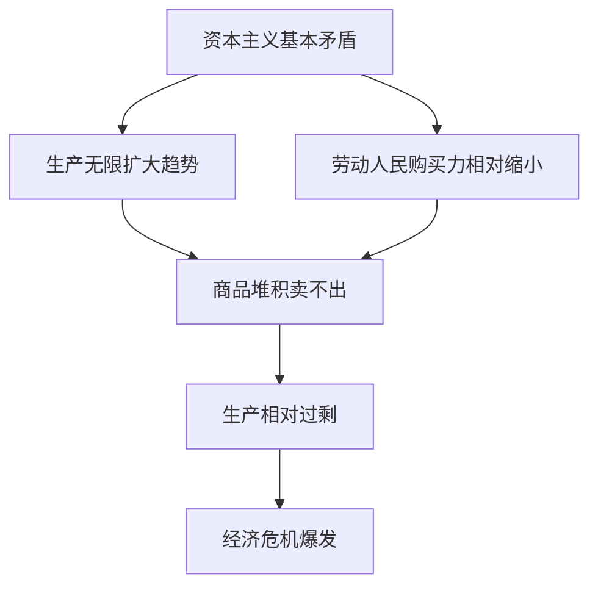
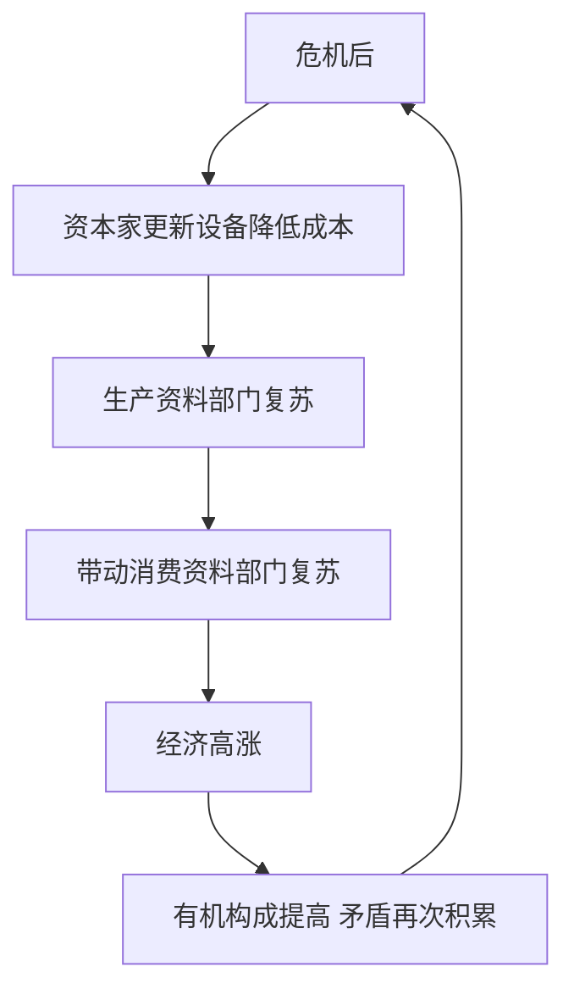
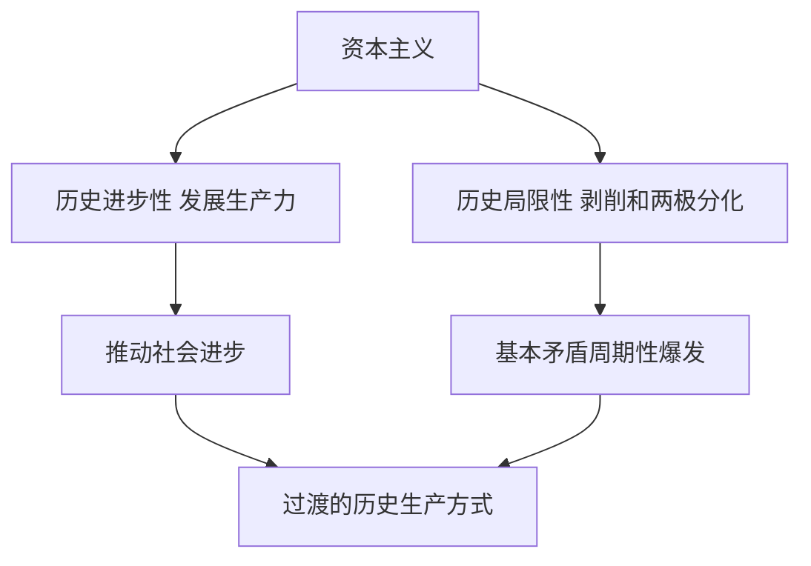
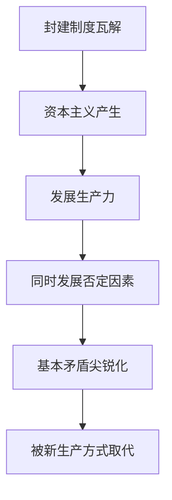
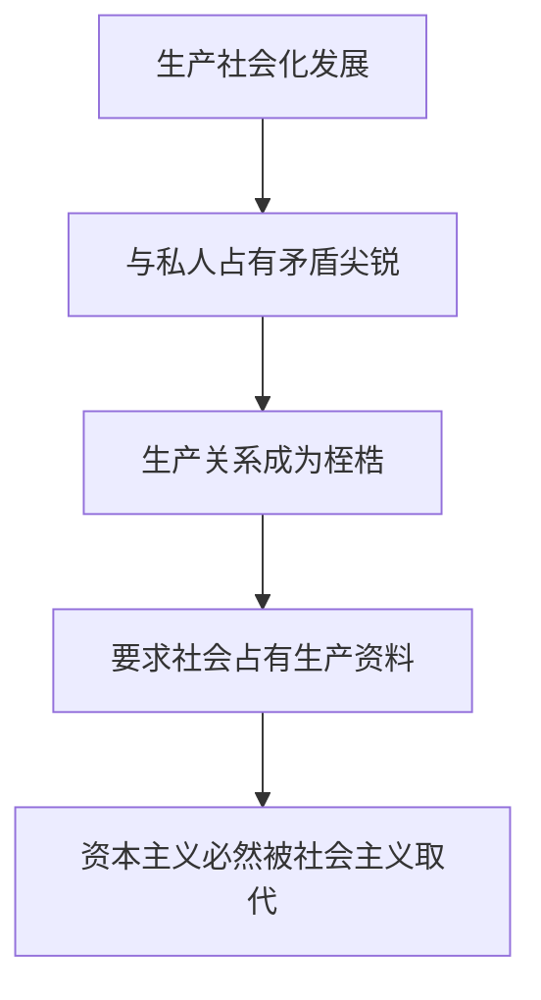
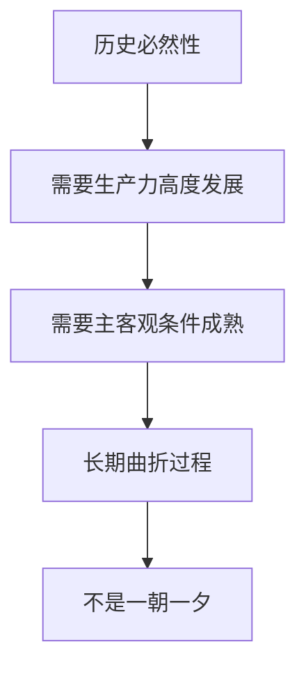

# 第 04 章 经济危机与历史趋势 · 选择题集（首经贸 801 巩固用）

<a href="../../../exam.html" target="_blank" style="display:inline-block;padding:6px 16px;background:#2563eb;color:#fff;border-radius:6px;text-decoration:none;font-size:14px;">📝 开始做题</a>

> 每个知识点 9 道单选，共 27 道。
> 题目方向：概念辨析、易混淆点、反向考法。
> 配套主观题见 [[考研真题集|本章考研真题集]]

## 📋 目录
- [[#KP01 资本主义经济危机|KP01 资本主义经济危机]] — 9 题
- [[#KP02 资本主义的历史地位|KP02 资本主义的历史地位]] — 9 题
- [[#KP03 资本主义发展的历史趋势|KP03 资本主义发展的历史趋势]] — 9 题

---

## KP01 资本主义经济危机（[[KP01_资本主义经济危机|回知识点]]）

**1. 资本主义经济危机的实质是（　）。**
A. 生产绝对过剩
B. 生产相对过剩
C. 商品供不应求
D. 货币供应不足

> **✅ 答案：B**
> **解析：** 危机时商品堆积与人民贫困并存，不是真的生产太多用不了，而是相对于劳动人民有支付能力需求显得过剩。

**2. 资本主义经济危机的根源是（　）。**
A. 生产技术落后
B. 人民消费不足
C. 资本主义基本矛盾
D. 国家政策失误

> **✅ 答案：C**
> **解析：** 根源是生产社会化与生产资料资本主义私人占有之间的矛盾。

**3. 资本主义基本矛盾是（　）。**
A. 无产阶级与资产阶级的矛盾
B. 生产社会化与生产资料资本主义私人占有之间的矛盾
C. 生产与消费的矛盾
D. 个别企业有组织与社会无政府的矛盾

> **✅ 答案：B**
> **解析：** A 是阶级表现，C、D 是基本矛盾的具体表现；B 是基本矛盾本身。

**4. 资本主义再生产周期的顺序是（　）。**
A. 危机—萧条—复苏—高涨
B. 危机—复苏—萧条—高涨
C. 高涨—危机—萧条—复苏
D. 萧条—危机—复苏—高涨

> **✅ 答案：A**
> **解析：** 危机是决定性阶段，之后经历萧条、复苏、高涨，再回到危机。

**5. 资本主义再生产周期的决定性阶段是（　）。**
A. 危机阶段
B. 萧条阶段
C. 复苏阶段
D. 高涨阶段

> **✅ 答案：A**
> **解析：** 危机既是上一周期的终点，又是下一周期的起点。

**6. 资本主义经济危机周期性的物质基础是（　）。**
A. 商品积压
B. 固定资本大规模更新
C. 信用扩张
D. 政府干预

> **✅ 答案：B**
> **解析：** 危机后固定资本大规模更新，既推动复苏，又为下一次危机准备物质条件。

**7. 战后资本主义经济危机的新特点不包括（　）。**
A. 危机强度有所减弱
B. 出现"滞胀"
C. 经济危机与金融危机交织
D. 经济危机已经消失

> **✅ 答案：D**
> **解析：** 战后危机只是形式变化，并未消失。

**8. 1970 年代主要资本主义国家出现的"滞胀"是指（　）。**
A. 经济增长与通货膨胀并存
B. 生产停滞与通货膨胀并存
C. 失业下降与物价下降并存
D. 经济高涨与通货紧缩并存

> **✅ 答案：B**
> **解析：** 生产停滞（高失业）与物价上涨同时并存，传统凯恩斯政策失灵。

**9. 下列说法错误的是（　）。**
A. 经济危机是资本主义基本矛盾尖锐化的强制爆发
B. 危机通过破坏生产力暂时恢复比例
C. 危机可以通过资本主义制度本身根除
D. 危机具有周期性

> **✅ 答案：C**
> **解析：** 危机只能缓和不能根除，要消灭危机必须消灭资本主义制度。
**10. （逻辑链·分析）资本主义经济危机的根源及其传导链是（　）。**
A. 资本主义基本矛盾（生产社会化与生产资料资本主义私人占有）→ 生产无限扩大趋势 vs 劳动人民购买力相对缩小 → 生产相对过剩 → 危机爆发
B. 人们消费太多
C. 政府干预太多
D. 天灾导致减产

> **✅ 答案：A**
> **解析：** 经济危机的实质是生产相对过剩——不是真的生产太多用不完，而是相对于劳动人民有支付能力的需求来说过剩了。根源是资本主义基本矛盾：生产社会化（整个社会生产成了一个大系统）和生产资料私人占有（资本家各自逐利）的矛盾。
>

>
> **数学推导**：设社会总产出 $W$，工人有支付能力需求 $D_w$，资本家消费和投资 $D_c$。当 $W > D_w + D_c$ 时，相对过剩产生。$D_w$ 被 $m'$ 压低（$v$ 占比下降），所以矛盾周期性爆发。
>
> **生活实例**：2008 年金融危机前，美国华尔街造出一大堆房贷衍生品，老百姓却还不起贷款——生产无限扩张，老百姓口袋里没钱，于是危机爆发。

**11. （逻辑链·判断）经济危机周期性爆发的物质基础是（　）。**
A. 固定资本的大规模更新（危机后资本家为降低成本更新设备，带动复苏，又为下一次危机准备条件）
B. 政府换届
C. 太阳黑子
D. 人口周期

> **✅ 答案：A**
> **解析：** 危机周期 = 危机→萧条→复苏→高涨→危机。固定资本大规模更新是周期性的物质基础：危机后资本家为降低成本争先更新设备，推动生产资料部门复苏，带动消费资料部门；但更新设备提高有机构成，又为下一次生产过剩准备条件。
>

>
> **数学推导**：固定资本周转周期约 10 年，与危机周期大致吻合。每次更新提高 $c/v$，$p' = m'/(c/v+1)$ 下降，矛盾再度积累。
>
> **生活实例**：奶茶店疫情后纷纷换全自动封口机、上小程序点单（固定资本更新），带动设备厂生意好转；但大家都更新后产能过剩，又迎来价格战——这就是危机周期的微观版。

---

## KP02 资本主义的历史地位（[[KP02_资本主义的历史地位|回知识点]]）

**1. 马克思主义对资本主义历史地位的态度是（　）。**
A. 全盘肯定
B. 全盘否定
C. 历史唯物主义辩证分析
D. 道德义愤地批判

> **✅ 答案：C**
> **解析：** 既肯定其历史进步性，又指出其历史暂时性。

**2. 资本主义对生产力发展的作用，马克思、恩格斯认为（　）。**
A. 一直阻碍生产力发展
B. 在不到一百年中创造的生产力比过去一切世代还要多
C. 与封建制相比没有进步
D. 只有破坏没有建设

> **✅ 答案：B**
> **解析：** 出自《共产党宣言》，肯定资产阶级革命的历史作用。

**3. 资本主义的历史局限性不包括（　）。**
A. 以追逐剩余价值为目的
B. 造成阶级对立和两极分化
C. 周期性爆发经济危机
D. 推动了世界市场形成

> **✅ 答案：D**
> **解析：** D 属于历史进步性。

**4. 马克思指出"两个决不会"是指（　）。**
A. 资本主义马上灭亡
B. 无论哪一个社会形态，在它所能容纳的全部生产力发挥出来以前，决不会灭亡；新的生产关系在物质条件成熟以前，决不会出现
C. 社会主义永远不会胜利
D. 资本主义不会有任何变化

> **✅ 答案：B**
> **解析：** 出自《政治经济学批判》序言，强调社会形态更替的客观条件性。

**5. 当代资本主义新变化不包括（　）。**
A. 股份公司普遍化
B. 福利国家制度建立
C. 生产资料公有制占主体
D. 国家干预经济加强

> **✅ 答案：C**
> **解析：** 当代资本主义仍然以私有制为主体。

**6. 当代资本主义中间阶层扩大，说明（　）。**
A. 无产阶级已经消失
B. 阶级矛盾已经根本解决
C. 阶级结构发生变化，但资产阶级与无产阶级的对立仍然存在
D. 资本主义已经变成社会主义

> **✅ 答案：C**
> **解析：** 中间阶层扩大缓和了阶级矛盾，但没有改变私有制和雇佣劳动制度。

**7. 战后资本主义国家建立福利国家制度，本质上是（　）。**
A. 实行社会主义
B. 为了缓和阶级矛盾、维护资本主义统治
C. 消灭了剥削
D. 实现了共同富裕

> **✅ 答案：B**
> **解析：** 福利制度是工人斗争的结果，也是资产阶级的让步，不是真正的社会主义。

**8. 资本主义把一切社会关系变成（　）。**
A. 宗法关系
B. 金钱关系（交换价值）
C. 合作关系
D. 等级关系

> **✅ 答案：B**
> **解析：** 《共产党宣言》指出，资产阶级"使人和人之间除了赤裸裸的利害关系，除了冷酷无情的'现金交易'，就再也没有别的联系了"。

**9. 下列说法错误的是（　）。**
A. 资本主义相对于封建主义是巨大进步
B. 资本主义必然被更高级社会形态代替
C. 当代资本主义新变化改变了资本主义本质
D. 资本主义造成人的异化

> **✅ 答案：C**
> **解析：** 新变化是制度内调整，没有改变私有制和剥削本质。
**10. （逻辑链·分析）资本主义的历史地位，正确传导是（　）。**
A. 资本主义曾经极大发展生产力（历史进步性）→ 但它建立在剥削基础上，导致两极分化和周期性危机（历史局限性）→ 它是一个过渡的、历史的生产方式
B. 资本主义是永恒的
C. 资本主义只有坏处
D. 资本主义最终完美

> **✅ 答案：A**
> **解析：** 资本主义在历史上曾摧毁封建束缚、极大发展生产力（资产阶级在一百年间创造的生产力比过去一切世代总和还多）。但它的基础是剥削雇佣劳动，必然导致财富两极分化和周期性经济危机——它不是永恒的自然制度，而是一个历史的、过渡的生产方式。
>

>
> **数学推导**：资本积累规律 $K_{t+1} = K_t + \alpha \cdot m_t$，财富一端积累资本，另一端积累贫困——两极分化。
>
> **生活实例**：资本主义让奶茶连锁从无到有、遍地开花（进步），但也让店长开豪车、店员加班到深夜（局限）——它既推动了文明，又带着自己的矛盾。

**11. （逻辑链·判断）说资本主义是"历史的、过渡的"生产方式，意思是（　）。**
A. 它不是从来就有、也不会永远存在，它在历史中产生，也将在历史中被更高级的生产方式取代
B. 它很快就会消失
C. 它是偶然的
D. 它会自动变好

> **✅ 答案：A**
> **解析：** 马克思主义认为，资本主义生产方式是在封建制度瓦解中产生的，它发展生产力的同时也发展了自己的否定因素（社会化大生产、无产阶级）。它不是永恒的自然制度，而是历史上暂时的、过渡的——必然被与社会化大生产相适应的新生产方式取代。
>

>
> **数学推导**：生产社会化与私人占有的矛盾 $M$ 随资本积累 $K$ 增大而扩大，$M(K) \uparrow$，最终突破资本主义外壳。
>
> **生活实例**：封建社会的手工工场孕育了资本主义；资本主义的大工厂又孕育了否定它的力量——就像果实成熟会从树上掉下来一样。

---

## KP03 资本主义发展的历史趋势（[[KP03_资本主义发展的历史趋势|回知识点]]）

**1. 资本主义必然被社会主义代替，是由（　）决定的。**
A. 道德愿望
B. 资本主义基本矛盾运动
C. 伟人意志
D. 偶然事件

> **✅ 答案：B**
> **解析：** 这是客观历史规律，不是道德诉求。

**2. 资本主义为自身灭亡准备的物质条件是（　）。**
A. 农民阶级
B. 高度社会化的大生产
C. 小手工业
D. 封建地主

> **✅ 答案：B**
> **解析：** 生产力高度发展是新社会的物质基础。

**3. 资本主义的掘墓人是（　）。**
A. 农民阶级
B. 小资产阶级
C. 无产阶级
D. 中产阶级

> **✅ 答案：C**
> **解析：** 无产阶级与社会化大生产相联系，最有组织性和革命性。

**4. 列宁指出，（　）是社会主义的最充分物质准备，是社会主义的前阶。**
A. 股份公司
B. 垄断资本主义
C. 国家垄断资本主义
D. 跨国公司

> **✅ 答案：C**
> **解析：** 国家垄断资本主义使生产社会化达到最高度，为社会主义准备了入口。

**5. 股份公司是（　）。**
A. 私有制的彻底消灭
B. 作为私人财产的资本在资本主义生产方式范围内的扬弃
C. 社会主义性质的企业
D. 与资本主义无关的组织形式

> **✅ 答案：B**
> **解析：** 股份资本是社会资本，它没有消除资本属性，但已经是对私人资本的扬弃。

**6. 资本主义代替封建主义、社会主义代替资本主义，二者共同说明（　）。**
A. 社会发展是杂乱无章的
B. 生产关系一定要适应生产力性质的规律
C. 英雄人物决定历史
D. 社会形态可以随意选择

> **✅ 答案：B**
> **解析：** 这是历史唯物主义基本原理。

**7. 苏东剧变说明（　）。**
A. 社会主义已经失败
B. 社会主义代替资本主义是短期的
C. 社会主义发展是曲折的，但总趋势不可逆转
D. 资本主义是历史终点

> **✅ 答案：C**
> **解析：** 苏东剧变是僵化模式的失败，不是社会主义本身的失败。

**8. "两个必然"是指（　）。**
A. 资本主义必然繁荣、社会主义必然失败
B. 资本主义必然灭亡、社会主义必然胜利
C. 危机必然消失、福利必然扩大
D. 全球化必然倒退、民族国家必然消亡

> **✅ 答案：B**
> **解析：** 出自《共产党宣言》。

**9. 下列说法错误的是（　）。**
A. 资本主义为新社会准备了物质条件和社会力量
B. 社会主义代替资本主义是长期、曲折的过程
C. 当代资本主义可以通过调整永远存在下去
D. 中国特色社会主义正在实践社会主义的生命力

> **✅ 答案：C**
> **解析：** 任何社会形态都有产生、发展、灭亡的过程，资本主义也不例外。
**10. （逻辑链·分析）资本主义被社会主义取代的历史必然性，正确传导是（　）。**
A. 资本主义基本矛盾随生产社会化发展而尖锐化 → 生产关系成为生产力发展桎梏 → 社会化大生产要求生产资料社会占有 → 资本主义必然被社会主义取代
B. 人们道德提高
C. 工人罢工
D. 资本家良心发现

> **✅ 答案：A**
> **解析：** 生产越来越社会化（整个社会成了一个分工协作的大系统），但生产资料仍归资本家私人占有——这一矛盾随生产发展而尖锐化。社会化大生产客观上要求由社会共同占有生产资料、统一组织生产，这就是社会主义取代资本主义的历史必然性。
>

>
> **数学推导**：生产社会化程度 $S$ 随资本积累提高，私人占有 $P$ 不变，矛盾 $S-P \to \infty$，最终突破。
>
> **生活实例**：外卖平台把整个城市的骑手、商家、用户连成一个大网络（社会化），但平台归私人所有、追逐利润最大化——这种矛盾发展到一定程度，就要求更社会化的治理方式。

**11. （逻辑链·判断）资本主义向社会主义过渡是一个长期历史过程，因为（　）。**
A. 生产关系的根本变革需要生产力高度发展、客观条件和主观条件成熟
B. 它明天就发生
C. 它不会发生
D. 它由一场革命自动完成

> **✅ 答案：A**
> **解析**：必然性不等于现实性。资本主义被取代需要生产力高度发展、生产社会化达到相当程度，还需要社会条件和阶级条件成熟。这是一个长期的、曲折的历史过程，不是一朝一夕的事。
>

>
> **数学推导**：过渡时期长度 $T$ 取决于生产力发展水平 $P$、矛盾激化程度 $M$，$T = f(P, M)$，随历史条件变化。
>
> **生活实例**：从第一家手工工场到现在几百年了，资本主义还在发展——取代它是必然趋势，但具体路径和时间是长期曲折的。

---

