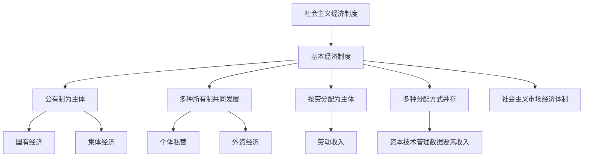

# 05 社会主义经济制度 · 章节总结

> 对应原书：第三篇 社会主义经济制度、所有制、分配（第 9-11 章）
> 📖 原书原文：[[../../../原文件/经济学/马克思主义政治经济学概论_全书|《概论》第9-11章]]

## 这一篇在回答什么问题

1. 社会主义经济制度怎么建立、本质是什么？
2. 中国特色社会主义所有制结构是什么？
3. 分配制度怎么体现"以人民为中心"？

## 框架图

## 核心概念

| 概念 | 一句话 | 详细 KP |
|---|---|---|
| 社会主义本质 | 解放生产力、发展生产力、消灭剥削、消除两极分化、最终共同富裕 | [[知识点/KP01_社会主义的本质与根本任务]] |
| 基本经济制度 | 公有制为主体、多种所有制共同发展；按劳分配为主体、多种分配方式并存；社会主义市场经济体制 | [[知识点/KP02_中国特色社会主义所有制]] |
| 按劳分配 | 按劳动数量和质量分配个人消费品 | [[知识点/KP03_按劳分配与多种分配方式]] |
| 共同富裕 | 社会主义的本质要求 | [[知识点/KP04_共同富裕]] |

## 🔗 相关知识点

**本篇：** [[知识点/KP01_社会主义的本质与根本任务]] ｜ [[知识点/KP02_中国特色社会主义所有制]] ｜ [[知识点/KP03_按劳分配与多种分配方式]] ｜ [[知识点/KP04_共同富裕]]

**跨章：** [[../06_社会主义市场经济与发展/00_章节总结|市场经济体制]]
