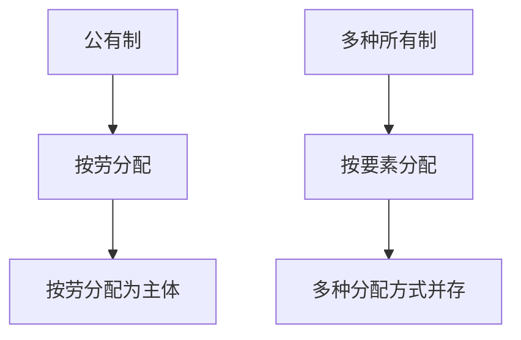

# KP03 · 按劳分配与多种分配方式

<a href="../../../../exam.html" target="_blank" style="display:inline-block;padding:6px 16px;background:#2563eb;color:#fff;border-radius:6px;text-decoration:none;font-size:14px;">📝 开始做题</a>

> 所属：[[../00_章节总结|第11章]] ｜ 节：原书第十一章

## 1. 一句话先懂（小白版）

分配制度 = **按劳分配为主体、多种分配方式并存**。

- **按劳分配**：公有制企业里，按你劳动的数量和质量发工资；
- **多种分配方式**：在市场经济下，资本、技术、管理、数据、土地等要素也参与分配。

不是"干多干少一个样"，也不是"资本独吞"。

## 2. 严格定义

**按劳分配**：在生产资料公有制范围内，按照劳动者向社会提供的劳动数量和质量分配个人消费品，多劳多得、少劳少得。

**按生产要素分配**：劳动、资本、技术、管理、数据、土地等要素按贡献参与分配。

**两者关系**：
- 主体是按劳分配（公有制经济中）；
- 并存是按要素分配（市场经济中）；
- 初次分配注重效率和公平，再分配注重公平，三次分配（慈善）自愿。

## 3. 为什么

- 社会主义阶段生产力还不够发达，不能按需分配；
- 劳动还是谋生手段，不是第一需要；
- 所以要按劳分配，调动积极性；
- 市场经济下要素要流动，必须允许按要素分配。

## 4. 怎么用

- 国企工资 = 按劳分配为主；
- 股东分红 = 按资本要素分配；
- 专利入股 = 按技术要素分配；
- 数据入股 = 按数据要素分配（新现象）。

## 5. 容易混淆什么

| 容易混 | 区别 |
|---|---|
| 按劳分配 vs 按劳动力价值分配 | 按劳分配在公有制内部，无剥削；按劳动力价值在私营企业，本质是资本主义工资。 |
| 初次分配 vs 再分配 | 初次 = 工资、利润、地租；再分配 = 税收、社保、转移支付。 |
| 效率 vs 公平 | 初次分配重效率，再分配重公平，三次分配靠自愿。 |

## 5.5 理论推导（一步步推）

**假设起点**：公有制为主体 + 多种所有制并存。

**推导过程**：
- 第一步：公有制内按劳动分配——按劳分配。
- 第二步：多种所有制内资本、技术、管理要素参与分配。
- 第三步：按劳分配为主体，多种分配方式并存。
- 结论：分配结构由所有制结构决定。

## 5.6 数学推导（公式怎么来的）

> 每个符号第一次出现必须解释。

个人收入 $Y = Y_{按劳} + Y_{按资} + Y_{按技} + \dots$。按劳分配部分 $Y_{按劳} = \bar Y \cdot L_i / \sum L$（与劳动贡献成正比）。

## 6. 现实意义

理解"最低工资""个税改革""社保""共同富裕示范区"，都是在调整分配关系。

---

## 🔗 相关知识点

**同章：** [[KP01_社会主义的本质与根本任务]] ｜ [[KP02_中国特色社会主义所有制]] ｜ [[KP04_共同富裕]]

**跨章：** [[../../02_资本主义经济制度与生产/知识点/KP08_资本主义工资|资本主义工资（对比）]]

**📖 原书原文：** [[../../../../原文件/经济学/马克思主义政治经济学概论_全书|《概论》第十一章]]

---

## 📝 考研真题（首经贸 801）

**配套主观题：** 见同目录 [[../考研真题集|本章考研真题集]]
**配套选择题：** 见同目录 [[../选择题集|本章选择题集]]

### 高频简答
- 为什么实行按劳分配为主体、多种分配方式并存 → 见 [[../考研真题集#s6|真题集·简答 6]]

### 高频论述
- 联系马克思剩余价值分配理论分析规范收入分配与防止资本无序扩张 → 见 [[../考研真题集#l4|真题集·论述 4]]

### 易错选择
- 本知识点选择题见 [[../选择题集#KP03 按劳分配与多种分配方式|选择题集·KP03]]
