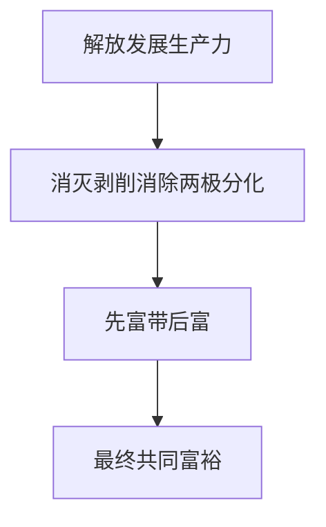
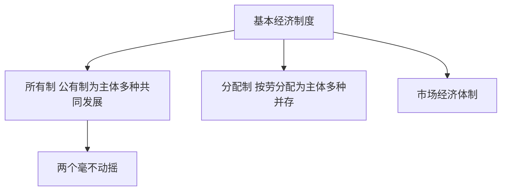

# 第 05 章 社会主义经济制度 · 考研真题集（首经贸 801）

<a href="../../../exam.html" target="_blank" style="display:inline-block;padding:6px 16px;background:#2563eb;color:#fff;border-radius:6px;text-decoration:none;font-size:14px;">📝 开始做题</a>

> 本章共收录：简答题 8 道（每题 15 分）｜论述题 4 道（每题 30 分）
> 配套选择题见 [[选择题集|本章选择题集]]
> 对应大纲：马克思主义政治经济学概论 第三篇 第 9—11 章

## 📋 本题集目录

### 简答题
1. [[#简答 1：简述社会主义的科学本质。|社会主义的科学本质]]
2. [[#简答 2：为什么说社会主义的根本任务是解放和发展生产力？|社会主义的根本任务是解放和发展生产力]]
3. [[#简答 3：简述我国社会主义初级阶段基本经济制度的内容及其客观依据。|社会主义初级阶段基本经济制度的内容与依据]]
4. [[#简答 4：如何理解"两个毫不动摇"？|如何理解"两个毫不动摇"]]
5. [[#简答 5：如何理解公有制主体地位的体现？|公有制主体地位的体现]]
6. [[#简答 6：为什么我国实行按劳分配为主体、多种分配方式并存的分配制度？|按劳分配为主体、多种分配方式并存的客观依据]]
7. [[#简答 7：简述按劳分配的客观必然性及其特点。|按劳分配的客观必然性与特点]]
8. [[#简答 8：如何理解共同富裕是社会主义的本质要求？|共同富裕是社会主义的本质要求]]

### 论述题
1. [[#论述 1：试用马克思主义所有制理论，分析新时代坚持"两个毫不动摇"、促进民营经济发展壮大的必然性与重大意义。|用马克思主义所有制理论分析"两个毫不动摇"与民营经济地位]]
2. [[#论述 2：试用马克思主义分配理论，分析浙江高质量发展建设共同富裕示范区的实践路径。|用分配理论分析浙江共同富裕示范区实践路径]]
3. [[#论述 3：结合社会主义本质理论，论述高质量发展与共同富裕的关系。|结合社会主义本质分析高质量发展与共同富裕的关系]]
4. [[#论述 4：联系马克思剩余价值分配理论，分析我国规范收入分配、防止资本无序扩张的必然性。|联系马克思剩余价值分配理论，分析规范收入分配与防止资本无序扩张]]

---

## 一、简答题（每题 15 分，建议 450—700 字）

### 简答 1：简述社会主义的科学本质。

**【建议字数】450–700 字 ｜ 【建议时间】15 分钟 ｜ 【题型】概念简答**

**【考什么】** 对应知识点 [[知识点/KP01_社会主义的本质与根本任务|社会主义的本质与根本任务]]，对应大纲第 9 章第 1 节；题型属于概念简答。

**【核心推导】**
**第一步：先立方法论——社会主义的本质是"两个层面"的统一**

$$ \text{价值目标}:\ \text{消灭剥削、消除两极分化、最终达到共同富裕} $$
$$ \text{根本手段}:\ \text{解放生产力、发展生产力} $$

邓小平 1992 年南方谈话的经典表述："社会主义的本质，是解放生产力，发展生产力，消灭剥削，消除两极分化，最终达到共同富裕。"

**关键判据**：这五句话不是五个并列特征，而是**手段与目的的统一、生产力与生产关系的统一**。答这道题必须先指出这一点，否则会写成"五个特征的罗列"。

**第二步：拆解——第一层是生产力层面的规定**

$$ \text{解放生产力} + \text{发展生产力} \Rightarrow \text{社会主义的物质基础} $$

为什么把生产力放进"本质"而不是只讲公有制？
- 马克思主义的基本原理是**生产力决定生产关系**，社会主义的优越性最终要通过更高的劳动生产率来体现；
- 落后国家建设社会主义，若不以发展生产力为中心，就会陷入"贫穷的社会主义"，无法体现优越性；
- 邓小平指出："贫穷不是社会主义。"这一判断把生产力标准重新确立为社会主义的核心内容。

**第三步：第二层是生产关系层面的规定**

$$ \text{消灭剥削} + \text{消除两极分化} \Rightarrow \text{生产关系的性质} $$

- 消灭剥削的根据：生产资料公有制为主体 → 按劳分配为主体 → 剩余劳动不再被少数人无偿占有；
- 消除两极分化的根据：共同富裕的目标导向 + 再分配与公共服务体系；
- **注意分寸**：我国处于社会主义初级阶段，剥削现象在一定范围、一定程度上仍然存在（如私营企业中的雇佣关系），但**制度主体上不存在剥削阶级**，且国家通过法律与政策加以引导和限制。

**第四步：第三层是价值目标——共同富裕**

$$ \text{共同富裕} = \text{生产力高度发达} + \text{分配公平} + \text{人的全面发展} $$

**共同富裕不是平均主义**：
- 不是同步富裕（有条件的地方可以先富起来）；
- 不是平均富裕（承认差别、反对悬殊）；
- 不是杀富济贫（保护合法收入、调节过高收入、取缔非法收入）；
- 而是**全体人民共同富裕、物质与精神生活都富裕**。

**第五步：三层之间是什么关系——不能割裂**

| 若只有生产力 | 若只有公有制 | 若只有共同富裕口号 |
|---|---|---|
| 变成"唯生产力论"，无法与资本主义区分 | 变成"一大二公"，脱离生产力水平（人民公社的教训） | 变成平均主义，失去物质基础 |

$$ \text{本质} = \text{生产力基础} + \text{生产关系性质} + \text{价值目标} $$

**三者是"基础—性质—目标"的递进关系**，缺一条就不完整。这是本题的采分核心。

**第六步：与其他社会形态的对比——本质的判别标准**

| 社会形态 | 生产力 | 生产关系 | 目标 |
|---|---|---|---|
| 资本主义 | 高度发达 | 私人占有、雇佣劳动 | 资本增殖 |
| 传统社会主义模式 | 相对落后 | 单一公有制、计划经济 | 平均分配 |
| 中国特色社会主义 | 解放和发展生产力 | 公有制为主体、多种所有制共同发展 | 共同富裕 |

**判别标准**：看**生产资料的占有方式**与**生产目的**。资本主义的生产目的是剩余价值，社会主义的生产目的是满足人民日益增长的美好生活需要——**这才是"本质"层面的区别。**

**第七步：当代推进——中国式现代化的五个特征**

$$ \text{人口规模巨大} + \text{全体人民共同富裕} + \text{物质文明与精神文明协调} + \text{人与自然和谐共生} + \text{走和平发展道路} $$

其中"全体人民共同富裕"直接对应社会主义本质的价值目标；"人与自然和谐共生"扩展了本质的内涵（生态维度）；"物质与精神文明协调"指向人的全面发展。

**第八步：结论**

社会主义的本质是解放生产力、发展生产力，消灭剥削、消除两极分化，最终达到共同富裕。这五句话构成"手段—性质—目标"的完整结构：解放和发展生产力是物质基础，消灭剥削与消除两极分化是生产关系的规定，共同富裕是最终价值目标，三者不可分割。它既区别于只讲公有制、忽视生产力的传统模式，也区别于只讲效率、不谈分配的资本主义。**一句话：社会主义不是穷的平均，也不是富的分化，而是把生产力搞上去以后让大家一起富起来。**

**【为什么要答这几点】**
**【满分 15 分的分点逻辑】**

**第一段：引出经典表述（3 分）**
邓小平 1992 年南方谈话的五句话，必须完整准确引述。**引述不全或记错直接扣 2 分。**

**第二段：指出结构——手段与目的、生产力与生产关系的统一（3 分）**
这一句是全题的"魂"，表明你不是在罗列特征，而是在解析结构。

**第三段：生产力层面（3 分）**
解放生产力、发展生产力是物质基础；"贫穷不是社会主义"；落后国家尤其要以发展生产力为中心。

**第四段：生产关系层面（3 分）**
消灭剥削、消除两极分化的根据是公有制主体 + 按劳分配主体；同时说明初级阶段剥削现象在一定范围存在但制度主体上无剥削阶级。

**第五段：价值目标（2 分）**
共同富裕不是平均主义、不是同步富裕、不是杀富济贫，而是全体人民共同富裕、物质与精神都富裕。

**第六段：三者统一（1 分）**
割裂任一条的后果（唯生产力论 / 一大二公 / 平均主义）。

**易失分点（五条）**
1. 只背五句话不解释，或把五句话当五个并列特征。
2. 漏掉"解放生产力、发展生产力"这两句，只谈公有制和共同富裕——这是最常见的失分。
3. 把共同富裕说成"平均分配"。
4. 回避初级阶段存在剥削现象的问题，或反之夸大。
5. 不与资本主义的生产目的做对比，显得没有本质层面的区分。

**加分点（五条）**
1. 用"手段—性质—目标"三段结构解析五句话，层次立刻拉开。
2. 用"贫穷不是社会主义"与人民公社"一大二公"的教训对照，说明为何生产力必须进入本质。
3. 指出判别标准是"占有方式 + 生产目的"，把本质落到可比较的维度。
4. 把共同富裕拆成三个反例（不同步、不平均、不杀富济贫），避免误解。
5. 联系中国式现代化五个特征，说明本质在当代的展开。

**【阅卷心理】**
判卷老师主要看两处：**五句话是否完整**；**是否把生产力与生产关系统一起来（而不是只讲公有制）**。这两处做到，13 分以上。
记忆金句：**社会主义不是穷的平均，也不是富的分化，而是把生产力搞上去以后让大家一起富起来。**

**【如何分析题目】**
**第一步：审题，注意"科学本质"三字**
"科学"意味着要用马克思主义的立场方法，而不是道德愿望来解释。开篇就应交代这是邓小平的经典概括。

**第二步：完整引述五句话**
解放生产力、发展生产力、消灭剥削、消除两极分化、最终达到共同富裕。一句不能少。

**第三步：先给结构判断**
指出这是手段与目的的统一、生产力与生产关系的统一。让阅卷老师知道你不是在背条条。

**第四步：展开生产力层面**
说明为何生产力必须进入本质：生产力决定生产关系、贫穷不是社会主义、落后国家的现实。

**第五步：展开生产关系层面**
公有制主体与按劳分配主体如何导致"消灭剥削、消除两极分化"；初级阶段的分寸如何把握。

**第六步：展开价值目标**
共同富裕的三个"不是"，再加"物质与精神都富裕"的完整含义。

**第七步：补三者统一的论证**
用三种割裂的后果反证三者的不可分割。

**第八步：与资本主义对比**
占方式与生产目的两条判据，点出本质层面的区别。

**第九步：字数与时间控制**
15 分约 550–700 字，建议 15 分钟：引述与结构 3 分钟、生产力 3 分钟、生产关系 3 分钟、共同富裕 3 分钟、统一与对比 3 分钟。时间紧时先保五句话完整性与"生产力+生产关系"的统一论证。

**【答题框架】**
- 第 1 段：社会主义本质论断的提出（3 分）
- 第 2 段：五句话的内在逻辑（8 分）
- 第 3 段：认识意义（4 分）

**【参考答案】**

一、社会主义本质论断的提出

邓小平在 1992 年南方谈话中对社会主义本质作出科学概括："社会主义的本质，是解放生产力，发展生产力，消灭剥削，消除两极分化，最终达到共同富裕。"这一论断突破了过去单纯从公有制、按劳分配等特征定义社会主义的传统思路，从生产力与生产关系、手段与目的的统一上揭示了社会主义的本质。

二、五句话的内在逻辑

(一) **解放生产力、发展生产力**——这是社会主义的根本任务，是实现社会主义的物质基础。马克思主义最注重发展生产力，社会主义优越性归根到底要体现在它的生产力比资本主义发展得更快更好。

(二) **消灭剥削**——这是生产关系方面的要求。社会主义要消灭剥削制度，坚持公有制为主体，不允许凭借生产资料无偿占有他人劳动。

(三) **消除两极分化**——这是分配关系方面的要求。资本主义造成一极财富积累、一极贫困积累，社会主义要避免这种状况，使发展成果惠及全体人民。

(四) **最终达到共同富裕**——这是社会主义的根本目标和归宿。前三个方面都是手段，最终目的是实现共同富裕。

五个方面是一个有机整体：前两条讲生产力，中间两条讲生产关系，最后一条讲根本目标。它们共同回答了"什么是社会主义、怎样建设社会主义"这一根本问题。

三、认识意义

(一) 这一论断纠正了过去忽视生产力发展的错误倾向，把解放和发展生产力提到首要位置；
(二) 突破了脱离生产力抽象谈论公有制、按劳分配的观念，为社会主义初级阶段实行公有制为主体、多种所有制共同发展提供了理论依据；
(三) 明确了共同富裕是社会主义与资本主义的本质区别，为新时代推进共同富裕示范区建设提供了指导。

**【解析·得分点】** 采分点：①完整背诵五句话 ②区分生产力/生产关系/目标三个层次 ③南方谈话背景 ④认识意义。易丢分：漏掉"解放生产力"只写"发展生产力"；把共同富裕与平均主义混同。

**【生活实例】** 一个家庭，本质不是"必须几口人、必须几间房"，而是"把日子过好（发展生产力）、家里人不互相剥削（消灭剥削）、大家都不穷富差距太大（消除两极分化）、最终全家一起富裕（共同富裕）"。

**【双链接】** 🔗 [[知识点/KP01_社会主义的本质与根本任务|回知识点]] ｜ [[知识点/KP04_共同富裕|共同富裕]]

---

### 简答 2：为什么说社会主义的根本任务是解放和发展生产力？

**【建议字数】450–700 字 ｜ 【建议时间】15 分钟 ｜ 【题型】原因分析**

**【考什么】** 对应知识点 [[知识点/KP01_社会主义的本质与根本任务|社会主义的本质与根本任务]]，对应大纲第 9 章第 1 节；题型属于原因分析。

**【核心推导】**
**第一步：先给判断句——这是由历史唯物主义的基本原理决定的**

$$ \text{生产力决定生产关系} \Rightarrow \text{社会主义必须以发展生产力为根本任务} $$

**根本任务**与"根本目的"不同：根本任务是手段层面的、阶段性的核心工作；根本目的是价值层面的、最终要实现的满足人民需要。**两者必须分清，混答必失分。**

**第二步：理论依据——三层**

**(一) 生产力是社会发展的最终决定力量**

$$ \text{生产力} \to \text{生产关系} \to \text{上层建筑} $$

马克思：社会形态的更替最终取决于生产力的发展水平。社会主义要取代资本主义，就必须在劳动生产率上超过资本主义。列宁明确指出："劳动生产率，归根到底是使新社会制度取得胜利的最重要最主要的东西。"

**(二) 社会主义本质的内在要求**

$$ \text{本质} = \text{解放生产力} + \text{发展生产力} + \text{消灭剥削} + \text{消除两极分化} + \text{共同富裕} $$

若不以发展生产力为根本任务，"消灭剥削、共同富裕"就失去物质基础，只能成为贫穷的平均主义。**"贫穷不是社会主义"这一判断，正是把生产力标准写进了本质。**

**(三) 初级阶段主要矛盾的决定**

$$ \text{主要矛盾}:\ \text{人民日益增长的美好生活需要} \ \text{vs}\ \text{不平衡不充分的发展} $$

解决这一矛盾只能靠发展，且是高质量发展。**党的十九大、二十大对此有明确表述，是本题最应引用的当代依据。**

**第三步：历史依据——正反两方面的经验**

| 时期 | 做法 | 结果 |
|---|---|---|
| 1956–1978 | 以阶级斗争为纲，"一大二公"、平均主义 | 生产力发展缓慢，人民生活贫困 |
| 1978 年后 | 以经济建设为中心，改革开放 | GDP 从 1978 年 3679 亿元增至 2023 年超 126 万亿元 |
| 新时代 | 高质量发展、新发展理念 | 脱贫攻坚全面胜利、全面小康 |

$$ \text{正反经验} \Rightarrow \text{什么时候把发展生产力作为根本任务，社会主义就兴旺；什么时候偏离，就受挫折} $$

**第四步：现实依据——社会主义制度的优越性靠什么证明**

$$ \text{优越性} \neq \text{口号};\qquad \text{优越性} = \text{更高的劳动生产率} + \text{更公平的分配} $$

- 与资本主义的竞争中，最终靠发展速度和质量的比较；
- 共同富裕的目标要求"把蛋糕做大"是前提，"把蛋糕分好"是保障，顺序不能倒；
- 2035 年基本实现现代化、本世纪中叶建成社会主义现代化强国——目标的实现全靠发展。

**第五步：为什么不是"唯一任务"——分寸把握**

$$ \text{根本任务} = \text{中心工作};\qquad \text{但需统筹}:\ \text{经济、政治、文化、社会、生态} $$

"以经济建设为中心"不等于"只搞经济"。五位一体总体布局、高质量发展要求统筹多方面。**答"根本任务"时若不写统筹，容易显得片面。**

**第六步：结论**

社会主义的根本任务是解放和发展生产力，这一判断有三重依据：理论上，生产力是社会发展的最终决定力量，社会主义必须创造高于资本主义的劳动生产率；本质上，解放和发展生产力是社会主义本质的首要内容，是消灭剥削、消除两极分化、实现共同富裕的物质基础，"贫穷不是社会主义"；现实上，社会主义初级阶段的主要矛盾决定了必须以发展（尤其是高质量发展）来解决不平衡不充分的问题。历史经验从正反两面证明，偏离这一根本任务，社会主义就遭受挫折。**一句话：社会主义的优越性不是喊出来的，是干出来的——先把生产力搞上去，才有资格谈共同富裕。**

**【为什么要答这几点】**
**【满分 15 分的分点逻辑】**

**第一段：判断句（2 分）**
由生产力决定生产关系的原理决定；同时区分"根本任务"（手段）与"根本目的"（价值）。

**第二段：理论依据（5 分）**
① 生产力是社会发展的最终决定力量（引列宁"劳动生产率归根到底是使新社会制度取得胜利的最重要最主要的东西"）；② 社会主义本质的首要内容；③ 初级阶段主要矛盾。

**第三段：历史依据（4 分）**
1978 年前以阶级斗争为纲的教训（"一大二公"、平均主义、贫穷）；改革开放后 GDP 从 3679 亿元到超 126 万亿元；新时代脱贫攻坚、全面小康。**正反对照最有说服力。**

**第四段：现实依据（2 分）**
制度优越性要靠更高的劳动生产率与更公平的分配来证明；"两个一百年"目标靠发展实现。

**第五段：分寸（2 分）**
根本任务不等于唯一任务，要统筹五位一体，坚持高质量发展。

**易失分点（五条）**
1. 把"根本任务"与"根本目的"混为一谈（根本目的是满足人民需要）。
2. 只讲理论不讲历史经验，答案显得空。
3. 只讲"发展生产力"不讲"解放生产力"——改革也是解放生产力。
4. 不引初级阶段主要矛盾的表述。
5. 走极端："只要经济发展，其他都不重要"，违背五位一体。

**加分点（五条）**
1. 引列宁关于劳动生产率的论断，理论依据立刻扎实。
2. 用 1978 年前后的正反对照，说明"贫穷不是社会主义"。
3. 指出"解放"与"发展"两个动词的差别：前者指改革僵化体制释放活力，后者指扩大生产。
4. 把"做大蛋糕"与"分好蛋糕"的顺序讲清，回应共同富裕的关系。
5. 联系高质量发展与新发展理念，落到新时代的政策语言。

**【阅卷心理】**
判卷老师主要看两处：**是否既讲理论依据又讲历史经验**；**是否区分根本任务与根本目的、区分"解放"与"发展"**。这两处做到，13 分以上。
记忆金句：**优越性不是喊出来的，是干出来的——先把生产力搞上去，才有资格谈共同富裕。**

**【如何分析题目】**
**第一步：审题，抓"根本任务"四字**
先明确它是手段层面的中心工作，与"根本目的"不同。开篇区分，避免混答。

**第二步：写理论依据三层**
最终决定力量、本质的首要内容、主要矛盾。每层一两句，引列宁与十九大表述。

**第三步：写历史依据**
用 1978 年前后对照，附 GDP 数据。正反经验比单向论证更有力。

**第四步：写现实依据**
制度竞争、共同富裕的前提、现代化目标。

**第五步：补分寸**
根本任务不等于唯一任务，统筹五位一体。

**第六步：解释"解放"与"发展"的差别**
解放指改革体制机制释放活力；发展指扩大生产、提高效率。这一层能体现理论精度。

**第七步：收尾**
一句话落到"共同富裕需要物质基础"。

**第八步：自检**
是否区分了根本任务与根本目的；是否有历史经验；是否避免"唯经济论"。

**第九步：字数与时间控制**
15 分约 500–700 字，建议 15 分钟：判断句 2 分钟、理论 4 分钟、历史 4 分钟、现实与分寸 4 分钟、收尾 1 分钟。时间紧时先保理论三层与历史对照。

**【答题框架】**
- 第 1 段：马克思主义基本原理（4 分）
- 第 2 段：社会主义制度优越性的体现（4 分）
- 第 3 段：初级阶段主要矛盾决定（4 分）
- 第 4 段：实现共同富裕的物质基础（3 分）

**【参考答案】**

一、马克思主义基本原理

历史唯物主义认为，生产力是社会发展的最终决定力量。马克思主义最注重发展生产力。无产阶级夺取政权后，必须尽快发展生产力，创造比资本主义更高的劳动生产率，这是社会主义战胜资本主义的根本保证。《共产党宣言》明确指出，无产阶级在夺取政权后，要"尽可能快地增加生产力的总量"。

二、社会主义制度优越性的根本体现

一种社会制度是否先进，归根到底看它是否能促进生产力发展。社会主义公有制克服了资本主义生产社会化与私人占有的矛盾，能够为生产力迅速发展开辟道路。社会主义优越性，归根到底要体现在生产力比资本主义发展得更快更好、人民生活比资本主义更好。如果长期不能摆脱贫穷，就不能说是合格的社会主义。

三、社会主义初级阶段主要矛盾的决定

我国社会主义初级阶段的主要矛盾，是人民日益增长的美好生活需要和不平衡不充分的发展之间的矛盾。解决这一矛盾，必须把发展作为党执政兴国的第一要务，通过解放和发展生产力，提供更多更好的产品和服务，满足人民多方面需要。

四、实现共同富裕的物质基础

共同富裕不是平均主义，不是劫富济贫，而是建立在生产力高度发展基础上的富裕。没有生产力的高度发展，就没有可供分配的社会财富，共同富裕就是空话。只有把"蛋糕"做大，才能把"蛋糕"分好。新时代坚持以经济建设为中心、推动高质量发展，正是为了实现共同富裕创造物质条件。

**【解析·得分点】** 采分点：①历史唯物主义原理 ②社会主义优越性 ③初级阶段主要矛盾 ④共同富裕的物质基础。易丢分：只说"要发展"，不说为什么。

**【生活实例】** 一个班集体，班长再怎么讲奉献，如果班级成绩上不去、活动办不起来，大家不会服班长。社会主义也是一样——制度好不好，先看能不能让大家日子越过越好。

**【双链接】** 🔗 [[知识点/KP01_社会主义的本质与根本任务|回知识点]] ｜ [[知识点/KP04_共同富裕|共同富裕]]

---

### 简答 3：简述我国社会主义初级阶段基本经济制度的内容及其客观依据。

**【建议字数】450–700 字 ｜ 【建议时间】15 分钟 ｜ 【题型】模型分析**

**【考什么】** 对应知识点 [[知识点/KP02_中国特色社会主义所有制|中国特色社会主义所有制]]，对应大纲第 10 章；题型属于概念简答。

**【核心推导】**
**第一步：先给制度内容的三层结构**

$$ \text{基本经济制度} = \underbrace{\text{所有制}}_{基础} + \underbrace{\text{分配制度}}_{结果} + \underbrace{\text{资源配置方式}}_{运行} $$

党的十九届四中全会明确：公有制为主体、多种所有制经济共同发展，按劳分配为主体、多种分配方式并存，社会主义市场经济体制——**三位一体**，都属于社会主义基本经济制度。

**第二步：第一层——所有制结构**

$$ \text{公有制为主体} + \text{多种所有制经济共同发展} $$

- 公有制经济包括国有经济、集体经济，以及混合所有制经济中的国有成分和集体成分；
- 公有制主体地位主要体现在**公有资产在社会总资产中占优势、国有经济控制国民经济命脉并对经济发展起主导作用**；
- 非公有制经济包括个体经济、私营经济、外资经济等，是社会主义市场经济的重要组成部分。

**第三步：第二层——分配制度**

$$ \text{按劳分配为主体} + \text{多种分配方式并存} $$

- 按劳分配与公有制主体地位相适应；
- 按生产要素分配（劳动、资本、土地、知识、技术、管理、数据）与多种所有制并存相适应；
- **数据作为生产要素参与分配**是十九届四中全会的新表述，体现了数字经济时代的特点。

**第四步：第三层——社会主义市场经济体制**

$$ \text{市场在资源配置中起决定性作用} + \text{更好发挥政府作用} $$

"决定性作用"与"基础性作用"的表述变化（十八届三中全会）是关键考点：前者强调市场的广度与深度，后者保留了政府作用的必要性。

**第五步：客观依据——三层论证**

**(一) 由生产力发展水平的多层次性决定**

$$ \text{生产力多层次} \Rightarrow \text{所有制不能单一化} $$

我国既有自动化、信息化的现代生产，也有半机械化、手工劳动；既有世界一流企业，也有大量中小微企业。**生产力水平的多层次决定了所有制结构不能"一刀切"。**

**(二) 由社会主义性质决定**

$$ \text{公有制为主体} \Rightarrow \text{保证社会主义方向} + \text{共同富裕的制度基础} $$

**(三) 由社会主义初级阶段的基本国情决定**

$$ \text{人口多、底子薄、发展不平衡} \Rightarrow \text{必须调动一切积极因素} $$

**第六步：为什么"三位一体"而不是只讲所有制**

| 只讲所有制 | 三位一体 |
|---|---|
| 无法解释分配方式的多样性 | 所有制决定分配，分配反作用于所有制 |
| 无法说明市场机制的地位 | 把资源配置方式上升为制度层面 |
| 与计划经济的旧表述难以区分 | 明确社会主义与市场经济的结合 |

$$ \text{制度} = \text{所有制（谁拥有）} + \text{分配（谁得益）} + \text{体制（怎么运行）} $$

**第七步：结论**

我国社会主义初级阶段的基本经济制度包括三个方面：公有制为主体、多种所有制经济共同发展的所有制结构；按劳分配为主体、多种分配方式并存的分配制度；社会主义市场经济体制。三者是有机整体，分别回答"谁拥有""谁得益""怎么运行"。其客观依据在于：生产力发展水平的多层次性要求所有制结构不能单一化；社会主义性质要求公有制为主体以保证共同富裕的方向；初级阶段的基本国情要求调动一切积极因素。**一句话：所有制是基础，分配是结果，体制是运行方式，三者配套才叫"基本经济制度"。**

**【为什么要答这几点】**
**【满分 15 分的分点逻辑】**

**第一段：总述三位一体（3 分）**
点明十九届四中全会的表述，把三项制度一次列全。**只答所有制一项最多得 8 分。**

**第二段：所有制结构（3 分）**
公有制为主体、多种所有制共同发展；主体地位的体现；非公有制经济的地位。

**第三段：分配制度（3 分）**
按劳分配为主体、多种分配方式并存；生产要素包括劳动、资本、土地、知识、技术、管理、数据。

**第四段：市场经济体制（2 分）**
市场起决定性作用、更好发挥政府作用；与"基础性作用"的表述变化。

**第五段：客观依据（3 分）**
生产力多层次性、社会主义性质、初级阶段国情，三条各一句。

**第六段：三者关系（1 分）**
所有制决定分配、分配反作用于所有制、体制是运行方式。

**易失分点（五条）**
1. 只答所有制结构，漏掉分配制度与市场经济体制。
2. 把"公有制主体地位"说成"公有制在每个行业都占优势"。
3. 分配制度里漏掉"数据"这一新要素。
4. 客观依据只讲生产力，不讲社会主义性质与初级阶段。
5. 把"决定性作用"仍写成"基础性作用"。

**加分点（五条）**
1. 用"谁拥有—谁得益—怎么运行"三问串起三项制度，结构清晰。
2. 指出十九届四中全会把分配制度与市场经济体制上升为"基本经济制度"，是表述的重大发展。
3. 说明公有制主体地位的两条具体标准（公有资产占优势、国有经济控制命脉并起主导作用）。
4. 把"数据"作为新生产要素单独点出，体现时代性。
5. 结尾点明三者是有机整体而非简单并列。

**【阅卷心理】**
判卷老师主要看两处：**三项制度是否答全**；**客观依据是否有三条（生产力、性质、国情）**。这两处做到，13 分以上。
记忆金句：**所有制是基础，分配是结果，体制是运行方式，三者配套才叫"基本经济制度"。**

**【如何分析题目】**
**第一步：审题，抓"内容"与"客观依据"两部分**
"内容"要答全三项制度；"客观依据"要答出理论根据。两部分分值通常各占一半。

**第二步：先总述三位一体**
引出十九届四中全会表述，让阅卷老师立刻看到你知道这是"三项"不是"一项"。

**第三步：逐项展开**
所有制（公有制主体地位 + 多种所有制共同发展）、分配（按劳分配为主体 + 多种方式并存 + 七类要素）、体制（市场决定性作用 + 政府作用）。

**第四步：写客观依据三层**
生产力多层次、社会主义性质、初级阶段国情。每层一句话，不要展开过多。

**第五步：补三者关系**
所有制决定分配、分配反作用于所有制、体制是运行方式。这一句能显层次。

**第六步：注意表述准确**
"公有制为主体"不等于"公有制占绝对多数"；"决定性作用"不写成"基础性作用"；分配要素要列全。

**第七步：字数与时间控制**
15 分约 600–750 字，建议 15 分钟：总述 2 分钟、三项制度 7 分钟、客观依据 4 分钟、关系与收尾 2 分钟。时间紧时先保三项制度答全。

**【答题框架】**
- 第 1 段：三项内容（5 分）
- 第 2 段：客观依据（6 分）
- 第 3 段：意义（4 分）

**【参考答案】**

一、基本经济制度的三项内容

党的十九届四中全会将社会主义基本经济制度概括为三项相互联系的内容：

(一) **公有制为主体、多种所有制经济共同发展**——这是所有制结构；
(二) **按劳分配为主体、多种分配方式并存**——这是分配制度；
(三) **社会主义市场经济体制**——这是资源配置方式和经济运行机制。

这三项共同构成中国特色社会主义基本经济制度体系，标志着我们对社会主义经济制度的认识达到新高度。

二、客观依据

(一) **由社会主义性质决定**：我国是社会主义国家，必须坚持公有制作为社会主义经济制度的基础，坚持按劳分配主体地位，否则就会偏离社会主义方向。

(二) **由初级阶段国情决定**：我国生产力总体水平不高，发展不平衡、多层次，既有现代化大生产，又有传统手工劳动；既有东部发达地区，又有西部欠发达地区。这种生产力状况决定了不能实行单一公有制，必须发展多种所有制经济。

(三) **由发展社会主义市场经济的需要决定**：市场经济要求多元市场主体平等竞争、要素自由流动。多种所有制共同发展，才能为市场经济提供微观基础；按劳分配与按要素分配结合，才能激发要素活力。

(四) **由实践证明有效**：改革开放四十多年来，我国坚持这一基本经济制度，实现了经济快速发展和人民生活水平大幅提高，证明它符合中国实际。

三、意义

这一基本经济制度既坚持了社会主义基本原则，又根据我国实际和时代特点赋予其鲜明的中国特色，是中国特色社会主义制度的重要支柱。它既不同于传统苏联模式的单一公有制，也不同于西方资本主义私有制，是党和人民的伟大创造。

**【解析·得分点】** 采分点：①三项内容完整 ②社会主义性质+初级阶段国情+市场经济需要+实践证明 ③十九届四中全会定位。易丢分：只写所有制，漏掉分配制度和市场经济体制。

**【生活实例】** 像一个大家庭，既要有"公家房"（公有制）保证大家基本居住，也要允许有人开小饭馆、搞小装修（非公有制）满足多样化需求；既要有按出力多少分钱（按劳分配），也要允许房子出租收租（按要素分配）；既不能全计划安排，也不能全交给市场。

**【双链接】** 🔗 [[知识点/KP02_中国特色社会主义所有制|回知识点]] ｜ [[知识点/KP03_按劳分配与多种分配方式|按劳分配]]

---

### 简答 4：如何理解"两个毫不动摇"？

**【建议字数】450–700 字 ｜ 【建议时间】15 分钟 ｜ 【题型】关系对比**

**【考什么】** 对应知识点 [[知识点/KP02_中国特色社会主义所有制|中国特色社会主义所有制]]，对应大纲第 10 章；题型属于分析评价。

**【核心推导】**
**第一步：先立判断——"两个毫不动摇"是所有制问题的核心方针**

$$ \text{毫不动摇巩固和发展公有制经济} + \text{毫不动摇鼓励、支持、引导非公有制经济发展} $$

党的十六大提出"两个毫不动摇"，十九大、二十大重申。**它是"两个"而不是"一个"，本身就是对"国进民退"或"民营经济离场论"的直接否定。**

**第二步：第一层——为什么必须毫不动摇巩固和发展公有制经济**

**(一) 公有制是社会主义的经济基础**

$$ \text{公有制为主体} \Rightarrow \text{社会主义方向} + \text{共同富裕的制度前提} $$

**(二) 国有经济控制国民经济命脉**

$$ \text{能源、交通、通信、金融、国防、粮食} \Rightarrow \text{国家安全与经济稳定} $$

- 提供公共品与基础设施（高铁、电网、5G 基站）——私营资本不愿或不能承担；
- 承担宏观调控与逆周期调节的载体功能；
- 重大科技攻关的组织者（载人航天、大飞机、芯片制造）。

**(三) 公有制实现形式可以多样化**

$$ \text{公有制} \neq \text{国有国营};\qquad \text{股份制、混合所有制都可成为实现形式} $$

**第三个"毫不动摇"（十九大新增）：毫不动摇把国有企业做强做优做大。**答本题时点出这一句可加分。

**第三步：第二层——为什么必须毫不动摇鼓励、支持、引导非公有制经济**

**(一) 由生产力多层次性决定**

$$ \text{生产力多层次} \Rightarrow \text{所有制不能单一化} $$

**(二) 民营经济的实际贡献——"56789"**

$$ \text{50\% 以上税收} + \text{60\% 以上 GDP} + \text{70\% 以上技术创新} + \text{80\% 以上城镇就业} + \text{90\% 以上企业数量} $$

这组数据是最有力的现实依据。**记不住具体数字时，"五六七八九"这个口诀能救场。**

**(三) 就业与民生的主要载体**

$$ \text{城镇就业} \Rightarrow \text{民营经济贡献 80\% 以上} $$

**(四) 社会主义市场经济的活力来源**

民营经济机制灵活、贴近市场，是创新与竞争的重要主体。

**第四步：第三层——两者为什么是统一的而不是对立的**

| 误解 | 事实 |
|---|---|
| "国进民退" | 公有制与非公有制是互相促进、共同发展的关系 |
| "民营经济离场" | 民营经济是社会主义市场经济的重要组成部分，长期不变 |
| "两个毫不动摇是权宜之计" | 是长久之策，写入党章宪法 |

$$ \text{基本经济制度} \Rightarrow \text{两者都是"制度内"的，而非"制度外"的补充} $$

**关键论证**：非公有制经济不是"社会主义市场经济的异己力量"，而是**其重要组成部分**；公有制与非公有制在市场竞争中各自发挥优势、相互促进，而不是零和博弈。

**第五步：第四层——如何落实"两个毫不动摇"**

$$ \text{产权保护} + \text{公平竞争} + \text{要素市场化} + \text{法治化营商环境} $$

- 依法保护民营企业产权和企业家权益（"两个健康"）；
- 破除市场准入壁垒（"非禁即入"、负面清单）；
- 在融资、用地、招投标等方面一视同仁；
- 2023 年《关于促进民营经济发展壮大的意见》是标志性文件。

**第六步：结论**

"两个毫不动摇"是我国基本经济制度的核心方针：一方面，公有制经济是社会主义的经济基础，国有经济控制国民经济命脉，必须在关系国家安全和国计民生的重要行业做强做优做大；另一方面，非公有制经济由生产力多层次性决定，贡献了"56789"，是就业与创新的主要载体，是社会主义市场经济的重要组成部分。两者不是对立的，而是互相促进、共同发展，共同统一于社会主义现代化建设进程中。**一句话：公有制是脊梁，民营经济是血脉，二者缺一不可。**

**【为什么要答这几点】**
**【满分 15 分的分点逻辑】**

**第一段：判断句与出处（2 分）**
十六大提出、十九大与二十大重申；点出是"两个"而非"一个"。

**第二段：公有制为何毫不动摇（5 分）**
社会主义经济基础；国有经济控制命脉（能源、交通、通信、金融、国防、粮食）；公共品与重大科技攻关的组织者；公有制实现形式可以多样化；补一句"做强做优做大国有企业"。

**第三段：非公有制为何毫不动摇（5 分）**
生产力多层次性决定；"56789"的贡献；就业主渠道；社会主义市场经济的重要组成部分。

**第四段：两者统一（2 分）**
辨析"国进民退""民营经济离场论"，说明两者都是制度内的、互相促进。

**第五段：如何落实（1 分）**
产权保护、公平竞争、要素市场化、法治化营商环境；2023 年促进民营经济发展壮大的意见。

**易失分点（五条）**
1. 只答"为什么坚持公有制"或只答"为什么发展非公有制"，漏掉另一半。
2. 把非公有制经济说成"社会主义市场经济的补充"——正确表述是"重要组成部分"。
3. 把"两个毫不动摇"说成权宜之计。
4. 不区分"公有制主体地位"与"国有经济主导作用"。
5. 只讲理论不讲"56789"等数据支撑。

**加分点（五条）**
1. 用"56789"口诀呈现民营经济的贡献，数据感强。
2. 补第三个毫不动摇（做强做优做大国有企业），体现对十九大精神的掌握。
3. 指出"公有制实现形式可以多样化"，避免把公有制等同于国有国营。
4. 用表格辨析"国进民退""民营经济离场论"两种错误观点。
5. 落到 2023 年促进民营经济发展壮大的意见，彰显时代性。

**【阅卷心理】**
判卷老师主要看两处：**是否两边都答到（两个毫不动摇）**；**是否把两者关系说成"统一"而非"对立"**。这两处做到，13 分以上。
记忆金句：**公有制是脊梁，民营经济是血脉，二者缺一不可。**

**【如何分析题目】**
**第一步：审题，抓"如何理解"**
这类题要答"是什么—为什么—怎么办"三段，不能只解释字面。

**第二步：点出处与判断**
十六大提出、十九大二十大重申；强调是"两个"毫不动摇。

**第三步：写公有制的必要性**
社会主义基础、控制命脉、公共品、科技攻关、实现形式多样化。

**第四步：写非公有制的必要性**
生产力多层次、56789、就业、重要组成部分的定位。

**第五步：辨析错误观点**
列出"国进民退""离场论"并逐一反驳，是本题的采分亮点。

**第六步：落到落实举措**
产权保护、公平竞争、负面清单、2023 年文件。

**第七步：注意表述准确**
"重要组成部分"不是"补充"；"主体地位"与"主导作用"分属公有制与国有经济。

**第八步：字数与时间控制**
15 分约 600–750 字，建议 15 分钟：判断与出处 2 分钟、公有制 5 分钟、非公有制 5 分钟、统一与落实 3 分钟。时间紧时先保两边都答到。

**【答题框架】**
- 第 1 段："两个毫不动摇"的内容（4 分）
- 第 2 段：为什么毫不动摇巩固发展公有制（5 分）
- 第 3 段：为什么毫不动摇鼓励支持引导非公有制（4 分）
- 第 4 段：二者统一（2 分）

**【参考答案】**

一、"两个毫不动摇"的内容

党的十六大明确提出："必须毫不动摇地巩固和发展公有制经济"，"必须毫不动摇地鼓励、支持和引导非公有制经济发展"。党的十九大、二十大重申这一方针，把它作为党和国家一项大政方针长期坚持。

二、为什么毫不动摇巩固和发展公有制经济

(一) 公有制是社会主义经济制度的基础，是社会主义生产关系的本质特征；
(二) 国有经济控制国民经济命脉，对经济发展起主导作用，主要体现在控制力上；
(三) 公有制经济是实现共同富裕的基本保证，是国家进行宏观调控、防止两极分化的物质基础；
(四) 坚持公有制主体地位，才能保证劳动人民的主人翁地位，巩固社会主义制度。

三、为什么毫不动摇鼓励、支持和引导非公有制经济

(一) 非公有制经济是我国社会主义市场经济的重要组成部分，是推动发展的重要力量；
(二) 它在支撑经济增长、促进创新、扩大就业、增加税收等方面具有重要作用。改革开放以来，非公有制经济贡献了 50% 以上的税收、60% 以上的 GDP、70% 以上的技术创新成果、80% 以上的城镇劳动就业、90% 以上的企业数量（"五六七八九"）；
(三) 我国现阶段生产力状况决定了非公有制经济不是权宜之计，而是必须长期坚持的；
(四) "引导"就是要引导非公有制经济人士爱国、敬业、创新、守法、诚信，健康成长。

四、二者统一于社会主义现代化建设

公有制经济和非公有制经济不是对立的，而是统一于社会主义现代化建设进程中。二者可以相辅相成、共同发展。要营造各种所有制经济依法平等使用生产要素、公平参与市场竞争、同等受到法律保护的市场环境。

**【解析·得分点】** 采分点：①两句话完整 ②公有制四点理由 ③非公有制"五六七八九" ④二者统一。易丢分：把"两个毫不动摇"说成"公私对立"。

**【生活实例】** 像一个城市，既要有国有公交、公立医院、公立学校（公有制）保证基本公共服务，也要有民营餐馆、民营快递、民营互联网公司（非公有制）满足多样化需求。两者不是谁吃掉谁，而是一起把城市运转起来。

**【双链接】** 🔗 [[知识点/KP02_中国特色社会主义所有制|回知识点]] ｜ [[../04_经济危机与历史趋势/知识点/KP03_资本主义发展的历史趋势|历史趋势]]

---

### 简答 5：如何理解公有制主体地位的体现？

**【建议字数】450–700 字 ｜ 【建议时间】15 分钟 ｜ 【题型】概念简答**

**【考什么】** 对应知识点 [[知识点/KP02_中国特色社会主义所有制|中国特色社会主义所有制]]，对应大纲第 10 章；题型属于概念简答。

**【核心推导】**
**第一步：先破一个常见误解——"主体地位"不等于"数量占多数"**

$$ \text{主体地位} \neq \text{每个行业都过半};\qquad \text{主体地位} = \text{资产优势} + \text{控制力} + \text{主导作用} $$

十五大报告明确指出：公有制的主体地位主要体现在**公有资产在社会总资产中占优势**；**国有经济控制国民经济命脉，对经济发展起主导作用**。这是回答本题的纲领性表述。

**第二步：第一层——量的规定：公有资产在社会总资产中占优势**

$$ \text{公有资产} = \text{国有资产} + \text{集体资产} + \text{混合所有制中的公有成分} $$

- "占优势"是就**全国而言、就总资产而言**，不是每个地区、每个行业都要占优势；
- 优势既包括量的优势，也包括质的优势（技术装备、管理水平、控制力）；
- 现实中我国公有制经济在总资产、基础设施、金融资产中占明显优势。

**第三步：第二层——质的规定：国有经济控制国民经济命脉，起主导作用**

$$ \text{主导作用} \Rightarrow \text{控制力} > \text{数量比重} $$

**(一) 控制哪些领域**

$$ \text{能源} + \text{交通} + \text{通信} + \text{金融} + \text{国防} + \text{粮食} + \text{重要资源} $$

这些是"国民经济命脉"，涉及国家安全与国计民生，必须由国有经济控制。

**(二) 主导作用的四个维度**

| 维度 | 含义 |
|---|---|
| 控制力 | 在关键领域和重要行业占支配地位 |
| 影响力 | 对国民经济整体走向与发展方向的影响 |
| 带动力 | 通过产业链、技术扩散带动其他所有制经济 |
| 竞争力 | 在国际竞争中代表国家实力 |

**(三) 主导作用的实现方式变了**

$$ \text{主导作用} \neq \text{数量比重高};\qquad \text{主导作用} = \text{控制力} + \text{影响力} + \text{带动力} $$

计划经济时期靠"数量全覆盖"，市场经济条件下靠"关键领域控制"。这是表述上的重大变化。

**第四步：第三层——主体地位如何实现：形式多样化**

$$ \text{公有制实现形式}:\ \text{国有独资} + \text{股份制} + \text{混合所有制} + \text{集体合作制} $$

- 股份制是现代企业的一种资本组织形式，**资本主义可以用，社会主义也可以用**；
- 关键看控股权掌握在谁手里：国家和集体控股，就具有明显的公有性；
- 混合所有制经济中的国有成分和集体成分属于公有制经济。

**第五步：辨析——几组易混表述**

| 易混 | 准确表述 |
|---|---|
| 公有制主体地位 | 体现在公有资产占优势、国有经济控制命脉并起主导作用 |
| 国有经济主导作用 | 体现在控制力、影响力、带动力、竞争力 |
| 公有制占主体 | 就全国而言，不要求每个行业、每个地区 |
| 国有经济比重下降 | 不等于主导作用削弱（结构升级可能是控制力增强） |

**第六步：为什么要坚持公有制为主体**

$$ \text{共同富裕} + \text{国家安全} + \text{宏观调控} + \text{重大工程} \Rightarrow \text{都需要公有制} $$

- 共同富裕要求有制度基础来调节分配、提供公共服务；
- 国家安全与战略产业不能完全交给市场；
- 宏观调控需要通过国有经济传导；
- 高铁、航天、脱贫攻坚等重大工程的组织能力来自公有制。

**第七步：结论**

公有制主体地位主要体现在两个方面：一是公有资产在社会总资产中占优势；二是国有经济控制国民经济命脉，对经济发展起主导作用。前者是量的规定，后者是质的规定，后者更为关键——**主导作用不靠数量比重，而靠控制力、影响力、带动力与竞争力**。主体地位就全国而言，不要求每个行业每个地区都占优势；实现形式上可以多样化，股份制、混合所有制都可以成为公有制的有效实现形式，关键看控股权在谁手里。**一句话：公有制的主体地位，是靠资产优势打底、靠控制力说话的。**

**【为什么要答这几点】**
**【满分 15 分的分点逻辑】**

**第一段：判断句与出处（3 分）**
引出十五大表述：公有资产在社会总资产中占优势；国有经济控制国民经济命脉，起主导作用。这两句必须原文式给出。

**第二段：量的规定（3 分）**
公有资产占优势；就全国而言，不要求每个行业每个地区；优势含量与质两方面。

**第三段：质的规定（5 分）**
国有经济控制命脉的领域；主导作用的四个维度（控制力、影响力、带动力、竞争力）；关键判断——"控制力优于数量比重"。

**第四段：实现形式多样化（2 分）**
股份制与混合所有制；关键看控股权在谁手里；混合所有制中的公有成分属于公有制经济。

**第五段：为何坚持（1 分）**
共同富裕、国家安全、宏观调控、重大工程。

**第六段：辨析（1 分）**
国有经济比重下降不等于主导作用削弱。

**易失分点（五条）**
1. 把主体地位说成"公有制在数量上占多数，每个行业都要占优势"。
2. 把"公有资产占优势"与"国有经济占优势"混为一谈（前者包含集体资产）。
3. 不区分主体地位与主导作用（前者是公有制整体，后者是国有经济）。
4. 把股份制简单等同于私有化。
5. 只答"量"不答"质"，漏掉控制力这一核心。

**加分点（五条）**
1. 用"量的规定 + 质的规定"二分结构，层次分明。
2. 指出质的规定更为关键，主导作用不靠数量靠控制力。
3. 补主导作用的四个维度（控制力、影响力、带动力、竞争力），超出常规答案。
4. 说明主导作用实现方式的转变（从数量全覆盖到关键领域控制）。
5. 用"控股权在谁手里"作为判断混合所有制性质的标准。

**【阅卷心理】**
判卷老师主要看两处：**是否答出"公有资产占优势 + 控制命脉起主导作用"这两句**；**是否说明"不要求每个行业每个地区"**。这两处做到，13 分以上。
记忆金句：**公有制的主体地位，是靠资产优势打底、靠控制力说话的。**

**【如何分析题目】**
**第一步：审题，抓"体现"二字**
要答的是"怎么体现"，不是"为什么要坚持"。开篇先给十五大的两句规范性表述。

**第二步：拆成量与质两层**
量：公有资产占优势；质：国有经济控制命脉、起主导作用。这个二分是本答案的骨架。

**第三步：展开量的规定**
说明"就全国而言"，并指出优势含质的方面。

**第四步：展开质的规定**
列控制领域，再列四个维度。逐项解释比堆词更有说服力。

**第五步：补实现形式**
股份制、混合所有制；控股权判据。

**第六步：补为何坚持**
共同富裕、国家安全、宏观调控、重大工程。

**第七步：写辨析**
国有经济比重下降不等于主导作用削弱；公有资产含集体资产。

**第八步：字数与时间控制**
15 分约 600–750 字，建议 15 分钟：两句表述 3 分钟、量的规定 3 分钟、质的规定 5 分钟、实现形式与辨析 4 分钟。时间紧时先保十五大两句原文表述。

**【答题框架】**
- 第 1 段：公有制经济的构成（3 分）
- 第 2 段：主体地位的两方面体现（6 分）
- 第 3 段：国有经济主导作用（4 分）
- 第 4 段：结论（2 分）

**【参考答案】**

一、公有制经济的构成

公有制经济包括国有经济、集体经济以及混合所有制经济中的国有成分和集体成分。公有制主体地位是就全国而言的，有的地方、有的产业可以有所差别。

二、公有制主体地位的两方面体现

(一) **公有资产在社会总资产中占优势**。这是量的规定。公有资产既包括经营性资产，也包括资源性资产（如城市土地、矿藏）和非经营性资产（如公立医院、学校）。既要有量的优势，更要注重质的提高。

(二) **国有经济控制国民经济命脉，对经济发展起主导作用**。这是质的规定。国有经济的主导作用主要体现在控制力上，即控制涉及国家安全的行业、自然垄断的行业、提供重要公共产品和服务的行业，以及支柱产业和高新技术产业中的重要骨干企业。

三、国有经济主导作用

在关系国家安全和国民经济命脉的重要行业和关键领域，国有经济必须占支配地位。在其他领域，可以通过资产重组和结构调整，以加强重点、提高国有资产的整体质量。国有经济通过股份制改革、混合所有制改革，放大国有资本功能，提高竞争力。

四、结论

坚持公有制主体地位，不意味着纯而又纯的国有制，也不意味着国有经济在一切行业都占绝对优势。而是在保持控制力的前提下，积极发展混合所有制经济，探索公有制多种实现形式。

**【解析·得分点】** 采分点：①公有制构成 ②两方面体现（量+质） ③控制力而非比重 ④混合所有制。易丢分：把"主体"等同于"比重占大多数"。

**【生活实例】** 像一个交响乐团，公有制不是说每件乐器都必须是公家的，而是说指挥、主旋律声部必须掌握在手里——这样整个曲子方向不会偏。小提琴手可以是民营的，但指挥和定音鼓必须是国有。

**【双链接】** 🔗 [[知识点/KP02_中国特色社会主义所有制|回知识点]]

---

### 简答 6：为什么我国实行按劳分配为主体、多种分配方式并存的分配制度？

**【建议字数】450–700 字 ｜ 【建议时间】15 分钟 ｜ 【题型】原因分析**

**【考什么】** 对应知识点 [[知识点/KP03_按劳分配与多种分配方式|按劳分配与多种分配方式]]，对应大纲第 11 章；题型属于原因分析。

**【核心推导】**
**第一步：先立"决定—相适应"的基本原理**

$$ \text{所有制决定分配方式};\qquad \text{分配方式反作用于所有制} $$

有什么样的所有制结构，就有什么样的分配方式。**这是本题的总纲**，先写它，后面的两条理由才有根。

**第二步：由公有制为主体决定按劳分配为主体**

**(一) 公有制的经济关系要求按劳分配**

$$ \text{公有制} \Rightarrow \text{劳动者共同占有生产资料} \Rightarrow \text{不能凭借生产资料占有他人劳动} \Rightarrow \text{只能按劳动分配} $$

在公有制经济内部，谁都不能凭生产资料的所有权去占有别人的剩余劳动，因此个人消费品的分配只能以劳动为尺度——这是按劳分配存在的**直接原因**。

**(二) 按劳分配的含义**

$$ \text{按劳分配} = \text{以劳动为唯一尺度},\ \text{多劳多得、少劳少得、不劳不得} $$

注意：按劳分配的依据是**劳动的数量和质量**，而不是劳动创造的价值全部（要扣除社会基金）。

**第三步：由多种所有制共同发展决定多种分配方式并存**

$$ \text{多种所有制} \Rightarrow \text{多种生产要素参与分配} $$

| 要素 | 主体 | 收入形式 |
|---|---|---|
| 劳动 | 劳动者 | 工资、薪金 |
| 资本 | 出资者 | 利润、利息、股息、红利 |
| 土地 | 土地所有者 | 地租、转让费 |
| 知识技术 | 创新者 | 技术转让、专利许可 |
| 管理 | 企业家 | 年薪、股权激励 |
| 数据 | 平台与企业 | 数据交易收益 |

**第四步：由社会主义市场经济体制决定生产要素按贡献参与分配**

$$ \text{市场配置资源} \Rightarrow \text{要素价格由市场评价} \Rightarrow \text{按要素贡献分配} $$

- 市场通过价格机制评价要素的稀缺程度与贡献大小；
- 若不允许要素获得报酬，要素就不会流入，市场机制就失效；
- 十九届四中全会把"数据"列为生产要素，是这一逻辑的当代延伸。

**第五步：由社会主义初级阶段的生产力状况决定**

$$ \text{生产力不发达} + \text{发展不平衡} \Rightarrow \text{单一按劳分配会压抑积极性} $$

- 若只允许按劳分配，资本、技术、管理等要素的积极性和投入都会受限；
- 若完全按要素分配，则偏离社会主义方向、加剧分化；
- 故必须"主体 + 并存"：**主体保证方向，并存保证效率**。

**第六步：这一制度的优势——"两个避免"**

| 若单一按劳分配 | 若单一按要素分配 | 我国制度 |
|---|---|---|
| 效率不足、要素投入缺乏激励 | 两极分化、偏离社会主义方向 | 主体保方向、并存保效率 |

$$ \text{按劳分配为主体} \Rightarrow \text{防止两极分化};\qquad \text{多种方式并存} \Rightarrow \text{提高效率} $$

**第七步：政策延伸——三次分配**

$$ \text{初次分配（按要素）} + \text{再分配（税收社保转移支付）} + \text{第三次分配（自愿捐赠）} $$

按劳分配为主体的原则主要体现在初次分配；再分配环节则通过税收、社会保障、转移支付调节差距，共同指向共同富裕。

**第八步：结论**

我国实行按劳分配为主体、多种分配方式并存的分配制度，根本原因在于**所有制结构决定分配结构**：公有制为主体决定了按劳分配的主体地位——在公有制内部，任何人不能凭借生产资料所有权无偿占有他人劳动，只能以劳动为尺度分配；多种所有制共同发展决定了资本、土地、知识、技术、管理、数据等要素必然参与分配；社会主义市场经济体制决定了要素按贡献参与分配；初级阶段的生产力状况决定了既不能单一按劳分配压抑效率，也不能完全按要素分配导致分化。**一句话：分配制度是所有制结构的"影子"，主体保证方向，并存保证活力。**

**【为什么要答这几点】**
**【满分 15 分的分点逻辑】**

**第一段：总纲（2 分）**
所有制决定分配方式、分配反作用于所有制。这一句必须先写。

**第二段：公有制 → 按劳分配为主体（4 分）**
公有制内部不能凭生产资料占有他人劳动，只能按劳动分配；按劳分配的含义是多劳多得、少劳少得、不劳不得。

**第三段：多种所有制 → 多种分配方式并存（4 分）**
列出劳动、资本、土地、知识、技术、管理、数据七类要素及其收入形式。**漏"数据"扣分。**

**第四段：市场经济体制 → 按要素贡献分配（2 分）**
市场通过价格评价要素贡献；不允许要素获得报酬则要素不流入。

**第五段：初级阶段生产力状况（2 分）**
单一按劳分配压抑积极性；完全按要素分配导致分化。故"主体 + 并存"。

**第六段：优势与延伸（1 分）**
"两个避免"；三次分配与共同富裕。

**易失分点（五条）**
1. 只说"所有制决定分配"就结束，不展开具体要素。
2. 把按劳分配与按劳动力价值分配（资本主义工资）混为一谈。
3. 漏掉"数据"这一新生产要素。
4. 不提"按劳分配为主体"的"主体"二字，写成"按劳分配与按要素分配并重"。
5. 不说明这一制度与共同富裕的关系。

**加分点（五条）**
1. 用"主体保方向、并存保效率"一句概括，简洁有力。
2. 说明按劳分配的直接原因（公有制内部不能凭生产资料占有他人劳动），而不是笼统说"公有制要求"。
3. 列出七类生产要素及对应收入形式，条理清楚。
4. 指出市场机制要求要素按贡献获得报酬，否则要素不流入——这是经济学的解释。
5. 联系三次分配与共同富裕，落到当代政策。

**【阅卷心理】**
判卷老师主要看两处：**是否从"所有制决定分配"起手**；**要素是否列全（尤其数据）**。这两处做到，13 分以上。
记忆金句：**分配制度是所有制结构的"影子"，主体保证方向，并存保证活力。**

**【如何分析题目】**
**第一步：审题，抓"为什么"**
这是原因分析题，不是"是什么"题。开篇给总纲：所有制决定分配。

**第二步：拆成三条决定关系**
公有制 → 按劳分配主体；多种所有制 → 多种方式并存；市场经济 → 按要素贡献分配。再加一条初级阶段生产力状况。

**第三步：每条给出机制**
不要只写结论，要说清"为什么"：公有制内部不能凭生产资料占有他人劳动，所以只能按劳动分配。

**第四步：列出要素与收入形式**
劳动、资本、土地、知识、技术、管理、数据，一一对应。表格呈现更清晰。

**第五步：写"两个避免"**
单一按劳分配与单一按要素分配各自的问题，反证"主体 + 并存"的合理性。

**第六步：联系共同富裕与三次分配**
初次分配讲效率、再分配讲公平、第三次分配讲自愿。

**第七步：字数与时间控制**
15 分约 600–750 字，建议 15 分钟：总纲 2 分钟、三条决定关系各 3 分钟、优势与延伸 4 分钟。时间紧时先保"所有制决定分配"这条主线与要素清单。

**【答题框架】**
- 第 1 段：分配制度的内容（3 分）
- 第 2 段：由所有制结构决定（5 分）
- 第 3 段：由生产力发展水平决定（4 分）
- 第 4 段：市场经济的客观要求（3 分）

**【参考答案】**

一、分配制度的内容

我国实行按劳分配为主体、多种分配方式并存的分配制度。按劳分配是社会主义公有制经济中个人消费品分配的基本原则；多种分配方式，主要是指按生产要素（劳动、资本、技术、管理、数据等）贡献参与分配。

二、由所有制结构决定

生产决定分配，生产资料所有制决定分配方式。我国实行公有制为主体、多种所有制共同发展，相应地就必然实行按劳分配为主体、多种分配方式并存：

(一) 公有制是实行按劳分配的经济前提。在公有制范围内，劳动者共同占有生产资料，只能按劳动分配个人消费品；
(二) 非公有制经济必然实行按要素分配。私营企业主凭借资本获得利润，出租房产获得租金，技术入股获得分红。

三、由生产力发展水平决定

分配方式本质上取决于可分配产品的数量。我国现阶段生产力总体水平不高，社会产品还没有极大丰富，还不具备实行按需分配的物质条件。同时，生产力发展不平衡、多层次，决定了分配方式不可能单一，必须是多种方式并存。

四、社会主义市场经济的客观要求

发展社会主义市场经济，必须让劳动、资本、土地、知识、技术、管理、数据等要素都由市场评价贡献、按贡献决定报酬。这样才能激发要素活力，让一切创造社会财富的源泉充分涌流。

**【解析·得分点】** 采分点：①分配制度内容 ②所有制决定分配 ③生产力水平 ④市场经济要素分配。易丢分：只讲按劳分配，不讲多种分配方式并存。

**【生活实例】** 一个村子，既有集体土地（公有制），年底按各家出工多少分红利（按劳分配）；也有人自己开的小超市、买的小汽车跑出租（非公有制），超市利润、出租车租金归自己（按要素分配）。两种分配方式并存。

**【双链接】** 🔗 [[知识点/KP03_按劳分配与多种分配方式|回知识点]] ｜ [[知识点/KP02_中国特色社会主义所有制|所有制]]

---

### 简答 7：简述按劳分配的客观必然性及其特点。

**【建议字数】450–700 字 ｜ 【建议时间】15 分钟 ｜ 【题型】分析推导**

**【考什么】** 对应知识点 [[知识点/KP03_按劳分配与多种分配方式|按劳分配与多种分配方式]]，对应大纲第 11 章；题型属于概念简答。

**【核心推导】**
**第一步：先给定义——按劳分配是什么**

$$ \text{按劳分配} = \text{以劳动为唯一尺度分配个人消费品},\ \text{多劳多得、少劳少得、不劳不得} $$

它回答的是"个人消费品怎么分"这个具体问题，不是"社会总产品怎么分"（后者要先做六项扣除：补偿基金、积累基金、后备基金、管理费、文教卫生、社会保障）。

**第二步：客观必然性——四层依据（本题核心）**

**(一) 生产资料公有制是按劳分配的前提**

$$ \text{公有制} \Rightarrow \text{劳动者共同占有生产资料} \Rightarrow \text{排除凭所有权占有他人劳动} $$

若生产资料被私人占有，分配就必然按所有权（按资）进行；公有制排除了这条路径，剩下的唯一尺度只能是劳动。**这是最根本的依据。**

**(二) 生产力发展水平是按劳分配的物质基础**

$$ \text{生产力水平} \Rightarrow \text{可供分配的产品数量} \Rightarrow \text{决定"按什么分"} $$

- 原始社会生产力极低，只能平均分配以维持生存；
- 未来共产主义生产力高度发达、产品极大丰富，才能"按需分配"；
- 社会主义阶段生产力不够发达，产品不够丰富，只能按劳分配。**"按劳分配"是生产力水平的函数，不是道德选择。**

**(三) 旧的社会分工与劳动差别的存在是直接原因**

$$ \text{脑体差别} + \text{工农差别} + \text{城乡差别} + \text{熟练与非熟练差别} \Rightarrow \text{承认劳动差别} $$

只要劳动还存在重大差别，劳动还是谋生手段，就不能不承认差别、不能不按劳分配。

**(四) 劳动仍是谋生手段是内在动力**

$$ \text{劳动是谋生手段} \Rightarrow \text{多劳才能多得} \Rightarrow \text{激励劳动} $$

若劳动成为"生活第一需要"（共产主义），按劳分配就失去意义；现阶段劳动仍是谋生手段，按劳分配正是与之相适应的分配方式。

**第三步：按劳分配的特点——五条**

| 特点 | 具体含义 |
|---|---|
| 分配主体 | 以企业为单位的局部劳动，不是全社会的直接劳动 |
| 分配范围 | 限于公有制经济内部 |
| 分配尺度 | 劳动的数量与质量（社会必要劳动时间） |
| 分配对象 | 个人消费品，不是生产资料 |
| 分配结果 | 承认差别、反对平均主义，也不产生两极分化 |

**第四步：重点辨析——按劳分配不等于平均主义**

$$ \text{按劳分配} = \text{承认差别};\qquad \text{平均主义} = \text{否认差别} $$

- 平均主义"干多干少一个样"，实质是让少劳者无偿占有他人的部分劳动，与按劳分配背道而驰；
- 按劳分配会产生劳动者之间收入的一定差距，但这种差距是**劳动能力与劳动贡献的差距**，不构成两极分化；
- 计划经济时期"大锅饭"的教训说明：否认差别会损害效率。

**第五步：重点辨析——按劳分配不等于按劳动力价值分配**

| 项目 | 按劳分配 | 资本主义按劳动力价值分配 |
|---|---|---|
| 前提 | 公有制 | 私有制、雇佣劳动 |
| 尺度 | 劳动贡献 | 劳动力价值（维持与再生产的费用） |
| 结果 | 劳动者获得自己创造产品扣除后的份额 | 剩余价值归资本家 |
| 性质 | 社会主义分配方式 | 资本主义剥削关系 |

**关键区别**：按劳分配下，劳动者创造的价值在作了必要扣除后按劳动分给劳动者自己；按劳动力价值分配下，劳动者得到的只相当于劳动力价值，剩余价值归资本家。

**第六步：按劳分配的主体地位如何体现**

$$ \text{主体地位} \Rightarrow \text{在全社会分配中占主体} + \text{对分配关系起主导作用} $$

- 在公有制经济中，按劳分配是基本分配方式；
- 在全社会范围内，按劳分配的收入占居民收入的较大比重；
- 按劳分配体现的"劳动光荣、勤劳致富"价值导向对整个分配关系起引导作用。

**第七步：结论**

按劳分配是社会主义公有制条件下个人消费品的分配方式。它的客观必然性有四层：公有制是前提（排除凭所有权占有他人劳动，只能按劳分配）；生产力发展水平是物质基础（产品不够丰富，不能按需分配，也不能平均分配）；旧的社会分工与劳动差别的存在是直接原因；劳动仍是谋生手段是内在动力。它的特点是：以企业为分配主体、限于公有制内部、以劳动的数量和质量为尺度、对象是个人消费品、承认差别反对平均主义。**一句话：按劳分配是"既不能按资、也不能按需、更不能平均"的那个唯一剩下的方案。**

**【为什么要答这几点】**
**【满分 15 分的分点逻辑】**

**第一段：定义（2 分）**
以劳动为唯一尺度、多劳多得少劳少得不劳不得；对象是个人消费品。

**第二段：必然性四层（8 分，每层 2 分）**
① 公有制是前提——排除凭所有权占有他人劳动；② 生产力水平是物质基础——不能按需也不能平均；③ 旧的分工与劳动差别是直接原因；④ 劳动仍是谋生手段是内在动力。

**第三段：特点（3 分）**
主体、范围、尺度、对象、结果五个维度。至少要答出"以劳动的数量和质量为尺度""限于公有制内部""承认差别"。

**第四段：辨析（2 分）**
不等于平均主义；不等于按劳动力价值分配。

**易失分点（五条）**
1. 只答"公有制决定按劳分配"一条，缺生产力水平、劳动差别、谋生手段三层。
2. 把按劳分配与平均主义混同——这是最严重的错误。
3. 把按劳分配与资本主义工资（按劳动力价值分配）混同。
4. 分不清按劳分配的"客观必然性"与"特点"，答串。
5. 不说明按劳分配的"主体"地位只限于公有制内部及社会主导层面。

**加分点（五条）**
1. 把按劳分配定位成"生产力水平的函数"，而不是道德选择，理论感强。
2. 用"既不能按资、也不能按需、更不能平均"三者对照，突出唯一性。
3. 补"六项扣除"（社会总产品分配前提），显示对原著的熟悉。
4. 用四行表格对照按劳分配与按劳动力价值分配，边界清晰。
5. 指出平均主义实质是"少劳者无偿占有多劳者的一部分劳动"，回到剥削范畴。

**【阅卷心理】**
判卷老师主要看两处：**必然性是否答全四层**；**是否辨析平均主义**。这两处做到，13 分以上。
记忆金句：**按劳分配是"既不能按资、也不能按需、更不能平均"的那个唯一剩下的方案。**

**【如何分析题目】**
**第一步：审题，抓"客观必然性"与"特点"两部分**
前者答"为什么必然"，后者答"是什么样的"。两部分都要写，缺一扣分。

**第二步：先下定义**
以劳动为唯一尺度、对象是个人消费品。一句话即可，不要展开。

**第三步：写必然性四层**
公有制（前提）→ 生产力水平（物质基础）→ 劳动差别（直接原因）→ 谋生手段（动力）。按这个顺序写，逻辑是递进的。

**第四步：写特点五条**
主体、范围、尺度、对象、结果，用表格最清楚。

**第五步：写两个辨析**
不等于平均主义（承认差别）；不等于按劳动力价值分配（公有制 vs 私有制、劳动贡献 vs 劳动力价值）。

**第六步：补主体地位**
限于公有制内部，但在全社会分配中占主体并起导向作用。

**第七步：注意不要跑题**
不要把"多种分配方式并存"写成主体，本题只问按劳分配。

**第八步：字数与时间控制**
15 分约 600–750 字，建议 15 分钟：定义 2 分钟、必然性 8 分钟、特点 3 分钟、辨析 2 分钟。时间紧时先保必然性四层与"不等于平均主义"的辨析。

**【答题框架】**
- 第 1 段：按劳分配的含义（3 分）
- 第 2 段：客观必然性（6 分）
- 第 3 段：社会主义市场经济下按劳分配的特点（6 分）

**【参考答案】**

一、按劳分配的含义

按劳分配是社会主义公有制经济中个人消费品分配的基本原则。其基本内容是：凡是有劳动能力的人都必须参加社会劳动，社会在作了各项必要的扣除之后，按照劳动者提供的劳动数量和质量分配个人消费品，多劳多得，少劳少得，不劳动者不得食。

二、按劳分配的客观必然性

(一) 生产资料公有制是实行按劳分配的前提。在公有制经济中，劳动者共同占有生产资料，谁也不能凭借生产资料无偿占有他人劳动，只能按劳动分配。

(二) 社会主义阶段生产力发展水平是实行按劳分配的物质条件。产品还没有极大丰富，还不能实行按需分配；但又消灭了剥削，也不能恢复按资分配。

(三) 旧的社会分工还没有消失，劳动还存在重大差别，劳动还是谋生的手段，而不是生活的第一需要。这就必须默认劳动差别，把劳动与报酬联系起来。

三、社会主义市场经济条件下按劳分配的特点

(一) 按劳分配不是在全社会统一按劳动时间直接分配，而是通过企业这个中间环节进行。企业是分配主体，职工收入不仅取决于个人劳动，还取决于企业经营效益。

(二) 劳动量不是直接的社会劳动时间，而是通过商品交换、价值形式迂回表现。受市场供求、价格波动影响。

(三) 按劳分配与按要素分配相结合。公有制企业中职工也有股权、期权等要素收入；非公有制企业中也有按劳动力价值分配。

(四) 按劳分配的实现程度受市场机制制约。工资、奖金要与企业经济效益挂钩，不是国家统一规定。

**【解析·得分点】** 采分点：①含义完整 ②三个必然性（公有制、生产力、旧分工）③四个特点。易丢分：把按劳分配说成"平均分配"；忘记市场经济下的新特点。

**【生活实例】** 村里集体果园，收了苹果扣掉种子、肥料、公积金后，按各家出工天数分。出工 30 天的比出工 20 天的多拿一半，不出工的不分——这就是按劳分配。但在市场经济下，苹果卖得好不好也影响年终分红。

**【双链接】** 🔗 [[知识点/KP03_按劳分配与多种分配方式|回知识点]]

---

### 简答 8：如何理解共同富裕是社会主义的本质要求？

**【建议字数】450–700 字 ｜ 【建议时间】15 分钟 ｜ 【题型】概念简答**

**【考什么】** 对应知识点 [[知识点/KP04_共同富裕|共同富裕]]，对应大纲第 9 章第 3 节；题型属于概念简答。

**【核心推导】**
**第一步：先给判断——共同富裕是社会主义的本质要求，不是附加目标**

$$ \text{本质} = \text{解放发展生产力} + \text{消灭剥削} + \text{消除两极分化} + \text{最终达到共同富裕} $$

邓小平把"最终达到共同富裕"直接写进社会主义本质。**这是本题最硬的依据：不是"应该做到"，而是"本来就定义在里面"。**

**第二步：第一层——从生产力与生产关系统一的角度看**

$$ \text{富裕} \Leftarrow \text{生产力发展};\qquad \text{共同} \Leftarrow \text{生产关系性质} $$

- "富裕"要靠发展生产力（区别于贫穷的平均主义）；
- "共同"要靠公有制与按劳分配（区别于资本主义的两极分化）；
- **"共同富裕"四个字本身就是生产力与生产关系的统一体**，这是它成为本质要求的理论根据。

**第三步：第二层——从社会主义生产目的看**

$$ \text{社会主义生产目的} = \text{满足人民日益增长的美好生活需要} $$

资本主义的生产目的是剩余价值，社会主义的生产目的是人民需要。**目的不同，分配结果的评价标准就不同**：资本主义允许甚至需要两极分化来维持资本积累，社会主义必须共同富裕。

**第四步：第三层——从中国式现代化的特征看**

$$ \text{中国式现代化} = \text{人口规模巨大} + \text{全体人民共同富裕} + \text{物质精神协调} + \text{人与自然和谐} + \text{和平发展} $$

"全体人民共同富裕"是中国式现代化区别于西方现代化的**本质特征之一**。西方现代化往往伴随两极分化（如美国基尼系数 0.48 左右、最富 1% 占约 19% 财富）。

**第五步：第四层——从党的初心使命看**

$$ \text{为人民谋幸福} + \text{为民族谋复兴} \Rightarrow \text{共同富裕是出发点和落脚点} $$

- 社会主义的根本目的不是"把蛋糕做大"本身，而是让全体人民共享发展成果；
- 脱贫攻坚（近 1 亿农村贫困人口脱贫）、全面小康，都是共同富裕的阶段性成果。

**第六步：共同富裕的科学内涵——四个"不是"**

| 不是 | 而是 |
|---|---|
| 不是同步富裕 | 是允许一部分人、一部分地区先富起来，先富带后富 |
| 不是平均富裕 | 是承认合理差别，反对两极分化 |
| 不是杀富济贫 | 是保护合法收入、调节过高收入、取缔非法收入 |
| 不只是物质富裕 | 是物质与精神生活都富裕 |

$$ \text{共同富裕} = \text{全体人民} + \text{全面富裕} + \text{逐步实现} $$

**第七步：如何实现——三条路径**

$$ \text{做大蛋糕} \to \text{分好蛋糕} \to \text{三次分配协同} $$

- **高质量发展**：把蛋糕做大是前提，高质量发展是共同富裕的物质基础；
- **三次分配协同**：初次分配按要素（效率）、再分配靠税收社保转移支付（公平）、第三次分配靠自愿捐赠（道德）；
- **基本公共服务均等化**：教育、医疗、养老、住房，缩小机会差距比缩小收入差距更根本。

**第八步：现实挑战与当前重点**

$$ \text{城乡差距} + \text{区域差距} + \text{收入差距} \Rightarrow \text{共同富裕的重点难点} $$

- 我国基尼系数长期在 0.46 以上；城乡收入比约 2.4:1；东中西部差距明显；
- 当前重点：扩大中等收入群体（"扩中提低"）、浙江共同富裕示范区（2021 年设立）、乡村振兴。

**第九步：结论**

共同富裕是社会主义的本质要求，这一命题有四重根据：理论上，它直接写在社会主义本质的表述中，且"共同"来自生产关系性质、"富裕"来自生产力水平，是二者的统一；目的上，社会主义的生产目的是满足人民需要而非剩余价值；道路上，它是中国式现代化的本质特征之一；宗旨上，它是党的初心使命的落脚点。同时必须准确把握其科学内涵：不是同步富裕、不是平均富裕、不是杀富济贫，而是全体人民物质与精神生活的全面富裕，需要分阶段逐步实现。**一句话：共同富裕不是"均贫富"，而是"把蛋糕做大之后让每个人都分到应得的一块"。**

**【为什么要答这几点】**
**【满分 15 分的分点逻辑】**

**第一段：判断句与最硬依据（3 分）**
邓小平社会主义本质表述中直接含"最终达到共同富裕"。这一句是全题基础。

**第二段：理论根据（3 分）**
"富裕"来自生产力、"共同"来自生产关系，四字本身是统一体。

**第三段：生产目的（3 分）**
社会主义目的是满足人民需要，资本主义目的是剩余价值；目的不同则分配评价标准不同。

**第四段：中国式现代化特征（2 分）**
"全体人民共同富裕"是本质特征之一；对比西方两极分化。

**第五段：初心使命（2 分）**
为人民谋幸福；脱贫攻坚与全面小康是阶段性成果。

**第六段：科学内涵四个"不是"（2 分）**
不同步、不平均、不杀富济贫、不止物质。**这一段决定答案是否准确，不能不写。**

**第七段：实现路径（1 分）**
高质量发展做大蛋糕、三次分配协同、基本公共服务均等化。

**易失分点（五条）**
1. 把共同富裕理解为"平均分配"，这是最致命的错误。
2. 只讲分配不讲发展，说成"分蛋糕"问题。
3. 不引社会主义本质的原文，缺最有力的依据。
4. 不提"逐步实现"的长期性，显得空想。
5. 只讲物质富裕，漏掉精神生活富裕。

**加分点（五条）**
1. 用"富裕来自生产力、共同来自生产关系"拆解四字，理论精度高。
2. 用"四个不是"划清与平均主义、杀富济贫的界限。
3. 引基尼系数 0.46、城乡收入比约 2.4:1 等数据说明现实挑战。
4. 指出"缩小机会差距比缩小收入差距更根本"，落到公共服务均等化。
5. 提到浙江共同富裕示范区（2021 年设立），体现时代性。

**【阅卷心理】**
判卷老师主要看两处：**是否引了社会主义本质原文并展开**；**是否辨析了"不是平均主义"**。这两处做到，13 分以上。
记忆金句：**共同富裕不是"均贫富"，而是"把蛋糕做大之后让每个人都分到应得的一块"。**

**【如何分析题目】**
**第一步：审题，抓"本质要求"四字**
要论证的是"为什么它是本质层面的"，不是"怎么实现"。开篇点出它在本质表述里的位置。

**第二步：拆四字**
"富裕"对应生产力、"共同"对应生产关系。这一拆开场，层次立刻出来。

**第三步：写四重根据**
理论（本质表述）、目的（生产目的）、道路（中国式现代化）、宗旨（初心使命）。

**第四步：写科学内涵**
四个"不是"，正面写"是"。这一段是准确性所在。

**第五步：写实现路径**
高质量发展、三次分配、公共服务均等化。顺序上先做大再分好。

**第六步：补现实挑战**
基尼系数、城乡收入比、浙江示范区。数据一到，说服力翻倍。

**第七步：收尾回到本质**
重申不是均贫富而是共享发展成果。

**第八步：字数与时间控制**
15 分约 650–800 字，建议 15 分钟：判断与拆解 3 分钟、四重根据 6 分钟、内涵 3 分钟、路径与挑战 3 分钟。时间紧时先保本质原文与四个"不是"。

**【答题框架】**
- 第 1 段：共同富裕的内涵（5 分）
- 第 2 段：共同富裕不是什么（5 分）
- 第 3 段：实现路径（5 分）

**【参考答案】**

一、共同富裕的科学内涵

共同富裕是社会主义的本质要求，是中国式现代化的重要特征。其内涵包括：

(一) **共同富裕是全体人民的富裕**，不是少数人富裕、不是一部分地区一部分人富裕；
(二) **是人民群众物质生活和精神生活都富裕**，不仅指收入高、房子大，还包括教育、医疗、文化、环境等全面发展；
(三) **是迟早要实现但又不可能同时同等富裕**，是一个循序渐进的历史过程；
(四) **共同富裕不是整齐划一的平均主义**，允许合理差距存在。
二、共同富裕不是什么

三、实现路径

(一) 坚持以经济建设为中心，把"蛋糕"做大做好；
(二) 通过合理的制度安排，把"蛋糕"切好分好。构建初次分配、再分配、三次分配协调配套的基础性制度安排：初次分配讲效率，再分配讲公平（税收、社保、转移支付），三次分配讲自愿（慈善）；
(三) 扩大中等收入群体，增加低收入者收入，合理调节高收入，取缔非法收入；
(四) 在高质量发展中促进共同富裕，到 2035 年取得更为明显的实质性进展，到本世纪中叶基本实现共同富裕。

**【解析·得分点】** 采分点：①四点内涵 ②四个"不是" ③三次分配 ④橄榄型结构。易丢分：把共同富裕等同于平均主义。

**【生活实例】** 像一个班集体最终要大家都学好，但不是所有人同时考 90 分。有的同学先考到 95 分，然后他帮基础弱的同学补到 80 分；最终全班平均 85 分，差距合理、大家都进步——这就是共同富裕。不是把考 95 的硬拉到 80，也不是让 60 分的永远 60 分。

**【双链接】** 🔗 [[知识点/KP04_共同富裕|回知识点]] ｜ [[知识点/KP01_社会主义的本质与根本任务|社会主义本质]]

---

### 简答 9：（逻辑链·分析）简述社会主义本质及其实现路径，并画图

**【建议字数】450–700 字 ｜ 【建议时间】15 分钟 ｜ 【题型】逻辑链分析**

**【考什么】** 对应知识点 [[知识点/KP01_社会主义的本质与根本任务|社会主义本质]]、[[知识点/KP04_共同富裕|共同富裕]]。

**【核心推导】**
**第一步：先把"本质"与"路径"分开摆**

$$ \text{本质} = \text{解放发展生产力} + \text{消灭剥削} + \text{消除两极分化} + \text{共同富裕} $$
$$ \text{路径}:\ \text{所有制} \to \text{分配} \to \text{体制} \to \text{发展方式} $$

本质是"要达到什么"，路径是"通过什么机制达到"。**本题画图的关键，是把本质的五个要素逐一对上路径的四个环节。**

**第二步：要素—路径对应表（作图核心）**

| 本质要素 | 对应路径 | 机制 |
|---|---|---|
| 解放生产力 | 改革体制机制 | 破除束缚，释放活力 |
| 发展生产力 | 高质量发展、科技创新 | 做大蛋糕 |
| 消灭剥削 | 公有制主体 + 按劳分配主体 | 排除凭所有权占有他人劳动 |
| 消除两极分化 | 再分配 + 三次分配 + 公共服务均等化 | 分好蛋糕 |
| 共同富裕 | 扩大中等收入群体、乡村振兴 | 目标落地 |

**第三步：画图方案一——mermaid 流程图**

$$ \text{本质（五要素）} \to \text{制度基础（公有制/按劳分配）} \to \text{运行机制（市场+政府）} \to \text{分配环节（三次分配）} \to \text{共同富裕} $$

作图建议用 mermaid 的 graph TD，主干五个节点自上而下；在"制度基础"处分出两个子节点（公有制、按劳分配），在"分配环节"处分成三个并列子节点（初次、再分配、第三次）。**图中必须体现"生产力一条线 + 生产关系一条线"的双线并进**，否则会退化成单向因果链。

**第四步：画图方案二——双轨并进图**

$$ \text{上层轨（生产力）}:\ \text{改革} \to \text{创新} \to \text{高质量发展} \to \text{富裕} $$
$$ \text{下层轨（生产关系）}:\ \text{公有制} \to \text{按劳分配} \to \text{三次分配} \to \text{共同} $$

两条轨在末端汇合成"共同富裕"。**这个画法最能体现"共同"与"富裕"分别来自哪里**，是本题最推荐的图形。

**第五步：逻辑链的文字表述（图示配文字）**

$$ \text{基本经济制度} \to \text{生产力发展（富裕）} + \text{分配公平（共同）} \to \text{共同富裕} \to \text{人的全面发展} $$

沿着这条链写三段：
- 第一段：制度基础。公有制保证"共同"的方向，多种所有制激发"富裕"的活力。
- 第二段：运行机制。市场在资源配置中起决定性作用（效率），政府更好发挥作用（公平）。
- 第三段：分配环节。初次分配讲效率、再分配讲公平、第三次分配讲道德，三者协同指向共同富裕。

**第六步：路径的现实抓手**

$$ \text{高质量发展} + \text{扩大中等收入群体} + \text{乡村振兴} + \text{公共服务均等化} + \text{示范区} $$

- 高质量发展是物质基础；
- "扩中提低"是结构抓手；
- 乡村振兴缩小城乡差距；
- 教育、医疗、养老、住房均等化缩小机会差距；
- 浙江共同富裕示范区（2021 年）是制度试验。

**第七步：实现过程的阶段性**

$$ \text{2020 全面小康} \to \text{2035 共同富裕取得实质性进展} \to \text{本世纪中叶 基本实现} $$

共同富裕是长期历史过程，不能一蹴而就，也不能等靠要。

**第八步：结论**

社会主义本质的实现路径，可以概括为"双轨并进 + 三次分配"：生产力一轨通过改革与创新实现"富裕"，生产关系一轨通过公有制主体、按劳分配主体与三次分配实现"共同"，两轨在基本经济制度的框架内汇合，最终指向共同富裕与人的全面发展。作图时应把本质五要素逐一对应到路径环节，并保留两条线而不是压成一条单向链。**一句话：本质回答"要到哪里去"，路径回答"从哪条路走"——双轨并进才不会走偏。**

**【为什么要答这几点】**
**【满分 15 分的分点逻辑】**

**第一段：分开本质与路径（2 分）**
本质是"要达到什么"，路径是"通过什么机制达到"。这一句定框架。

**第二段：要素—路径对应（4 分）**
把五个本质要素逐一对应到路径环节，最好用表格。

**第三段：逻辑链文字表述（4 分）**
制度基础 → 运行机制 → 分配环节 → 共同富裕，三段展开。

**第四段：图形呈现（3 分）**
必须真画出图，并说明图的结构（双轨并进而非单向链）。**只写"如下图"而无图或图与文字不对应，直接扣分。**

**第五段：现实抓手与阶段性（2 分）**
高质量发展、扩中提低、乡村振兴、公共服务均等化、浙江示范区；2020/2035/本世纪中叶三步走。

**易失分点（五条）**
1. 只画图不解释，或只解释不画图。
2. 图是单向链"制度→发展→富裕"，丢掉"共同"这一条线。
3. 把路径写成政策罗列，不落到本质要素上。
4. 混淆"共同富裕"与"平均主义"。
5. 不体现阶段性，显得一蹴而就。

**加分点（五条）**
1. 用"双轨并进"（生产力轨 + 生产关系轨）作图，结构明显优于常规答案。
2. 把五个本质要素与路径做一一映射，逻辑严密。
3. 指出"缩小机会差距比缩小收入差距更根本"，落到公共服务均等化。
4. 三次分配各司其职的表述（效率—公平—道德）简洁准确。
5. 三步走时间表（2020/2035/本世纪中叶）体现政策熟悉度。

**【阅卷心理】**
判卷老师主要看两处：**图是否体现"共同"与"富裕"两条来源**；**路径是否能一一对应上本质要素**。这两处做到，13 分以上。
记忆金句：**本质回答"要到哪里去"，路径回答"从哪条路走"——双轨并进才不会走偏。**

**【如何分析题目】**
**第一步：审题，注意"逻辑链"与"画图"两个要求**
这类题的得分点一半在结构，一半在图形。先想清图的骨架再动笔。

**第二步：分开本质与路径**
本质五要素列清，路径四环节列出，为映射做准备。

**第三步：做映射表**
逐一对上，这是作图的基础。

**第四步：定图形骨架**
推荐"双轨并进"：上轨生产力、下轨生产关系，末端汇合。若考场上时间紧，用 mermaid 式流程图替代。

**第五步：写逻辑链文字**
制度 → 机制 → 分配 → 目标，三段展开，每段都要点出对应的本质要素。

**第六步：补现实抓手与阶段性**
政策 + 时间表。

**第七步：检查图与文是否一致**
图中每条边都应在文字里有解释，避免"图文两张皮"。

**第八步：字数与时间控制**
15 分约 600–750 字加一副图，建议 18 分钟：框架 3 分钟、映射 3 分钟、画图 5 分钟、文字 5 分钟、检查 2 分钟。画图宁简勿繁，节点不超过 10 个。

**【答题框架】**
- 第 1 段：社会主义本质五句话（5 分）
- 第 2 段：根本任务是发展生产力（5 分）
- 第 3 段：实现路径（5 分）

**【参考答案】**

一、社会主义本质是解放生产力、发展生产力，消灭剥削、消除两极分化，最终达到共同富裕。

二、根本任务是解放和发展生产力。这是由初级阶段主要矛盾决定的。

三、实现路径：鼓励一部分人一部分地区先富起来，先富带后富，最终实现共同富裕——不是同步富裕、平均主义，而是长期历史过程。

**【解析·得分点】** 采分点：① 本质五句话（5 分）；② 根本任务（5 分）；③ 路径（5 分）。易丢分处：把共同富裕说成平均主义或同步富裕。

**【生活实例】** 先把蛋糕做大（发展生产力），再分好蛋糕（共同富裕）——不是均分，而是先富带后富。

---

## 二、论述题（每题 30 分，建议 900—1200 字）

### 论述 1：试用马克思主义所有制理论，分析新时代坚持"两个毫不动摇"、促进民营经济发展壮大的必然性与重大意义。

**【建议字数】900–1200 字 ｜ 【建议时间】30 分钟 ｜ 【题型】政策效应类**

**【考什么】** 跨知识点 [[知识点/KP02_中国特色社会主义所有制|KP02 所有制]]、[[../03_资本流通与剩余价值分配/知识点/KP06_商业利润|03 商业利润]]、[[../04_经济危机与历史趋势/知识点/KP03_资本主义发展的历史趋势|04 历史趋势]]；题型属于政策效应类。

**【核心推导】**
**第一步：先立理论坐标——马克思主义所有制理论的三条基本原理**

$$ \text{生产力决定生产关系};\qquad \text{生产关系反作用于生产力};\qquad \text{生产资料所有制是生产关系的基础} $$

这是分析"两个毫不动摇"的理论出发点：判断一种所有制是否应当存在，标准不是道德好恶，而是**它是否适应生产力发展的要求**。

**第二步：必然性之一——生产力多层次性决定所有制不能单一化**

$$ \text{自动化} + \text{半自动化} + \text{手工劳动并存} \Rightarrow \text{多种所有制并存} $$

- 我国既有世界一流的现代大工业，也有大量中小微企业与个体经营；
- 高度社会化的部门适合公有制（投资大、周期长、公共性强）；
- 灵活多变的部门适合非公有制（贴近市场、反应快、创新活跃）；
- **这是马克思主义"生产关系必须适应生产力性质"原理的直接应用**。

**第三步：必然性之二——公有制为主体保证社会主义方向**

$$ \text{公有制} \Rightarrow \text{共同富裕的制度基础} + \text{国家对经济命脉的控制} $$

按马克思主义所有制理论，谁占有生产资料，谁就支配生产过程与分配结果。公有制为主体，意味着剩余劳动主要归社会共同占有，这是"消灭剥削、消除两极分化"的制度前提。

**第四步：必然性之三——非公有制经济是社会主义市场经济的组成部分**

$$ \text{非公有制经济} = \text{社会主义市场经济的重要组成部分},\ \text{不是"异己力量"} $$

按马克思主义的逻辑：只要它能容纳并促进现实生产力的发展，就具有历史合理性。马克思本人在分析股份公司时也指出，资本主义生产方式内部会产生"向更高级形式的过渡点"。**不能把马克思主义所有制理论简化成"越公越好"。**

**第五步：意义之一——经济层面：效率与活力的来源**

$$ \text{56789}:\ \text{50\% 税收} + \text{60\% GDP} + \text{70\% 创新} + \text{80\% 城镇就业} + \text{90\% 企业数量} $$

民营经济是就业主渠道、创新重要主体、税收重要来源。稳定民营经济就是稳定增长与就业。

**第六步：意义之二——制度层面：基本经济制度的自我完善**

$$ \text{公有制} + \text{非公有制} \Rightarrow \text{基本经济制度} \Rightarrow \text{制度优势转化为治理效能} $$

"两个毫不动摇"写入党章宪法，是把所有制结构从"政策选择"上升为"制度安排"，为长期稳定预期提供保障。

**第七步：意义之三——社会层面：共同富裕的必由之路**

$$ \text{做大蛋糕（民营活力）} + \text{分好蛋糕（公有制与再分配）} = \text{共同富裕} $$

共同富裕需要"富裕"与"共同"两条腿：民营经济提供就业与创新带来"富裕"，公有制与再分配保证"共同"。

**第八步：意义之四——理论层面：对马克思主义所有制理论的丰富发展**

$$ \text{马克思主义经典} \to \text{传统模式（单一公有制）} \to \text{中国特色社会主义（混合所有制结构）} $$

- 马克思、恩格斯设想的是生产力高度发达条件下的单一社会所有制；
- 现实社会主义是在生产力相对落后国家建立的，必须结合国情；
- "两个毫不动摇"是对马克思主义所有制理论的创造性发展，回答了"落后国家如何建设社会主义"这个历史课题。

**第九步：现实回应——反驳两种错误倾向**

| 错误倾向 | 表现 | 反驳 |
|---|---|---|
| 否定公有制 | "民营经济离场论"、全面私有化 | 公有制是社会主义制度基础，失去它就没有共同富裕 |
| 否定非公有制 | "国进民退"、限制民营 | 违背生产力多层次性，会损害就业与创新 |

**第十步：结论**

用马克思主义所有制理论分析，"两个毫不动摇"的必然性在于：生产力发展的多层次性决定了所有制结构不能单一化，这是"生产关系必须适应生产力性质"原理的直接结论；公有制为主体保证了社会主义方向与共同富裕的制度基础；非公有制经济是社会主义市场经济的重要组成部分，具有历史合理性。其重大意义体现在经济（效率与就业）、制度（基本经济制度定型）、社会（共同富裕的两条腿）、理论（丰富发展马克思主义所有制理论）四个层面。**一句话：判断所有制的唯一标准是它能否促进生产力发展——"两个毫不动摇"正是把这条标准贯彻到底。**

**【为什么要答这几点】**
**【满分 30 分的分点逻辑】**

**第一段：理论坐标（4 分）**
三条基本原理：生产力决定生产关系、生产关系反作用、所有制是生产关系的基础。这一段落是整篇的理论依据，不能省。

**第二段：必然性三条（9 分，每条 3 分）**
① 生产力多层次性决定所有制不能单一化；② 公有制为主体保证社会主义方向；③ 非公有制是社会主义市场经济的重要组成部分，具有历史合理性。

**第三段：意义四条（12 分，每条 3 分）**
经济（56789 的效率与就业）、制度（写入党章宪法的定型意义）、社会（共同富裕的两条腿）、理论（丰富发展马克思主义所有制理论）。

**第四段：反驳两种错误倾向（3 分）**
"民营经济离场论"与"国进民退"各一句反驳。

**第五段：结论回扣原理（2 分）**
重申判断标准是"是否促进生产力发展"。

**易失分点（六条）**
1. 只谈政策不讲马克思主义所有制理论，丢掉"试用……理论"的限定，最多得 18 分。
2. 把马克思主义所有制理论简化成"越公越好"。
3. 只讲必然性不讲意义，或反之。
4. 不引"56789"等数据。
5. 不反驳错误观点。
6. 把非公有制经济说成"补充"而非"重要组成部分"。

**加分点（六条）**
1. 引马克思关于股份公司是"向更高级形式的过渡点"的论述，理论深度立现。
2. 用"落后国家如何建设社会主义"这个历史课题统摄理论意义。
3. 指出"两个毫不动摇"写入党章宪法意味着从政策选择到制度安排的跃升。
4. 用"两条腿走路"比喻共同富裕需要民营活力与公有制并存。
5. 表格形式呈现两种错误倾向及反驳，条理清楚。
6. 结尾回到"判断标准是生产力"，首尾呼应。

**【阅卷心理】**
判卷老师主要看三处：**是否真的用了马克思主义所有制理论（而不是政策宣讲）**；**必然性与意义是否分层且内容不重复**；**是否有数据与反驳**。这三处做到，26 分以上。
记忆金句：**判断所有制的唯一标准是它能否促进生产力发展——"两个毫不动摇"正是把这条标准贯彻到底。**

**【如何分析题目】**
**第一步：审题，抓"试用马克思主义所有制理论"**
这是理论应用题，必须先立理论框架再分析现实。上来就讲政策的，分数上限很低。

**第二步：立三条基本原理**
生产力决定生产关系；生产关系反作用；所有制是生产关系的基础。

**第三步：写必然性三条**
生产力多层次（对应原理一）、公有制保证方向（对应原理二）、非公有制具有历史合理性（对应原理一的具体展开）。

**第四步：写意义四条**
经济、制度、社会、理论。每条都要有具体内容，不能只写标题。

**第五步：补数据**
"56789"必写；可加民营经济贡献的具体领域（就业、创新）。

**第六步：反驳错误倾向**
两种错误各一句反驳即可，点到为止。

**第七步：结构上避免重复**
必然性讲"为什么应当存在"，意义讲"存在有什么好处"，理论意义讲"对理论本身的发展"。三者视角要分开。

**第八步：字数与时间控制**
30 分约 1200–1500 字，建议 32 分钟：理论 5 分钟、必然性 10 分钟、意义 12 分钟、反驳与结论 5 分钟。时间紧时先保理论框架与必然性三条。

**【答题框架】**
- 第 1 段：理论破题（4 分）
- 第 2 段：马克思主义所有制理论要点（6 分）
- 第 3 段：我国坚持公有制为主体的必然性（6 分）
- 第 4 段：发展民营经济的必然性与"五六七八九"（8 分）
- 第 5 段：新时代促进民营经济发展壮大的意义（6 分）

**【参考答案】**

一、理论破题

马克思主义政治经济学认为，生产资料所有制是生产关系的基础，决定分配、交换、消费关系。但所有制不是一成不变的，它必须与生产力发展水平相适应。我国社会主义初级阶段实行公有制为主体、多种所有制共同发展，是生产关系一定要适应生产力性质规律的具体体现。新时代坚持"两个毫不动摇"，促进民营经济发展壮大，正是这一规律的要求。

二、马克思主义所有制理论要点

(一) 生产力决定生产关系，生产资料所有制形式必须与生产力发展水平相适应。封建社会的小手工业决定小私有制，资本主义大工业决定资本主义私有制；
(二) 社会主义要消灭剥削、实现共同富裕，必须坚持公有制为主体。但公有制的具体形式和范围，要与生产力发展水平相适应，不能搞纯而又纯；
(三) 马克思在《资本论》中分析了股份公司、合作工厂等"对资本主义私人产业的扬弃"形式，表明所有制形式是丰富多样的；
(四) 列宁在新经济政策时期，曾经提出利用国家资本主义、发展商品货币关系，说明在经济落后国家建设社会主义，不能简单排斥非公有制经济。

三、坚持公有制为主体的必然性

(一) 我国是社会主义国家，必须坚持公有制作为经济制度基础，否则就会偏离社会主义方向；
(二) 国有经济控制国民经济命脉，在关系国家安全、自然垄断、公共产品、支柱产业等关键领域占支配地位，是国家宏观调控、实现战略目标的物质基础；
(三) 公有制是实现共同富裕的基本保证。如果私有化，必然导致两极分化，重演资本主义基本矛盾；
(四) 从抗疫、脱贫攻坚、关键核心技术攻关等实践看，国有经济集中力量办大事的优越性充分显现。

四、发展民营经济的必然性与"五六七八九"

(一) 我国现阶段生产力总体水平不高，发展不平衡、多层次，既有现代化大生产，又有传统手工劳动，决定了不能实行单一公有制；
(二) 民营经济在国民经济中具有"五六七八九"的地位：贡献了 50% 以上的税收、60% 以上的 GDP、70% 以上的技术创新成果、80% 以上的城镇劳动就业、90% 以上的企业数量；
(三) 民营经济在支撑增长、促进创新、扩大就业、方便生活、满足多样化需求方面不可替代。外卖、快递、电商、互联网服务，几乎都由民营企业主导；
(四) 民营经济也是社会主义市场经济的重要组成部分，不是"补充"，而是"自己人"。

五、新时代促进民营经济发展壮大的意义

(一) 当前民营经济发展面临市场预期不稳、融资难融资贵、公平竞争环境不完善等问题。党中央出台《关于促进民营经济发展壮大的意见》，从制度和法律上把对国企、民企平等对待的要求落下来；
(二) 意义一：稳定预期、提振信心，防止资本外流和就业萎缩；
(三) 意义二：通过公平竞争激发民营经济创新活力，推动高质量发展；
(四) 意义三：在发展中规范、在规范中发展。要引导民营经济人士健康成长，防止资本无序扩张，但不能把正常的民营经济发展当作打击对象；
(五) 意义四：在扩大开放中提升民营经济国际竞争力，使民营企业成为中国式现代化的重要力量。

**【解析·得分点】** 采分点：①生产力决定生产关系 ②公有制主体必然性 ③民营经济"五六七八九" ④新时代政策意义 ⑤防止资本无序扩张与促进发展并重。易丢分：把"两个毫不动摇"说成"公私对立"或"民营经济就是资本主义"。

**【生活实例】** 像一个城市，公交、地铁、公立医院必须国有，否则穷人坐不起车、看不起病；但外卖、奶茶、快递必须民营，否则效率低、选择少。两者缺一不可——这就是"两个毫不动摇"。

**【双链接】** 🔗 [[知识点/KP02_中国特色社会主义所有制|KP02 所有制]] ｜ [[../03_资本流通与剩余价值分配/知识点/KP06_商业利润|03 商业利润]] ｜ [[../04_经济危机与历史趋势/知识点/KP03_资本主义发展的历史趋势|04 历史趋势]]

---

### 论述 2：试用马克思主义分配理论，分析浙江高质量发展建设共同富裕示范区的实践路径。

**【建议字数】900–1200 字 ｜ 【建议时间】30 分钟 ｜ 【题型】政策效应类**

**【考什么】** 跨知识点 [[知识点/KP03_按劳分配与多种分配方式|KP03 分配]]、[[知识点/KP04_共同富裕|KP04 共同富裕]]、[[../03_资本流通与剩余价值分配/知识点/KP04_社会总资本再生产|03 再生产]]；题型属于政策效应类。

**【核心推导】**
**第一步：先立马克思主义分配理论的三条原理**

$$ \text{消费资料的分配是生产条件分配的结果}（马克思） $$
$$ \text{按劳分配}:\ \text{以劳动为尺度};\qquad \text{按要素分配}:\ \text{以要素贡献为尺度} $$
$$ \text{分配关系反作用于生产力} $$

马克思在《哥达纲领批判》中强调：**"消费资料的任何一种分配，都不过是生产条件本身分配的结果。"**这是分析分配问题的总纲——要改分配，先看所有制。

**第二步：浙江示范区的定位——为什么是浙江**

$$ \text{城乡差距小} + \text{区域差距小} + \text{民营经济发达} + \text{市场化程度高} \Rightarrow \text{具备试验条件} $$

2021 年《关于支持浙江高质量发展建设共同富裕示范区的意见》明确浙江的定位。浙江 2023 年人均 GDP 超 12 万元、城乡居民收入比约 1.83:1（全国约 2.39:1），是全国差距最小的省份之一。

**第三步：路径一——初次分配：按劳分配为主体 + 要素市场化**

$$ \text{按劳分配主体} \Rightarrow \text{提高劳动报酬占比};\qquad \text{要素市场化} \Rightarrow \text{提高配置效率} $$

- 提高劳动报酬在初次分配中的比重：浙江推进"扩中提低"、技能人才薪酬激励、最低工资标准动态调整；
- 健全要素市场：土地、劳动力、资本、技术、数据五要素市场化配置改革；
- **理论对应**：初次分配讲效率，但要保证劳动这一最普遍要素不被资本过度挤压。

**第四步：路径二——再分配：税收、社保、转移支付**

$$ \text{再分配} = \text{税收调节} + \text{社会保障} + \text{转移支付} + \text{公共服务均等化} $$

- 税收：个人所得税累进、财产性收入调节（房地产税试点探索）；
- 社保：浙江推进全省统一的社会保障体系、常住人口全覆盖；
- 公共服务：教育、医疗、养老的均等化（"浙里办"、县域医共体、教育共同体）；
- **理论对应**：再分配是对初次分配结果的事后矫正，是"消除两极分化"的直接工具。

**第五步：路径三——第三次分配：慈善与自愿捐赠**

$$ \text{第三次分配} = \text{道德力量} + \text{自愿捐赠} + \text{公益慈善} $$

- 浙江民营经济发达，慈善基金会、企业捐赠活跃；
- **理论对应**：第三次分配不属于制度强制，但体现社会主义精神文明与先富带后富的价值导向。

**第六步：路径四——初次分配的结构性抓手：扩大中等收入群体**

$$ \text{橄榄型分配结构} = \text{小两头} + \text{大中间} $$

- "扩中提低"：技术工人、农业转移人口、高校毕业生等重点群体增收；
- 浙江目标：家庭年可支配收入 10 万–50 万元群体比例持续提高；
- **理论对应**：中等收入群体是共同富裕的社会结构基础，也是消费需求的稳定来源。

**第七步：路径五——城乡与区域协调（生产关系层面的调整）**

$$ \text{乡村振兴} + \text{山海协作} + \text{要素双向流动} \Rightarrow \text{缩小城乡区域差距} $$

- "千村示范、万村整治"工程（千万工程）；
- 山区 26 县跨越式发展、"山海协作"工程；
- 农村土地制度改革（"三权分置"）：让农民分享土地增值收益；
- **理论对应**：这是改变"生产条件分配"本身的努力，比单纯转移支付更根本。

**第八步：马克思主义视角的总结——三条判断**

| 判断 | 内容 |
|---|---|
| 分配由生产决定 | 浙江的成效根子在于民营经济发达、就业充分、劳动生产率高 |
| 分配反作用于生产 | 中等收入群体扩大 → 消费扩大 → 内需驱动增长 |
| 消灭剥削是长期过程 | 示范区是"逐步实现"，不是一朝一夕 |

**第九步：结论**

用马克思主义分配理论分析，浙江共同富裕示范区的实践路径是"三次分配协同 + 结构性改革"：初次分配提高劳动报酬比重、健全要素市场化配置，对应"按劳分配为主体、多种方式并存"；再分配通过税收、社保、转移支付与公共服务均等化矫正差距，对应"消除两极分化"；第三次分配以慈善捐赠体现先富带后富的价值导向；同时通过"扩中提低"、乡村振兴、山海协作改变生产条件本身的分配格局。这些路径共同说明：**分配是生产条件分配的结果，因此共同富裕的根本路径在于改变生产条件，而非仅仅再分一次。**

**【为什么要答这几点】**
**【满分 30 分的分点逻辑】**

**第一段：理论框架（5 分）**
引马克思"消费资料的任何一种分配，都不过是生产条件本身分配的结果"；按劳分配与按要素分配的尺度；分配反作用于生产力。缺这段直接掉到 18 分以下。

**第二段：示范区的定位与条件（3 分）**
2021 年意见；浙江城乡收入比 1.83:1 全国最小之一、人均 GDP 超 12 万元。

**第三段：初次分配路径（5 分）**
提高劳动报酬占比、技能人才薪酬激励、最低工资动态调整；五要素市场化改革。

**第四段：再分配路径（5 分）**
累进所得税、财产性收入调节、全省统一社保、公共服务均等化（县域医共体、教育共同体）。

**第五段：第三次分配路径（3 分）**
慈善捐赠、企业社会责任；道德力量与自愿原则。

**第六段：结构性抓手（4 分）**
"扩中提低"、橄榄型结构、家庭年可支配收入 10 万–50 万群体比例。

**第七段：城乡区域协调（3 分）**
千万工程、山海协作、山区 26 县、农村"三权分置"。

**第八段：理论回扣（2 分）**
三条判断：分配由生产决定、分配反作用于生产、消灭剥削是长期过程。

**易失分点（六条）**
1. 只写浙江做法不讲马克思主义分配理论，不符合"试用……理论"的要求。
2. 三次分配写成一锅粥，不区分主体、机制与原则。
3. 不提"劳动报酬占比"这个初次分配的核心指标。
4. 把第三次分配说成强制摊派。
5. 不指出路径的长期性与阶段性。
6. 不点出"改变生产条件是根本"这一马克思主义立场。

**加分点（六条）**
1. 用"消费资料的分配是生产条件分配的结果"作总纲，理论站位高。
2. 三次分配与"效率—公平—道德"一一对应，结构清晰。
3. 引浙江具体数据（1.83:1、12 万元）与国际比较。
4. 指出"改变生产条件比再分一次更根本"，回到马克思主义的精髓。
5. 讲清"三权分置"如何让农民分享土地增值收益（生产关系调整的直接例证）。
6. 结尾三句判断（分配由生产决定、反作用于生产、长期过程）层层收束。

**【阅卷心理】**
判卷老师主要看三处：**是否引了马克思主义分配理论的总纲**；**三次分配是否分清且各自对应理论**；**是否落到"改变生产条件"这一根本**。这三处做到，26 分以上。
记忆金句：**分配是生产条件分配的结果——所以共同富裕的根本在"改变生产条件"，而不只在"再分一次"。**

**【如何分析题目】**
**第一步：审题，抓"试用马克思主义分配理论"与"实践路径"两个要求**
一半篇幅讲理论框架，一半讲路径，且路径要逐条对应理论。不能写成纯政策介绍。

**第二步：先写总纲**
马克思"消费资料的分配是生产条件分配的结果"。这一句是全篇的魂。

**第三步：交代示范区背景**
设立时间、文件、浙江的条件与数据，说明"为什么选浙江"。

**第四步：按三次分配展开路径**
每条路径写清"做法 + 对应理论"。这一对应关系是得分关键。

**第五步：写结构性抓手**
扩中提低、橄榄型结构，这是共同富裕的结构性目标。

**第六步：写城乡区域协调**
千万工程、山海协作、三权分置。指出这是改变生产条件本身的努力。

**第七步：回到理论做总结**
三条判断层层收束，最后落到"根本在改变生产条件"。

**第八步：字数与时间控制**
30 分约 1100–1400 字，建议 30 分钟：理论框架 6 分钟、背景 2 分钟、三次分配 13 分钟、结构性抓手与城乡 5 分钟、总结 4 分钟。时间紧时先保理论框架与三次分配的对应关系。

**【答题框架】**
- 第 1 段：理论破题（4 分）
- 第 2 段：共同富裕示范区的设立背景（4 分）
- 第 3 段：初次分配——做大蛋糕+勤劳致富（6 分）
- 第 4 段：再分配——税收社保转移支付（6 分）
- 第 5 段：三次分配与橄榄型社会（6 分）
- 第 6 段：浙江实践的启示（4 分）

**【参考答案】**

一、理论破题

马克思主义政治经济学认为，分配由生产决定，但分配反过来影响生产。共同富裕不是平均主义，而是在生产力高度发展基础上，通过合理的分配制度安排，使全体人民物质生活和精神生活都富裕。2021 年党中央、国务院印发《关于支持浙江高质量发展建设共同富裕示范区的意见》，这是马克思主义分配理论在中国的具体实践。

二、示范区设立背景

(一) 浙江是共同富裕的最佳试验田：人均 GDP 高、区域城乡差距相对较小、民营经济发达、基本公共服务较好；
(二) 我国发展不平衡不充分问题仍然突出，城乡区域发展和收入分配差距较大；
(三) 示范区要为全国探索路径、提供经验，到 2035 年基本实现共同富裕。

三、初次分配：做大蛋糕与勤劳致富

(一) 浙江坚持以经济建设为中心，推动高质量发展。数字经济、制造业、民营经济发达，把"蛋糕"做大；
(二) 在初次分配中，健全工资决定、正常增长和支付保障机制，完善最低工资标准，推进集体协商；
(三) 鼓励勤劳创新致富，提高劳动者特别是一线劳动者报酬，让普通劳动者通过自己的努力过上好日子；
(四) 浙江"千万工程"从农村人居环境整治入手，推动乡村产业振兴，使农民收入持续增长。

四、再分配：税收、社保、转移支付

(一) 加大税收调节。推进房地产税立法试点、个人所得税改革、消费税改革，合理调节过高收入；
(二) 完善社会保障。扩大养老保险、医疗保险覆盖面，推进社保省级统筹，发展多层次养老体系；
(三) 转移支付向农村、山区、欠发达地区倾斜。浙江实施"山海协作"工程，发达县与山区县结对帮扶，缩小区域差距；
(四) 推进基本公共服务均等化。教育、医疗、住房保障常住人口全覆盖。

五、三次分配与橄榄型社会

(一) 三次分配是在自愿基础上的慈善捐赠，不是强制。浙江鼓励企业家回报社会，发展慈善事业；
(二) 扩大中等收入群体。浙江目标是家庭年可支配收入 10—50 万元的中等收入群体比例明显提高，形成"橄榄型"社会结构；
(三) 增加低收入者收入。通过技能培训、就业帮扶、社会救助，使低收入群体迈入中等收入行列；
(四) 合理调节过高收入，取缔非法收入。规范平台经济、房地产、资本市场收入，防止财富向少数人集中。

六、浙江实践的启示

(一) 共同富裕不是"杀富济贫"，而是在发展中扩大中等收入群体；
(二) 共同富裕是一个长期过程，不能搞过头、不能养懒汉；
(三) 共同富裕不仅是物质富裕，也是精神富有。浙江推进文化惠民、公共文化服务，丰富人民精神世界；
(四) 共同富裕要靠共同奋斗。只有全体人民辛勤劳动、互相帮助，才能最终实现。

**【解析·得分点】** 采分点：①三次分配框架 ②"千万工程""山海协作" ③橄榄型社会 ④共同富裕不是平均主义 ⑤联系马克思分配理论。易丢分：把浙江模式说成"高福利养懒汉"。

**【生活实例】** 像一个班集体，班长不是把考 95 分的硬拉到 60，而是：①先让大家成绩整体提高（做大蛋糕）；②给基础弱的同学补课（再分配）；③考得好的同学自愿帮同学答疑（三次分配）；④最终全班平均 85 分、差距合理（橄榄型）。

**【双链接】** 🔗 [[知识点/KP03_按劳分配与多种分配方式|KP03 分配]] ｜ [[知识点/KP04_共同富裕|KP04 共同富裕]] ｜ [[../03_资本流通与剩余价值分配/知识点/KP04_社会总资本再生产|03 再生产]]

---

### 论述 3：结合社会主义本质理论，论述高质量发展与共同富裕的关系。

**【建议字数】900–1200 字 ｜ 【建议时间】30 分钟 ｜ 【题型】理论类**

**【考什么】** 跨知识点 [[知识点/KP01_社会主义的本质与根本任务|KP01 社会主义本质]]、[[知识点/KP04_共同富裕|KP04 共同富裕]]、[[../04_经济危机与历史趋势/知识点/KP01_资本主义经济危机|04 经济危机]]；题型属于理论类。

**【核心推导】**
**第一步：先给二者的关系判断——不是先后关系，而是同一过程的两个方面**

$$ \text{高质量发展} = \text{做大蛋糕};\qquad \text{共同富裕} = \text{分好蛋糕} $$

常见错误是把二者对立（"先发展再分配"或"先公平再发展"）。**正确表述是：高质量发展是共同富裕的前提和基础，共同富裕是高质量发展的目的和动力，二者统一于中国式现代化进程中。**

**第二步：高质量发展是共同富裕的物质基础**

$$ \text{富裕} \Leftarrow \text{生产力发展} \Leftarrow \text{高质量发展} $$

- 社会主义本质的第一句就是"解放生产力、发展生产力"——没有生产力基础，"共同"只能是"共同的贫穷"；
- 高质量发展强调创新驱动、协调发展、绿色发展、开放发展、共享发展，其中"共享"直接指向共同富裕；
- 数据：我国人均 GDP 从 1978 年不足 200 美元增至 2023 年超 1.2 万美元，这是共同富裕的物质前提。

**第三步：共同富裕是高质量发展的目的和动力**

$$ \text{共同富裕} \Rightarrow \text{内需扩大} \Rightarrow \text{高质量发展} $$

- **目的**：发展的目的是人民，不是 GDP 本身。若发展成果集中于少数人，发展就失去了社会主义性质。
- **动力**：共同富裕通过三重机制反哺发展：
  - 扩大中等收入群体 → 提升消费能力 → 形成内需主导的增长模式（我国居民消费率约 38%，低于全球平均 58%，提升空间大）；
  - 公共服务均等化 → 提升人力资本 → 提高全要素生产率；
  - 减少社会矛盾 → 稳定预期 → 降低交易成本。

**第四步：二者的统一性——三个层面**

| 层面 | 高质量发展 | 共同富裕 | 统一性 |
|---|---|---|---|
| 目标 | 效率与质量提升 | 分配公平 | 共享发展理念 |
| 手段 | 创新、协调、绿色、开放 | 三次分配、公共服务 | 制度与政策协同 |
| 结果 | 蛋糕做大 | 蛋糕分好 | 人的全面发展 |

**第五步：辩证关系中的两个风险**

$$ \text{只要效率不要公平} \Rightarrow \text{两极分化，偏离社会主义本质} $$
$$ \text{只要公平不要效率} \Rightarrow \text{平均主义，丧失发展动力} $$

- 拉美陷阱（部分国家基尼系数超 0.5、增长长期停滞）是前者的现实教训；
- 计划经济时期"大锅饭"是后者的历史教训；
- **共同富裕必须建立在高质量发展基础上，高质量发展必须以满足人民需要为目的。**

**第六步：实践路径——如何实现二者统一**

$$ \text{高质量发展} \xrightarrow{\text{共享发展理念}} \text{共同富裕} $$

- 在发展中保障和改善民生：就业优先、教育公平、医疗服务；
- 在分配中体现效率与公平的统一：初次分配讲效率、再分配讲公平、第三次分配讲道德；
- 在区域协调中缩小差距：乡村振兴、区域重大战略、山海协作；
- 在改革中破除障碍：要素市场化、户籍制度改革、公共服务均等化。

**第七步：新时代的现实状况**

$$ \text{成就} + \text{挑战} \Rightarrow \text{要求二者统一推进} $$

- 成就：近 1 亿农村贫困人口脱贫、全面小康、中等收入群体超 4 亿人；
- 挑战：基尼系数长期在 0.46 以上、城乡收入比约 2.4:1、区域差距明显、居民消费率偏低；
- 结论：既不能放慢发展，也不能放松分配，必须一体推进。

**第八步：结论**

高质量发展与共同富裕是社会主义本质的"一体两面"：高质量发展解决"富裕"，共同富裕解决"共同"，二者统一于社会主义本质的内在要求。高质量发展是共同富裕的物质基础——没有生产力发展，共同富裕只能是贫穷的平均；共同富裕是高质量发展的目的和动力——扩大中等收入群体、提升人力资本、稳定社会预期都会反哺发展。割裂二者的两种倾向（只要效率、只要公平）在历史上都已被证明走不通。**一句话：做大蛋糕与分好蛋糕不是先后题，而是同一道题的两种写法。**

**【为什么要答这几点】**
**【满分 30 分的分点逻辑】**

**第一段：关系判断（5 分）**
不做先后而是一体两面；高质量发展是前提基础、共同富裕是目的动力。**上来就写"先发展后分配"的，直接掉档。**

**第二段：高质量发展是物质基础（6 分）**
本质第一句就是解放发展生产力；"共同贫穷"的反证；高质量发展五大理念中的"共享"；人均 GDP 数据。

**第三段：共同富裕是目的和动力（8 分）**
目的：发展为了人民；动力：三条机制（扩大中等收入群体→消费→内需；公共服务→人力资本→TFP；减少矛盾→稳定预期）。这一段最能体现分析深度。

**第四段：统一性三层面（4 分）**
目标、手段、结果三层，用表格呈现。

**第五段：两种风险（4 分）**
只要效率→拉美陷阱（基尼系数超 0.5、增长停滞）；只要公平→平均主义（"大锅饭"教训）。

**第六段：实践路径（2 分）**
发展、分配、协调、改革四条。

**第七段：现实状况（1 分）**
成就（脱贫近 1 亿、中等收入群体超 4 亿）与挑战（基尼系数 0.46、城乡比 2.4:1）。

**易失分点（六条）**
1. 把二者写成"先发展后分配"的时间先后关系。
2. 只讲高质量发展对共同富裕的作用，不讲反向反哺。
3. 不引社会主义本质原文。
4. 把共同富裕理解成平均主义。
5. 举例只有口号没有数据。
6. 不点出"居民消费率偏低"这个连接二者的关键变量。

**加分点（六条）**
1. 用"一体两面"定调，一句话立住框架。
2. 把共同富裕对发展的反哺拆成三条机制（消费、人力资本、预期），超出常规答案。
3. 引拉美陷阱与"大锅饭"两个正反教训。
4. 指出居民消费率 38% vs 全球 58%，直接把两个概念用数据焊在一起。
5. 强调"共享发展理念"是五大理念中连接二者的桥梁。
6. 结尾用"同一道题的两种写法"收束，形象好记。

**【阅卷心理】**
判卷老师主要看三处：**是否把二者说成统一而非先后**；**是否讲出共同富裕对发展的反哺机制**；**是否有社会主义本质原文与数据**。这三处做到，26 分以上。
记忆金句：**做大蛋糕与分好蛋糕不是先后题，而是同一道题的两种写法。**

**【如何分析题目】**
**第一步：审题，抓"结合社会主义本质理论"**
必须引本质五句话，尤其"解放和发展生产力"与"最终达到共同富裕"两句。

**第二步：先给关系判断**
一体两面、前提与目的。开门见山，避免陷入"先后"陷阱。

**第三步：展开高质量发展这一侧**
本质第一句、贫穷不是社会主义、共享发展理念。

**第四步：展开共同富裕这一侧**
目的（为了人民）+ 动力（三条反哺机制）。动力部分是拉分点。

**第五步：写统一性**
目标、手段、结果三层，表格呈现。

**第六步：写两种风险**
拉美陷阱与平均主义，一正一反。

**第七步：写路径与现实**
四条路径 + 成就与挑战数据。

**第八步：字数与时间控制**
30 分约 1200–1500 字，建议 32 分钟：关系判断 5 分钟、高质量发展 8 分钟、共同富裕 10 分钟、统一性与风险 5 分钟、路径与现实 4 分钟。时间紧时先保"一体两面"与三条反哺机制。

**【答题框架】**
- 第 1 段：理论破题（4 分）
- 第 2 段：高质量发展是共同富裕的物质基础（8 分）
- 第 3 段：共同富裕是高质量发展的目的和归宿（8 分）
- 第 4 段：二者统一于中国式现代化（6 分）
- 第 5 段：实践路径（4 分）

**【参考答案】**

一、理论破题

邓小平指出，社会主义本质是"解放生产力，发展生产力，消灭剥削，消除两极分化，最终达到共同富裕"。这五句话内在地包含了手段与目的的统一：解放和发展生产力是手段，实现共同富裕是目的。新时代提出的高质量发展和共同富裕，正是这一本质理论在新发展阶段的具体展开。

二、高质量发展是共同富裕的物质基础

(一) 共同富裕不是贫穷的普遍化，而是建立在生产力高度发展基础上的富裕。没有高质量发展，蛋糕做不大，分配就成了无米之炊；
(二) 高质量发展是体现新发展理念的发展，是创新成为第一动力、协调成为内生特点、绿色成为普遍形态、开放成为必由之路、共享成为根本目的的发展；
(三) 从速度型增长转向高质量发展，才能解决过去那种"有增长无发展"、只重 GDP 不重民生的问题；
(四) 高质量发展创造更高质量就业、更高收入水平、更好公共服务，是共同富裕的源泉。我国脱贫攻坚战取得全面胜利，近 1 亿农村贫困人口脱贫，靠的就是发展。

三、共同富裕是高质量发展的目的和归宿

(一) 资本主义生产的目的是剩余价值，必然导致两极分化和生产相对过剩危机；
(二) 社会主义生产的目的是满足人民日益增长的美好生活需要，发展成果必须由全体人民共享；
(三) 如果发展了但贫富差距拉大，就偏离了社会主义方向。马克思在《资本论》中批判资本主义"一极是财富积累，一极是贫困积累"；我国推进共同富裕，正是要避免这种状况；
(四) 从社会总资本再生产角度看，只有扩大中等收入群体、提高劳动人民有支付能力的需求，才能为扩大再生产提供持久市场，避免生产相对过剩。共同富裕本身就是扩大内需、畅通国内大循环的战略举措。

四、二者统一于中国式现代化

(一) 中国式现代化是人口规模巨大的现代化、全体人民共同富裕的现代化、物质文明和精神文明相协调的现代化、人与自然和谐共生的现代化、走和平发展道路的现代化；
(二) 高质量发展与共同富裕，是中国式现代化的一体两面：高质量发展是路径，共同富裕是目标；
(三) 二者统一于以人民为中心的发展思想，体现了生产力与生产关系、效率与公平、发展与共享的辩证统一。

五、实践路径

(一) 坚持以经济建设为中心，完整、准确、全面贯彻新发展理念，加快构建新发展格局；
(二) 在高质量发展中扩大就业、提高劳动报酬，形成中间大、两头小的橄榄型分配结构；
(三) 通过三次分配协调配套，把蛋糕切好分好；
(四) 统筹需要和可能，把保障和改善民生建立在经济发展和财力可持续的基础上，不吊高胃口、不搞过头保障；
(五) 到 2035 年，人均国内生产总值达到中等发达国家水平，中等收入群体显著扩大，人的全面发展、全体人民共同富裕取得更为明显的实质性进展。

**【解析·得分点】** 采分点：①社会主义本质五句话 ②高质量发展是物质基础 ③共同富裕是目的 ④联系资本主义两极分化 ⑤三次分配。易丢分：把二者割裂为"先发展后分配"或"为分配牺牲发展"。

**【生活实例】** 像一个班级，要想全班都考到 85 分（共同富裕），前提是老师把课讲好、大家把学习效率提上去（高质量发展）；但如果老师只顾自己讲、不管学生听懂没（为生产而生产），或者为了平均把好学生硬拉下来（平均主义），都不行。两者必须一起抓。

**【双链接】** 🔗 [[知识点/KP01_社会主义的本质与根本任务|KP01 社会主义本质]] ｜ [[知识点/KP04_共同富裕|KP04 共同富裕]] ｜ [[../04_经济危机与历史趋势/知识点/KP01_资本主义经济危机|04 经济危机]]

---

### 论述 4：联系马克思剩余价值分配理论，分析我国规范收入分配、防止资本无序扩张的必然性。

**【建议字数】900–1200 字 ｜ 【建议时间】30 分钟 ｜ 【题型】现象类**

**【考什么】** 跨知识点 [[知识点/KP03_按劳分配与多种分配方式|KP03 分配]]、[[../03_资本流通与剩余价值分配/知识点/KP05_平均利润与生产价格|03 平均利润]]、[[../03_资本流通与剩余价值分配/知识点/KP08_地租|03 地租]]、[[../04_经济危机与历史趋势/知识点/KP01_资本主义经济危机|04 经济危机]]；题型属于政策效应类。

**【核心推导】**
**第一步：先立理论坐标——马克思的剩余价值分配理论讲了什么**

$$ \text{剩余价值} \to \text{利润} \to \text{平均利润} \to \text{生产价格} $$
$$ \text{产业资本} + \text{商业资本} + \text{借贷资本} + \text{土地所有者} \Rightarrow \text{剩余价值的分割} $$

马克思指出：剩余价值由产业工人创造，但在资本主义经济运行中要通过**平均利润率规律**在各类资本之间分割为产业利润、商业利润、利息、地租。**这一理论的当代意义在于：它揭示了"按要素分配"背后的权力结构。**

**第二步：规范收入分配的必要性——三条依据**

**(一) 由社会主义本质决定**

$$ \text{本质} = \text{消灭剥削} + \text{消除两极分化} + \text{共同富裕} $$

若收入差距持续扩大，本质的后三句就无从体现。

**(二) 由分配反作用于生产的原理决定**

$$ \text{差距过大} \Rightarrow \text{消费不足} \Rightarrow \text{生产过剩} \Rightarrow \text{危机} $$

马克思在分析危机时已指出，劳动者有支付能力的需求相对不足是危机的直接原因。**分配不公会通过需求不足反噬生产力**——这是本题最有力的理论论证。

**(三) 由现实差距决定**

$$ \text{基尼系数} > 0.46 + \text{城乡收入比} \approx 2.4:1 + \text{财富集中度上升} $$

**第三步：防止资本无序扩张的必要性——用剩余价值分配理论分析**

**(一) 资本无序扩张的实质是分割剩余价值的权力失衡**

$$ \text{资本} \to \text{垄断} \to \text{垄断价格} \to \text{超额利润} \to \text{挤压劳动份额} $$

- 垄断资本可以通过垄断价格获取超额利润，实质是**把其他部门与消费者的一部分价值转移过来**；
- 平台经济中的"二选一""大数据杀熟""扼杀式并购"，都是凭借市场势力分割剩余价值；
- 案例：2021 年阿里被罚 182.28 亿元、美团被罚 34.42 亿元（"二选一"）。

**(二) 资本无序扩张的后果**

| 后果 | 机制 |
|---|---|
| 劳动份额下降 | 资本议价能力强，工资增长滞后于生产率 |
| 中小企业被挤压 | 垄断定价、平台抽成抬高经营成本 |
| 创新被抑制 | 扼杀式并购消灭潜在竞争者 |
| 金融风险 | 资本脱实向虚、杠杆叠加 |

**(三) 用马克思的话说**：这是"资本积累的一般规律"在当代的表现——一端是财富积累，另一端是相对过剩人口与贫困积累。

**第四步：规范分配与防止扩张的政策工具**

$$ \text{初次分配} + \text{再分配} + \text{第三次分配} + \text{反垄断} + \text{法治} $$

- 初次分配：提高劳动报酬比重、集体协商、最低工资；
- 再分配：累进所得税、财产税探索、社保全国统筹、转移支付；
- 第三次分配：慈善捐赠、企业社会责任；
- 反垄断与资本监管：平台经济反垄断、防止"无序扩张"、设置"红绿灯"；
- 法治保障：保护合法收入、取缔非法收入、整顿不合理收入。

**第五步：分辨"规范"与"否定"——关键分寸**

$$ \text{规范资本} \neq \text{否定资本};\qquad \text{共同富裕} \neq \text{杀富济贫} $$

- 我国仍是"两个毫不动摇"，资本作为生产要素仍有积极作用；
- 规范的目标是让资本在法治轨道上运行、服务于实体经济与共同富裕；
- "设置红绿灯"而非"关灯"，是本题必须写清的立场。

**第六步：结论**

联系马克思剩余价值分配理论，我国规范收入分配、防止资本无序扩张具有必然性。理论上，剩余价值要在各类资本间分割，平均利润率规律决定了谁掌握市场势力谁就能多分割；资本无序扩张的实质是凭垄断势力挤压劳动份额与中小企业生存空间，这既加剧两极分化、又通过需求不足反噬生产力。实践上，我国基尼系数长期高于 0.46、城乡收入比约 2.4:1，差距问题已成现实约束。因此必须通过三次分配协同、反垄断与法治规范，让资本在法治轨道上运行。**一句话：规范的不是资本本身，而是资本分割剩余价值的那种"无序"。**

**【为什么要答这几点】**
**【满分 30 分的分点逻辑】**

**第一段：理论坐标（5 分）**
剩余价值→利润→平均利润→生产价格；四类资本分割剩余价值。**不写平均利润率规律的，拿不到"联系理论"的分。**

**第二段：规范分配的三条依据（6 分）**
本质要求；分配反作用于生产（需求不足→危机）；现实差距数据。

**第三段：无序扩张的实质（7 分）**
垄断价格→超额利润→挤压劳动份额；三种具体手法（二选一、杀熟、扼杀式并购）；2021 年阿里 182.28 亿、美团 34.42 亿罚款。

**第四段：无序扩张的后果（5 分）**
劳动份额下降、中小企业被挤压、创新被抑制、金融风险；用"资本积累一般规律"概括。

**第五段：政策工具（4 分）**
三次分配 + 反垄断 + 法治；提高劳动报酬比重是关键指标。

**第六段：分寸（3 分）**
规范≠否定，设置红绿灯而非关灯；仍坚持"两个毫不动摇"。

**易失分点（六条）**
1. 只讲政策不讲剩余价值分配理论。
2. 把"防止资本无序扩张"理解为"限制民营经济"，立场跑偏。
3. 不引具体案例与罚款数据。
4. 不区分"资本"与"资本无序扩张"。
5. 漏掉"分配反作用于生产"这条最有力的理论论证。
6. 把第三次分配说成强制。

**加分点（六条）**
1. 用"分割剩余价值的权力失衡"定义无序扩张，理论刻画精准。
2. 引马克思的"资本积累一般规律"与当代财富集中数据对照。
3. 指出规范的目标是"让资本在法治轨道上运行、服务实体经济"。
4. 用"设置红绿灯而非关灯"一句点明政策分寸。
5. 提到"提高劳动报酬在初次分配中的比重"这一可量化指标。
6. 结尾把"规范"精确定位到"无序"二字上，切题。

**【阅卷心理】**
判卷老师主要看三处：**是否真用了剩余价值分配理论（平均利润率规律）**；**是否把"规范"与"否定"分清**；**是否有案例数据**。这三处做到，26 分以上。
记忆金句：**规范的不是资本本身，而是资本分割剩余价值的那种"无序"。**

**【如何分析题目】**
**第一步：审题，抓"联系马克思剩余价值分配理论"**
理论在前，现实在后。上来就讲政策，分数上限有限。

**第二步：立理论坐标**
剩余价值→利润→平均利润→生产价格；四类资本如何分割。平均利润率规律必须写出。

**第三步：写规范分配的必要性**
本质要求、分配反噬生产、现实差距三条。

**第四步：用理论刻画无序扩张**
垄断价格→超额利润→挤压劳动份额。把"无序"落到"分割剩余价值的权力失衡"上。

**第五步：列后果**
劳动份额、中小企业、创新、金融风险四条。

**第六步：列政策工具**
三次分配、反垄断、法治。要有可量化指标（劳动报酬比重）。

**第七步：写分寸**
规范≠否定、红绿灯而非关灯、仍坚持两个毫不动摇。

**第八步：字数与时间控制**
30 分约 1200–1500 字，建议 32 分钟：理论 6 分钟、分配必要性 6 分钟、无序扩张分析 10 分钟、政策与分寸 8 分钟、收尾 2 分钟。时间紧时先保平均利润率规律与"规范≠否定"的分寸。

**【答题框架】**
- 第 1 段：理论破题（4 分）
- 第 2 段：马克思剩余价值分配理论要点（6 分）
- 第 3 段：社会主义初级阶段按要素分配的双重性（6 分）
- 第 4 段：资本无序扩张的表现与危害（8 分）
- 第 5 段：规范收入分配的政策措施（6 分）

**【参考答案】**

一、理论破题

马克思在《资本论》第三卷系统分析了剩余价值如何在产业资本家、商业资本家、借贷资本家、土地所有者之间分割为产业利润、商业利润、利息、地租。这一理论揭示了：在资本主义制度下，雇佣工人创造的剩余价值被整个剥削阶级瓜分。我国是社会主义国家，但在社会主义初级阶段，还存在多种所有制和按要素分配，必须以马克思主义为指导，规范收入分配、防止资本无序扩张。

二、马克思剩余价值分配理论要点

(一) 雇佣工人创造的剩余价值是利润、利息、地租的唯一源泉；
(二) 部门间竞争使利润率平均化，商品价值转化为生产价格；
(三) 商业资本、借贷资本、土地所有者都参与剩余价值分割；
(四) 这一分配关系建立在资本主义私有制基础上，必然导致无产阶级与资产阶级的阶级对立。

三、社会主义初级阶段按要素分配的双重性

(一) 必然性：我国存在多种所有制，发展社会主义市场经济，必须让劳动、资本、土地、知识、技术、管理、数据等要素按贡献参与分配。这有利于激发要素活力、优化资源配置；
(二) 局限性：按要素分配默认资本强势地位，如果不加规范，必然导致收入差距扩大、资本收益过高、劳动收益相对下降；
(三) 我国是社会主义国家，公有制为主体、按劳分配为主体，决定了我们不能放任资本逻辑主导一切，必须把按要素分配限制在社会主义制度框架内。

四、资本无序扩张的表现与危害

(一) **平台垄断与数据租金**：互联网平台凭借网络效应形成垄断，对商家收取高额佣金、竞价排名费，对消费者"大数据杀熟"，对骑手算法控制超长工时劳动。这本质上是垄断资本凭借数字"土地"收取垄断地租；
(二) **金融化与脱实向虚**：资本涌入房地产、影子银行、虚拟货币，脱离实体经济，炒作资产价格。地方土地财政与银行信贷结合，形成"土地金融"，积累金融风险；
(三) **分配差距扩大**：资本收益增速长期高于劳动报酬增速，行业间、城乡间、群体间收入差距扩大，财富向少数人集中；
(四) **危害**：一是冲击实体经济；二是加剧两极分化，违背共同富裕方向；三是积累金融风险，可能引发经济危机；四是损害劳动者权益和消费者利益。

五、规范收入分配的政策措施

(一) **反垄断与反不正当竞争**。对平台企业常态化监管，查处"二选一""大数据杀熟"，维护市场公平竞争；
(二) **规范财富积累机制**。推进房地产税立法、个人所得税改革、遗产税研究，合理调节过高收入；
(三) **保护劳动所得**。健全工资决定和正常增长机制，推进社保扩面，保障外卖骑手、网约车司机等新就业形态劳动者权益；
(四) **引导资本健康发展**。资本是重要生产要素，要发挥其积极作用，同时为资本设置"红绿灯"，依法加强对资本的有效监管，防止资本野蛮生长；
(五) **三次分配协调配套**。初次分配讲效率，再分配讲公平，三次分配讲自愿，形成"橄榄型"社会结构；
(六) 根本方向：在发展中规范、在规范中发展，既不搞一刀切打击民营经济，也不放任资本无序扩张，让资本服务于人民美好生活和共同富裕。

**【解析·得分点】** 采分点：①剩余价值分割理论 ②按要素分配双重性 ③平台垄断、金融化、差距扩大 ④反垄断、房地产税、劳动者权益 ⑤"红绿灯"。易丢分：把"规范资本"说成"消灭资本"。

**【生活实例】** 像一条公路，车流（资本）能运货赚钱，但如果不管，就会变成：有人在路口设卡收过路费（平台垄断）、有人把车开到人行道撞人（野蛮生长）、有人把车停在路中间卖货（脱实向虚）。政府要做的不是把车都扣了，而是装红绿灯、画车道、定规则，让车跑得既快又安全。

**【双链接】** 🔗 [[知识点/KP03_按劳分配与多种分配方式|KP03 分配]] ｜ [[../03_资本流通与剩余价值分配/知识点/KP05_平均利润与生产价格|03 平均利润]] ｜ [[../03_资本流通与剩余价值分配/知识点/KP08_地租|03 地租]] ｜ [[../04_经济危机与历史趋势/知识点/KP01_资本主义经济危机|04 经济危机]]

---

---

### 论述 5：（逻辑链·大综合）试论述中国特色社会主义基本经济制度的内涵，并说明为什么要坚持"两个毫不动摇"

**【建议字数】900–1200 字 ｜ 【建议时间】30 分钟 ｜ 【题型】逻辑链综合论述**

**【考什么】** 对应知识点 [[知识点/KP02_中国特色社会主义所有制|所有制]]、[[知识点/KP03_按劳分配与多种分配方式|分配制]]。

**【核心推导】**
**第一步：先把内涵摆成三位一体的结构图**

$$ \text{基本经济制度} = \underbrace{\text{所有制}}_{谁拥有} + \underbrace{\text{分配制度}}_{谁得益} + \underbrace{\text{市场经济体制}}_{怎么运行} $$

十九届四中全会首次把三项制度并列，这是重大理论发展。**本题的"内涵"部分必须三项齐全，"两个毫不动摇"部分必须两边都答。**

**第二步：内涵之一——所有制结构**

$$ \text{公有制为主体} + \text{多种所有制经济共同发展} $$

- 公有制包括国有经济、集体经济与混合所有制中的公有成分；
- 主体地位体现在：公有资产在社会总资产中占优势；国有经济控制国民经济命脉、起主导作用；
- 非公有制经济是社会主义市场经济的重要组成部分。

**第三步：内涵之二——分配制度**

$$ \text{按劳分配为主体} + \text{多种分配方式并存} $$

- 按劳分配与公有制相适应；按要素分配与多种所有制相适应；
- 生产要素包括劳动、资本、土地、知识、技术、管理、数据；
- 三次分配协同指向共同富裕。

**第四步：内涵之三——社会主义市场经济体制**

$$ \text{市场在资源配置中起决定性作用} + \text{更好发挥政府作用} $$

从"基础性作用"到"决定性作用"（十八届三中全会），是表述的重大变化。

**第五步：三者的内在关系**

$$ \text{所有制} \Rightarrow \text{决定分配方式};\qquad \text{两类制度} \Rightarrow \text{决定体制性质};\qquad \text{体制} \Rightarrow \text{反作用于所有制与分配} $$

这是一个"基础—结果—运行"的链条，缺一环制度就不完整。

**第六步：转入第二部分——为什么坚持"两个毫不动摇"**

$$ \text{毫不动摇巩固和发展公有制经济} + \text{毫不动摇鼓励、支持、引导非公有制经济发展} $$

**第七步：为什么毫不动摇公有制**

$$ \text{公有制} \Rightarrow \text{社会主义方向} + \text{共同富裕基础} + \text{命脉控制} + \text{重大工程组织} $$

- 能源、交通、通信、金融、国防、粮食等命脉领域必须由国有经济控制；
- 高铁、航天、脱贫攻坚等需要强大的组织动员能力；
- 宏观调控需要国有经济作为传导载体。

**第八步：为什么毫不动摇非公有制**

$$ \text{生产力多层次性} + \text{56789} + \text{就业主渠道} + \text{创新重要主体} $$

- 生产力多层次决定所有制不能单一化；
- 民营经济贡献 50% 以上税收、60% 以上 GDP、70% 以上技术创新、80% 以上城镇就业、90% 以上企业数量；
- 非公有制经济是社会主义市场经济的重要组成部分，不是"补充"。

**第九步：两者的统一性——本题的点睛之笔**

$$ \text{公有制} + \text{非公有制} \Rightarrow \text{互相促进、共同发展} \Rightarrow \text{统一于社会主义现代化建设} $$

辨析三种错误观点：

| 错误观点 | 反驳 |
|---|---|
| 民营经济离场论 | 非公有制是重要组成部分，写入党章宪法 |
| 国进民退论 | 二者是共同发展而非此消彼长 |
| 两个毫不动摇是权宜之计 | 是长久之策，与基本经济制度同构 |

**第十步：结论**

中国特色社会主义基本经济制度是"所有制 + 分配制度 + 市场经济体制"三位一体的有机整体，分别回答"谁拥有""谁得益""怎么运行"，其中所有制是基础、分配是结果、体制是运行方式。坚持"两个毫不动摇"，一方面因为公有制是社会主义的经济基础、控制命脉、支撑共同富裕与重大工程；另一方面因为非公有制由生产力多层次性决定，贡献"56789"，是就业与创新的主渠道。两者不是对立的，而是互相促进、共同发展，统一于社会主义现代化建设进程中。**一句话：三位一体定制度，两个毫不动摇定关系——制度是骨架，关系是血肉。**

**【为什么要答这几点】**
**【满分 30 分的分点逻辑】**

**第一段：三位一体总述（4 分）**
十九届四中全会表述；"谁拥有—谁得益—怎么运行"三问。

**第二段：三项内涵各一（9 分，每项 3 分）**
所有制（主体地位两条标准）、分配（七类要素）、体制（决定性作用 + 政府作用）。

**第三段：三者关系（3 分）**
所有制决定分配、体制反作用。

**第四段：公有制为何毫不动摇（6 分）**
方向、共同富裕基础、命脉控制、重大工程、宏观调控载体。

**第五段：非公有制为何毫不动摇（5 分）**
生产力多层次性、"56789"、就业、创新、重要组成部分定位。

**第六段：统一性与辨析（3 分）**
三种错误观点逐一反驳。

**易失分点（六条）**
1. 内涵只答所有制一项（最多 15 分）。
2. 分配制度漏"数据"要素。
3. "两个毫不动摇"只答一边。
4. 把非公有制说成"补充"。
5. 不辨析错误观点。
6. 不说明三项制度的内在关系，变成三个并列段落。

**加分点（六条）**
1. 用三问串三项制度，结构极清晰。
2. 指出十九届四中全会把分配与体制上升为"基本经济制度"是理论发展。
3. 引"56789"数据。
4. 补"做强做优做大国有企业"（十九大第三个毫不动摇）。
5. 用表格辨析三种错误观点。
6. 结尾"制度是骨架、关系是血肉"的比喻便于记忆。

**【阅卷心理】**
判卷老师主要看三处：**三项内涵是否齐全**；**两个毫不动摇是否两边都答**；**是否辨析错误观点**。这三处做到，26 分以上。
记忆金句：**三位一体定制度，两个毫不动摇定关系——制度是骨架，关系是血肉。**

**【如何分析题目】**
**第一步：审题，注意两个问**
①内涵；②为什么坚持"两个毫不动摇"。两部分分值大致各半，篇幅也要各半。

**第二步：先给三位一体总述**
十九届四中全会表述 + 三问。一句话立骨架。

**第三步：逐项写内涵**
每项 3 分左右，写清核心表述与关键判断标准。

**第四步：补三者关系**
基础—结果—运行，一句话即可。

**第五步：转入第二部分**
先用一句话把"两个"并列表述完整，避免只答一边。

**第六步：分别论证**
公有制讲方向与命脉；非公有制讲生产力与 56789。

**第七步：辨析错误观点**
表格呈现最清晰，三条足够。

**第八步：字数与时间控制**
30 分约 1200–1500 字，建议 32 分钟：内涵 13 分钟、关系 3 分钟、两个毫不动摇 12 分钟、辨析与收尾 4 分钟。时间紧时先保三项内涵齐全与两边都答。

**【答题框架】**
- 第 1 段：基本经济制度三方面（6 分）
- 第 2 段：所有制结构（8 分）
- 第 3 段：分配制度（6 分）
- 第 4 段：两个毫不动摇（10 分）

**【参考答案】**

一、中国特色社会主义基本经济制度包括：公有制为主体、多种所有制经济共同发展；按劳分配为主体、多种分配方式并存；社会主义市场经济体制。

二、所有制结构：公有制是主体，国有经济控制国民经济命脉；同时鼓励、支持、引导非公有制经济发展。

三、分配制度：按劳分配为主体，资本、技术、管理等要素按贡献参与分配。

四、两个毫不动摇：毫不动摇巩固和发展公有制经济，毫不动摇鼓励、支持、引导非公有制经济发展。二者不是对立的，而是相辅相成、共同发展。

**【解析·得分点】** 采分点：① 三方面制度（6 分）；② 所有制结构（8 分）；③ 分配制度（6 分）；④ 两个毫不动摇（10 分）。易丢分处：把公有制和非公有制对立起来。

**【生活实例】** 国企保命脉、民企添活力，店员拿工资、老板拿利润——基本经济制度把二者统一在社会主义市场经济中。
