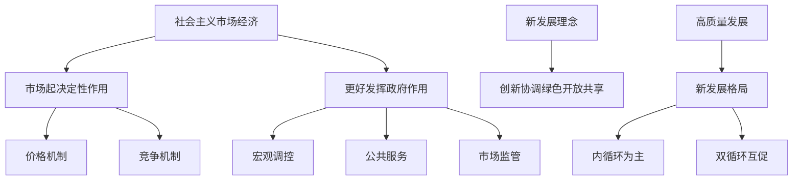

# 06 社会主义市场经济与发展 · 章节总结

> 对应原书：第三篇 社会主义市场经济体制、经济发展（第 12-13 章）
> 📖 原书原文：[[../../../原文件/经济学/马克思主义政治经济学概论_全书|《概论》第12-13章]]

## 框架图

## 核心概念

| 概念 | 一句话 | 详细 KP |
|---|---|---|
| 政府与市场关系 | 市场起决定性作用，更好发挥政府作用 | [[知识点/KP01_政府与市场关系]] |
| 新发展理念 | 创新协调绿色开放共享 | [[知识点/KP02_新发展理念与高质量发展]] |
| 新发展格局 | 以国内大循环为主体、国内国际双循环相互促进 | [[知识点/KP03_新发展格局]] |

## 🔗 相关知识点

**本篇：** [[知识点/KP01_政府与市场关系]] ｜ [[知识点/KP02_新发展理念与高质量发展]] ｜ [[知识点/KP03_新发展格局]]

**跨章：** [[../01_商品与货币/知识点/KP08_价值规律|价值规律]]
