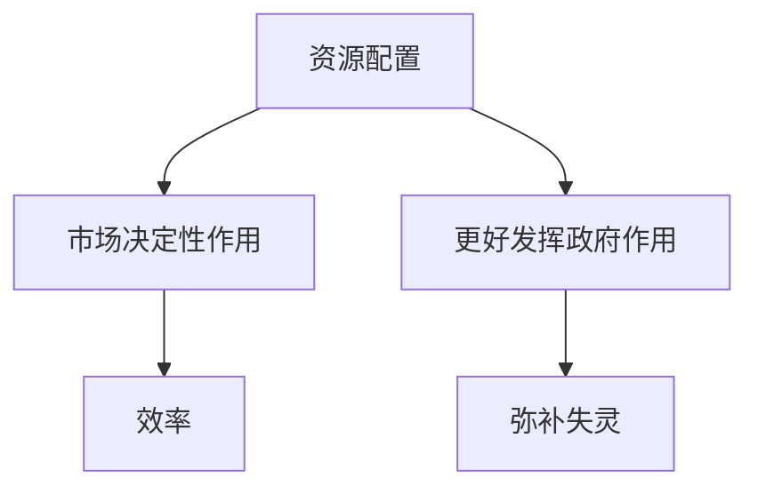

# KP01 · 政府与市场关系

<a href="../../../../exam.html" target="_blank" style="display:inline-block;padding:6px 16px;background:#2563eb;color:#fff;border-radius:6px;text-decoration:none;font-size:14px;">📝 开始做题</a>

> 所属：[[../00_章节总结|第12章]] ｜ 节：原书第十二章第四、五节

## 1. 一句话先懂（小白版）

- **市场**：看不见的手，通过价格、供求、竞争配置资源（价值规律起作用）；
- **政府**：看得见的手，做市场做不了的事（公共品、反垄断、宏观稳定、社会保障）。

党的十八届三中全会定位：**使市场在资源配置中起决定性作用，更好发挥政府作用。**

不是"大政府小市场"或"小政府大市场"，而是**各归其位**。

## 2. 严格定义

**市场决定性作用**：价格由市场形成，要素自由流动，竞争决定优胜劣汰。

**更好发挥政府作用**：
1. 保持宏观经济稳定（财政货币政策）；
2. 加强和优化公共服务（教育、医疗、基础设施）；
3. 保障公平竞争（反垄断、市场监管）；
4. 加强市场监管（食品、药品、环保）；
5. 维护市场秩序；
6. 推动可持续发展（绿色发展）；
7. 促进共同富裕；
8. 弥补市场失灵（外部性、信息不对称）。

## 3. 为什么

- 单一计划经济：效率低、信息不足；
- 完全自由市场：两极分化、经济危机、公共品缺失；
- 社会主义市场经济：让价值规律充分作用（效率），同时用政府规划和调控弥补其自发性（公平）。

## 4. 怎么用

- 价格双轨制 → 价格市场化（让市场决定）；
- 产业政策 → 引导投资方向（政府作用）；
- 反垄断（阿里、美团罚款）→ 维护竞争；
- 精准扶贫、社保 → 弥补市场失灵。

## 5. 容易混淆什么

| 容易混 | 区别 |
|---|---|
| 决定性作用 vs 基础性作用 | 十八届三中全会从"基础"升级到"决定"，市场化更进一步。 |
| 更好发挥政府作用 vs 更多干预 | 不是多管，而是管好该管的。 |
| 市场失灵 vs 政府失灵 | 两者都可能，要互相补位。 |

---

## 5.5 理论推导（一步步推）

**假设起点**：市场有失灵，政府有局限。

**推导过程**：
- 第一步：市场通过价格供求竞争调节资源配置——效率高。
- 第二步：但市场有失灵（外部性、公共品、垄断、信息不对称）。
- 第三步：政府要弥补失灵，但不能越位。
- 第四步：市场起决定性作用 + 更好发挥政府作用。
- 结论：二者相辅相成，不是对立。

## 5.6 数学推导（公式怎么来的）

> 每个符号第一次出现必须解释。

市场均衡由 $Q^d(P) = Q^s(P)$ 决定。政府干预仅在市场失灵处：外部性 $e$、公共品、垄断 $m$。

## 🔗 相关知识点

**同章：** [[KP02_新发展理念与高质量发展]] ｜ [[KP03_新发展格局]]

**跨章：** [[../../01_商品与货币/知识点/KP08_价值规律|价值规律]] ｜ [[../../03_资本流通与剩余价值分配/知识点/KP04_社会总资本再生产|再生产比例]]

**📖 原书原文：** [[../../../../原文件/经济学/马克思主义政治经济学概论_全书|《概论》第十二章]]

---

## 📝 考研真题（首经贸 801）

**配套主观题：** 见同目录 [[../考研真题集|本章考研真题集]]
**配套选择题：** 见同目录 [[../选择题集|本章选择题集]]

### 高频简答
- 简述"使市场在资源配置中起决定性作用，更好发挥政府作用"的科学内涵（15 分）→ 见 [[../考研真题集#s1|真题集·简答 1]]
- 简述市场失灵的主要表现及政府弥补市场失灵的途径（15 分）→ 见 [[../考研真题集#s3|真题集·简答 3]]

### 高频论述
- 试述处理好政府与市场关系对建设全国统一大市场的意义（30 分）→ 见 [[../考研真题集#l1|真题集·论述 1]]
- 结合地方政府债务化解与房地产发展模式转型，论述如何更好发挥政府作用（30 分）→ 见 [[../考研真题集#l4|真题集·论述 4]]

### 易错选择
- 本知识点选择题见 [[../选择题集#KP01 政府与市场关系|选择题集·KP01]]
