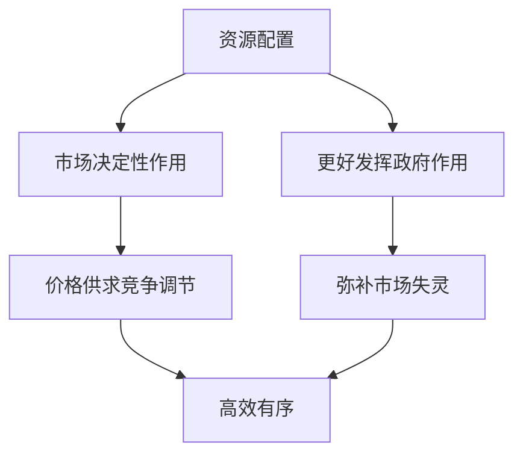
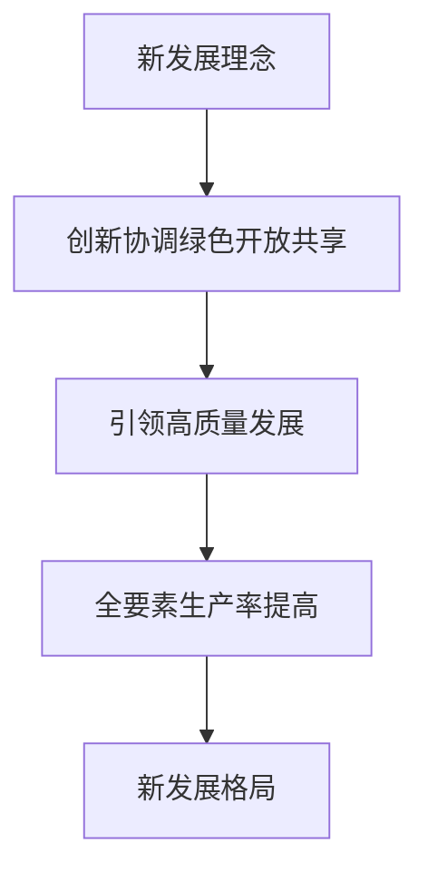

# 06 社会主义市场经济与发展 · 考研真题集（首经贸 801）

<a href="../../../exam.html" target="_blank" style="display:inline-block;padding:6px 16px;background:#2563eb;color:#fff;border-radius:6px;text-decoration:none;font-size:14px;">📝 开始做题</a>

> 本章共收录：简答题 10 道（每题 15 分）｜论述题 4 道（每题 30 分）
> 配套选择题见 [[选择题集|本章选择题集]]
> 对应大纲：马工程《马克思主义政治经济学概论》第十二章（社会主义市场经济体制）、第十三章（经济发展新常态与新发展理念）

## 📋 本题集目录

### 简答题
1. [[#简答 1：简述"使市场在资源配置中起决定性作用，更好发挥政府作用"的科学内涵|简述"使市场在资源配置中起决定性作用，更好发挥政府作用"的科学内涵]]
2. [[#简答 2：如何理解市场在资源配置中的作用从"基础性"上升为"决定性"|如何理解市场在资源配置中的作用从"基础性"上升为"决定性"]]
3. [[#简答 3：简述市场失灵的主要表现及政府弥补市场失灵的途径|简述市场失灵的主要表现及政府弥补市场失灵的途径]]
4. [[#简答 4：简述新发展理念的科学内涵及其相互关系|简述新发展理念的科学内涵及其相互关系]]
5. [[#简答 5：为什么说高质量发展是体现新发展理念的发展|为什么说高质量发展是体现新发展理念的发展]]
6. [[#简答 6：简述创新、协调、绿色、开放、共享五大发展理念分别要解决的核心问题|简述创新、协调、绿色、开放、共享五大发展理念分别要解决的核心问题]]
7. [[#简答 7：简述构建新发展格局的科学内涵|简述构建新发展格局的科学内涵]]
8. [[#简答 8：分析我国构建新发展格局的客观必然性（外部环境与国内条件）|分析我国构建新发展格局的客观必然性（外部环境与国内条件）]]
9. [[#简答 9：为什么说新发展格局不是封闭的国内循环，而是更加开放的双循环|为什么说新发展格局不是封闭的国内循环，而是更加开放的双循环]]
10. [[#简答 10：简述扩大内需战略基点与供给侧结构性改革之间的关系|简述扩大内需战略基点与供给侧结构性改革之间的关系]]

### 论述题
1. [[#论述 1：试述处理好政府与市场关系对建设全国统一大市场的意义|试述处理好政府与市场关系对建设全国统一大市场的意义]]
2. [[#论述 2：试述新发展理念如何引领高质量发展，并结合新质生产力加以分析|试述新发展理念如何引领高质量发展，并结合新质生产力加以分析]]
3. [[#论述 3：在中美博弈与逆全球化背景下，分析我国构建以国内大循环为主体、国内国际双循环相互促进新发展格局的战略选择|在中美博弈与逆全球化背景下，分析我国构建以国内大循环为主体、国内国际双循环相互促进新发展格局的战略选择]]
4. [[#论述 4：结合地方政府债务化解与房地产发展模式转型，论述如何更好发挥政府作用|结合地方政府债务化解与房地产发展模式转型，论述如何更好发挥政府作用]]

---

## 一、简答题（每题 15 分，建议 450–700 字）

### 简答 1：简述"使市场在资源配置中起决定性作用，更好发挥政府作用"的科学内涵

**【建议字数】450–700 字 ｜ 【建议时间】15 分钟 ｜ 【题型】概念简答**

**【考什么】** 对应知识点 [[知识点/KP01_政府与市场关系|政府与市场关系]]，对应大纲第十二章第四、五节；题型属于概念简答。

**【核心推导】**
**第一步：先给原文级表述——这是本题的"标准答案骨架"**

$$ \text{市场在资源配置中起决定性作用} + \text{更好发挥政府作用} $$

十八届三中全会《中共中央关于全面深化改革若干重大问题的决定》原话："使市场在资源配置中起决定性作用和更好发挥政府作用。"**注意是"和"不是"或"——两者是同一命题的两个方面，不是二选一。**

**第二步：拆解前半句——"决定性作用"的三层含义**

$$ \text{决定性} = \text{广度和深度上} + \text{资源配置的主导机制} + \text{但非全部领域} $$

**(一) 地位上**：市场是资源配置的**基本机制**，而不是"辅助"机制。价格、供求、竞争三大机制共同引导资源流向。

**(二) 范围上**："决定性"强调**广度和深度**——凡属市场能有效发挥作用的领域，都要让市场决定，最大限度减少政府对资源的直接配置。

**(三) 边界上**："决定性"不等于"唯一"。市场机制无法解决的领域（公共品、外部性、垄断、信息不对称、宏观波动、分配公平），需要政府作用。

**第三步：拆解后半句——"更好发挥政府作用"的四项职能**

$$ \text{政府作用} = \text{宏观调控} + \text{市场监管} + \text{公共服务} + \text{社会管理} + \text{生态环境保护} $$

| 职能 | 具体内容 |
|---|---|
| 宏观调控 | 财政与货币政策、逆周期与跨周期调节、就业优先 |
| 市场监管 | 反垄断、质量安全、公平竞争审查、消费者保护 |
| 公共服务 | 教育、医疗、社保、基础设施 |
| 社会管理 | 社会治理、应急管理、公共安全 |
| 生态保护 | 环保标准、碳市场、生态补偿 |

"更好"二字的含义：不是"更多"，而是**定位更准、方式更优、效能更高**——减少审批干预，加强规则与监管。

**第四步：为什么两者是对立统一而非替代关系**

$$ \text{有效市场} + \text{有为政府} = \text{社会主义市场经济体制} $$

**(一) 市场失灵的领域必须由政府补位**

$$ \text{公共品} + \text{外部性} + \text{垄断} + \text{信息不对称} + \text{分配不公} \Rightarrow \text{政府补位} $$

**(二) 政府失灵的领域必须由市场约束**

$$ \text{信息不足} + \text{寻租} + \text{低效} + \text{决策失误} \Rightarrow \text{市场约束} $$

**(三) 二者的共同目标是增进人民福祉**

$$ \text{市场} \to \text{效率};\qquad \text{政府} \to \text{公平与稳定};\qquad \text{统一} \to \text{共同富裕} $$

**第五步：科学内涵的四个关键词**

| 关键词 | 含义 |
|---|---|
| 有效市场 | 价格信号灵敏、竞争充分、要素自由流动、产权清晰 |
| 有为政府 | 边界清晰、职能到位、不越位不缺位错位 |
| 有机统一 | 制度层面的一条原则，而非工作层面的两个主体 |
| 人民立场 | 一切以增进人民福祉为出发点和落脚点 |

**第六步：实践要求——三个"不是"**

$$ \text{不是"市场万能"};\qquad \text{不是"政府万能"};\qquad \text{不是"两个都要"的和稀泥} $$

- 不是市场万能：注意 2008 金融危机与"市场原教旨主义"的教训；
- 不是政府万能：计划经济体制的教训说明政府无法掌握全部信息；
- 不是和稀泥：二者在不同领域有明确的优先顺序，边界要法治化。

**第七步：结论**

"使市场在资源配置中起决定性作用，更好发挥政府作用"的科学内涵是：在地位上，市场是资源配置的基本机制，必须在广度和深度上都发挥其作用；在边界上，市场不能覆盖公共品、外部性、垄断、信息不对称、宏观稳定、分配公平等领域，这些正是政府作用的领域；在方式上，"更好发挥政府作用"强调的不是管得更多而是定位更准、方式更优；在目的上，二者统一于增进人民福祉与共同富裕。**一句话：市场管效率、政府管公平与稳定，两个都"有效"才算好的市场经济。**

**【为什么要答这几点】**
**【满分 15 分的分点逻辑】**

**第一段：原文表述（3 分）**
十八届三中全会原话；指出是"和"不是"或"。

**第二段："决定性作用"三层含义（4 分）**
地位（基本机制）、范围（广度深度、减少直接配置）、边界（不等于唯一）。

**第三段："更好发挥政府作用"五项职能（4 分）**
宏观调控、市场监管、公共服务、社会管理、生态保护；解释"更好"是定位更准而非管得更多。

**第四段：对立统一（2 分）**
市场失灵需政府补位、政府失灵需市场约束、共同目标在人民福祉。

**第五段：四个关键词（2 分）**
有效市场、有为政府、有机统一、人民立场。

**易失分点（五条）**
1. 只答市场决定作用，不答政府作用，或反之。
2. 把"决定性作用"说成"市场万能"。
3. 把"更好发挥政府作用"理解为"政府管得更多"。
4. 不说明两者的边界（哪些领域市场不能覆盖）。
5. 忽略十八届三中全会的表述变化（"基础性"→"决定性"）。

**加分点（五条）**
1. 按"地位—范围—边界"三层拆解"决定性"，结构清晰。
2. 用五项职能表列政府作用，条理分明。
3. 明确"更好"不是"更多"而是"定位更准、方式更优、效能更高"。
4. 用"有效市场 + 有为政府"概括，术语准确。
5. 用三个"不是"（市场万能、政府万能、和稀泥）收束，立场分明。

**【阅卷心理】**
判卷老师主要看两处：**是否两边都答且说明二者的统一关系**；**是否准确解释"决定性"与"更好"这两个限定词**。这两处做到，13 分以上。
记忆金句：**市场管效率、政府管公平与稳定，两个都"有效"才算好的市场经济。**

**【如何分析题目】**
**第一步：审题，抓"科学内涵"**
不是问"为什么"，也不是问"怎么做"，而是解释这句话本身的含义。要拆词、要划界。

**第二步：先给原文表述**
十八届三中全会原话，并点出"和"字。这一步定住答案的权威性。

**第三步：拆前半句**
从地位、范围、边界三个角度解释"决定性"。

**第四步：拆后半句**
列政府五项职能，并解释"更好"二字的含义。

**第五步：写二者关系**
市场失灵与政府失灵互证，说明是互补而非替代。

**第六步：给四个关键词**
有效市场、有为政府、有机统一、人民立场。

**第七步：写实践分寸**
三个"不是"，避免绝对化表述。

**第八步：字数与时间控制**
15 分约 600–750 字，建议 15 分钟：原文 2 分钟、前半句 4 分钟、后半句 4 分钟、关系与关键词 4 分钟、收尾 1 分钟。时间紧时先保两边都答与两个限定词的解释。

**【答题框架】**
- 第 1 段：提出背景与定位（2 分）
- 第 2 段：市场起决定性作用的内涵（4 分）
- 第 3 段：更好发挥政府作用的内涵（4 分）
- 第 4 段：二者不是相互否定而是有机统一（3 分）
- 第 5 段：现实意义（2 分）

**【参考答案】**

一、提出背景。党的十八届三中全会《中共中央关于全面深化改革若干重大问题的决定》把市场在资源配置中的"基础性作用"修改为"决定性作用"，同时强调"更好发挥政府作用"。这是我们党对社会主义市场经济体制认识的重大理论飞跃。

二、市场起决定性作用的内涵。所谓市场在资源配置中起决定性作用，就是要让价值规律充分发挥作用：（一）价格主要由市场供求形成，而不是由政府规定；（二）资本、劳动力、土地、数据等要素自由流动、平等交换；（三）通过竞争机制实现优胜劣汰，把资源配置到效率最高的部门和企业。凡是能由市场形成价格的都交给市场，政府不进行不当干预。

三、更好发挥政府作用的内涵。更好发挥政府作用，不是更多干预，而是政府要在市场失灵的领域主动作为，主要包括：（一）保持宏观经济稳定，实施财政政策和货币政策；（二）加强和优化公共服务，提供教育、医疗、基础设施等公共品；（三）保障公平竞争，加强市场监管，反垄断、反不正当竞争；（四）维护市场秩序，保护产权和知识产权；（五）推动可持续发展，促进共同富裕，弥补外部性、信息不对称等市场失灵。

四、二者的关系。"决定性作用"和"更好发挥作用"是有机统一的，不是"大政府小市场"或"小政府大市场"的二选一。市场决定资源配置是市场经济的一般规律，政府的职责是为市场机制有效运行创造条件，而不是取代市场。

五、现实意义。这一表述正确处理了社会主义制度与市场经济的结合问题，既避免了计划经济管得过死的低效，又防止了完全自由放任导致的两极分化和经济危机。

**【解析·得分点】** 采分点：①十八届三中全会"基础→决定"的表述变化（2分）；②价格、要素、竞争三要素（4分）；③政府八项职责中答出宏观稳定、公共服务、市场监管、共同富裕四项即可（4分）；④二者不是对立而是互补（3分）。容易丢分的地方：把"更好发挥政府作用"答成"更多干预"，或把"决定性作用"答成"全部作用"。

**【生活实例】** 就像一个学校食堂：菜价由采购量和学生偏好决定（市场定价），但学校要监管卫生、补贴贫困生、建好水电煤管道（政府作用）。不能校长一刀切定所有菜价，也不能完全不管让黑心老板卖地沟油。

**【双链接】** 🔗 [[知识点/KP01_政府与市场关系|回知识点]] ｜ 📖 [[../../../原文件/经济学/马克思主义政治经济学概论_全书|《概论》第十二章]]

---

### 简答 2：如何理解市场在资源配置中的作用从"基础性"上升为"决定性"

**【建议字数】450–700 字 ｜ 【建议时间】15 分钟 ｜ 【题型】关系对比**

**【考什么】** 对应知识点 [[知识点/KP01_政府与市场关系|政府与市场关系]]，对应大纲第十二章；题型属于关系对比。

**【核心推导】**
**第一步：先把两个表述摆在一起对照**

$$ \text{1992 年十四大}:\ \text{市场在国家宏观调控下对资源配置起基础性作用} $$
$$ \text{2013 年十八届三中全会}:\ \text{市场在资源配置中起决定性作用} $$

从"基础性"到"决定性"，是**党的文件表述中一次具有里程碑意义的变化**。理解这一变化，要从"为什么改—改了什么—改的限度"三层展开。

**第二步：为什么改——旧表述的三重局限**

**(一) "基础性作用"定位偏低**

$$ \text{基础性} \Rightarrow \text{暗含"还有一个更基础的层次"（如计划）} $$

实践中容易被理解为"市场是辅助的、政府才是主导的"，为政府过度直接配置资源留下空间。

**(二) 政府干预空间过大**

$$ \text{审批多} + \text{要素价格扭曲} + \text{地方保护} \Rightarrow \text{市场分割} $$

土地、劳动力、资本等要素市场发育滞后，行政配置仍占相当比重。

**(三) 与新阶段的改革任务不匹配**

$$ \text{高质量发展} \Rightarrow \text{要素市场化配置} \Rightarrow \text{需要更强的市场作用} $$

**第三步：改了什么——"决定性"的五层新意**

| 维度 | 含义变化 |
|---|---|
| 地位 | 从"基础"到"决定"，市场成为资源配置的主导机制 |
| 广度 | 凡市场能有效发挥作用的领域，都由市场决定 |
| 深度 | 不仅商品市场，要素市场也要让市场决定价格 |
| 约束力 | 对政府直接配置资源形成明确限制（"最大限度减少"） |
| 逻辑关系 | 政府作用不是与市场"并列第一"，而是以市场决定作用为前提 |

**第四步：改的限度——不是"市场万能"**

$$ \text{决定性作用} \subset \text{市场机制能有效发挥作用的领域} $$

- 公共品、外部性、垄断、信息不对称、宏观波动、分配公平等领域，市场机制失效，需要政府作用；
- "决定性"不等于"唯一性"，更不等于"自由放任"；
- **这一句是本题的"防失分护栏"，写了才显分寸。**

**第五步：为什么能改——理论认识的三次跃升**

$$ \text{计划经济（市场是异己）} \to \text{有计划的商品经济（市场是补充）} \to \text{社会主义市场经济（市场是基础）} \to \text{决定性作用} $$

- 1984 年十二届三中全会："有计划的商品经济"；
- 1992 年十四大：确立社会主义市场经济体制目标，"基础性作用"；
- 2013 年十八届三中全会："决定性作用"；
- 2019 年十九届四中全会：把社会主义市场经济体制上升为**社会主义基本经济制度**。

**四条线索的递进，说明认识随实践深化。**答出这条线索，答案就有了历史厚度。

**第六步：意义——四个层面的提升**

$$ \text{理论意义} + \text{实践意义} + \text{制度意义} + \text{国际意义} $$

- 理论上：突破"市场=资本主义"的传统认识，丰富发展了马克思主义政治经济学；
- 实践上：为"放管服"改革、要素市场化配置改革、全国统一大市场建设提供依据；
- 制度上：与基本经济制度相衔接，为长期稳定的市场预期提供制度保障；
- 国际上：为发展中国家探索政府与市场关系提供中国方案。

**第七步：实践的落点——三个"最大限度"**

$$ \text{最大限度减少政府对资源的直接配置} + \text{最大限度减少政府对市场活动的直接干预} + \text{最大限度激发市场活力} $$

对照改革措施：负面清单管理、公平竞争审查、"非禁即入"、营商环境条例。

**第八步：结论**

市场作用从"基础性"上升为"决定性"，不是文字调整而是理论认识的重大飞跃。原因在于"基础性"定位偏低、政府干预空间过大、与高质量发展的要求不匹配；新表述在地位、广度、深度、约束力四个维度上都提高了市场的分量，同时对政府直接配置资源形成明确限制。但"决定性"不等于"唯一性"——公共品、外部性、垄断、信息不对称、宏观稳定、分配公平等领域仍需政府作用，故须与"更好发挥政府作用"合起来理解。**一句话：从"基础"到"决定"，加的不是形容词，而是对政府权力的边界约束。**

**【为什么要答这几点】**
**【满分 15 分的分点逻辑】**

**第一段：摆出两个表述并给出判断（3 分）**
十四大"基础性"、十八届三中全会"决定性"；是理论认识飞跃而非文字调整。

**第二段：为什么改（4 分）**
"基础性"定位偏低、"暗含还有更基础层次"；政府干预空间过大、要素市场发育滞后；与高质量发展不匹配。

**第三段：改了什么（4 分）**
地位、广度、深度、约束力四维（最好列表）。

**第四段：改的限度（2 分）**
不等于唯一性、不等于市场万能；公共品、外部性、垄断、信息不对称等仍需政府。

**第五段：认识演进线索（1 分）**
有计划商品经济→基础性→决定性→上升为基本经济制度。

**第六段：意义（1 分）**
理论、实践、制度、国际四层。

**易失分点（五条）**
1. 只说"更重视市场了"，不解释具体变化在哪些维度。
2. 把"决定性"理解为"市场万能"。
3. 不说明"为什么"要改（只有结论没有原因）。
4. 混淆"基础性"与"决定性"的提出时间与文件。
5. 不提"更 好发挥政府作用"的配套表述。

**加分点（五条）**
1. 指出"基础性"暗含"还有更基础层次"，这一理解很有洞察力。
2. 用四维表格呈现"决定性"的新意。
3. 完整梳理从十二届三中全会到十九届四中全会的认识演进线索。
4. 点出"决定性作用"实质是对政府直接配置资源的边界约束。
5. 联系"放管服"、负面清单、公平竞争审查等具体改革。

**【阅卷心理】**
判卷老师主要看两处：**是否讲清了"为什么改"而不只是"改了什么"**；**是否有"不等于市场万能"的分寸句**。这两处做到，13 分以上。
记忆金句：**从"基础"到"决定"，加的不是形容词，而是对政府权力的边界约束。**

**【如何分析题目】**
**第一步：审题，抓"上升"二字**
要答"为何上升、上升了什么、限度何在"。这是"为什么+是什么"的复合题。

**第二步：摆出两个表述**
给出时间与文件，让答案有据可依。

**第三步：写为什么改**
三条局限：定位偏低、干预空间大、与高质量发展不匹配。

**第四步：写改了什么**
四个维度逐一展开，能列表更好。

**第五步：立刻写限度**
"不等于市场万能"，这是分寸所在，不要留到最后才提。

**第六步：写认识演进线索**
四个时间点串起来，显示历史厚度。

**第七步：写意义与落点**
四层意义 + 三个"最大限度"。

**第八步：字数与时间控制**
15 分约 600–750 字，建议 15 分钟：表述与判断 2 分钟、为什么改 4 分钟、改了什么与限度 5 分钟、演进与意义 4 分钟。时间紧时先保"为什么改"与"限度"两段。

**【答题框架】**
- 第 1 段：两次表述的历史脉络（3 分）
- 第 2 段："基础性作用"的含义与局限（4 分）
- 第 3 段："决定性作用"的内涵突破（5 分）
- 第 4 段：理论与现实意义（3 分）

**【参考答案】**

一、历史脉络。党的十四大确立社会主义市场经济体制改革目标，提出要使市场在国家宏观调控下对资源配置起"基础性作用"；十八届三中全会升级为"决定性作用"。从"基础"到"决定"，一字之差，反映了改革实践的深化。

二、"基础性作用"的含义与局限。"基础性"隐含的意思是：市场是资源配置的基础层次，但政府还可以在"更高层次"对资源进行调配。在实践中，这为政府过度干预留下了空间，表现为价格管制、项目审批、地方保护、要素市场扭曲等。例如土地、资本等要素长期由政府主导配置，造成产能过剩和效率损失。

三、"决定性作用"的内涵突破。"决定性"意味着：（一）凡是市场能做的，政府都不要代替；（二）价格信号是资源配置的最终依据；（三）竞争机制决定企业的生与死；（四）政府的职责是维护市场环境，而不是直接配置资源。这一表述不是否定政府作用，而是明确了政府作用的边界——主要是宏观调控、市场监管、公共服务、社会管理、保护环境。

四、理论与现实意义。这一升级标志着我国对社会主义市场经济的认识达到新高度，有利于让一切创造社会财富的源泉充分涌流。当前建设全国统一大市场、要素市场化配置改革、反垄断执法，都是落实"决定性作用"的具体举措。

**【解析·得分点】** 采分点：①十四大到十八届三中全会的时间线（3分）；②"基础"隐含政府可在更高层次调配（4分）；③"决定"意味着价格、竞争、要素自由流动（5分）；④不是否定政府而是划界（3分）。容易丢分：只答"更重视市场"这种空话，没讲清两个词的政策含义差别。

**【生活实例】** 像打车软件：以前是"基础作用"——平台先派单，不满意乘客再投诉；现在是"决定作用"——价格由供需动态决定，乘客和司机自由匹配，平台只做安全监管。

**【双链接】** 🔗 [[知识点/KP01_政府与市场关系|回知识点]] ｜ 📖 [[../../../原文件/经济学/马克思主义政治经济学概论_全书|《概论》第十二章]]

---

### 简答 3：简述市场失灵的主要表现及政府弥补市场失灵的途径

**【建议字数】450–700 字 ｜ 【建议时间】15 分钟 ｜ 【题型】解决对策**

**【考什么】** 对应知识点 [[知识点/KP01_政府与市场关系|政府与市场关系]]，对应大纲第十二章；题型属于原因分析。

**【核心推导】**
**第一步：先定义市场失灵，再给分类目录**

$$ \text{市场失灵} = \text{市场机制在若干领域无法实现资源最优配置} $$

**两类分法最常用**：一是"效率型失灵"（市场机制本身解决不了效率问题），二是"公平型失灵"（市场机制必然导致分配不均）。**先给这个二分，答案就有了骨架。**

**第二步：第一类——效率型失灵的五种表现**

**(一) 公共物品**

$$ \text{非竞争性} + \text{非排他性} \Rightarrow \text{搭便车} \Rightarrow \text{供给不足} $$

国防、路灯、基础研究、公共卫生。**政府途径**：直接提供、政府采购、PPP、公共品均等化。

**(二) 外部性**

$$ \text{私人成本} \neq \text{社会成本}\quad\text{或}\quad \text{私人收益} \neq \text{社会收益} $$

- 负外部性：污染、噪声、拥堵 → 政府途径：庇古税（环保税）、排污权交易、管制标准；
- 正外部性：教育、疫苗、研发 → 政府途径：补贴、知识产权保护、公共服务提供。

**(三) 垄断**

$$ \text{垄断} \Rightarrow P > MC \Rightarrow \text{产量不足} + \text{无谓损失} $$

自然垄断（电网、管网）需价格管制或国有经营；行政垄断与平台垄断需反垄断执法。**政府途径**：反垄断法、公平竞争审查、自然垄断的价格监管（准许成本加合理收益）。

**(四) 信息不对称**

$$ \text{逆向选择} + \text{道德风险} \Rightarrow \text{市场萎缩甚至消失} $$

二手车"柠檬市场"、保险、医疗、金融产品。**政府途径**：强制信息披露、质量标准与认证、消费者保护、审慎监管。

**(五) 宏观经济波动**

$$ \text{总需求不足} \Rightarrow \text{非自愿失业} \Rightarrow \text{需要宏观调控} $$

市场机制无法自动实现充分就业与物价稳定。**政府途径**：财政政策与货币政策、逆周期与跨周期调节。

**第三步：第二类——公平型失灵**

$$ \text{市场按要素贡献分配} \Rightarrow \text{要素占有不均} \Rightarrow \text{收入差距扩大} $$

市场机制不解决"结果公平"问题，也不提供社会保障。**政府途径**：累进税制、社会保障、转移支付、基本公共服务均等化。

**第四步：还要补一类——市场发育不充分型失灵**

$$ \text{要素市场发育滞后} + \text{地方保护} + \text{市场分割} \Rightarrow \text{配置效率损失} $$

这是**我国特有的转轨型问题**：土地、劳动力、资本、技术、数据等要素市场发育不足；地方保护与市场分割仍存在。**政府途径**：要素市场化配置改革、全国统一大市场建设。

**第五步：政府弥补失灵的四种途径归纳**

| 途径 | 工具 |
|---|---|
| 直接提供 | 公共品供给、国有企业、事业单位 |
| 经济手段 | 税收（庇古税）、补贴、价格管制、排污权交易 |
| 法律手段 | 反垄断法、消费者权益保护法、标准与认证 |
| 行政手段 | 准入许可、质量监管、安全标准（需依法、有限度） |

**第六步：政府弥补 ≠ 政府万能——政府失灵**

$$ \text{信息不足} + \text{寻租} + \text{低效} + \text{决策失误} \Rightarrow \text{政府失灵} $$

- 政府同样面临信息约束，未必能算出"最优产量"；
- 管制可能被俘获、产生寻租；
- 因此政府介入要有**边界、有法治、有成本收益评估**——这也是"更好发挥政府作用"的含义。

**第七步：结论**

市场失灵表现为两大类：效率型失灵包括公共物品（搭便车导致供给不足）、外部性（私人成本与社会成本偏离）、垄断（P>MC 造成无谓损失）、信息不对称（逆向选择与道德风险）、宏观经济波动（无法自动实现充分就业）；公平型失灵指市场按要素分配必然带来收入差距扩大。此外我国还存在市场发育不充分、地方保护与市场分割的转轨型失灵。政府弥补途径相应为：直接提供公共品、经济手段（税补与价格管制）、法律手段（反垄断与信息披露）、行政手段（准入与标准），以及再分配与公共服务均等化。但政府本身也可能失灵，故须在法治框架内、按成本收益原则审慎介入。**一句话：市场失灵是政府介入的理由，政府失灵是政府介入的边界。**

**【为什么要答这几点】**
**【满分 15 分的分点逻辑】**

**第一段：定义与分类（2 分）**
先给市场失灵定义，再给"效率型 / 公平型"二分。有分类就有效得分。

**第二段：效率型五种表现（7 分，每种 1.5 分左右）**
公共物品、外部性、垄断、信息不对称、宏观波动。每种写出"为什么失灵 + 政府怎么办"。

**第三段：公平型失灵（2 分）**
市场按要素分配 → 差距扩大；政府靠税收、社保、转移支付、公共服务均等化。

**第四段：我国特有的转轨型失灵（2 分）**
要素市场发育滞后、地方保护与市场分割；对应要素市场化改革与全国统一大市场。

**第五段：政府途径归纳（1 分）**
直接提供、经济手段、法律手段、行政手段四类。

**第六段：政府失灵（1 分）**
信息不足、寻租、低效、决策失误；政府介入要有边界与法治。

**易失分点（五条）**
1. 只列表现不讲政府途径，或反之。
2. 把"垄断"笼统说成"市场失灵"，不区分自然垄断与行政垄断。
3. 漏掉"宏观经济波动"这一类失灵。
4. 只讲效率不讲公平型失灵。
5. 不写"政府失灵"，答案显得一味强调政府。

**加分点（五条）**
1. 用"效率型 / 公平型"二分开局，结构胜过平铺。
2. 每类失灵都写出对应政策工具（庇古税、排污权、价格管制、强制披露），显得具体。
3. 补出"我国特有的转轨型失灵"（要素市场发育不足、市场分割），体现中国视角。
4. 用"市场失灵是政府介入的理由，政府失灵是政府介入的边界"作结，辩证有力。
5. 提到公平竞争审查、全国统一大市场等现实政策。

**【阅卷心理】**
判卷老师主要看两处：**失灵类型是否列全（五类效率型 + 公平型）**；**每类是否配了对应的政府手段**。这两处做到，13 分以上。
记忆金句：**市场失灵是政府介入的理由，政府失灵是政府介入的边界。**

**【如何分析题目】**
**第一步：审题，两个问**
"主要表现"与"弥补途径"都要答，且要一一对应，不能前松后紧。

**第二步：先给定义与分类**
效率型 + 公平型二分，立住骨架。

**第三步：逐类展开效率型失灵**
每类写"为什么失灵（一句话机制）+ 政府怎么补（具体工具）"。

**第四步：补公平型失灵**
再分配四件套。

**第五步：补转轨型失灵**
这是中国情境的加分点。

**第六步：归纳政府四种途径**
直接提供、经济、法律、行政。

**第七步：写政府失灵**
一句辩证收尾，避免片面。

**第八步：字数与时间控制**
15 分约 650–800 字，建议 15 分钟：定义分类 2 分钟、五类失灵 8 分钟、公平与转轨 2 分钟、途径与政府失灵 3 分钟。时间紧时先保五类效率型失灵及其对应工具。

**【答题框架】**
- 第 1 段：市场失灵的定义（2 分）
- 第 2 段：市场失灵的四类表现（6 分）
- 第 3 段：政府弥补的途径（5 分）
- 第 4 段：注意避免政府失灵（2 分）

**【参考答案】**

一、市场失灵的定义。市场失灵是指市场机制在某些领域不能实现资源有效配置，或不能实现社会合意的收入分配状态。其根源在于外部性、公共品、垄断、信息不对称等。

二、市场失灵的主要表现。（一）外部性：经济活动给无关第三方带来影响。企业排污让周边居民受害，却不为此付费；植树造林让全社会受益，私人却得不到全部补偿。（二）公共品缺失：国防、路灯、基础研究等具有非排他性和非竞争性，私人不愿提供，市场会供给不足。（三）垄断与不完全竞争：企业通过垄断定价获取超额利润，压低产量、抬高价格，损害消费者。（四）信息不对称：二手车市场、医疗市场中卖方比买方知道得多，会出现逆向选择和道德风险。（五）收入分配两极分化：按要素分配必然导致贫富差距过大。（六）宏观经济波动：市场自发调节会带来周期性失业和通货膨胀。

三、政府弥补市场失灵的途径。（一）对负外部性征税（如环保税、碳交易），对正外部性补贴；（二）直接提供公共品，如国防、义务教育、公共卫生；（三）反垄断立法和执法，防止企业滥用市场支配地位；（四）通过税收、社保、转移支付进行再分配，缩小收入差距；（五）实施财政政策和货币政策，熨平经济周期；（六）监管信息披露，保护消费者和投资者。

四、注意避免政府失灵。政府干预也可能因信息不完全、利益集团俘获、决策时滞而失效。因此要"更好发挥"而不是"更多发挥"政府作用，把政府干预限定在市场真正失灵的领域。

**【解析·得分点】** 采分点：①外部性、公共品、垄断、信息不对称四类核心失灵（6分）；②环保税、公共品供给、反垄断、再分配、宏观调控五类对策（5分）；③不能只讲市场失灵不讲政府失灵（2分）。容易丢分：只列现象不给对策，或把"收入分配差距"漏掉。

**【生活实例】** 像外卖平台：商家为了降成本可能用过期食材（负外部性），平台必须设食安罚款和差评机制（政府/监管作用）；雨天加价过高（市场自发），平台要设加价上限（防止市场极端化）。

**【双链接】** 🔗 [[知识点/KP01_政府与市场关系|回知识点]] ｜ 📖 [[../../../原文件/经济学/马克思主义政治经济学概论_全书|《概论》第十二章]]

---

### 简答 4：简述新发展理念的科学内涵及其相互关系

**【建议字数】450–700 字 ｜ 【建议时间】15 分钟 ｜ 【题型】概念简答**

**【考什么】** 对应知识点 [[知识点/KP02_新发展理念与高质量发展|新发展理念与高质量发展]]，对应大纲第十三章；题型属于概念简答。

**【核心推导】**
**第一步：先给完整表述——五个理念与一句话关系**

$$ \text{创新} + \text{协调} + \text{绿色} + \text{开放} + \text{共享} $$

十八届五中全会提出新发展理念。**关键判断句**：创新是动力、协调是内在要求、绿色是必要条件、开放是必由之路、共享是本质要求——**五者是一个有机整体，不能割裂、不能替代。**

**第二步：逐个内涵——每个理念"解决什么问题"**

| 理念 | 内涵 | 解决的问题 |
|---|---|---|
| 创新 | 理论、制度、科技、文化创新，以科技创新为核心 | 发展动力问题 |
| 协调 | 城乡、区域、经济社会、物质与精神、发展与安全协调 | 发展不平衡问题 |
| 绿色 | 人与自然和谐共生，低碳循环发展 | 人与自然和谐问题 |
| 开放 | 高水平对外开放、制度型开放、双循环 | 发展内外联动问题 |
| 共享 | 全民共享、全面共享、共建共享、渐进共享 | 社会公平正义问题 |

**第三步：相互关系——三层论证**

**(一) 它们统一于"以人民为中心"的发展思想**

$$ \text{五大理念} \Rightarrow \text{以人民为中心} \Rightarrow \text{人民对美好生活的向往} $$

**(二) 它们构成"动力—结构—生态—空间—目的"的完整链条**

$$ \text{创新（动力）} \to \text{协调（结构）} \to \text{绿色（生态）} \to \text{开放（空间）} \to \text{共享（目的）} $$

这是一个"从哪来—怎么摆—与自然—向外看—为了谁"的闭环，缺一环发展就不完整。

**(三) 它们是"系统性"的方法论，不是五项并列任务**

$$ \text{整体性} + \text{协同性} + \text{不可分割} $$

- 创新单兵突进但区域不协调，会加剧分化；
- 只讲绿色不讲发展，会脱离实际；
- 只讲共享不讲创新，会变成平均主义；
- **因此必须"一体坚持、一体贯彻"。**

**第四步：为什么要"一体坚持"——反例对照**

| 割裂后果 | 具体表现 |
|---|---|
| 只创新不协调 | 东部创新高地 vs 中西部塌陷，区域差距扩大 |
| 只绿色不发展 | "一刀切"限产停产，误伤民生与就业 |
| 只开放不自主 | 关键核心技术受制于人 |
| 只共享不发展 | 平均主义，失去效率与动力 |

**第五步：共享理念的四个"共享"要展开**

$$ \text{全民共享} + \text{全面共享} + \text{共建共享} + \text{渐进共享} $$

- 全民共享：覆盖全体人民，不是少数人；
- 全面共享：经济、政治、文化、社会、生态各方面成果；
- 共建共享：人人参与、人人尽力、人人享有；
- 渐进共享：从低级到高级，不能一蹴而就。

**第六步：五大理念与"新发展格局""高质量发展"的关系**

$$ \text{新发展理念（指挥棒）} \to \text{高质量发展（形态）} \to \text{新发展格局（路径）} $$

新发展理念是"指挥棒、红绿灯"，高质量发展是"理念的实践形态"，新发展格局是"实现路径"。

**第七步：结论**

新发展理念包括创新、协调、绿色、开放、共享五个方面，分别解决发展动力、发展不平衡、人与自然和谐、内外联动、社会公平正义五类问题。五者不是并列任务而是有机整体：它们统一于以人民为中心的发展思想，构成"动力—结构—生态—空间—目的"的完整链条，必须一体坚持、一体贯彻。割裂任何一个都会带来现实偏差（只创新不协调加剧区域差距、只绿色不发展误伤民生、只开放不自主则核心技术受制于人）。**一句话：五大理念是一张网，抽一根线，整张网就散了。**

**【为什么要答这几点】**
**【满分 15 分的分点逻辑】**

**第一段：完整表述与判断句（3 分）**
五个理念一个不少；点明是"有机整体"而非五项并列。

**第二段：逐个内涵（5 分，每个 1 分）**
每个理念写"一句话内涵 + 解决什么问题"。**只写名词不写问题意识的，扣分。**

**第三段：相互关系（4 分）**
统一于以人民为中心；构成"动力—结构—生态—空间—目的"链条；系统性方法论要求一体坚持。

**第四段：割裂的反例（2 分）**
四组反例，说明为何是整体。

**第五段：与高质量发展、新发展格局的关系（1 分）**
指挥棒 → 形态 → 路径。

**易失分点（五条）**
1. 漏掉任何一个理念。
2. 只写五个名词，不写各自解决的问题。
3. 把五者说成"并列的五项工作"，不讲有机整体。
4. 共享理念不展开"四个共享"。
5. 不提"以人民为中心"这个统一基础。

**加分点（五条）**
1. 用"动力—结构—生态—空间—目的"一句串起五者，结构感极强。
2. 每个理念对应"解决什么问题"，体现问题导向。
3. 举四组割裂反例，说明整体性不是空话。
4. 展开共享的四个维度（全民、全面、共建、渐进）。
5. 区分"指挥棒—形态—路径"三层关系，理论层次清楚。

**【阅卷心理】**
判卷老师主要看两处：**五个理念是否齐全且各自对应问题**；**是否论证了"有机整体"而不只是罗列**。这两处做到，13 分以上。
记忆金句：**五大理念是一张网，抽一根线，整张网就散了。**

**【如何分析题目】**
**第一步：审题，抓"内涵"与"相互关系"两部分**
内涵要逐个写，关系要整体论证。两边都要有。

**第二步：先给完整表述**
五个理念写全，附一句"有机整体"的判断。

**第三步：逐个写内涵**
用表格或分段，每个写"内涵 + 解决什么问题"。

**第四步：写相互关系**
三层：统一基础（以人民为中心）、链条结构（动力—结构—生态—空间—目的）、方法论要求（一体坚持）。

**第五步：写反例**
四组割裂后果，最能说明"整体性"。

**第六步：展开共享**
四个共享是常考点，顺手写上。

**第七步：补与高质量发展的关系**
指挥棒、形态、路径三层。

**第八步：字数与时间控制**
15 分约 600–750 字，建议 15 分钟：表述 2 分钟、五个内涵 6 分钟、相互关系 4 分钟、反例与延伸 3 分钟。时间紧时先保五个理念齐全与"有机整体"的论证。

**【答题框架】**
- 第 1 段：提出背景（2 分）
- 第 2 段：五大理念各自内涵（8 分）
- 第 3 段：五大理念的相互关系（3 分）
- 第 4 段：指导意义（2 分）

**【参考答案】**

一、提出背景。党的十八届五中全会针对我国经济发展进入新常态、传统粗放增长模式难以为系的形势，提出创新、协调、绿色、开放、共享的新发展理念。它回答了实现什么样的发展、怎样实现发展的重大问题。

二、五大理念的内涵。（一）创新发展，注重解决发展动力问题，把创新作为引领发展的第一动力，包括理论创新、制度创新、科技创新、文化创新，核心是科技创新。（二）协调发展，注重解决发展不平衡问题，促进城乡协调、区域协调、经济社会协调、新型工业化与信息化同步、物质文明与精神文明协调。（三）绿色发展，注重解决人与自然和谐共生问题，树立绿水青山就是金山银山的理念，推进美丽中国建设。（四）开放发展，注重解决发展内外联动问题，坚持对外开放基本国策，推动互利共赢、共同发展。（五）共享发展，注重解决社会公平正义问题，让发展成果更多更公平惠及全体人民，逐步实现共同富裕。

三、五大理念的相互关系。创新、协调、绿色、开放、共享是具有内在联系的集合体：创新是动力，协调是要求，绿色是底色，开放是条件，共享是目的。它们相互贯通、相互促进，要统一贯彻，不能顾此失彼。

四、指导意义。新发展理念是管全局、管根本、管方向、管长远的指导原则，是引领我国经济由高速增长转向高质量发展的行动指南。

**【解析·得分点】** 采分点：①五个理念名称必须写全（2分）；②每个理念对应要解决的核心问题（动力/不平衡/人与自然/内外联动/公平正义）（8分）；③五者是集合体不是孤立的（3分）。容易丢分：只罗列名词不解释"解决什么问题"，或把"共享"答成"平均主义"。

**【生活实例】** 像一个班级：光有学霸刷题（创新动力）不行，要帮落后同学（协调）、注意作息别猝死（绿色）、多和外班交流（开放）、奖学金大家都有份（共享）。

**【双链接】** 🔗 [[知识点/KP02_新发展理念与高质量发展|回知识点]] ｜ 📖 [[../../../原文件/经济学/马克思主义政治经济学概论_全书|《概论》第十三章]]

---

### 简答 5：为什么说高质量发展是体现新发展理念的发展

**【建议字数】450–700 字 ｜ 【建议时间】15 分钟 ｜ 【题型】原因分析**

**【考什么】** 对应知识点 [[知识点/KP02_新发展理念与高质量发展|新发展理念与高质量发展]]，对应大纲第十三章；题型属于原因分析。

**【核心推导】**
**第一步：先给两个定义，再做包含关系判断**

$$ \text{高质量发展} = \text{体现新发展理念的发展} = \text{创新成为第一动力、协调成为内生特点、绿色成为普遍形态、开放成为必由之路、共享成为根本目的的发展} $$

这是十九届五中全会的规范表述。**本题的答法就是：逐条证明"高质量发展"的每个要素都对应一个新发展理念。**

**第二步：第一层——创新是高质量发展的第一动力**

$$ \text{高质量发展} \Leftarrow \text{全要素生产率提升} \Leftarrow \text{创新驱动} $$

- 要素驱动（劳动力、资本、土地）边际收益递减，且我国面临人口红利消退、资源环境约束；
- 创新驱动才能突破报酬递减，实现可持续增长；
- 数据：我国研发投入强度从 2012 年 1.91% 升至 2023 年 2.64%，但与发达国家 3%–4% 仍有差距；基础研究占比约 6%，低于发达国家 15% 左右。

**第三步：第二层——协调是高质量发展的内生特点**

$$ \text{不平衡} \Rightarrow \text{短板制约整体} \Rightarrow \text{必须协调} $$

- 城乡收入比约 2.4:1、区域差距明显、物质与精神文明不匹配；
- 木桶效应：短板决定整体水平；
- 协调不是平均，而是"补短板 + 强优势"。

**第四步：第三层——绿色是高质量发展的普遍形态**

$$ \text{高质量发展} \Leftarrow \text{低消耗} + \text{低排放} + \text{高效率} $$

- 传统高投入高排放模式已触及资源环境天花板；
- "双碳"目标（2030 碳达峰、2060 碳中和）是硬约束；
- 绿色本身也是新增长点（新能源、节能环保产业）。

**第五步：第四层——开放是高质量发展的必由之路**

$$ \text{开放} \Rightarrow \text{要素流动} + \text{技术扩散} + \text{竞争倒逼} $$

- 制度型开放（规则、规制、管理、标准）；
- 但绝不是"依附型开放"，核心技术与产业链安全要自主可控；
- 我国已从"商品和要素流动型开放"转向"制度型开放"。

**第六步：第五层——共享是高质量发展的根本目的**

$$ \text{发展目的} = \text{人民} \Rightarrow \text{共享} $$

- 若发展成果集中于少数人，那只是"增长"不是"高质量发展"；
- 共享通过扩大中等收入群体→扩大内需→反哺发展。

**第七步：反向论证——为什么"体现新发展理念"就是"高质量发展"**

$$ \text{高质量发展} \Leftrightarrow \text{创新（动力）} + \text{协调（结构）} + \text{绿色（生态）} + \text{开放（空间）} + \text{共享（目的）} $$

- **必要性**：五点都做到，发展的动力、结构、生态、空间、目的才都正确，这才是高质量的"整体"；
- **充分性**：任何一点缺失，发展就是"畸形的高"或"低质量的增长"；
- 因此"体现新发展理念的发展"与"高质量发展"是**同义展开**，而非两个不同概念。

**第八步：与"高速增长"的区别**

| 维度 | 高速增长 | 高质量发展 |
|---|---|---|
| 目标 | GDP 增速 | 质量、效益、结构、民生、生态 |
| 动力 | 要素投入 | 创新驱动 |
| 评价 | 单一指标 | 综合指标体系（新发展理念指数） |
| 分配 | 增长自动惠及 | 主动追求共享 |

**第九步：结论**

高质量发展之所以是体现新发展理念的发展，是因为十九届五中全会对高质量发展的规范表述就是"创新成为第一动力、协调成为内生特点、绿色成为普遍形态、开放成为必由之路、共享成为根本目的的发展"。从内容上看，创新解决动力、协调解决结构、绿色解决生态、开放解决空间、共享解决目的，五者齐备才构成"高质量"的完整内涵；从逻辑上看，缺少任何一环，发展就会出现畸形（要素驱动的低效、区域失衡、生态透支、封闭脱钩、成果不共享）。**一句话：新发展理念是"什么叫好"的标准，高质量发展就是照着这个标准长出来的样子。**

**【为什么要答这几点】**
**【满分 15 分的分点逻辑】**

**第一段：规范表述（3 分）**
引十九届五中全会"创新成为第一动力……共享成为根本目的的发展"。这一句背下就拿到基本分。

**第二段至第六段：逐条论证（每条约 2 分，共 10 分）**
创新（报酬递减与 TFP）、协调（木桶效应与差距数据）、绿色（双碳约束与新增长点）、开放（制度型开放与自主可控）、共享（目的与内需反哺）。

**第七段：反向论证（1 分）**
必要性与充分性，说明二者是"同义展开"。

**第八段：与高速增长的区别（1 分）**
目标、动力、评价、分配四维对照。

**易失分点（五条）**
1. 只答"高质量发展就是好的发展"，不落到五个理念上。
2. 逐条写但漏掉"根本目的"（共享）。
3. 不引十九届五中全会的规范表述。
4. 把开放说成"依附型开放"，缺少自主可控的分寸。
5. 不区分"高速增长"与"高质量发展"。

**加分点（五条）**
1. 直接用规范表述作锚，一半分数已经稳住。
2. 每条论证都配机制（报酬递减、木桶效应、双碳约束、制度型开放、内需反哺）。
3. 补 R&D 强度 2.64%、基础研究占比约 6% 等数据。
4. 做"必要性 + 充分性"的反向论证，逻辑严密。
5. 用四维表格区分高速增长与高质量发展。

**【阅卷心理】**
判卷老师主要看两处：**是否引了规范表述**；**是否逐条论证五个理念与高质量发展的对应关系**。这两处做到，13 分以上。
记忆金句：**新发展理念是"什么叫好"的标准，高质量发展就是照着这个标准长出来的样子。**

**【如何分析题目】**
**第一步：审题，抓"为什么说"**
这是论证题，核心是证明"体现新发展理念"与"高质量发展"是同一回事。

**第二步：先给规范表述**
十九届五中全会原话，一句定音。

**第三步：逐条论证**
五个理念逐条对应高质量发展的五个特征，每条写"机制 + 数据"。

**第四步：做反向论证**
必要性与充分性各一句，把逻辑闭合。

**第五步：与高速增长对照**
四维表格，突出"转型"的含义。

**第六步：注意分寸**
开放要强调"制度型开放 + 自主可控"，绿色要强调"双碳硬约束"，共享要强调"不是平均主义"。

**第七步：自检**
是否五个理念都对应到了？是否引了原文？是否有机制解释？

**第八步：字数与时间控制**
15 分约 650–800 字，建议 15 分钟：规范表述 2 分钟、五条论证 9 分钟、反向论证与对照 3 分钟、收尾 1 分钟。时间紧时先保规范表述与五条对应。

**【答题框架】**
- 第 1 段：高质量发展的定义（3 分）
- 第 2 段：高速增长与高质量发展的区别（4 分）
- 第 3 段：新发展理念如何体现在高质量发展中（5 分）
- 第 4 段：现实依据（3 分）

**【参考答案】**

一、高质量发展的定义。高质量发展，就是能够很好满足人民日益增长的美好生活需要的发展，是体现新发展理念的发展，是创新成为第一动力、协调成为内生特点、绿色成为普遍形态、开放成为必由之路、共享成为根本目的的发展。

二、高速增长与高质量发展的区别。高速增长阶段主要追求 GDP 增速，依靠要素投入（资本、劳动力、资源）驱动，表现为高投入、高消耗、高排放、低效率。高质量阶段则追求发展的质量和效益，依靠全要素生产率提升驱动，表现为技术进步、结构优化、分配公平、环境友好。

三、新发展理念如何体现在高质量发展中。（一）创新成为第一动力，意味着经济增长主要靠技术进步而非资本堆砌；（二）协调成为内生特点，意味着城乡、区域、产业结构平衡；（三）绿色成为普遍形态，意味着发展不以牺牲环境为代价；（四）开放成为必由之路，意味着在全球分工中提升价值链位置；（五）共享成为根本目的，意味着发展成果由人民共享。

四、现实依据。我国人均 GDP 已超过 1.2 万美元，社会主要矛盾转化为人民日益增长的美好生活需要和不平衡不充分的发展之间的矛盾。传统粗放增长带来的产能过剩、环境污染、收入差距等问题已经积累，必须转向高质量发展。

**【解析·得分点】** 采分点：①高质量发展的官方定义（3分）；②高速 vs 高质量：要素驱动 vs 效率驱动（4分）；③五个"成为"对应五个理念（5分）；④社会主要矛盾变化（3分）。容易丢分：把高质量发展答成"慢发展"，实际上高质量是更有效率的发展，不是不要速度。

**【生活实例】** 像找对象：以前只要"个子高、工资高"（高速增长指标单一），现在要看性格、三观、健康、相处舒服（高质量多维评价）。

**【双链接】** 🔗 [[知识点/KP02_新发展理念与高质量发展|回知识点]] ｜ 📖 [[../../../原文件/经济学/马克思主义政治经济学概论_全书|《概论》第十三章]]

---

### 简答 6：简述创新、协调、绿色、开放、共享五大发展理念分别要解决的核心问题

**【建议字数】450–700 字 ｜ 【建议时间】15 分钟 ｜ 【题型】因素影响**

**【考什么】** 对应知识点 [[知识点/KP02_新发展理念与高质量发展|新发展理念与高质量发展]]，对应大纲第十三章；题型属于因素影响。

**【核心推导】**
**第一步：先给一张"问题—理念—举措"总表**

| 理念 | 解决的核心问题 | 关键举措 |
|---|---|---|
| 创新 | 发展动力问题 | 科技自立自强、新质生产力、体制改革 |
| 协调 | 发展不平衡问题 | 城乡融合、区域协调、乡村振兴 |
| 绿色 | 人与自然和谐问题 | 双碳、污染防治、生态补偿 |
| 开放 | 发展内外联动问题 | 制度型开放、一带一路、双循环 |
| 共享 | 社会公平正义问题 | 共同富裕、公共服务均等化、三次分配 |

**这张表就是本题的答案骨架，先摆表再逐条展开。**

**第二步：创新——解决"动力从哪里来"**

$$ \text{要素驱动} \to \text{创新驱动} \Rightarrow \text{破解报酬递减} $$

- **问题本质**：劳动力数量红利消退、资本边际报酬递减、资源环境约束趋紧，靠要素投入的增长不可持续；
- **关键判断**：创新是引领发展的第一动力；
- **数据**：R&D 强度 2.64%，基础研究占比约 6%（发达国家约 15%），"卡脖子"领域（高端芯片、工业软件、航空发动机）仍受制约。

**第三步：协调——解决"结构摆不平"**

$$ \text{木桶效应}:\ \text{短板决定整体} $$

- **问题本质**：城乡差距（收入比约 2.4:1）、区域差距（东部与中西部）、物质与精神文明不匹配、经济与社会发展不匹配；
- **关键判断**：协调是持续健康发展的内在要求；
- **举措**：乡村振兴、区域重大战略（京津冀、长三角、粤港澳、长江经济带）、新型城镇化。

**第四步：绿色——解决"人与自然怎么相处"**

$$ \text{绿水青山} = \text{金山银山} \Rightarrow \text{生态本身就是经济} $$

- **问题本质**：高投入高排放模式触及资源环境天花板，环境容量成为硬约束；
- **关键判断**：绿色是永续发展的必要条件；
- **举措**：双碳目标（2030/2060）、污染防治攻坚战、生态产品价值实现机制、碳市场。

**第五步：开放——解决"内外如何联动"**

$$ \text{商品要素流动型开放} \to \text{制度型开放} $$

- **问题本质**：逆全球化与"脱钩断链"压力下，如何在开放中保持安全；
- **关键判断**：开放是国家繁荣发展的必由之路；
- **举措**：RCEP、自贸试验区、共建"一带一路"、高水平制度型开放（规则、规制、管理、标准）。

**第六步：共享——解决"发展为了谁"**

$$ \text{全民共享} + \text{全面共享} + \text{共建共享} + \text{渐进共享} $$

- **问题本质**：收入差距（基尼系数长期高于 0.46）、基本公共服务不均衡；
- **关键判断**：共享是中国特色社会主义的本质要求；
- **举措**：共同富裕、三次分配、基本公共服务均等化、扩大中等收入群体。

**第七步：五者的层次关系——不是同一层级**

$$ \text{创新（动力层）} \subset \text{协调/绿色/开放（结构层）} \subset \text{共享（目的层）} $$

- 创新回答"靠什么发展"；
- 协调、绿色、开放回答"怎么摆、怎么与环境相处、怎么对外"；
- 共享回答"为了谁"；
- **目的层最高，动力层最基础**——所以答"核心问题"时要能说出这层区别。

**第八步：结论**

创新解决发展动力问题（要素驱动转向创新驱动，破解报酬递减与"卡脖子"制约）；协调解决发展不平衡问题（城乡、区域、物质与精神、经济与社会四类不平衡，木桶效应决定整体水平）；绿色解决人与自然和谐问题（高排放模式触及环境天花板，双碳是硬约束）；开放解决发展内外联动问题（逆全球化压力下从商品要素流动型开放转向制度型开放）；共享解决社会公平正义问题（差距过大则偏离社会主义本质，须靠三次分配与公共服务均等化）。**一句话：五个理念各治一种病——动力不足、结构失衡、生态透支、内外脱节、分配不公。**

**【为什么要答这几点】**
**【满分 15 分的分点逻辑】**

**第一段：总表（3 分）**
先给"问题—理念—举措"表，五个理念各对应一个问题。**有表即得结构分。**

**第二段至第六段：逐条展开（每条 2 分，共 10 分）**
每条必须写"问题本质 + 关键判断 + 举措/数据"，三段式。

**第七段：层次关系（1 分）**
动力层—结构层—目的层的区分。

**第八段：一句话收束（1 分）**
"各治一种病"。

**易失分点（五条）**
1. 只写理念名词，不写解决什么问题。
2. 把五个问题写重复或交叉（如把"不平衡"与"不充分"混答）。
3. 举措与问题不对应（如用"乡村振兴"回答创新问题）。
4. 漏掉共享的"公平正义"定位。
5. 不分层次，五段平铺显得没有认识深度。

**加分点（五条）**
1. 开篇用表格呈现，阅卷效率高。
2. 每条补一个关键数据（2.64%、2.4:1、0.46、双碳时间点）。
3. 指出五者不在同一层级（动力层/结构层/目的层），显示理解深度。
4. 用"木桶效应""报酬递减"等经济学机制解释，而非口号。
5. 收尾用"各治一种病"的比喻，便于记忆。

**【阅卷心理】**
判卷老师主要看两处：**五个理念是否各对应一个明确的核心问题**；**举措是否与问题匹配**。这两处做到，13 分以上。
记忆金句：**五个理念各治一种病——动力不足、结构失衡、生态透支、内外脱节、分配不公。**

**【如何分析题目】**
**第一步：审题，抓"分别"二字**
要求一一对应，不能笼统讲五大理念整体。先搭表。

**第二步：列表**
五列：理念、核心问题、关键举措。这一步决定答案的结构分。

**第三步：逐条写"问题本质"**
说明为什么这是个"核心问题"，最好用经济学机制（报酬递减、木桶效应、环境容量、脱钩断链、基尼系数）。

**第四步：逐条写"关键判断"**
引言简意赅的定位句（第一动力、内在要求、必要条件、必由之路、本质要求）。

**第五步：逐条写"举措"**
每条两三个具体举措，可带时间点或数据。

**第六步：写层次关系**
动力层、结构层、目的层，说明五者不是同一层级。

**第七步：避免交叉重复**
协调讲"结构"，共享讲"分配"，不要都写成"不平衡"。

**第八步：字数与时间控制**
15 分约 650–800 字，建议 15 分钟：总表 3 分钟、五条各 2 分钟、层次与收尾 2 分钟。时间紧时先保总表与五条对应关系。

**【答题框架】**
- 每个理念一段，点明"解决什么问题+具体要求"

**【参考答案】**

新发展理念是针对我国发展中的突出矛盾和问题提出来的，五大理念各有侧重：

一、创新发展，注重解决发展动力问题。我国经济发展必须从要素驱动转向创新驱动，把科技自立自强作为国家发展的战略支撑，突破"卡脖子"技术，让创新贯穿党和国家一切工作。

二、协调发展，注重解决发展不平衡问题。要处理好局部和全局、当前和长远、重点和非重点的关系，推动区域协调发展、城乡协调发展、物质文明和精神文明协调发展、经济建设和国防建设融合发展。

三、绿色发展，注重解决人与自然和谐共生问题。要坚持节约资源和保护环境的基本国策，坚持可持续发展，推进美丽中国建设，为全球生态安全作出贡献。

四、开放发展，注重解决发展内外联动问题。要顺应我国经济深度融入世界经济的趋势，奉行互利共赢的开放战略，发展更高层次的开放型经济。

五、共享发展，注重解决社会公平正义问题。要坚持发展为了人民、发展依靠人民、发展成果由人民共享，作出更有效的制度安排，使全体人民在共建共享发展中有更多获得感。

**【解析·得分点】** 采分点：每个理念必须对应一个"解决什么问题"——动力、不平衡、人与自然、内外联动、公平正义（每个3分，共15分）。这是首经贸反复考的标准采分点。容易丢分：把"绿色"答成"解决污染问题"，漏了"人与自然和谐共生"的高度；把"共享"答成"解决贫困问题"，漏了"公平正义"。

**【生活实例】** 像开车：创新是发动机动力够不够，协调是四个轮子平衡，绿色是尾气排放达标，开放是和国道高速连接，共享是乘客都有安全带和座位。

**【双链接】** 🔗 [[知识点/KP02_新发展理念与高质量发展|回知识点]] ｜ 📖 [[../../../原文件/经济学/马克思主义政治经济学概论_全书|《概论》第十三章]]

---

### 简答 7：简述构建新发展格局的科学内涵

**【建议字数】450–700 字 ｜ 【建议时间】15 分钟 ｜ 【题型】概念简答**

**【考什么】** 对应知识点 [[知识点/KP03_新发展格局|新发展格局]]，对应大纲第十三章；题型属于概念简答。

**【核心推导】**
**第一步：先给完整内涵——"三个关键词"**

$$ \text{新发展格局} = \text{以国内大循环为主体} + \text{国内国际双循环相互促进} $$

2020 年 5 月中央首次提出，十九届五中全会正式确立。**理解它要抓住三句话：主体是国内大循环；双循环不是单循环；相互促进而非彼此替代。**

**第二步：第一个内涵——"以国内大循环为主体"的含义**

$$ \text{国内大循环} = \text{生产} \to \text{分配} \to \text{流通} \to \text{消费} \ \text{主要依托国内市场完成} $$

- **不是**降低对外开放程度，**而是**把发展的立足点放到国内；
- 我国 GDP 中消费与投资（内需）占比超 98%，出口依存度从 2006 年约 35% 降至 2023 年约 18%——**内需为主本来就是事实**；
- 大国经济的共同特征：内需为主导、内部可循环（美国、日本、德国皆如此）。

**第三步：第二个内涵——"国内国际双循环相互促进"**

$$ \text{国内循环} \rightleftharpoons \text{国际循环} $$

- 国内循环为国际循环提供**市场、产能、技术、资本**；
- 国际循环为国内循环提供**资源、技术、市场、规则经验**；
- 相互促进的机制：出口→就业与收入→国内消费；进口→技术扩散→产业升级；外资→竞争→效率提升。

**第四步：第三层——为什么是"主体"而不是"唯一"**

$$ \text{主体} \neq \text{闭关锁国} $$

辨析三个误解：

| 误解 | 事实 |
|---|---|
| 新发展格局是"内卷化" | 双循环仍是开放的循环 |
| 是应对疫情的临时措施 | 是大国经济发展的长期战略 |
| 是"去全球化" | 是重构参与全球化的方式（制度型开放） |

**第五步：内涵的四个支柱**

$$ \text{扩大内需（战略基点）} + \text{供给侧结构性改革（主线）} + \text{科技自立自强（支撑）} + \text{高水平开放（联动）} $$

| 支柱 | 作用 |
|---|---|
| 扩大内需 | 提供需求基础（消费 + 投资） |
| 供给侧结构性改革 | 提升供给体系对需求的适配性 |
| 科技自立自强 | 保障循环不被"卡脖子"中断 |
| 高水平对外开放 | 保证循环是开放的、双向的 |

**第六步：形成新发展格局的关键——打通堵点**

$$ \text{生产—分配—流通—消费} \Rightarrow \text{堵点在哪，循环就断在哪} $$

- 生产端：核心技术受制、产业链关键环节薄弱；
- 分配端：收入差距制约消费能力；
- 流通端：地方保护、市场分割、物流成本高；
- 消费端：居民消费率约 38%，低于全球平均 58%；
- **所以"全国统一大市场"（2022 年文件）是构建新发展格局的基础支撑。**

**第七步：结论**

构建新发展格局的科学内涵包括三个层次：一是以国内大循环为主体，即生产、分配、流通、消费主要依托国内市场完成——这不是降低开放程度，而是把发展立足点放到国内，且我国内需占比超 98%、出口依存度已降至约 18%，本身具备条件；二是国内国际双循环相互促进，国内循环为国际循环提供市场与产能，国际循环为国循环提供资源、技术与规则经验；三是它的四个支柱是扩大内需（战略基点）、供给侧结构性改革（主线）、科技自立自强（支撑）、高水平对外开放（联动）。**一句话：新发展格局不是"关起门来自己转"，而是"把自己的循环做强大，再与世界对接得更稳"。**

**【为什么要答这几点】**
**【满分 15 分的分点逻辑】**

**第一段：完整内涵（3 分）**
提出时间（2020 年 5 月、十九届五中全会）；"以国内大循环为主体、国内国际双循环相互促进"。

**第二段：国内大循环为主体（4 分）**
生产—分配—流通—消费主要依托国内；内需占比超 98%、出口依存度从 35% 降至约 18%；大国经济共同特征。

**第三段：双循环相互促进（3 分）**
双向机制（市场产能技术资本 ↔ 资源技术市场规则）。

**第四段：辨析三个误解（2 分）**
不是内卷化、不是临时措施、不是去全球化。

**第五段：四个支柱（2 分）**
扩大内需、供给侧改革、科技自立自强、高水平开放。

**第六段：打通堵点（1 分）**
生产、分配、流通、消费四端堵点；全国统一大市场是基础支撑。

**易失分点（五条）**
1. 把新发展格局说成"闭关锁国""内循环为主就是不要外循环"。
2. 只背表述不解释"主体"的含义。
3. 不区分"战略基点"（内需）、"主线"（供给侧改革）、"支撑"（科技自立自强）等定位。
4. 不引数据支撑"内需为主本来就是事实"。
5. 漏掉"全国统一大市场"这一基础支撑。

**加分点（五条）**
1. 用出口依存度从 35% 降至 18% 的数据证明"内需为主是事实而非转向"。
2. 指出大国经济共同特征是内需主导、内部可循环（美日德皆如此）。
3. 用"三个误解"辨析表，把常见错误一次性澄清。
4. 区分四个支柱的功能定位，结构清晰。
5. 把"打通堵点"与"全国统一大市场"联系起来，政策链接准确。

**【阅卷心理】**
判卷老师主要看两处：**是否把"主体"解释清楚（不是闭关锁国）**；**是否答出四个支柱及其定位**。这两处做到，13 分以上。
记忆金句：**新发展格局不是"关起门来自己转"，而是"把自己的循环做强大，再与世界对接得更稳"。**

**【如何分析题目】**
**第一步：审题，抓"科学内涵"**
要解释这句话本身的三层含义，不是讲必要性（那是下一题）。

**第二步：先给完整表述与出处**
时间与会议，一句话立住。

**第三步：解释"国内大循环为主体"**
三环节描述 + 数据 + 大国经济特征。

**第四步：解释"相互促进"**
双向机制，最好分国内→国际、国际→国内两条。

**第五步：辨析误解**
三张表最直观，把"闭关锁国"的误读先按住。

**第六步：写四个支柱**
内需（基点）、供给侧（主线）、科技（支撑）、开放（联动）。

**第七步：写堵点与统一大市场**
体现对政策的熟悉。

**第八步：字数与时间控制**
15 分约 650–800 字，建议 15 分钟：表述 2 分钟、国内大循环 5 分钟、相互促进 3 分钟、辨析与支柱 4 分钟、堵点 1 分钟。时间紧时先保三层含义与"主体不等于闭关"的澄清。

**【答题框架】**
- 第 1 段：定义（4 分）
- 第 2 段：国内大循环为主体的内涵（5 分）
- 第 3 段：双循环相互促进的内涵（4 分）
- 第 4 段：关键抓手（2 分）

**【参考答案】**

一、定义。新发展格局是指以国内大循环为主体、国内国际双循环相互促进的新发展格局。这是党中央根据我国发展阶段、环境、条件变化作出的战略决策，是把握未来发展主动权的战略性布局和先手棋。

二、国内大循环为主体的内涵。就是要使生产、分配、流通、消费更多依托国内市场，提升供给体系对国内需求的适配性，形成需求牵引供给、供给创造需求的更高水平动态平衡。具体包括：（一）把实施扩大内需战略作为战略基点；（二）突破供给约束堵点，打通从科技强到产业强、经济强的通道；（三）让居民有能力消费、愿意消费、敢于消费。

三、国内国际双循环相互促进的内涵。以国内大循环为主体，绝不是关起门来封闭运行，而是要通过发挥内需潜力，使国内市场和国际市场更好联通，更好利用两个市场、两种资源，实现更加强劲可持续的发展。（一）继续扩大商品和要素流动型开放；（二）推进规则、规制、管理、标准等制度型开放；（三）"一带一路"、RCEP 等国际合作平台继续发挥作用。

四、关键抓手。科技自立自强是战略支撑，扩大内需是战略基点，深化供给侧结构性改革是主线。

**【解析·得分点】** 采分点：①"以国内大循环为主体、国内国际双循环相互促进"这句话必须完整写出（4分）；②生产分配流通消费四环节依托国内（5分）；③不是封闭而是开放（4分）；④扩大内需+科技自立+供给侧改革三抓手（2分）。容易丢分：把新发展格局答成"扩大出口"或"关起门来"，两个极端都错。

**【生活实例】** 像一个大学生：以前主要靠家里寄钱（国际循环/外需），现在自己兼职+奖学金能 cover 大部分开销（国内大循环为主体），但也不拒绝偶尔接家里补贴和朋友请客（国际循环相互促进）。

**【双链接】** 🔗 [[知识点/KP03_新发展格局|回知识点]] ｜ 📖 [[../../../原文件/经济学/马克思主义政治经济学概论_全书|《概论》第十三章]]

---

### 简答 8：分析我国构建新发展格局的客观必然性（外部环境与国内条件）

**【建议字数】450–700 字 ｜ 【建议时间】15 分钟 ｜ 【题型】原因分析**

**【考什么】** 对应知识点 [[知识点/KP03_新发展格局|新发展格局]]，对应大纲第十三章；题型属于原因分析。

**【核心推导】**
**第一步：先给判断——客观必然性来自"外部环境之变"与"国内条件之变"两个方向**

$$ \text{外部}:\ \text{逆全球化} + \text{脱钩断链} + \text{地缘冲突} $$
$$ \text{内部}:\ \text{内需潜力} + \text{产业体系完整} + \text{发展阶段转换} $$

**双重变化同时发生，原来的"两头在外、大进大出"模式就难以为继。**

**第二步：外部环境之变——三重压力**

**(一) 逆全球化与贸易保护主义抬头**

$$ \text{2008 金融危机} \to \text{全球价值链收缩} \to \text{贸易摩擦常态化} $$

- 2018 年以来中美贸易摩擦，加征关税覆盖数千亿美元商品；
- WTO 争端解决机制停摆，多边规则弱化；
- 疫情暴露全球供应链脆弱性，"安全"取代"效率"成为部分国家的优先目标。

**(二) "脱钩断链"与科技封锁**

$$ \text{芯片出口管制} + \text{实体清单} + \text{投资审查} \Rightarrow \text{关键环节被卡} $$

外部需求与技术来源不再稳定，"两头在外"的风险显著上升。

**(三) 外需增长中枢下移**

$$ \text{出口依存度}:\ 2006\ \text{年约 } 35\% \to 2023\ \text{年约 } 18\% $$

外需对增长的拉动作用下降，客观上要求内需接力。

**第三步：国内条件之变——三重基础**

**(一) 超大规模市场优势**

$$ \text{14 亿人口} + \text{4 亿多中等收入群体} + \text{全球第二大消费市场} $$

这是"以国内大循环为主体"的**物质基础**：规模足够大，才能支撑内部可循环。

**(二) 完整产业体系**

$$ \text{41 个工业大类} + \text{207 个中类} + \text{666 个小类} \Rightarrow \text{全链条配套能力} $$

我国是唯一拥有联合国产业分类中全部工业门类的国家，产业链完整使"内部循环"在技术上可行。

**(三) 发展阶段转换**

$$ \text{高速增长} \to \text{高质量发展} \Rightarrow \text{内需主导是必然} $$

工业化中后期，投资增速回落，消费成为主要动力；城镇化率超 66%，服务业占比上升。

**第四步：内外条件叠加——"以国内大循环为主体"的必然性**

$$ \text{外部不确定性上升} + \text{内部具备条件} \Rightarrow \text{把立足点放在国内} $$

- 如果外部稳定，可以继续"两头在外"；但外部不稳定，就必须有"内部可循环"的底气；
- 如果内部条件不足，也无法转向内需主导；而我国恰好具备超大规模市场与完整产业体系；
- **两个条件同时成立，才构成"客观必然性"而非"主观选择"。**

**第五步：这不是"被迫转向"而是"主动谋划"**

$$ \text{被动应对} \neq \text{主动战略} $$

- 若只是应对冲击，那冲击过后就该回到旧模式；但新发展格局是长期战略；
- 主动谋划的根据在于：大国经济本来就应该内需主导（美、日、德皆如此），这是经济发展规律；
- "以国内大循环为主体"是**顺应规律 + 应对变局**的统一。

**第六步：数据支撑**

| 指标 | 数值 |
|---|---|
| 出口依存度 | 2006 年约 35% → 2023 年约 18% |
| 最终消费对增长贡献率 | 2023 年约 82.5% |
| 居民消费率 | 约 38%（全球平均约 58%） |
| 城镇化率 | 超 66% |
| 中等收入群体 | 超 4 亿人 |

**第七步：结论**

我国构建新发展格局具有客观必然性，这来自内外两个方向的同时变化。外部：逆全球化与贸易保护主义抬头、科技封锁与"脱钩断链"、外需增长中枢下移（出口依存度从 2006 年约 35% 降至 2023 年约 18%），使"两头在外、大进大出"的模式难以为继。内部：超大规模市场（14 亿人口、4 亿多中等收入群体）、完整产业体系（全部工业门类）、发展阶段由高速转向高质量，为内需主导提供了物质基础。两者同时成立，才构成"必然性"。**一句话：不是我们想关起门来，而是外面风大、家里有粮——把循环的根基扎在国内，才有资格继续开门。**

**【为什么要答这几点】**
**【满分 15 分的分点逻辑】**

**第一段：双向判断（2 分）**
外部之变 + 国内之变，同时成立才构成必然性。这个框架是本题的骨架。

**第二段：外部三重压力（5 分）**
逆全球化与贸易保护（中美摩擦、WTO 停摆）；科技封锁与脱钩断链（芯片管制、实体清单）；外需中枢下移（出口依存度数据）。

**第三段：国内三重基础（5 分）**
超大规模市场（14 亿人口、4 亿中等收入群体）；完整产业体系（41/207/666）；发展阶段转换（城镇化率、消费主导）。

**第四段：逻辑闭合（2 分）**
外部不稳 + 内部有条件 = 必然；缺一只是可能或应当。

**第五段：主动而非被动（1 分）**
大国经济内需主导是规律，非权宜之计。

**易失分点（五条）**
1. 只讲外部压力，不讲国内条件，无法说明"为什么能"。
2. 只讲国内条件，变成"客观可能性"而非"必然性"。
3. 把新发展格局说成被迫的、临时的应对。
4. 不引数据（出口依存度、消费贡献率）。
5. 不指出大国经济内需主导是普遍规律。

**加分点（五条）**
1. 用"外部之变 + 国内之变 → 必然性"的双向结构，逻辑严密。
2. 引出口依存度 35%→18% 这一关键数据。
3. 用 41/207/666 的产业分类数字说明产业体系完整。
4. 区分"客观必然性"与"主观选择"，指出这是顺势而为。
5. 指出"安全"取代"效率"成为部分国家优先目标的趋势，判断有洞察力。

**【阅卷心理】**
判卷老师主要看两处：**是否内外两个方向都答**；**是否有数据支撑**。这两处做到，13 分以上。
记忆金句：**不是我们想关起门来，而是外面风大、家里有粮——把循环的根基扎在国内，才有资格继续开门。**

**【如何分析题目】**
**第一步：审题，抓"客观必然性"**
"必然"意味着内外条件同时具备，缺一不可。开篇就给这个双向框架。

**第二步：写外部三重压力**
逆全球化、科技封锁、外需下移。每条配一个具体事件或数据。

**第三步：写国内三重基础**
大市场、完整产业、阶段转换。这三条回答"为什么能"。

**第四步：闭合逻辑**
外部不稳说明"必须"，内部有条件说明"能够"，两者相加才是"必然"。

**第五步：强调主动**
大国经济内需主导是规律，避免答成"被迫防守"。

**第六步：列数据表**
集中呈现关键指标，让阅卷老师一眼看到证据。

**第七步：注意分寸**
不要把"以国内大循环为主体"写成"不要外部循环"。

**第八步：字数与时间控制**
15 分约 650–800 字，建议 15 分钟：框架 2 分钟、外部 5 分钟、内部 5 分钟、闭合与数据 3 分钟。时间紧时先保内外两边与出口依存度数据。

**【答题框架】**
- 第 1 段：总起（2 分）
- 第 2 段：外部环境变化（6 分）
- 第 3 段：国内条件成熟（5 分）
- 第 4 段：战略意义（2 分）

**【参考答案】**

构建新发展格局是我国顺应发展阶段、环境、条件变化的必然选择，不是被动应对，而是主动战略。

一、外部环境变化。（一）逆全球化思潮抬头。2008 年国际金融危机后，世界经济长期低迷，贸易保护主义、单边主义抬头，美国对我国发起贸易战、科技战，加征关税、出口管制、实体清单不断升级。（二）全球产业链重构。新冠疫情后各国重新审视供应链安全，"中国+1"、友岸外包趋势明显，传统"两头在外、大进大出"的国际大循环模式受阻。（三）全球需求结构变化。发达国家居民储蓄率上升、消费率下降，外需对我国经济的拉动作用减弱。

二、国内条件成熟。（一）超大规模市场优势。我国有 14 亿人口、4 亿中等收入群体，是全球最有潜力的消费市场，最终消费支出对 GDP 增长贡献率已连续多年超过 50%。（二）完整产业体系。我国是联合国产业分类中唯一拥有全部工业门类的国家，独立完整的工业体系为内循环提供了供给基础。（三）要素条件变化。我国劳动力成本上升，人口红利逐步转向人才红利，传统出口导向型加工贸易的比较优势减弱。（四）技术积累达到一定水平，具备科技自立自强的基础。

三、战略意义。构建新发展格局既是应对外部风险的战略举措，也是发挥大国优势、提升人民福祉的内在要求，是重塑我国国际合作和竞争新优势的战略抉择。

**【解析·得分点】** 采分点：①外部三点：逆全球化、产业链重构、外需疲软（6分）；②国内三点：超大规模市场、完整工业体系、内需贡献率超50%（5分）；③主动战略不是被动应对（2分）。容易丢分：只讲外部不讲国内，或把"国内条件成熟"答成"内需不足所以要扩内需"，逻辑反了——是内需潜力大所以能以国内为主体。

**【生活实例】** 像一家餐厅：以前主要做游客生意（外需），现在游客少了、还投诉说你家太挤；但发现本地老客其实够多，而且自己后厨菜品丰富，那就改成做本地人的回头客生意，同时继续接待游客。

**【双链接】** 🔗 [[知识点/KP03_新发展格局|回知识点]] ｜ 📖 [[../../../原文件/经济学/马克思主义政治经济学概论_全书|《概论》第十三章]]

---

### 简答 9：为什么说新发展格局不是封闭的国内循环，而是更加开放的双循环

**【建议字数】450–700 字 ｜ 【建议时间】15 分钟 ｜ 【题型】关系对比**

**【考什么】** 对应知识点 [[知识点/KP03_新发展格局|新发展格局]]，对应大纲第十三章；题型属于关系对比。

**【核心推导】**
**第一步：先破题——"不是封闭的国内循环"针对的是哪一种误读**

$$ \text{误读}:\ \text{以国内大循环为主体} \Rightarrow \text{关起门来} $$

这个推理省略了一个关键环节：**"主体"讲的是动力来源的权重，不是开放的对象**。判定一个经济体的循环是否封闭，看三件事：要素是否跨境流动、贸易与投资是否还在进行、规则是否与国际接轨。

**第二步：从"主体"的本义看——主体不等于全部**

$$ \text{主体} + \text{补充} = \text{整体} $$

- "以国内大循环为主体"回答的是"增长的立足点在哪"，不是"要不要对外"；
- 类比：一个人以本职收入为主体，不等于不理财、不接受外部机会；
- 大国经济从来都是内需为主（美、日、德的内需占比都在 80% 以上），但都是高度开放的。

**第三步：从双循环的定义看——本身包含国际循环**

$$ \text{新发展格局} = \text{国内大循环为主体} + \text{国内国际双循环相互促进} $$

- 如果只是国内循环，定义里就不需要"相互促进"这一半；
- "相互促进"要求两个循环都必须存在且互相强化；
- **没有国际循环，就谈不上"双循环"。**

**第四步：从现实数据看——我国仍深度嵌入全球分工**

$$ \text{出口依存度约 } 18\% \Rightarrow \text{仍是全球第一大货物贸易国} $$

- 2023 年货物贸易进出口总额超 41 万亿元，居世界第一；
- 我国是 120 多个国家和地区的最大贸易伙伴；
- 外资、对外投资、人员往来规模巨大；
- **若真是封闭循环，这些数据不可能存在。**

**第五步：从开放的方向看——开放的水平在"升级"而不是"收缩"**

$$ \text{商品要素流动型开放} \to \text{制度型开放} $$

| 维度 | 过去 | 现在 |
|---|---|---|
| 开放重点 | 商品、要素流动 | 规则、规制、管理、标准 |
| 开放载体 | 沿海、加工贸易 | 自贸试验区、自贸港、RCEP |
| 开放姿态 | 被动适应规则 | 主动对接并参与制定规则 |

- 外资准入负面清单持续缩减；
- 制造业外资准入限制全面取消（2024 年）；
- 共建"一带一路"进入高质量发展阶段。

**第六步：从逻辑上看——"更强的内循环"恰恰是"更好的外循环"的条件**

$$ \text{内需强} \to \text{进口能力强} \to \text{对世界更有吸引力} $$

- 内需扩大 → 进口需求上升 → 为世界提供市场；
- 产业链完整 → 抗冲击能力强 → 更敢于开放；
- 科技自立 → 减少被"卡"的风险 → 开放的成本更低；
- **内循环强大不是开放的替代，而是开放的前提。**

**第七步：结论**

新发展格局不是封闭的国内循环，而是更加开放的双循环，理由有四层：一是"主体"讲的是动力来源的权重（大国经济内需占比普遍在 80% 以上），不等于封闭；二是"双循环相互促进"这一半本身就要求国际循环存在；三是现实数据不支持封闭说——出口依存度虽降至约 18%，但我国仍是全球第一大货物贸易国、120 多个国家的最大贸易伙伴；四是开放的方向在升级而非收缩——从商品要素流动型开放转向规则规制管理标准的制度型开放，制造业外资准入限制全面取消、负面清单持续缩减。**一句话：内循环是"把自己的底盘做扎实"，为的是在更开放的世界里站得更稳。**

**【为什么要答这几点】**
**【满分 15 分的分点逻辑】**

**第一段：破题（2 分）**
指出误读的推理链条缺口："主体"讲权重，不讲开放与否；判定封闭看三件事（要素、贸易投资、规则）。

**第二段：主体不等于全部（3 分）**
大国经济内需占比普遍 80% 以上，但都是高度开放经济。

**第三段：定义本身包含国际循环（3 分）**
"双循环相互促进"这一半要求国际循环存在。

**第四段：现实数据反驳（3 分）**
货物贸易总额超 41 万亿元、全球第一；120 多个国家的最大贸易伙伴。

**第五段：开放在升级（3 分）**
从商品要素流动型转向制度型开放；负面清单缩减、制造业外资限制取消、RCEP、一带一路。

**第六段：内循环是外循环的前提（1 分）**
内需强 → 进口强 → 吸引力强。

**易失分点（五条）**
1. 只说"不是封闭"却不给理由，变成口号。
2. 不引数据，说服力弱。
3. 把"制度型开放"与"扩大开放"混为一谈，不解释升级方向。
4. 不指出"主体不等于全部"这一语义辨析。
5. 漏掉"内循环增强有利于外循环"这一辩证关系，答案变单薄。

**加分点（五条）**
1. 用"判定封闭看三件事"给出可操作的判据。
2. 引 41 万亿元、120 多个国家等具体数据。
3. 用表格呈现开放方式的三个维度转变。
4. 指出内循环强大是开放的前提条件，体现辩证思维。
5. 引 2024 年制造业外资准入限制全面取消，政策熟悉度高。

**【阅卷心理】**
判卷老师主要看两处：**是否给出"主体不等于封闭"的语义辨析**；**是否有数据与开放升级的事实支撑**。这两处做到，13 分以上。
记忆金句：**内循环是"把自己的底盘做扎实"，为的是在更开放的世界里站得更稳。**

**【如何分析题目】**
**第一步：审题，抓"不是…而是…"**
这是辨析型题目，须先破后立：先拆误读的推理，再给正面论证。

**第二步：给判据**
"怎样才算封闭"——要素、贸易投资、规则三条，让辨析有标准。

**第三步：语义辨析**
"主体"是权重概念，不是排他概念。

**第四步：回到定义**
指出"相互促进"本身就包含国际循环。

**第五步：用数据反驳**
贸易总额、最大贸易伙伴数量、外资规模，三条数据即可。

**第六步：讲开放升级**
表格呈现三个维度的变化，突出"制度型开放"。

**第七步：补辩证关系**
内循环强了，外循环反而更强——这一点最能拉开分差。

**第八步：字数与时间控制**
15 分约 650–800 字，建议 15 分钟：破题与判据 3 分钟、三条正面论证 7 分钟、开放升级 3 分钟、辩证与收尾 2 分钟。时间紧时先保"主体不等于全部"与数据两条。

**【答题框架】**
- 第 1 段：澄清误解（3 分）
- 第 2 段：不是封闭循环的理由（5 分）
- 第 3 段：更高水平开放的内涵（5 分）
- 第 4 段：双循环如何相互促进（2 分）

**【参考答案】**

一、澄清误解。社会上有一种观点认为，提出新发展格局意味着中国要"关起门来搞建设"、要"脱钩断链"。这是对新发展格局的严重误解。习近平总书记多次强调，新发展格局决不是封闭的国内循环，而是更加开放的国内国际双循环。

二、为什么不是封闭循环。（一）从理论上看，马克思主义认为世界市场是生产力发展的必然结果，社会主义不能脱离世界市场孤立发展。（二）从历史经验看，我国过去几十年的发展得益于开放，未来实现现代化也离不开开放。（三）从现实看，我国对全球供应链的依存度仍高，大宗商品、能源、高端零部件仍需进口；同时我国是 140 多个国家和地区的主要贸易伙伴，出口仍是就业和增长的重要拉动力。

三、更高水平开放的内涵。（一）从商品和要素流动型开放，转向更加注重规则、规制、管理、标准等制度型开放；（二）从引进来为主，转向引进来和走出去并重；（三）从沿海开放，转向陆海内外联动、东西双向互济；（四）进博会、服贸会、自贸试验区、海南自贸港等平台持续升级。

四、双循环如何相互促进。国内大循环为主体，可以培育我国参与国际合作和竞争的新优势，使我国在国际竞争中处于更有利位置；国际循环反过来又可以提升国内大循环的效率和水平，通过竞争倒逼改革、通过引进吸收再创新提升技术。

**【解析·得分点】** 采分点：①明确指出"不是封闭"（3分）；②理论+历史+现实三层论据（5分）；③制度型开放是关键词（5分）；④相互促进不是相互替代（2分）。容易丢分：只喊口号"我们要开放"，没讲清"更高水平开放"和过去开放有什么不同。

**【生活实例】** 像一个大学生：以前主要靠打零工赚零花钱（国际循环），现在自己专业能力强了可以靠实习和奖学金（国内大循环），但他并没有退学不出门，反而因为专业强了能拿到更好的国际交流机会（更高水平开放）。

**【双链接】** 🔗 [[知识点/KP03_新发展格局|回知识点]] ｜🔗 [[../07_民生开放与全球治理/知识点/KP03_对外开放|对外开放]] ｜ 📖 [[../../../原文件/经济学/马克思主义政治经济学概论_全书|《概论》第十三章]]

---

### 简答 10：简述扩大内需战略基点与供给侧结构性改革之间的关系

**【建议字数】450–700 字 ｜ 【建议时间】15 分钟 ｜ 【题型】关系对比**

**【考什么】** 对应知识点 [[知识点/KP03_新发展格局|新发展格局]] 与 [[知识点/KP01_政府与市场关系|政府与市场关系]]，对应大纲第十二、十三章；题型属于关系对比。

**【核心推导】**
**第一步：先给两者的定位**

$$ \text{扩大内需} = \text{战略基点（需求侧）} \qquad \text{供给侧结构性改革} = \text{主线（供给侧）} $$

**两者不是并列的两个任务，而是"需求牵引供给、供给创造需求"的一个循环的两端。**

**第二步：扩大内需为什么是"战略基点"**

$$ \text{大国经济} \Rightarrow \text{内需主导} \Rightarrow \text{内需是增长的基本盘} $$

- 出口依存度从 2006 年约 35% 降至 2023 年约 18%，外需拉动力减弱；
- 居民消费率约 38%，低于全球平均约 58%，内需有巨大提升空间；
- "基点"的含义是**立足点**：一切政策的落脚点是形成有效需求；
- 扩大内需包括消费与投资两方面，重点是**居民消费**（消费是最终需求）。

**第三步：供给侧结构性改革为什么是"主线"**

$$ \text{矛盾的主要方面在供给侧} \Rightarrow \text{主线是供给侧} $$

- 我国不是需求总量不足，而是**供需错配**：中低端产能过剩、高端供给不足；
- 典型现象：海外抢购马桶盖、奶粉、药品；高端芯片、工业软件、航空发动机受制；
- 供给侧改革的"结构性"三字是关键——不是总量调控，而是**结构优化**；
- 手段：去产能、去库存、去杠杆、降成本、补短板（早期）→ 提升产业链供应链韧性（现在）。

**第四步：二者的关系——四层递进**

**(一) 需求牵引供给**

$$ \text{内需扩大} \to \text{市场规模} \to \text{规模经济与分工深化} \to \text{供给升级} $$

超大规模市场是我国独有的优势，它降低了创新的固定成本分摊，使研发在经济上可行。

**(二) 供给创造需求**

$$ \text{新供给} \to \text{新需求} \qquad \text{（萨伊定律的合理内核）} $$

- 智能手机、新能源汽车、移动支付都是"供给创造需求"的例证；
- 没有供给升级，需求扩大只会变成**进口扩大或低端重复建设**。

**(三) 需求不足时供给侧措施会失效**

$$ \text{需求萎缩} + \text{供给升级} \Rightarrow \text{好产品卖不出去} $$

这是当前的核心矛盾：有产能、有技术，但居民不敢消费（预防性储蓄、房地产财富缩水、就业预期）。所以扩大内需是当前更紧迫的一端。

**(四) 供给不足时需求刺激会变成通胀或资产泡沫**

$$ \text{需求刺激} + \text{供给刚性} \Rightarrow \text{价格上涨而非产出增加} $$

- 2009 年四万亿的经验：需求刺激有效，但也带来产能过剩与地方债务；
- 因此两者必须**统筹**，不能偏废。

**第五步：统筹的具体做法**

| 方向 | 措施 |
|---|---|
| 需求侧 | 提高居民收入、完善社保、扩大中等收入群体、以旧换新、消费券 |
| 供给侧 | 科技自立自强、产业链韧性、新质生产力、传统产业改造 |
| 结合部 | 全国统一大市场、要素市场化改革、降低物流与制度成本 |

**第六步：结论**

扩大内需是战略基点，供给侧结构性改革是主线，两者是"需求牵引供给、供给创造需求"的同一循环的两端，不是可以相互替代的两个任务。扩大内需是战略基点，因为大国经济必须内需主导（出口依存度已降至约 18%，居民消费率约 38% 有巨大空间），它回答"增长的动力从哪里来"；供给侧结构性改革是主线，因为矛盾的主要方面在供给侧（供需错配、高端供给不足），它回答"供给能不能接得住需求"。二者关系有四层：需求牵引供给、供给创造需求、需求不足时供给措施失效、供给刚性时需求刺激变通胀。**一句话：没有需求的供给是库存，没有供给的需求是泡沫——两者必须一体推进。**

**【为什么要答这几点】**
**【满分 15 分的分点逻辑】**

**第一段：定位（2 分）**
扩大内需=战略基点（需求侧）；供给侧改革=主线（供给侧）；不是并列而是循环两端。

**第二段：为什么是战略基点（3 分）**
出口依存度 35%→18%；居民消费率 38% vs 全球 58%；"基点"是立足点之意。

**第三段：为什么是主线（3 分）**
矛盾主要方面在供给侧；供需错配（中低端过剩、高端不足）；"结构性"三字是关键。

**第四段：关系四层（5 分）**
需求牵引供给（规模经济）；供给创造需求（智能手机、新能源车）；需求不足则供给措施失效；供给刚性则刺激变通胀。

**第五段：统筹做法（2 分）**
需求侧、供给侧、结合部三条措施。

**易失分点（五条）**
1. 把两者写成平行并列的两个政策，不说明关系。
2. 只讲扩大内需，不讲为什么主线在供给侧。
3. 不解释"战略基点""主线"这两个定位词的含义。
4. 不用"需求牵引供给、供给创造需求"这一规范表述。
5. 不结合当前需求不足的现实（预防性储蓄、房地产财富缩水）。

**加分点（五条）**
1. 用"没有需求的供给是库存，没有供给的需求是泡沫"的对偶句概括关系。
2. 指出"结构性"三字意味着不是总量调控。
3. 引 2009 年四万亿的经验教训，说明偏废一端的后果。
4. 提出"结合部"措施（全国统一大市场、要素市场化改革），显示政策整合能力。
5. 指出当前矛盾的主要方面在需求侧（有效需求不足），判断有时效性。

**【阅卷心理】**
判卷老师主要看两处：**是否说清两者的定位与关系**；**是否指出当前矛盾的主要方面**。这两处做到，13 分以上。
记忆金句：**没有需求的供给是库存，没有供给的需求是泡沫。**

**【如何分析题目】**
**第一步：审题，抓"关系"二字**
重点在两者的联结机制，不是分别罗列内容。

**第二步：先给定位**
战略基点 vs 主线，各自属于需求侧还是供给侧。

**第三步：分别说明为什么是这个定位**
各给两个理由加数据。

**第四步：写关系的四层**
牵引、创造、两种失衡，四个方向都写，结构最完整。

**第五步：落到"统筹"**
分需求侧、供给侧、结合部三列措施。

**第六步：结合现实**
当前有效需求不足，说明重心在需求侧但不放弃主线。

**第七步：注意分寸**
不要写成"供给侧为主、内需为辅"或反之。

**第八步：字数与时间控制**
15 分约 650–800 字，建议 15 分钟：定位 2 分钟、两个理由 5 分钟、关系四层 5 分钟、统筹 3 分钟。时间紧时先保关系四层，这是得分核心。

**【答题框架】**
- 第 1 段：两个概念分别是什么（4 分）
- 第 2 段：需求侧与供给侧的辩证关系（6 分）
- 第 3 段：如何协同发力（3 分）
- 第 4 段：现实意义（2 分）

**【参考答案】**

一、两个概念。扩大内需是战略基点，就是要发挥消费的基础性作用和投资的关键作用，释放国内需求潜力。供给侧结构性改革是主线，就是要从提高供给质量出发，用改革的办法推进结构调整，减少无效和低端供给，扩大有效和中高端供给。

二、需求侧与供给侧的辩证关系。（一）马克思主义政治经济学认为，生产（供给）和消费（需求）是社会再生产的两个环节：生产决定消费的对象和方式，消费创造出新的生产需要。（二）二者不是对立的，而是相互依存的。没有需求，供给就无从实现；没有供给，需求就无法满足。（三）当前我国的主要矛盾是结构性的：一方面传统产业产能过剩（无效供给），另一方面高品质产品、服务、养老医疗等供给不足（有效供给缺口），居民不得不通过海淘、代购满足需求。

三、如何协同发力。（一）需求侧：通过完善社保、提高居民收入、优化分配，让老百姓敢消费；通过新型基础设施、城镇化补短板扩大有效投资。（二）供给侧：通过科技创新、产业升级、营商环境改革，让供给更好匹配需求；通过"三去一降一补"（去产能、去库存、去杠杆、降成本、补短板）优化存量。（三）把实施扩大内需战略同深化供给侧结构性改革有机结合起来，形成需求牵引供给、供给创造需求的更高水平动态平衡。

四、现实意义。这一结合是构建新发展格局的核心路径，有利于打通从科技强到产业强、经济强的通道。

**【解析·得分点】** 采分点：①需求侧和供给侧的定义（4分）；②马克思生产与消费辩证关系（6分）；③"需求牵引供给、供给创造需求"这句话必须出现（3分）；④不能只讲一侧（2分）。容易丢分：把供给侧改革答成"三去一降一补"的旧版本，忽略了新时代"科技自立自强""新质生产力"的新内涵。

**【生活实例】** 像一个奶茶店：光打折发券（需求侧）但原料差、品种少，顾客来了一次不再来；光研发新品（供给侧）但不做宣传、价格太高，也没人知道。要既出新品又做活动，顾客和产品互相促进。

**【双链接】** 🔗 [[知识点/KP03_新发展格局|回知识点]] ｜ 🔗 [[知识点/KP01_政府与市场关系|政府与市场关系]] ｜ 📖 [[../../../原文件/经济学/马克思主义政治经济学概论_全书|《概论》第十三章]]

---

### 简答 11：（逻辑链·分析）简述如何正确处理政府和市场的关系，并画图

**【建议字数】450–700 字 ｜ 【建议时间】15 分钟 ｜ 【题型】逻辑链分析**

**【考什么】** 对应知识点 [[知识点/KP01_政府与市场关系|政府与市场关系]]。

**【核心推导】**
**第一步：先给结论框架——正确处理政府与市场关系，要回答四个问题**

$$ \text{边界在哪} \to \text{各自干什么} \to \text{怎么协同} \to \text{以谁为准} $$

**第二步：第一个问题——边界怎么划**

$$ \text{市场能有效配置的} \to \text{交给市场} \qquad \text{市场失灵的} \to \text{政府补位} $$

- **判据是"是否存在市场失灵"**：公共物品、外部性、垄断、信息不对称、宏观波动、分配不公；
- **反面判据是"是否存在政府失灵"**：信息不足、寻租、低效、决策失误；
- 现实做法是**最小必要干预原则**：能用市场解决的不用政府，必须政府做的做到位。

**第三步：第二个问题——市场干什么**

$$ \text{市场} = \text{资源配置的决定性机制} $$

- 通过价格信号引导资源流向效率更高的部门；
- 通过竞争形成激励与淘汰；
- 通过分散决策利用局部信息（哈耶克"知识分工"）；
- **三个"最大限度"**：最大限度减少政府对资源的直接配置、最大限度减少政府对市场活动的直接干预、最大限度激发市场主体活力。

**第四步：第三个问题——政府干什么（五项职能）**

$$ \text{宏观调控} + \text{市场监管} + \text{公共服务} + \text{社会管理} + \text{生态环境保护} $$

| 职能 | 具体内容 |
|---|---|
| 宏观调控 | 财政与货币政策，熨平周期 |
| 市场监管 | 反垄断、质量安全、信息披露 |
| 公共服务 | 教育、医疗、社保、基础设施 |
| 社会管理 | 社会治理、应急管理 |
| 生态保护 | 环境监管、双碳目标 |

**第五步：第四个问题——怎么协同（"有效市场 + 有为政府"）**

$$ \text{有效市场} \leftrightarrow \text{有为政府} \qquad \text{不是替代关系，是互补关系} $$

- 市场有效，需要政府提供产权保护、契约执行、公平竞争环境；
- 政府有为，需要市场提供价格信号与激励，避免"拍脑袋"决策；
- **协同的关键是"制度化"**：权力清单、责任清单、负面清单，把边界固定下来。

**第六步：画图方案**

**方案一：线段分区图**

$$ \text{横轴} = \text{市场失灵程度} \quad \text{纵轴} = \text{政府干预强度} $$

- 左段（市场有效区）：政府只做"守夜人"，提供产权与秩序；
- 中段（混合区）：政府与市场协同，如教育、医疗、养老；
- 右段（市场失灵区）：政府主导，如国防、公共安全、基础科研。

**方案二：双圆交叠图**

$$ \text{市场圆} \cap \text{政府圆} = \text{协同区} $$

- 市场圆：价格、竞争、激励；
- 政府圆：规则、公共品、再分配；
- 交叠区：产业政策、公共服务供给、生态治理——**协同区最需要精细设计**。

**方案三：mermaid 流程图**

基本矛盾 → 市场失灵？→ 是 → 政府补位（五项职能）→ 政府失灵？→ 是 → 引入市场机制（PPP、购买服务、特许经营）

**第七步：结论**

正确处理政府与市场关系，核心是"使市场在资源配置中起决定性作用，更好发挥政府作用"，要回答四个问题：边界在哪（以市场失灵与政府失灵双向判据划定，遵循最小必要干预原则）；市场干什么（通过价格、竞争、分散决策配置资源，做到三个"最大限度"）；政府干什么（宏观调控、市场监管、公共服务、社会管理、生态保护五项职能）；怎么协同（有效市场与有为政府互补，靠权力清单、责任清单、负面清单把边界制度化）。**一句话：市场管效率、政府管公平与秩序，边界靠制度固定、协同靠清单落地。**

**【为什么要答这几点】**
**【满分 15 分的分点逻辑】**

**第一段：四问框架（2 分）**
边界—各自干什么—怎么协同—以谁为准。开篇给出框架，阅卷老师立刻知道结构。

**第二段：边界怎么划（3 分）**
双向判据（市场失灵 / 政府失灵）；最小必要干预原则。

**第三段：市场干什么（3 分）**
价格信号、竞争、分散决策；三个"最大限度"。

**第四段：政府干什么（3 分）**
五项职能（宏观调控、市场监管、公共服务、社会管理、生态保护）。

**第五段：怎么协同（2 分）**
有效市场 + 有为政府；制度化（权力、责任、负面三张清单）。

**第六段：画图（2 分）**
线段分区图或双圆交叠图，并说明图中各区域的政策含义。

**易失分点（五条）**
1. 只写"市场决定、政府更好"两句口号，不展开边界判据。
2. 不画图或画了图不解释（图必须配文）。
3. 把二者写成对立关系（有你没我）。
4. 不引"三个最大限度"这一规范表述。
5. 不提权力清单、责任清单、负面清单等制度化手段。

**加分点（五条）**
1. 用"四问"框架，结构一目了然。
2. 给出双向判据（市场失灵 + 政府失灵），显示辩证思维。
3. 画图后逐一说明左段、中段、右段或交叠区的政策含义。
4. 引哈耶克"知识分工"说明市场的信息优势。
5. 引三张清单说明制度化，政策落地感强。

**【阅卷心理】**
判卷老师主要看两处：**是否画出图并解释**；**是否给出边界的判据而非口号**。这两处做到，13 分以上。
记忆金句：**市场管效率、政府管公平与秩序，边界靠制度固定、协同靠清单落地。**

**【如何分析题目】**
**第一步：审题，抓"逻辑链·分析"和"画图"**
必须给图，且图后要有解释。

**第二步：先立四问框架**
边界、各自干什么、怎么协同、以谁为准。

**第三步：给边界判据**
双向判据最能体现理论功底。

**第四步：分写市场与政府**
市场三条机制、政府五项职能。

**第五步：写协同**
有效市场 + 有为政府，落到三张清单。

**第六步：画图**
选一种（线段分区图最省时），标轴、标区、标政策。

**第七步：图后逐区解释**
左段、中段、右段各一句，图才有效。

**第八步：字数与时间控制**
15 分约 650–800 字，建议 18 分钟（含画图）：框架 2 分钟、边界与两边 8 分钟、协同 2 分钟、画图与解释 5 分钟、收尾 1 分钟。时间紧时先保四问框架与画图。

**【答题框架】**
- 第 1 段：市场起决定性作用（5 分）
- 第 2 段：更好发挥政府作用（5 分）
- 第 3 段：二者关系（5 分）

**【参考答案】**

一、使市场在资源配置中起决定性作用。价格、供求、竞争机制自发调节资源流动，减少政府不当干预。

二、更好发挥政府作用。市场有失灵（外部性、公共品、垄断、信息不对称），政府要弥补：保持宏观经济稳定、加强和优化公共服务、保障公平竞争、推动可持续发展。

三、二者不是对立，而是相辅相成——市场调节效率，政府守住底线。

**【解析·得分点】** 采分点：① 市场决定性作用（5 分）；② 政府更好作用（5 分）；③ 二者统一（5 分）。易丢分处：把政府和市场对立，或认为市场万能。

**【生活实例】** 奶茶店卖什么、卖多少钱市场说了算；食品安全、价格欺诈政府要管——市场定效率，政府守底线。

---

## 二、论述题（每题 30 分，建议 900–1200 字）

### 论述 1：试述处理好政府与市场关系对建设全国统一大市场的意义

**【建议字数】900–1200 字 ｜ 【建议时间】30 分钟 ｜ 【题型】政策效应类**

**【考什么】** 跨 [[知识点/KP01_政府与市场关系|政府与市场关系]] 与 [[知识点/KP02_新发展理念与高质量发展|高质量发展]]，并关联 [[知识点/KP03_新发展格局|新发展格局]]；题型属于政策效应类。

**【核心推导】**
**第一步：先给全国统一大市场的定义与文件依据**

$$ \text{全国统一大市场} = \text{统一的市场基础制度} + \text{统一的要素与资源市场} + \text{统一的商品与服务市场} + \text{统一的市场监管} $$

2022 年 4 月《中共中央 国务院关于加快建设全国统一大市场的意见》发布。**它的对立面不是"对外开放"，而是"地方保护与市场分割"。**

**第二步：政府与市场关系的处理，直接决定统一大市场能否建成**

$$ \text{政府越位} \to \text{市场分割} \qquad \text{政府缺位} \to \text{规则失序} $$

| 关系失当 | 造成的市场分割 |
|---|---|
| 地方政府保护本地企业 | 招投标设隐性门槛、外地产品准入受限 |
| 招商引资拼优惠 | 税收返还、零地价，形成政策洼地竞赛 |
| 要素价格行政干预 | 土地、劳动力、资本、数据价格扭曲 |
| 监管标准不统一 | 同一产品各地标准不一，重复检验 |
| 司法地方化 | 跨区域纠纷执行难 |

**第三步：处理好这对关系的三重意义**

**(一) 效率意义：让价格信号重新统一**

$$ \text{统一市场} \to \text{统一价格} \to \text{资源按效率流动} $$

- 市场分割的本质是**同一商品在不同地区有不同价格且无法套利**；
- 消除分割后，比较优势才能在省际发挥作用；
- 测算显示我国市场分割程度在下降但仍有空间（价格法测算的"市场分割指数"）。

**(二) 规模意义：把超大规模市场优势变成现实**

$$ \text{14 亿人口} + \text{统一规则} = \text{真正的规模经济} $$

- 规模经济要求市场半径足够大；
- 现行的属地管理使企业跨省经营要面对多套规则，规模经济被打折；
- 统一大市场降低制度性交易成本，让"大市场"变成"强市场"。

**(三) 创新意义：为新技术提供应用场景**

$$ \text{统一标准} \to \text{新技术可全国推广} \to \text{分摊研发成本} $$

- 新能源汽车、5G、数据要素都需要统一标准与互联互通；
- 地方标准碎片化会阻断创新扩散。

**第四步：政府应该做什么、不做什么**

| 应做（有为） | 不应做（避免越位） |
|---|---|
| 统一市场基础制度（产权、准入、公平竞争、信用） | 指定本地企业、设置隐性门槛 |
| 统一监管规则与标准 | 用补贴制造政策洼地 |
| 反垄断与反不正当竞争 | 干预要素价格形成 |
| 建设统一要素市场（土地、劳动力、资本、技术、数据） | 地方保护式采购 |
| 完善跨区域司法与执法协作 | 以"属地管理"为由封锁市场 |

**第五步：改革的关键抓手**

$$ \text{负面清单} + \text{公平竞争审查} + \text{要素市场化配置} $$

- **市场准入负面清单**：非禁即入，全国一张清单；
- **公平竞争审查制度**：政策出台前先审查是否限制竞争；
- **要素市场化配置综合改革试点**：土地、劳动力、资本、技术、数据五要素；
- **反垄断与反不正当竞争**：2021 年阿里 182.28 亿元、美团 34.42 亿元罚款。

**第六步：结论**

处理好政府与市场关系对建设全国统一大市场具有决定性意义。政府越位会造成市场分割（地方保护、招商优惠竞赛、要素价格干预、标准不统一、司法地方化），政府缺位会造成规则失序。处理好这对关系的意义有三重：效率上让价格信号重新统一、资源按比较优势流动；规模上把 14 亿人口的市场规模转化为真正的规模经济；创新上通过统一标准为新技术提供全国应用场景、分摊研发成本。具体路径是"三张清单 + 两项制度"：市场准入负面清单、权责清单、要素市场化配置改革，加上公平竞争审查制度与反垄断执法。**一句话：统一大市场不是"多管"，而是"少管乱管、多管规则"——政府把规则统一了，市场自己会把资源配置好。**

**【为什么要答这几点】**
**【满分 30 分的分点逻辑】**

**第一段：定义与文件依据（4 分）**
四统一（制度、要素资源、商品服务、监管）；2022 年 4 月文件；对立面是地方保护。

**第二段：关系失当如何造成分割（7 分）**
表格呈现五种越位情形（地方保护、优惠竞赛、要素价格干预、标准不一、司法地方化）与一种缺位情形（规则失序）。

**第三段：三重意义（9 分）**
效率（统一价格、比较优势）、规模（14 亿人口、规模经济）、创新（统一标准、研发分摊）。每重 3 分。

**第四段：政府应做与不应做（5 分）**
两栏对照表。

**第五段：改革抓手（3 分）**
负面清单、公平竞争审查、要素市场化改革、反垄断。

**第六段：收尾（2 分）**
"不是多管，而是少管乱管、多管规则"。

**易失分点（六条）**
1. 只讲统一大市场的意义，不讲政府与市场关系这个题干要求。
2. 不讲具体分割现象，答案空泛。
3. 把"统一大市场"误解为"回到计划经济"。
4. 不引 2022 年文件依据。
5. 缺少"公平竞争审查"这一核心制度。
6. 论述题不引数据与案例，只得一半分。

**加分点（六条）**
1. 用"市场分割的本质是同一商品不同地区不同价格且无法套利"给定义。
2. 引阿里、美团反垄断罚款案例。
3. 指出规模经济要求市场半径，属地管理使规模经济打折。
4. 提出"统一标准让新技术分摊研发成本"这一创新视角。
5. 用"三张清单 + 两项制度"概括路径，便于记忆。
6. 收尾对偶句，评分印象好。

**【阅卷心理】**
判卷老师主要看两处：**是否紧扣"政府与市场关系"这一题干而非泛谈统一大市场**；**是否有具体分割现象与改革抓手**。这两处做到，25 分以上。
记忆金句：**统一大市场不是"多管"，而是"少管乱管、多管规则"。**

**【如何分析题目】**
**第一步：审题，抓"政府与市场关系"与"意义"两个要求**
不能写成统一大市场概论，必须以政府—市场关系为主线。

**第二步：先定义**
四统一 + 文件依据 + 对立面（地方保护）。

**第三步：列关系失当的后果**
用表格把五种越位与缺位说清，这是论证的实证基础。

**第四步：写三重意义**
效率、规模、创新，每重都要有机制说明。

**第五步：写政府应做与不应做**
两栏对照，界线清晰。

**第六步：给改革抓手**
负面清单、公平竞争审查、要素市场化、反垄断四件事。

**第七步：补案例与数据**
2022 年文件、阿里美团罚款、14 亿人口。

**第八步：字数与时间控制**
30 分约 1400–1700 字，建议 35 分钟：定义 5 分钟、失当后果 8 分钟、三重意义 12 分钟、应做不应做 5 分钟、抓手与收尾 5 分钟。时间紧时先保第三段三重意义，占分最重。

**【答题框架】**
- 第 1 段：定义+破题（4 分）
- 第 2 段：全国统一大市场的核心要求（6 分）
- 第 3 段：政府与市场关系理论（6 分）
- 第 4 段：现实堵点与对策（8 分）
- 第 5 段：评价与中国实际（6 分）

**【参考答案】**

一、破题。2022 年《中共中央国务院关于加快建设全国统一大市场的意见》发布，提出要"打破地方保护和市场分割，打通制约经济循环的关键堵点"。建设全国统一大市场，本质上是在更大范围、更高层次上处理好政府与市场关系，让市场在全国范围内而非局部区域内起决定性作用。

二、全国统一大市场的核心要求。（一）强化基础制度规则统一：包括产权保护、市场准入、公平竞争、社会信用四方面基础制度。（二）推进设施高标准联通：现代流通网络、市场信息交互渠道、交易平台联通。（三）打造统一的要素和资源市场：土地、劳动力、资本、技术、数据、能源、生态环境。（四）推进商品和服务市场高水平统一：质量、标准、消费维权。（五）推进市场监管公平统一。（六）进一步规范不当市场竞争和市场干预行为。

三、政府与市场关系理论。党的十八届三中全会提出"使市场在资源配置中起决定性作用，更好发挥政府作用"。市场决定性作用的发挥，以市场的统一性为前提。如果各地搞"小循环""内循环"，地方政府通过行政壁垒保护本地企业，那么价格信号就会被扭曲，竞争就不充分，资源就无法流向效率最高的地方。全国统一大市场就是要让价值规律在全国范围内充分起作用。

四、现实堵点与对策。（一）地方保护：一些地方通过财政返还、国企采购、准入限制等方式排斥外地商品和企业。对策：全面落实公平竞争审查制度，清理废除妨碍统一市场的各种规定。（二）要素市场分割：户籍制度限制劳动力流动，土地指标行政分配，数据要素确权和交易规则不健全。对策：深化户籍、土地、数据要素改革。（三）行业垄断和不正当竞争：平台"二选一"、企业滥用市场支配地位。对策：反垄断执法常态化。（四）标准不统一：各地产品标准、检验结果不互认，企业合规成本高。对策：推动标准互认、结果互认。

五、评价与中国实际。建设全国统一大市场不是要回到计划经济的"统购统销"，而是要在社会主义市场经济框架下，通过政府的制度供给和监管，破除行政性壁垒，让市场机制在更大范围发挥作用。这是发挥我国超大规模市场优势、构建新发展格局的基础支撑，也是应对中美博弈、增强我国经济韧性的战略举措。2024 年以来，中央持续推进地方招商违规行为整治、招标投标领域反垄断、数据要素市场化改革，都是这一方向的具体落实。

**【解析·得分点】** 采分点：①全国统一大市场"五个统一"（基础制度、设施、要素、商品服务、监管）（6分）；②"市场决定性作用以市场统一性为前提"这个理论连接（6分）；③地方保护、要素分割、行业垄断三个堵点（8分）；④不是计划经济而是更高水平市场经济（6分）。跨章节连接词："全国统一大市场是新发展格局的基础支撑"——这是把 KP01 和 KP03 串起来的关键句。

**【生活实例】** 像一个大学校园：如果每个宿舍楼都只许买本楼超市的东西，价格贵、品种少；只有所有宿舍楼互通、学生自由比价，小卖部才会降价、改进品种。学校要做的是定规则（不许强买强卖）、修道路（物流），而不是自己开超市。

**【双链接】** 🔗 [[知识点/KP01_政府与市场关系|政府与市场关系]] ｜ 🔗 [[知识点/KP03_新发展格局|新发展格局]] ｜ 📖 [[../../../原文件/经济学/马克思主义政治经济学概论_全书|《概论》第十二章]]

---

### 论述 2：试述新发展理念如何引领高质量发展，并结合新质生产力加以分析

**【建议字数】900–1200 字 ｜ 【建议时间】30 分钟 ｜ 【题型】理论类**

**【考什么】** 跨 [[知识点/KP02_新发展理念与高质量发展|新发展理念]] 与 [[知识点/KP03_新发展格局|新发展格局]]，并关联 07 章 [[../07_民生开放与全球治理/知识点/KP01_生态文明与绿色发展|绿色发展]]；题型属于理论类+政策类。

**【核心推导】**
**第一步：先给新发展理念与高质量发展的连接公式**

$$ \text{新发展理念（指挥棒）} \to \text{高质量发展（发展形态）} \to \text{新质生产力（动力内核）} $$

**三者不是三个并列口号，而是一条"理念—形态—动力"的传导链。**

**第二步：新发展理念如何"引领"高质量发展——五条引领路径**

**(一) 创新引领：从要素驱动转向创新驱动**

$$ g = g_A + \alpha g_K + (1-\alpha) g_L \qquad \text{TFP}(g_A)\ \text{成为主引擎} $$

- 劳动力数量红利消退、资本边际报酬递减，靠要素投入的增长必然减速；
- R&D 强度从 2012 年 1.91% 升至 2023 年 2.64%，但基础研究占比约 6%（发达国家约 15%）；
- **新质生产力的核心是全要素生产率大幅提升**，不是某个具体产业。

**(二) 协调引领：解决结构失衡**

$$ \text{城乡收入比约 } 2.4{:}1 \quad \text{区域差距} \quad \Rightarrow \text{木桶效应} $$

- 协调发展直接提升总需求的广度（农村消费升级）与总供给的效率（劳动力流动）；
- 乡村振兴、区域重大战略、新型城镇化是具体承载。

**(三) 绿色引领：把环境约束变成新增长点**

$$ \text{双碳目标} \Rightarrow \text{新能源、储能、电动车、碳市场} $$

- 绿色转型不是成本，而是**新产业赛道**：我国新能源汽车产销量占全球 60% 以上、光伏组件产能占全球 80% 以上；
- 绿色是全要素生产率的新来源（能源效率提升）。

**(四) 开放引领：以开放促改革促创新**

$$ \text{制度型开放} \Rightarrow \text{规则对接} \Rightarrow \text{降低制度性交易成本} $$

- 从商品要素流动型开放转向规则、规制、管理、标准开放；
- 自贸试验区、RCEP、共建"一带一路"。

**(五) 共享引领：把公平转化为增长动力**

$$ \text{扩大中等收入群体} \to \text{消费升级} \to \text{内需扩大} $$

- 居民消费率约 38%，低于全球平均约 58%，提升空间即增长空间；
- 公共服务均等化 → 人力资本积累 → TFP 提升。

**第三步：新质生产力——五条引领路径的交汇点**

$$ \text{新质生产力} = \text{高科技} + \text{高效能} + \text{高质量} \quad \text{核心标志：全要素生产率大幅提升} $$

| 新质生产力的要素 | 对应的发展理念 |
|---|---|
| 技术革命性突破 | 创新 |
| 生产要素创新性配置 | 协调（要素市场化） |
| 产业深度转型升级 | 绿色、开放 |
| 劳动者素质提升 | 共享（教育医疗） |

- **要避免两个误读**：一是把它等同于"只搞新兴产业、放弃传统产业"；二是把它等同于"只搞高科技、忽视就业"；
- 正确理解：**传统产业改造升级同样是新质生产力**（数字化、绿色化改造）；
- 因地制宜：不能一哄而上，避免重复建设与产能过剩（光伏、锂电已出现阶段性过剩）。

**第四步：高质量发展的判据**

$$ \text{是否体现新发展理念} \Leftrightarrow \text{创新成为第一动力、协调成为内生特点、绿色成为普遍形态、开放成为必由之路、共享成为根本目的} $$

这五个"成为"就是高质量发展的定义式表述。

**第五步：结论**

新发展理念引领高质量发展，是通过"理念—形态—动力"的传导链实现的：创新引领解决动力问题（TFP 成为主引擎，R&D 强度 2.64%）；协调引领解决结构问题（城乡比 2.4:1 的木桶效应）；绿色引领把环境约束变成新赛道（新能源车占全球 60%、光伏组件占 80%）；开放引领以制度型开放降低制度性交易成本；共享引领把公平转化为增长动力（消费率 38% 的提升空间）。新质生产力是五条路径的交汇点，其核心标志是全要素生产率大幅提升，不是"只搞新兴产业"，传统产业改造升级同样是新质生产力。**一句话：理念是方向盘，高质量发展是路，新质生产力是发动机——方向盘定了，路才走得直，发动机才不空转。**

**【为什么要答这几点】**
**【满分 30 分的分点逻辑】**

**第一段：传导链（4 分）**
理念（指挥棒）→ 形态（高质量发展）→ 动力（新质生产力）。

**第二段：五条引领路径（15 分，每条 3 分）**
创新（TFP、R&D 2.64%）；协调（城乡 2.4:1、木桶效应）；绿色（新能源车 60%、光伏 80%）；开放（制度型开放）；共享（消费率 38%）。

**第三段：新质生产力是交汇点（6 分）**
定义（高科技、高效能、高质量）；核心标志是 TFP 大幅提升；四要素与五理念对应表。

**第四段：两个误读（3 分）**
不是只搞新兴产业、不是忽视就业；传统产业改造也是新质生产力；因地制宜避免一哄而上。

**第五段：判据（2 分）**
五个"成为"的规范表述。

**易失分点（六条）**
1. 把新发展理念与高质量发展写成两段并列，不讲引领机制。
2. 新质生产力只背定义，不指出核心标志是全要素生产率。
3. 把新质生产力等同于"新兴产业"或"高科技产业"，这是最常见的错误。
4. 不引数据，30 分论述显得空。
5. 不提"因地制宜"与重复建设风险，缺少辩证性。
6. 五个理念平均用力，不分层次。

**加分点（六条）**
1. 用"指挥棒—路—发动机"的比喻贯穿全文，结构感强。
2. 引新能源车占全球 60%、光伏组件占 80% 的具体数据。
3. 指出基础研究占比 6% vs 发达国家 15%，问题意识强。
4. 明确"传统产业改造升级也是新质生产力"，纠正流行误读。
5. 提出光伏、锂电阶段性过剩作为"一哄而上"的警示。
6. 用五条引领路径一一对应五个理念，无遗漏。

**【阅卷心理】**
判卷老师主要看两处：**是否讲清"引领"的机制而非并列罗列**；**对"新质生产力"的理解是否准确（TFP 而非产业清单）**。这两处做到，25 分以上。
记忆金句：**理念是方向盘，高质量发展是路，新质生产力是发动机。**

**【如何分析题目】**
**第一步：审题，抓"如何引领"与"结合新质生产力"两个要求**
前者要机制，后者要准确理解。

**第二步：立传导链**
理念—形态—动力三层，先给骨架。

**第三步：五条引领路径逐条写**
每条"问题—机制—数据"三段式。

**第四步：写新质生产力**
定义 + 核心标志（TFP）+ 四要素对应表。

**第五步：写两个误读**
这是拉开分差的关键，必须写。

**第六步：写判据**
五个"成为"的规范表述。

**第七步：注意辩证**
补"因地制宜""避免一哄而上""传统产业改造"。

**第八步：字数与时间控制**
30 分约 1400–1700 字，建议 35 分钟：传导链 5 分钟、五条路径 18 分钟、新质生产力 7 分钟、误读与判据 5 分钟。时间紧时先保五条路径与新质生产力的核心标志。

**【答题框架】**
- 第 1 段：新发展理念与高质量发展关系（4 分）
- 第 2 段：创新与新质生产力（6 分）
- 第 3 段：协调、绿色、开放、共享（8 分）
- 第 4 段：新质生产力的内涵与特征（8 分）
- 第 5 段：现实路径（4 分）

**【参考答案】**

一、总起。新发展理念是管全局、管根本、管方向、管长远的指导原则，高质量发展是体现新发展理念的发展。2023 年以来，党中央进一步提出"新质生产力"概念，为新时代以新发展理念引领高质量发展提供了具体抓手。

二、创新发展与新质生产力。（一）创新是引领发展的第一动力。新质生产力的核心定义是：由技术革命性突破、生产要素创新性配置、产业深度转型升级而催生，以劳动者、劳动资料、劳动对象及其优化组合的跃升为基本内涵，以全要素生产率大幅提升为核心标志，特点是创新，关键在质优，本质是先进生产力。（二）与传统生产力相比，新质生产力摆脱了传统增长路径、粗放型经济发展方式，具有高科技、高效能、高质量特征。（三）现实中表现为人工智能、量子计算、生物制造、商业航天、低空经济、新能源新材料等新兴产业。

三、协调、绿色、开放、共享如何协同。（一）协调发展：新质生产力不是单点突破，而是数字经济与实体经济融合、传统产业改造升级与新兴产业培育并举，避免产业空心化和区域失衡。（二）绿色发展：新质生产力本身就是绿色生产力，要摆脱"先污染后治理"老路，光伏、风电、新能源汽车等产业既是创新也是绿色。（三）开放发展：新质生产力不能关起门来搞，要在全球科技合作中提升，但关键核心技术必须自主可控。（四）共享发展：新质生产力创造的就业和财富要惠及全体人民，通过技能培训让劳动者适应新就业形态，防止技术进步加剧贫富分化。

四、新质生产力的现实路径。（一）以科技创新引领现代化产业体系建设：加强基础研究，打好关键核心技术攻坚战。（二）深化教育科技人才体制机制改革：把人才作为第一资源。（三）因地制宜发展新质生产力：不搞一种模式、不搞层层加码、不搞低水平重复建设，有条件的地方可以先行，传统产业地区要"老树发新芽"。（四）处理好新质生产力和传统产业的关系：传统产业不等于落后产业，用新技术改造传统产业也是新质生产力的重要源泉。

五、结语。新发展理念回答了"发展为了谁、靠什么发展"的根本问题，新质生产力回答了"用什么力量发展"的路径问题。二者统一于中国式现代化伟大实践，是马克思主义政治经济学中国化时代化的最新成果。

**【解析·得分点】** 采分点：①高质量发展=体现新发展理念的发展（4分）；②新质生产力的定义（技术革命、要素新配置、产业升级、全要素生产率）（8分）；③五个理念如何分别落到新质生产力（8分）；④"因地制宜""不搞一刀切"是2024年以来的重要政策表态（4分）；⑤全要素生产率是核心标志（6分）。容易丢分：把新质生产力等同于"高科技产业"，忽略了它也包括用新技术改造传统产业；或只讲创新不讲其他四个理念。

**【生活实例】** 像一家老纺织厂：不是一把火烧掉换成芯片厂（那不是因地制宜），而是用 AI 设计花型、用机器人织布、用数字化管理库存，老产业长出新效率——这就是新质生产力。

**【双链接】** 🔗 [[知识点/KP02_新发展理念与高质量发展|新发展理念]] ｜ 🔗 [[知识点/KP03_新发展格局|新发展格局]] ｜ 🔗 [[../07_民生开放与全球治理/知识点/KP01_生态文明与绿色发展|绿色发展]] ｜ 📖 [[../../../原文件/经济学/马克思主义政治经济学概论_全书|《概论》第十三章]]

---

### 论述 3：在中美博弈与逆全球化背景下，分析我国构建以国内大循环为主体、国内国际双循环相互促进新发展格局的战略选择

**【建议字数】900–1200 字 ｜ 【建议时间】30 分钟 ｜ 【题型】现象类**

**【考什么】** 跨 [[知识点/KP03_新发展格局|新发展格局]] 与 07 章 [[../07_民生开放与全球治理/知识点/KP04_经济全球化与全球治理|经济全球化与全球治理]]、[[../07_民生开放与全球治理/知识点/KP03_对外开放|对外开放]]；题型属于现象类。

**【核心推导】**
**第一步：先定时代背景——"两个大局"**

$$ \text{中华民族伟大复兴的战略全局} + \text{世界百年未有之大变局} $$

中美博弈与逆全球化是"百年变局"的核心表现，新发展格局正是对这一变局的**战略应答**。

**第二步：外部环境的三个变化**

**(一) 从"效率优先"到"安全优先"**

$$ \text{全球价值链} \to \text{价值观链} \qquad \text{just-in-time} \to \text{just-in-case} $$

- 2018 年以来中美贸易摩擦，加征关税覆盖数千亿美元商品；
- 芯片出口管制、"实体清单"、投资审查，"小院高墙"策略；
- 各国强调供应链"友岸外包""近岸外包"。

**(二) 全球化形态改变——从超全球化到"慢全球化"**

$$ \text{贸易增速} < \text{GDP 增速} \Rightarrow \text{全球化红利递减} $$

- WTO 争端解决机制停摆，多边规则弱化；
- 区域化替代全球化：RCEP、CPTPP、USMCA 三大区域协定并存。

**(三) 外需中枢下移**

$$ \text{出口依存度}:\ 2006\ \text{年约 } 35\% \to 2023\ \text{年约 } 18\% $$

**第三步：战略选择的三条路——为什么只能选第三条**

| 路径 | 内容 | 问题 |
|---|---|---|
| 路径一：继续两头在外 | 依赖外需与外源技术 | 外部不稳则增长失速 |
| 路径二：全面封闭 | 关起门来自循环 | 技术落后、效率损失 |
| 路径三：以内为主、双循环促进 | 立足国内、开放联动 | 需要内部条件支撑 |

**路径三是唯一可行解：既不能把命门交给别人，也不能关起门来。**

**第四步：战略选择的四个支柱**

**(一) 内需为基：把消费变成主引擎**

$$ \text{居民消费率 } 38\% \to \text{提升空间即增长空间} $$

- 提高居民收入占比、完善社保、扩中提低；
- 以旧换新、消费券等短期工具 + 收入分配改革等长期工具。

**(二) 科技自立自强：破解"卡脖子"**

$$ \text{新型举国体制} + \text{基础研究} \Rightarrow \text{关键核心技术攻关} $$

- R&D 强度 2.64%，基础研究占比约 6%（需提升到 15% 量级）；
- 重点领域：集成电路、工业母机、高端仪器、基础软件、先进材料。

**(三) 产业链韧性：从"效率最优"到"效率与安全平衡"**

$$ \text{"补短板"} + \text{"锻长板"} + \text{"强基础"} $$

- 补短板：关键环节国产替代；
- 锻长板：巩固新能源、光伏、电动车、5G 的优势；
- 强基础：产业基础再造工程。

**(四) 高水平开放：以开放对冲"脱钩"**

$$ \text{制度型开放} + \text{一带一路} + \text{RCEP} \Rightarrow \text{重构开放格局} $$

- 制造业外资准入限制全面取消（2024 年）；
- RCEP 生效后区域贸易占比上升；
- 共建"一带一路"十年，合作国家超 150 个。

**第五步：战略选择中的辩证关系**

$$ \text{自主可控} \neq \text{自给自足} \qquad \text{开放合作} \neq \text{放弃安全} $$

- 自主可控是最坏情况下的底线能力，不是日常状态；
- 开放合作是效率来源，但要防止关键环节被"卡"；
- **两头都要，靠"备胎 + 主线"的双轨设计实现。**

**第六步：结论**

中美博弈与逆全球化背景下，我国新发展格局的战略选择只能是"以内为主、双循环促进"：继续两头在外会因外部不稳而失速，全面封闭会造成技术落后与效率损失，只有第三条路可行。四个支柱是内需为基（消费率 38% 的提升空间）、科技自立自强（R&D 2.64%、基础研究从 6% 向 15% 提升）、产业链韧性（补短板、锻长板、强基础）、高水平开放（制度型开放、RCEP、一带一路）。战略分寸在于：自主可控不等于自给自足，开放合作不等于放弃安全。**一句话：把最关键的技术握在自己手里，把最广大的市场连到世界各地——这就是大变局下的最优解。**

**【为什么要答这几点】**
**【满分 30 分的分点逻辑】**

**第一段：时代背景（4 分）**
"两个大局"；中美博弈与逆全球化是百年变局的核心表现。

**第二段：外部三个变化（7 分）**
效率优先转安全优先（关税、芯片管制、友岸外包）；超全球化转慢全球化（WTO 停摆、区域化替代）；外需中枢下移（35%→18%）。

**第三段：三条路径比较（6 分）**
两头在外、全面封闭、以内为主双循环促进，用表格说明为何只能选第三条。

**第四段：四个支柱（9 分，每条 2 分 + 1 分统筹）**
内需为基、科技自立自强、产业链韧性、高水平开放。

**第五段：辩证关系（4 分）**
自主可控≠自给自足；开放合作≠放弃安全；"备胎 + 主线"双轨。

**易失分点（六条）**
1. 只讲外部压力，不讲战略选择的具体内容。
2. 不比较三条路径，缺少"为什么只能这样选"的论证。
3. 把"自主可控"写成"闭关自守"。
4. 不引数据（出口依存度、R&D 强度、基础研究占比）。
5. 不区分"补短板"与"锻长板"。
6. 只谈经济不谈安全，或只谈安全不谈开放。

**加分点（六条）**
1. 用"just-in-time → just-in-case"说明供应链逻辑转变，专业感强。
2. 用三条路径对照表，使"唯一可行解"的结论有说服力。
3. 引 2024 年制造业外资准入限制全面取消，说明开放仍在扩大。
4. 提出"备胎 + 主线"双轨设计，具体可操作。
5. 区分补短板（国产替代）与锻长板（新能源、光伏优势），层次清晰。
6. 收尾对偶句点出"两头都要"的战略分寸。

**【阅卷心理】**
判卷老师主要看两处：**是否有"路径比较"的论证结构**；**是否在开放与安全之间保持辩证**。这两处做到，25 分以上。
记忆金句：**把最关键的技术握在自己手里，把最广大的市场连到世界各地。**

**【如何分析题目】**
**第一步：审题，抓"战略选择"**
不是描述现状，是论证"应该怎么选、为什么这么选"。

**第二步：立时代背景**
"两个大局"一句话定位。

**第三步：写外部三个变化**
三条各配事件与数据，构成"必须变"的压力。

**第四步：列三条路径比较**
用表格，得出唯一可行解，这一步是得分关键。

**第五步：写四个支柱**
内需、科技、产业链、开放，每条给具体措施。

**第六步：写辩证关系**
自主可控与开放合作的分寸，避免极端化。

**第七步：注意层次**
先外部压力、再路径选择、再具体支柱、最后分寸。

**第八步：字数与时间控制**
30 分约 1400–1700 字，建议 35 分钟：背景 5 分钟、外部变化 8 分钟、路径比较 7 分钟、四支柱 10 分钟、辩证与收尾 5 分钟。时间紧时先保路径比较与四支柱。

**【答题框架】**
- 第 1 段：背景与破题（4 分）
- 第 2 段：外部环境分析（8 分）
- 第 3 段：国内大循环的内在逻辑（8 分）
- 第 4 段：双循环相互促进（6 分）
- 第 5 段：战略评价（4 分）

**【参考答案】**

一、破题。2018 年以来，美国对我国发起大规模贸易摩擦、科技封锁、金融施压，叠加新冠疫情、俄乌冲突、巴以冲突等地缘事件，经济全球化遭遇逆流。在这一背景下，党中央提出构建新发展格局，是重塑我国国际合作和竞争新优势的战略抉择。

二、外部环境分析。（一）中美战略竞争长期化。美国通过芯片与科学法案、通胀削减法案、实体清单、对华投资限制等，试图在高科技领域"脱钩断链"，推动"友岸外包""中国+1"。（二）全球产业链重构。疫情暴露了全球供应链的脆弱性，各国纷纷推行产业回流、关键物资本土化。（三）全球经济治理体系失灵。WTO 上诉机构停摆，多边贸易谈判停滞，区域贸易协定（CPTPP、RCEP、美墨加协定）成为主渠道。（四）外需拉动减弱。2007 年净出口对我国 GDP 增长贡献率曾达 10% 以上，近年降至均值附近波动，过度依赖外需的增长模式难以为继。

三、国内大循环的内在逻辑。（一）超大规模市场优势。我国 14 亿人口、4 亿中等收入群体，社会消费品零售总额已与美国相当，是全球最有潜力的市场。（二）完整产业体系。联合国产业分类全部工业门类我国都有，独立完整的供给体系为内循环提供了物质基础。（三）内需潜力释放。最终消费支出对 GDP 增长贡献率已连续多年超过 50%，成为经济增长第一拉动力。（四）科技自立自强。面对"卡脖子"压力，我国在芯片、操作系统、高端机床、航空发动机等领域加大投入，把科技命脉掌握在自己手中。

四、双循环相互促进。以国内大循环为主体，不是放弃国际循环。（一）继续扩大开放：进博会、服贸会、自贸试验区扩容、海南自贸港封关运作。（二）RCEP 生效实施，我国积极申请加入 CPTPP、DEPA，推动制度型开放。（三）"一带一路"十年成就显著，中欧班列、雅万高铁、比雷埃夫斯港等项目成为互利共赢典范。（四）通过国内大循环培育的新优势，反过来增强我国在国际谈判中的话语权和吸引力。

五、战略评价。构建新发展格局是主动作为，不是被动应对；是开放的国内国际双循环，不是封闭的国内单循环。它体现了马克思主义政治经济学关于社会再生产四个环节（生产、分配、流通、消费）辩证统一的原理，也体现了大国经济内需为主的一般规律——美国、日本等大型经济体的内需贡献率都在 70% 以上，我国提升空间仍然很大。

**【解析·得分点】** 采分点：①中美科技战、友岸外包、产业链重构三个外部事实（8分）；②超大规模市场、完整工业体系、内需贡献率超50%三个国内条件（8分）；③RCEP、一带一路、制度型开放（6分）；④"主动作为不是被动应对""不是封闭"两个关键判断（4分）；⑤社会再生产四环节的政治经济学依据（4分）。容易丢分：把新发展格局答成"出口转内销"，忽略了"供给侧改革""科技自立自强"的深度；或只讲外部压力不讲国内优势。

**【生活实例】** 像一个合租屋：以前大家都点外卖（外需），现在外卖涨价、还吃出问题，那咱就自己开火，冰箱里食材齐全（完整产业体系）、人多饭量稳定（超大规模市场）。但咱也不点断外卖——朋友来还是会点，而且自己厨艺好了反而能给朋友做（更高水平开放）。

**【双链接】** 🔗 [[知识点/KP03_新发展格局|新发展格局]] ｜ 🔗 [[../07_民生开放与全球治理/知识点/KP04_经济全球化与全球治理|经济全球化]] ｜ 🔗 [[../07_民生开放与全球治理/知识点/KP03_对外开放|对外开放]] ｜ 📖 [[../../../原文件/经济学/马克思主义政治经济学概论_全书|《概论》第十三章]]

---

### 论述 4：结合地方政府债务化解与房地产发展模式转型，论述如何更好发挥政府作用

**【建议字数】900–1200 字 ｜ 【建议时间】30 分钟 ｜ 【题型】政策效应类**

**【考什么】** 跨 [[知识点/KP01_政府与市场关系|政府与市场关系]] 与 [[知识点/KP03_新发展格局|新发展格局]]；题型属于政策效应类。

**【核心推导】**
**第一步：先破题——"更好发挥政府作用"不等于"政府多干事"**

$$ \text{更好} = \text{定位更准} + \text{方式更优} + \text{效能更高} $$

地方债务化解与房地产模式转型，正是检验这一点的两块"试金石"：**过去政府既当裁判又当运动员，现在要回到裁判席。**

**第二步：地方债务问题的成因——政府越位的三个环节**

**(一) 财权与事权错配**

$$ \text{分税制（1994）} \Rightarrow \text{财权上收、事权下移} \Rightarrow \text{地方靠土地与举债补缺口} $$

- 地方政府承担了大量公共服务支出，但税收分成比例偏低；
- 土地出让收入从 2021 年 8.7 万亿元降至 2024 年约 4.5 万亿元，缺口靠举债填补；
- 显性债务约 40 万亿元，隐性债务约 30–50 万亿元。

**(二) 政绩考核与投资冲动**

$$ \text{GDP 考核} \Rightarrow \text{基建投资冲动} \Rightarrow \text{债务累积} $$

- 传统基建边际回报率从 1990 年代的 20% 降至现在的 3%–5%；
- 部分项目现金流不足以覆盖本息，形成"借新还旧"。

**(三) 预算软约束与隐性担保**

$$ \text{城投公司} + \text{政府信用背书} \Rightarrow \text{软约束} \Rightarrow \text{过度举债} $$

**第三步：化债中的政府角色——从"运动员"回到"裁判员"**

| 过去（越位） | 现在（归位） |
|---|---|
| 直接举债上项目 | 规范举债、限额管理 |
| 隐性担保城投 | 剥离政府融资职能、推动市场化转型 |
| 借新还旧掩盖风险 | 12 万亿化债方案、债务置换 |
| 只重投资不重收益 | 项目全生命周期绩效管理 |

**具体措施：**一是 2023 年以来 12 万亿元化债组合（6 万亿置换 + 连续五年每年 8000 亿专项债 + 2 万亿棚改隐债置换）；二是建立债务风险预警与问责机制；三是推动融资平台市场化转型；四是中央加杠杆置换地方高成本债务（降低利息负担）。

**第四步：房地产模式转型中的政府角色**

**(一) 旧模式：土地财政的闭环**

$$ \text{政府供地} \to \text{开发商拿地} \to \text{房价上涨} \to \text{土地增值} \to \text{政府再供地} $$

- 土地出让收入峰值占地方基金收入的 80% 以上；
- 居民家庭资产 70% 以上是住房，房价与金融风险高度绑定。

**(二) 新模式：从"土地财政"到"税收财政 + 公共服务"**

| 旧模式（越位） | 新模式（归位） |
|---|---|
| 政府垄断供地、依赖卖地 | 土地要素市场化配置、供地节奏与人口挂钩 |
| 重建设轻运营 | 保障性住房 + 城中村改造 + 平急两用设施 |
| 房价调控靠行政限购 | 因城施策、金融宏观审慎管理 |
| 开发商高杠杆高周转 | 现房销售试点、预售资金监管 |

**第五步："更好发挥政府作用"在这里的具体内涵**

$$ \text{该退的退（不直接配置资源）} + \text{该进的进（补公共服务短板）} + \text{该管的管（防风险）} $$

- **该退的退**：不再以政府信用为经营性项目背书，不干预要素价格；
- **该进的进**：保障性住房、城中村改造、公共服务均等化、社保全国统筹；
- **该管的管**：债务限额、预售资金监管、房地产金融宏观审慎管理（"三线四档"）；
- **该协同的协同**：中央与地方财权事权改革（消费税征收环节后移并下划地方）。

**第六步：结论**

结合地方债务化解与房地产模式转型可以看出，"更好发挥政府作用"的实质是政府从"运动员"回到"裁判员"：地方债务的根源是财权事权错配、政绩考核下的投资冲动与预算软约束，化债的关键是规范举债、剥离隐性担保、推动平台市场化转型、中央加杠杆置换高成本债务；房地产旧模式是"政府供地—开发商拿地—房价上涨—再供地"的土地财政闭环，新模式是从"土地财政"转向"税收财政 + 公共服务"，供地节奏与人口挂钩、保障房与城中村改造补位、金融宏观审慎管理防风险。**一句话：政府的手不是收回，而是换个位置——从地里拔出来，放到规则上。**

**【为什么要答这几点】**
**【满分 30 分的分点逻辑】**

**第一段：破题（4 分）**
"更好"=定位更准、方式更优、效能更高，不等于政府多干事；两块试金石。

**第二段：地方债务成因（7 分）**
财权事权错配（土地出让 8.7→4.5 万亿、显性 40 万亿 + 隐性 30–50 万亿）；政绩考核与投资冲动（边际回报 20%→3%–5%）；预算软约束与隐性担保。

**第三段：化债中的政府角色（6 分）**
四行对照表（越位 vs 归位）+ 四条具体措施（12 万亿化债、预警问责、平台转型、中央加杠杆置换）。

**第四段：房地产模式转型（7 分）**
旧模式土地财政闭环（土地收入占基金收入 80% 以上、居民资产 70% 是住房）；新模式四行对照表（要素市场化、保障房、因城施策、现房销售）。

**第五段：更好发挥政府作用的三重内涵（4 分）**
该退的退、该进的进、该管的管（含中央地方财权事权改革）。

**第六段：收尾（2 分）**
"从地里拔出来，放到规则上"。

**易失分点（六条）**
1. 只讲债务与房地产现象，不讲"更好发挥政府作用"这条主线。
2. 把"更好发挥"理解成"管得更多"。
3. 不区分显性债务与隐性债务。
4. 不引 12 万亿化债方案等具体政策。
5. 房地产只讲房价不讲模式转型（供地、保障房、销售制度）。
6. 不提中央与地方财权事权改革这一治本之策。

**加分点（六条）**
1. 用"运动员—裁判员"的比喻贯穿全文。
2. 引土地出让收入从 8.7 万亿降至 4.5 万亿的拐点数据。
3. 指出传统基建边际回报率从 20% 降至 3%–5%，说明债务效率下降。
4. 提出"该退的退、该进的进、该管的管"三分法，结构清晰。
5. 提到消费税征收环节后移并下划地方，政策熟悉度高。
6. 收尾"从地里拔出来，放到规则上"形象准确。

**【阅卷心理】**
判卷老师主要看两处：**是否始终扣住"更好发挥政府作用"**；**是否有具体的化债与房地产转型措施**。这两处做到，25 分以上。
记忆金句：**政府的手不是收回，而是换个位置——从地里拔出来，放到规则上。**

**【如何分析题目】**
**第一步：审题，抓"更好发挥政府作用"这一主线**
债务与房地产只是论据，不能变成现象描述。

**第二步：破题**
先纠正"更好=更多"的误读。

**第三步：分析债务成因**
三条（财权事权、政绩考核、软约束），这是"政府越位"的具体化。

**第四步：写化债中的角色转变**
对照表 + 具体措施，体现"归位"。

**第五步：分析房地产旧模式**
用一个闭环链条把土地财政讲透。

**第六步：写新模式**
四条对照，突出供地、保障房、销售制度、调控方式。

**第七步：归纳三重内涵**
退、进、管，再加协同（财权事权改革）。

**第八步：字数与时间控制**
30 分约 1400–1700 字，建议 35 分钟：破题 4 分钟、债务 10 分钟、房地产 10 分钟、三重内涵 7 分钟、收尾 2 分钟。时间紧时先保债务与房地产两段的具体措施。

**【答题框架】**
- 第 1 段：问题背景（4 分）
- 第 2 段：地方债与房地产的机制关联（8 分）
- 第 3 段：政府作用越位与缺位的表现（8 分）
- 第 4 段：更好发挥政府作用的对策（8 分）
- 第 5 段：理论评价（2 分）

**【参考答案】**

一、问题背景。2020 年以来，我国房地产市场深度调整，部分头部房企债务违约，地方政府土地出让收入大幅下滑，地方政府债务风险凸显。2023 年中央金融工作会议提出"全面加强金融监管、有效防范化解金融风险"，2024 年以来一揽子化债政策出台。这一过程集中反映了过去政府与市场关系中存在的越位、缺位问题。

二、地方债与房地产的机制关联。（一）过去地方政府过度依赖土地出让收入和地方融资平台举债，形成"土地财政+房地产"发展模式。（二）房地产上行期，房价上涨、土地出让金充裕，地方政府有动力通过城投平台加杠杆搞建设。（三）房地产下行期，土地流拍、出让金锐减，城投平台债务还本付息压力骤增，风险向金融体系传导。（四）这一模式的根源在于：政府职能越位（深度介入土地一级开发、隐性担保）+ 缺位（没有建立稳定的地方税体系）。

三、政府作用越位与缺位的表现。（一）越位：地方政府通过融资平台举债搞竞争性领域投资，对微观经济活动干预过多；对房企隐性担保，扭曲了市场预期。（二）缺位：中央与地方财政事权和支出责任划分不清晰，地方税体系（房地产税、消费税、社保税）建设滞后；房地产市场监管曾一度宽松，预售资金监管不到位；对住房保障的供给不足。（三）错位：在应该让市场起作用的商品房领域，政府曾频繁调控限购限贷，扭曲供求；在应该政府保障的保障性住房领域，供给长期不足。

四、更好发挥政府作用的对策。（一）一揽子化债：2024 年中央推出"6+4+2"重点省份化债方案，通过置换隐性债务、延长债务久期、降低利率，防范系统性风险。这是政府在市场失灵（债务违约可能引发连锁反应）时的主动作为。（二）房地产发展新模式：推动"三大工程"（保障性住房建设、"平急两用"公共基础设施建设、城中村改造），让政府在保障房领域补位；同时商品房领域充分尊重市场规律，支持居民刚性和改善性住房需求。（三）财政体制改革：理顺中央和地方财政关系，培育地方主体税种，打破土地财政依赖。（四）市场监管：把预售资金监管、房企资产负债监管制度化，让市场在透明规则下运行。

五、理论评价。地方债和房地产问题的本质，是过去在资源配置中没有严格划清政府与市场的边界。"更好发挥政府作用"不是不要市场，而是政府要在宏观稳定、公共服务、市场监管、共同富裕上到位，在微观竞争性领域退出。这与十八届三中全会"使市场在资源配置中起决定性作用"的方向完全一致。

**【解析·得分点】** 采分点：①土地财政+房地产模式的形成机制（8分）；②越位、缺位、错位三类问题（8分）；③一揽子化债、三大工程、财政体制改革三个对策（8分）；④理论上回扣"市场决定+政府更好"（4分）；⑤不能只讲化债不讲发展模式转型（2分）。跨章节连接词："这一问题本质是政府与市场边界不清"——把现实问题拉回 KP01 理论。

**【生活实例】** 像一个班导：以前班导什么都管——学生组乐队要审批、外卖要管、恋爱要管（越位），但贫困生补助没发到位、教室空调坏了不修（缺位）。好的班导是定规矩（不打架不挂科）、给资源（奖学金、教室设备），学生自己的事让学生自己决定。

**【双链接】** 🔗 [[知识点/KP01_政府与市场关系|政府与市场关系]] ｜ 🔗 [[知识点/KP03_新发展格局|新发展格局]] ｜ 📖 [[../../../原文件/经济学/马克思主义政治经济学概论_全书|《概论》第十二章]]

---

> 本题集结束。配套选择题见 [[选择题集|本章选择题集]]。

---

### 论述 5：（逻辑链·大综合）试论述新发展理念的内涵，并说明它如何引领我国经济高质量发展

**【建议字数】900–1200 字 ｜ 【建议时间】30 分钟 ｜ 【题型】逻辑链综合论述**

**【考什么】** 对应知识点 [[知识点/KP02_新发展理念与高质量发展|新发展理念]]、[[知识点/KP03_新发展格局|新发展格局]]。

**【核心推导】**
**第一步：先立总框架——"理念管方向，高质量发展管形态，逻辑链管传导"**

$$ \text{五大理念（解决五个问题）} \to \text{高质量发展（五个"成为"）} \to \text{实践成效（TFP、结构、绿色、开放、共享）} $$

**大综合题的得分点不在罗列，而在"链条"：理念→形态→路径→成效。**

**第二步：五个理念的完整内涵与相互关系**

| 理念 | 定位 | 解决的问题 |
|---|---|---|
| 创新 | 第一动力 | 发展动力 |
| 协调 | 内生特点 | 发展不平衡 |
| 绿色 | 普遍形态 | 人与自然和谐 |
| 开放 | 必由之路 | 内外联动 |
| 共享 | 根本目的 | 社会公平正义 |

$$ \text{统一于以人民为中心} \quad \text{构成"动力—结构—生态—空间—目的"链条} $$

**第三步：高质量发展是五理念的"落地形态"**

$$ \text{创新成为第一动力} + \text{协调成为内生特点} + \text{绿色成为普遍形态} + \text{开放成为必由之路} + \text{共享成为根本目的} $$

这五个"成为"是十九届五中全会的规范表述，**它就是"引领"这一动作的结果定义**。

**第四步：引领路径之一——创新引领与新质生产力**

$$ g = g_A + \alpha g_K + (1-\alpha) g_L \quad \Rightarrow \quad \text{TFP 成为主引擎} $$

- R&D 强度 2012 年 1.91% → 2023 年 2.64%；基础研究占比约 6%（发达国家约 15%）；
- 新质生产力的核心标志是全要素生产率大幅提升；
- **误读纠正**：新质生产力不等于只搞新兴产业，传统产业数字化、绿色化改造同样是新质生产力；须因地制宜，避免光伏、锂电式的阶段性过剩。

**第五步：引领路径之二——协调与绿色引领**

$$ \text{协调}:\ \text{城乡收入比约 } 2.4{:}1 \Rightarrow \text{木桶效应} \qquad \text{绿色}:\ \text{双碳} \Rightarrow \text{新赛道} $$

- 协调：乡村振兴、区域重大战略、新型城镇化，提升总需求广度与劳动力配置效率；
- 绿色：新能源汽车产销量占全球 60% 以上、光伏组件产能占全球 80% 以上，把环境约束变成产业优势。

**第六步：引领路径之三——开放与共享引领**

$$ \text{开放}:\ \text{制度型开放} \qquad \text{共享}:\ \text{消费率 } 38\% \to \text{内需空间} $$

- 开放：从商品要素流动型开放转向规则、规制、管理、标准开放，制造业外资准入限制全面取消（2024 年）；
- 共享：居民消费率约 38%（全球平均约 58%），扩中提低即扩内需。

**第七步：逻辑链的完整传导图**

$$ \text{以人民为中心} \to \text{五大理念} \to \left\{ \begin{array}{l} \text{创新} \to \text{新质生产力} \\ \text{协调} \to \text{结构优化} \\ \text{绿色} \to \text{可持续} \\ \text{开放} \to \text{联动} \\ \text{共享} \to \text{共同富裕} \end{array} \right\} \to \text{高质量发展} \to \text{中国式现代化} $$

**第八步：结论**

新发展理念的科学内涵是创新（第一动力）、协调（内生特点）、绿色（普遍形态）、开放（必由之路）、共享（根本目的），五者统一于以人民为中心，构成"动力—结构—生态—空间—目的"的完整链条。它引领高质量发展，体现为五个"成为"的落地形态，并通过三条路径传导：创新引领催生新质生产力（TFP 为主引擎、R&D 强度 2.64%）；协调与绿色引领优化结构与可持续性（城乡比 2.4:1、新能源车占全球 60%）；开放与共享引领联动与共富（制度型开放、消费率 38% 的提升空间）。**一句话：理念是"为什么发展、为谁发展"的回答，高质量发展是"发展成什么样"的回答，逻辑链把两个回答连成一条可执行的路。**

**【为什么要答这几点】**
**【满分 30 分的分点逻辑】**

**第一段：总框架（4 分）**
理念管方向、形态管落地、逻辑链管传导。

**第二段：五理念内涵与关系（7 分）**
表格（理念—定位—问题）+ 统一于以人民为中心 + 动力结构生态空间目的链条。

**第三段：高质量是落地形态（4 分）**
五个"成为"的规范表述，说明它就是"引领"的结果定义。

**第四段：三条引领路径（10 分）**
创新与新质生产力（4 分）；协调与绿色（3 分）；开放与共享（3 分）。每条给机制与数据。

**第五段：完整传导图（3 分）**
以人民为中心 → 五理念 → 高质量发展 → 中国式现代化。

**第六段：收尾（2 分）**
"为什么发展—发展成什么样—怎么走"的三问回答。

**易失分点（六条）**
1. 五个理念平均用力，没有层次（动力层/结构层/目的层）。
2. 不写五个"成为"的规范表述，显得没背规范。
3. 新质生产力理解错误（等同于新兴产业）。
4. 不讲传导链，答案变成两段并列。
5. 数据缺失，30 分论述显得空。
6. 不提"因地制宜、避免一哄而上"的辩证要求。

**加分点（六条）**
1. 用"理念是方向盘、高质量发展是路"的比喻贯穿。
2. 五个"成为"逐一对应用五条引领路径，结构严密。
3. 引 R&D 2.64%、基础研究 6% vs 15%、新能源车 60%、光伏 80% 等数据。
4. 明确指出"传统产业改造也是新质生产力"，纠正流行误读。
5. 用传导图把大综合题的逻辑串成一条链。
6. 收尾用三问回答收束，呼应"大综合"要求。

**【阅卷心理】**
判卷老师主要看两处：**是否有传导链而非罗列**；**对规范表述（五个"成为"）与新质生产力（TFP）的理解是否准确**。这两处做到，25 分以上。
记忆金句：**理念定方向，高质量发展定形态，逻辑链定路径。**

**【如何分析题目】**
**第一步：审题，抓"大综合"**
要求把内涵、关系、引领、路径、成效串成一条链，不是分两半写。

**第二步：先立总框架**
三层结构（方向—形态—传导），一句话交代。

**第三步：写五理念内涵与关系**
表格 + 统一于以人民为中心。

**第四步：写高质量发展形态**
五个"成为"必须写规范表述。

**第五步：分三条写引领路径**
创新/协调绿色/开放共享，每条"机制 + 数据"。

**第六步：画传导链**
从以人民为中心到中国式现代化，一条链画完。

**第七步：补辩证要求**
因地制宜、避免重复建设、传统产业改造。

**第八步：字数与时间控制**
30 分约 1400–1700 字，建议 35 分钟：框架 4 分钟、内涵与关系 8 分钟、形态 4 分钟、三条路径 14 分钟、传导链与收尾 5 分钟。时间紧时先保五理念内涵与三条引领路径。

**【答题框架】**
- 第 1 段：新发展理念五方面（8 分）
- 第 2 段：高质量发展核心（8 分）
- 第 3 段：新发展格局（6 分）
- 第 4 段：现实意义（8 分）

**【参考答案】**

一、新发展理念是创新、协调、绿色、开放、共享。创新解决动力问题，协调解决不平衡问题，绿色解决人与自然和谐问题，开放解决内外联动问题，共享解决公平正义问题。

二、高质量发展核心是从规模速度型转向质量效率型，提高全要素生产率。

三、新发展格局是以国内大循环为主体、国内国际双循环相互促进，关键是经济循环畅通，最本质特征是高水平自立自强。

四、现实意义：新发展理念是指挥棒、红绿灯，指引我国经济从高速增长转向高质量发展。

**【解析·得分点】** 采分点：① 五大理念（8 分）；② 高质量发展核心（8 分）；③ 新发展格局（6 分）；④ 现实意义（8 分）。易丢分处：把高质量发展等同于 GDP 高增长。

**【生活实例】** 奶茶店研发新品（创新）、用环保杯（绿色）、给员工交社保（共享）——五理念一起抓，才是高质量发展。
