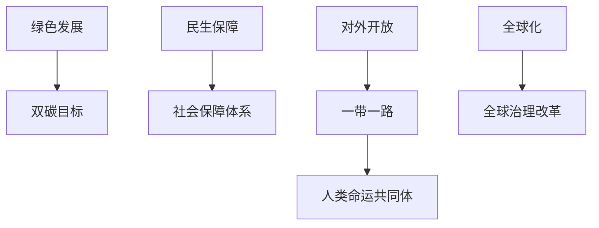

# 07 民生开放与全球治理 · 章节总结

> 对应原书：第三篇 生态文明、民生、对外开放、全球化、一带一路（第 14-18 章）
> 📖 原书原文：[[../../../原文件/经济学/马克思主义政治经济学概论_全书|《概论》第14-18章]]

## 框架图

## 核心概念

| 概念 | 一句话 | 详细 KP |
|---|---|---|
| 生态文明与绿色发展 | 绿水青山就是金山银山 | [[知识点/KP01_生态文明与绿色发展]] |
| 社会保障体系 | 覆盖全民的社保网 | [[知识点/KP02_社会保障体系]] |
| 对外开放 | 基本国策，新时代升级版 | [[知识点/KP03_对外开放]] |
| 经济全球化与全球治理 | 全球化是必然趋势，要改革治理体系 | [[知识点/KP04_经济全球化与全球治理]] |

## 🔗 相关知识点

**本篇：** [[知识点/KP01_生态文明与绿色发展]] ｜ [[知识点/KP02_社会保障体系]] ｜ [[知识点/KP03_对外开放]] ｜ [[知识点/KP04_经济全球化与全球治理]]

**跨章：** [[../06_社会主义市场经济与发展/知识点/KP03_新发展格局|新发展格局]]
