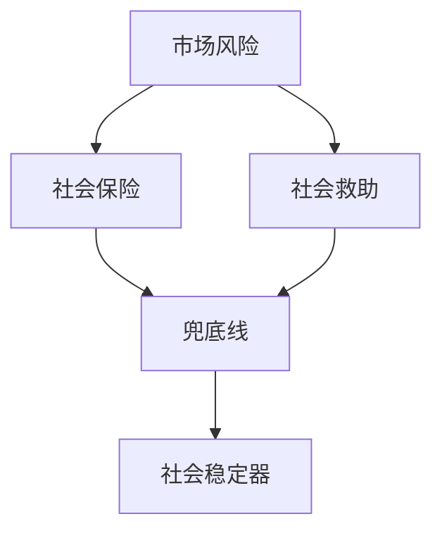

# KP02 · 社会保障体系

<a href="../../../../exam.html" target="_blank" style="display:inline-block;padding:6px 16px;background:#2563eb;color:#fff;border-radius:6px;text-decoration:none;font-size:14px;">📝 开始做题</a>

> 所属：[[../00_章节总结|第15章]] ｜ 节：原书第十五章

## 1. 一句话先懂（小白版）

社会保障是社会的"安全网"——生老病死有兜底，不让人因为风险掉到底层。

## 2. 严格定义

**社会保障体系**：社会保险（养老、医疗、失业、工伤、生育）、社会救助、社会福利、社会优抚、住房保障等组成的体系。

**目标**：覆盖全民、统筹城乡、公平统一、安全规范、可持续。

## 3. 为什么

- 市场经济下个人面临各种风险（失业、疾病、年老）；
- 单靠家庭和市场解决不了；
- 社会主义要通过再分配兜底，实现共同富裕。

## 4. 怎么用

- 基本养老保险覆盖 10 亿人；
- 基本医疗保险覆盖 13 亿人；
- 脱贫攻坚消除绝对贫困；
- 老旧小区改造、保障房。

## 5. 容易混淆什么

| 容易混 | 区别 |
|---|---|
| 社会保险 vs 商业保险 | 社保强制、公平；商保自愿、盈利。 |
| 社会保障 vs 社会福利 | 社保是基本保障；福利是更高层次。 |

---

## 5.5 理论推导（一步步推）

**假设起点**：市场经济存在风险。

**推导过程**：
- 第一步：劳动者面临年老、疾病、失业、工伤、生育等风险。
- 第二步：社会保险分担风险。
- 第三步：社会救助兜底困难群体。
- 第四步：形成兜底线、织密网、建机制的体系。
- 结论：社会保障是社会稳定器。

## 5.6 数学推导（公式怎么来的）

> 每个符号第一次出现必须解释。

社会保障 = 社会保险 + 社会救助 + 社会福利 + 优抚安置，覆盖风险 $R$ 下的基本生活支出。

## 🔗 相关知识点

**同章：** [[KP01_生态文明与绿色发展]] ｜ [[KP03_对外开放]]

**跨章：** [[../../05_社会主义经济制度/知识点/KP04_共同富裕|共同富裕]]

**📖 原书原文：** [[../../../../原文件/经济学/马克思主义政治经济学概论_全书|《概论》第十五章]]

---

## 📝 考研真题（首经贸 801）

**配套主观题：** 见同目录 [[../考研真题集|本章考研真题集]]
**配套选择题：** 见同目录 [[../选择题集|本章选择题集]]

### 高频简答
- 简述我国社会保障体系的构成及其目标（15 分）→ 见 [[../考研真题集#s4|真题集·简答 4]]
- 简述社会保险与商业保险的区别与联系（15 分）→ 见 [[../考研真题集#s6|真题集·简答 6]]

### 高频论述
- 结合人口老龄化，论述我国多层次社会保障体系建设的必要性与路径（30 分）→ 见 [[../考研真题集#l2|真题集·论述 2]]

### 易错选择
- 本知识点选择题见 [[../选择题集#KP02 社会保障体系|选择题集·KP02]]
