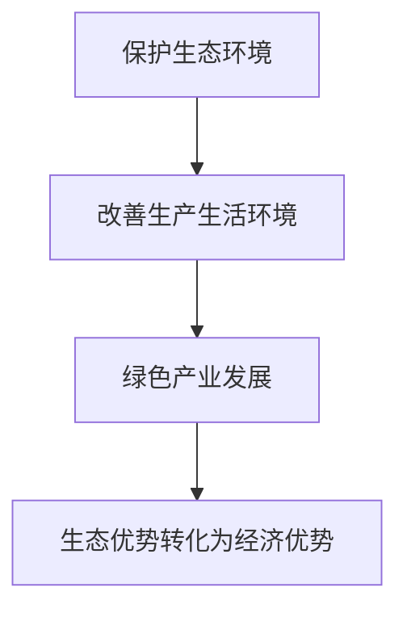
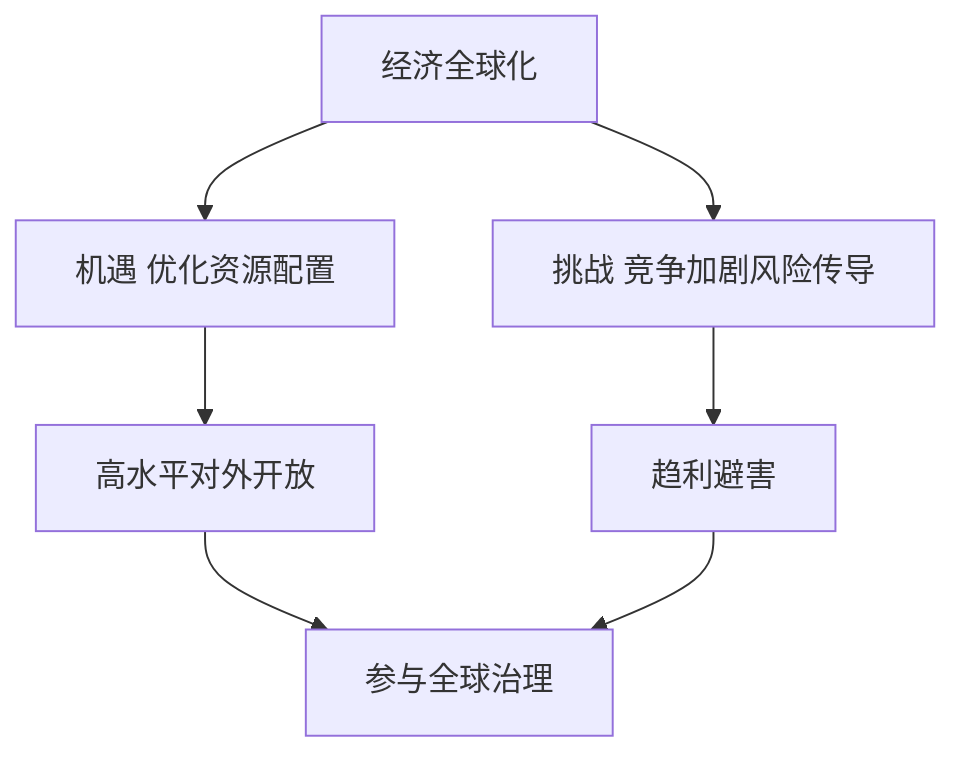

# 07 民生开放与全球治理 · 考研真题集（首经贸 801）

<a href="../../../exam.html" target="_blank" style="display:inline-block;padding:6px 16px;background:#2563eb;color:#fff;border-radius:6px;text-decoration:none;font-size:14px;">📝 开始做题</a>

> 本章共收录：简答题 10 道（每题 15 分）｜论述题 4 道（每题 30 分）
> 配套选择题见 [[选择题集|本章选择题集]]
> 对应大纲：马工程《马克思主义政治经济学概论》第十四章（生态文明）、第十五章（民生保障）、第十六章（对外开放）、第十七至十八章（经济全球化与全球治理）

## 📋 本题集目录

### 简答题
1. [如何理解"绿水青山就是金山银山"的经济学内涵](#s1)
2. [简述碳达峰与碳中和的含义及相互关系](#s2)
3. [为什么说保护生态环境就是保护生产力、改善生态环境就是发展生产力](#s3)
4. [简述我国社会保障体系的构成及其目标](#s4)
5. [如何理解社会保障是共同富裕的"安全网"和"稳定器"](#s5)
6. [简述社会保险与商业保险的区别与联系](#s6)
7. [简述新时代我国推进制度型对外开放的内涵](#s7)
8. [如何理解"一带一路"不是新殖民主义，而是共商共建共享的国际合作平台](#s8)
9. [简述经济全球化的历史必然性与当前遭遇的逆流](#s9)
10. [简述人类命运共同体理念的科学内涵](#s10)

### 论述题
1. [结合碳达峰碳中和目标，论述绿色发展与高质量发展的内在统一](#l1)
2. [结合人口老龄化，论述我国多层次社会保障体系建设的必要性与路径](#l2)
3. [结合 RCEP 生效与"一带一路"提出十周年，论述高水平对外开放与新发展格局的关系](#l3)
4. [在经济全球化遭遇逆流、中美博弈加剧的背景下，分析中国为什么仍要推动构建人类命运共同体](#l4)

---

## 一、简答题（每题 15 分，建议 450–700 字）

### 简答 1：如何理解"绿水青山就是金山银山"的经济学内涵

**【建议字数】450–700 字 ｜ 【建议时间】15 分钟 ｜ 【题型】概念简答**

**【考什么】** 对应知识点 [[知识点/KP01_生态文明与绿色发展|生态文明与绿色发展]]，对应大纲第十四章；题型属于概念简答。

**【答题框架】**
- 第 1 段：命题提出与含义（3 分）
- 第 2 段：绿水青山为什么能变成金山银山（6 分）
- 第 3 段：反对两种错误倾向（4 分）
- 第 4 段：现实意义（2 分）

**【参考答案】**

一、命题提出。"绿水青山就是金山银山"是习近平生态文明思想的核心命题，最早于 2005 年在浙江湖州安吉余村提出。它打破了把生态保护与经济发展对立起来的传统观念。

二、经济学内涵。（一）生态环境本身就是有价值的资产。清新的空气、清洁的水源、良好的生态，可以提供生态产品、生态旅游、绿色农业等经济产出。安吉余村从开矿卖石头转向办农家乐、白茶产业，村民收入反而超过开矿时期。（二）保护生态环境可以减少治理成本。先污染后治理的代价极高——工业污染造成的医疗支出、环境修复费用，往往远超当年的税收和利润。（三）绿色产业本身就是新的经济增长点。光伏、风电、新能源汽车、储能、碳汇交易等绿色产业，正在成为中国经济新的支柱产业。（四）良好生态是最公平的公共产品，是最普惠的民生福祉。

三、反对两种错误倾向。（一）反对"先污染后治理"：以牺牲环境为代价换取一时增长，最终要付出更大代价。（二）反对"生态中心主义"：不吃饭、不发展单纯保护环境也是行不通的，关键是在发展中保护、在保护中发展。

四、现实意义。这一命题为正确处理经济发展与生态保护关系提供了理论指导，是新发展理念中绿色发展的通俗表达。

**【解析·得分点】** 采分点：①生态产品本身有价值（3分）；②减少治理成本+绿色产业新增长点（6分）；③反对先污染后治理和极端环保主义（4分）；④最公平公共品、最普惠民生福祉（2分）。容易丢分：只喊口号不展开经济学逻辑，或把"两山论"答成"保护环境就不能发展经济"。

**【生活实例】** 像一个小区：以前物业把花坛铲了建停车场（短期收益），结果蚊子多、房价跌；后来恢复绿化、搞口袋公园，房价涨了、租客也愿意付钱——好环境本身就是收益。

**【双链接】** 🔗 [[知识点/KP01_生态文明与绿色发展|回知识点]] ｜ 🔗 [[../06_社会主义市场经济与发展/知识点/KP02_新发展理念与高质量发展|新发展理念]] ｜ 📖 [[../../../原文件/经济学/马克思主义政治经济学概论_全书|《概论》第十四章]]

---

### 简答 2：简述碳达峰与碳中和的含义及相互关系

**【建议字数】450–700 字 ｜ 【建议时间】15 分钟 ｜ 【题型】关系对比**

**【考什么】** 对应知识点 [[知识点/KP01_生态文明与绿色发展|生态文明与绿色发展]]，对应大纲第十四章；题型属于概念简答。

**【答题框架】**
- 第 1 段：双碳目标的提出（2 分）
- 第 2 段：碳达峰含义（4 分）
- 第 3 段：碳中和含义（4 分）
- 第 4 段：二者关系（5 分）

**【参考答案】**

一、提出。2020 年 9 月，习近平总书记在第七十五届联合国大会一般性辩论上宣布：中国将提高国家自主贡献力度，采取更加有力的政策和措施，二氧化碳排放力争于 2030 年前达到峰值，努力争取 2060 年前实现碳中和。这就是"双碳目标"。

二、碳达峰的含义。碳达峰是指二氧化碳排放量达到历史最高值后，经历平台期进入持续下降的过程，是二氧化碳排放量由增转降的历史拐点。达峰之后，碳排放总量不再增长。我国承诺 2030 年前实现碳达峰。

三、碳中和的含义。碳中和是指人类活动排放的二氧化碳，通过技术减排、能源替代、碳汇吸收（植树造林、海洋吸收）、碳捕集利用与封存（CCUS）等方式，实现排放与吸收相互抵消，净排放为零。我国承诺 2060 年前实现碳中和。

四、二者关系。（一）碳达峰是碳中和的前提和基础：只有先达峰，才能谈中和；达峰越早、峰值越低，碳中和的难度就越小。（二）碳中和是碳达峰的必然趋势和最终目标：达峰不是终点，而是为中和创造条件。（三）我国从达峰到中和只有 30 年，比发达国家（一般 50-70 年）时间更紧、任务更难，必须付出艰苦努力。（四）双碳不是"运动式减碳"，要坚持"全国统筹、节约优先、双轮驱动、内外畅通、防范风险"原则，先立后破。

**【解析·得分点】** 采分点：①2030 碳达峰、2060 碳中和两个时间点必须准确（2分）；②达峰=排放由增转降拐点（4分）；③中和=排放等于吸收、净零（4分）；④达峰是基础、中和是目标、我国时间更紧（5分）。容易丢分：把碳中和答成"完全不排放"，实际上是净零排放，仍允许一定排放由碳汇抵消。

**【生活实例】** 像一个家庭记账：碳达峰就是"开支不再增加"的那个月，碳中和就是"这个月花多少、赚多少刚好抵消"。先控制住开支不再涨，再慢慢做到收支平衡。

**【双链接】** 🔗 [[知识点/KP01_生态文明与绿色发展|回知识点]] ｜ 📖 [[../../../原文件/经济学/马克思主义政治经济学概论_全书|《概论》第十四章]]

---

### 简答 3：为什么说保护生态环境就是保护生产力、改善生态环境就是发展生产力

**【建议字数】450–700 字 ｜ 【建议时间】15 分钟 ｜ 【题型】原因分析**

**【考什么】** 对应知识点 [[知识点/KP01_生态文明与绿色发展|生态文明与绿色发展]]，对应大纲第十四章；题型属于原因分析。

**【答题框架】**
- 第 1 段：命题含义（3 分）
- 第 2 段：传统生产力观的局限（4 分）
- 第 3 段：生态作为生产要素（5 分）
- 第 4 段：绿色生产力（3 分）

**【参考答案】**

一、命题含义。马克思主义认为，劳动和自然界一起构成财富的源泉。自然界不仅是劳动的"食堂"，也是劳动的"工具箱"。保护和改善生态环境，本质上是在保护和发展生产力本身。

二、传统生产力观的局限。传统观念把生产力只理解为人改造自然的能力，把自然当作无偿的原料库和垃圾桶。这种生产力观忽视了自然对生产力的承载能力，结果是：土壤退化、水源枯竭、空气污染，反而削弱了长期生产力。

三、生态作为生产要素。（一）劳动力要素：清洁空气和水源减少疾病，提高劳动者健康水平和劳动生产率。（二）资源要素：土地、水、矿产、能源是生产的投入品，破坏它们就是破坏生产条件。（三）资本要素：良好生态本身就是有价值的资产，可以通过碳汇、生态补偿、生态旅游转化为经济收益。（四）技术要素：绿色技术（光伏、储能、新能源车）正在成为新的生产力。

四、绿色生产力。新时代的生产力是"绿色生产力"——它不再以掠夺自然为代价，而是通过技术进步提高资源利用效率，实现人与自然和谐共生。我国光伏组件产量占全球 80% 以上、新能源汽车产销量连续多年世界第一，就是绿色生产力发展的生动证明。

**【解析·得分点】** 采分点：①自然界是财富源泉（马克思原话精神）（3分）；②传统生产力观的局限（4分）；③劳动力、资源、资本、技术四要素与生态关系（5分）；④绿色生产力+光伏新能源车案例（3分）。容易丢分：只重复命题不展开，或把"保护生态"答成"限制生产"。

**【生活实例】** 像一块农田：拼命施肥打农药，第一年亩产高，第三年土壤板结减产——这是破坏生产力。养地、轮作、有机肥，虽然短期产量不最高，但长期地力稳定、持续高产——这是保护和发展生产力。

**【双链接】** 🔗 [[知识点/KP01_生态文明与绿色发展|回知识点]] ｜ 📖 [[../../../原文件/经济学/马克思主义政治经济学概论_全书|《概论》第十四章]]

---

### 简答 4：简述我国社会保障体系的构成及其目标

**【建议字数】450–700 字 ｜ 【建议时间】15 分钟 ｜ 【题型】概念简答**

**【考什么】** 对应知识点 [[知识点/KP02_社会保障体系|社会保障体系]]，对应大纲第十五章；题型属于概念简答。

**【答题框架】**
- 第 1 段：社会保障的定义（2 分）
- 第 2 段：体系构成（8 分）
- 第 3 段：目标（3 分）
- 第 4 段：现实意义（2 分）

**【参考答案】**

一、定义。社会保障体系是指国家通过立法和国民收入再分配，对社会成员在年老、疾病、失业、工伤、生育、遭受灾害、面临生活困难时给予物质帮助，保障其基本生活需要的制度安排。

二、体系构成。我国社会保障体系主要包括：（一）社会保险：是体系的核心部分，包括基本养老保险、基本医疗保险、失业保险、工伤保险、生育保险五项。（二）社会救助：是兜底部分，包括最低生活保障、特困人员救助供养、受灾人员救助、医疗救助、教育救助、住房救助、就业救助、临时救助等。（三）社会福利：是高层次部分，包括老年人福利、残疾人福利、儿童福利等。（四）社会优抚：面向军人、退役军人及家属的特殊保障。（五）住房保障：包括公租房、保障性租赁住房、共有产权房等。（六）补充保障：包括企业年金、职业年金、商业健康保险、慈善事业等。

三、目标。党的二十大提出，要建成"覆盖全民、统筹城乡、公平统一、安全规范、可持续"的多层次社会保障体系。

四、现实意义。社会保障是民生安全网、社会稳定器，与人民幸福安康息息相关，是实现共同富裕的重要制度安排。

**【解析·得分点】** 采分点：①五险（养老、医疗、失业、工伤、生育）（4分）；②社会救助、社会福利、社会优抚、住房保障（4分）；③"覆盖全民、统筹城乡、公平统一、安全规范、可持续"五句话目标（3分）；④安全网、稳定器定位（2分）。容易丢分：把"社会保险"等同于"社会保障"，漏了救助、福利、优抚等层次；或把目标五句话记错。

**【生活实例】** 像一栋楼的消防系统：社保是自动喷淋（核心、人人有），社会救助是灭火器（兜底），社会福利是绿化和健身房（高层次），优抚是退伍军人的专项服务。

**【双链接】** 🔗 [[知识点/KP02_社会保障体系|回知识点]] ｜ 📖 [[../../../原文件/经济学/马克思主义政治经济学概论_全书|《概论》第十五章]]

---

### 简答 5：如何理解社会保障是共同富裕的"安全网"和"稳定器"

**【建议字数】450–700 字 ｜ 【建议时间】15 分钟 ｜ 【题型】影响结果**

**【考什么】** 对应知识点 [[知识点/KP02_社会保障体系|社会保障体系]]，对应大纲第十五章；题型属于原因分析。

**【答题框架】**
- 第 1 段：总起（3 分）
- 第 2 段：为什么是"安全网"（6 分）
- 第 3 段：为什么是"稳定器"（4 分）
- 第 4 段：与共同富裕的关系（2 分）

**【参考答案】**

一、总起。社会保障通过国民收入再分配，为社会成员提供基本生活保障，既是市场经济的"安全网"，又是社会运行的"稳定器"，也是走向共同富裕的重要制度基础。

二、为什么是"安全网"。市场经济按要素分配，必然带来收入差距。个人面临生老病死、失业、灾害等风险，如果没有兜底，一部分人可能因一次疾病、一次失业就陷入贫困。社会保障的作用是：（一）基本养老保险保障劳动者退休后有收入；（二）基本医疗保险减轻大病医疗负担；（三）失业保险为暂时失业者提供过渡；（四）最低生活保障为绝对贫困者兜底。脱贫攻坚战中，社保兜底是"两不愁三保障"的重要内容，数千万贫困人口因此摆脱绝对贫困。

三、为什么是"稳定器"。（一）社会保障具有自动稳定器功能：经济下行时，失业金、低保支出自动增加，支撑消费；经济过热时，这些支出自动减少，抑制总需求。（二）完善的社保减少了居民的预防性储蓄，有利于扩大消费、拉动内需。（三）社会保障缓解了社会矛盾，避免了贫富分化引发的冲突。

四、与共同富裕的关系。共同富裕不是平均主义，而是在保障基本权利公平的基础上，允许合理差距。社会保障通过再分配，让发展成果更多更公平惠及全体人民，是共同富裕的底线制度安排。

**【解析·得分点】** 采分点：①社保覆盖的五类风险（老、病、失业、工伤、贫困）（6分）；②自动稳定器+预防性储蓄减少+社会矛盾缓解（4分）；③共同富裕不是平均主义（2分）；④社保兜底脱贫案例（3分）。容易丢分：只讲"帮助穷人"，漏了社保对宏观经济自动稳定器的作用。

**【生活实例】** 像走钢丝的人下面那张网：不是替他走，而是他万一失手不至于摔死。有了这张网，他敢走更难的路（敢消费、敢创业）。

**【双链接】** 🔗 [[知识点/KP02_社会保障体系|回知识点]] ｜ 📖 [[../../../原文件/经济学/马克思主义政治经济学概论_全书|《概论》第十五章]]

---

### 简答 6：简述社会保险与商业保险的区别与联系

**【建议字数】450–700 字 ｜ 【建议时间】15 分钟 ｜ 【题型】关系对比**

**【考什么】** 对应知识点 [[知识点/KP02_社会保障体系|社会保障体系]]，对应大纲第十五章；题型属于关系对比。

**【答题框架】**
- 第 1 段：总起（2 分）
- 第 2 段：区别（8 分）
- 第 3 段：联系（3 分）
- 第 4 段：多层次体系（2 分）

**【参考答案】**

一、总起。社会保险和商业保险都是风险分散机制，但二者在性质、目标、运行方式上有本质区别，又相互补充。

二、区别。（一）性质不同：社会保险是国家通过立法强制实施的社会保障制度，具有强制性、公益性；商业保险是保险公司按市场原则经营的金融产品，具有自愿性、营利性。（二）目标不同：社会保险以保障基本生活、促进社会公平为目标，不以盈利为目的；商业保险以利润最大化为目标。（三）资金来源不同：社会保险由国家、单位、个人三方共同缴费，财政兜底；商业保险完全由投保人缴费。（四）保障对象不同：社会保险覆盖全体公民，强调人人享有；商业保险面向有购买能力的人，按合同赔付。（五）保障水平不同：社会保险保障基本生活需要，"保基本"；商业保险可提供较高水平的补充保障。

三、联系。（一）二者都是风险分散机制，通过大数法则集聚资金补偿损失。（二）社会保险是第一道防线，商业保险是补充。（三）我国鼓励发展商业健康保险、年金保险，作为多层次社会保障体系的组成部分。

四、多层次体系。我国正在构建"三支柱"养老保险体系：第一支柱是基本养老保险（国家强制）；第二支柱是企业年金、职业年金（单位补充）；第三支柱是个人养老金和商业养老保险（个人自愿）。

**【解析·得分点】** 采分点：①强制 vs 自愿、公益 vs 盈利、三方缴费 vs 个人缴费、保基本 vs 较高水平（8分）；②三支柱养老保险体系（3分）；③不能互相替代（2分）。容易丢分：把二者混为一谈，或认为商业保险可以取代社保。

**【生活实例】** 像小区里的安保：社保是物业强制配的保安（谁都有、保基本），商业保险是你自己请的私人保镖（花钱买、服务更好但贵）。

**【双链接】** 🔗 [[知识点/KP02_社会保障体系|回知识点]] ｜ 📖 [[../../../原文件/经济学/马克思主义政治经济学概论_全书|《概论》第十五章]]

---

### 简答 7：简述新时代我国推进制度型对外开放的内涵

**【建议字数】450–700 字 ｜ 【建议时间】15 分钟 ｜ 【题型】概念简答**

**【考什么】** 对应知识点 [[知识点/KP03_对外开放|对外开放]]，对应大纲第十六章；题型属于概念简答。

**【答题框架】**
- 第 1 段：从商品要素流动型开放到制度型开放（4 分）
- 第 2 段：制度型开放的内涵（6 分）
- 第 3 段：主要举措（3 分）
- 第 4 段：意义（2 分）

**【参考答案】**

一、开放的两个阶段。我国对外开放经历了两个阶段：第一阶段是"商品和要素流动型开放"，主要表现为关税减让、吸引外资、发展加工贸易，以边境开放为主；进入新时代，我国对外开放进入"制度型开放"新阶段，以规则、规制、管理、标准等制度层面的开放为主。

二、制度型开放的内涵。（一）主动对接国际高标准经贸规则：在知识产权保护、竞争政策、国有企业、补贴、劳工标准、环境标准、数字贸易等领域，参照国际高水平协定推进国内改革。（二）推动由商品和要素流动型开放向规则等制度型开放转变：不仅要"打开国门"，还要"打通制度"。（三）在开放中提升国内治理水平：通过加入高标准协定，倒逼国内市场化改革。（四）积极参与国际经贸规则制定：从规则接受者转向规则参与者、塑造者。

三、主要举措。（一）自贸试验区和自贸港试点：上海、广东等 21 个自贸试验区，海南自贸港封关运作。（二）进博会、服贸会、广交会等平台。（三）RCEP 生效实施，积极申请加入 CPTPP、DEPA。（四）出台《外商投资准入负面清单》《外商投资法》，落实准入后国民待遇。

四、意义。制度型开放是我国推动高水平对外开放的标志，有利于在逆全球化背景下，以开放促改革、促发展，为构建新发展格局提供有力支撑。

**【解析·得分点】** 采分点：①商品要素流动型 vs 制度型开放的区分（4分）；②规则、规制、管理、标准四个词必须写全（6分）；③自贸试验区、海南自贸港、RCEP 三个抓手（3分）；④从规则接受者到塑造者（2分）。容易丢分：把制度型开放答成"多开几个自贸区"，没理解它是规则层面的开放。

**【生活实例】** 像加入一个社团：以前是交学费、参加活动（要素流动型）；现在是按社团章程修改自己的行为规则、甚至参与制定章程（制度型）。开放不再是"开门做生意"，而是"按共同规则办事"。

**【双链接】** 🔗 [[知识点/KP03_对外开放|回知识点]] ｜ 🔗 [[../06_社会主义市场经济与发展/知识点/KP03_新发展格局|新发展格局]] ｜ 📖 [[../../../原文件/经济学/马克思主义政治经济学概论_全书|《概论》第十六章]]

---

### 简答 8：如何理解"一带一路"不是新殖民主义，而是共商共建共享的国际合作平台

**【建议字数】450–700 字 ｜ 【建议时间】15 分钟 ｜ 【题型】关系对比**

**【考什么】** 对应知识点 [[知识点/KP03_对外开放|对外开放]] 与 [[知识点/KP04_经济全球化与全球治理|全球治理]]，对应大纲第十六、十八章；题型属于关系对比。

**【答题框架】**
- 第 1 段：提出与定位（3 分）
- 第 2 段：与新殖民主义的本质区别（6 分）
- 第 3 段：共商共建共享原则（4 分）
- 第 4 段：实践成果（2 分）

**【参考答案】**

一、提出与定位。"一带一路"倡议于 2013 年提出，到 2023 年已走过十年。它是在共商共建共享原则基础上，发展开放型世界经济的国际合作平台，不是中国一家的独奏，而是沿线国家的合唱。西方舆论将其污名为"新殖民主义"，这是对历史和现实的严重歪曲。

二、与新殖民主义的本质区别。（一）历史上的殖民主义：通过武力征服、不平等条约、资源掠夺、资本输出剥削殖民地，附加政治条件。（二）"一带一路"：①不干涉他国内政，不附加政治条件；②项目由各国自主提出、自愿参与；③合作基于平等互利，目的是帮助东道国改善基础设施、增加就业、促进发展。（三）典型项目：雅万高铁（印尼）、比雷埃夫斯港（希腊）、中老铁路、巴基斯坦中巴经济走廊，都为当地创造了大量就业和税收。

三、共商共建共享原则。（一）共商：有事大家商量着办，不是中国单方面说了算；（二）共建：各国共同参与项目建设，发挥各自比较优势；（三）共享：发展成果由各国人民共同分享。

四、实践成果。截至 2023 年，已有 150 多个国家、30 多个国际组织签署合作文件，形成 3000 多个合作项目，拉动近万亿美元投资规模，形成 3000 多个合作项目，为沿线国家创造 42 万个工作岗位，让近 4000 万人摆脱极端贫困。

**【解析·得分点】** 采分点：①新殖民主义=武力+不平等+掠夺（3分）；②一带一路=不干涉内政+自愿参与+平等互利（6分）；③共商共建共享三原则（4分）；④雅万高铁、中老铁路等案例（2分）。容易丢分：只喊口号"我们不是殖民主义"，没讲清区别在哪。

**【生活实例】** 像一个大学社团请其他学校合办比赛：不是强制拉人参加、把奖品全拿走，而是大家一起商量规则、各自出力、奖品和经验都分享。

**【双链接】** 🔗 [[知识点/KP03_对外开放|回知识点]] ｜ 🔗 [[知识点/KP04_经济全球化与全球治理|全球治理]] ｜ 📖 [[../../../原文件/经济学/马克思主义政治经济学概论_全书|《概论》第十六、十八章]]

---

### 简答 9：简述经济全球化的历史必然性与当前遭遇的逆流

**【建议字数】450–700 字 ｜ 【建议时间】15 分钟 ｜ 【题型】经济现象**

**【考什么】** 对应知识点 [[知识点/KP04_经济全球化与全球治理|经济全球化与全球治理]]，对应大纲第十七章；题型属于原因分析。

**【答题框架】**
- 第 1 段：经济全球化的定义（2 分）
- 第 2 段：历史必然性（6 分）
- 第 3 段：当前逆流的表现与原因（5 分）
- 第 4 段：中国立场（2 分）

**【参考答案】**

一、定义。经济全球化是指商品、服务、生产要素（资本、技术、劳动力）跨国流动规模不断扩大，国际分工不断深化，各国经济相互依存、相互联系日益加深的历史过程。

二、历史必然性。（一）马克思主义认为，生产力的发展必然冲破民族国家的壁垒。资产阶级"首次开创了世界历史"，因为它使每个文明国家以及这些国家中的每一个人的需要的满足都依赖于整个世界。（二）根本动力是社会分工和科技进步：交通运输、信息技术、互联网的发展，极大降低了跨境交易成本。（三）内在机制是比较优势：各国按比较优势参与国际分工，通过贸易增进福利。（四）经济全球化是生产力发展的客观要求，是历史潮流，不以人的意志为转移。

三、当前逆流的表现与原因。2008 年国际金融危机后，全球化进入调整期：（一）贸易保护主义抬头：美国加征关税、实施出口管制；（二）地缘政治冲突：俄乌冲突、中美战略竞争加剧；（三）产业链重构：友岸外包、近岸外包、中国+1；（四）英国脱欧、反全球化政治势力抬头。原因包括：全球化收益分配不均，发达国家内部产业空心化、中产阶级萎缩，民粹主义兴起；各国对供应链安全、技术竞争的考量上升。

四、中国立场。逆流不是全球化的终结，而是全球化进入新阶段。中国坚决反对逆全球化，主张建设开放型世界经济，推动全球化朝着更加开放、包容、普惠、平衡、共赢的方向发展。

**【解析·得分点】** 采分点：①马克思"世界历史"思想（2分）；②生产力+科技+比较优势三个动力（6分）；③贸易保护、产业链重构、地缘冲突三个逆流表现（5分）；④中国主张开放包容普惠平衡共赢（2分）。容易丢分：把全球化逆流答成"全球化失败"，忽略它是历史必然只是进入调整期。

**【生活实例】** 像大学宿舍：以前大家一起凑单买打印机、轮流带饭（全球化）；现在有人嫌"别人用得比我多"，开始各买各的（逆流）。但总还是比完全独立买便宜——逆流是暂时的，分工的好处不会消失。

**【双链接】** 🔗 [[知识点/KP04_经济全球化与全球治理|回知识点]] ｜ 📖 [[../../../原文件/经济学/马克思主义政治经济学概论_全书|《概论》第十七章]]

---

### 简答 10：简述人类命运共同体理念的科学内涵

**【建议字数】450–700 字 ｜ 【建议时间】15 分钟 ｜ 【题型】概念简答**

**【考什么】** 对应知识点 [[知识点/KP04_经济全球化与全球治理|经济全球化与全球治理]]，对应大纲第十八章；题型属于概念简答。

**【答题框架】**
- 第 1 段：提出与定位（3 分）
- 第 2 段：核心内涵（7 分）
- 第 3 段：现实依据（3 分）
- 第 4 段：意义（2 分）

**【参考答案】**

一、提出。2013 年 3 月，习近平主席在莫斯科国际关系学院演讲中首次提出人类命运共同体理念。这一理念多次被写入联合国文件，成为引领时代潮流和人类前进方向的鲜明旗帜。

二、核心内涵。人类命运共同体，就是每个民族、每个国家的前途命运都紧紧联系在一起，应该风雨同舟、荣辱与共，努力把我们生于斯、长于斯的这个星球建成一个和睦的大家庭，把世界各国人民对美好生活的向往变成现实。具体包括五个维度：（一）持久和平：坚持对话协商，建设一个持久和平的世界；（二）普遍安全：坚持共建共享，建设一个普遍安全的世界；（三）共同繁荣：坚持合作共赢，建设一个共同繁荣的世界；（四）开放包容：坚持交流互鉴，建设一个开放包容的世界；（五）清洁美丽：坚持绿色低碳，建设一个清洁美丽的世界。

三、现实依据。（一）经济全球化使各国相互依存空前加深；（二）气候变化、疫情、恐怖主义、贫富差距等全球性挑战单靠一国无法解决；（三）旧的零和博弈、丛林法则已经过时。

四、意义。人类命运共同体理念超越了民族国家界限和意识形态对立，为改革全球治理体系、建设更加美好的世界提供了中国方案，是马克思主义时代化的重要成果。

**【解析·得分点】** 采分点：①五个世界（持久和平、普遍安全、共同繁荣、开放包容、清洁美丽）必须写全（7分）；②各国相互依存、全球性挑战（3分）；③不是取消国家而是尊重主权下合作（3分）；④中国方案定位（2分）。容易丢分：把人类命运共同体答成"天下大同"或"全球政府"，它承认主权国家，不是取消国家。

**【生活实例】** 像一个大教室上课：空调坏了没人修、有人一直开灯浪费电，但考试是按全班平均分算——那大家就得一起商量怎么修空调、怎么省电。这就是命运共同体：一荣俱荣、一损俱损。

**【双链接】** 🔗 [[知识点/KP04_经济全球化与全球治理|回知识点]] ｜ 📖 [[../../../原文件/经济学/马克思主义政治经济学概论_全书|《概论》第十八章]]

---

### 简答 11：（逻辑链·分析）简述"绿水青山就是金山银山"的内涵，并画图

**【建议字数】450–700 字 ｜ 【建议时间】15 分钟 ｜ 【题型】逻辑链分析**

**【考什么】** 对应知识点 [[知识点/KP01_生态文明与绿色发展|生态文明]]。

**【答题框架】**
- 第 1 段：保护生态就是发展生产力（5 分）
- 第 2 段：生态优势转化为经济优势（5 分）
- 第 3 段：绿色发展道路（5 分）

**【参考答案】**

一、保护生态环境就是保护生产力，改善生态环境就是发展生产力。生态文明不是不要发展，而是绿色发展。

二、生态优势可以转化为经济优势：良好生态带来绿色产业、生态旅游、特色农产品。

三、走生产发展、生活富裕、生态良好的文明发展道路。

**【解析·得分点】** 采分点：① 保护生态就是发展生产力（5 分）；② 生态优势转化（5 分）；③ 文明发展道路（5 分）。易丢分处：把生态文明说成不要发展。

**【生活实例】** 安吉白茶村保护竹海，白茶卖出高价、搞生态旅游——绿水青山真变成了金山银山。

---

## 二、论述题（每题 30 分，建议 900–1200 字）

### 论述 1：结合碳达峰碳中和目标，论述绿色发展与高质量发展的内在统一

**【建议字数】900–1200 字 ｜ 【建议时间】30 分钟 ｜ 【题型】理论类**

**【考什么】** 跨 [[知识点/KP01_生态文明与绿色发展|绿色发展]] 与 06 章 [[../06_社会主义市场经济与发展/知识点/KP02_新发展理念与高质量发展|高质量发展]]、[[../06_社会主义市场经济与发展/知识点/KP03_新发展格局|新发展格局]]；题型属于政策类。

**【答题框架】**
- 第 1 段：破题（4 分）
- 第 2 段：绿色发展是高质量发展的底色（8 分）
- 第 3 段：双碳目标如何倒逼高质量发展（8 分）
- 第 4 段：现实路径与挑战（6 分）
- 第 5 段：中国实际（4 分）

**【参考答案】**

一、破题。绿色发展是新发展理念的重要组成部分，高质量发展是体现新发展理念的发展。碳达峰碳中和目标不是单纯的环保任务，而是一场广泛而深刻的经济社会系统性变革，它与高质量发展在方向、动力、路径上高度统一。

二、绿色发展是高质量发展的底色。（一）从投入端看，传统粗放增长以高投入、高消耗、高排放为特征，资源环境成本高昂，本身就是低质量。绿色发展要求提高资源利用效率，降低单位 GDP 能耗和碳排放，这与高质量发展"高效能"的要求一致。（二）从需求端看，随着收入水平提高，人民对清洁空气、安全食品、优美环境的需求日益增长，绿色产品和服务本身就是高品质供给。（三）从国际竞争看，绿色低碳已成为新一轮科技革命和产业变革的方向，绿色竞争力就是未来国际竞争力。

三、双碳目标如何倒逼高质量发展。（一）推动能源结构转型：从煤炭为主转向风、光、水、核、储能为主，倒逼新能源技术突破。我国光伏组件产量占全球 80% 以上、风电设备占全球一半以上、新能源汽车产销量连续 9 年世界第一，绿色产业已成为新的经济增长点。（二）推动产业结构升级：高耗能行业（钢铁、水泥、化工）面临减排压力，必须通过技术改造提高效率；现代服务业、高技术产业比重上升。（三）推动技术创新：电池技术、CCUS（碳捕集利用与封存）、绿氢、储能等领域的突破，正在形成新质生产力。（四）推动制度创新：全国碳市场扩容、环保税、生态补偿、绿色金融等制度逐步完善。

四、现实路径与挑战。（一）要坚持"先立后破"：不能传统能源还没退出就盲目关停，要先把新能源体系建起来再替代。2021 年部分地方"运动式减碳"导致拉闸限电，教训深刻。（二）要统筹发展和安全：我国产业结构偏重、能源结构偏煤，双碳任务比发达国家更艰巨，需要长达 40 年的努力。（三）要完善碳定价机制：全国碳排放权交易市场从发电行业起步，逐步扩大到钢铁、水泥、化工等行业。（四）要推动全球气候治理：坚持共同但有区别的责任原则，争取发达国家向发展中国家提供资金和技术支持。

五、中国实际。2024 年以来，我国非化石能源消费比重已超过 18%，单位 GDP 碳排放比 2005 年下降超过 50%。绿色发展不仅没有拖累经济，反而成为我国经济转型升级、培育新质生产力、参与全球竞争的重要抓手。这充分证明：保护生态环境就是保护生产力，改善生态环境就是发展生产力。

**【解析·得分点】** 采分点：①绿色是高质量发展的内在要求（8分）；②双碳倒逼能源、产业、技术、制度四个转型（8分）；③"先立后破"反对运动式减碳（6分）；④光伏、新能源车全球领先数据（4分）；⑤共同但有区别的责任原则（4分）。跨章节连接词："双碳目标是新发展理念中绿色发展的具体化，也是高质量发展的内在要求"——把 KP01 和 06 章 KP02 串起来。

**【生活实例】** 像一家老饭店：以前重油重盐、靠低价拉客（粗放增长），现在改成健康轻食、用可降解餐具、装太阳能热水器，短期成本高，但回头客多了、好评多了、还上了美食榜——绿色转型不是赔本，是换一种更长久的赚钱方式。

**【双链接】** 🔗 [[知识点/KP01_生态文明与绿色发展|绿色发展]] ｜ 🔗 [[../06_社会主义市场经济与发展/知识点/KP02_新发展理念与高质量发展|高质量发展]] ｜ 🔗 [[../06_社会主义市场经济与发展/知识点/KP03_新发展格局|新发展格局]] ｜ 📖 [[../../../原文件/经济学/马克思主义政治经济学概论_全书|《概论》第十四章]]

---

### 论述 2：结合人口老龄化，论述我国多层次社会保障体系建设的必要性与路径

**【建议字数】900–1200 字 ｜ 【建议时间】30 分钟 ｜ 【题型】政策效应类**

**【考什么】** 跨 [[知识点/KP02_社会保障体系|社会保障体系]] 与 06 章 [[../06_社会主义市场经济与发展/知识点/KP03_新发展格局|新发展格局]]、[[../06_社会主义市场经济与发展/知识点/KP02_新发展理念与高质量发展|共享发展]]；题型属于现象类。

**【答题框架】**
- 第 1 段：老龄化背景（4 分）
- 第 2 段：现行社保体系面临的挑战（8 分）
- 第 3 段：多层次体系建设的必要性（8 分）
- 第 4 段：改革路径（6 分）
- 第 5 段：与共同富裕和内需的关系（4 分）

**【参考答案】**

一、老龄化背景。我国 60 岁及以上人口已超过 2.97 亿（占比 21%），65 岁及以上超过 2.1 亿（占比 15%），进入中度老龄化社会。预计到 2035 年前后进入重度老龄化。人口结构变化对社会保障体系提出严峻挑战。

二、现行社保体系面临的挑战。（一）基本养老保险收支压力加大：缴费人口增长放缓，领取人口快速增加，部分省份养老保险基金当期收不抵支，依靠中央调剂。（二）医疗费用快速上涨：老龄化叠加慢性病高发，医保基金支出压力持续增大。（三）养老服务供给不足：失能半失能老人超过 4000 万，护理床位和专业护理人员短缺。（四）三支柱发展不平衡：第一支柱"一枝独大"，第二支柱（企业年金）覆盖率低，第三支柱（个人养老金）刚起步。（五）城乡、区域、群体之间保障水平差距仍然存在。

三、多层次体系建设的必要性。（一）单一社保制度无法应对老龄化：必须构建"三支柱"养老保险体系，分散风险。（二）社会保障是共同富裕的底线制度：通过再分配保障老年人基本生活，防止老年贫困。（三）完善社保有利于扩大内需：减少居民预防性储蓄，让老百姓敢消费，是构建新发展格局的重要配套。（四）社会保障是社会稳定器：避免因养老、医疗问题引发社会矛盾。

四、改革路径。（一）实施渐进式延迟法定退休年龄：2024 年起用 15 年时间逐步延迟，缓解劳动力供给和养老基金压力。（二）充实社保基金：划转部分国有资本充实社保基金，扩大全国社保基金规模。（三）发展第二、三支柱：推动企业年金扩面，推出个人养老金制度，给予税收优惠。（四）推进全国统筹：基本养老保险全国统筹已经实施，医保省级统筹稳步推进。（五）发展养老服务业：普惠养老、医养结合、长期护理保险试点。（六）健全农村社保：巩固城乡居民养老保险，完善被征地农民社保。

五、与共同富裕和内需的关系。社会保障是收入再分配的重要工具。通过完善社保，让老年人有稳定收入、有病能医，既能体现共享发展理念，又能释放消费潜力，为新发展格局提供内需支撑。这是一项关系亿万群众切身利益的重大制度安排。

**【解析·得分点】** 采分点：①2.97 亿老人、21% 老龄化率（4分）；②养老基金压力、医疗费用上涨、三支柱不平衡（8分）；③延迟退休、国有资本充实社保、个人养老金（8分）；④社保减少预防性储蓄、利好内需（6分）；⑤共同富裕+新发展格局双连接（4分）。容易丢分：只讲老龄化不讲对策，或只讲养老不讲医疗和长期护理。

**【生活实例】** 像一个家庭的养老准备：光靠子女一个人养老人（第一支柱独大）压力太大；得有退休金（社保）+ 企业给的补充养老金（企业年金）+ 自己存的养老钱（个人养老金），三条腿走路才稳。

**【双链接】** 🔗 [[知识点/KP02_社会保障体系|社会保障体系]] ｜ 🔗 [[../06_社会主义市场经济与发展/知识点/KP03_新发展格局|新发展格局]] ｜ 🔗 [[../06_社会主义市场经济与发展/知识点/KP02_新发展理念与高质量发展|共享发展]] ｜ 📖 [[../../../原文件/经济学/马克思主义政治经济学概论_全书|《概论》第十五章]]

---

### 论述 3：结合 RCEP 生效与"一带一路"提出十周年，论述高水平对外开放与新发展格局的关系

**【建议字数】900–1200 字 ｜ 【建议时间】30 分钟 ｜ 【题型】现象类**

**【考什么】** 跨 [[知识点/KP03_对外开放|对外开放]] 与 [[知识点/KP04_经济全球化与全球治理|全球治理]] 及 06 章 [[../06_社会主义市场经济与发展/知识点/KP03_新发展格局|新发展格局]]；题型属于政策类。

**【答题框架】**
- 第 1 段：破题（4 分）
- 第 2 段：新发展格局不是封闭，而是更高水平开放（8 分）
- 第 3 段：RCEP 与一带一路的实践（8 分）
- 第 4 段：双向循环如何相互促进（6 分）
- 第 5 段：挑战与方向（4 分）

**【参考答案】**

一、破题。2020 年 11 月 RCEP 签署，2022 年 1 月 1 日生效；2023 年是"一带一路"提出十周年。两大事件都发生在我国提出构建新发展格局的背景下。新发展格局以国内大循环为主体，绝不是关起门来开放，而是要通过高水平对外开放，使国内国际双循环相互促进。

二、新发展格局与高水平开放的内在联系。（一）以国内大循环为主体，要求我们把自己的市场做大做强，这本身就是对世界的开放——14 亿人的大市场是全球共享的机遇。（二）国内大循环效率越高，我国在国际合作中的竞争力就越强，越有条件扩大开放。（三）反过来，高水平开放可以引入竞争、技术、资源，提升国内大循环的质量。（四）新时代开放已经从"红利分割"转向"红利共享"，从"引进来"为主转向"引进来与走出去并重"。

三、RCEP 与一带一路的实践。（一）RCEP 是全球最大的自由贸易区，涵盖 15 个国家、22 亿人口。生效以来，区域内 90% 以上货物最终实现零关税，原产地累积规则促进了区域产业链供应链整合。我国对 RCEP 其他成员国进出口额占外贸总额约 30%。（二）一带一路十年：150 多个国家、30 多个国际组织签署合作文件，形成 3000 多个项目，雅万高铁、中老铁路、比雷埃夫斯港、匈塞铁路等标志性项目落地，拉动近万亿美元投资。（三）进博会、服贸会、广交会持续举办，海南自贸港封关运作，自贸试验区扩容到 21 个。

四、双向循环如何相互促进。（一）国内产业升级为出口提供高质量产品：新能源汽车、光伏、锂电池"新三样"出口快速增长。（二）进口满足国内消费和生产需要：进博会让中国消费者买到全球优质商品。（三）对外投资带动国内装备、技术、标准输出：中老铁路建设带动了我国高铁技术、装备和标准走出去。（四）制度型开放倒逼国内改革：对接 RCEP 规则，推动知识产权保护、竞争政策、数字贸易等领域改革。

五、挑战与方向。（一）逆全球化和中美博弈给外向型经济带来压力。（二）部分一带一路项目面临债务可持续性、地缘政治风险。（三）未来方向：继续扩大制度型开放，积极申请加入 CPTPP、DEPA，推动多边贸易体制改革，以中国的新发展为世界提供新机遇。

**【解析·得分点】** 采分点：①国内大循环不是封闭而是更大开放（8分）；②RCEP 零关税、原产地规则（4分）；③一带一路十年成果数据（4分）；④新三样出口、中老铁路案例（6分）；⑤CPTPP、DEPA 申请（4分）；⑥相互促进不是相互替代（4分）。跨章节连接词："高水平开放是新发展格局的内在要求和重要支撑"——把 KP03 和 06 章 KP03 串起来。

**【生活实例】** 像一个大学生创业：先在学校里把自己的咖啡店做火（国内大循环），然后把标准化配方卖给周边高校加盟（走出去），同时引入外地好的咖啡豆供应商（引进来）——自己强了，和别人的合作反而更多更深。

**【双链接】** 🔗 [[知识点/KP03_对外开放|对外开放]] ｜ 🔗 [[知识点/KP04_经济全球化与全球治理|全球治理]] ｜ 🔗 [[../06_社会主义市场经济与发展/知识点/KP03_新发展格局|新发展格局]] ｜ 📖 [[../../../原文件/经济学/马克思主义政治经济学概论_全书|《概论》第十六、十七章]]

---

### 论述 4：在经济全球化遭遇逆流、中美博弈加剧的背景下，分析中国为什么仍要推动构建人类命运共同体

**【建议字数】900–1200 字 ｜ 【建议时间】30 分钟 ｜ 【题型】现象类**

**【考什么】** 跨 [[知识点/KP04_经济全球化与全球治理|全球治理]] 与 [[知识点/KP03_对外开放|对外开放]] 及 06 章 [[../06_社会主义市场经济与发展/知识点/KP03_新发展格局|新发展格局]]；题型属于理论类+现象类。

**【答题框架】**
- 第 1 段：背景与破题（4 分）
- 第 2 段：逆流改变不了历史趋势（8 分）
- 第 3 段：人类命运共同体的历史依据（8 分）
- 第 4 段：中国实践与现实路径（6 分）
- 第 5 段：对中国自身的意义（4 分）

**【参考答案】**

一、破题。近年来，美国推行"脱钩断链""小院高墙"，俄乌冲突延宕，巴以冲突加剧，单边主义、保护主义抬头。有人认为全球化已经终结，中国应该转向闭关自守。但中国始终高举人类命运共同体旗帜，这不是权宜之计，而是基于历史规律和现实判断的战略选择。

二、逆流改变不了历史趋势。（一）经济全球化是生产力发展的客观要求，社会分工和科技进步不会因为政治干扰而停止。（二）全球产业链深度融合，脱钩成本极高——苹果手机完全在中国以外组装并不现实。（三）发展中国家群体性崛起，全球南方国家要求更加公正的国际秩序，它们是全球化的支持者。（四）逆流本身也是全球化调整的一部分，全球化正在从"西方主导"转向"多元共治"。

三、人类命运共同体的历史依据。（一）马克思主义认为，资产阶级"开创了世界历史"，未来的共产主义社会是"自由人联合体"，人类命运共同体理念与这一理想一脉相承。（二）全球性挑战要求全球合作：气候变化、疫情、AI 治理、核扩散、恐怖主义，任何一个国家都无法独善其身。（三）旧的全球治理体系（布雷顿森林体系、WTO）已经失灵，改革势在必行。（四）人类命运共同体主张共商共建共享，超越了零和博弈、国强必霸的旧逻辑。

四、中国实践与现实路径。（一）实实在在的公共产品：亚投行、新开发银行（金砖银行）为发展中国家提供融资；进博会向世界开放中国市场；一带一路项目改善东道国基础设施。（二）推动多边机制改革：支持 WTO 改革，推动 G20、APEC 发挥作用。（三）应对全球性挑战：积极参与巴黎气候协定，承诺双碳目标；向发展中国家提供新冠疫苗和援助。（四）处理大国关系：中美关系坚持相互尊重、和平共处、合作共赢；中欧坚持和平共处、开放合作、多边主义。

五、对中国自身的意义。（一）推动构建人类命运共同体，不是无偿奉献，而是为中国发展创造良好外部环境。（二）一个开放繁荣的世界，符合中国发展利益——中国是全球 140 多个国家和地区的主要贸易伙伴。（三）通过参与全球治理，中国获得制度性话语权，为新发展格局创造外部条件。（四）这一大国担当也提升了中国的软实力和国际吸引力。

**【解析·得分点】** 采分点：①逆流不是全球化终结而是调整（8分）；②马克思世界历史思想+自由人联合体（8分）；③亚投行、一带一路、巴黎协定等实践（6分）；④不是无偿奉献而是符合中国利益（4分）；⑤中美关系三原则（4分）。跨章节连接词："推动人类命运共同体与构建新发展格局是内外统筹的关系"——把 KP04 和 06 章 KP03 串起来。

**【生活实例】** 像一个宿舍楼：有人挑唆"别和隔壁宿舍共用洗衣机了"，但大家共用水电、一起对付蟑螂和物业，真脱钩谁都不方便。那个挑事的人其实是怕自己不再当老大。中国的做法是：大家坐下来把规则改公平点，而不是散伙。

**【双链接】** 🔗 [[知识点/KP04_经济全球化与全球治理|全球治理]] ｜ 🔗 [[知识点/KP03_对外开放|对外开放]] ｜ 🔗 [[../06_社会主义市场经济与发展/知识点/KP03_新发展格局|新发展格局]] ｜ 📖 [[../../../原文件/经济学/马克思主义政治经济学概论_全书|《概论》第十七、十八章]]

---

> 本题集结束。配套选择题见 [[选择题集|本章选择题集]]。

---

### 论述 5：（逻辑链·大综合）试论述经济全球化的双重效应，并说明我国应如何参与全球治理

**【建议字数】900–1200 字 ｜ 【建议时间】30 分钟 ｜ 【题型】逻辑链综合论述**

**【考什么】** 对应知识点 [[知识点/KP03_对外开放|对外开放]]、[[知识点/KP04_经济全球化与全球治理|全球治理]]。

**【答题框架】**
- 第 1 段：经济全球化机遇（6 分）
- 第 2 段：经济全球化挑战（8 分）
- 第 3 段：我国对外开放战略（8 分）
- 第 4 段：参与全球治理（8 分）

**【参考答案】**

一、机遇：经济全球化优化全球资源配置，促进贸易、投资和技术传播，为我国发展提供历史机遇。

二、挑战：加剧国际竞争、扩大南北差距、经济危机跨国传导、产业链供应链风险。

三、我国坚持高水平对外开放：更大范围、更宽领域、更深层次，从商品要素流动型开放转向制度型开放。

四、全球治理：推动全球治理朝着更加公正合理方向发展，践行共商共建共享的全球治理观，推动构建人类命运共同体。

**【解析·得分点】** 采分点：① 机遇（6 分）；② 挑战（8 分）；③ 高水平开放（8 分）；④ 全球治理（8 分）。易丢分处：只讲一面，或把全球化说成只有坏处。

**【生活实例】** 全球供应链让奶茶原料便宜（机遇）；海外疫情断供（挑战）——我国既要开放，又要把命脉掌握在自己手里。
