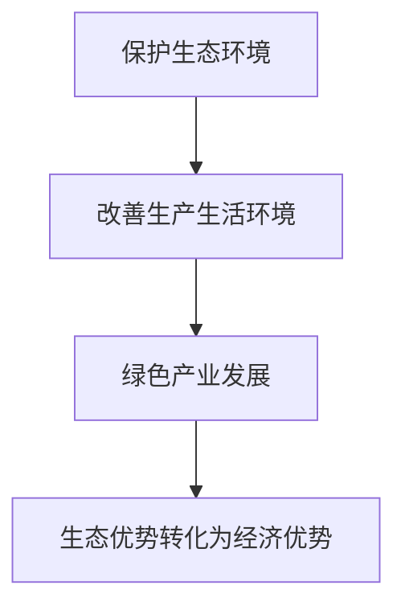
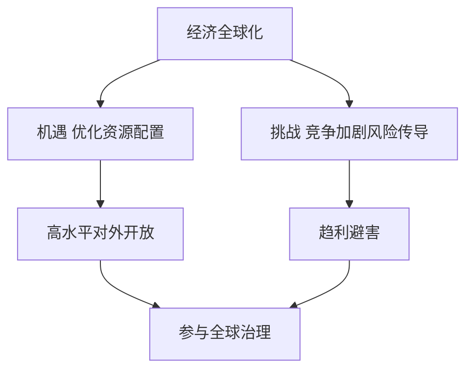

# 07 民生开放与全球治理 · 考研真题集（首经贸 801）

<a href="../../../exam.html" target="_blank" style="display:inline-block;padding:6px 16px;background:#2563eb;color:#fff;border-radius:6px;text-decoration:none;font-size:14px;">📝 开始做题</a>

> 本章共收录：简答题 10 道（每题 15 分）｜论述题 4 道（每题 30 分）
> 配套选择题见 [[选择题集|本章选择题集]]
> 对应大纲：马工程《马克思主义政治经济学概论》第十四章（生态文明）、第十五章（民生保障）、第十六章（对外开放）、第十七至十八章（经济全球化与全球治理）

## 📋 本题集目录

### 简答题
1. [[#简答 1：如何理解"绿水青山就是金山银山"的经济学内涵|如何理解"绿水青山就是金山银山"的经济学内涵]]
2. [[#简答 2：简述碳达峰与碳中和的含义及相互关系|简述碳达峰与碳中和的含义及相互关系]]
3. [[#简答 3：为什么说保护生态环境就是保护生产力、改善生态环境就是发展生产力|为什么说保护生态环境就是保护生产力、改善生态环境就是发展生产力]]
4. [[#简答 4：简述我国社会保障体系的构成及其目标|简述我国社会保障体系的构成及其目标]]
5. [[#简答 5：如何理解社会保障是共同富裕的"安全网"和"稳定器"|如何理解社会保障是共同富裕的"安全网"和"稳定器"]]
6. [[#简答 6：简述社会保险与商业保险的区别与联系|简述社会保险与商业保险的区别与联系]]
7. [[#简答 7：简述新时代我国推进制度型对外开放的内涵|简述新时代我国推进制度型对外开放的内涵]]
8. [[#简答 8：如何理解"一带一路"不是新殖民主义，而是共商共建共享的国际合作平台|如何理解"一带一路"不是新殖民主义，而是共商共建共享的国际合作平台]]
9. [[#简答 9：简述经济全球化的历史必然性与当前遭遇的逆流|简述经济全球化的历史必然性与当前遭遇的逆流]]
10. [[#简答 10：简述人类命运共同体理念的科学内涵|简述人类命运共同体理念的科学内涵]]

### 论述题
1. [[#论述 1：结合碳达峰碳中和目标，论述绿色发展与高质量发展的内在统一|结合碳达峰碳中和目标，论述绿色发展与高质量发展的内在统一]]
2. [[#论述 2：结合人口老龄化，论述我国多层次社会保障体系建设的必要性与路径|结合人口老龄化，论述我国多层次社会保障体系建设的必要性与路径]]
3. [[#论述 3：结合 RCEP 生效与"一带一路"提出十周年，论述高水平对外开放与新发展格局的关系|结合 RCEP 生效与"一带一路"提出十周年，论述高水平对外开放与新发展格局的关系]]
4. [[#论述 4：在经济全球化遭遇逆流、中美博弈加剧的背景下，分析中国为什么仍要推动构建人类命运共同体|在经济全球化遭遇逆流、中美博弈加剧的背景下，分析中国为什么仍要推动构建人类命运共同体]]

---

## 一、简答题（每题 15 分，建议 450–700 字）

### 简答 1：如何理解"绿水青山就是金山银山"的经济学内涵

**【建议字数】450–700 字 ｜ 【建议时间】15 分钟 ｜ 【题型】概念简答**

**【考什么】** 对应知识点 [[知识点/KP01_生态文明与绿色发展|生态文明与绿色发展]]，对应大纲第十四章；题型属于概念简答。

**【核心推导】**
**第一步：先给"两山"的原文与三层含义**

$$ \text{绿水青山就是金山银山} = \text{生态价值} + \text{经济价值} + \text{两者的转化机制} $$

2005 年 8 月习近平同志在浙江安吉余村提出。**这句话不是环保口号，而是对"生态—经济"关系的经济学判断。**

**第二步：第一层——生态环境是"生产要素"，不是"外部条件"**

$$ Y = F(K, L, E) \qquad E = \text{生态与环境要素} $$

- 传统增长函数只写资本与劳动，把环境当作无限免费；
- 实际上环境提供三类投入：**资源投入**（矿产、水、土地）、**消纳功能**（吸收污染）、**舒适性服务**（景观、气候、康养）；
- 环境质量下降 → 这三类投入的边际产出下降 → 增长受限，说明环境是生产要素。

**第三步：第二层——环境是"自然资本"，需要保值增值**

$$ \text{自然资本} = \text{可再生资源存量} + \text{不可再生资源存量} + \text{环境容量} $$

- 与物质资本一样，自然资本可以折旧（森林砍伐、土壤退化、水污染），也可以投资（植树造林、治理修复）；
- **只看 GDP 不看自然资本折旧，等于"卖掉家产当收入"**；
- 绿色 GDP、生态系统生产总值（GEP）核算就是为了修正这个缺陷：浙江丽水、深圳盐田等地已开展 GEP 核算。

**第四步：第三层——"两山"转化的四条路径（这是最核心的得分点）**

**(一) 生态产业化**

$$ \text{生态资源} \to \text{生态产品} \to \text{市场价值} $$

- 生态旅游、康养、林下经济、有机农业、碳汇交易；
- 安吉余村：关停矿山后发展旅游，2023 年村集体经济收入超千万元。

**(二) 产业生态化**

$$ \text{传统产业} \to \text{绿色化改造} \Rightarrow \text{降低单位产出的资源消耗} $$

- 绿色制造、循环经济、清洁生产；
- 我国单位 GDP 能耗持续下降。

**(三) 生态产品价值实现机制**

$$ \text{生态产品} \xrightarrow{\text{确权—核算—交易}} \text{货币收入} $$

- 生态补偿（新安江流域跨省补偿、长江上下游补偿）；
- 碳汇交易（CCER 重启）、排污权交易、用水权交易；
- 生态产品"度量难、抵押难、交易难、变现难"四难是核心障碍，需靠确权与核算制度破解。

**(四) 生态修复的投资属性**

$$ \text{修复投入} \to \text{环境改善} \to \text{资产增值} \to \text{收益回收} $$

- 矿山修复后土地增值、河道治理带动周边地价；
- EOD 模式（生态环境导向的开发）把修复与产业打包。

**第五步：反面论证——"用绿水青山换金山银山"为什么会失败**

$$ \text{先污染后治理} \Rightarrow \text{治理成本} > \text{污染收益} $$

- 环境库兹涅茨曲线（倒 U 型）不是必然规律，很多国家在拐点前已丧失修复能力；
- 污染的健康成本、治理成本往往超过短期增长收益；
- **"宁要绿水青山，不要金山银山"是底线表述，"两山"是目标表述，三者是递进关系**（既要、又要、还要）。

**第六步：结论**

"绿水青山就是金山银山"的经济学内涵有三层：一是生态环境是生产要素而非外部条件，提供资源投入、消纳功能与舒适性服务三类投入；二是环境是自然资本，会折旧也会增值，只看 GDP 不计自然资本折旧等于"卖家产换收入"，需 GEP 核算修正；三是生态与经济可以相互转化，转化有四条路径——生态产业化、产业生态化、生态产品价值实现机制（确权、核算、交易，破解"四难"）、生态修复的投资属性（EOD 模式）。三者关系"既要绿水青山，也要金山银山；宁要绿水青山，不要金山银山；绿水青山就是金山银山"是递进而非并列。**一句话：环境不是增长的代价，而是增长的资本——不懂这个，就会把本金当利息花掉。**

**【为什么要答这几点】**
**【满分 15 分的分点逻辑】**

**第一段：出处与定位（2 分）**
2005 年安吉余村；不是环保口号而是经济学判断。

**第二段：环境是生产要素（3 分）**
$Y=F(K,L,E)$；三类投入（资源、消纳、舒适性）。

**第三段：环境是自然资本（3 分）**
可折旧也可投资；绿色 GDP 与 GEP 核算；"卖家产换收入"。

**第四段：四条转化路径（5 分）**
生态产业化（安吉旅游）、产业生态化、生态产品价值实现（补偿、碳汇、"四难"）、生态修复的投资属性（EOD）。

**第五段：反面论证与三者递进（2 分）**
先污染后治理不经济；"既要—宁要—就是"的递进关系。

**易失分点（五条）**
1. 只讲生态保护重要性，不讲经济学内涵（价值、资本、转化）。
2. 不指出环境是生产要素或自然资本。
3. 不提 GEP、绿色 GDP 等核算工具。
4. 只讲一个转化路径，不全面。
5. 把"宁要绿水青山不要金山银山"与"两山"混为一谈，不辨递进关系。

**加分点（五条）**
1. 用生产函数把环境纳入投入，理论化程度高。
2. 提出"自然资本折旧"与"卖家产换收入"的类比，形象准确。
3. 引安吉余村、新安江补偿、CCER、EOD 等具体案例。
4. 指出生态产品"度量难、抵押难、交易难、变现难"四难，问题意识强。
5. 辨析"既要—宁要—就是"三句的递进关系，理解到位。

**【阅卷心理】**
判卷老师主要看两处：**是否从经济学角度（要素、资本、价值实现）展开**；**是否给出转化路径**。这两处做到，13 分以上。
记忆金句：**环境不是增长的代价，而是增长的资本。**

**【如何分析题目】**
**第一步：审题，抓"经济学内涵"**
不能写成环保宣传，必须用经济学语言（要素、资本、价值、外部性）。

**第二步：写出处与定位**
一句话交代背景，明确这不是口号。

**第三步：三层展开**
生产要素 → 自然资本 → 价值转化，层层递进。

**第四步：重点写转化路径**
四条路径是全题重心，每条给机制与案例。

**第五步：写核算工具**
绿色 GDP、GEP，体现专业度。

**第六步：反面论证**
先污染后治理不经济，增强论证力。

**第七步：辨析三句关系**
"既要—宁要—就是"的递进，避免简单化。

**第八步：字数与时间控制**
15 分约 650–800 字，建议 15 分钟：出处 2 分钟、三层内涵 6 分钟、四条路径 5 分钟、反面与辨析 2 分钟。时间紧时先保四条转化路径。

**【答题框架】**
- 第 1 段：命题提出与含义（3 分）
- 第 2 段：绿水青山为什么能变成金山银山（6 分）
- 第 3 段：反对两种错误倾向（4 分）
- 第 4 段：现实意义（2 分）

**【参考答案】**

一、命题提出。"绿水青山就是金山银山"是习近平生态文明思想的核心命题，最早于 2005 年在浙江湖州安吉余村提出。它打破了把生态保护与经济发展对立起来的传统观念。

二、经济学内涵。（一）生态环境本身就是有价值的资产。清新的空气、清洁的水源、良好的生态，可以提供生态产品、生态旅游、绿色农业等经济产出。安吉余村从开矿卖石头转向办农家乐、白茶产业，村民收入反而超过开矿时期。（二）保护生态环境可以减少治理成本。先污染后治理的代价极高——工业污染造成的医疗支出、环境修复费用，往往远超当年的税收和利润。（三）绿色产业本身就是新的经济增长点。光伏、风电、新能源汽车、储能、碳汇交易等绿色产业，正在成为中国经济新的支柱产业。（四）良好生态是最公平的公共产品，是最普惠的民生福祉。

三、反对两种错误倾向。（一）反对"先污染后治理"：以牺牲环境为代价换取一时增长，最终要付出更大代价。（二）反对"生态中心主义"：不吃饭、不发展单纯保护环境也是行不通的，关键是在发展中保护、在保护中发展。

四、现实意义。这一命题为正确处理经济发展与生态保护关系提供了理论指导，是新发展理念中绿色发展的通俗表达。

**【解析·得分点】** 采分点：①生态产品本身有价值（3分）；②减少治理成本+绿色产业新增长点（6分）；③反对先污染后治理和极端环保主义（4分）；④最公平公共品、最普惠民生福祉（2分）。容易丢分：只喊口号不展开经济学逻辑，或把"两山论"答成"保护环境就不能发展经济"。

**【生活实例】** 像一个小区：以前物业把花坛铲了建停车场（短期收益），结果蚊子多、房价跌；后来恢复绿化、搞口袋公园，房价涨了、租客也愿意付钱——好环境本身就是收益。

**【双链接】** 🔗 [[知识点/KP01_生态文明与绿色发展|回知识点]] ｜ 🔗 [[../06_社会主义市场经济与发展/知识点/KP02_新发展理念与高质量发展|新发展理念]] ｜ 📖 [[../../../原文件/经济学/马克思主义政治经济学概论_全书|《概论》第十四章]]

---

### 简答 2：简述碳达峰与碳中和的含义及相互关系

**【建议字数】450–700 字 ｜ 【建议时间】15 分钟 ｜ 【题型】关系对比**

**【考什么】** 对应知识点 [[知识点/KP01_生态文明与绿色发展|生态文明与绿色发展]]，对应大纲第十四章；题型属于概念简答。

**【核心推导】**
**第一步：先给两个定义**

$$ \text{碳达峰}:\ \text{CO}_2\ \text{年排放量达到历史最高值后进入平台期并开始下降} $$
$$ \text{碳中和}:\ \text{人为排放量与人为移除量相互抵消，净排放为零} $$

**中国目标：2030 年前碳达峰、2060 年前碳中和（"双碳"目标，2020 年 9 月联合国大会提出）。**

**第二步：两者的区别——一个是"拐点"，一个是"平衡点"**

| 维度 | 碳达峰 | 碳中和 |
|---|---|---|
| 含义 | 排放量由增转降的拐点 | 净排放等于零 |
| 性质 | 过程性、阶段性节点 | 终局性、目标性状态 |
| 判断标准 | 达峰后不再反弹 | 净零（排放 − 吸收 = 0） |
| 时间 | 2030 年前 | 2060 年前 |
| 难度 | 相对可控 | 极难，需深度脱碳 |

**碳达峰不等于碳中和，但碳达峰是碳中和的必经阶段；达峰时间越早、峰值越低，碳中和越容易。**

**第三步：两者的联系——同一条路径上的两个节点**

$$ \text{碳达峰} \to \text{平台期} \to \text{快速下降期} \to \text{深度脱碳期} \to \text{碳中和} $$

- 达峰是"刹车点"：停止增量扩张；
- 中和是"归零点"：存量排放要全部被吸收或替代；
- **中间的时间长度决定减排斜率**：中国从达峰到中和只有 30 年，欧美普遍有 50–70 年（欧盟 1990 年达峰、2050 年中和），**这意味着中国的减排曲线必须更陡。**

**第四步：中国的挑战——"三个高"**

**(一) 排放总量高**

$$ \text{2023 年排放约 } 105\ \text{亿吨} \approx \text{全球 } 30\% $$

**(二) 煤炭占比高**

$$ \text{煤炭在一次能源中约占 } 55\% \quad (\text{全球平均约 } 27\%) $$

**(三) 发展阶段与时间窗口紧**

$$ \text{人均 GDP } 1.3\ \text{万美元} \Rightarrow \text{仍在工业化城镇化中后期} $$

欧美达峰时已基本完成工业化，中国是"未富先减"——发展与减排的双重压力并存。

**第五步：实现路径——"1+N"政策体系**

| 维度 | 主要措施 |
|---|---|
| 能源 | 新能源替代（风电光伏装机全球第一）、煤电"三改联动" |
| 产业 | 钢铁水泥电解铝纳入碳市场（2024 年扩围）、遏制"两高"项目 |
| 技术 | 储能、氢能、CCUS（碳捕集利用与封存） |
| 市场 | 全国碳市场（2021 年 7 月上线，2257 家→扩围）、CCER 重启 |
| 生态 | 森林碳汇、湿地保护（提升吸收能力） |
| 制度 | 碳排放统计核算、碳足迹管理、绿色金融 |

**第六步：防范两个误区**

$$ \text{"运动式减碳"} \neq \text{"双碳目标"} \qquad \text{"一刀切"} \neq \text{"有序转型"} $$

- **不能"毕其功于一役"**：能源安全是底线，必须先立后破；
- **不能"碳冲锋"**：2021 年部分地区拉闸限电的教训；
- **要"先立后破"**：新能源的安全可靠替代要先到位，再退出传统能源；
- 中央明确"双碳目标"要纳入生态文明建设整体布局，但要"梯次有序"。

**第七步：结论**

碳达峰是二氧化碳年排放量达到历史最高值后进入平台期并开始下降的拐点（我国目标 2030 年前），碳中和是人为排放与人为移除相互抵消、净排放为零的状态（我国目标 2060 年前）。二者区别在于一个是过程性节点、一个是终局性状态，判断标准分别是"不再反弹"与"净零"；联系在于碳达峰是碳中和的必经阶段，达峰越早、峰值越低，中和越容易。中国面临的特殊挑战是排放总量高（约 105 亿吨、占全球 30%）、煤炭占比高（约 55%）、从达峰到中和只有 30 年（欧美有 50–70 年），路径是"1+N"政策体系，原则是"先立后破"。**一句话：达峰是刹车，中和是归零——中国只有 30 年，所以油门和刹车必须同时精准。**

**【为什么要答这几点】**
**【满分 15 分的分点逻辑】**

**第一段：两个定义与目标时间（3 分）**
碳达峰（拐点）、碳中和（净零）；2030/2060。

**第二段：区别（4 分）**
五行对照表（含义、性质、判断标准、时间、难度）。

**第三段：联系（3 分）**
同一条路径的两个节点；30 年 vs 欧美 50–70 年。

**第四段：中国挑战（3 分）**
三个高（排放 105 亿吨占 30%、煤炭 55%、未富先减）。

**第五段：路径与误区（2 分）**
"1+N"体系 + 先立后破 + 反对运动式减碳。

**易失分点（五条）**
1. 把碳达峰与碳中和混为一谈。
2. 只说"2030/2060"不解释含义。
3. 不讲二者关系（必经阶段），只做并列对比。
4. 不引数据（105 亿吨、30%、55%、30 年 vs 50–70 年）。
5. 不提"先立后破"与运动式减碳的教训。

**加分点（五条）**
1. 用"刹车点—归零点"的比喻讲清区别。
2. 用"中国 30 年 vs 欧美 50–70 年"说明减排斜率差异，洞察力强。
3. 指出"未富先减"这一中国特殊性。
4. 引全国碳市场、CCER、CCUS 等具体工具。
5. 明确反对"碳冲锋""一刀切"，政策分寸准确。

**【阅卷心理】**
判卷老师主要看两处：**是否讲清区别与联系**；**是否有中国国情的具体数据**。这两处做到，13 分以上。
记忆金句：**达峰是刹车，中和是归零——中国只有 30 年，所以油门和刹车必须同时精准。**

**【如何分析题目】**
**第一步：审题，抓"含义"与"相互关系"**
两者都要写，重点是关系。

**第二步：给定义**
两个精确定义 + 两个时间点。

**第三步：列表讲区别**
五行对照最清晰。

**第四步：讲联系**
用"路径上的两个节点"把二者串起来。

**第五步：写中国特殊性**
三个高 + 时间窗口窄，这是本题的深度所在。

**第六步：写路径**
"1+N"体系，按能源、产业、技术、市场、生态、制度六维。

**第七步：写误区**
先立后破、反对运动式减碳。

**第八步：字数与时间控制**
15 分约 650–800 字，建议 15 分钟：定义 3 分钟、区别 4 分钟、联系 3 分钟、挑战与路径 4 分钟、误区与收尾 1 分钟。时间紧时先保区别表与"30 年 vs 50–70 年"。

**【答题框架】**
- 第 1 段：双碳目标的提出（2 分）
- 第 2 段：碳达峰含义（4 分）
- 第 3 段：碳中和含义（4 分）
- 第 4 段：二者关系（5 分）

**【参考答案】**

一、提出。2020 年 9 月，习近平总书记在第七十五届联合国大会一般性辩论上宣布：中国将提高国家自主贡献力度，采取更加有力的政策和措施，二氧化碳排放力争于 2030 年前达到峰值，努力争取 2060 年前实现碳中和。这就是"双碳目标"。

二、碳达峰的含义。碳达峰是指二氧化碳排放量达到历史最高值后，经历平台期进入持续下降的过程，是二氧化碳排放量由增转降的历史拐点。达峰之后，碳排放总量不再增长。我国承诺 2030 年前实现碳达峰。

三、碳中和的含义。碳中和是指人类活动排放的二氧化碳，通过技术减排、能源替代、碳汇吸收（植树造林、海洋吸收）、碳捕集利用与封存（CCUS）等方式，实现排放与吸收相互抵消，净排放为零。我国承诺 2060 年前实现碳中和。

四、二者关系。（一）碳达峰是碳中和的前提和基础：只有先达峰，才能谈中和；达峰越早、峰值越低，碳中和的难度就越小。（二）碳中和是碳达峰的必然趋势和最终目标：达峰不是终点，而是为中和创造条件。（三）我国从达峰到中和只有 30 年，比发达国家（一般 50-70 年）时间更紧、任务更难，必须付出艰苦努力。（四）双碳不是"运动式减碳"，要坚持"全国统筹、节约优先、双轮驱动、内外畅通、防范风险"原则，先立后破。

**【解析·得分点】** 采分点：①2030 碳达峰、2060 碳中和两个时间点必须准确（2分）；②达峰=排放由增转降拐点（4分）；③中和=排放等于吸收、净零（4分）；④达峰是基础、中和是目标、我国时间更紧（5分）。容易丢分：把碳中和答成"完全不排放"，实际上是净零排放，仍允许一定排放由碳汇抵消。

**【生活实例】** 像一个家庭记账：碳达峰就是"开支不再增加"的那个月，碳中和就是"这个月花多少、赚多少刚好抵消"。先控制住开支不再涨，再慢慢做到收支平衡。

**【双链接】** 🔗 [[知识点/KP01_生态文明与绿色发展|回知识点]] ｜ 📖 [[../../../原文件/经济学/马克思主义政治经济学概论_全书|《概论》第十四章]]

---

### 简答 3：为什么说保护生态环境就是保护生产力、改善生态环境就是发展生产力

**【建议字数】450–700 字 ｜ 【建议时间】15 分钟 ｜ 【题型】原因分析**

**【考什么】** 对应知识点 [[知识点/KP01_生态文明与绿色发展|生态文明与绿色发展]]，对应大纲第十四章；题型属于原因分析。

**【核心推导】**
**第一步：先破题——这句话把"生态"从"约束"改写成"生产力"**

$$ \text{传统认知}:\ \text{环境} = \text{增长的代价} \qquad \text{新认知}:\ \text{环境} = \text{生产力的构成要素} $$

生产力三要素是劳动者、劳动资料、劳动对象。**生态环境同时作用于这三者**，这就是"保护生态环境就是保护生产力"的落点。

**第二步：从劳动对象看——生态环境本身就是被加工的对象**

$$ \text{土地、森林、水域、矿产、气候} \subset \text{劳动对象} $$

- 农业依赖土壤肥力与气候条件，渔业依赖水域生态；
- 生态退化直接减少可用劳动对象的数量与质量；
- 例：土壤污染治理成本远高于预防成本，"先污染"等于毁掉劳动对象。

**第三步：从劳动资料看——生态提供基础设施性条件**

$$ \text{清洁水源、稳定气候、生态屏障} = \text{广义劳动资料} $$

- 水利、气候调节、病虫害控制都是"自然提供的免费服务"；
- 一旦破坏，就要用人工设施替代（如净水厂替代自然净化），**成本由社会承担**；
- 例：长江禁渔是恢复渔业资源这一劳动对象，属生产力修复。

**第四步：从劳动者看——环境质量即人力资本**

$$ \text{健康} \subset \text{人力资本} \qquad \text{污染} \to \text{健康损失} \to \text{劳动生产率下降} $$

- 空气污染导致的呼吸系统疾病直接降低劳动时间与效率；
- 生态环境优美的地区对人才有吸引力（"环境引才"）；
- 世卫组织测算：环境风险因素导致的疾病负担占比可观。

**第五步：从"改善生态就是发展生产力"看——新增生产力的路径**

$$ \text{生态修复} \to \text{新产业} \to \text{新生产力} $$

- **生态产业化**：生态旅游、康养、林下经济、碳汇；
- **产业生态化**：绿色制造降低单位产出资源消耗，等同于提高生产率；
- **新赛道**：我国新能源汽车产销量占全球 60% 以上、光伏组件产能占全球 80% 以上——**绿色转型本身就是新质生产力的重要来源**；
- 例：塞罕坝从荒漠到林场，既改善生态又带动旅游与林产业。

**第六步：反面论证——破坏生态如何破坏生产力**

$$ \text{生态破坏} \to \text{治理成本} + \text{健康损失} + \text{机会成本} > \text{短期收益} $$

- 滇池治理投入数百亿元仍未恢复原状，远超当年环湖开发的收益；
- 一些资源枯竭型城市面临产业空心化；
- 环境库兹涅茨曲线的"拐点"并非自动到来，很多地区在拐点前已失去修复能力。

**第七步：结论**

"保护生态环境就是保护生产力、改善生态环境就是发展生产力"，其理论落点在于生态环境同时作用于生产力三要素：作为劳动对象（土地、水域、矿产、气候），生态环境退化直接减少可用对象；作为广义劳动资料（清洁水源、稳定气候、生态屏障），破坏后需用人工设施替代，成本由社会承担；作为劳动者健康这一人力资本，污染直接降低劳动生产率。改善生态则通过生态产业化、产业生态化与绿色新赛道增加生产力——新能源汽车占全球 60%、光伏组件占全球 80% 即是证明。**一句话：环境不是生产的外围，而是生产的前提——毁掉它要花更多钱修，修好了它自己会生钱。**

**【为什么要答这几点】**
**【满分 15 分的分点逻辑】**

**第一段：破题（2 分）**
从"约束"到"要素"的认知转换；落到生产力三要素。

**第二段：劳动对象（3 分）**
土地、森林、水域、矿产、气候；土壤污染治理成本高于预防。

**第三段：劳动资料（3 分）**
清洁水源、稳定气候、生态屏障；破坏后需人工替代，成本社会化。

**第四段：劳动者（3 分）**
健康即人力资本；污染降低劳动生产率；环境引才。

**第五段：改善生态新增生产力（3 分）**
生态产业化、产业生态化、绿色新赛道（新能源车 60%、光伏 80%）。

**第六段：反面论证（1 分）**
滇池治理、资源枯竭型城市。

**易失分点（五条）**
1. 只讲重要性，不落到生产力三要素，理论挂不上。
2. 不区分"保护"与"改善"两个动词（前者是维持存量，后者是增加增量）。
3. 不引数据与案例。
4. 把生态与生产力写成对立，无法自圆其说。
5. 漏掉绿色产业本身即新质生产力这一当代最强论据。

**加分点（五条）**
1. 用生产力三要素逐一对应，结构严密。
2. 指出"破坏后用人工设施替代"这一成本社会化机制。
3. 提出健康即人力资本，把环境与人力资本理论打通。
4. 引新能源车 60%、光伏 80% 的数据说明绿色即生产力。
5. 引滇池治理数百亿元的反例，论证有力。

**【阅卷心理】**
判卷老师主要看两处：**是否用生产力三要素搭骨架**；**是否有正反两面论证**。这两处做到，13 分以上。
记忆金句：**环境不是生产的外围，而是生产的前提。**

**【如何分析题目】**
**第一步：审题，抓"就是"二字**
"就是"意味着等同关系，必须论证环境属于生产力范畴。

**第二步：先给破题**
从"代价"到"要素"的认知转换。

**第三步：用生产力三要素展开**
劳动对象、劳动资料、劳动者各一段，这是骨架。

**第四步：写"改善生态"的增量**
生态产业化、产业生态化、绿色新赛道。

**第五步：反面论证**
破坏生态的成本账，增强说服力。

**第六步：补案例与数据**
塞罕坝、滇池、新能源车 60%、光伏 80%。

**第七步：注意两个动词**
"保护"是守住存量，"改善"是做大增量。

**第八步：字数与时间控制**
15 分约 650–800 字，建议 15 分钟：破题 2 分钟、三要素 8 分钟、改善路径 3 分钟、反面与收尾 2 分钟。时间紧时先保三要素与绿色产业两条。

**【答题框架】**
- 第 1 段：命题含义（3 分）
- 第 2 段：传统生产力观的局限（4 分）
- 第 3 段：生态作为生产要素（5 分）
- 第 4 段：绿色生产力（3 分）

**【参考答案】**

一、命题含义。马克思主义认为，劳动和自然界一起构成财富的源泉。自然界不仅是劳动的"食堂"，也是劳动的"工具箱"。保护和改善生态环境，本质上是在保护和发展生产力本身。

二、传统生产力观的局限。传统观念把生产力只理解为人改造自然的能力，把自然当作无偿的原料库和垃圾桶。这种生产力观忽视了自然对生产力的承载能力，结果是：土壤退化、水源枯竭、空气污染，反而削弱了长期生产力。

三、生态作为生产要素。（一）劳动力要素：清洁空气和水源减少疾病，提高劳动者健康水平和劳动生产率。（二）资源要素：土地、水、矿产、能源是生产的投入品，破坏它们就是破坏生产条件。（三）资本要素：良好生态本身就是有价值的资产，可以通过碳汇、生态补偿、生态旅游转化为经济收益。（四）技术要素：绿色技术（光伏、储能、新能源车）正在成为新的生产力。

四、绿色生产力。新时代的生产力是"绿色生产力"——它不再以掠夺自然为代价，而是通过技术进步提高资源利用效率，实现人与自然和谐共生。我国光伏组件产量占全球 80% 以上、新能源汽车产销量连续多年世界第一，就是绿色生产力发展的生动证明。

**【解析·得分点】** 采分点：①自然界是财富源泉（马克思原话精神）（3分）；②传统生产力观的局限（4分）；③劳动力、资源、资本、技术四要素与生态关系（5分）；④绿色生产力+光伏新能源车案例（3分）。容易丢分：只重复命题不展开，或把"保护生态"答成"限制生产"。

**【生活实例】** 像一块农田：拼命施肥打农药，第一年亩产高，第三年土壤板结减产——这是破坏生产力。养地、轮作、有机肥，虽然短期产量不最高，但长期地力稳定、持续高产——这是保护和发展生产力。

**【双链接】** 🔗 [[知识点/KP01_生态文明与绿色发展|回知识点]] ｜ 📖 [[../../../原文件/经济学/马克思主义政治经济学概论_全书|《概论》第十四章]]

---

### 简答 4：简述我国社会保障体系的构成及其目标

**【建议字数】450–700 字 ｜ 【建议时间】15 分钟 ｜ 【题型】概念简答**

**【考什么】** 对应知识点 [[知识点/KP02_社会保障体系|社会保障体系]]，对应大纲第十五章；题型属于概念简答。

**【核心推导】**
**第一步：先给社会保障体系的完整构成**

$$ \text{社会保障} = \text{社会保险} + \text{社会救助} + \text{社会福利} + \text{社会优抚} + \text{补充保障} $$

**其中社会保险是核心（占基金支出 70% 以上），社会救助是底线，社会福利是提升，社会优抚是特殊保障。**

**第二步：分层——"五层结构"**

| 层次 | 项目 | 功能 | 资金来源 |
|---|---|---|---|
| 第一层（兜底） | 社会救助（低保、特困、临时救助、医疗救助） | 保基本生存 | 财政为主 |
| 第二层（核心） | 社会保险（养老、医疗、失业、工伤、生育） | 风险分担 | 单位 + 个人 + 财政补贴 |
| 第三层（提升） | 社会福利（老年人、儿童、残疾人福利、教育医疗公共服务） | 提高生活质量 | 财政 + 社会 |
| 第四层（特殊） | 社会优抚（军人及军烈属） | 国家责任 | 财政 |
| 第五层（补充） | 企业年金、职业年金、商业保险、个人养老金 | 多层次补充 | 单位 + 个人 |

**第三步：社会保险五个险种的分述**

$$ \text{养老} + \text{医疗} + \text{失业} + \text{工伤} + \text{生育} $$

- **养老保险**：职工基本养老保险（现收现付 + 个人账户）、城乡居民基本养老保险；
- **医疗保险**：职工医保、城乡居民医保（覆盖 13.6 亿人，参保率稳定在 95% 以上）；
- **失业保险**：缴费满一年、非因本人意愿中断就业可领取；
- **工伤保险**：用人单位缴费、个人不缴费；
- **生育保险**：已与职工医保合并实施（2019 年）。

**第四步：核心制度参数与改革**

$$ \text{全国统筹（2022 年养老保险）} + \text{门诊共济（2021 年）} + \text{个人养老金（2022 年）} $$

- 养老保险全国统筹：解决地区间基金不平衡（东北缺口 vs 广东结余）；
- 医保门诊共济：把个人账户的一部分转为门诊统筹，提高互助共济性；
- 个人养老金：每年 1.2 万元限额，税收递延，属第三支柱；
- 延迟退休：2025 年起渐进式实施。

**第五步：目标——"覆盖全民、统筹城乡、公平统一、安全规范、可持续"**

$$ \text{五句话} = \text{广度} + \text{结构} + \text{公平} + \text{安全} + \text{时间维度} $$

- **覆盖全民**：应保尽保（目标是把灵活就业人员、新业态从业者纳入）；
- **统筹城乡**：破除城乡二元（城乡居民与职工制度并轨方向）；
- **公平统一**：制度统一、标准统一、经办统一；
- **安全规范**：基金监管、打击骗保；
- **可持续**：应对老龄化，多支柱、延迟退休、全国统筹、划转国资充实社保（已划转国有资本约 1.68 万亿元）。

**第六步：现存问题**

| 问题 | 表现 |
|---|---|
| 老龄化压力 | 职工养老保险抚养比下降，部分省份当期收不抵支 |
| 制度碎片化 | 职工与居民、机关事业与企业历史差异 |
| 多层次不足 | 第一支柱独大，第二、三支柱占比低 |
| 灵活就业覆盖难 | 平台骑手、网约车司机参保率低 |
| 待遇差距 | 城乡、区域、群体间待遇差异 |

**第七步：结论**

我国社会保障体系由社会保险（养老、医疗、失业、工伤、生育五项，是核心）、社会救助（低保、特困、临时救助、医疗救助，是底线）、社会福利（老幼病残福利与公共服务，是提升）、社会优抚（军人军属，是国家责任）以及补充保障（企业年金、职业年金、商业保险、个人养老金）构成，呈"兜底—核心—提升—特殊—补充"五层结构。目标是"覆盖全民、统筹城乡、公平统一、安全规范、可持续"。当前主要问题是老龄化压力、制度碎片化、多层次发展不足、灵活就业覆盖难、待遇差距，改革方向是养老保险全国统筹、医保门诊共济、发展第三支柱个人养老金、渐进式延迟退休、划转国有资本充实社保基金。**一句话：社保体系是一张"五层网"——最底层防坠落，最上层提质量，中间层最费钱也最要紧。**

**【为什么要答这几点】**
**【满分 15 分的分点逻辑】**

**第一段：总构成（3 分）**
五大板块；社保是核心、救助是底线。

**第二段：五层结构表（3 分）**
层次、项目、功能、资金来源四列。

**第三段：五个险种（3 分）**
养老、医疗、失业、工伤、生育，各一句话讲解。

**第四段：核心改革（2 分）**
全国统筹、门诊共济、个人养老金、延迟退休、划转国资。

**第五段：目标五句话（2 分）**
覆盖全民、统筹城乡、公平统一、安全规范、可持续。

**第六段：现存问题（2 分）**
老龄化、碎片化、多层次不足、灵活就业、待遇差距。

**易失分点（五条）**
1. 只写"五险"，漏掉救助、福利、优抚（这是最常见的失分）。
2. 不区分社会保险与社会救助的功能差异。
3. 目标五句话背不全。
4. 不引制度进展（全国统筹 2022 年、个人养老金 2022 年）。
5. 不提多层次（三支柱）结构。

**加分点（五条）**
1. 用"五层网"的结构化表达，层次清晰。
2. 引 13.6 亿人参保、国有资本划转 1.68 万亿元等数据。
3. 指出"第一支柱独大、第二三支柱占比低"这一结构性问题。
4. 提到灵活就业人员参保难，切中当下。
5. 用"最底层防坠落、最上层提质量"的比喻便于记忆。

**【阅卷心理】**
判卷老师主要看两处：**构成是否完整（不只五险）**；**目标五句话是否写全**。这两处做到，13 分以上。
记忆金句：**社保是一张五层网——底层防坠落，上层提质量，中间层最费钱也最要紧。**

**【如何分析题目】**
**第一步：审题，抓"构成"与"目标"两个要求**
两半都要写，构成要全，目标要准。

**第二步：先给总构成**
五大板块，一句话交代各板块定位。

**第三步：列表展开**
五层结构表最高效。

**第四步：写五个险种**
每个一两句话，重点是差异（谁缴费、覆盖谁）。

**第五步：写改革进展**
全国统筹、门诊共济、个人养老金、延迟退休。

**第六步：背准目标五句话**
覆盖全民、统筹城乡、公平统一、安全规范、可持续。

**第七步：补问题**
五条问题让答案有现实感。

**第八步：字数与时间控制**
15 分约 650–800 字，建议 15 分钟：总构成 3 分钟、表格 3 分钟、五险 3 分钟、改革与目标 4 分钟、问题 2 分钟。时间紧时先保五层结构与目标五句话。

**【答题框架】**
- 第 1 段：社会保障的定义（2 分）
- 第 2 段：体系构成（8 分）
- 第 3 段：目标（3 分）
- 第 4 段：现实意义（2 分）

**【参考答案】**

一、定义。社会保障体系是指国家通过立法和国民收入再分配，对社会成员在年老、疾病、失业、工伤、生育、遭受灾害、面临生活困难时给予物质帮助，保障其基本生活需要的制度安排。

二、体系构成。我国社会保障体系主要包括：（一）社会保险：是体系的核心部分，包括基本养老保险、基本医疗保险、失业保险、工伤保险、生育保险五项。（二）社会救助：是兜底部分，包括最低生活保障、特困人员救助供养、受灾人员救助、医疗救助、教育救助、住房救助、就业救助、临时救助等。（三）社会福利：是高层次部分，包括老年人福利、残疾人福利、儿童福利等。（四）社会优抚：面向军人、退役军人及家属的特殊保障。（五）住房保障：包括公租房、保障性租赁住房、共有产权房等。（六）补充保障：包括企业年金、职业年金、商业健康保险、慈善事业等。

三、目标。党的二十大提出，要建成"覆盖全民、统筹城乡、公平统一、安全规范、可持续"的多层次社会保障体系。

四、现实意义。社会保障是民生安全网、社会稳定器，与人民幸福安康息息相关，是实现共同富裕的重要制度安排。

**【解析·得分点】** 采分点：①五险（养老、医疗、失业、工伤、生育）（4分）；②社会救助、社会福利、社会优抚、住房保障（4分）；③"覆盖全民、统筹城乡、公平统一、安全规范、可持续"五句话目标（3分）；④安全网、稳定器定位（2分）。容易丢分：把"社会保险"等同于"社会保障"，漏了救助、福利、优抚等层次；或把目标五句话记错。

**【生活实例】** 像一栋楼的消防系统：社保是自动喷淋（核心、人人有），社会救助是灭火器（兜底），社会福利是绿化和健身房（高层次），优抚是退伍军人的专项服务。

**【双链接】** 🔗 [[知识点/KP02_社会保障体系|回知识点]] ｜ 📖 [[../../../原文件/经济学/马克思主义政治经济学概论_全书|《概论》第十五章]]

---

### 简答 5：如何理解社会保障是共同富裕的"安全网"和"稳定器"

**【建议字数】450–700 字 ｜ 【建议时间】15 分钟 ｜ 【题型】影响结果**

**【考什么】** 对应知识点 [[知识点/KP02_社会保障体系|社会保障体系]]，对应大纲第十五章；题型属于原因分析。

**【核心推导】**
**第一步：先破题——"安全网"与"稳定器"是两个不同功能的比喻**

$$ \text{安全网} = \text{兜底功能（微观）} \qquad \text{稳定器} = \text{缓冲功能（宏观）} $$

**两者合起来构成社会保障在共同富裕中的双重角色：既防止跌落，也熨平波动。**

**第二步："安全网"的含义——三层兜底机制**

**(一) 收入中断的兜底**

$$ \text{失业、疾病、工伤、年老} \Rightarrow \text{收入中断} \Rightarrow \text{社保给付替代} $$

- 失业保险替代部分工资，避免劳动者在失业期陷入贫困；
- 医保报销避免"因病致贫、因病返贫"——这是农村贫困最主要的成因之一；
- 养老保险避免老年贫困。

**(二) 贫困线的兜底**

$$ \text{低保} + \text{特困供养} + \text{临时救助} = \text{最后一道防线} $$

- 低保标准与物价挂钩联动；
- 脱贫攻坚中"社会保障兜底一批"是"五个一批"之一，近 2000 万贫困人口纳入低保与特困供养。

**(三) 风险社会化的机制**

$$ \text{个体风险} \xrightarrow{\text{大数法则}} \text{社会分担} $$

- 保险的本质是风险池：少数人的大额损失由多数人的小额缴费分摊；
- 这是社保优于个人储蓄的根本原因——**储蓄只能应对确定性支出，保险才能应对不确定性风险**。

**第三步："稳定器"的含义——两条宏观机制**

**(一) 自动稳定器：经济下行时支出增加、上行时支出减少**

$$ Y \downarrow \Rightarrow \text{失业增加} \Rightarrow \text{失业金支出} \uparrow \Rightarrow \text{消费跌幅被缓冲} $$

- 社保支出具有逆周期性，天然起缓冲作用；
- 相当于财政的"自动稳定器"，不需决策即可发挥作用。

**(二) 消费基础的重塑：降低预防性储蓄**

$$ \text{社保完善} \Rightarrow \text{预防性储蓄} \downarrow \Rightarrow \text{消费率} \uparrow $$

- 我国居民消费率约 38%，低于全球平均约 58%，重要原因之一是预防性储蓄高（为养老、医疗、教育存钱）；
- 居民存款 2022–2024 年新增超 50 万亿元，其中相当部分是预防性储蓄；
- **社保越完善，居民越敢花钱**——这是社会保障对扩大内需的深层作用。

**第四步：与共同富裕的关系——三条连接线**

| 连接线 | 机制 |
|---|---|
| 机会公平 | 医保、教育、社保均等化→人力资本积累→向上流动 |
| 结果调节 | 养老金、低保的再分配功能（社保是二次分配的主要工具） |
| 底线保障 | 防止因病、因老、因灾返贫，巩固脱贫成果 |

$$ \text{共同富裕} = \text{做大蛋糕（发展）} + \text{分好蛋糕（分配）} + \text{守住底线（社保）} $$

**第五步：现实短板**

$$ \text{待遇差距} + \text{统筹层次} + \text{可持续性} $$

- 城乡、区域、群体间待遇差异明显（职工养老金与居民养老金差距数倍）；
- 老龄化使抚养比下降，部分省份基金当期收不抵支；
- 灵活就业人员、平台从业者参保率低，安全网存在"漏洞"。

**第六步：结论**

社会保障是共同富裕的"安全网"和"稳定器"，两个比喻对应两种功能。"安全网"是微观兜底：通过失业保险、医保、养老保险应对收入中断，通过低保、特困供养、临时救助守住贫困线，通过大数法则实现风险社会化——这是社保优于个人储蓄的根本原因。"稳定器"是宏观缓冲：社保支出具有逆周期性，经济下行时自动增加支出缓冲消费跌幅；更重要的是它降低预防性储蓄，我国居民消费率约 38%、居民存款近年新增超 50 万亿元，社保完善是扩大内需的深层条件。它与共同富裕的三条连接线是机会公平、结果调节、底线保障。**一句话：安全网接住掉下来的人，稳定器让整个社会不至于大起大落。**

**【为什么要答这几点】**
**【满分 15 分的分点逻辑】**

**第一段：破题（2 分）**
两个比喻对应两种功能：微观兜底 vs 宏观缓冲。

**第二段：安全网三层（5 分）**
收入中断兜底（失业、医疗、养老）；贫困线兜底（低保、特困、临时救助、兜底一批近 2000 万人）；风险社会化（大数法则，优于个人储蓄）。

**第三段：稳定器两条（4 分）**
自动稳定器（逆周期支出）；降低预防性储蓄（消费率 38% vs 全球 58%、存款新增 50 万亿）。

**第四段：与共同富裕三条连接线（3 分）**
机会公平、结果调节、底线保障。

**第五段：现实短板（1 分）**
待遇差距、统筹层次、可持续性、灵活就业覆盖。

**易失分点（五条）**
1. 只解释"安全网"，不讲"稳定器"的宏观机制。
2. 不区分微观兜底与宏观缓冲两种功能。
3. 不用"逆周期""预防性储蓄"等经济学概念，答案偏宣传。
4. 不引数据（消费率、存款、兜底人口）。
5. 不提短板，答案变成纯赞美。

**加分点（五条）**
1. 用"接住掉下来的人"与"不大起大落"分别对应两个比喻。
2. 指出储蓄只能应对确定性支出、保险才能应对不确定性风险，理论清晰。
3. 把社保与扩大内需联系起来（预防性储蓄→消费率），视野开阔。
4. 引"社会保障兜底一批"与近 2000 万人的政策事实。
5. 三条连接线（机会公平、结果调节、底线保障）结构工整。

**【阅卷心理】**
判卷老师主要看两处：**两个比喻是否各有对应机制**；**是否用经济学概念（逆周期、预防性储蓄、大数法则）而非口号**。这两处做到，13 分以上。
记忆金句：**安全网接住掉下来的人，稳定器让整个社会不至于大起大落。**

**【如何分析题目】**
**第一步：审题，抓两个比喻**
"安全网"与"稳定器"必须分别论述，不能混着写。

**第二步：先破题**
一句话给两个比喻的功能定位。

**第三步：写安全网三层**
收入中断、贫困线、风险社会化。

**第四步：写稳定器两条**
自动稳定器 + 预防性储蓄。

**第五步：连接共同富裕**
三条连接线，落到分好蛋糕与守住底线。

**第六步：写短板**
三条问题加灵活就业覆盖。

**第七步：用经济学概念**
大数法则、逆周期、预防性储蓄、边际消费倾向。

**第八步：字数与时间控制**
15 分约 650–800 字，建议 15 分钟：破题 2 分钟、安全网 5 分钟、稳定器 4 分钟、连接线 3 分钟、短板与收尾 1 分钟。时间紧时先保两个比喻的对应机制。

**【答题框架】**
- 第 1 段：总起（3 分）
- 第 2 段：为什么是"安全网"（6 分）
- 第 3 段：为什么是"稳定器"（4 分）
- 第 4 段：与共同富裕的关系（2 分）

**【参考答案】**

一、总起。社会保障通过国民收入再分配，为社会成员提供基本生活保障，既是市场经济的"安全网"，又是社会运行的"稳定器"，也是走向共同富裕的重要制度基础。

二、为什么是"安全网"。市场经济按要素分配，必然带来收入差距。个人面临生老病死、失业、灾害等风险，如果没有兜底，一部分人可能因一次疾病、一次失业就陷入贫困。社会保障的作用是：（一）基本养老保险保障劳动者退休后有收入；（二）基本医疗保险减轻大病医疗负担；（三）失业保险为暂时失业者提供过渡；（四）最低生活保障为绝对贫困者兜底。脱贫攻坚战中，社保兜底是"两不愁三保障"的重要内容，数千万贫困人口因此摆脱绝对贫困。

三、为什么是"稳定器"。（一）社会保障具有自动稳定器功能：经济下行时，失业金、低保支出自动增加，支撑消费；经济过热时，这些支出自动减少，抑制总需求。（二）完善的社保减少了居民的预防性储蓄，有利于扩大消费、拉动内需。（三）社会保障缓解了社会矛盾，避免了贫富分化引发的冲突。

四、与共同富裕的关系。共同富裕不是平均主义，而是在保障基本权利公平的基础上，允许合理差距。社会保障通过再分配，让发展成果更多更公平惠及全体人民，是共同富裕的底线制度安排。

**【解析·得分点】** 采分点：①社保覆盖的五类风险（老、病、失业、工伤、贫困）（6分）；②自动稳定器+预防性储蓄减少+社会矛盾缓解（4分）；③共同富裕不是平均主义（2分）；④社保兜底脱贫案例（3分）。容易丢分：只讲"帮助穷人"，漏了社保对宏观经济自动稳定器的作用。

**【生活实例】** 像走钢丝的人下面那张网：不是替他走，而是他万一失手不至于摔死。有了这张网，他敢走更难的路（敢消费、敢创业）。

**【双链接】** 🔗 [[知识点/KP02_社会保障体系|回知识点]] ｜ 📖 [[../../../原文件/经济学/马克思主义政治经济学概论_全书|《概论》第十五章]]

---

### 简答 6：简述社会保险与商业保险的区别与联系

**【建议字数】450–700 字 ｜ 【建议时间】15 分钟 ｜ 【题型】关系对比**

**【考什么】** 对应知识点 [[知识点/KP02_社会保障体系|社会保障体系]]，对应大纲第十五章；题型属于关系对比。

**【核心推导】**
**第一步：先给一句话区别**

$$ \text{社会保险} = \text{强制} + \text{保基本} + \text{政府主导} \qquad \text{商业保险} = \text{自愿} + \text{多层次} + \text{市场经营} $$

**两者不是替代关系，而是"基础保障 + 补充保障"的层次关系。**

**第二步：五个维度的区别**

| 维度 | 社会保险 | 商业保险 |
|---|---|---|
| 性质 | 公共品/准公共品，政府主导 | 私人产品，市场经营 |
| 参保 | 强制（法定） | 自愿（合同） |
| 目的 | 保障基本生活、维护公平 | 营利，兼顾风险转移 |
| 资金来源 | 单位 + 个人缴费 + 财政补贴 | 保费（投保人） |
| 待遇确定 | 法定标准，与工资/缴费挂钩 | 合同约定，与保费挂钩 |
| 经营主体 | 政府及其经办机构 | 保险公司 |
| 风险承担 | 国家信用兜底 | 保险公司（破产有限保障） |

**第三步：社会保险的强制性依据**

$$ \text{逆向选择与道德风险} \Rightarrow \text{自愿参保无法覆盖高风险人群} $$

- **逆向选择**：健康人不愿参保、病人愿意参保，风险池恶化，保费上升，最终市场崩溃（"死亡螺旋"）；
- **道德风险**：参保后过度使用医疗服务；
- **强制参保是破解逆向选择的制度设计**：把所有人强制纳入同一个池子，风险才能充分分散；
- 这正是社会保险与商业保险最根本的差别——**商业保险无法解决逆向选择，只能筛选客户。**

**第四步：商业保险的不可替代性**

$$ \text{社保保基本} + \text{商保补高端} = \text{多层次保障} $$

- 社保有"封顶线"，超出部分需商保或个人承担；
- 重疾险、医疗险覆盖社保目录外的药品与治疗；
- 商业养老险、年金险是第三支柱的重要组成部分（个人养老金每年 1.2 万元限额可购买商保产品）；
- **我国第一支柱独大，第二、三支柱占比低**，发展商业保险是完善多层次体系的关键。

**第五步：两者的联系——互补、衔接、协同**

**(一) 保障范围互补**

$$ \text{社保}:\ \text{广覆盖、低水平} \qquad \text{商保}:\ \text{选择性、高水平} $$

**(二) 制度衔接**

- 大病保险（社保框架内，由商业保险机构承办）是典型衔接：政府主导、商业运作；
- 长期护理保险试点中也引入商业保险机构经办。

**(三) 数据与经办协同**

- 医保部门与商保公司信息共享（在保护隐私前提下）便于精算与理赔；
- 经办服务社会化（政府购买服务）。

**第六步：结论**

社会保险与商业保险的区别体现在五个维度：性质上社保是政府主导的准公共品、商保是市场经营的私人产品；参保上社保强制、商保自愿；目的上社保保基本维护公平、商保营利并提供风险转移；资金来源上社保由单位、个人缴费与财政补贴共同承担、商保由保费承担；待遇上社保法定、商保合同约定。根本差别在于社保通过强制参保破解逆向选择，而商业保险只能筛选客户。两者的联系是互补与衔接：社保广覆盖低水平、商保选择性高水平；大病保险是"政府主导 + 商业运作"的典型衔接；个人养老金可购买商保产品，是第三支柱的组成部分。**一句话：社保是地基，商保是加层——地基必须人人有，加层按需自己买。**

**【为什么要答这几点】**
**【满分 15 分的分点逻辑】**

**第一段：一句话区别（2 分）**
强制/保基本/政府主导 vs 自愿/多层次/市场经营。

**第二段：五维区别表（4 分）**
性质、参保、目的、资金、待遇（可加经营主体与风险承担）。

**第三段：强制的理论依据（3 分）**
逆向选择与道德风险；自愿参保导致死亡螺旋；强制参保是制度设计。

**第四段：商保的不可替代性（3 分）**
封顶线以上、目录外药品、第三支柱；我国第一支柱独大。

**第五段：联系三条（2 分）**
范围互补、制度衔接（大病保险）、数据与经办协同。

**第六段：收尾（1 分）**
"地基与加层"的比喻。

**易失分点（五条）**
1. 只写区别不写联系（题干要求"区别与联系"）。
2. 不解释社会保险为什么强制，只写"国家规定"。
3. 不提逆向选择这一核心理论依据。
4. 漏掉大病保险这一"政府主导 + 商业运作"的衔接案例。
5. 不联系我国多层次体系（第一支柱独大）的现实。

**加分点（五条）**
1. 用逆向选择与死亡螺旋说明强制的必要性，理论深度足。
2. 引个人养老金每年 1.2 万元限额与商保产品，政策熟悉。
3. 指出商业保险"只能筛选客户"这一根本局限。
4. 用"地基与加层"的比喻清晰易懂。
5. 提到数据共享与经办社会化，视角新。

**【阅卷心理】**
判卷老师主要看两处：**区别是否分维度清晰**；**是否讲到联系（尤其大病保险）**。这两处做到，13 分以上。
记忆金句：**社保是地基，商保是加层——地基必须人人有，加层按需自己买。**

**【如何分析题目】**
**第一步：审题，抓"区别与联系"**
两块都要写，只写区别会丢 3 分左右。

**第二步：先给一句话区别**
三个关键词对三个关键词，开场立住。

**第三步：列五维表**
性质、参保、目的、资金、待遇。

**第四步：讲强制的理论依据**
逆向选择 + 道德风险 + 死亡螺旋，这是拉开差距的地方。

**第五步：写商保的不可替代性**
封顶线、目录外、第三支柱。

**第六步：写联系**
互补、衔接（大病保险）、协同。

**第七步：补我国现实**
第一支柱独大、第二三支柱不足。

**第八步：字数与时间控制**
15 分约 650–800 字，建议 15 分钟：区别 8 分钟、强制依据 3 分钟、联系 3 分钟、收尾 1 分钟。时间紧时先保五维表与逆向选择。

**【答题框架】**
- 第 1 段：总起（2 分）
- 第 2 段：区别（8 分）
- 第 3 段：联系（3 分）
- 第 4 段：多层次体系（2 分）

**【参考答案】**

一、总起。社会保险和商业保险都是风险分散机制，但二者在性质、目标、运行方式上有本质区别，又相互补充。

二、区别。（一）性质不同：社会保险是国家通过立法强制实施的社会保障制度，具有强制性、公益性；商业保险是保险公司按市场原则经营的金融产品，具有自愿性、营利性。（二）目标不同：社会保险以保障基本生活、促进社会公平为目标，不以盈利为目的；商业保险以利润最大化为目标。（三）资金来源不同：社会保险由国家、单位、个人三方共同缴费，财政兜底；商业保险完全由投保人缴费。（四）保障对象不同：社会保险覆盖全体公民，强调人人享有；商业保险面向有购买能力的人，按合同赔付。（五）保障水平不同：社会保险保障基本生活需要，"保基本"；商业保险可提供较高水平的补充保障。

三、联系。（一）二者都是风险分散机制，通过大数法则集聚资金补偿损失。（二）社会保险是第一道防线，商业保险是补充。（三）我国鼓励发展商业健康保险、年金保险，作为多层次社会保障体系的组成部分。

四、多层次体系。我国正在构建"三支柱"养老保险体系：第一支柱是基本养老保险（国家强制）；第二支柱是企业年金、职业年金（单位补充）；第三支柱是个人养老金和商业养老保险（个人自愿）。

**【解析·得分点】** 采分点：①强制 vs 自愿、公益 vs 盈利、三方缴费 vs 个人缴费、保基本 vs 较高水平（8分）；②三支柱养老保险体系（3分）；③不能互相替代（2分）。容易丢分：把二者混为一谈，或认为商业保险可以取代社保。

**【生活实例】** 像小区里的安保：社保是物业强制配的保安（谁都有、保基本），商业保险是你自己请的私人保镖（花钱买、服务更好但贵）。

**【双链接】** 🔗 [[知识点/KP02_社会保障体系|回知识点]] ｜ 📖 [[../../../原文件/经济学/马克思主义政治经济学概论_全书|《概论》第十五章]]

---

### 简答 7：简述新时代我国推进制度型对外开放的内涵

**【建议字数】450–700 字 ｜ 【建议时间】15 分钟 ｜ 【题型】概念简答**

**【考什么】** 对应知识点 [[知识点/KP03_对外开放|对外开放]]，对应大纲第十六章；题型属于概念简答。

**【核心推导】**
**第一步：先给定义——制度型开放是"开放什么"的升级**

$$ \text{商品要素流动型开放} \to \text{规则、规制、管理、标准开放} $$

传统开放是"让货物、资金、人员进出更便利"；制度型开放是"让规则本身与国际高标准对接"。**前者降低边境上的成本，后者降低边境后的成本。**

**第二步：内涵的四个维度**

| 维度 | 内容 | 例 |
|---|---|---|
| 规则 | 与国际经贸规则对接 | 自贸试验区先行先试 CPTPP 条款 |
| 规制 | 国内监管制度透明、可预期 | 负面清单、公平竞争审查 |
| 管理 | 政府管理方式改革 | "单一窗口"、证照分离 |
| 标准 | 技术、环保、劳工等标准互认 | 认证认可互认、绿色标准 |

$$ \text{边境措施（关税、配额）} \to \text{边境后措施（规则、标准、监管）} $$

**第三步：为什么必须升级——三重动因**

**(一) 全球化规则正在重构**

$$ \text{CPTPP} + \text{RCEP} + \text{USMCA} \Rightarrow \text{高标准规则竞争} $$

- CPTPP 涵盖国有企业、数字贸易、劳工、环境等"边境后"议题；
- 不参与规则制定，就只能被动接受规则，"卡脖子"从技术延伸到规则。

**(二) 我国比较优势已转换**

$$ \text{劳动力成本优势} \to \text{制度成本优势} $$

- 过去靠低成本劳动力吸引外资，现在要靠可预期的制度环境；
- 外资关注的不只是税率，还有知识产权保护、数据跨境、争端解决。

**(三) 加入高水平协定的自身需要**

$$ \text{申请加入 CPTPP} \Rightarrow \text{必须对标高标准规则} $$

**第四步：具体举措**

$$ \text{自贸试验区} + \text{海南自贸港} + \text{RCEP} + \text{外资准入负面清单} $$

- 自贸试验区（2013 年起，已设立 22 个）累计形成数百项制度创新成果并向全国复制推广；
- 海南自贸港 2025 年底前实现封关运作；
- RCEP 2022 年生效，区域贸易占比上升；
- 外资准入负面清单持续缩减，制造业外资准入限制全面取消（2024 年，自贸试验区负面清单制造业条目已清零）；
- 服务业开放试点（电信、医疗、教育等领域扩大开放）。

**第五步：与"安全"的关系**

$$ \text{扩大开放} + \text{风险防控} = \text{高水平开放的完整含义} $$

- 制度型开放不等于放弃监管：数据安全法、个人信息保护法、外商投资安全审查都是配套；
- "放得开"与"管得住"必须同时具备。

**第六步：结论**

新时代推进制度型对外开放的内涵，是从商品要素流动型开放转向规则、规制、管理、标准的开放，即从"边境措施"走向"边境后措施"，包括与国际经贸规则对接（规则）、国内监管透明可预期（规制）、政府管理方式改革（管理）、技术环保劳工标准互认（标准）四个维度。升级的三重动因是：全球化规则正在重构（CPTPP 涵盖国有企业、数字贸易、劳工环境等边境后议题）、我国比较优势从劳动力成本转向制度成本、以及申请加入 CPTPP 的自身需要。具体举措是自贸试验区、海南自贸港封关、"外资准入负面清单"持续缩减、制造业外资准入限制全面取消（2024 年）、服务业扩大开放试点。**一句话：过去的开放是"把门开大"，现在的开放是"把屋里的规矩也理顺"。**

**【为什么要答这几点】**
**【满分 15 分的分点逻辑】**

**第一段：定义升级（2 分）**
从商品要素流动型到规则规制管理标准；"边境措施→边境后措施"。

**第二段：四个维度（4 分）**
规则、规制、管理、标准各一句话加例证。

**第三段：三重动因（5 分）**
规则重构（CPTPP 边境后议题）、比较优势转换（制度成本）、申请加入 CPTPP 的需要。

**第四段：具体举措（3 分）**
自贸试验区、海南封关、RCEP、负面清单、制造业外资限制取消、服务业试点。

**第五段：与安全的关系（1 分）**
放得开与管得住。

**易失分点（五条）**
1. 把制度型开放等同于"扩大开放"或"降低关税"。
2. 不讲"边境措施→边境后措施"这一核心转变。
3. 四个维度只背词不展开。
4. 不引自贸试验区、海南自贸港、RCEP 等具体载体。
5. 只讲开放不讲风险防控，显得单向。

**加分点（五条）**
1. 用"边境措施—边境后措施"的区分，专业性强。
2. 指出"不参与规则制定就只能被动接受规则"，战略判断到位。
3. 提 2024 年制造业外资准入限制全面取消，政策熟悉。
4. 提申请加入 CPTPP 这一主动对标事项。
5. 用"把门开大"与"把屋里规矩理顺"的比喻，形象好记。

**【阅卷心理】**
判卷老师主要看两处：**是否讲清"升级"在哪（边境后措施）**；**是否有具体载体与举措**。这两处做到，13 分以上。
记忆金句：**过去的开放是把门开大，现在的开放是把屋里的规矩也理顺。**

**【如何分析题目】**
**第一步：审题，抓"制度型"三字**
重点是"制度"，不是"开放"的一般意义。

**第二步：给升级定义**
从商品要素流动型到规则规制管理标准。

**第三步：补一句关键区分**
边境措施 vs 边境后措施，全题的理论支点。

**第四步：写四个维度**
每个维度配一个例子。

**第五步：写三重动因**
规则重构、优势转换、自身需要。

**第六步：写具体举措**
载体 + 制度 + 时间点。

**第七步：写风险防控**
数据安全、安全审查，体现完整性。

**第八步：字数与时间控制**
15 分约 650–800 字，建议 15 分钟：定义 3 分钟、四维度 4 分钟、动因 5 分钟、举措与安全 3 分钟。时间紧时先保"边境后措施"与四维度。

**【答题框架】**
- 第 1 段：从商品要素流动型开放到制度型开放（4 分）
- 第 2 段：制度型开放的内涵（6 分）
- 第 3 段：主要举措（3 分）
- 第 4 段：意义（2 分）

**【参考答案】**

一、开放的两个阶段。我国对外开放经历了两个阶段：第一阶段是"商品和要素流动型开放"，主要表现为关税减让、吸引外资、发展加工贸易，以边境开放为主；进入新时代，我国对外开放进入"制度型开放"新阶段，以规则、规制、管理、标准等制度层面的开放为主。

二、制度型开放的内涵。（一）主动对接国际高标准经贸规则：在知识产权保护、竞争政策、国有企业、补贴、劳工标准、环境标准、数字贸易等领域，参照国际高水平协定推进国内改革。（二）推动由商品和要素流动型开放向规则等制度型开放转变：不仅要"打开国门"，还要"打通制度"。（三）在开放中提升国内治理水平：通过加入高标准协定，倒逼国内市场化改革。（四）积极参与国际经贸规则制定：从规则接受者转向规则参与者、塑造者。

三、主要举措。（一）自贸试验区和自贸港试点：上海、广东等 21 个自贸试验区，海南自贸港封关运作。（二）进博会、服贸会、广交会等平台。（三）RCEP 生效实施，积极申请加入 CPTPP、DEPA。（四）出台《外商投资准入负面清单》《外商投资法》，落实准入后国民待遇。

四、意义。制度型开放是我国推动高水平对外开放的标志，有利于在逆全球化背景下，以开放促改革、促发展，为构建新发展格局提供有力支撑。

**【解析·得分点】** 采分点：①商品要素流动型 vs 制度型开放的区分（4分）；②规则、规制、管理、标准四个词必须写全（6分）；③自贸试验区、海南自贸港、RCEP 三个抓手（3分）；④从规则接受者到塑造者（2分）。容易丢分：把制度型开放答成"多开几个自贸区"，没理解它是规则层面的开放。

**【生活实例】** 像加入一个社团：以前是交学费、参加活动（要素流动型）；现在是按社团章程修改自己的行为规则、甚至参与制定章程（制度型）。开放不再是"开门做生意"，而是"按共同规则办事"。

**【双链接】** 🔗 [[知识点/KP03_对外开放|回知识点]] ｜ 🔗 [[../06_社会主义市场经济与发展/知识点/KP03_新发展格局|新发展格局]] ｜ 📖 [[../../../原文件/经济学/马克思主义政治经济学概论_全书|《概论》第十六章]]

---

### 简答 8：如何理解"一带一路"不是新殖民主义，而是共商共建共享的国际合作平台

**【建议字数】450–700 字 ｜ 【建议时间】15 分钟 ｜ 【题型】关系对比**

**【考什么】** 对应知识点 [[知识点/KP03_对外开放|对外开放]] 与 [[知识点/KP04_经济全球化与全球治理|全球治理]]，对应大纲第十六、十八章；题型属于关系对比。

**【核心推导】**
**第一步：先给"新殖民主义"的判据——四个特征**

$$ \text{新殖民主义} = \text{政治控制} + \text{资源掠夺} + \text{不平等交换} + \text{附加政治条件} $$

**判断一个国际合作平台是不是新殖民主义，就看这四条是否成立。逐条对照"一带一路"，四条都不成立。**

**第二步：第一判据——政治控制：共商而非主导**

$$ \text{共商共建共享} \qquad \text{一国一票、平等协商} $$

- "一带一路"没有设立超国家机构，不要求成员国让渡主权；
- 项目由东道国提出、双方协商确定，不是单方面规划；
- 对比：历史上的殖民体系有总督、驻军、治外法权，"一带一路"一概没有。

**第三步：第二判据——资源掠夺：贸易而非攫取**

$$ \text{资源合作} = \text{市场交易} \ne \text{无偿攫取} $$

- 中国进口能源矿产按国际市场价格交易，不是低价征用；
- 同时帮助资源国建设加工能力（如印尼镍矿下游产业链），推动产业升级而非固化其原料出口地位；
- 对比：殖民时代是"只挖矿不建厂"。

**第四步：第三判据——平等交换：不附加政治条件**

$$ \text{西方援助}:\ \text{资金} + \text{政治条件} \qquad \text{一带一路}:\ \text{资金} + \text{项目} $$

- 西方官方发展援助常附带治理改革、人权、私有化等条件；
- "一带一路"强调不干涉内政、不附加政治条件；
- 这是发展中国家普遍欢迎的原因，也是西方批评的焦点（指责"标准低"）——**需要在"不附加条件"与"债务可持续、环境社会治理标准"之间取得平衡。**

**第五步：第四判据——互利共赢：基础设施的公共品属性**

$$ \text{基础设施} = \text{公共品，具有强正外部性} $$

- 中老铁路通车后老挝由"陆锁国"变"陆联国"，物流成本显著下降；
- 雅万高铁是东南亚首条高铁；
- 比雷埃夫斯港、瓜达尔港改善了当地就业与物流；
- **基础设施投资的经济社会回报远超项目本身的财务回报**，这正是"共商共建共享"的经济基础。

**第六步：客观回应三种质疑**

| 质疑 | 回应 |
|---|---|
| "债务陷阱外交" | 中国贷款在部分国家外债中占比不高，多国债务主要来自多边机构与私人债权人；且中方已参与 G20 缓债倡议 |
| "标准低、不透明" | 已发布《"一带一路"廉洁之路》等规范，推行公开招标；但仍需提高透明度 |
| "地缘扩张" | 无军事基地、无驻军；合作以经济为主 |

**辩证态度：不能否认存在个别项目风险评估不足、环境社会影响考虑不周的问题——正视问题才能回应对质疑，但个别问题不改变整体性质。**

**第七步：结论**

判断"一带一路"不是新殖民主义，可通过四个判据逐条检验：一是政治控制——"一带一路"坚持共商共建共享，不设超国家机构、不要求让渡主权、无驻军与治外法权；二是资源掠夺——能源矿产按国际市场价格交易，并帮助资源国建设加工能力推动产业升级；三是平等交换——不附加政治条件，与西方附带治理改革、人权条件的援助形成对比；四是互利共赢——基础设施具有强正外部性，中老铁路、雅万高铁、比雷埃夫斯港带来的是物流成本下降与就业增加。它是共商共建共享的国际合作平台，因为其治理结构是平等协商、其收益分配是双向的。同时要正视个别项目风险评估不足的问题。**一句话：殖民者留下的是总督和铁路，中国留下的是铁路和合同——走不走，东道国自己决定。**

**【为什么要答这几点】**
**【满分 15 分的分点逻辑】**

**第一段：四判据（3 分）**
政治控制、资源掠夺、不平等交换、附加政治条件——先给可检验的标准。

**第二段：逐条对照（6 分，每条 1.5 分）**
共商共建共享（无超国家机构、无驻军）；市场交易（印尼镍矿下游产业链）；不附加政治条件；基础设施正外部性（中老铁路、雅万高铁）。

**第三段：客观回应质疑（3 分）**
债务陷阱（贷款占比、G20 缓债）、标准透明、地缘扩张（无军事基地）。

**第四段：辩证态度（2 分）**
正视个别项目风险评估不足、环境社会影响考虑不周。

**第五段：收尾（1 分）**
"总督与铁路"的对比句。

**易失分点（五条）**
1. 只喊"不是新殖民主义"却不给判据，说服力弱。
2. 不引具体项目（中老铁路、雅万高铁、比雷埃夫斯港）。
3. 不敢正视问题，一味辩护，反而失分。
4. 不谈"债务陷阱"这一主要质疑，回避关键。
5. 不讲共商共建共享的具体含义（无超国家机构、不设条件）。

**加分点（五条）**
1. 用四条可检验判据，把价值判断变成事实核对。
2. 引印尼镍矿下游产业链，说明不是固化原料出口地位。
3. 引 G20 缓债倡议，回应债务质疑有据。
4. 主动承认标准与透明度仍需提高，显示客观性。
5. 收尾对比句形象有力，但须克制不做情绪化表述。

**【阅卷心理】**
判卷老师主要看两处：**是否给出判据并逐条对照**；**是否正视质疑而非一味辩护**。这两处做到，13 分以上。
记忆金句：**殖民者留下的是总督和铁路，中国留下的是铁路和合同。**

**【如何分析题目】**
**第一步：审题，抓"不是…而是…"**
须先给判据，再逐条核对，最后正面定性。

**第二步：给四条判据**
政治控制、资源掠夺、不平等交换、附加条件。

**第三步：逐条对照**
每条一句判断加一个事实或案例。

**第四步：正面写"共商共建共享"**
落到治理结构平等协商、收益分配双向。

**第五步：回应三种质疑**
债务、标准、地缘，各一句。

**第六步：补辩证**
承认个别项目问题，显得客观。

**第七步：用足案例**
中老铁路、雅万高铁、比雷埃夫斯港、印尼镍矿。

**第八步：字数与时间控制**
15 分约 650–800 字，建议 15 分钟：判据 3 分钟、四条对照 7 分钟、质疑 3 分钟、辩证与收尾 2 分钟。时间紧时先保四判据与逐条对照。

**【答题框架】**
- 第 1 段：提出与定位（3 分）
- 第 2 段：与新殖民主义的本质区别（6 分）
- 第 3 段：共商共建共享原则（4 分）
- 第 4 段：实践成果（2 分）

**【参考答案】**

一、提出与定位。"一带一路"倡议于 2013 年提出，到 2023 年已走过十年。它是在共商共建共享原则基础上，发展开放型世界经济的国际合作平台，不是中国一家的独奏，而是沿线国家的合唱。西方舆论将其污名为"新殖民主义"，这是对历史和现实的严重歪曲。

二、与新殖民主义的本质区别。（一）历史上的殖民主义：通过武力征服、不平等条约、资源掠夺、资本输出剥削殖民地，附加政治条件。（二）"一带一路"：①不干涉他国内政，不附加政治条件；②项目由各国自主提出、自愿参与；③合作基于平等互利，目的是帮助东道国改善基础设施、增加就业、促进发展。（三）典型项目：雅万高铁（印尼）、比雷埃夫斯港（希腊）、中老铁路、巴基斯坦中巴经济走廊，都为当地创造了大量就业和税收。

三、共商共建共享原则。（一）共商：有事大家商量着办，不是中国单方面说了算；（二）共建：各国共同参与项目建设，发挥各自比较优势；（三）共享：发展成果由各国人民共同分享。

四、实践成果。截至 2023 年，已有 150 多个国家、30 多个国际组织签署合作文件，形成 3000 多个合作项目，拉动近万亿美元投资规模，形成 3000 多个合作项目，为沿线国家创造 42 万个工作岗位，让近 4000 万人摆脱极端贫困。

**【解析·得分点】** 采分点：①新殖民主义=武力+不平等+掠夺（3分）；②一带一路=不干涉内政+自愿参与+平等互利（6分）；③共商共建共享三原则（4分）；④雅万高铁、中老铁路等案例（2分）。容易丢分：只喊口号"我们不是殖民主义"，没讲清区别在哪。

**【生活实例】** 像一个大学社团请其他学校合办比赛：不是强制拉人参加、把奖品全拿走，而是大家一起商量规则、各自出力、奖品和经验都分享。

**【双链接】** 🔗 [[知识点/KP03_对外开放|回知识点]] ｜ 🔗 [[知识点/KP04_经济全球化与全球治理|全球治理]] ｜ 📖 [[../../../原文件/经济学/马克思主义政治经济学概论_全书|《概论》第十六、十八章]]

---

### 简答 9：简述经济全球化的历史必然性与当前遭遇的逆流

**【建议字数】450–700 字 ｜ 【建议时间】15 分钟 ｜ 【题型】经济现象**

**【考什么】** 对应知识点 [[知识点/KP04_经济全球化与全球治理|经济全球化与全球治理]]，对应大纲第十七章；题型属于原因分析。

**【核心推导】**
**第一步：先给经济全球化的定义与动力机制**

$$ \text{经济全球化} = \text{生产、贸易、投资、金融、信息跨越国界的一体化} $$

**三大动力：**

$$ \text{技术进步（运输与通信成本下降）} + \text{制度变革（关税下降、规则统一）} + \text{资本逐利（寻找低成本区位）} $$

**第二步：历史必然性——为什么必然发生**

**(一) 技术基础：距离成本的大幅下降**

$$ \text{集装箱} + \text{互联网} \Rightarrow \text{可贸易性范围空前扩大} $$

- 集装箱使单位运输成本下降一个数量级；
- 互联网使服务可跨境交付（软件外包、数字服务）。

**(二) 经济基础：比较优势与规模经济**

$$ \text{分工} \to \text{专业化} \to \text{效率提升} $$

- 比较优势使各国专注于相对擅长环节，总产出增加；
- 规模经济要求市场半径足够大，全球化扩展了市场边界；
- **价值链片段化**（一件产品多国生产）是当代全球化的核心特征。

**(三) 制度基础：规则体系的确立**

$$ \text{GATT（1947）} \to \text{WTO（1995）} \Rightarrow \text{关税与非关税壁垒系统性下降} $$

- 全球平均关税从战后 40% 左右降至现在的 5% 以下。

**第三步：全球化的双重效应**

$$ \text{总效率} \uparrow \qquad \text{分配效应分化} $$

- **正面**：全球资源配置效率提升、技术扩散加快、发展中国家通过参与分工实现增长（东亚奇迹）；
- **负面**：收益分配不均（资本相对劳动占优）、部分国家和群体被边缘化、金融危机跨境传染、环境压力转移。

**第四步：当前遭遇的三重逆流**

**(一) 分配失衡引发的政治反弹**

$$ \text{发达国家中低收入群体受损} \Rightarrow \text{民粹主义与保护主义兴起} $$

- 制造业外迁导致"铁锈地带"失业；
- 2016 年以来贸易保护措施显著增加，2018 年中美贸易摩擦。

**(二) 安全逻辑压倒效率逻辑**

$$ \text{just-in-time} \to \text{just-in-case} \Rightarrow \text{供应链友岸化、近岸化} $$

- 芯片出口管制、投资审查、实体清单；
- "小院高墙"策略。

**(三) 全球治理失灵**

$$ \text{WTO 上诉机构停摆（2019 年）} \Rightarrow \text{多边规则弱化} $$

- 区域协定替代多边协定（RCEP、CPTPP、USMCA 并存）；
- 全球公共品供给不足（气候、公共卫生）。

**第五步：逆流是"全球化终结"还是"全球化重构"**

$$ \text{超全球化（hyper-globalization）} \to \text{慢全球化（slowbalization）} $$

- 货物贸易增速由长期高于 GDP 增速转为持平甚至更低；
- 但服务贸易、数字贸易、区域内部贸易仍在增长；
- **结论：全球化没有终结，而是形态在改变——从"效率优先的深度一体化"转向"效率与安全平衡的区域化重构"。**

**第六步：结论**

经济全球化具有历史必然性，其动力来自技术进步（集装箱与互联网大幅降低距离成本）、经济规律（比较优势与规模经济要求更大市场半径，形成价值链片段化）与制度保障（GATT—WTO 体系使全球平均关税从 40% 左右降至 5% 以下）。它的效应是双重的：总效率提升、技术扩散加快，但分配失衡、危机传染、环境压力转移。当前遭遇的三重逆流是分配失衡引发的政治反弹（民粹主义与保护主义、2018 年中美摩擦）、安全逻辑压倒效率逻辑（just-in-time 转向 just-in-case、友岸外包）、全球治理失灵（WTO 上诉机构 2019 年停摆、区域协定替代多边）。**一句话：全球化不会倒退到从前，但也不会再按老的剧本演——它正从"效率优先的深度一体化"变成"效率与安全平衡的区域化重构"。**

**【为什么要答这几点】**
**【满分 15 分的分点逻辑】**

**第一段：定义与三大动力（3 分）**
技术、制度、资本逐利。

**第二段：历史必然性三条（5 分）**
技术基础（集装箱与互联网）；经济基础（比较优势、规模经济、价值链片段化）；制度基础（GATT—WTO、关税 40%→5%）。

**第三段：双重效应（3 分）**
正面（效率、技术扩散、东亚奇迹）；负面（分配不均、危机传染、环境转移）。

**第四段：三重逆流（3 分）**
分配失衡的政治反弹（铁锈地带、2018 摩擦）；安全压倒效率（just-in-case、友岸外包）；治理失灵（WTO 停摆、区域协定替代）。

**第五段：定性判断（1 分）**
不是终结而是重构：超全球化→慢全球化。

**易失分点（五条）**
1. 只讲全球化的好处或只讲坏处，缺少双重效应。
2. 不讲"价值链片段化"这一当代全球化的核心特征。
3. 逆流只写"贸易保护主义"一条，不全面。
4. 不做定性判断（终结还是重构），答案没有落点。
5. 不引 WTO 上诉机构停摆、区域协定并存等制度事实。

**加分点（五条）**
1. 用"超全球化→慢全球化"这一学术概括，专业性强。
2. 引全球平均关税从 40% 降至 5% 以下的长期数据。
3. 指出逆流的根源是分配失衡而非单纯政治意愿，分析深一层。
4. 提出服务贸易与数字贸易仍在增长，避免"一边倒"结论。
5. 用"老剧本"的比喻收尾，兼顾准确与可读。

**【阅卷心理】**
判卷老师主要看两处：**必然性的论证是否成立（技术+经济+制度）**；**是否做出"重构而非终结"的定性**。这两处做到，13 分以上。
记忆金句：**全球化不会倒退到从前，但也不会再按老的剧本演。**

**【如何分析题目】**
**第一步：审题，抓"必然性"与"逆流"两半**
一半论证为什么必然，一半解释为什么受阻。

**第二步：先给定义与三大动力**
技术、制度、资本，一句话各自交代。

**第三步：写必然性三条**
技术基础、经济基础、制度基础，每条配一个关键事实。

**第四步：写双重效应**
正负各三条，保持平衡。

**第五步：写三重逆流**
分配、安全、治理，三条都要落到具体事件。

**第六步：做定性判断**
重构而非终结，指出形态变化。

**第七步：注意辩证**
既要承认逆流真实存在，也不夸大其程度。

**第八步：字数与时间控制**
15 分约 650–800 字，建议 15 分钟：定义 2 分钟、必然性 6 分钟、双重效应 3 分钟、逆流 3 分钟、定性 1 分钟。时间紧时先保必然性三条与三重逆流。

**【答题框架】**
- 第 1 段：经济全球化的定义（2 分）
- 第 2 段：历史必然性（6 分）
- 第 3 段：当前逆流的表现与原因（5 分）
- 第 4 段：中国立场（2 分）

**【参考答案】**

一、定义。经济全球化是指商品、服务、生产要素（资本、技术、劳动力）跨国流动规模不断扩大，国际分工不断深化，各国经济相互依存、相互联系日益加深的历史过程。

二、历史必然性。（一）马克思主义认为，生产力的发展必然冲破民族国家的壁垒。资产阶级"首次开创了世界历史"，因为它使每个文明国家以及这些国家中的每一个人的需要的满足都依赖于整个世界。（二）根本动力是社会分工和科技进步：交通运输、信息技术、互联网的发展，极大降低了跨境交易成本。（三）内在机制是比较优势：各国按比较优势参与国际分工，通过贸易增进福利。（四）经济全球化是生产力发展的客观要求，是历史潮流，不以人的意志为转移。

三、当前逆流的表现与原因。2008 年国际金融危机后，全球化进入调整期：（一）贸易保护主义抬头：美国加征关税、实施出口管制；（二）地缘政治冲突：俄乌冲突、中美战略竞争加剧；（三）产业链重构：友岸外包、近岸外包、中国+1；（四）英国脱欧、反全球化政治势力抬头。原因包括：全球化收益分配不均，发达国家内部产业空心化、中产阶级萎缩，民粹主义兴起；各国对供应链安全、技术竞争的考量上升。

四、中国立场。逆流不是全球化的终结，而是全球化进入新阶段。中国坚决反对逆全球化，主张建设开放型世界经济，推动全球化朝着更加开放、包容、普惠、平衡、共赢的方向发展。

**【解析·得分点】** 采分点：①马克思"世界历史"思想（2分）；②生产力+科技+比较优势三个动力（6分）；③贸易保护、产业链重构、地缘冲突三个逆流表现（5分）；④中国主张开放包容普惠平衡共赢（2分）。容易丢分：把全球化逆流答成"全球化失败"，忽略它是历史必然只是进入调整期。

**【生活实例】** 像大学宿舍：以前大家一起凑单买打印机、轮流带饭（全球化）；现在有人嫌"别人用得比我多"，开始各买各的（逆流）。但总还是比完全独立买便宜——逆流是暂时的，分工的好处不会消失。

**【双链接】** 🔗 [[知识点/KP04_经济全球化与全球治理|回知识点]] ｜ 📖 [[../../../原文件/经济学/马克思主义政治经济学概论_全书|《概论》第十七章]]

---

### 简答 10：简述人类命运共同体理念的科学内涵

**【建议字数】450–700 字 ｜ 【建议时间】15 分钟 ｜ 【题型】概念简答**

**【考什么】** 对应知识点 [[知识点/KP04_经济全球化与全球治理|经济全球化与全球治理]]，对应大纲第十八章；题型属于概念简答。

**【核心推导】**
**第一步：先给完整表述与提出背景**

$$ \text{人类命运共同体} = \text{持久和平} + \text{普遍安全} + \text{共同繁荣} + \text{开放包容} + \text{清洁美丽} $$

2013 年提出，2017 年写入联合国决议。**它回答的是"世界向何处去"这一根本问题。**

**第二步：五个维度的科学内涵**

| 维度 | 内涵 | 对应问题 |
|---|---|---|
| 持久和平 | 对话协商、结伴不结盟 | 战争与冲突 |
| 普遍安全 | 共同、综合、合作、可持续的安全观 | 传统与非传统安全 |
| 共同繁荣 | 开放型世界经济、反对保护主义 | 发展不平衡 |
| 开放包容 | 文明交流互鉴、不搞意识形态划线 | 文明冲突论 |
| 清洁美丽 | 人与自然生命共同体、双碳合作 | 气候变化 |

$$ \text{五个维度} = \text{政治} + \text{安全} + \text{经济} + \text{文化} + \text{生态} \quad \text{（五位一体）} $$

**第三步：理论内核——三个"共同体"的层次递进**

$$ \text{利益共同体} \to \text{责任共同体} \to \text{命运共同体} $$

- **利益共同体**：相互依赖带来共同利益（价值链、市场、能源）；
- **责任共同体**：共同应对全球性挑战（气候、公共卫生、反恐）；
- **命运共同体**：在利益与责任之上形成休戚与共的认同；
- **三层递进，一层比一层难，也一层比一层深。**

**第四步：与西方全球化叙事的根本差异**

| 维度 | 零和思维 | 命运共同体 |
|---|---|---|
| 国际关系 | 大国博弈、势力均衡 | 结伴不结盟、伙伴关系 |
| 秩序观 | 单极霸权或均势 | 多边主义、共商共建共享 |
| 发展观 | 你输我赢 | 合作共赢 |
| 安全观 | 绝对安全、军事同盟 | 共同综合合作可持续 |
| 文明观 | 文明冲突论 | 交流互鉴 |

**第五步：实践载体**

$$ \text{一带一路} + \text{全球发展倡议} + \text{全球安全倡议} + \text{全球文明倡议} + \text{双碳合作} $$

- 共建"一带一路"是最大的实践平台（合作国家超 150 个）；
- 三大全球倡议分别对应发展、安全、文明三个维度；
- 应对气候变化是中国推动共同体理念最有力的领域之一（双碳目标、全球碳市场合作）。

**第六步：为什么这一理念有现实基础**

$$ \text{全球性问题} \Rightarrow \text{任何一国都无法单独解决} $$

- 气候变化无国界；
- 传染病跨境传播；
- 金融危机跨境传染；
- **"人类命运共同体"不是道德理想主义，而是对相互依赖现实的理性回应。**

**第七步：结论**

人类命运共同体理念的科学内涵包括五个维度：持久和平（对话协商、结伴不结盟）、普遍安全（共同、综合、合作、可持续的安全观）、共同繁荣（开放型世界经济、反对保护主义）、开放包容（文明交流互鉴、不搞意识形态划线）、清洁美丽（人与自然生命共同体），对应政治、安全、经济、文化、生态"五位一体"。其理论内核是"利益共同体—责任共同体—命运共同体"的层次递进；与西方零和思维的根本差异在于国际关系观、秩序观、发展观、安全观、文明观五个方面；实践载体是共建"一带一路"与三大全球倡议。**一句话：它不是要世界变得一样，而是要世界在不一样的前提下还能一起过日子。**

**【为什么要答这几点】**
**【满分 15 分的分点逻辑】**

**第一段：完整表述与五个维度（4 分）**
持久和平、普遍安全、共同繁荣、开放包容、清洁美丽；对应政治安全经济文化生态。

**第二段：三个共同体递进（3 分）**
利益→责任→命运，说明层次关系。

**第三段：与零和思维的差异（4 分）**
五行对照表（国际关系、秩序、发展、安全、文明）。

**第四段：实践载体（2 分）**
一带一路、三大全球倡议、双碳合作。

**第五段：现实基础（1 分）**
全球性问题无一国可单独解决。

**第六段：收尾（1 分）**
"不一样的前提下还能一起过日子"。

**易失分点（五条）**
1. 五个维度背不全或漏"清洁美丽"。
2. 只背表述不讲"为什么"（理论内核与现实基础）。
3. 不区分利益、责任、命运三个层次。
4. 不与西方零和思维对照，缺乏理论张力。
5. 不引实践载体（一带一路、三大倡议）。

**加分点（五条）**
1. 用"五位一体"（政治安全经济文化生态）对应五个维度，结构工整。
2. 提出"利益—责任—命运"三层递进，显示理解深度。
3. 五维对照表（对比零和思维）信息密度高。
4. 指出气候变化是最有力的合作领域，落点具体。
5. 强调"不是道德理想主义而是对相互依赖的理性回应"，避免空泛。

**【阅卷心理】**
判卷老师主要看两处：**五个维度是否齐全并对应领域**；**是否讲清理论内核（三层递进）**。这两处做到，13 分以上。
记忆金句：**它不是要世界变得一样，而是要世界在不一样的前提下还能一起过日子。**

**【如何分析题目】**
**第一步：审题，抓"科学内涵"**
重点在五个维度与内在逻辑，不是罗列外交口号。

**第二步：先给完整表述**
五个短语 + 提出时间与写入联合国决议。

**第三步：把五维对应五个领域**
政治、安全、经济、文化、生态，便于记忆与展开。

**第四步：写三层递进**
利益、责任、命运，说明为什么是"递进"。

**第五步：写与零和思维的差异**
用对照表，突出理论区分度。

**第六步：写实践载体**
一带一路 + 三大倡议 + 双碳。

**第七步：写现实基础**
三个全球性问题，说明不是空想。

**第八步：字数与时间控制**
15 分约 650–800 字，建议 15 分钟：五维 5 分钟、三层递进 3 分钟、对照表 4 分钟、载体与基础 3 分钟。时间紧时先保五个维度与三层递进。

**【答题框架】**
- 第 1 段：提出与定位（3 分）
- 第 2 段：核心内涵（7 分）
- 第 3 段：现实依据（3 分）
- 第 4 段：意义（2 分）

**【参考答案】**

一、提出。2013 年 3 月，习近平主席在莫斯科国际关系学院演讲中首次提出人类命运共同体理念。这一理念多次被写入联合国文件，成为引领时代潮流和人类前进方向的鲜明旗帜。

二、核心内涵。人类命运共同体，就是每个民族、每个国家的前途命运都紧紧联系在一起，应该风雨同舟、荣辱与共，努力把我们生于斯、长于斯的这个星球建成一个和睦的大家庭，把世界各国人民对美好生活的向往变成现实。具体包括五个维度：（一）持久和平：坚持对话协商，建设一个持久和平的世界；（二）普遍安全：坚持共建共享，建设一个普遍安全的世界；（三）共同繁荣：坚持合作共赢，建设一个共同繁荣的世界；（四）开放包容：坚持交流互鉴，建设一个开放包容的世界；（五）清洁美丽：坚持绿色低碳，建设一个清洁美丽的世界。

三、现实依据。（一）经济全球化使各国相互依存空前加深；（二）气候变化、疫情、恐怖主义、贫富差距等全球性挑战单靠一国无法解决；（三）旧的零和博弈、丛林法则已经过时。

四、意义。人类命运共同体理念超越了民族国家界限和意识形态对立，为改革全球治理体系、建设更加美好的世界提供了中国方案，是马克思主义时代化的重要成果。

**【解析·得分点】** 采分点：①五个世界（持久和平、普遍安全、共同繁荣、开放包容、清洁美丽）必须写全（7分）；②各国相互依存、全球性挑战（3分）；③不是取消国家而是尊重主权下合作（3分）；④中国方案定位（2分）。容易丢分：把人类命运共同体答成"天下大同"或"全球政府"，它承认主权国家，不是取消国家。

**【生活实例】** 像一个大教室上课：空调坏了没人修、有人一直开灯浪费电，但考试是按全班平均分算——那大家就得一起商量怎么修空调、怎么省电。这就是命运共同体：一荣俱荣、一损俱损。

**【双链接】** 🔗 [[知识点/KP04_经济全球化与全球治理|回知识点]] ｜ 📖 [[../../../原文件/经济学/马克思主义政治经济学概论_全书|《概论》第十八章]]

---

### 简答 11：（逻辑链·分析）简述"绿水青山就是金山银山"的内涵，并画图

**【建议字数】450–700 字 ｜ 【建议时间】15 分钟 ｜ 【题型】逻辑链分析**

**【考什么】** 对应知识点 [[知识点/KP01_生态文明与绿色发展|生态文明]]。

**【核心推导】**
**第一步：先拆"两山"的逻辑结构——三个命题**

$$ P_1:\ \text{绿水青山（生态）} \qquad P_2:\ \text{金山银山（经济）} \qquad P_3:\ \text{两者可转化} $$

**逻辑链的关键是 $P_3$：如果不能转化，$P_1$ 与 $P_2$ 就是对立的；正因为可以转化，二者才统一。**

**第二步：转化的第一环——生态资源资产化**

$$ \text{生态资源} \xrightarrow{\text{确权}} \text{资产} \xrightarrow{\text{核算}} \text{价值量} \xrightarrow{\text{交易}} \text{收入} $$

- **确权**：自然资源统一确权登记（山、水、林、田、湖、草、沙）；
- **核算**：GEP（生态系统生产总值）核算，浙江丽水、深圳盐田等地已试点；
- **交易**：碳汇、水权、排污权、用能权交易市场；
- 破解的核心障碍是"度量难、抵押难、交易难、变现难"四难。

**第三步：第二环——价值实现的四条路径**

| 路径 | 机制 | 案例 |
|---|---|---|
| 生态产业化 | 生态资源直接变成产品 | 安吉余村生态旅游、林下经济 |
| 产业生态化 | 传统产业绿色改造 | 绿色制造、循环经济 |
| 生态补偿 | 受益者付费、保护者受偿 | 新安江流域跨省补偿、长江上下游补偿 |
| 生态修复投资 | 修复带来资产增值 | EOD 模式、矿山修复后土地升值 |

**第四步：第三环——制度保障（转化的外部条件）**

$$ \text{政绩考核} + \text{产权制度} + \text{市场机制} + \text{法治保障} $$

- 把生态效益纳入考核（领导干部自然资源资产离任审计）；
- 自然资源资产产权制度（全民所有自然资源资产有偿使用）；
- 绿色金融（绿色信贷、绿色债券、碳金融）；
- 生态保护红线、环境准入清单。

**第五步：画图方案**

**方案一：闭环流程图（mermaid）**

graph LR
A[绿水青山 生态资源] --> B[确权核算]
B --> C[生态产品]
C --> D[市场交易/生态补偿]
D --> E[金山银山 经济收益]
E --> F[反哺生态保护投入]
F --> A

**方案二：坐标图——环境质量与经济效益的"倒 U 转正 U"**

$$ \text{横轴} = \text{生态保护投入} \qquad \text{纵轴} = \text{经济产出} $$

- 传统观点认为二者替代（向下倾斜的直线）；
- "两山"观点认为在超过某阈值后二者互补（先降后升的 U 型）——因为生态投入会带来旅游、康养、绿色产业等新收益。

**方案三：三环相扣图**

$$ \text{生态资本} \cap \text{经济资本} \cap \text{社会资本} = \text{可持续发展} $$

**第六步：逻辑链的文字表述（考试可直接写）**

生态是生产要素与自然资本 → 通过确权、核算、交易使其资产化 → 通过生态产业化、产业生态化、生态补偿、修复投资四条路径实现价值 → 收益反哺保护投入，形成正循环 → 从而"绿水青山"转化为"金山银山"。前提是制度保障（考核、产权、市场、法治）到位，否则转化链条断裂（如生态无价、保护无收益、破坏无成本）。

**第七步：结论**

"绿水青山就是金山银山"的逻辑链是"生态资源资产化—价值实现—收益反哺"的闭环：第一步，通过自然资源确权登记与 GEP 核算把生态资源变成可度量、可交易的资产，破解"度量难、抵押难、交易难、变现难"；第二步，通过生态产业化（安吉余村旅游）、产业生态化（绿色制造）、生态补偿（新安江流域）、生态修复投资（EOD 模式）四条路径实现价值；第三步，收益反哺生态保护投入，形成正循环。制度保障是考核、产权、市场、法治四件事，缺一环链条就会断。**一句话：先给生态"上户口"，再给它"定价格"，最后让它"能挣钱"，绿水青山才真的变成金山银山。**

**【为什么要答这几点】**
**【满分 15 分的分点逻辑】**

**第一段：拆解三个命题（2 分）**
生态、经济、可转化；关键是第三个。

**第二段：第一环资产化（3 分）**
确权—核算—交易；GEP；四难。

**第三段：第二环四条路径（4 分）**
生态产业化、产业生态化、生态补偿、修复投资，各配案例。

**第四段：第三环制度保障（3 分）**
考核、产权、市场、法治。

**第五段：画图（2 分）**
闭环流程图或 U 型坐标图，图后必须有文字解释。

**第六段：收尾（1 分）**
"上户口—定价格—能挣钱"三步。

**易失分点（五条）**
1. 只写"两山"重要性，不画逻辑链。
2. 画了图不配文字解释，等于没画。
3. 四条路径只写一两条。
4. 不提 GEP、确权、生态补偿等具体制度。
5. 逻辑链缺"反哺"环节，不是闭环。

**加分点（五条）**
1. 用三个命题的拆解开头，逻辑清晰。
2. 引安吉余村、新安江流域、EOD 等具体案例。
3. 画出"U 型"坐标图解释传统观点与"两山"观点的差异，有创见。
4. 指出"破坏无成本、保护无收益"是链条断裂的典型原因。
5. 收尾三步（上户口—定价格—能挣钱）便于记忆。

**【阅卷心理】**
判卷老师主要看两处：**逻辑链是否闭环（含反哺环节）**；**图是否配了解释**。这两处做到，13 分以上。
记忆金句：**先给生态上户口，再给它定价格，最后让它能挣钱。**

**【如何分析题目】**
**第一步：审题，抓"逻辑链·分析"与"画图"**
必须先给链条再画图，图是链条的可视化。

**第二步：拆三个命题**
生态、经济、可转化，指出关键是转化。

**第三步：写第一环资产化**
确权、核算、交易三步，点出四难。

**第四步：写第二环四条路径**
表格呈现，路径—机制—案例三列。

**第五步：写第三环制度保障**
考核、产权、市场、法治。

**第六步：画图**
选一种（闭环流程最直观），标清节点与箭头。

**第七步：图后配文**
用一段文字把图走一遍，并指出断裂点。

**第八步：字数与时间控制**
15 分约 650–800 字，建议 18 分钟（含画图）：三命题 2 分钟、资产化 3 分钟、四路径 5 分钟、制度 2 分钟、画图与解释 5 分钟、收尾 1 分钟。时间紧时先保四路径与图。

**【答题框架】**
- 第 1 段：保护生态就是发展生产力（5 分）
- 第 2 段：生态优势转化为经济优势（5 分）
- 第 3 段：绿色发展道路（5 分）

**【参考答案】**

一、保护生态环境就是保护生产力，改善生态环境就是发展生产力。生态文明不是不要发展，而是绿色发展。

二、生态优势可以转化为经济优势：良好生态带来绿色产业、生态旅游、特色农产品。

三、走生产发展、生活富裕、生态良好的文明发展道路。

**【解析·得分点】** 采分点：① 保护生态就是发展生产力（5 分）；② 生态优势转化（5 分）；③ 文明发展道路（5 分）。易丢分处：把生态文明说成不要发展。

**【生活实例】** 安吉白茶村保护竹海，白茶卖出高价、搞生态旅游——绿水青山真变成了金山银山。

---

## 二、论述题（每题 30 分，建议 900–1200 字）

### 论述 1：结合碳达峰碳中和目标，论述绿色发展与高质量发展的内在统一

**【建议字数】900–1200 字 ｜ 【建议时间】30 分钟 ｜ 【题型】理论类**

**【考什么】** 跨 [[知识点/KP01_生态文明与绿色发展|绿色发展]] 与 06 章 [[../06_社会主义市场经济与发展/知识点/KP02_新发展理念与高质量发展|高质量发展]]、[[../06_社会主义市场经济与发展/知识点/KP03_新发展格局|新发展格局]]；题型属于政策类。

**【核心推导】**
**第一步：先给两者的连接点——"绿色"是高质量发展的普遍形态**

$$ \text{高质量发展} = \text{创新} + \text{协调} + \text{绿色} + \text{开放} + \text{共享} \Rightarrow \text{绿色是内在要求，不是附加项} $$

**双碳是绿色发展在当下的总抓手，因此双碳与高质量发展是"目标与路径"的统一。**

**第二步：绿色发展为什么是高质量发展的内在要求**

**(一) 从增长理论看：环境是增长函数的自变量**

$$ Y = F(K, L, E) \qquad E \downarrow \Rightarrow Y \downarrow $$

- 环境退化降低其他要素的生产率（健康受损→劳动效率下降；水源污染→治理成本上升）；
- 计入自然资本折旧后，某些高污染增长可能是"负增长"。

**(二) 从约束看：资源环境约束已成为硬约束**

$$ \text{碳排空间} + \text{环境容量} + \text{资源储量} \Rightarrow \text{增长的物理上限} $$

- 我国单位 GDP 能耗仍高于世界平均；
- 煤炭占比约 55%，能源结构决定了减碳压力大。

**(三) 从需求看：人民对优美生态环境的需要**

$$ \text{美好生活需要} \supset \text{生态环境需要} $$

**第三步：双碳如何推动高质量发展——四重红利**

| 红利 | 机制 | 证据 |
|---|---|---|
| 产业红利 | 新能源、储能、电动车形成新赛道 | 新能源汽车产销量占全球 60% 以上、光伏组件产能占全球 80% 以上 |
| 效率红利 | 节能降碳即提高全要素生产率 | 单位 GDP 能耗持续下降 |
| 技术红利 | 倒逼技术突破（储能、氢能、CCUS） | 我国在电池、光伏领域形成全球优势 |
| 规则红利 | 参与全球绿色规则制定 | 碳市场、碳足迹、绿色金融标准 |

$$ \text{双碳不是"减少增长"，而是"换一种增长"——从资源投入驱动转向效率与创新驱动} $$

**第四步：高质量发展的要求反过来塑造双碳路径**

$$ \text{"先立后破"} + \text{"梯次有序"} \Rightarrow \text{双碳的推进方式由高质量发展原则决定} $$

- 不能"运动式减碳"、"碳冲锋"（2021 年部分地区拉闸限电的教训）；
- 能源安全是底线，新能源的安全可靠替代要先到位；
- 必须统筹发展与减排、整体与局部、短期与中长期。

**第五步：内在统一的四个层面**

$$ \text{目标统一} + \text{理念统一} + \text{路径统一} + \text{评价统一} $$

- **目标统一**：都指向可持续的现代化；
- **理念统一**：都把绿色作为普遍形态；
- **路径统一**：都依靠创新与制度改革；
- **评价统一**：都需要绿色 GDP、GEP 等核算体系，破除唯 GDP 论。

**第六步：结论**

绿色发展与高质量发展是内在统一的：一方面，绿色发展是高质量发展的内在要求与普遍形态——环境是增长函数的自变量、资源环境约束已成为硬约束、人民对优美生态环境的需要是美好生活需要的组成部分；另一方面，双碳是绿色发展的总抓手，通过四重红利推动高质量发展：产业红利（新能源汽车占全球 60%、光伏组件占全球 80%）、效率红利（单位 GDP 能耗下降即 TFP 提升）、技术红利（储能、氢能、CCUS 倒逼突破）、规则红利（参与全球绿色规则与碳市场标准制定）。同时高质量发展的原则也塑造双碳的推进方式："先立后破"、梯次有序、反对运动式减碳。**一句话：双碳不是给增长踩刹车，而是给增长换发动机——从烧资源换成烧技术。**

**【为什么要答这几点】**
**【满分 30 分的分点逻辑】**

**第一段：连接点（4 分）**
绿色是高质量发展的普遍形态；双碳是绿色发展的总抓手，二者是目标与路径的统一。

**第二段：为什么是内在要求（8 分）**
增长理论视角（$Y=F(K,L,E)$）；约束视角（碳空间、环境容量、煤炭 55%）；需求视角（美好生活需要）。三条各约 2–3 分。

**第三段：四重红利（10 分，每条 2.5 分）**
产业（新能源车 60%、光伏 80%）、效率（单位 GDP 能耗）、技术（储能氢能 CCUS）、规则（碳市场与绿色标准）。

**第四段：高质量发展塑造双碳路径（5 分）**
先立后破、梯次有序、反对运动式减碳、能源安全底线。

**第五段：四个统一（3 分）**
目标、理念、路径、评价（绿色 GDP、GEP）。

**易失分点（六条）**
1. 把双碳写成"减少增长"的负担，不写红利。
2. 只讲政策口号，不讲理论机制（增长函数、TFP）。
3. 不引数据（60%、80%、煤炭 55%）。
4. 不提"先立后破"与运动式减碳的教训。
5. 不说明双碳反过来受高质量发展原则约束（双向关系）。
6. 只写一个红利，四项不齐。

**加分点（六条）**
1. 用生产函数把环境纳入，理论性强。
2. 指出"计入自然资本折旧后某些高污染增长是负增长"，视角犀利。
3. 四重红利结构完整，每条都有证据。
4. 引 2021 年拉闸限电的教训说明"先立后破"的必要性。
5. 强调双碳与高质量发展的双向关系（不止单向促进）。
6. 收尾"换发动机"的比喻准确传神。

**【阅卷心理】**
判卷老师主要看两处：**是否双向论证（绿色发展促高质量发展 + 高质量发展约束双碳路径）**；**是否有四重红利的完整结构**。这两处做到，25 分以上。
记忆金句：**双碳不是给增长踩刹车，而是给增长换发动机——从烧资源换成烧技术。**

**【如何分析题目】**
**第一步：审题，抓"内在统一"**
要论证"统一"，不是分别介绍绿色与高质量发展。

**第二步：先给连接点**
绿色是普遍形态；双碳是总抓手。

**第三步：写绿色发展为何是内在要求**
理论、约束、需求三个视角。

**第四步：写四重红利**
产业、效率、技术、规则，每条配证据。

**第五步：写双向关系**
高质量发展原则塑造双碳路径（先立后破）。

**第六步：写四个统一**
目标、理念、路径、评价。

**第七步：补数据与教训**
60%/80%/55%、2021 年拉闸限电。

**第八步：字数与时间控制**
30 分约 1400–1700 字，建议 35 分钟：连接点 5 分钟、内在要求 10 分钟、四重红利 12 分钟、双向与统一 6 分钟、收尾 2 分钟。时间紧时先保四重红利与"先立后破"。

**【答题框架】**
- 第 1 段：破题（4 分）
- 第 2 段：绿色发展是高质量发展的底色（8 分）
- 第 3 段：双碳目标如何倒逼高质量发展（8 分）
- 第 4 段：现实路径与挑战（6 分）
- 第 5 段：中国实际（4 分）

**【参考答案】**

一、破题。绿色发展是新发展理念的重要组成部分，高质量发展是体现新发展理念的发展。碳达峰碳中和目标不是单纯的环保任务，而是一场广泛而深刻的经济社会系统性变革，它与高质量发展在方向、动力、路径上高度统一。

二、绿色发展是高质量发展的底色。（一）从投入端看，传统粗放增长以高投入、高消耗、高排放为特征，资源环境成本高昂，本身就是低质量。绿色发展要求提高资源利用效率，降低单位 GDP 能耗和碳排放，这与高质量发展"高效能"的要求一致。（二）从需求端看，随着收入水平提高，人民对清洁空气、安全食品、优美环境的需求日益增长，绿色产品和服务本身就是高品质供给。（三）从国际竞争看，绿色低碳已成为新一轮科技革命和产业变革的方向，绿色竞争力就是未来国际竞争力。

三、双碳目标如何倒逼高质量发展。（一）推动能源结构转型：从煤炭为主转向风、光、水、核、储能为主，倒逼新能源技术突破。我国光伏组件产量占全球 80% 以上、风电设备占全球一半以上、新能源汽车产销量连续 9 年世界第一，绿色产业已成为新的经济增长点。（二）推动产业结构升级：高耗能行业（钢铁、水泥、化工）面临减排压力，必须通过技术改造提高效率；现代服务业、高技术产业比重上升。（三）推动技术创新：电池技术、CCUS（碳捕集利用与封存）、绿氢、储能等领域的突破，正在形成新质生产力。（四）推动制度创新：全国碳市场扩容、环保税、生态补偿、绿色金融等制度逐步完善。

四、现实路径与挑战。（一）要坚持"先立后破"：不能传统能源还没退出就盲目关停，要先把新能源体系建起来再替代。2021 年部分地方"运动式减碳"导致拉闸限电，教训深刻。（二）要统筹发展和安全：我国产业结构偏重、能源结构偏煤，双碳任务比发达国家更艰巨，需要长达 40 年的努力。（三）要完善碳定价机制：全国碳排放权交易市场从发电行业起步，逐步扩大到钢铁、水泥、化工等行业。（四）要推动全球气候治理：坚持共同但有区别的责任原则，争取发达国家向发展中国家提供资金和技术支持。

五、中国实际。2024 年以来，我国非化石能源消费比重已超过 18%，单位 GDP 碳排放比 2005 年下降超过 50%。绿色发展不仅没有拖累经济，反而成为我国经济转型升级、培育新质生产力、参与全球竞争的重要抓手。这充分证明：保护生态环境就是保护生产力，改善生态环境就是发展生产力。

**【解析·得分点】** 采分点：①绿色是高质量发展的内在要求（8分）；②双碳倒逼能源、产业、技术、制度四个转型（8分）；③"先立后破"反对运动式减碳（6分）；④光伏、新能源车全球领先数据（4分）；⑤共同但有区别的责任原则（4分）。跨章节连接词："双碳目标是新发展理念中绿色发展的具体化，也是高质量发展的内在要求"——把 KP01 和 06 章 KP02 串起来。

**【生活实例】** 像一家老饭店：以前重油重盐、靠低价拉客（粗放增长），现在改成健康轻食、用可降解餐具、装太阳能热水器，短期成本高，但回头客多了、好评多了、还上了美食榜——绿色转型不是赔本，是换一种更长久的赚钱方式。

**【双链接】** 🔗 [[知识点/KP01_生态文明与绿色发展|绿色发展]] ｜ 🔗 [[../06_社会主义市场经济与发展/知识点/KP02_新发展理念与高质量发展|高质量发展]] ｜ 🔗 [[../06_社会主义市场经济与发展/知识点/KP03_新发展格局|新发展格局]] ｜ 📖 [[../../../原文件/经济学/马克思主义政治经济学概论_全书|《概论》第十四章]]

---

### 论述 2：结合人口老龄化，论述我国多层次社会保障体系建设的必要性与路径

**【建议字数】900–1200 字 ｜ 【建议时间】30 分钟 ｜ 【题型】政策效应类**

**【考什么】** 跨 [[知识点/KP02_社会保障体系|社会保障体系]] 与 06 章 [[../06_社会主义市场经济与发展/知识点/KP03_新发展格局|新发展格局]]、[[../06_社会主义市场经济与发展/知识点/KP02_新发展理念与高质量发展|共享发展]]；题型属于现象类。

**【核心推导】**
**第一步：先立事实——老龄化的速度与规模**

$$ \text{60 岁及以上人口占比：2000 年约 10\% → 2023 年约 21.1\%} \qquad \text{65 岁及以上约 15.4\%} $$

- 2023 年末 60 岁以上约 2.97 亿人；预计 2035 年超 4 亿、占比超 30%，进入重度老龄化；
- **"未富先老"**：进入老龄化时人均 GDP 约 1 万美元，而发达国家进入时多在 2 万美元以上；
- **速度快**：从老龄化到深度老龄化年我国约用 20 余年，法国用 115 年、美国用 69 年。

**第二步：老龄化对社会保障体系的四重压力**

| 压力 | 机制 |
|---|---|
| 基金收支 | 缴费人数相对减少、领取人数增加，$ \text{抚养比} = \frac{\text{参保职工}}{\text{退休人员} } $ 下降 |
| 医疗支出 | 老年人医疗费用显著高于其他年龄段，医保支出结构性上升 |
| 长期照护 | 失能半失能老人超 4000 万，护理需求快速增长 |
| 制度可持续 | 现收现付制的代际负担失衡 |

$$ \text{赡养率} = \frac{\text{退休人数}}{\text{在职人数}} \uparrow \Rightarrow \text{在职者负担} \uparrow \Rightarrow \text{要么提高缴费率、要么降低替代率、要么财政补贴} $$

**第三步：为什么必须"多层次"——单一支柱的三个死结**

$$ \text{第一支柱独大} \Rightarrow \text{对财政与就业的双重挤压} $$

- **死结一**：缴费率过高会抑制就业与企业活力（我国企业养老保险费率曾达 20%，2019 年降至 16%）；
- **死结二**：替代率过高则财政不可持续，过低则老年贫困；
- **死结三**：现收现付制难以应对人口结构剧变；
- **多层次的作用就是把风险分散到不同机制上**：国家保基本、单位补充、个人积累、市场供给。

**第四步：多层次体系的具体路径**

$$ \text{三支柱} + \text{第三支柱补充} + \text{长期护理保险} + \text{养老服务} $$

**(一) 第一支柱：基本养老保险——保基本、可持续**

- 2018 年起建立中央调剂制度，2022 年实行全国统筹，解决地区间基金不平衡（广东结余多、东北缺口大）；
- 划转部分国有资本充实社保基金，已完成划转约 1.68 万亿元；
- 提高统筹层次是最有效的再分配手段。

**(二) 第二支柱：企业年金与职业年金——扩面是难点**

- 职业年金已覆盖机关事业单位；企业年金覆盖面仍窄（主要集中于大型国企）；
- 用财税优惠（税前扣除）激励中小企业建立。

**(三) 第三支柱：个人养老金——2022 年制度落地**

- 2022 年 4 月个人养老金制度出台，年缴费上限 1.2 万元，享受税收递延；
- 用税收优惠把自愿储蓄转为长期养老资产；
- 与商业养老保险、养老目标基金打通。

**(四) 长期护理保险——应对失能风险**

- 2016 年起 15 个城市试点，2020 年扩大到 49 个城市；
- 解决"一人失能、全家失衡"，把家庭照护负担社会化。

**(五) 养老服务与银发经济**

- 居家社区机构相协调、医养康养相结合；
- 银发经济既是民生需求也是增长点。

**第五步：配套改革与制度可持续**

$$ \text{延迟退休} + \text{全国统筹} + \text{基金投资运营} + \text{精算平衡} $$

- 2025 年起实施渐进式延迟法定退休年龄，逐步将男职工退休年龄从 60 岁延至 63 岁、女职工从 50/55 岁延至 55/58 岁；
- 延迟退休同时增加缴费年限、缩短领取年限，对基金平衡是双向利好；
- 划转国资、基金市场化投资提高收益率；
- 建立精算报告制度，定期评估可持续性。

**第六步：结论**

人口老龄化对社会保障体系形成四重压力：基金收支（赡养率上升）、医疗支出（老年人医疗费用高）、长期照护（失能老人超 4000 万）、制度可持续（现收现付制代际失衡）。单一第一支柱面临三个死结：缴费率过高抑制就业、替代率过高财政不可持续、现收现付难以应对结构剧变，因此必须建设多层次体系——第一支柱保基本、可持续（全国统筹 2022 年落地、划转国资约 1.68 万亿元），第二支柱扩面（企业年金与职业年金），第三支柱个人养老金（2022 年落地、年缴费上限 1.2 万元、税收递延），加上长期护理保险（49 个试点城市）与养老服务、银发经济。配套改革是渐进式延迟退休（2025 年起）、基金投资运营与精算平衡。**一句话：老龄化不是"钱不够"的问题，而是"把风险放在一个篮子里"的问题——多层次就是多几个篮子。**

**【为什么要答这几点】**
**【满分 30 分的分点逻辑】**

**第一段：老龄化的事实与特点（6 分）**
2.97 亿人、21.1%、未富先老、速度快（20 年 vs 法国 115 年）。

**第二段：四重压力（8 分）**
基金收支（赡养率）、医疗支出、长期照护（4000 万失能）、制度可持续。每条 2 分。

**第三段：单一支柱的三个死结（6 分）**
缴费率抑制就业（20%→16%）、替代率两难、现收现付的结构不适应性。

**第四段：多层次体系的五条路径（8 分）**
第一支柱全国统筹（2022）与划转国资（1.68 万亿元）；第二支柱扩面；第三支柱个人养老金（1.2 万元限额、税收递延）；长期护理保险（49 城）；养老服务与银发经济。

**第五段：配套改革（2 分）**
延迟退休（2025 年、男 63 女 55/58）、基金投资运营、精算平衡。

**易失分点（六条）**
1. 只讲"人口老龄化严重"，不讲具体数据与速度特征。
2. 不区分"基本养老保险"与"多层次"。
3. 不提全国统筹与划转国资这两项关键改革。
4. 第三支柱只说"个人养老金"，不讲税收递延与限额。
5. 漏掉长期护理保险。
6. 不写延迟退休或写错具体年龄。

**加分点（六条）**
1. "未富先老 + 速度快"两个特征点出中国特殊性。
2. 用赡养率公式把基金压力机制化。
3. 三个死结的提法显示对制度设计的理解。
4. 引 2019 年费率从 20% 降到 16% 的政策细节。
5. 提出"多层次就是多几个篮子"，比喻精当。
6. 提到银发经济兼具民生与增长双重属性。

**【阅卷心理】**
判卷老师主要看两处：**是否把"压力—为什么要多层次—怎么建"三段打通**；**关键改革（全国统筹、划转国资、个人养老金、延迟退休）是否落地**。这两处做到，25 分以上。
记忆金句：**老龄化不是钱不够的问题，而是把风险放在一个篮子里——多层次就是多几个篮子。**

**【如何分析题目】**
**第一步：审题，抓"必要性 + 路径"两个词**
必要性讲压力与死结，路径讲五条与配套。

**第二步：先给数据与特征**
2.97 亿人、21.1%、未富先老、速度快。

**第三步：写四重压力**
用表格或分条，机制要说清。

**第四步：写单一支柱的三个死结**
这是"为什么必须多层次"的核心论证。

**第五步：写五条路径**
第一、二、三支柱 + 长护险 + 养老服务，每条给具体制度。

**第六步：写配套改革**
延迟退休、全国统筹、投资运营、精算平衡。

**第七步：补一个国际对照**
法国 115 年、美国 69 年，反衬速度压力。

**第八步：字数与时间控制**
30 分约 1400–1700 字，建议 35 分钟：数据特征 5 分钟、四重压力 10 分钟、三死结 7 分钟、五路径 10 分钟、收尾 3 分钟。时间紧时先保四重压力与五条路径。

**【答题框架】**
- 第 1 段：老龄化背景（4 分）
- 第 2 段：现行社保体系面临的挑战（8 分）
- 第 3 段：多层次体系建设的必要性（8 分）
- 第 4 段：改革路径（6 分）
- 第 5 段：与共同富裕和内需的关系（4 分）

**【参考答案】**

一、老龄化背景。我国 60 岁及以上人口已超过 2.97 亿（占比 21%），65 岁及以上超过 2.1 亿（占比 15%），进入中度老龄化社会。预计到 2035 年前后进入重度老龄化。人口结构变化对社会保障体系提出严峻挑战。

二、现行社保体系面临的挑战。（一）基本养老保险收支压力加大：缴费人口增长放缓，领取人口快速增加，部分省份养老保险基金当期收不抵支，依靠中央调剂。（二）医疗费用快速上涨：老龄化叠加慢性病高发，医保基金支出压力持续增大。（三）养老服务供给不足：失能半失能老人超过 4000 万，护理床位和专业护理人员短缺。（四）三支柱发展不平衡：第一支柱"一枝独大"，第二支柱（企业年金）覆盖率低，第三支柱（个人养老金）刚起步。（五）城乡、区域、群体之间保障水平差距仍然存在。

三、多层次体系建设的必要性。（一）单一社保制度无法应对老龄化：必须构建"三支柱"养老保险体系，分散风险。（二）社会保障是共同富裕的底线制度：通过再分配保障老年人基本生活，防止老年贫困。（三）完善社保有利于扩大内需：减少居民预防性储蓄，让老百姓敢消费，是构建新发展格局的重要配套。（四）社会保障是社会稳定器：避免因养老、医疗问题引发社会矛盾。

四、改革路径。（一）实施渐进式延迟法定退休年龄：2024 年起用 15 年时间逐步延迟，缓解劳动力供给和养老基金压力。（二）充实社保基金：划转部分国有资本充实社保基金，扩大全国社保基金规模。（三）发展第二、三支柱：推动企业年金扩面，推出个人养老金制度，给予税收优惠。（四）推进全国统筹：基本养老保险全国统筹已经实施，医保省级统筹稳步推进。（五）发展养老服务业：普惠养老、医养结合、长期护理保险试点。（六）健全农村社保：巩固城乡居民养老保险，完善被征地农民社保。

五、与共同富裕和内需的关系。社会保障是收入再分配的重要工具。通过完善社保，让老年人有稳定收入、有病能医，既能体现共享发展理念，又能释放消费潜力，为新发展格局提供内需支撑。这是一项关系亿万群众切身利益的重大制度安排。

**【解析·得分点】** 采分点：①2.97 亿老人、21% 老龄化率（4分）；②养老基金压力、医疗费用上涨、三支柱不平衡（8分）；③延迟退休、国有资本充实社保、个人养老金（8分）；④社保减少预防性储蓄、利好内需（6分）；⑤共同富裕+新发展格局双连接（4分）。容易丢分：只讲老龄化不讲对策，或只讲养老不讲医疗和长期护理。

**【生活实例】** 像一个家庭的养老准备：光靠子女一个人养老人（第一支柱独大）压力太大；得有退休金（社保）+ 企业给的补充养老金（企业年金）+ 自己存的养老钱（个人养老金），三条腿走路才稳。

**【双链接】** 🔗 [[知识点/KP02_社会保障体系|社会保障体系]] ｜ 🔗 [[../06_社会主义市场经济与发展/知识点/KP03_新发展格局|新发展格局]] ｜ 🔗 [[../06_社会主义市场经济与发展/知识点/KP02_新发展理念与高质量发展|共享发展]] ｜ 📖 [[../../../原文件/经济学/马克思主义政治经济学概论_全书|《概论》第十五章]]

---

### 论述 3：结合 RCEP 生效与"一带一路"提出十周年，论述高水平对外开放与新发展格局的关系

**【建议字数】900–1200 字 ｜ 【建议时间】30 分钟 ｜ 【题型】现象类**

**【考什么】** 跨 [[知识点/KP03_对外开放|对外开放]] 与 [[知识点/KP04_经济全球化与全球治理|全球治理]] 及 06 章 [[../06_社会主义市场经济与发展/知识点/KP03_新发展格局|新发展格局]]；题型属于政策类。

**【核心推导】**
**第一步：先给两个事实基座**

$$ \text{RCEP：2022 年 1 月 1 日生效，15 国、人口与经济总量约占全球 30\%} $$
$$ \text{一带一路：2013 年提出，2023 年十周年，合作文件国家超 150 个} $$

**第二步：高水平对外开放与新发展格局的关系——三个层次**

**(一) 开放是新发展格局的内在组成部分，不是外部变量**

$$ \text{新发展格局} = \text{以国内大循环为主体} + \text{国内国际双循环相互促进} $$

- 双循环本身就包含国际循环，**开放是"双循环"中的"外循环"这一半**；
- 若把开放当外部条件，就会误读为"内循环为主就是少开放"。

**(二) 国内大循环越强，开放的能力越强**

$$ \text{产业体系完整度} \uparrow + \text{市场规模} \uparrow \Rightarrow \text{在国际规则谈判中的议价能力} \uparrow $$

- 我国拥有 41 个工业大类、207 个中类、666 个小类的完整体系；
- 超大规模市场使我国在 RCEP 中成为最大的市场提供方，这是"以开放促改革"的底气。

**(三) 高水平开放反过来促进国内大循环**

$$ \text{开放} \Rightarrow \text{竞争效应} + \text{技术溢出} + \text{规则倒逼} \Rightarrow \text{国内效率提升} $$

- 关税与非关税壁垒下降引入竞争，淘汰低效产能；
- 制度型开放（规则、规制、管理、标准）倒逼国内营商环境改革。

**第三步：RCEP 与"一带一路"在格局中的不同功能**

| 平台 | 性质 | 主要功能 |
|---|---|---|
| RCEP | 区域自贸协定（规则型） | 关税减让、原产地累积规则、服务贸易与投资开放，稳定区域产业链 |
| 一带一路 | 合作平台（发展型） | 基础设施互联互通、产能合作、贸易投资便利化 |

$$ \text{二者} = \text{规则型开放（东亚区域）} + \text{发展型开放（欧亚非拉）} \quad \text{互补而非替代} $$

- **RCEP 的原产地累积规则**允许区域内的中间品价值累加计算，直接降低区域产业链成本，是应对"脱钩断链"的制度工具；
- **一带一路**通过中老铁路、雅万高铁、比雷埃夫斯港等把"陆锁国"变"陆联国"，扩大市场纵深。

**第四步：高水平开放如何支撑新发展格局（四条路径）**

$$ \text{制度型开放} + \text{区域合作} + \text{互联互通} + \text{安全可控} $$

1. **制度型开放**：从商品要素流动型开放转向规则、规制、管理、标准开放，自贸试验区已设 22 个、海南自贸港 2025 年底前封关；
2. **区域合作**：RCEP + 申请加入 CPTPP，形成"以我为主"的区域经济网络；
3. **互联互通**：中欧班列、西部陆海新通道，把内陆地区变成开放前沿；
4. **安全可控**：统筹开放与安全，供应链多元化、粮食能源安全底线。

**第五步：现实意义与风险**

$$ \text{收益：市场扩大} + \text{成本下降} + \text{规则话语权} \qquad \text{风险：外部依赖} + \text{规则不兼容} + \text{地缘摩擦} $$

- 2023 年我国对 RCEP 其他成员进出口持续增长，"新三样"（电动载人汽车、锂电池、太阳能电池）出口成为新增长点；
- 风险上要防止"开放即安全"与"安全即封闭"两种极端。

**第六步：结论**

高水平对外开放是新发展格局的内在组成部分而非外部条件：双循环本身就包含国际循环；国内大循环越强（完整工业体系、超大规模市场），开放议价能力越强；高水平开放又通过竞争效应、技术溢出与规则倒逼促进国内效率提升。RCEP（规则型、关税减让与原产地累积规则、稳定区域产业链）与"一带一路"（发展型、基础设施互联互通、扩大市场纵深）功能互补，共同构成"以我为主"的开放网络；路径上是制度型开放（22 个自贸试验区、海南封关）、区域合作（RCEP + 申请加入 CPTPP）、互联互通（中欧班列、陆海新通道）、安全可控四条。**一句话：内循环是根，外循环是枝——根扎得深，枝才能伸得远；枝伸得远，根也才吸得到更多养分。**

**【为什么要答这几点】**
**【满分 30 分的分点逻辑】**

**第一段：事实基座（4 分）**
RCEP 2022 年生效、15 国、占全球约 30%；一带一路 2013 年提出、2023 年十周年、超 150 国。

**第二段：三个层次的关系（10 分）**
开放是内在组成（不是外部变量）；内循环强则开放强（工业体系、超大市场）；开放促进内循环（竞争、溢出、规则倒逼）。三层各约 3 分。

**第三段：RCEP 与一带一路的功能差异（6 分）**
表格：规则型 vs 发展型；原产地累积规则与基础设施互联互通各讲机制。

**第四段：四条支撑路径（6 分）**
制度型开放（22 个自贸区、海南封关）、区域合作（RCEP + CPTPP）、互联互通（中欧班列、陆海新通道）、安全可控。

**第五段：现实意义与风险（4 分）**
新三样出口；防止"开放即安全"与"安全即封闭"两种极端。

**易失分点（六条）**
1. 把对外开放写成新发展格局的"外部条件"，而不是内在组成。
2. 只讲"要开放"，不解释为什么开放能促进内循环。
3. RCEP 与一带一路混为一谈，不分性质。
4. 不提原产地累积规则这一关键机制。
5. 不写制度型开放，停留在商品和要素流动型开放。
6. 不提统筹开放与安全。

**加分点（六条）**
1. 用"根与枝"的关系表述内循环与外循环，形象准确。
2. 指出双循环本身包含国际循环，纠正常见误读。
3. RCEP 与一带一路的"规则型 vs 发展型"二分有分析力。
4. 提到原产地累积规则，显示专业功底。
5. 引 41/207/666 工业体系数据与"新三样"出口。
6. 提出"开放即安全"与"安全即封闭"双防，体现辩证。

**【阅卷心理】**
判卷老师主要看两处：**是否把开放定位为内在组成并说清双向促进机制**；**RCEP 与一带一路是否区分性质**。这两处做到，25 分以上。
记忆金句：**内循环是根，外循环是枝——根扎得深，枝才能伸得远。**

**【如何分析题目】**
**第一步：审题，抓两个对象与一个关系**
对象是 RCEP、一带一路；关系是与新发展格局的关系。

**第二步：先给事实**
生效时间、成员国数量、十周年、合作国家数。

**第三步：写三个层次**
定位（内在组成）、内促外、外促内。

**第四步：区分两个平台的性质**
规则型 vs 发展型，各讲机制。

**第五步：写四条支撑路径**
制度型开放、区域合作、互联互通、安全可控。

**第六步：写意义与风险**
新三样；两种极端要防。

**第七步：字数与时间控制**
30 分约 1400–1700 字，建议 35 分钟：事实 4 分钟、三层次 12 分钟、两平台 7 分钟、四路径 7 分钟、收尾 3 分钟。时间紧时先保三层次与两平台区分。

**【答题框架】**
- 第 1 段：破题（4 分）
- 第 2 段：新发展格局不是封闭，而是更高水平开放（8 分）
- 第 3 段：RCEP 与一带一路的实践（8 分）
- 第 4 段：双向循环如何相互促进（6 分）
- 第 5 段：挑战与方向（4 分）

**【参考答案】**

一、破题。2020 年 11 月 RCEP 签署，2022 年 1 月 1 日生效；2023 年是"一带一路"提出十周年。两大事件都发生在我国提出构建新发展格局的背景下。新发展格局以国内大循环为主体，绝不是关起门来开放，而是要通过高水平对外开放，使国内国际双循环相互促进。

二、新发展格局与高水平开放的内在联系。（一）以国内大循环为主体，要求我们把自己的市场做大做强，这本身就是对世界的开放——14 亿人的大市场是全球共享的机遇。（二）国内大循环效率越高，我国在国际合作中的竞争力就越强，越有条件扩大开放。（三）反过来，高水平开放可以引入竞争、技术、资源，提升国内大循环的质量。（四）新时代开放已经从"红利分割"转向"红利共享"，从"引进来"为主转向"引进来与走出去并重"。

三、RCEP 与一带一路的实践。（一）RCEP 是全球最大的自由贸易区，涵盖 15 个国家、22 亿人口。生效以来，区域内 90% 以上货物最终实现零关税，原产地累积规则促进了区域产业链供应链整合。我国对 RCEP 其他成员国进出口额占外贸总额约 30%。（二）一带一路十年：150 多个国家、30 多个国际组织签署合作文件，形成 3000 多个项目，雅万高铁、中老铁路、比雷埃夫斯港、匈塞铁路等标志性项目落地，拉动近万亿美元投资。（三）进博会、服贸会、广交会持续举办，海南自贸港封关运作，自贸试验区扩容到 21 个。

四、双向循环如何相互促进。（一）国内产业升级为出口提供高质量产品：新能源汽车、光伏、锂电池"新三样"出口快速增长。（二）进口满足国内消费和生产需要：进博会让中国消费者买到全球优质商品。（三）对外投资带动国内装备、技术、标准输出：中老铁路建设带动了我国高铁技术、装备和标准走出去。（四）制度型开放倒逼国内改革：对接 RCEP 规则，推动知识产权保护、竞争政策、数字贸易等领域改革。

五、挑战与方向。（一）逆全球化和中美博弈给外向型经济带来压力。（二）部分一带一路项目面临债务可持续性、地缘政治风险。（三）未来方向：继续扩大制度型开放，积极申请加入 CPTPP、DEPA，推动多边贸易体制改革，以中国的新发展为世界提供新机遇。

**【解析·得分点】** 采分点：①国内大循环不是封闭而是更大开放（8分）；②RCEP 零关税、原产地规则（4分）；③一带一路十年成果数据（4分）；④新三样出口、中老铁路案例（6分）；⑤CPTPP、DEPA 申请（4分）；⑥相互促进不是相互替代（4分）。跨章节连接词："高水平开放是新发展格局的内在要求和重要支撑"——把 KP03 和 06 章 KP03 串起来。

**【生活实例】** 像一个大学生创业：先在学校里把自己的咖啡店做火（国内大循环），然后把标准化配方卖给周边高校加盟（走出去），同时引入外地好的咖啡豆供应商（引进来）——自己强了，和别人的合作反而更多更深。

**【双链接】** 🔗 [[知识点/KP03_对外开放|对外开放]] ｜ 🔗 [[知识点/KP04_经济全球化与全球治理|全球治理]] ｜ 🔗 [[../06_社会主义市场经济与发展/知识点/KP03_新发展格局|新发展格局]] ｜ 📖 [[../../../原文件/经济学/马克思主义政治经济学概论_全书|《概论》第十六、十七章]]

---

### 论述 4：在经济全球化遭遇逆流、中美博弈加剧的背景下，分析中国为什么仍要推动构建人类命运共同体

**【建议字数】900–1200 字 ｜ 【建议时间】30 分钟 ｜ 【题型】现象类**

**【考什么】** 跨 [[知识点/KP04_经济全球化与全球治理|全球治理]] 与 [[知识点/KP03_对外开放|对外开放]] 及 06 章 [[../06_社会主义市场经济与发展/知识点/KP03_新发展格局|新发展格局]]；题型属于理论类+现象类。

**【核心推导】**
**第一步：先立事实——逆全球化的具体表现**

$$ \text{关税战} + \text{技术管制} + \text{友岸外包} + \text{机制停摆} $$

- 2018 年起中美贸易摩擦，加征关税涉及数千亿美元商品；
- 芯片出口管制、实体清单、投资审查；
- "friend-shoring"（友岸外包）、"de-risking"（去风险）替代"decoupling"（脱钩）的表述；
- WTO 上诉机构自 2019 年 12 月起停摆，多边争端解决机制失灵。

**第二步：为什么中国仍要推动构建人类命运共同体——三层逻辑**

**(一) 现实逻辑：全球性问题无一国可独解**

$$ \text{气候变化、传染病、金融危机、粮食与能源安全} \Rightarrow \text{跨国界} \Rightarrow \text{单边无法解决} $$

- 碳排放无国界，双碳目标需要全球协同；
- 供应链安全需要多边规则，而非一国自建全产业链。

**(二) 利益逻辑：中国是全球化最大的受益者之一，也是维护者**

$$ \text{中国货物贸易总额全球第一} \Rightarrow \text{开放是中国的基本利益，不是道德姿态} $$

- 我国是第一大货物贸易国、120 多个国家和地区的最大贸易伙伴；
- 2023 年货物进出口总额约 41.8 万亿元；
- 推动共同体理念，本质是维护自身发展所需的外部环境。

**(三) 价值逻辑：提供不同于零和博弈的秩序方案**

$$ \text{零和思维} \to \text{阵营对抗} \qquad \text{共同体理念} \to \text{多边合作} $$

- 若只有"本国优先"，世界将滑向集团对抗，最终伤害包括中国在内的所有国家；
- 共同体理念提供的是公共品：规则、基础设施、发展机会。

**第三步：中国推动共同体的实际路径**

$$ \text{理念倡导} + \text{公共产品供给} + \text{制度性合作} + \text{自身开放} $$

| 路径 | 内容 |
|---|---|
| 理念倡导 | 三大全球倡议（发展、安全、文明）、写入联合国决议 |
| 公共产品 | 一带一路超 150 国、全球发展倡议项目库 |
| 制度合作 | RCEP 生效、申请加入 CPTPP、亚投行与新开发银行 |
| 自身开放 | 22 个自贸试验区、海南自贸港、制造业外资准入限制全面取消 |

**第四步：应对逆全球化的具体主张**

$$ \text{不脱钩} + \text{不对抗} + \text{不针对第三方} \quad \text{同时} \quad \text{守住安全底线} $$

- 反对"筑墙设垒"、"脱钩断链"，主张维护以 WTO 为核心的多边贸易体制；
- 反对阵营对抗，主张结伴不结盟；
- 同时推进科技自立自强与供应链多元化，属于"自主可控"而非"封闭自循环"；
- 区别对待：一般贸易继续开放，关键核心技术自主攻关。

**第五步：辩证看待——要正视困难**

$$ \text{道阻且长} \quad \text{但} \quad \text{方向不变} $$

- 逆全球化短期内不会逆转，博弈具有长期性；
- 共同体理念的落地依赖实力与信誉，需要持续提供可验证的公共产品；
- 也要警惕"理念超前、能力不足"的落差。

**第六步：结论**

在逆全球化与中美博弈背景下，中国仍要推动构建人类命运共同体，理由有三层：现实逻辑（气候、传染病、金融危机等全球性问题无一国可独解）、利益逻辑（中国是第一大货物贸易国、120 多个国家最大贸易伙伴，开放是自身利益而非道德姿态）、价值逻辑（为零和博弈主导的世界提供另一种秩序方案，避免集团对抗伤及自身）。路径上是理念倡导（三大全球倡议）、公共产品供给（一带一路 150 多国、亚投行）、制度性合作（RCEP、申请加入 CPTPP）、自身开放（22 个自贸试验区、制造业外资准入全面放开）四条；策略上"不脱钩、不对抗、不针对第三方"，同时守住科技自主与供应链安全底线。**一句话：推动共同体不是"做好事"，而是"在别人筑墙的时候，把自己家门开得更有章法"。**

**【为什么要答这几点】**
**【满分 30 分的分点逻辑】**

**第一段：逆全球化的具体表现（5 分）**
关税战、技术管制、友岸外包、WTO 上诉机构停摆（2019 年 12 月）。

**第二段：三层逻辑（12 分，每层 4 分）**
现实（全球性问题无解于一国）、利益（第一大货物贸易国、120 多国最大伙伴、41.8 万亿元）、价值（提供非零和秩序方案）。

**第三段：四条路径（8 分，每条 2 分）**
理念（三大倡议）、公共产品（一带一路、亚投行）、制度合作（RCEP、CPTPP）、自身开放（22 个自贸区、制造业准入放开）。

**第四段：应对主张（3 分）**
不脱钩不对抗不针对第三方 + 守住安全底线 + 区别对待。

**第五段：辩证看待（2 分）**
逆全球化长期性、理念与能力的落差。

**易失分点（六条）**
1. 只写"共同体很好"，不讲为什么在逆全球化下更要推。
2. 把推动共同体写成纯粹道义，不谈国家利益。
3. 不引具体事实（关税战、实体清单、上诉机构停摆）。
4. 只写理念不写路径，落不到实处。
5. 不处理"推动共同体"与"科技自立自强"的表面矛盾。
6. 全篇乐观，不做辩证分析。

**加分点（六条）**
1. 用"现实—利益—价值"三层立论，格局完整。
2. 指出中国是全球化最大受益者之一，把道义与利益统一。
3. 用"friend-shoring/de-risking"等原词，时政敏感度高。
4. 处理自立自强与开放的关系：自主可控不是闭关自守。
5. 提到理念与能力的落差，显示辩证思维。
6. 收尾"别人筑墙时把家门开得更有章法"，贴切有力。

**【阅卷心理】**
判卷老师主要看两处：**是否把"为什么仍要推"讲成利益与现实的必然而非道义呼吁**；**是否有可落地的路径**。这两处做到，25 分以上。
记忆金句：**别人筑墙的时候，把自己家门开得更有章法。**

**【如何分析题目】**
**第一步：审题，抓"逆全球化背景下"与"为什么仍要"**
要正面回答"为什么"，不能只描述理念。

**第二步：先铺事实**
关税战、技术管制、友岸外包、机制停摆四条。

**第三步：三层立论**
现实、利益、价值，每层一段。

**第四步：写路径**
理念、公共产品、制度合作、自身开放。

**第五步：写策略主张**
三个"不"加安全底线，注意区别对待。

**第六步：写辩证一句**
长期性、落差，防全篇乐观。

**第七步：字数与时间控制**
30 分约 1400–1700 字，建议 35 分钟：事实 5 分钟、三层 14 分钟、路径 9 分钟、策略与辩证 5 分钟、收尾 2 分钟。时间紧时先保三层逻辑。

**【答题框架】**
- 第 1 段：背景与破题（4 分）
- 第 2 段：逆流改变不了历史趋势（8 分）
- 第 3 段：人类命运共同体的历史依据（8 分）
- 第 4 段：中国实践与现实路径（6 分）
- 第 5 段：对中国自身的意义（4 分）

**【参考答案】**

一、破题。近年来，美国推行"脱钩断链""小院高墙"，俄乌冲突延宕，巴以冲突加剧，单边主义、保护主义抬头。有人认为全球化已经终结，中国应该转向闭关自守。但中国始终高举人类命运共同体旗帜，这不是权宜之计，而是基于历史规律和现实判断的战略选择。

二、逆流改变不了历史趋势。（一）经济全球化是生产力发展的客观要求，社会分工和科技进步不会因为政治干扰而停止。（二）全球产业链深度融合，脱钩成本极高——苹果手机完全在中国以外组装并不现实。（三）发展中国家群体性崛起，全球南方国家要求更加公正的国际秩序，它们是全球化的支持者。（四）逆流本身也是全球化调整的一部分，全球化正在从"西方主导"转向"多元共治"。

三、人类命运共同体的历史依据。（一）马克思主义认为，资产阶级"开创了世界历史"，未来的共产主义社会是"自由人联合体"，人类命运共同体理念与这一理想一脉相承。（二）全球性挑战要求全球合作：气候变化、疫情、AI 治理、核扩散、恐怖主义，任何一个国家都无法独善其身。（三）旧的全球治理体系（布雷顿森林体系、WTO）已经失灵，改革势在必行。（四）人类命运共同体主张共商共建共享，超越了零和博弈、国强必霸的旧逻辑。

四、中国实践与现实路径。（一）实实在在的公共产品：亚投行、新开发银行（金砖银行）为发展中国家提供融资；进博会向世界开放中国市场；一带一路项目改善东道国基础设施。（二）推动多边机制改革：支持 WTO 改革，推动 G20、APEC 发挥作用。（三）应对全球性挑战：积极参与巴黎气候协定，承诺双碳目标；向发展中国家提供新冠疫苗和援助。（四）处理大国关系：中美关系坚持相互尊重、和平共处、合作共赢；中欧坚持和平共处、开放合作、多边主义。

五、对中国自身的意义。（一）推动构建人类命运共同体，不是无偿奉献，而是为中国发展创造良好外部环境。（二）一个开放繁荣的世界，符合中国发展利益——中国是全球 140 多个国家和地区的主要贸易伙伴。（三）通过参与全球治理，中国获得制度性话语权，为新发展格局创造外部条件。（四）这一大国担当也提升了中国的软实力和国际吸引力。

**【解析·得分点】** 采分点：①逆流不是全球化终结而是调整（8分）；②马克思世界历史思想+自由人联合体（8分）；③亚投行、一带一路、巴黎协定等实践（6分）；④不是无偿奉献而是符合中国利益（4分）；⑤中美关系三原则（4分）。跨章节连接词："推动人类命运共同体与构建新发展格局是内外统筹的关系"——把 KP04 和 06 章 KP03 串起来。

**【生活实例】** 像一个宿舍楼：有人挑唆"别和隔壁宿舍共用洗衣机了"，但大家共用水电、一起对付蟑螂和物业，真脱钩谁都不方便。那个挑事的人其实是怕自己不再当老大。中国的做法是：大家坐下来把规则改公平点，而不是散伙。

**【双链接】** 🔗 [[知识点/KP04_经济全球化与全球治理|全球治理]] ｜ 🔗 [[知识点/KP03_对外开放|对外开放]] ｜ 🔗 [[../06_社会主义市场经济与发展/知识点/KP03_新发展格局|新发展格局]] ｜ 📖 [[../../../原文件/经济学/马克思主义政治经济学概论_全书|《概论》第十七、十八章]]

---

> 本题集结束。配套选择题见 [[选择题集|本章选择题集]]。

---

### 论述 5：（逻辑链·大综合）试论述经济全球化的双重效应，并说明我国应如何参与全球治理

**【建议字数】900–1200 字 ｜ 【建议时间】30 分钟 ｜ 【题型】逻辑链综合论述**

**【考什么】** 对应知识点 [[知识点/KP03_对外开放|对外开放]]、[[知识点/KP04_经济全球化与全球治理|全球治理]]。

**【核心推导】**
**第一步：先给双重效应的完整框架**

$$ \text{经济全球化} = \text{资源配置效率效应} + \text{分配与风险效应} $$

- **正效应**：效率（比较优势与规模经济）、增长（贸易与投资拉动）、技术扩散、减贫；
- **负效应**：分配失衡（资本相对劳动占优、中心—外围结构）、金融风险传染、生态压力、规则不对称。

$$ \text{净效应} = \text{效率收益} - \text{分配损失} - \text{风险成本} \quad \text{（三项都要计入）} $$

**第二步：正效应——三条机制**

1. **比较优势与专业化**：各国按相对成本分工，全球产出提高；
2. **规模经济与价值链**：生产片段化使规模扩大到全球市场，单位成本下降；
3. **技术扩散与知识溢出**：FDI、中间品贸易、人员流动带来技术外溢。

数据支撑：GATT 1947 → WTO 1995 推动平均关税从 40% 以上降至 5% 以下；全球贸易增速长期快于 GDP 增速；发展中国家贫困人口大幅下降。

**第三步：负效应——四条机制**

$$ \text{资本流动性} > \text{劳动力流动性} \Rightarrow \text{议价能力不对称} \Rightarrow \text{劳动份额下降} $$

1. **分配失衡**：资本可全球配置、劳动力不能自由流动，劳动议价能力下降，发达国家出现"铁锈地带"与政治反弹；
2. **中心—外围结构**：价值链高端（研发、品牌、标准）集中于少数国家，低端锁定风险；
3. **风险传染**：1997 亚洲金融危机、2008 国际金融危机的跨境传导；
4. **生态与规则压力**：污染转移、"逐底竞争"（race to the bottom）。

**第四步：我国参与全球治理的总体立场**

$$ \text{以我为主} + \text{多边主义} + \text{共商共建共享} + \text{统筹开放与安全} $$

- 维护以联合国为核心的国际体系、以 WTO 为核心的多边贸易体制；
- 推动全球治理体系改革，增加发展中国家代表性与发言权；
- 不搞另起炉灶、不对抗现有秩序，做"参与者、建设者、贡献者"。

**第五步：我国参与全球治理的五条具体路径**

| 领域 | 举措 |
|---|---|
| 经济治理 | RCEP 生效、申请加入 CPTPP、亚投行与新开发银行、推动 WTO 改革 |
| 发展治理 | 一带一路（超 150 国）、全球发展倡议、中老铁路与雅万高铁 |
| 安全治理 | 全球安全倡议、联合国维和行动、反恐与公共卫生合作 |
| 生态治理 | 双碳目标（2030/2060）、全球碳市场合作、绿色一带一路 |
| 规则治理 | 制度型开放、22 个自贸试验区、海南自贸港、数字贸易规则探索 |

**第六步：实践中的方法论——三条原则**

$$ \text{尽力而为} + \text{量力而行} + \text{区别对待} $$

- **尽力而为**：提供力所能及的公共产品（一带一路、疫苗援助、气候合作）；
- **量力而行**：不搞超出国力的承诺，防止"承诺—能力"落差；
- **区别对待**：一般领域深化开放，关键核心技术自主可控；对不公平规则据理力争，对合理规则主动接轨。

**第七步：结论**

经济全球化具有双重效应：正效应通过比较优势与专业化、规模经济与价值链分工、技术扩散与知识溢出三条机制提高全球效率（关税从 40% 以上降至 5% 以下、贸易增速长期快于 GDP）；负效应通过分配失衡（资本流动性大于劳动力流动性，劳动份额下降与铁锈地带反弹）、中心—外围结构（价值链高端锁定）、风险传染（1997、2008 两次危机）与生态规则压力（污染转移与逐底竞争）四条机制体现。我国参与全球治理的立场是"以我为主 + 多边主义 + 共商共建共享 + 统筹开放与安全"，路径覆盖经济治理（RCEP、CPTPP、亚投行、WTO 改革）、发展治理（一带一路、全球发展倡议）、安全治理（全球安全倡议、维和）、生态治理（双碳、绿色一带一路）、规则治理（制度型开放、自贸试验区）五个领域，方法论上是"尽力而为、量力而行、区别对待"。**一句话：全球化不是要不要的问题，而是谁来定规则、收益怎么分的问题。**

**【为什么要答这几点】**
**【满分 30 分的分点逻辑】**

**第一段：框架（4 分）**
正效应与负效应并列，净效应 = 效率收益 − 分配损失 − 风险成本。

**第二段：正效应三机制（7 分）**
比较优势、规模经济与价值链、技术扩散；每条 2 分，数据 1 分。

**第三段：负效应四机制（10 分，每条 2.5 分）**
分配失衡（资本流动性 > 劳动力流动性）、中心—外围、风险传染（1997/2008）、生态与逐底竞争。

**第四段：立场（4 分）**
以我为主、多边主义、共商共建共享、统筹开放与安全。

**第五段：五条路径（5 分）**
经济、发展、安全、生态、规则五个治理领域，各举一到两个载体。

**第六段：方法论与收尾（2 分）**
尽力而为、量力而行、区别对待；"规则与分配"是核心问题。

**易失分点（六条）**
1. 只讲正效应或只讲负效应，不成"双重"。
2. 负效应只写"贫富差距"，四条不齐。
3. 不解释"资本流动快于劳动力流动"这一根本机制。
4. 立场写成"反对全球化"或"无条件拥抱全球化"两个极端。
5. 路径只写一带一路，五个领域不全。
6. 全篇泛泛而谈，无数据无案例。

**加分点（六条）**
1. 开头给出净效应的可计算框架，结构感强。
2. 指出"资本流动性 > 劳动力流动性"是分配失衡的根源，抓住本质。
3. 引 1997、2008 两次危机说明风险传染。
4. 用 race to the bottom（逐底竞争）等术语，专业。
5. 五领域路径表信息密度高，易得分。
6. 收尾点出"谁来定规则、收益怎么分"这个真问题。

**【阅卷心理】**
判卷老师主要看两处：**双重效应是否对称且机制清楚**；**我国立场与路径是否具体可落地**。这两处做到，25 分以上。
记忆金句：**全球化不是要不要的问题，而是谁来定规则、收益怎么分的问题。**

**【如何分析题目】**
**第一步：审题，抓"双重效应"与"如何参与"
两问都要答，且第二问要落到具体路径。

**第二步：先给净效应框架**
效率收益 − 分配损失 − 风险成本。

**第三步：写正效应三机制**
比较优势、规模经济、技术扩散，各配数据。

**第四步：写负效应四机制**
分配、结构、风险、生态，讲清机制。

**第五步：写我国立场**
四个短语，说明"参与者、建设者、贡献者"。

**第六步：写五领域路径**
经济、发展、安全、生态、规则，用表格。

**第七步：写方法论**
尽力而为、量力而行、区别对待。

**第八步：字数与时间控制**
30 分约 1400–1700 字，建议 35 分钟：框架 4 分钟、正效应 8 分钟、负效应 11 分钟、立场与路径 9 分钟、方法论 3 分钟。时间紧时先保双重效应的对称展开。

**【答题框架】**
- 第 1 段：经济全球化机遇（6 分）
- 第 2 段：经济全球化挑战（8 分）
- 第 3 段：我国对外开放战略（8 分）
- 第 4 段：参与全球治理（8 分）

**【参考答案】**

一、机遇：经济全球化优化全球资源配置，促进贸易、投资和技术传播，为我国发展提供历史机遇。

二、挑战：加剧国际竞争、扩大南北差距、经济危机跨国传导、产业链供应链风险。

三、我国坚持高水平对外开放：更大范围、更宽领域、更深层次，从商品要素流动型开放转向制度型开放。

四、全球治理：推动全球治理朝着更加公正合理方向发展，践行共商共建共享的全球治理观，推动构建人类命运共同体。

**【解析·得分点】** 采分点：① 机遇（6 分）；② 挑战（8 分）；③ 高水平开放（8 分）；④ 全球治理（8 分）。易丢分处：只讲一面，或把全球化说成只有坏处。

**【生活实例】** 全球供应链让奶茶原料便宜（机遇）；海外疫情断供（挑战）——我国既要开放，又要把命脉掌握在自己手里。
