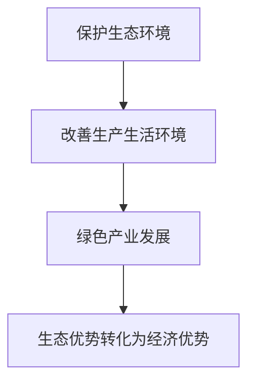
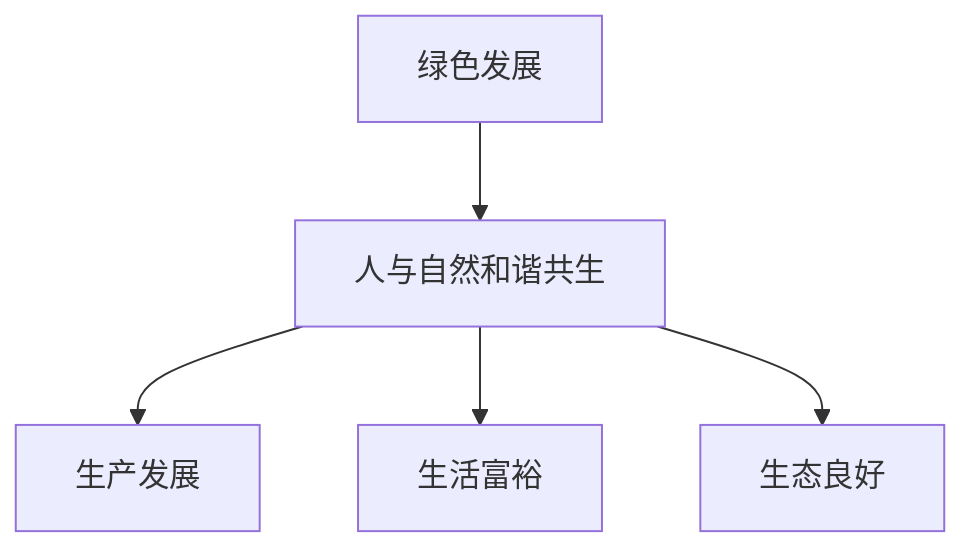
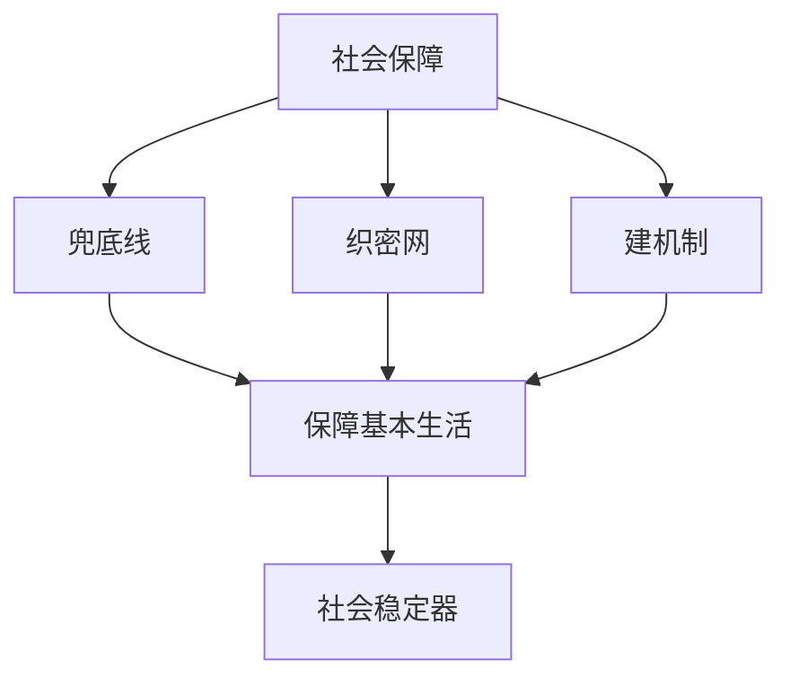
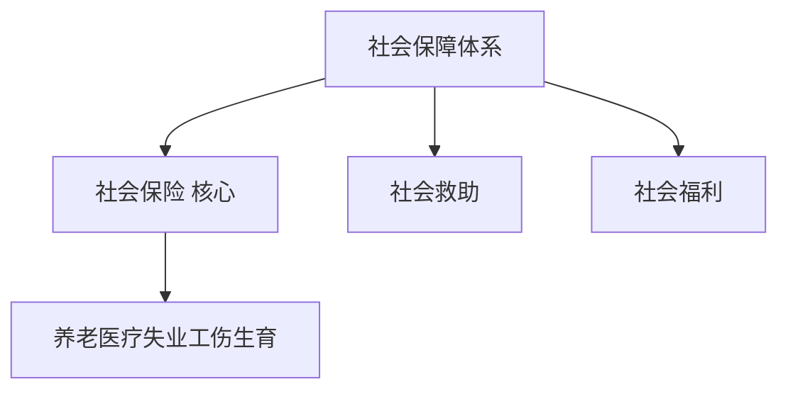
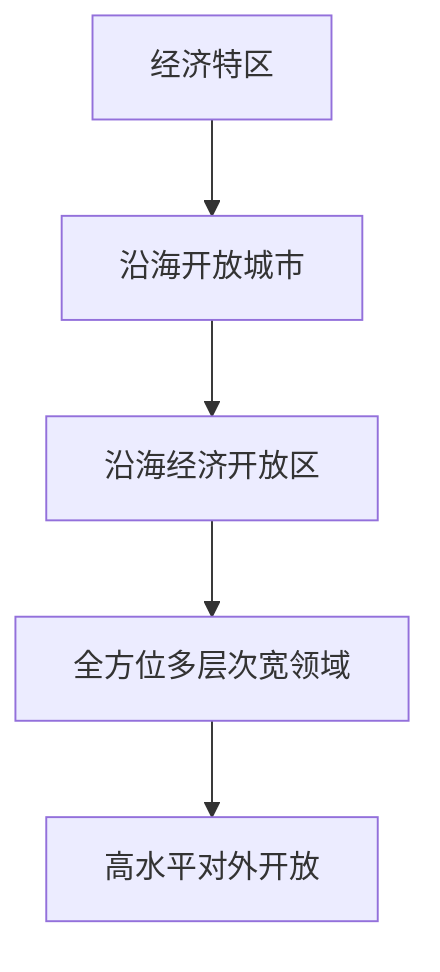
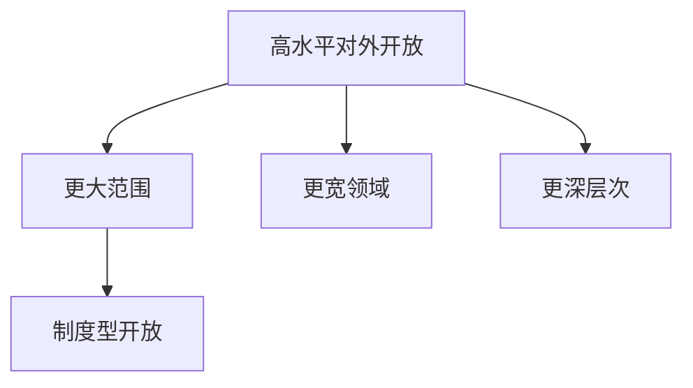
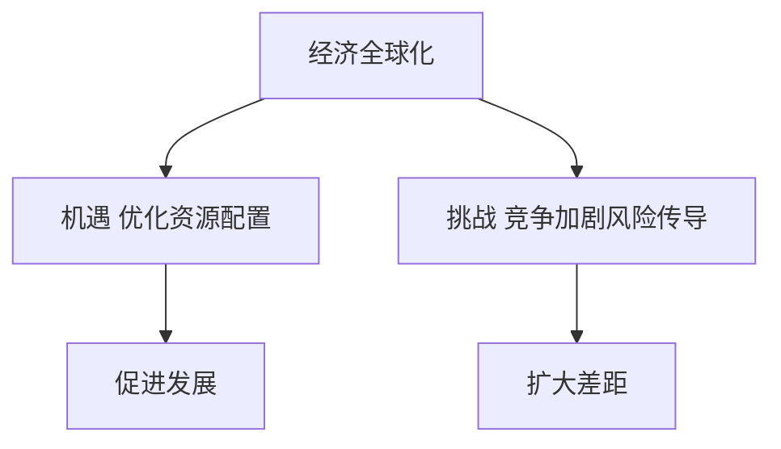
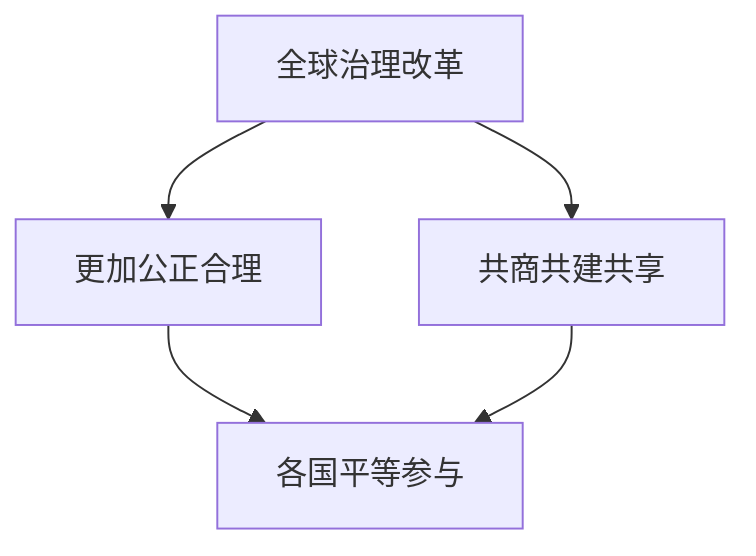

# 07 民生开放与全球治理 · 选择题集（首经贸 801 巩固用）

<a href="../../../exam.html" target="_blank" style="display:inline-block;padding:6px 16px;background:#2563eb;color:#fff;border-radius:6px;text-decoration:none;font-size:14px;">📝 开始做题</a>

> 每个知识点 9 道单选，共 36 道。
> 题目方向：概念辨析、易混淆点、反向考法、结合现象。
> 配套主观题见 [[考研真题集|本章考研真题集]]

## 📋 目录
- [[#KP01 生态文明与绿色发展|KP01]] — 9 题
- [[#KP02 社会保障体系|KP02]] — 9 题
- [[#KP03 对外开放|KP03]] — 9 题
- [[#KP04 经济全球化与全球治理|KP04]] — 9 题

---

## KP01 生态文明与绿色发展（[[知识点/KP01_生态文明与绿色发展|回知识点]]）

**1. 我国承诺二氧化碳排放力争于（ ）前达到峰值**
A. 2025 年
B. 2030 年
C. 2050 年
D. 2060 年

> **✅ 答案：B**
> **解析：** 2030 年前碳达峰、2060 年前碳中和。两个时间点必须记牢。D 是碳中和年份。

**2. 碳中和是指（ ）**
A. 完全不排放二氧化碳
B. 人为排放与吸收相互抵消，净排放为零
C. 停止使用化石能源
D. 把二氧化碳全部储存起来

> **✅ 答案：B**
> **解析：** 碳中和是净零排放，不是零排放。仍允许一定排放，通过碳汇、CCUS 等方式抵消。A、C、D 都是极端理解。

**3. "绿水青山就是金山银山"最早提出于（ ）**
A. 广东深圳
B. 浙江安吉余村
C. 江苏苏州
D. 福建厦门

> **✅ 答案：B**
> **解析：** 2005 年 8 月，习近平在浙江湖州安吉县余村考察时首次提出"绿水青山就是金山银山"。

**4. 下列属于碳汇的是（ ）**
A. 燃煤电厂发电
B. 森林吸收二氧化碳
C. 燃油汽车行驶
D. 水泥厂生产水泥

> **✅ 答案：B**
> **解析：** 碳汇是指通过森林、草地、海洋等自然系统吸收大气中的二氧化碳。A、C、D 都是碳排放源。

**5. 关于碳达峰与碳中和的关系，下列说法正确的是（ ）**
A. 碳达峰是碳中和的前提和基础
B. 碳中和是碳达峰的前提
C. 二者没有必然联系
D. 达峰越晚，中和越容易

> **✅ 答案：A**
> **解析：** 先达峰、再中和。达峰越早、峰值越低，中和难度越小。我国从达峰到中和只有 30 年，任务比发达国家更紧。

**6. 下列哪种做法符合"先立后破"原则（ ）**
A. 立即关闭所有煤电厂
B. 在新能源体系建好后逐步替代传统能源
C. 停止所有燃油汽车生产
D. 全面禁止煤炭进口

> **✅ 答案：B**
> **解析：** "先立后破"是 2021 年运动式减碳教训后的政策原则：先把新能源体系建起来，再逐步替代传统能源。A、C、D 都是"运动式减碳"。

**7. 下列属于负外部性治理手段的是（ ）**
A. 对排污企业征收环保税
B. 给绿色企业补贴
C. 政府投资建设公园
D. 植树造林

> **✅ 答案：A**
> **解析：** 对负外部性征税（庇古税）是内部化外部成本的典型手段。B、D 是鼓励正外部性，C 是公共品供给。

**8. 我国新能源汽车产销量连续（ ）年位居世界第一**
A. 3
B. 5
C. 9
D. 20

> **✅ 答案：C**
> **解析：** 自 2015 年起，我国新能源汽车产销量已连续 9 年位居世界第一（截至 2024 年）。这是绿色生产力的典型案例。

**9. 下列关于绿色发展的说法，错误的是（ ）**
A. 绿色发展是发展方式，不是不要发展
B. 绿色发展与高质量发展内在统一
C. 绿色发展就是限制经济增长
D. 绿色发展需要技术创新和制度创新

> **✅ 答案：C**
> **解析：** C 错误。绿色发展是更高质量的发展，不是不要发展。把绿色发展等同于"限制增长"是极端环保主义误解。
**10. （逻辑链·分析）"绿水青山就是金山银山"的传导是（　）。**
A. 保护生态环境 → 改善生产生活环境 → 绿色产业发展 → 生态优势转化为经济优势
B. 先污染后治理
C. 生态保护就是不要发展
D. 绿水青山不能换钱

> **✅ 答案：A**
> **解析：** 生态文明建设不是不要发展，而是要绿色发展。保护生态环境本身就是保护生产力，改善生态环境就是发展生产力——生态优势可以转化为经济优势。
>

>
> **数学推导**：绿色发展 = 经济增长 $Y \uparrow$ + 碳排放 $C \downarrow$，二者通过技术进步协调。
>
> **生活实例**：安吉白茶村保护竹海、不污染，白茶卖出高价、搞生态旅游——绿水青山真变成了金山银山。

**11. （逻辑链·判断）绿色发展的核心是（　）。**
A. 解决人与自然和谐共生问题，走生产发展、生活富裕、生态良好的文明发展道路
B. 停止发展
C. 牺牲经济保环境
D. 先污染后治理

> **✅ 答案：A**
> **解析**：绿色发展注重解决人与自然和谐共生问题，坚持可持续发展，走生产发展、生活富裕、生态良好的文明发展道路——不是不发展，而是绿色发展。
>

>
> **数学推导**：文明发展 = 经济增长 + 社会进步 + 生态保护三者协调，缺一不可。
>
> **生活实例**：奶茶店用可降解杯、减少糖和奶精浪费——既赚钱又环保，生产发展、生活富裕、生态良好三者兼得。

---

## KP02 社会保障体系（[[知识点/KP02_社会保障体系|回知识点]]）

**1. 我国社会保障体系的核心部分是（ ）**
A. 社会救助
B. 社会保险
C. 社会福利
D. 社会优抚

> **✅ 答案：B**
> **解析：** 社会保险（养老、医疗、失业、工伤、生育五险）是社会保障体系的核心。社会救助是兜底，社会福利是高层次，社会优抚是特殊保障。

**2. 下列不属于我国社会保险五险的是（ ）**
A. 基本养老保险
B. 基本医疗保险
C. 住房公积金
D. 工伤保险

> **✅ 答案：C**
> **解析：** 五险=养老、医疗、失业、工伤、生育。住房公积金是住房保障制度，不属于社会保险五险。

**3. 我国养老保险体系的第一支柱是（ ）**
A. 企业年金
B. 职业年金
C. 基本养老保险
D. 个人养老金

> **✅ 答案：C**
> **解析：** 三支柱：第一支柱基本养老保险（国家强制），第二支柱企业/职业年金（单位补充），第三支柱个人养老金（个人自愿）。

**4. 社会保险与商业保险的本质区别是（ ）**
A. 社会保险是强制的、公益的；商业保险是自愿的、盈利的
B. 二者完全相同
C. 商业保险比社会保险更重要
D. 社会保险可以取代商业保险

> **✅ 答案：A**
> **解析：** 社会保险由国家立法强制实施，以保障基本生活为目的；商业保险是保险公司按市场原则经营的金融产品。二者互补，不能互相替代。

**5. 我国提出建成多层次社会保障体系的目标是（ ）**
A. 覆盖全民、统筹城乡、公平统一、安全规范、可持续
B. 效率优先、兼顾公平
C. 高福利、高保障
D. 完全免费、按需分配

> **✅ 答案：A**
> **解析：** 党的二十大提出的五句话目标。B 是分配原则，C、D 不符合我国国情。

**6. 下列属于社会救助的是（ ）**
A. 基本养老保险金
B. 最低生活保障金
C. 企业年金
D. 商业医疗保险赔付

> **✅ 答案：B**
> **解析：** 社会救助是对困难群体的兜底，包括低保、特困供养、医疗救助、教育救助等。A 是社会保险，C 是补充保险，D 是商业保险。

**7. 社会保障作为宏观经济"自动稳定器"，是指（ ）**
A. 经济下行时失业金、低保支出自动增加，支撑消费
B. 政府主动调整税率
C. 央行调整利率
D. 企业自动裁员

> **✅ 答案：A**
> **解析：** 自动稳定器不需要政府主动决策，经济下行时领取失业金的人自动增多，支出自动增加；经济过热时自动减少。B、C 是相机抉择政策。

**8. 我国 60 岁及以上人口占比已超过（ ）**
A. 10%
B. 15%
C. 21%
D. 40%

> **✅ 答案：C**
> **解析：** 截至 2023 年末，我国 60 岁及以上人口约 2.97 亿，占比 21.1%，进入中度老龄化社会。

**9. 下列关于共同富裕与社会保障关系的说法，正确的是（ ）**
A. 社会保障就是平均主义
B. 社会保障是共同富裕的底线制度安排
C. 社会保障会抑制经济效率，应尽量减少
D. 共同富裕不需要社会保障

> **✅ 答案：B**
> **解析：** 共同富裕不是平均主义，而是在保障基本权利公平基础上允许合理差距。社会保障通过再分配兜底，是共同富裕的底线。
**10. （逻辑链·分析）社会保障体系的功能和传导是（　）。**
A. 兜底线、织密网、建机制 → 保障基本生活、维护社会稳定
B. 养懒人
C. 高端福利
D. 只覆盖城里人

> **✅ 答案：A**
> **解析：** 社会保障体系是兜底线、织密网、建机制的基本制度保障，保障公民在年老、疾病、工伤、失业、生育等情况下的基本生活，发挥社会稳定器作用。
>

>
> **数学推导**：社会保障 = 社会保险 + 社会救助 + 社会福利 + 优抚安置，覆盖风险 $R$ 下的基本生活支出。
>
> **生活实例**：店员交了医保，生病住院不慌；失业了有失业金过渡；老了有养老金——社会保障托住了基本生活底线。

**11. （逻辑链·判断）我国社会保障体系的核心是（　）。**
A. 社会保险（养老、医疗、失业、工伤、生育）
B. 社会救济
C. 社会福利
D. 商业保险

> **✅ 答案：A**
> **解析**：社会保险是社会保障体系的核心，包括养老、医疗、失业、工伤、生育五险。它面向劳动者、强制缴费、分担风险。
>

>
> **数学推导**：社会保险 = 单位缴费 + 个人缴费 + 财政补贴，在风险事件 $R$ 发生时给付。
>
> **生活实例**：奶茶店给店员交五险，店员生病、失业、老了都有保障——这是社会保障的核心。

---

## KP03 对外开放（[[知识点/KP03_对外开放|回知识点]]）

**1. 我国加入世界贸易组织（WTO）是在（ ）**
A. 1978 年
B. 1992 年
C. 2001 年
D. 2010 年

> **✅ 答案：C**
> **解析：** 2001 年 12 月 11 日，中国正式加入 WTO，标志着对外开放进入新阶段。

**2. 新时代我国对外开放正从商品和要素流动型开放转向（ ）**
A. 完全关闭国门
B. 规则、规制、管理、标准等制度型开放
C. 只引进外资
D. 只出口商品

> **✅ 答案：B**
> **解析：** 制度型开放是新时代开放的特征，强调在规则、规制、管理、标准等制度层面与国际高标准对接。

**3. 下列不属于我国对外开放平台的是（ ）**
A. 自贸试验区
B. 海南自由贸易港
C. 进博会
D. 经济特区（1980 年设立）

> **✅ 答案：D**
> **解析：** D 是改革开放初期的开放平台，题目问的是"新时代"开放平台。A、B、C 都是新时代高水平开放的抓手。注意审题：题目问"不属于"。

**4. "一带一路"倡议提出于（ ）**
A. 2001 年
B. 2008 年
C. 2013 年
D. 2020 年

> **✅ 答案：C**
> **解析：** 2013 年 9 月和 10 月，习近平分别在哈萨克斯坦和印度尼西亚提出共建"丝绸之路经济带"和"21 世纪海上丝绸之路"，合称"一带一路"。2023 年是提出十周年。

**5. 一带一路建设遵循的原则是（ ）**
A. 共商共建共享
B. 平等互利、自力更生
C. 和平共处五项原则
D. 不结盟、不对抗

> **✅ 答案：A**
> **解析：** 共商共建共享是一带一路的核心原则。B、C、D 都是正确的对外政策，但不是一带一路的专门表述。

**6. 下列属于"制度型开放"举措的是（ ）**
A. 降低关税
B. 扩大出口
C. 对接 CPTPP 等高标准国际经贸规则
D. 吸引外商直接投资

> **✅ 答案：C**
> **解析：** 制度型开放聚焦规则、规制、管理、标准。A、B、D 都属于商品和要素流动型开放。

**7. RCEP 是指（ ）**
A. 北美自由贸易协定
B. 区域全面经济伙伴关系协定
C. 中欧全面投资协定
D. 跨太平洋伙伴关系协定

> **✅ 答案：B**
> **解析：** RCEP=Regional Comprehensive Economic Partnership，2022 年 1 月生效，全球最大自贸区。D 是 CPTPP。

**8. 下列关于"引进来"和"走出去"的说法，正确的是（ ）**
A. 新时代只强调走出去，不需要引进来
B. 新时代只强调引进来，不需要走出去
C. 新时代坚持引进来和走出去并重
D. 二者是对立的

> **✅ 答案：C**
> **解析：** 新时代对外开放从过去以引进来为主，转向引进来和走出去并重。中国已成为对外投资大国。

**9. 下列关于对外开放与独立自主关系的说法，正确的是（ ）**
A. 对外开放必然损害独立自主
B. 独立自主就是闭关自守
C. 独立自主是自力更生基础上的对外开放
D. 对外开放和独立自主完全矛盾

> **✅ 答案：C**
> **解析：** 坚持独立自主、自力更生是立足点，对外开放是为了增强我国自力更生能力，二者辩证统一。
**10. （逻辑链·分析）我国对外开放的历程和传导是（　）。**
A. 经济特区 → 沿海开放城市 → 沿海经济开放区 → 全方位多层次宽领域开放
B. 一步到位
C. 只开放城市
D. 只开放旅游

> **✅ 答案：A**
> **解析：** 对外开放从设立经济特区起步，逐步扩大到沿海开放城市、沿海经济开放区，再到全方位、多层次、宽领域的对外开放格局。现在转向高水平对外开放。
>

>
> **数学推导**：开放度 $O$ 随时间 $t$ 扩大：$O(t) \uparrow$，从试点到全面。
>
> **生活实例**：深圳特区先行→沿海城市跟进→全国开放→现在进博会、RCEP 高水平开放——一步步扩大。

**11. （逻辑链·判断）高水平对外开放的特征是（　）。**
A. 更大范围、更宽领域、更深层次，制度型开放
B. 只是多出口
C. 只是多引进外资
D. 关门发展

> **✅ 答案：A**
> **解析**：高水平对外开放是更大范围、更宽领域、更深层次的开放，从商品和要素流动型开放转向规则、规制、管理、标准等制度型开放。
>

>
> **数学推导**：制度型开放 = 国内规则 $R_d$ 与国际规则 $R_i$ 对接，降低制度性交易成本。
>
> **生活实例**：进博会不只是买外国货，更是对接国际规则、标准——这就是制度型开放。

---

## KP04 经济全球化与全球治理（[[知识点/KP04_经济全球化与全球治理|回知识点]]）

**1. 经济全球化的根本动力是（ ）**
A. 联合国的推动
B. 社会分工和科技进步
C. 跨国公司的慈善行为
D. 各国政府的自愿协议

> **✅ 答案：B**
> **解析：** 马克思主义认为，生产力发展和社会分工扩大是全球化的根本动力。跨国公司是载体，但不是根本动力。

**2. 马克思认为，资产阶级"首次开创了世界历史"，是因为它（ ）**
A. 建立了联合国
B. 使每个文明国家和每个人的需要满足都依赖于整个世界
C. 实现了世界和平
D. 消灭了国家

> **✅ 答案：B**
> **解析：** 出自《德意志意识形态》。资产阶级通过大工业开拓世界市场，使各国相互依存。

**3. 人类命运共同体理念的提出者是（ ）**
A. 联合国秘书长
B. 习近平
C. 欧盟委员会
D. 金砖国家集团

> **✅ 答案：B**
> **解析：** 2013 年 3 月，习近平在莫斯科国际关系学院首次提出人类命运共同体理念。

**4. 人类命运共同体理念的五个维度不包括（ ）**
A. 持久和平
B. 普遍安全
C. 共同繁荣
D. 全球霸权

> **✅ 答案：D**
> **解析：** 五个世界=持久和平、普遍安全、共同繁荣、开放包容、清洁美丽。D 与理念完全相反。

**5. 下列属于中国倡议成立的多边开发机构是（ ）**
A. 世界银行
B. 国际货币基金组织
C. 亚洲基础设施投资银行（亚投行）
D. 世界贸易组织

> **✅ 答案：C**
> **解析：** 亚投行 2015 年成立，总部北京，是中国倡议的多边开发机构。A、B、D 都是二战后西方主导的机构。

**6. 当前经济全球化遭遇逆流的表现不包括（ ）**
A. 贸易保护主义抬头
B. 美国对中国加征关税
C. 全球产业链向友岸外包调整
D. 全球关税水平普遍下降

> **✅ 答案：D**
> **解析：** D 是全球化顺利发展的表现，不是逆流。A、B、C 都是逆流的典型表现。

**7. 人类命运共同体理念与"天下大同"的区别在于（ ）**
A. 前者承认主权国家，后者取消国家
B. 前者是中国古代理想
C. 后者是现代理念
D. 二者完全相同

> **✅ 答案：A**
> **解析：** 人类命运共同体是在承认主权国家平等基础上的国际合作，不是取消国家、建立世界政府。这是与古代"天下大同"的重要区别。

**8. 全球气候治理中，中国坚持的原则是（ ）**
A. 各国承担相同责任
B. 共同但有区别的责任
C. 发展中国家承担主要责任
D. 发达国家不承担责任

> **✅ 答案：B**
> **解析：** "共同但有区别的责任"是联合国气候变化框架公约的核心原则。发达国家历史排放多，应承担更多责任和向发展中国家提供资金技术。

**9. 下列关于经济全球化的说法，正确的是（ ）**
A. 全球化已经终结
B. 全球化是生产力发展的必然结果，不可逆转
C. 全球化只对发达国家有利
D. 发展中国家应该反对全球化

> **✅ 答案：B**
> **解析：** 全球化遭遇逆流，但历史趋势不可逆转。全球化是一把双刃剑，关键是要引导其走向开放、包容、普惠、平衡、共赢。
**10. （逻辑链·分析）经济全球化的双重效应传导是（　）。**
A. 优化资源配置、促进经济发展（机遇）+ 加剧全球竞争、扩大贫富差距、风险传导（挑战）
B. 只有好处
C. 只有坏处
D. 与中国无关

> **✅ 答案：A**
> **解析：** 经济全球化是双刃剑：一方面优化全球资源配置、促进贸易和发展；另一方面加剧国际竞争、扩大南北差距、经济危机跨国传导。我们要积极参与、趋利避害。
>

>
> **数学推导**：全球化 $G$ 提高效率但放大波动——贸易依存度 $\uparrow$ 则外部冲击传导 $\uparrow$。
>
> **生活实例**：全球供应链让奶茶原料便宜（机遇）；但海外疫情一来供应链断了（挑战）——全球化是双刃剑。

**11. （逻辑链·判断）全球治理体系改革的方向是（　）。**
A. 推动全球治理朝着更加公正合理的方向发展，共商共建共享
B. 一国主导
C. 维持现状
D. 退回到保护主义

> **✅ 答案：A**
> **解析**：全球治理体系改革要推动其朝着更加公正合理的方向发展，践行共商共建共享的全球治理观——世界各国共同商量着办，而不是一国说了算。
>

>
> **数学推导**：全球治理 = 国际规则 $R$ 由各国共同制定，而非由霸权国单方决定。
>
> **生活实例**：气候变化、疫情防控需要全球各国合作——一个国家再强也解决不了，这就是共商共建共享。

---

> 本题集结束。配套主观题见 [[考研真题集|本章考研真题集]]。
