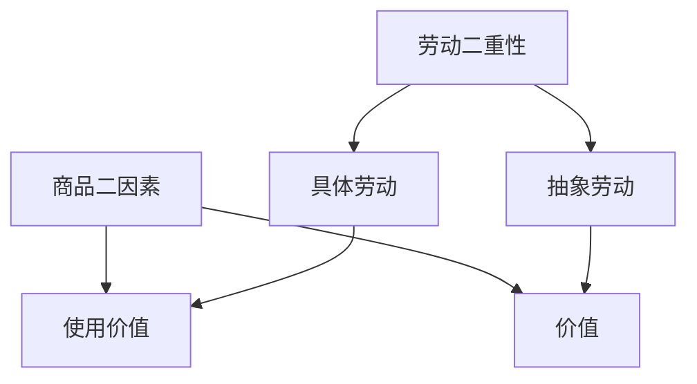

# 笔记规范（07 政治经济学专用）

## 一、文件结构

```
XX_章名/
├── 00_章节总结.md      ← 本章地图、mermaid 框架图、核心公式表、思考题
└── 知识点/
    ├── KP01_xxx.md
    ├── KP02_xxx.md
    └── ...
```

## 二、KP 文件固定模板（每个 KP 必须包含）

```markdown
# KPxx · 知识点名

> 所属：[[../00_章节总结|第X章 章名]] ｜ 节：原书第X节

## 1. 一句话先懂（小白版）
（大白话开头，禁用术语；用奶茶店/打车/外卖等生活场景）

## 2. 严格定义
（学术定义 + 关键符号首次解释）

## 3. 为什么（原理/机制）
（这个概念为什么存在，解决什么问题；完整推导链条不跳步）

## 4. 来源（理论怎么来的）
（历史脉络：谁提出、针对什么问题、怎么从前面的概念推出来）

## 5. 怎么用（现实例子/计算）
（手把手算：符号第一次出现要解释；公式用 LaTeX；数字要能口算核对）

## 6. 什么时候不能用（假设/边界条件）
（这个理论在什么前提下成立，超出边界会怎样）

## 7. 容易混淆什么
（表格对比：劳动 vs 劳动力、不变资本 vs 可变资本、固定资本 vs 流动资本……）

## 8. 现实意义
（今天看有什么用，能解释什么新闻/现象）

---

## 🔗 相关知识点
**同章关联：** [[KPxx_xxx|显示名]] ｜ [[KPyy_xxx|显示名]]
**跨章关联：** [[../../XX章/知识点/KPzz_xxx|显示名]]
**跨课对照：** [[../../../06_西方经济学/...|西方经济学怎么说]]
**📖 原书原文：** [[../../../原文件/经济学/马克思主义政治经济学概论_全书|《概论》第X章]]
```

## 三、mermaid 图规范（章节总结里用）

**禁用**：双引号 `"`、问号 `?`、括号 `()`、方括号 `[]` 内的特殊字符、中文标点在节点标签里。

✅ 正确写法：


❌ 错误写法（会 Syntax error）：
```mermaid
graph TD
    A["商品(二因素)"] --> B["使用价值?"]   ← 引号、括号、问号都炸
```

## 四、符号表（全课程统一）

| 符号 | 含义 | 第一次出现的 KP |
|---|---|---|
| $W$ | 商品（Ware） | KP01 |
| $G$ | 货币（Geld） | KP05 |
| $c$ | 不变资本（生产资料） | KP05 |
| $v$ | 可变资本（工资） | KP05 |
| $m$ | 剩余价值 | KP05 |
| $W'$ | 包含剩余价值的新商品 | KP05 |
| $G'$ | 增殖了的货币 | KP05 |
| $m'$ | 剩余价值率 = $m/v$ | KP06 |
| $p'$ | 利润率 = $m/(c+v)$ | 03章 |
| $k$ | 成本价格 = $c+v$ | 03章 |
| $P$ | 平均利润 | 03章 |
| $n$ | 资本周转次数 | 03章 |
| $T$ | 周转时间 | 03章 |
| $C$ | 预付总资本 | 03章 |

## 五、奶茶店例子库（全课程统一复用）

为了让跨 KP 的例子不打架，全课程统一用同一个"王老板奶茶店"：

- **王老板**：奶茶店老板，投 10 万开一家店。
- **小工**：你，被王老板雇来做奶茶，月薪 5000。
- **固定投入**：店面装修 + 制冰机 + 封口机 = 6 万（能用 3 年）。
- **流动投入**：茶叶、牛奶、杯子、吸管 = 每杯 4 元。
- **售价**：一杯奶茶 15 元。
- **你一天做 50 杯**，一个月 22 天 = 1100 杯。

后面所有 KP 都基于这个小账本展开，数字能口算核对。

## 六、交付硬指标

- 每个 KP 末尾必须有"🔗 相关知识点"，至少 3 个 wikilink。
- 每个章节必须有 `00_章节总结.md`，里面有 mermaid 图。
- 公式用 `$...$` 行内、`$$...$$` 独立行。
- 大白话优先，术语第一次出现给一句解释。
- 不改动其他课程目录下的任何文件。
