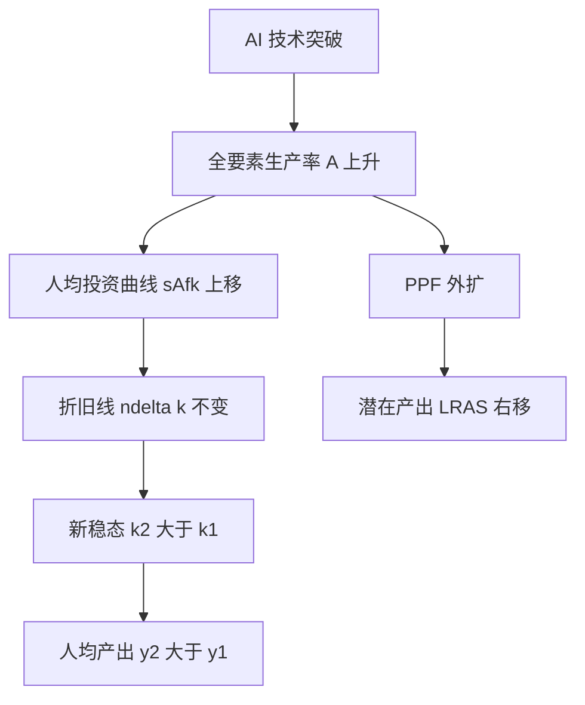

# 首都经济贸易大学 801 经济学·模拟卷（二）

<a href="../../exam.html" target="_blank" style="display:inline-block;padding:6px 16px;background:#2563eb;color:#fff;border-radius:6px;text-decoration:none;font-size:14px;">📝 开始做题</a>

> **难度定位**：基础卷（覆盖核心概念、基本原理、常规计算）
> **考试时间**：180 分钟　　**满分**：150 分
> **适用参考书**：马工程《西方经济学》（第二版）、《马克思主义政治经济学概论》（第二版）

---

## 注意事项

1. 本卷为闭卷考试，答案一律写在答题纸上，写在试题册上无效。
2. 允许使用黑色或蓝黑色钢笔、圆珠笔答题，不得使用铅笔、红色笔。
3. 考试过程中不得使用计算器、手机及任何电子设备，计算题数字均为可心算整数。
4. 答题须分点作答，标明题号；论述题须结合中国经济实际与当年热点。
5. 考试结束后，试题册与答题纸一并交回。

---

## 一、简答与计算题（共 6 题，每题 15 分，合计 90 分）

---

### 简答 1：简述政治经济学的研究对象，并说明物质资料生产为什么是马克思主义政治经济学研究的出发点。（15 分）

> 📚 **不懂就看：** [[../07_政治经济学/00_导论/知识点/KP01_政治经济学的研究对象|📖 KP·研究对象]] ｜ [[../07_政治经济学/00_导论/知识点/KP02_政治经济学的研究方法|📖 KP·研究方法]] ｜ [[../../经济统计学论文从0基础到精通/15_政治经济学基础/00_章节总结|🐮 教程·政经章节总结]]

**【考什么】** 对应知识点 [[../07_政治经济学/00_导论/知识点/KP01_政治经济学的研究对象|KP01 研究对象]]、[[../07_政治经济学/00_导论/知识点/KP02_政治经济学的研究方法|KP02 研究方法]]；题型属于概念简答类。

**【答题框架】**
- 第 1 段：政治经济学的研究对象是什么（2 分）
- 第 2 段：物质资料生产是出发点的原因（4 分）
- 第 3 段：生产力与生产关系的辩证关系（4 分）
- 第 4 段：研究对象的层次性——生产关系三环节（3 分）
- 第 5 段：小结（2 分）

**【参考答案】**

一、政治经济学的研究对象

（一）马克思主义政治经济学的研究对象是**社会生产关系及其发展规律**，即在一定生产力状况下人们在生产、分配、交换、消费过程中结成的相互关系。它不是研究物的自然属性，而是研究物背后人与人的关系、研究社会经济运行的客观规律。

二、物质资料生产是研究的出发点

（一）物质资料生产是人类社会存在和发展的基础。

1. 人类要生存，首先需要衣、食、住、行等基本生活资料，这些都必须通过生产才能获得。
2. 只有物质资料生产发展了，才能为政治、文化、科技、教育等其他社会活动提供物质前提。

（二）物质资料生产包含三个简单要素：人的劳动、劳动资料、劳动对象。其中劳动者是能动的主体，劳动资料与劳动对象合称生产资料，是生产的客观物质条件。

三、生产力与生产关系的辩证关系

（一）生产力是人类改造自然、征服自然的能力，反映人与自然的关系；生产关系是人们在生产过程中结成的相互关系，反映人与人的关系。

（二）二者是社会生产不可分割的两个方面：

1. 生产力决定生产关系。生产力的性质和水平决定生产关系的性质和形式，生产力的发展变化迟早会引起生产关系的变革。
2. 生产关系反作用于生产力。适合生产力发展要求的生产关系促进生产力发展，不适合的则阻碍其发展。
3. 生产关系一定要适合生产力状况，是人类社会发展的基本规律。

四、生产关系的层次性

（一）生产关系包括生产、分配、交换、消费四个环节，其中生产起主导决定作用，分配、交换、消费反作用于生产。
（二）政治经济学研究生产关系，既要研究生产关系的本质（所有制基础），也要研究其具体实现形式（经济体制）。

五、小结

政治经济学以社会生产关系为研究对象，以物质资料生产为出发点，在生产力与生产关系的矛盾运动中揭示经济规律，这是马克思主义政治经济学区别于资产阶级经济学的根本立场。

**【解析·得分点】** 采分点：①研究对象=社会生产关系及其发展规律（3 分）；②物质资料生产是人类生存发展基础（3 分）；③三要素（2 分）；④生产力决定生产关系、生产关系反作用（4 分）；⑤四环节与所有制（3 分）。易丢分：只答"研究生产关系"而漏答"发展规律"，或把生产力当作研究对象本身。

**【生活实例】** 一家奶茶店，店员劳动、封口机与杯子是劳动资料、茶叶奶精是劳动对象，三者结合才能做出奶茶；老板出钱开店、店员拿工资、毛利怎么分，这就是生产关系。店员手艺升级了（生产力提高），原来的小铺面雇佣方式就会变成连锁店——这就是生产力决定生产关系。

**【双链接】** 🔗 [[../07_政治经济学/00_导论/知识点/KP01_政治经济学的研究对象|回知识点·研究对象]] ｜ [[../07_政治经济学/00_导论/知识点/KP02_政治经济学的研究方法|研究方法]] ｜ 📖 《马克思主义政治经济学概论》导论

---

### 简答 2：简述产业资本循环的三个阶段、三种职能形式，并说明资本周转速度及其对剩余价值生产的影响。（15 分）

> 📚 **不懂就看：** [[../07_政治经济学/03_资本流通与剩余价值分配/知识点/KP01_资本循环|📖 KP·资本循环]] ｜ [[../07_政治经济学/03_资本流通与剩余价值分配/知识点/KP02_资本周转|📖 KP·资本周转]] ｜ [[../../经济统计学论文从0基础到精通/15_政治经济学基础/07_资本循环与周转|🐮 教程·资本循环与周转]]

**【考什么】** 对应知识点 [[../07_政治经济学/03_资本流通与剩余价值分配/知识点/KP01_资本循环|KP01 资本循环]]、[[../07_政治经济学/03_资本流通与剩余价值分配/知识点/KP02_资本周转|KP02 资本周转]]；题型属于关系对比类。

**【答题框架】**
- 第 1 段：产业资本循环公式（2 分）
- 第 2 段：三阶段与三种职能形式（5 分）
- 第 3 段：三种循环形式的统一（2 分）
- 第 4 段：资本周转、周转时间与周转次数（3 分）
- 第 5 段：周转速度对剩余价值的影响（3 分）

**【参考答案】**

一、产业资本循环的公式

（一）产业资本顺次经过购买、生产、售卖三个阶段，采取货币资本、生产资本、商品资本三种职能形式，实现价值增殖，最后回到原来出发点的运动，就是资本循环。公式为：

$$G—W\begin{Bmatrix}A\\P_m\end{Bmatrix}\cdots P\cdots W'—G'$$

其中 $G$ 为货币，$W$ 为商品，$A$ 为劳动力，$P_m$ 为生产资料，$P$ 为生产过程，$W'$ 为包含剩余价值的商品，$G'$ 为增殖了的货币。

二、三个阶段与三种职能形式

（一）购买阶段：$G—W$。资本家以货币购买劳动力 $A$ 和生产资料 $P_m$，货币执行**货币资本**职能，为剩余价值生产准备条件。

（二）生产阶段：$W\cdots P\cdots W'$。劳动力与生产资料结合生产出包含剩余价值的新商品，资本执行**生产资本**职能，这是循环中具有决定意义的阶段，剩余价值正是在此生产出来。

（三）售卖阶段：$W'—G'$。资本家把商品卖出换回货币，资本执行**商品资本**职能，实现包含在商品中的价值和剩余价值。

三、三种循环形式的统一

（一）产业资本连续循环必须是货币资本循环、生产资本循环、商品资本循环三种形式的统一。
（二）前提条件：空间上并存（三种职能形式按比例同时并存）、时间上继起（每一种形式都顺次通过各阶段）。并存与继起互为条件。

四、资本周转与周转速度

（一）资本周转是指不断重复、周而复始的资本循环。
（二）周转时间=生产时间+流通时间；周转次数 $n=\dfrac{U}{u}$（$U$ 为年，$u$ 为周转一次所需时间）。
（三）周转速度与周转时间成反比，与周转次数成正比。

五、周转速度对剩余价值生产的影响

（一）加快固定资本周转，可避免无形损耗，提高设备利用率。
（二）加快流动资本周转，可节省预付流动资本量，年剩余价值量 $M=m'\cdot v\cdot n$、年剩余价值率 $M'=m'\cdot n$ 随之提高。
（三）周转越快，同量可变资本在一年中剥削工人的次数越多，年剩余价值量与年剩余价值率越高。

**【解析·得分点】** 采分点：①公式完整（2 分）；②三阶段对应三职能形式且购买/售卖属流通领域、生产阶段决定剩余价值（5 分）；③并存性与继起性（2 分）；④周转次数公式（3 分）；⑤$M=m'vn$、$M'=m'n$（3 分）。易混点：货币资本≠货币本身，商品资本≠普通商品；职能形式≠循环形式。

**【生活实例】** 一家奶茶店：老板掏钱买茶叶奶精和雇店员是"购买阶段"（货币资本）；店员在后场做奶茶是"生产阶段"（生产资本，钱真正生钱的环节）；顾客点单付账是"售卖阶段"（商品资本）。一天能翻台多少轮，就是周转次数；翻台越快，同样店面一年赚的钱越多。

**【双链接】** 🔗 [[../07_政治经济学/03_资本流通与剩余价值分配/知识点/KP01_资本循环|回知识点·资本循环]] ｜ [[../07_政治经济学/03_资本流通与剩余价值分配/知识点/KP02_资本周转|资本周转]] ｜ 📖 《概论》第 4 章

---

### 简答 3：简述资本主义基本矛盾及其与经济危机的关系，说明资本主义经济危机的实质、根源和周期性。（15 分）

> 📚 **不懂就看：** [[../07_政治经济学/04_经济危机与历史趋势/知识点/KP01_资本主义经济危机|📖 KP·资本主义经济危机]] ｜ [[../../经济统计学论文从0基础到精通/15_政治经济学基础/10_资本主义经济危机|🐮 教程·资本主义经济危机]]

**【考什么】** 对应知识点 [[../07_政治经济学/04_经济危机与历史趋势/知识点/KP01_资本主义经济危机|KP01 经济危机]]、[[../07_政治经济学/04_经济危机与历史趋势/知识点/KP03_资本主义发展的历史趋势|KP03 历史趋势]]；题型属于原因分析类。

**【答题框架】**
- 第 1 段：资本主义基本矛盾是什么（3 分）
- 第 2 段：经济危机的实质（3 分）
- 第 3 段：经济危机的根源（4 分）
- 第 4 段：危机的周期性与再生产四阶段（3 分）
- 第 5 段：小结（2 分）

**【参考答案】**

一、资本主义基本矛盾

（一）资本主义基本矛盾是**生产社会化和生产资料资本主义私人占有之间的矛盾**。

（二）生产社会化表现为生产资料使用社会化、生产过程社会化、产品社会化；但生产资料和产品归资本家私人占有，这就形成了对立。

二、资本主义经济危机的实质

（一）经济危机的实质是**生产相对过剩**，即相对于劳动人民有支付能力的需求来说商品显得过剩，而不是与劳动人民实际需要相比的绝对过剩。
（二）危机期间大量商品卖不出去、工厂倒闭、工人失业、信用关系破坏，本质是生产相对过剩的危机。

三、经济危机的根源

（一）经济危机的根源在于资本主义基本矛盾。这一矛盾具体表现为两个方面：

1. 个别企业生产的有组织性与整个社会生产无政府状态之间的矛盾，导致社会再生产比例失调。
2. 资本主义生产无限扩大的趋势与劳动人民有支付能力的需求相对缩小之间的矛盾。资本家为追逐剩余价值不断改进技术、扩大生产，同时又加强对工人的剥削，使劳动者购买力相对下降，生产与消费的矛盾尖锐到一定程度，危机必然爆发。

（二）货币作为流通手段和支付手段包含危机的形式上的可能性，但危机的现实性根植于资本主义基本矛盾。

四、经济危机的周期性

（一）危机周期性爆发的原因在于资本主义基本矛盾运动本身——激化→强制解决（危机）→缓和→再激化。
（二）再生产周期一般包括**危机、萧条、复苏、高涨**四个阶段，其中危机是周期的基本阶段。
（三）周期性的物质基础是固定资本更新：危机过后大规模更新固定资本，为复苏和高涨提供物质条件，同时又为下一次危机准备新的物质基础。

五、小结

经济危机是资本主义基本矛盾尖锐化的必然产物，是资本主义制度无法自愈的痼疾；它暴露了资本主义生产方式的历史过渡性。

**【解析·得分点】** 采分点：①基本矛盾=生产社会化 vs 私人占有（3 分）；②实质=相对过剩不是绝对过剩（3 分）；③两个具体表现（4 分）；④四阶段+固定资本更新是物质基础（3 分）；⑤制度性结论（2 分）。易错：把危机根源说成"比例失调"或"消费不足"等表面原因，必须落到基本矛盾。

**【生活实例】** 奶茶店老板拼命多开店、多备货（生产社会化、规模扩大），但又把雇员工资压得很低（私人占有、劳动者购买力跟不上）。最后整条街奶茶都卖不动，门店接连倒闭——这就是"相对过剩"：不是大家不想喝奶茶，而是喝得起、愿意花钱买的人太少。

**【双链接】** 🔗 [[../07_政治经济学/04_经济危机与历史趋势/知识点/KP01_资本主义经济危机|回知识点·经济危机]] ｜ [[../07_政治经济学/04_经济危机与历史趋势/知识点/KP03_资本主义发展的历史趋势|历史趋势]] ｜ 📖 《概论》第 7 章

---

### 简答 4：已知某消费者效用函数为 $U=X_1X_2$，两种商品价格分别为 $P_1=2$，$P_2=3$，消费者收入 $M=120$。求该消费者实现效用最大化时对 $X_1$、$X_2$ 的最优购买量，并写出均衡条件。（15 分）

> 📚 **不懂就看：** [[../06_西方经济学/02_消费者选择/知识点/KP02_基数效用论与消费者均衡|📖 KP·基数效用论均衡]] ｜ [[../06_西方经济学/02_消费者选择/知识点/KP05_序数效用论与消费者均衡|📖 KP·序数效用论均衡]] ｜ [[../../经济统计学论文从0基础到精通/13_微观经济学基础/06_无差异曲线与消费者均衡是什么|🐮 教程·无差异曲线与消费者均衡]]

**【考什么】** 对应知识点 [[../06_西方经济学/02_消费者选择/知识点/KP02_基数效用论与消费者均衡|KP02 基数效用论与消费者均衡]]、[[../06_西方经济学/02_消费者选择/知识点/KP05_序数效用论与消费者均衡|KP05 序数效用论消费者均衡]]；题型属于分析推导（带计算）类。

**【答题框架】**
- 第 1 段：消费者均衡条件（3 分）
- 第 2 段：求边际效用（3 分）
- 第 3 段：联立均衡方程与预算约束（6 分）
- 第 4 段：代入数字求解（2 分）
- 第 5 段：结论与总效用（1 分）

**【参考答案】**

一、消费者均衡的经济含义

（一）消费者均衡研究的是：在收入 $M$ 既定、商品价格 $P_1$、$P_2$ 既定的条件下，消费者如何把有限的收入分配于两种商品的购买上，使总效用达到最大。此时消费者不再调整购买组合，故称"均衡"。

（二）实现均衡的思路是：如果花在第一种商品上的每一元钱带来的边际效用大于第二种商品，理性消费者就会减少第二种商品、增加第一种商品的购买；随着第一种商品数量增加，其边际效用递减，第二种商品数量减少，其边际效用递增，直到每一元钱在两种商品上带来的边际效用相等为止。这一调整过程最终形成均衡条件。

二、消费者均衡条件

（一）在基数效用论下，消费者实现效用最大化的均衡条件是：在收入既定、价格既定时，消费者花费在每种商品上的每一元货币所带来的边际效用相等，且等于货币的边际效用 $\lambda$：

$$\frac{MU_1}{P_1}=\frac{MU_2}{P_2}=\lambda$$

（二）同时必须满足预算约束，即收入全部花完：

$$P_1X_1+P_2X_2=M$$

（三）若 $\dfrac{MU_1}{P_1}>\dfrac{MU_2}{P_2}$，消费者会多买 $X_1$、少买 $X_2$；若反之则反向调整；只有二者相等时才达到最优。

三、求边际效用

（一）由 $U=X_1X_2$，分别对 $X_1$、$X_2$ 求偏导，得到两种商品的边际效用：

$$MU_1=\frac{\partial U}{\partial X_1}=X_2,\qquad MU_2=\frac{\partial U}{\partial X_2}=X_1$$

（二）可见边际效用随另一种商品消费量同向变化，这是柯布—道格拉斯型效用函数的特征。

四、代入均衡条件并联立预算方程

（一）由 $\dfrac{MU_1}{P_1}=\dfrac{MU_2}{P_2}$：

$$\frac{X_2}{2}=\frac{X_1}{3}$$

交叉相乘得：$3X_2=2X_1$，即 $X_1=\dfrac{3}{2}X_2$。

（二）预算约束：$2X_1+3X_2=120$。

（三）将 $X_1=\dfrac{3}{2}X_2$ 代入预算约束：

$$2\cdot\frac{3}{2}X_2+3X_2=120\;\Rightarrow\;3X_2+3X_2=120\;\Rightarrow\;6X_2=120$$

解得 $X_2=20$，回代得 $X_1=\dfrac{3}{2}\times 20=30$。

五、结论与验证

（一）最优购买量为 $X_1^*=30$，$X_2^*=20$。
（二）预算线验证：$2\times 30+3\times 20=60+60=120=M$，收入正好花完。
（三）此时最大效用 $U^*=X_1X_2=30\times 20=600$。
（四）货币边际效用 $\lambda=\dfrac{MU_1}{P_1}=\dfrac{20}{2}=10$，即每一元钱带来 10 单位效用，花在 $X_1$、$X_2$ 上最后一元的效用相等，消费者不再愿意调整购买组合，均衡达成。

**【解析·得分点】** 采分点：①均衡条件 $\dfrac{MU_1}{P_1}=\dfrac{MU_2}{P_2}$（3 分）；②正确求偏导 $MU_1=X_2$、$MU_2=X_1$（3 分）；③预算方程（2 分）；④联立得 $X_1=\dfrac{3}{2}X_2$（3 分）；⑤解出 $X_1=30$、$X_2=20$、$U=600$（4 分）。易错：偏导求错（把 $MU_1$ 写成 $X_1$）；只列条件不代入数字；漏写预算约束验证。

**【生活实例】** 你拿 120 元去食堂，早餐 2 元一份、饮料 3 元一瓶。最优组合不是把钱全花在便宜的早餐上——那样最后一口早餐的边际效用太低。要吃到"最后一块钱无论买早餐还是买饮料都一样值"为止，算下来就是 30 份早餐 + 20 瓶饮料。

**【双链接】** 🔗 [[../06_西方经济学/02_消费者选择/知识点/KP02_基数效用论与消费者均衡|回知识点·基数效用论均衡]] ｜ [[../06_西方经济学/02_消费者选择/知识点/KP05_序数效用论与消费者均衡|序数效用论均衡]] ｜ 📖 马工程《西方经济学》上册 第 2 章

---

### 简答 5：简述短期总成本、固定成本、可变成本、平均成本、平均固定成本、平均可变成本与边际成本的含义及其相互关系。（15 分）

> 📚 **不懂就看：** [[../06_西方经济学/03_生产与成本/知识点/KP05_成本概念|📖 KP·成本概念]] ｜ [[../06_西方经济学/03_生产与成本/知识点/KP06_短期成本曲线|📖 KP·短期成本曲线]] ｜ [[../../经济统计学论文从0基础到精通/13_微观经济学基础/08_成本曲线是什么|🐮 教程·成本曲线是什么]]

**【考什么】** 对应知识点 [[../06_西方经济学/03_生产与成本/知识点/KP05_成本概念|KP05 成本概念]]、[[../06_西方经济学/03_生产与成本/知识点/KP06_短期成本曲线|KP06 短期成本曲线]]；题型属于关系对比+图形分析类。

**【答题框架】**
- 第 1 段：短期总成本的分解（3 分）
- 第 2 段：三个平均量与边际成本的定义（4 分）
- 第 3 段：MC 与 AC、AVC 的关系（4 分）
- 第 4 段：图形特征文字描述（3 分）
- 第 5 段：小结（1 分）

**【参考答案】**

一、短期总成本的分解

（一）短期总成本 $TC$ 是厂商在短期生产一定产量所耗费的全部成本，分为：

1. 总固定成本 $TFC$：不随产量变动而变动的成本，如厂房租金、设备折旧，即使产量为零也需支付。
2. 总可变成本 $TVC$：随产量变动而变动的成本，如原材料、工人工资、燃料动力。

（二）关系式：$TC=TFC+TVC$。当 $Q=0$ 时，$TVC=0$，$TC=TFC$。

二、平均量与边际成本

（一）平均固定成本：$AFC=\dfrac{TFC}{Q}$。
（二）平均可变成本：$AVC=\dfrac{TVC}{Q}$。
（三）平均总成本：$AC=\dfrac{TC}{Q}=AFC+AVC$。
（四）边际成本：$MC=\dfrac{\Delta TC}{\Delta Q}=\dfrac{\Delta TVC}{\Delta Q}$，即每增加一单位产量所增加的总成本。

三、MC 与 AC、AVC 的关系

（一）$MC$ 曲线呈 U 形，这是由边际报酬递减规律决定的：起初边际产量递增使 MC 下降，之后边际产量递减使 MC 上升。

（二）$MC$ 与 $AC$ 相交于 $AC$ 的最低点：

1. 当 $MC<AC$ 时，$AC$ 下降；
2. 当 $MC>AC$ 时，$AC$ 上升；
3. 交点即收支相抵点（$AC$ 最低点）。

（三）$MC$ 与 $AVC$ 相交于 $AVC$ 的最低点：

1. 当 $MC<AVC$ 时，$AVC$ 下降；
2. 当 $MC>AVC$ 时，$AVC$ 上升；
3. 交点即停止营业点（$AVC$ 最低点）。

四、图形特征（文字描述）

（一）横轴为产量 $Q$，纵轴为成本。
（二）$TFC$ 为一条水平直线；$TVC$ 从原点出发、先以递减速率上升后以递增速率上升（斜向上、拐点后变陡）；$TC$ 曲线与 $TVC$ 平行，垂直距离恒等于 $TFC$。
（三）$AFC$ 单调递减，随 $Q$ 增大渐近于横轴。
（四）$AC$、$AVC$、$MC$ 均为 U 形；$MC$ 先后穿过 $AVC$ 最低点和 $AC$ 最低点，且 $AVC$ 最低点出现在较小产量、$AC$ 最低点出现在较大产量；$AC$ 与 $AVC$ 之间的垂直距离就是 $AFC$，随产量增大而缩小。

五、小结

短期诸成本曲线的形状和位置关系，根源在于边际报酬递减规律；$MC$ 先后穿过 $AVC$、$AC$ 最低点是最常考的图形结论，且两个最低点对应的产量不同——$AVC$ 最低点在前、$AC$ 最低点在后，二者之间的垂直距离随产量扩大而不断缩小。理解这些关系，才能进一步分析完全竞争厂商的短期供给曲线和停止营业决策。

**【解析·得分点】** 采分点：①$TC=TFC+TVC$（3 分）；②四个平均量/边际量公式（4 分）；③$MC$ 穿过 $AC$、$AVC$ 最低点及其含义（收支相抵点/停止营业点）（4 分）；④U 形成因=边际报酬递减（2 分）；⑤图形文字描述（2 分）。易错：把 $AFC$ 画成 U 形（应为单调下降）；漏说 $AC$ 最低点产量大于 $AVC$ 最低点产量。

**【生活实例】** 一家奶茶店月租 1 万元（TFC），每做一杯奶茶茶叶奶精人工 5 元（TVC）。做的杯数越多，每杯摊到的月租越少（AFC 下降）；但店员挤在一起互相干扰，做到后面每多做一杯反而更费劲（MC 先降后升），这就是边际报酬递减。

**【双链接】** 🔗 [[../06_西方经济学/03_生产与成本/知识点/KP06_短期成本曲线|回知识点·短期成本曲线]] ｜ [[../06_西方经济学/03_生产与成本/知识点/KP05_成本概念|成本概念]] ｜ 📖 马工程《西方经济学》上册 第 5 章

---

### 简答 6：简述 GDP 的三种核算方法，并说明 GDP、GNP、NDP、NI、PI、DPI 之间的换算关系。（15 分）

> 📚 **不懂就看：** [[../06_西方经济学/09_宏观经济基本指标/知识点/KP01_GDP的含义与核算|📖 KP·GDP 的含义与核算]] ｜ [[../06_西方经济学/09_宏观经济基本指标/知识点/KP02_名义GDP与实际GDP|📖 KP·名义与实际 GDP]] ｜ [[../../经济统计学论文从0基础到精通/14_宏观经济学基础/01_GDP与国民收入核算|🐮 教程·GDP 与国民收入核算]]

**【考什么】** 对应知识点 [[../06_西方经济学/09_宏观经济基本指标/知识点/KP01_GDP的含义与核算|KP01 GDP 的含义与核算]]；题型属于概念简答+关系对比类。

**【答题框架】**
- 第 1 段：GDP 定义（2 分）
- 第 2 段：生产法、收入法、支出法（5 分）
- 第 3 段：GDP 与 GNP 的区别（3 分）
- 第 4 段：五大总量换算关系（4 分）
- 第 5 段：小结（1 分）

**【参考答案】**

一、GDP 的含义

（一）国内生产总值（GDP）是指一个国家或地区在一定时期内（通常为一年）运用生产要素所生产的全部最终产品和服务的市场价值。
（二）关键词：地域原则（"国内"）、最终产品、市场价值、流量、一定时期。

二、三种核算方法

（一）生产法（增加值法）：

1. 从生产角度核算，$GDP=\sum$ 各部门总产出 $-\sum$ 各部门中间投入。
2. 即所有企业增加值之和，避免重复计算。

（二）收入法（要素支付法）：

1. 从收入角度核算，$GDP=$ 工资 $+$ 利息 $+$ 利润 $+$ 租金 $+$ 间接税 $-$ 补贴 $+$ 折旧。
2. 即把生产中形成的各种要素收入加总。

（三）支出法（最常用）：

1. 从最终使用角度核算：

$$GDP=C+I+G+(X-M)$$

2. 其中 $C$ 为居民消费，$I$ 为私人投资，$G$ 为政府购买，$X$ 为出口，$M$ 为进口，$(X-M)$ 为净出口。

三、GDP 与 GNP 的区别

（一）GDP 按**地域原则**核算：只要在中国境内生产，无论本国企业还是外资企业都计入。
（二）GNP（国民生产总值）按**国民原则**核算：只要是本国国民（企业）所生产，无论在国内还是国外都计入。
（三）关系：$GNP=GDP+$ 本国公民在国外的要素收入 $-$ 外国公民在本国的要素收入，即 $GNP=GDP+$ 国外净要素收入。

四、五大总量换算关系

（一）$GDP$：国内生产总值。
（二）$NDP=GDP-$ 折旧（国内生产净值）。
（三）$NI=NDP-$ 间接税 $+$ 补贴（狭义国民收入，即要素收入总和）。
（四）$PI=NI-$ 公司未分配利润 $-$ 公司所得税 $-$ 社会保险税 $+$ 政府转移支付 $+$ 利息调整（个人收入）。
（五）$DPI=PI-$ 个人所得税（个人可支配收入，即居民实际可用于消费和储蓄的收入）。

（六）换算链条概括：$GDP\xrightarrow{-折旧}NDP\xrightarrow{-间接税+补贴}NI\xrightarrow{-公司未分配利润等+转移支付}PI\xrightarrow{-个人所得税}DPI$。

五、小结

三种方法从不同角度核算同一 GDP，理论上结果相等；GDP 到 DPI 的层层扣减，反映了从生产创造到居民可支配收入之间的分配与再分配过程。

**【解析·得分点】** 采分点：①GDP 四关键词（2 分）；②生产法=增加值、收入法=要素收入加总、支出法 $C+I+G+(X-M)$（5 分）；③GDP 地域 vs GNP 国民（3 分）；④NDP/NI/PI/DPI 逐级扣减项（4 分）；⑤流量与最终产品提示（1 分）。易错：把 GNP 写成"全世界生产总和"；把转移支付计入 $G$（政府购买不含转移支付）。

**【生活实例】** 一家外企在中国建厂生产奶茶，产值算中国 GDP，但利润汇回母国，那部分才算母国 GNP。你工资条上的应发工资是 PI，扣完个税打到卡里的才是 DPI，才能真正用来吃饭租房。

**【双链接】** 🔗 [[../06_西方经济学/09_宏观经济基本指标/知识点/KP01_GDP的含义与核算|回知识点·GDP 核算]] ｜ [[../06_西方经济学/09_宏观经济基本指标/知识点/KP02_名义GDP与实际GDP|名义与实际 GDP]] ｜ 📖 马工程《西方经济学》下册 第 11 章

---

## 二、论述题（共 2 题，每题 30 分，合计 60 分）

---

### 论述 1：结合 2024—2026 年世界经济中平台垄断、金融化、全球化逆流与全球贫富分化加剧等新现象，运用马克思主义政治经济学基本原理，分析当代资本主义新变化的表现、本质及其历史趋势。（30 分）

> 📚 **不懂就看：** [[../07_政治经济学/04_经济危机与历史趋势/知识点/KP01_资本主义经济危机|📖 KP·资本主义经济危机]] ｜ [[../07_政治经济学/07_民生开放与全球治理/知识点/KP04_经济全球化与全球治理|📖 KP·经济全球化与全球治理]] ｜ [[../../经济统计学论文从0基础到精通/15_政治经济学基础/10_资本主义经济危机|🐮 教程·资本主义经济危机]]

**【考什么】** 跨 [[../07_政治经济学/02_资本主义经济制度与生产/知识点/KP09_资本积累|资本积累]]、[[../07_政治经济学/03_资本流通与剩余价值分配/知识点/KP05_平均利润与生产价格|平均利润]]、[[../07_政治经济学/04_经济危机与历史趋势/知识点/KP01_资本主义经济危机|经济危机]]、[[../07_政治经济学/07_民生开放与全球治理/知识点/KP04_经济全球化与全球治理|经济全球化]] 四章；题型属于现象类论述。

**【答题框架】**
- 第 1 段：破题——当代资本主义新变化是垄断资本主义的新发展（4 分）
- 第 2—3 段：新变化的主要表现（平台垄断、金融化、全球化、贫富分化）（8 分）
- 第 4 段：用马克思主义原理剖析本质（剩余价值、资本积累、基本矛盾）（8 分）
- 第 5 段：与中国特色社会主义的对照与政策启示（6 分）
- 第 6 段：历史趋势评价（4 分）

**【参考答案】**

一、破题：当代资本主义新变化的历史定位

（一）二战后特别是 20 世纪 80 年代以来，资本主义在科技革命、国家干预和全球化推动下出现一系列新变化，但没有改变其本质——生产资料私有制、剩余价值生产和资本对劳动的剥削。
（二）用马克思主义政治经济学看，新变化是垄断资本主义从一般垄断、国家垄断向国际垄断、金融垄断演进的新阶段，是资本主义基本矛盾在全球范围内的新展开。

二、新变化的主要表现

（一）平台垄断与数字资本主义。

1. 以数据为关键生产要素，平台企业凭借网络效应和算法形成赢者通吃的垄断地位，垄断利润空前集中。
2. 劳动者被纳入"零工经济"，算法监控下的劳动过程更加隐蔽化、弹性化，外卖骑手、网约车司机看似自由，实际受到平台严格控制。

（二）经济金融化。

1. 金融资本脱离实体经济自我循环，利润来源越来越依赖利息、股息和资产价格上涨，而非生产性剩余价值。
2. 2008 年国际金融危机、疫情后发达国家天量货币宽松，都是金融资本扩张与矛盾积累的表现。

（三）全球化逆流与国际垄断。

1. 跨国公司在全球配置生产，把劳动密集环节转移到发展中国家，在全球范围内攫取剩余价值。
2. 2024—2026 年单边主义、贸易保护主义抬头，产业链"友岸化""近岸化"，本质是国际垄断资本矛盾激化、重新瓜分世界市场。

（四）全球贫富分化加剧。

各国劳动收入份额长期下降、资本收入份额上升，顶端 1% 人群占有社会财富比重持续提高；发达国家与发展中国家、跨国资本与本国劳工之间的鸿沟同步扩大。

三、用马克思主义原理剖析本质

（一）剩余价值生产的本质没有变。

1. 平台企业的超额利润，本质上仍来自对数字劳动者、零工劳动者和用户数据租金的占有，是剩余价值在新科技条件下的转化形态。
2. 金融利润本质上是对产业工人创造的剩余价值的再分割，是借贷资本、虚拟资本参与剩余价值分配。

（二）资本积累一般规律仍然起作用。

1. 一极是资本和财富的积累，另一极是无产阶级贫困的积累，在数字时代表现为平台巨头财富爆炸与零工劳动者收入微薄并存。
2. 资本有机构成提高导致相对过剩人口扩大，表现为高技能岗位稀缺、普通劳动者失业或非正式就业。

（三）资本主义基本矛盾在全球展开。

生产社会化已扩展到全球，但生产资料和利润仍归少数跨国垄断资本私人占有；个别平台内部组织高度精密，全球生产却处于无政府状态；生产无限扩大与全球劳动人民有支付能力需求相对缩小的矛盾，表现为全球需求不足、贸易萎缩、债务高企。

四、政策含义与中国对照

（一）面对平台垄断，我国强化反垄断和防止资本无序扩张，引导资本服务实体经济和共同富裕。
（二）面对金融化，我国坚持金融服务实体经济，防范化解地方债务、房地产等重点领域风险。
（三）面对全球化逆流，我国推动高水平对外开放、共建"一带一路"，以人类命运共同体理念超越零和博弈。
（四）面对贫富分化，我国在发展中保障和改善民生，推动共同富裕，体现社会主义制度对资本主义分配方式的超越。

五、历史趋势评价

（一）新变化在一定程度上缓和了资本主义基本矛盾，但没有也不可能消除这一矛盾；每当矛盾尖锐化，就会以危机、衰退形式强制释放，2008 年危机、疫情冲击、全球滞胀与地缘冲突反复证明这点。
（二）资本主义必然被更能适应生产社会化的新社会形态所代替，这是生产关系一定要适合生产力状况规律作用的结果。新变化越充分发展出生产社会化形式，就越为向更高社会形态过渡准备物质条件。

**【解析·得分点】** 采分点：①新变化定位为垄断资本主义新发展（4 分）；②四大表现每点 2 分共 8 分；③用剩余价值、资本积累一般规律、基本矛盾剖析本质（8 分）；④中国政策对照（6 分）；⑤历史趋势结论（4 分）。加分项：能举 2008 危机、疫情货币宽松、平台反垄断、共同富裕等具体事例。易错：只罗列现象不上升到原理；把新变化说成资本主义"垂而不死"。

**【生活实例】** 外卖骑手在寒风中骑车，APP 用算法一秒一秒压缩送餐时间（劳动被严密监控）；平台市值却节节攀升（垄断利润归股东）。骑手以为自己是"自由职业者"，实际上每一步都被看不见的算法指挥——这就是数字时代剩余价值剥削的隐蔽形式。

**【双链接】** 🔗 [[../07_政治经济学/02_资本主义经济制度与生产/知识点/KP09_资本积累|资本积累]] ｜ [[../07_政治经济学/04_经济危机与历史趋势/知识点/KP01_资本主义经济危机|经济危机]] ｜ [[../07_政治经济学/07_民生开放与全球治理/知识点/KP04_经济全球化与全球治理|经济全球化]] ｜ 📖 《概论》第 8—9 章

---

### 论述 2：2024—2026 年中国经济运行中出现社会总需求不足、物价持续低位运行（CPI 温和、PPI 负增长）等特征。请运用 AD-AS 模型，分析当前中国经济形势的成因，并说明积极财政政策与稳健货币政策的作用机制、政策效果及局限。（30 分）

> 📚 **不懂就看：** [[../06_西方经济学/12_AD-AS模型/知识点/KP01_AD总需求曲线|📖 KP·AD 总需求曲线]] ｜ [[../06_西方经济学/12_AD-AS模型/知识点/KP04_ADAS均衡与冲击|📖 KP·AD-AS 均衡与冲击]] ｜ [[../../经济统计学论文从0基础到精通/14_宏观经济学基础/09_AD-AS模型是什么|🐮 教程·AD-AS 模型是什么]]

**【考什么】** 跨 [[../06_西方经济学/12_AD-AS模型/知识点/KP01_AD总需求曲线|AD 曲线]]、[[../06_西方经济学/12_AD-AS模型/知识点/KP02_短期总供给曲线|短期 AS]]、[[../06_西方经济学/12_AD-AS模型/知识点/KP04_ADAS均衡与冲击|AD-AS 均衡与冲击]]、[[../06_西方经济学/15_宏观经济政策/00_章节总结|宏观经济政策]] 四章；题型属于政策效应类论述。

**【答题框架】**
- 第 1 段：AD-AS 模型框架与图形文字描述（4 分）
- 第 2 段：当前"总需求不足、物价低位"在模型中的位置（8 分）
- 第 3 段：积极财政政策的作用机制与效果（8 分）
- 第 4 段：稳健货币政策的作用机制与效果（6 分）
- 第 5 段：政策局限与供给侧配合（4 分）

**【参考答案】**

一、AD-AS 模型框架

（一）总需求曲线 $AD$ 向右下方倾斜，表示价格总水平与总需求反向变动，由 $C+I+G+(X-M)$ 构成。
（二）短期总供给曲线 $SRAS$ 向右上方倾斜（价格粘性下，价格上升企业利润空间扩大、供给增加）；长期总供给曲线 $LRAS$ 垂直于潜在产出 $Y^*$。
（三）图形文字描述：横轴为国民收入 $Y$，纵轴为价格水平 $P$；$AD$ 右下倾斜，$SRAS$ 右上倾斜，$LRAS$ 在 $Y^*$ 处垂直。初始均衡为三线交点 $E_0$。

二、当前经济形势在模型中的位置

（一）2024—2026 年中国经济的特征是：经济增速低于潜在增速、CPI 低位温和、PPI 连续负增长、企业利润承压、青年就业与地产调整并存。
（二）用 AD-AS 解释：

1. **AD 左移**：居民消费意愿偏弱（收入预期与资产负债表修复）、房地产投资下行、地方政府债务约束下基建投资放缓、外需受全球贸易疲软影响。$AD_0$ 左移至 $AD_1$。
2. **SRAS 相对稳定或小幅下移**：大宗商品价格低位、产能过剩使企业提价困难，价格传导不畅。
3. 均衡点由 $E_0$ 移至 $E_1$：产出 $Y_1<Y^*$（产出缺口为负），价格水平 $P_1<P_0$，即"产出低于潜在、物价低位"的衰退性缺口（deflationary gap）。

（三）这说明矛盾的主要方面在**需求侧**，是总需求不足而非供给约束，需要扩张性政策把 $AD$ 推回 $LRAS$ 附近。

三、积极财政政策的作用机制

（一）作用工具：扩大财政赤字、发行特别国债、增加地方专项债、加大对社会保障与低收入群体的转移支付、对企业实施减税降费。

（二）传导机制：

1. 政府购买 $G$ 直接增加 $AD$，并通过乘数效应带动 $C$ 和 $I$：$\Delta Y=k\cdot \Delta G$。
2. 转移支付与减税提高居民可支配收入 $DPI$，拉动消费 $C$。
3. 中央加杠杆置换地方债，缓解财政紧缩对基建投资的拖累。

（三）图形效果：$AD_1$ 右移回 $AD_0$，产出缺口收窄，价格水平回升。

（四）评价：财政政策直接作用于总需求、时滞短，是当前稳增长的主力；但受地方债务约束、部分投资边际效益下降制约，需要优化支出结构、向民生和科技创新倾斜。

四、稳健货币政策的作用机制

（一）作用工具：降准、降息（MLF、LPR）、结构性再贷款、引导社会融资成本下行。

（二）传导机制：

1. 货币供应量扩张使利率下降，刺激企业投资 $I$ 和居民耐用品、住房消费 $C$。
2. 本币贬值压力下有利于出口 $X$。
3. 结构性工具定向支持小微企业、绿色发展、科技创新。

（三）图形效果：同样推动 $AD$ 右移；同时低利率降低企业融资成本，有助于 $SRAS$ 缓慢下移、企业修复盈利。

（四）评价：当前货币政策面临"流动性陷阱"特征——银行体系流动性充裕，但企业投资意愿弱、居民预防性储蓄高，降息对 $I$ 和 $C$ 的拉动存在"推绳子"效应；且需权衡汇率与银行净息差。

五、政策局限与供给侧配合

（一）单一需求管理政策的局限：

1. 若 $SRAS$ 因产能过剩、预期偏弱而对扩张政策反应钝化，$AD$ 右移可能主要带来价格回升而非产出扩张。
2. 若财政货币过度扩张，可能累积债务风险、延缓结构调整。

（二）必须与供给侧结构性改革配合：

1. 推动科技创新、产业升级，提高潜在产出 $Y^*$（$LRAS$ 右移）。
2. 完善社会保障、收入分配改革，稳定居民消费预期，从根本上修复消费倾向。
3. 化解房地产、地方债务存量风险，打通政策传导堵点。

（三）结论：当前中国经济需要"积极财政政策 + 稳健货币政策 + 供给侧改革"三管齐下，在 AD-AS 框架中既把 $AD$ 推回潜在产出附近，又通过提升全要素生产率让 $LRAS$ 右移，实现物价温和回升、就业充分和高质量发展的均衡。

**【解析·得分点】** 采分点：①AD/SRAS/LRAS 三线框架与图形（4 分）；②AD 左移成因（地产、消费预期、外需、地方债）（8 分）；③财政政策乘数机制（8 分）；④货币政策传导与"推绳子"局限（6 分）；⑤供给侧改革配合、$LRAS$ 右移（4 分）。加分项：提到产出缺口、衰退性缺口、PPI 负增长、LPR/MLF 等具体政策工具。易错：把物价低位简单归为"成本下降"（那是 SRAS 下移的通缩，需要区分）；只开药方不讲局限。

**【生活实例】** 街上的奶茶店今年生意清淡（AD 左移），老板不敢涨价（PPI 负），也不敢扩门店（投资弱）。政府多发消费券、搞基建（积极财政），银行降息让贷款便宜（稳健货币），就是要让顾客重新愿意掏钱；但如果顾客对未来收入没信心，发了券也存起来，政策效果就打折扣——所以还要改社保、涨收入，让人敢消费。

**【双链接】** 🔗 [[../06_西方经济学/12_AD-AS模型/知识点/KP01_AD总需求曲线|回知识点·AD 曲线]] ｜ [[../06_西方经济学/12_AD-AS模型/知识点/KP04_ADAS均衡与冲击|AD-AS 均衡与冲击]] ｜ [[../06_西方经济学/15_宏观经济政策/00_章节总结|宏观经济政策]] ｜ 📖 马工程《西方经济学》下册 第 13、15 章

### 论述 3：（曲线移动·PPF+索洛）试用生产可能性边界（PPF）与索洛增长模型，分析"DeepSeek 等 AI 技术突破"如何推动中国经济增长，并说明 PPF 外扩、sf(k) 线上移与长期增长率的关系 {#l3_m2}

**【建议字数】800–1200 字 ｜ 【建议时间】30 分钟 ｜ 【题型】曲线移动综合论述（技术进步）**

**【考什么】** 对应知识点 [[../06_西方经济学/00_导论/知识点/KP02_机会成本|生产可能性边界]]、[[../06_西方经济学/16_经济增长/00_章节总结|索洛增长模型]]；题型属于长期增长类曲线移动分析。

**【答题框架】**
- 第 1 段：事件定性——外生技术进步（4 分）
- 第 2 段：PPF 怎么外扩（理论 + 图形）（6 分）
- 第 3 段：索洛模型中 sf(k) 怎么移（8 分）
- 第 4 段：新稳态、黄金律、条件收敛（8 分）
- 第 5 段：数学推导 + 政策含义（4 分）

**【参考答案】**

一、事件定性。DeepSeek 等 AI 大模型突破是**外生技术进步**（全要素生产率 TFP 提升），不是劳动或资本数量的简单增加。它让同样的劳动 L 和资本 K 能生产更多产出。

二、PPF 怎么外扩。
（一）理论：PPF 表示在既定技术与资源下，两种产品（如"消费品 C"与"资本品 I"）最大产出组合。技术进步使同一资源能生产更多两种产品 → **整条 PPF 向外（右上）移动**。
（二）图形：横轴消费品 C，纵轴资本品 I。原 PPF₁ 凹向原点。AI 技术进步后 PPF 外扩到 PPF₂，且偏向资本品/I 一侧（AI 主要提升资本品生产效率）。
（三）若技术只提升消费品部门效率，PPF 只向 C 轴外扩；若两部门同步提升，则整体外扩。

三、索洛模型中 sf(k) 怎么移。
（一）生产函数：$Y = A\cdot F(K,L)$，人均形式 $y = A\cdot f(k)$，其中 $k=K/L$ 为人均资本、$A$ 为全要素生产率。
（二）投资：$i = s\cdot y = sA f(k)$。原投资曲线 $sA_1 f(k)$，折旧+人口增长线 $(n+\delta)k$。
（三）AI 使 A 从 A₁ 升到 A₂ > A₁ → **人均投资曲线 $sA f(k)$ 整体上移**（不是沿曲线移动，是曲线本身向上抬）。$(n+\delta)k$ 线不变。
（四）稳态条件 $sA f(k) = (n+\delta)k$。新稳态 $k_2^* > k_1^*$，人均产出 $y_2^* = A_2 f(k_2^*) > y_1^*$。

四、新稳态与黄金律。
（一）新稳态下人均资本更高、人均产出更高、人均消费 $c^*=(1-s)y^*$ 也更高。
（二）但注意：索洛模型中**技术进步是人均产出持续增长的唯一源泉**——没有 A 的增长，人均 y 会收敛到稳态不再增长（只有总产出随人口 n 增长）。
（三）黄金律：若 s 恰好使 $MPK = n + \delta$，则人均消费达到最大。AI 带来的 A 上升会把黄金律 k 也推高。

五、数学推导。
（一）Cobb-Douglas 生产函数 $Y = AK^\alpha L^{1-\alpha}$，人均形式 $y = Ak^\alpha$。
（二）稳态：$sAk^\alpha = (n+\delta)k$。
（三）解出 $k^* = \left(\frac{sA}{n+\delta}\right)^{1/(1-\alpha)}$。
（四）$A$ 从 A₁ 升到 A₂，$k^*$ 变为 $\left(\frac{sA_2}{n+\delta}\right)^{1/(1-\alpha)}$。因为指数 $1/(1-\alpha) > 0$，$k^*$ 上升。
（五）人均产出 $y^* = A (k^*)^\alpha = A \left(\frac{sA}{n+\delta}\right)^{\alpha/(1-\alpha)} = A^{1/(1-\alpha)} \left(\frac{s}{n+\delta}\right)^{\alpha/(1-\alpha)}$。
（六）可见 $y^*$ 对 $A$ 的弹性是 $1/(1-\alpha) > 1$——A 升 1%，y 升超过 1%，这就是**技术进步的放大效应**。

六、政策含义。中国从"要素驱动"（靠人口红利、投资拉动）转向"创新驱动"，本质就是让 A 持续上升。若只靠投资把 k 推高（s 上升），根据索洛模型，人均产出只会有**水平效应**（一次性跳升），不会带来**增长效应**（持续增长率）。只有 A 持续上升才能让中国人均产出持续增长。

**【解析·得分点】** ①技术进步是 TFP 提升不是 K 或 L 增加（4 分）；②PPF 外扩图形（6 分）；③sAf(k) 上移而非沿曲线移动（8 分）；④新稳态 k*、y* 上升（8 分）；⑤数学解 k*=(sA/(n+δ))^(1/(1-α))，A 的弹性 1/(1-α)（4 分）。易丢分：把技术进步当成储蓄率上升；混淆水平效应与增长效应；不画图。

**【生活实例】** 你家有同样两口锅、两个人炒菜（K、L 不变）。以前一小时炒 2 盘菜（A₁）。现在你学会了颠勺新技法（AI），一小时炒 5 盘菜（A₂）——不是锅多了、人多了，是技术让同样要素产出更多。放在国家层面：同样 14 亿人、同样工厂，AI 让我们能生产出更多手机、汽车、软件——这就是 PPF 外扩和索洛曲线的上移。

---

## 三、考点对照表

| 题号 | 题型 | 分值 | 学科 | 对应知识点 | 难度 |
|---|---|---|---|---|---|
| 简答 1 | 概念简答 | 15 | 政经 | 政治经济学研究对象、生产力与生产关系 | 基础 |
| 简答 2 | 关系对比 | 15 | 政经 | 产业资本循环三阶段三职能形式、资本周转 | 基础 |
| 简答 3 | 原因分析 | 15 | 政经 | 资本主义基本矛盾、经济危机实质根源与周期性 | 基础 |
| 简答 4 | 分析推导（计算） | 15 | 西经 | 消费者均衡条件、$U=X_1X_2$ 最优购买量 | 基础 |
| 简答 5 | 关系对比+图形 | 15 | 西经 | 短期成本曲线 TC/TFC/TVC/AC/AVC/AFC/MC | 基础 |
| 简答 6 | 概念简答 | 15 | 西经 | GDP 三种核算方法、GDP/GNP/NDP/NI/PI/DPI 关系 | 基础 |
| 论述 1 | 现象类 | 30 | 政经 | 当代资本主义新变化（平台垄断/金融化/全球化/贫富分化） | 中等 |
| 论述 2 | 政策效应类 | 30 | 西经 | AD-AS 分析中国总需求不足与物价低位、财政货币政策 | 中等 |
| 论述 3 | 曲线移动专题 | 30 | 西经 | PPF 外扩 + 索洛 sf(k) 上移，AI 技术进步与长期增长 | 中偏难 |
| **合计** | — | **180** | 政经 75 / 西经 105 | — | — |

---

> 本卷为基础难度模拟卷，建议闭卷限时 180 分钟完成。参考答案字数：简答每道 450—700 字，论述每道 900—1200 字。
