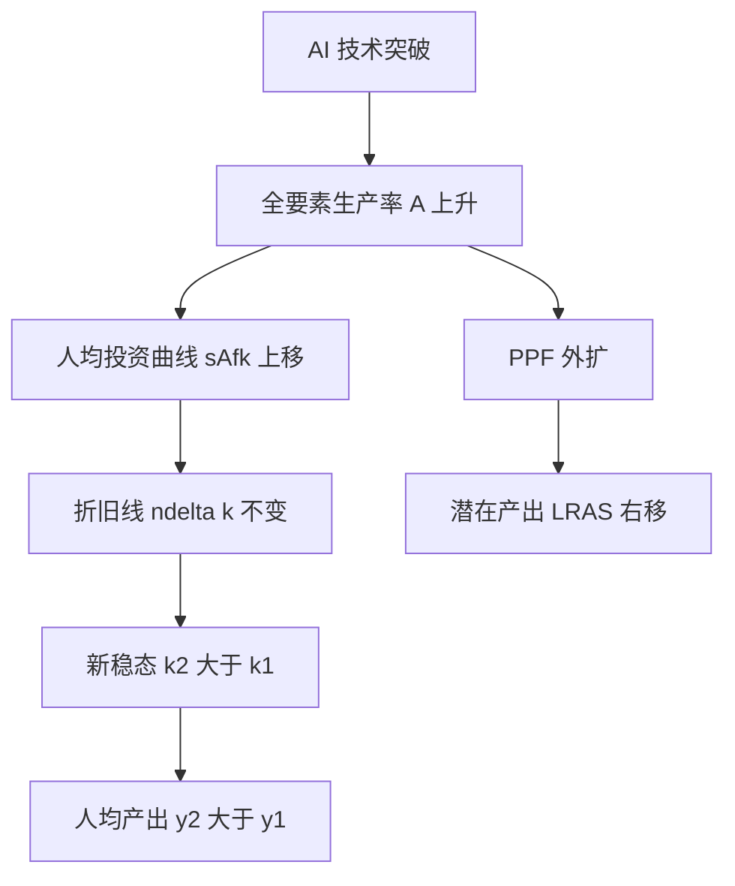

# 首都经济贸易大学 801 经济学·模拟卷（二）

<a href="../../exam.html" target="_blank" style="display:inline-block;padding:6px 16px;background:#2563eb;color:#fff;border-radius:6px;text-decoration:none;font-size:14px;">📝 开始做题</a>

> **难度定位**：基础卷（覆盖核心概念、基本原理、常规计算）
> **考试时间**：180 分钟　　**满分**：150 分
> **适用参考书**：马工程《西方经济学》（第二版）、《马克思主义政治经济学概论》（第二版）

---

## 注意事项

1. 本卷为闭卷考试，答案一律写在答题纸上，写在试题册上无效。
2. 允许使用黑色或蓝黑色钢笔、圆珠笔答题，不得使用铅笔、红色笔。
3. 考试过程中不得使用计算器、手机及任何电子设备，计算题数字均为可心算整数。
4. 答题须分点作答，标明题号；论述题须结合中国经济实际与当年热点。
5. 考试结束后，试题册与答题纸一并交回。

---

## 一、简答与计算题（共 6 题，每题 15 分，合计 90 分）

---

### 简答 1：简述政治经济学的研究对象，并说明物质资料生产为什么是马克思主义政治经济学研究的出发点。（15 分）

> 📚 **不懂就看：** [[../07_政治经济学/00_导论/知识点/KP01_政治经济学的研究对象|📖 KP·研究对象]] ｜ [[../07_政治经济学/00_导论/知识点/KP02_政治经济学的研究方法|📖 KP·研究方法]] ｜ [[../../经济统计学论文从0基础到精通/15_政治经济学基础/00_章节总结|🐮 教程·政经章节总结]]

**【考什么】** 对应知识点 [[../07_政治经济学/00_导论/知识点/KP01_政治经济学的研究对象|KP01 研究对象]]、[[../07_政治经济学/00_导论/知识点/KP02_政治经济学的研究方法|KP02 研究方法]]；题型属于概念简答类。

**【核心推导】**

**第一步 定性：研究对象是生产关系，不是物。**政治经济学的研究对象是**社会生产关系及其发展规律**，且是放在生产力与生产关系、经济基础与上层建筑的矛盾运动中去研究。它研究的不是"物"，而是"物背后的人与人的关系"——同样一台机器，在资本主义制度下是资本，在社会主义制度下是生产资料的公共所有，物的社会属性由生产关系决定。

**第二步 为什么必须以物质资料生产为出发点（三层逻辑）。**

| 层次 | 论证 | 关键 |
|---|---|---|
| ①存在论 | 人类要生存就要吃穿住行，要满足需要就必须生产物质资料，生产是人类社会的**第一个历史活动** | "任何一个民族，如果停止劳动，不用说一年，就是几个星期，也要灭亡" |
| ②决定论 | 物质生产是人类一切其他活动（政治、科学、艺术）的基础，生产决定分配、交换、消费 | 生产是起点、是主导环节 |
| ③关系论 | 生产关系只能在生产中形成：人们在生产中结成的人与人的关系，才是政治经济学真正的研究对象 | 生产是生产关系的"孵化器" |

**第三步 物质资料生产的三个简单要素。**劳动者（人的因素，主体）、劳动资料（主要是生产工具，是划分经济时代的**标志**）、劳动对象（被加工的东西）。三者中劳动资料最能体现生产力水平："手推磨产生的是封建主的社会，蒸汽磨产生的是工业资本家的社会"。

**第四步 生产力与生产关系的辩证关系（核心机制）。**生产力是内容，生产关系是形式。①生产力决定生产关系：生产力的性质决定生产关系的性质，生产力的发展变化决定生产关系的变革；②生产关系反作用于生产力：适合时促进、不适合时阻碍，这是"反作用"而不是"决定作用"；③二者的矛盾是社会基本矛盾，在生产关系一定要适合生产力性质的规律作用下，最终引向社会形态更替。

**第五步 为什么这门课要这么开场。**研究对象决定研究边界：把对象定为生产关系，才有后面的劳动价值论（价值是生产关系范畴）、剩余价值论（反映资本家与工人的对立）、资本积累论（反映历史趋势）；如果把经济学变成"资源配置技术"，就丢掉了历史性与阶级性。

**第六步 现实含义（数字经济下的检验）。**平台经济中，外卖骑手与平台之间并不是"技术关系"而是**劳动关系**：算法只是劳动资料，算法背后的抽成比例、派单规则、劳动强度，反映的是平台资本与劳动者之间的分配关系。这就是"从物质生产出发"仍有解释力的证明。

**【一句话】**物质资料生产是历史的起点，生产关系是理论的对象——起点错了，全部理论都悬空。

**【为什么要答这几点】**

**【满分 15 分的分点逻辑】**研究对象（4 分）→ 三层论证物质生产是出发点（6 分）→ 生产三要素与劳动资料的地位（2 分）→ 生产力与生产关系的辩证关系（3 分）。

**【易失分点】**①把研究对象写成"资源配置"或"经济发展"——直接跑出马克思主义政治经济学的边框，最多给 2 分；②只说"物质生产重要"而不给"为什么"，属于同义反复，不给分；③生产力与生产关系的反作用说成"决定作用"，是本考点最常见的概念混淆；④忘记强调"在生产力与生产关系的矛盾运动中研究"，答案会显得静态；⑤不区分劳动资料与劳动对象的意义，白丢 1 分。

**【加分点】**①引用"第一个历史活动"与"手推磨"两处经典表述；②点出劳动资料是划分经济时代的标志；③补一句研究方法论意义：对象决定理论边界；④用平台经济/数字劳动做现实印证。

**【阅卷心理】**阅卷老师看前两句就定档：开头若是"政治经济学研究生产关系"，进一档；若开头是"研究生产、分配、交换、消费"，基本封顶 8 分。因此**第一句必须写准**。

**【字数与时间】**500—600 字，建议 12 分钟：立意与三层论证占一半时间。

**【如何分析题目】**

**【如何分析题目】**
1. 先读题干的两个动词："简述研究对象"+"说明为什么是出发点"——这是**两个问**，必须分两段答，不能合成一段。
2. 为第一问定框：对象=生产关系（含其发展规律），限定词=在生产力与生产关系的矛盾运动中研究。写清"研究的是物背后的人与人的关系"。
3. 为第二问找论证结构：想"没有它会怎样"（存在论）+ "它还决定了什么"（决定论）+ "研究对象在哪形成"（关系论），三条论证自然成段。
4. 补生产三要素，并挑出劳动资料作为"划分经济时代标志"来加厚，避免简答过于单薄。
5. 加一层辩证关系：生产力决定生产关系、生产关系反作用，体现"规律"这一层含义。
6. 收尾落到现实：平台经济/数字劳动，说明理论仍有解释力，避免答案像背书。
7. 时间分配：0—3 分钟构思层级，3—10 分钟书写，10—12 分钟检查概念（生产力/生产关系、劳动资料/劳动对象）有无写反。

**【答题框架】**
- 第 1 段：政治经济学的研究对象是什么（2 分）
- 第 2 段：物质资料生产是出发点的原因（4 分）
- 第 3 段：生产力与生产关系的辩证关系（4 分）
- 第 4 段：研究对象的层次性——生产关系三环节（3 分）
- 第 5 段：小结（2 分）

**【参考答案】**

一、政治经济学的研究对象

（一）马克思主义政治经济学的研究对象是**社会生产关系及其发展规律**，即在一定生产力状况下人们在生产、分配、交换、消费过程中结成的相互关系。它不是研究物的自然属性，而是研究物背后人与人的关系、研究社会经济运行的客观规律。

二、物质资料生产是研究的出发点

（一）物质资料生产是人类社会存在和发展的基础。

1. 人类要生存，首先需要衣、食、住、行等基本生活资料，这些都必须通过生产才能获得。
2. 只有物质资料生产发展了，才能为政治、文化、科技、教育等其他社会活动提供物质前提。

（二）物质资料生产包含三个简单要素：人的劳动、劳动资料、劳动对象。其中劳动者是能动的主体，劳动资料与劳动对象合称生产资料，是生产的客观物质条件。

三、生产力与生产关系的辩证关系

（一）生产力是人类改造自然、征服自然的能力，反映人与自然的关系；生产关系是人们在生产过程中结成的相互关系，反映人与人的关系。

（二）二者是社会生产不可分割的两个方面：

1. 生产力决定生产关系。生产力的性质和水平决定生产关系的性质和形式，生产力的发展变化迟早会引起生产关系的变革。
2. 生产关系反作用于生产力。适合生产力发展要求的生产关系促进生产力发展，不适合的则阻碍其发展。
3. 生产关系一定要适合生产力状况，是人类社会发展的基本规律。

四、生产关系的层次性

（一）生产关系包括生产、分配、交换、消费四个环节，其中生产起主导决定作用，分配、交换、消费反作用于生产。
（二）政治经济学研究生产关系，既要研究生产关系的本质（所有制基础），也要研究其具体实现形式（经济体制）。

五、小结

政治经济学以社会生产关系为研究对象，以物质资料生产为出发点，在生产力与生产关系的矛盾运动中揭示经济规律，这是马克思主义政治经济学区别于资产阶级经济学的根本立场。

**【解析·得分点】** 采分点：①研究对象=社会生产关系及其发展规律（3 分）；②物质资料生产是人类生存发展基础（3 分）；③三要素（2 分）；④生产力决定生产关系、生产关系反作用（4 分）；⑤四环节与所有制（3 分）。易丢分：只答"研究生产关系"而漏答"发展规律"，或把生产力当作研究对象本身。

**【生活实例】** 一家奶茶店，店员劳动、封口机与杯子是劳动资料、茶叶奶精是劳动对象，三者结合才能做出奶茶；老板出钱开店、店员拿工资、毛利怎么分，这就是生产关系。店员手艺升级了（生产力提高），原来的小铺面雇佣方式就会变成连锁店——这就是生产力决定生产关系。

**【双链接】** 🔗 [[../07_政治经济学/00_导论/知识点/KP01_政治经济学的研究对象|回知识点·研究对象]] ｜ [[../07_政治经济学/00_导论/知识点/KP02_政治经济学的研究方法|研究方法]] ｜ 📖 《马克思主义政治经济学概论》导论

---

### 简答 2：简述产业资本循环的三个阶段、三种职能形式，并说明资本周转速度及其对剩余价值生产的影响。（15 分）

> 📚 **不懂就看：** [[../07_政治经济学/03_资本流通与剩余价值分配/知识点/KP01_资本循环|📖 KP·资本循环]] ｜ [[../07_政治经济学/03_资本流通与剩余价值分配/知识点/KP02_资本周转|📖 KP·资本周转]] ｜ [[../../经济统计学论文从0基础到精通/15_政治经济学基础/07_资本循环与周转|🐮 教程·资本循环与周转]]

**【考什么】** 对应知识点 [[../07_政治经济学/03_资本流通与剩余价值分配/知识点/KP01_资本循环|KP01 资本循环]]、[[../07_政治经济学/03_资本流通与剩余价值分配/知识点/KP02_资本周转|KP02 资本周转]]；题型属于关系对比类。

**【核心推导】**

**第一步 概念界定（两种剩余价值生产方法的区别在于"起点"）。**绝对剩余价值：在必要劳动时间不变的条件下，通过**延长工作日**或提高劳动强度而生产的剩余价值。相对剩余价值：在工作日长度不变的条件下，通过**缩短必要劳动时间**、相应延长剩余劳动时间而生产的剩余价值。

**第二步 机制推导（用公式说清两者的数量关系）。**工作日 $T = t_v + t_m$（必要劳动时间 + 剩余劳动时间），剩余价值率 $m' = t_m / t_v$。

| 方法 | 变动变量 | 计算示例 | 剩余价值率 |
|---|---|---|---|
| 绝对剩余价值 | $t_v$ 不变，$T$ 由 8h → 10h | $t_v=4,\ t_m$ 由 4h → 6h | $4/4=100\% \to 6/4=150\%$ |
| 相对剩余价值 | $T=8h$ 不变，$t_v$ 由 4h → 2h | $t_m$ 由 4h → 6h | $100\% \to 300\%$ |

注意：相对剩余价值虽然 $T$ 不变，但 $m'$ 从 100% 冲到 300%，涨幅远大于绝对剩余价值——因为缩短必要劳动时间是**乘法效应**，而延长工作日受生理与法律限制是**加法效应**。

**第三步 相对剩余价值的实现机制（这是全题的难点）。**它不是个别资本家直接"缩短"必要劳动时间，而是：个别企业提高劳动生产率 → 其商品个别价值低于社会价值 → 获得**超额剩余价值** → 各企业竞相仿效 → 部门劳动生产率普遍提高 → 生活资料价值下降 → 劳动力价值下降 → 必要劳动时间缩短 → 相对剩余价值生产形成。**超额剩余价值是动机，相对剩余价值是结果**，这是二者的因果链。

**第四步 联系（三点）。**①本质相同：两者都是资本家无偿占有工人剩余劳动的结果，都体现剥削关系；②目的相同：都为了提高剩余价值率、榨取更多剩余价值；③来源相同：都来源于雇佣工人的剩余劳动，都不创造新价值的"物"不参与。

**第五步 区别（四点）。**①手段不同：延长工作日 vs 提高劳动生产率；②限制不同：绝对剩余价值受生理界限与工人阶级斗争（工厂法）限制，相对剩余价值受技术条件限制但空间更大；③与劳动生产率的关系不同：绝对剩余价值以劳动生产率不变为前提，相对剩余价值以劳动生产率提高为前提；④历史地位不同：绝对剩余价值是资本主义初期的主要方法，相对剩余价值是机器大工业后、尤其是当代的主要方法。

**第六步 当代并存（举例）。**并存是因为两者可叠加：平台骑手"延长在线时长"（绝对）+ 智能调度压缩单位配送时间（相对）；互联网企业的"大小周"是绝对剩余价值，算法优化使社会必要劳动时间下降是相对剩余价值。996 与"降本增效"同时存在，正是两种方法并用的当下形态。

**【一句话】**绝对剩余价值向长度要剩余，相对剩余价值向效率要剩余，两者共同构成资本家提高剥削程度的两条腿。

**【为什么要答这几点】**

**【满分 15 分的分点逻辑】**两个概念界定（4 分）→ 数量机制与公式演算（3 分）→ 相对剩余价值的实现机制与超额剩余价值（4 分）→ 联系（2 分）→ 区别（2 分）→ 当代并存（1 分，酌情）。

**【易失分点】**①把相对剩余价值说成"个别企业提高劳动生产率直接得到"——混淆了超额剩余价值与相对剩余价值，扣分最重；②忘记写"工作日不变"这个前提；③联系与区别混在一段写，结构分丢失；④只背概念不做数量演算，答案显得空洞；⑤举不出当代例子。

**【加分点】**①用 $T=t_v+t_m$、$m'=t_m/t_v$ 演算两种情形；②点明"超额剩余价值是动机、相对剩余价值是结果"的因果链；③提到英国工厂法与十小时工作日法案作为绝对剩余价值的制度边界；④用外卖平台/996 做当代印证。

**【阅卷心理】**本题是"关系对比型"，阅卷按"对偶结构"给分：能成对写出联系与区别的，直接上一档；只答区别不答联系的，最多 11 分。

**【字数与时间】**550—650 字，13 分钟。演算部分要写清单位与百分比。

**【如何分析题目】**

**【如何分析题目】**
1. 拆题干："联系与区别"是并列两问，"举例说明并存"是第三问，答题必须三段式，不能揉成一团。
2. 先立定义：两种方法各自的前提（工作日变不变、必要劳动时间变不变）必须写对，这是全题地基。
3. 用公式做量化：设 $T=t_v+t_m$，分别演算绝对（延长 $T$）与相对（压缩 $t_v$）两种路径下 $m'$ 的变化，用具体小时数，别只写字母。
4. 攻坚难点：相对剩余价值的形成要走完"个别→部门→生活资料价值→劳动力价值→必要劳动时间"这条链，并说明超额剩余价值的位置。
5. 对偶罗列联系（本质、目的、来源）与区别（手段、限制、与劳动生产率关系、历史地位），每条一句话，句式对齐。
6. 落到当代：想两个能同时体现两种方法的场景（在线时长 + 算法提效），点明"叠加使用"。
7. 时间分配：2 分钟列提纲（左右两栏对写），9 分钟书写，2 分钟补公式与检查。

**【答题框架】**
- 第 1 段：产业资本循环公式（2 分）
- 第 2 段：三阶段与三种职能形式（5 分）
- 第 3 段：三种循环形式的统一（2 分）
- 第 4 段：资本周转、周转时间与周转次数（3 分）
- 第 5 段：周转速度对剩余价值的影响（3 分）

**【参考答案】**

一、产业资本循环的公式

（一）产业资本顺次经过购买、生产、售卖三个阶段，采取货币资本、生产资本、商品资本三种职能形式，实现价值增殖，最后回到原来出发点的运动，就是资本循环。公式为：

$$G—W\begin{Bmatrix}A\\P_m\end{Bmatrix}\cdots P\cdots W'—G'$$

其中 $G$ 为货币，$W$ 为商品，$A$ 为劳动力，$P_m$ 为生产资料，$P$ 为生产过程，$W'$ 为包含剩余价值的商品，$G'$ 为增殖了的货币。

二、三个阶段与三种职能形式

（一）购买阶段：$G—W$。资本家以货币购买劳动力 $A$ 和生产资料 $P_m$，货币执行**货币资本**职能，为剩余价值生产准备条件。

（二）生产阶段：$W\cdots P\cdots W'$。劳动力与生产资料结合生产出包含剩余价值的新商品，资本执行**生产资本**职能，这是循环中具有决定意义的阶段，剩余价值正是在此生产出来。

（三）售卖阶段：$W'—G'$。资本家把商品卖出换回货币，资本执行**商品资本**职能，实现包含在商品中的价值和剩余价值。

三、三种循环形式的统一

（一）产业资本连续循环必须是货币资本循环、生产资本循环、商品资本循环三种形式的统一。
（二）前提条件：空间上并存（三种职能形式按比例同时并存）、时间上继起（每一种形式都顺次通过各阶段）。并存与继起互为条件。

四、资本周转与周转速度

（一）资本周转是指不断重复、周而复始的资本循环。
（二）周转时间=生产时间+流通时间；周转次数 $n=\dfrac{U}{u}$（$U$ 为年，$u$ 为周转一次所需时间）。
（三）周转速度与周转时间成反比，与周转次数成正比。

五、周转速度对剩余价值生产的影响

（一）加快固定资本周转，可避免无形损耗，提高设备利用率。
（二）加快流动资本周转，可节省预付流动资本量，年剩余价值量 $M=m'\cdot v\cdot n$、年剩余价值率 $M'=m'\cdot n$ 随之提高。
（三）周转越快，同量可变资本在一年中剥削工人的次数越多，年剩余价值量与年剩余价值率越高。

**【解析·得分点】** 采分点：①公式完整（2 分）；②三阶段对应三职能形式且购买/售卖属流通领域、生产阶段决定剩余价值（5 分）；③并存性与继起性（2 分）；④周转次数公式（3 分）；⑤$M=m'vn$、$M'=m'n$（3 分）。易混点：货币资本≠货币本身，商品资本≠普通商品；职能形式≠循环形式。

**【生活实例】** 一家奶茶店：老板掏钱买茶叶奶精和雇店员是"购买阶段"（货币资本）；店员在后场做奶茶是"生产阶段"（生产资本，钱真正生钱的环节）；顾客点单付账是"售卖阶段"（商品资本）。一天能翻台多少轮，就是周转次数；翻台越快，同样店面一年赚的钱越多。

**【双链接】** 🔗 [[../07_政治经济学/03_资本流通与剩余价值分配/知识点/KP01_资本循环|回知识点·资本循环]] ｜ [[../07_政治经济学/03_资本流通与剩余价值分配/知识点/KP02_资本周转|资本周转]] ｜ 📖 《概论》第 4 章

---

### 简答 3：简述资本主义基本矛盾及其与经济危机的关系，说明资本主义经济危机的实质、根源和周期性。（15 分）

> 📚 **不懂就看：** [[../07_政治经济学/04_经济危机与历史趋势/知识点/KP01_资本主义经济危机|📖 KP·资本主义经济危机]] ｜ [[../../经济统计学论文从0基础到精通/15_政治经济学基础/10_资本主义经济危机|🐮 教程·资本主义经济危机]]

**【考什么】** 对应知识点 [[../07_政治经济学/04_经济危机与历史趋势/知识点/KP01_资本主义经济危机|KP01 经济危机]]、[[../07_政治经济学/04_经济危机与历史趋势/知识点/KP03_资本主义发展的历史趋势|KP03 历史趋势]]；题型属于原因分析类。

**【核心推导】**

**第一步 基本矛盾的表述。**生产社会化与生产资料资本主义私人占有之间的矛盾。生产社会化表现为三方面：生产资料使用的社会化、生产过程的社会化、产品的社会化（产品是许多工人共同劳动的成果）。

**第二步 矛盾如何生成（推到"谁该占有"这一层）。**社会化生产要求由社会统一占有和调配生产资料、按社会需要分配产品；但生产资料被资本家私人占有，生产服从私人利润最大化。**生产的社会性 vs 占有的私人性**——这就是矛盾的实质。

**第三步 矛盾的两大表现。**①个别企业生产的有组织性 vs 整个社会生产的无政府状态：企业内部计划严密、效率极高，但全社会没有统一计划，比例失调不可避免；②生产无限扩大的趋势 vs 劳动人民有支付能力的需求相对缩小：资本积累推动产能扩张，同时剥削压低工资，形成"产能过剩 + 消费不足"的组合。

**第四步 经济危机的实质与根源。**实质是**生产相对过剩**——不是产品绝对多了，而是相对于劳动人民有支付能力的需求过剩。根源是基本矛盾。危机的可能性早已存在于商品买卖脱节（货币作为流通手段）与货币作为支付手段的债务链中，但可能性变成现实需要基本矛盾发展到一定程度。

**第五步 危机的周期性（四阶段循环）。**危机 → 萧条 → 复苏 → 高涨 → 下一次危机。物质基础是**固定资本更新**：危机后设备廉价、利率低，资本家大规模更新固定资本，带动生产资料部门复苏；但更新又为下一轮产能过剩埋下伏笔，形成"用更大规模的生产过剩克服本次生产过剩"的悖论。

**第六步 现实含义。**2008 年国际金融危机是金融化掩盖下的生产过剩（次贷把低收入者的支付能力透支成有效需求）；2024—2026 年全球产能利用率下降、贸易保护主义抬头，本质仍是"世界市场容纳不了膨胀的生产力"，因此各资本国转向关税壁垒与产业回流，用政治手段分配市场——这正是基本矛盾在国际层面的展开。

**【一句话】**危机不是资本主义的意外，而是它自我运转的必然节奏。

**【为什么要答这几点】**

**【满分 15 分的分点逻辑】**基本矛盾表述（3 分）→ 矛盾生成的社会化三方面（3 分）→ 两大表现（4 分）→ 危机实质与根源（3 分）→ 周期性四阶段与固定资本更新（2 分）。

**【易失分点】**①把危机实质写成"生产绝对过剩"或"消费不足"，都是错位表述——必须写"相对过剩"；②只说基本矛盾，不提生产社会化三方面，等于有结论无论证；③两大表现只写一条；④周期性漏掉"固定资本更新"这一物质基础，是最常见的失分点；⑤不区分危机的可能性与现实性。

**【加分点】**①写出"可能性（买卖脱节、支付手段）→ 现实性（基本矛盾）"的层次；②点明"用更大规模的生产过剩克服本次过剩"的悖论；③引 2008 次贷与 2024—2026 产能利用率作当代例证。

**【阅卷心理】**本题踩点密度高，阅卷按"术语密度"给分：出现"相对过剩""固定资本更新""有支付能力的需求"三个术语基本进一档。

**【字数与时间】**550—650 字，13 分钟。

**【如何分析题目】**

**【如何分析题目】**
1. 先给定义式回答：矛盾 = 生产社会化 vs 私人占有，一句话立住。
2. 展开"社会化"三方面，让"社会化"不是一个空词。
3. 把矛盾翻译成反差句：社会要求统一调配 ↔ 实际由私人利润指挥。
4. 写两大表现，每条都用"一方面…另一方面…"的对照句式，突出矛盾张力。
5. 落到危机：先在"实质"上定调（相对过剩），再在"根源"上回到基本矛盾，形成闭环。
6. 补周期性：四阶段 + 固定资本更新这一物质基础，说明危机为什么"周期"而非"一次性"。
7. 用当代表现收尾（次贷危机、2024—2026 产能与贸易壁垒），体现理论的现实穿透力。
8. 时间分配：2 分钟搭框架（矛盾—表现—危机—周期—现实），10 分钟书写，1 分钟查术语。

**【答题框架】**
- 第 1 段：资本主义基本矛盾是什么（3 分）
- 第 2 段：经济危机的实质（3 分）
- 第 3 段：经济危机的根源（4 分）
- 第 4 段：危机的周期性与再生产四阶段（3 分）
- 第 5 段：小结（2 分）

**【参考答案】**

一、资本主义基本矛盾

（一）资本主义基本矛盾是**生产社会化和生产资料资本主义私人占有之间的矛盾**。

（二）生产社会化表现为生产资料使用社会化、生产过程社会化、产品社会化；但生产资料和产品归资本家私人占有，这就形成了对立。

二、资本主义经济危机的实质

（一）经济危机的实质是**生产相对过剩**，即相对于劳动人民有支付能力的需求来说商品显得过剩，而不是与劳动人民实际需要相比的绝对过剩。
（二）危机期间大量商品卖不出去、工厂倒闭、工人失业、信用关系破坏，本质是生产相对过剩的危机。

三、经济危机的根源

（一）经济危机的根源在于资本主义基本矛盾。这一矛盾具体表现为两个方面：

1. 个别企业生产的有组织性与整个社会生产无政府状态之间的矛盾，导致社会再生产比例失调。
2. 资本主义生产无限扩大的趋势与劳动人民有支付能力的需求相对缩小之间的矛盾。资本家为追逐剩余价值不断改进技术、扩大生产，同时又加强对工人的剥削，使劳动者购买力相对下降，生产与消费的矛盾尖锐到一定程度，危机必然爆发。

（二）货币作为流通手段和支付手段包含危机的形式上的可能性，但危机的现实性根植于资本主义基本矛盾。

四、经济危机的周期性

（一）危机周期性爆发的原因在于资本主义基本矛盾运动本身——激化→强制解决（危机）→缓和→再激化。
（二）再生产周期一般包括**危机、萧条、复苏、高涨**四个阶段，其中危机是周期的基本阶段。
（三）周期性的物质基础是固定资本更新：危机过后大规模更新固定资本，为复苏和高涨提供物质条件，同时又为下一次危机准备新的物质基础。

五、小结

经济危机是资本主义基本矛盾尖锐化的必然产物，是资本主义制度无法自愈的痼疾；它暴露了资本主义生产方式的历史过渡性。

**【解析·得分点】** 采分点：①基本矛盾=生产社会化 vs 私人占有（3 分）；②实质=相对过剩不是绝对过剩（3 分）；③两个具体表现（4 分）；④四阶段+固定资本更新是物质基础（3 分）；⑤制度性结论（2 分）。易错：把危机根源说成"比例失调"或"消费不足"等表面原因，必须落到基本矛盾。

**【生活实例】** 奶茶店老板拼命多开店、多备货（生产社会化、规模扩大），但又把雇员工资压得很低（私人占有、劳动者购买力跟不上）。最后整条街奶茶都卖不动，门店接连倒闭——这就是"相对过剩"：不是大家不想喝奶茶，而是喝得起、愿意花钱买的人太少。

**【双链接】** 🔗 [[../07_政治经济学/04_经济危机与历史趋势/知识点/KP01_资本主义经济危机|回知识点·经济危机]] ｜ [[../07_政治经济学/04_经济危机与历史趋势/知识点/KP03_资本主义发展的历史趋势|历史趋势]] ｜ 📖 《概论》第 7 章

---

### 简答 4：已知某消费者效用函数为 $U=X_1X_2$，两种商品价格分别为 $P_1=2$，$P_2=3$，消费者收入 $M=120$。求该消费者实现效用最大化时对 $X_1$、$X_2$ 的最优购买量，并写出均衡条件。（15 分）

> 📚 **不懂就看：** [[../06_西方经济学/02_消费者选择/知识点/KP02_基数效用论与消费者均衡|📖 KP·基数效用论均衡]] ｜ [[../06_西方经济学/02_消费者选择/知识点/KP05_序数效用论与消费者均衡|📖 KP·序数效用论均衡]] ｜ [[../../经济统计学论文从0基础到精通/13_微观经济学基础/06_无差异曲线与消费者均衡是什么|🐮 教程·无差异曲线与消费者均衡]]

**【考什么】** 对应知识点 [[../06_西方经济学/02_消费者选择/知识点/KP02_基数效用论与消费者均衡|KP02 基数效用论与消费者均衡]]、[[../06_西方经济学/02_消费者选择/知识点/KP05_序数效用论与消费者均衡|KP05 序数效用论消费者均衡]]；题型属于分析推导（带计算）类。

**【核心推导】**

**第一步 建模。**效用函数 $U = X_1 X_2$，价格 $P_1=2$、$P_2=3$，收入 $M=120$。

**第二步 写出预算约束。**$P_1 X_1 + P_2 X_2 = M$，即 $2X_1 + 3X_2 = 120$。

**第三步 用拉格朗日法求一阶条件（不跳步）。**构造 $\mathcal{L} = X_1 X_2 + \lambda(120 - 2X_1 - 3X_2)$，分别对 $X_1$、$X_2$、$\lambda$ 求偏导并令其为零：
$$\frac{\partial \mathcal{L}}{\partial X_1} = X_2 - 2\lambda = 0 \Rightarrow X_2 = 2\lambda$$
$$\frac{\partial \mathcal{L}}{\partial X_2} = X_1 - 3\lambda = 0 \Rightarrow X_1 = 3\lambda$$
两式相除得 $\dfrac{X_2}{X_1} = \dfrac{2}{3}$，即 $3X_2 = 2X_1$。

**第四步 代回预算约束求解。**由 $X_1 = 1.5 X_2$ 代入 $2(1.5X_2) + 3X_2 = 120$，得 $6X_2 = 120$，$X_2 = 20$，$X_1 = 30$。

**第五步 验算与效用值。**预算恰好用尽：$2 \times 30 + 3 \times 20 = 60 + 60 = 120$ ✔。最大效用 $U = 30 \times 20 = 600$。$\lambda = X_2/2 = 10$，含义是收入的边际效用——收入每增加 1 元，效用约增加 10 单位。

**第六步 用"等边际法则"复核（这是最省时的解法）。**消费者均衡条件 $\dfrac{MU_1}{P_1} = \dfrac{MU_2}{P_2}$，其中 $MU_1 = X_2 = 20$、$MU_2 = X_1 = 30$。代入：$20/2 = 10$，$30/3 = 10$，两者相等 ✔。均衡时每 1 元钱在两种商品上买到相同的边际效用。

**第七步 经济含义与常见变式。**

| 情形 | 判断 | 调整方向 |
|---|---|---|
| $\frac{MU_1}{P_1} > \frac{MU_2}{P_2}$ | 商品 1 的"性价比"更高 | 增加 $X_1$、减少 $X_2$ |
| $\frac{MU_1}{P_1} < \frac{MU_2}{P_2}$ | 商品 2 的"性价比"更高 | 增加 $X_2$、减少 $X_1$ |

对柯布—道格拉斯型 $U=X_1^a X_2^b$，有一般解 $X_1 = \dfrac{a}{a+b}\cdot\dfrac{M}{P_1}$、$X_2 = \dfrac{b}{a+b}\cdot\dfrac{M}{P_2}$——本题 $a=b=1$，故 $X_1 = \frac{120}{2\times 2}=30$、$X_2 = \frac{120}{2\times 3}=20$，与拉格朗日结果一致。这条"支出份额公式"必须背下来，考场上 30 秒出答案。

**【一句话】**均衡不是"买得起的任意组合"，而是每一元钱在两种商品上买到相同边际效用的那一点。

**【为什么要答这几点】**

**【满分 15 分的分点逻辑】**预算约束（2 分）→ 拉格朗日一阶条件（4 分）→ 求解与验算（4 分）→ 均衡条件的经济解释（3 分）→ 变式/支出份额公式（2 分）。

**【易失分点】**①直接写"$MU_1/P_1=MU_2/P_2$"给出答案而不写一阶条件推导——推导分全丢；②求导写错：$\partial U/\partial X_1 = X_2$（不是 $X_1$）；③解方程算错，$X_1$、$X_2$ 互换；④忘记验算预算是否用尽；⑤不解释 $\lambda$ 的经济含义。

**【加分点】**①给出 $\lambda=10$ 并解释为收入的边际效用；②用 $MU_1/P_1 = MU_2/P_2$ 二次复核；③背出 CD 函数的支出份额公式；④说明"性价比"判断与调整方向。

**【阅卷心理】**计算题按步骤给分，**写清拉格朗日函数就能拿到 6 分**；只写答案的即使数字对也只给 3 分。所以哪怕时间紧，也要把 $\mathcal{L}$ 与一阶条件写出来。

**【字数与时间】**400—500 字（含公式），10 分钟。

**【如何分析题目】**

**【如何分析题目】**
1. 先抄三组数据（$U$、$P_1,P_2$、$M$），明确"求最优购买量"是约束极值问题，工具是拉格朗日法。
2. 写预算约束，注意别把价格与数量位置写错。
3. 构造拉格朗日函数，把约束"搬进"目标函数——这一步是拿分分水岭。
4. 求三个偏导并令零，消去 $\lambda$ 得到数量比关系（$3X_2=2X_1$）。
5. 代回预算约束解出具体数值，再验算支出总额是否等于收入。
6. 算最大效用 $U=600$，并解释 $\lambda$ 的含义，把数学结果翻译成经济学语言。
7. 用 $MU_1/P_1=MU_2/P_2$ 复核，再补 CD 函数的份额公式作为一般化结论。
8. 时间分配：1 分钟列式，5 分钟推导，2 分钟验算，2 分钟写经济解释。

**【答题框架】**
- 第 1 段：消费者均衡条件（3 分）
- 第 2 段：求边际效用（3 分）
- 第 3 段：联立均衡方程与预算约束（6 分）
- 第 4 段：代入数字求解（2 分）
- 第 5 段：结论与总效用（1 分）

**【参考答案】**

一、消费者均衡的经济含义

（一）消费者均衡研究的是：在收入 $M$ 既定、商品价格 $P_1$、$P_2$ 既定的条件下，消费者如何把有限的收入分配于两种商品的购买上，使总效用达到最大。此时消费者不再调整购买组合，故称"均衡"。

（二）实现均衡的思路是：如果花在第一种商品上的每一元钱带来的边际效用大于第二种商品，理性消费者就会减少第二种商品、增加第一种商品的购买；随着第一种商品数量增加，其边际效用递减，第二种商品数量减少，其边际效用递增，直到每一元钱在两种商品上带来的边际效用相等为止。这一调整过程最终形成均衡条件。

二、消费者均衡条件

（一）在基数效用论下，消费者实现效用最大化的均衡条件是：在收入既定、价格既定时，消费者花费在每种商品上的每一元货币所带来的边际效用相等，且等于货币的边际效用 $\lambda$：

$$\frac{MU_1}{P_1}=\frac{MU_2}{P_2}=\lambda$$

（二）同时必须满足预算约束，即收入全部花完：

$$P_1X_1+P_2X_2=M$$

（三）若 $\dfrac{MU_1}{P_1}>\dfrac{MU_2}{P_2}$，消费者会多买 $X_1$、少买 $X_2$；若反之则反向调整；只有二者相等时才达到最优。

三、求边际效用

（一）由 $U=X_1X_2$，分别对 $X_1$、$X_2$ 求偏导，得到两种商品的边际效用：

$$MU_1=\frac{\partial U}{\partial X_1}=X_2,\qquad MU_2=\frac{\partial U}{\partial X_2}=X_1$$

（二）可见边际效用随另一种商品消费量同向变化，这是柯布—道格拉斯型效用函数的特征。

四、代入均衡条件并联立预算方程

（一）由 $\dfrac{MU_1}{P_1}=\dfrac{MU_2}{P_2}$：

$$\frac{X_2}{2}=\frac{X_1}{3}$$

交叉相乘得：$3X_2=2X_1$，即 $X_1=\dfrac{3}{2}X_2$。

（二）预算约束：$2X_1+3X_2=120$。

（三）将 $X_1=\dfrac{3}{2}X_2$ 代入预算约束：

$$2\cdot\frac{3}{2}X_2+3X_2=120\;\Rightarrow\;3X_2+3X_2=120\;\Rightarrow\;6X_2=120$$

解得 $X_2=20$，回代得 $X_1=\dfrac{3}{2}\times 20=30$。

五、结论与验证

（一）最优购买量为 $X_1^*=30$，$X_2^*=20$。
（二）预算线验证：$2\times 30+3\times 20=60+60=120=M$，收入正好花完。
（三）此时最大效用 $U^*=X_1X_2=30\times 20=600$。
（四）货币边际效用 $\lambda=\dfrac{MU_1}{P_1}=\dfrac{20}{2}=10$，即每一元钱带来 10 单位效用，花在 $X_1$、$X_2$ 上最后一元的效用相等，消费者不再愿意调整购买组合，均衡达成。

**【解析·得分点】** 采分点：①均衡条件 $\dfrac{MU_1}{P_1}=\dfrac{MU_2}{P_2}$（3 分）；②正确求偏导 $MU_1=X_2$、$MU_2=X_1$（3 分）；③预算方程（2 分）；④联立得 $X_1=\dfrac{3}{2}X_2$（3 分）；⑤解出 $X_1=30$、$X_2=20$、$U=600$（4 分）。易错：偏导求错（把 $MU_1$ 写成 $X_1$）；只列条件不代入数字；漏写预算约束验证。

**【生活实例】** 你拿 120 元去食堂，早餐 2 元一份、饮料 3 元一瓶。最优组合不是把钱全花在便宜的早餐上——那样最后一口早餐的边际效用太低。要吃到"最后一块钱无论买早餐还是买饮料都一样值"为止，算下来就是 30 份早餐 + 20 瓶饮料。

**【双链接】** 🔗 [[../06_西方经济学/02_消费者选择/知识点/KP02_基数效用论与消费者均衡|回知识点·基数效用论均衡]] ｜ [[../06_西方经济学/02_消费者选择/知识点/KP05_序数效用论与消费者均衡|序数效用论均衡]] ｜ 📖 马工程《西方经济学》上册 第 2 章

---

### 简答 5：简述短期总成本、固定成本、可变成本、平均成本、平均固定成本、平均可变成本与边际成本的含义及其相互关系。（15 分）

> 📚 **不懂就看：** [[../06_西方经济学/03_生产与成本/知识点/KP05_成本概念|📖 KP·成本概念]] ｜ [[../06_西方经济学/03_生产与成本/知识点/KP06_短期成本曲线|📖 KP·短期成本曲线]] ｜ [[../../经济统计学论文从0基础到精通/13_微观经济学基础/08_成本曲线是什么|🐮 教程·成本曲线是什么]]

**【考什么】** 对应知识点 [[../06_西方经济学/03_生产与成本/知识点/KP05_成本概念|KP05 成本概念]]、[[../06_西方经济学/03_生产与成本/知识点/KP06_短期成本曲线|KP06 短期成本曲线]]；题型属于关系对比+图形分析类。

**【核心推导】**

**第一步 七个概念的界定（按"总量—均量—增量"三类记住）。**总成本类：$TC$（总成本）、$TFC$（总固定成本）、$TVC$（总可变成本）；平均成本类：$AC$（平均成本）、$AFC$（平均固定成本）、$AVC$（平均可变成本）；边际成本 $MC$。

**第二步 七条恒等式（先有关系，才有形状）。**
$$TC = TFC + TVC, \quad AC = TC/Q, \quad AFC = TFC/Q, \quad AVC = TVC/Q$$
$$AC = AFC + AVC, \quad MC = \frac{dTC}{dQ} = \frac{dTVC}{dQ}$$

**第三步 短期七条曲线的形状与成因。**

| 曲线 | 形状 | 成因 |
|---|---|---|
| $TFC$ | 水平线 | 短期内与产量无关（厂房租金、设备折旧） |
| $TVC$ | 先平缓后陡增（S 形后段） | 边际报酬递减规律 |
| $TC$ | 与 $TVC$ 平行、上移 $TFC$ | $TC=TFC+TVC$ |
| $AFC$ | 单调递减、向两轴渐近 | $TFC$ 固定，分母 $Q$ 变大 |
| $AVC$ | U 形 | 先因分工与固定要素充分利用而下降，后因边际报酬递减上升 |
| $AC$ | U 形，位于 $AVC$ 上方 | $AC=AFC+AVC$，$AFC$ 递减使其最低点**晚于** $AVC$ 最低点 |
| $MC$ | U 形，变动最剧烈 | 边际报酬递减直接作用于增量 |

**第四步 三个"交点/穿过"关系（必考）。**
1. $MC$ 穿过 $AC$ 的最低点：$MC<AC$ 时 $AC$ 下降，$MC>AC$ 时 $AC$ 上升，故在 $MC=AC$ 处 $AC$ 最小。
2. $MC$ 穿过 $AVC$ 的最低点：同理，$MC=AVC$ 处 $AVC$ 最小。
3. $AC$ 最低点位于 $AVC$ 最低点右上方：因为 $AC=AVC+AFC$，$AFC$ 一直递减，在 $AVC$ 已回升时仍可能把 $AC$ 拉住，故 $AC$ 最低点更靠右、更高。

**第五步 数值示例（把"最低点"验一遍）。**设 $TC = 100 + 2Q + 0.5Q^2$，则 $TFC=100$、$TVC=2Q+0.5Q^2$、$MC = 2 + Q$、$AVC = 2 + 0.5Q$、$AC = 100/Q + 2 + 0.5Q$。
- $MC=AVC$：$2+Q = 2+0.5Q \Rightarrow Q=0$（短期起点即最低，属特例）；
- $AC$ 最小：$\dfrac{dAC}{dQ} = -100/Q^2 + 0.5 = 0 \Rightarrow Q^2 = 200 \Rightarrow Q \approx 14.1$，此时 $AC = 100/14.1 + 2 + 7.07 \approx 16.2$，而 $MC = 2 + 14.1 = 16.1$ ✔ 验证 $MC$ 穿过 $AC$ 最低点。这个数值例说明：**形如 $TC=a+bQ+cQ^2$ 时 $MC$ 是直线，$AVC$ 是直线，只有 $AC$ 是 U 形**——考试里被问"为什么 $AC$ 最低点在 $AVC$ 最低点右侧"就用 $AFC$ 递减解释。

**第六步 现实含义。**固定成本高的行业（航空、芯片制造、软件）$AFC$ 摊薄效应强，规模越大单位成本越低，因此有"必须做大"的内在压力；这也解释了为什么平台企业前期愿意亏损扩张——用产量摊薄固定成本，把 $AC$ 压到 $MC$ 附近。

**【一句话】**七条曲线其实只有三条独立（$TFC$、$TVC$、$MC$），其余都是它们的算术变形。

**【为什么要答这几点】**

**【满分 15 分的分点逻辑】**七个概念定义（3 分）→ 七条恒等式（3 分）→ 曲线形状与成因（4 分）→ 三条交点关系（3 分）→ 数值验证（2 分，酌情）。

**【易失分点】**①$AFC$ 与 $AVC$ 混淆，导致 $AC$ 最低点位置说反；②只说"U 形"不说"边际报酬递减规律"这个成因；③漏掉"$MC$ 穿过 $AC$ 与 $AVC$ 的最低点"这一核心考点；④$AC$ 最低点与 $AVC$ 最低点的相对位置写反；⑤恒等式漏写 $AC=AFC+AVC$。

**【加分点】**①指出"七条曲线只有三条独立"；②给出 $TC=a+bQ+cQ^2$ 的数值例并验算交点；③联系平台经济/重资产行业说明 $AFC$ 摊薄的现实压力。

**【阅卷心理】**阅卷看"是否成体系"：能按"总量—均量—增量"分组，并写出交点关系，基本满分；零散罗列概念的，最多 10 分。

**【字数与时间】**600—700 字（含表），14 分钟。

**【如何分析题目】**

**【如何分析题目】**
1. 先分组：总量（$TC,TFC,TVC$）、均量（$AC,AFC,AVC$）、增量（$MC$），分组能防止漏项。
2. 写恒等式，把所有量挂到 $TC=TFC+TVC$ 与 $Q$ 上，形成"一棵树"。
3. 分别说形状：$TFC$ 水平、$TVC$ S 形、$AFC$ 递减、$AVC$/$AC$/$MC$ U 形。
4. 逐个给成因，核心只有一条：边际报酬递减规律。
5. 专项回答"关系"：$MC$ 穿 $AC$、$MC$ 穿 $AVC$ 的最低点；$AC$ 最低点在 $AVC$ 最低点右上方（$AFC$ 递减所致）。
6. 用具体函数做数值验证，让"交点"从口号变成算式。
7. 收尾一句现实含义（重资产行业的规模压力）。
8. 时间分配：3 分钟起框架，9 分钟书写，2 分钟检查概念是否串位。

**【答题框架】**
- 第 1 段：短期总成本的分解（3 分）
- 第 2 段：三个平均量与边际成本的定义（4 分）
- 第 3 段：MC 与 AC、AVC 的关系（4 分）
- 第 4 段：图形特征文字描述（3 分）
- 第 5 段：小结（1 分）

**【参考答案】**

一、短期总成本的分解

（一）短期总成本 $TC$ 是厂商在短期生产一定产量所耗费的全部成本，分为：

1. 总固定成本 $TFC$：不随产量变动而变动的成本，如厂房租金、设备折旧，即使产量为零也需支付。
2. 总可变成本 $TVC$：随产量变动而变动的成本，如原材料、工人工资、燃料动力。

（二）关系式：$TC=TFC+TVC$。当 $Q=0$ 时，$TVC=0$，$TC=TFC$。

二、平均量与边际成本

（一）平均固定成本：$AFC=\dfrac{TFC}{Q}$。
（二）平均可变成本：$AVC=\dfrac{TVC}{Q}$。
（三）平均总成本：$AC=\dfrac{TC}{Q}=AFC+AVC$。
（四）边际成本：$MC=\dfrac{\Delta TC}{\Delta Q}=\dfrac{\Delta TVC}{\Delta Q}$，即每增加一单位产量所增加的总成本。

三、MC 与 AC、AVC 的关系

（一）$MC$ 曲线呈 U 形，这是由边际报酬递减规律决定的：起初边际产量递增使 MC 下降，之后边际产量递减使 MC 上升。

（二）$MC$ 与 $AC$ 相交于 $AC$ 的最低点：

1. 当 $MC<AC$ 时，$AC$ 下降；
2. 当 $MC>AC$ 时，$AC$ 上升；
3. 交点即收支相抵点（$AC$ 最低点）。

（三）$MC$ 与 $AVC$ 相交于 $AVC$ 的最低点：

1. 当 $MC<AVC$ 时，$AVC$ 下降；
2. 当 $MC>AVC$ 时，$AVC$ 上升；
3. 交点即停止营业点（$AVC$ 最低点）。

四、图形特征（文字描述）

（一）横轴为产量 $Q$，纵轴为成本。
（二）$TFC$ 为一条水平直线；$TVC$ 从原点出发、先以递减速率上升后以递增速率上升（斜向上、拐点后变陡）；$TC$ 曲线与 $TVC$ 平行，垂直距离恒等于 $TFC$。
（三）$AFC$ 单调递减，随 $Q$ 增大渐近于横轴。
（四）$AC$、$AVC$、$MC$ 均为 U 形；$MC$ 先后穿过 $AVC$ 最低点和 $AC$ 最低点，且 $AVC$ 最低点出现在较小产量、$AC$ 最低点出现在较大产量；$AC$ 与 $AVC$ 之间的垂直距离就是 $AFC$，随产量增大而缩小。

五、小结

短期诸成本曲线的形状和位置关系，根源在于边际报酬递减规律；$MC$ 先后穿过 $AVC$、$AC$ 最低点是最常考的图形结论，且两个最低点对应的产量不同——$AVC$ 最低点在前、$AC$ 最低点在后，二者之间的垂直距离随产量扩大而不断缩小。理解这些关系，才能进一步分析完全竞争厂商的短期供给曲线和停止营业决策。

**【解析·得分点】** 采分点：①$TC=TFC+TVC$（3 分）；②四个平均量/边际量公式（4 分）；③$MC$ 穿过 $AC$、$AVC$ 最低点及其含义（收支相抵点/停止营业点）（4 分）；④U 形成因=边际报酬递减（2 分）；⑤图形文字描述（2 分）。易错：把 $AFC$ 画成 U 形（应为单调下降）；漏说 $AC$ 最低点产量大于 $AVC$ 最低点产量。

**【生活实例】** 一家奶茶店月租 1 万元（TFC），每做一杯奶茶茶叶奶精人工 5 元（TVC）。做的杯数越多，每杯摊到的月租越少（AFC 下降）；但店员挤在一起互相干扰，做到后面每多做一杯反而更费劲（MC 先降后升），这就是边际报酬递减。

**【双链接】** 🔗 [[../06_西方经济学/03_生产与成本/知识点/KP06_短期成本曲线|回知识点·短期成本曲线]] ｜ [[../06_西方经济学/03_生产与成本/知识点/KP05_成本概念|成本概念]] ｜ 📖 马工程《西方经济学》上册 第 5 章

---

### 简答 6：简述 GDP 的三种核算方法，并说明 GDP、GNP、NDP、NI、PI、DPI 之间的换算关系。（15 分）

> 📚 **不懂就看：** [[../06_西方经济学/09_宏观经济基本指标/知识点/KP01_GDP的含义与核算|📖 KP·GDP 的含义与核算]] ｜ [[../06_西方经济学/09_宏观经济基本指标/知识点/KP02_名义GDP与实际GDP|📖 KP·名义与实际 GDP]] ｜ [[../../经济统计学论文从0基础到精通/14_宏观经济学基础/01_GDP与国民收入核算|🐮 教程·GDP 与国民收入核算]]

**【考什么】** 对应知识点 [[../06_西方经济学/09_宏观经济基本指标/知识点/KP01_GDP的含义与核算|KP01 GDP 的含义与核算]]；题型属于概念简答+关系对比类。

**【核心推导】**

**第一步 GDP 的定义要素（四个关键词都要点到）。**GDP 是一个国家或地区**一定时期内**（流量）**在本国国土范围内**（地域原则）生产的**全部最终产品和服务的市场价值**（最终产品、市场价值）。四个要素缺一不可：时期性、地域性、最终产品、市场价值。

**第二步 三种核算方法（同一结果的三个视角）。**
1. **生产法（部门法）**：$GDP = \sum (各部门总产出 - 中间投入) = \sum 各产业增加值$，强调"不重复计算"，中间投入不进入。
2. **收入法（分配法）**：$GDP = 工资 + 利息 + 租金 + 利润 + 间接税净额 + 折旧$，即按要素收入与政府收入拆解。
3. **支出法（使用法）**：$GDP = C + I + G + (X - M)$，其中 $I$ 为总投资（含固定资产投资与存货投资），$X-M$ 为净出口。

**第三步 为什么三种方法必然相等。**生产创造的价值总量 = 分配出去的收入总量 = 最终使用的支出总量，这是国民收入核算的**三方等价原则**。三者不相等只可能来自统计误差（漏报、存货估值、非市场活动）。

**第四步 六个总量的换算链（这是本题的重心）。**
$$GNP = GDP + \text{本国居民在国外的要素收入} - \text{外国居民在本国的要素收入}$$
$$NDP = GDP - \text{资本折旧}, \quad NNP = GNP - \text{折旧}$$
$$NI = NNP - \text{间接税净额} + \text{政府补贴}$$
$$PI = NI - \text{公司未分配利润} - \text{公司所得税} - \text{社会保险费} + \text{政府与企业转移支付} + \text{政府支付的利息}$$
$$DPI = PI - \text{个人所得税}$$

**第五步 数值示例（把链条走一遍）。**设 $GDP=1000$ 亿元，本国要素净收入 $+20$，折旧 $100$，间接税净额 $60$，公司未分配利润 $40$、公司所得税 $30$、社保费 $50$，转移支付 $70$、政府付息 $10$，个人所得税 $80$。
- $GNP = 1000+20 = 1020$
- $NDP = 1000-100 = 900$
- $NI = 900 - 60 = 840$
- $PI = 840 - 40 - 30 - 50 + 70 + 10 = 800$
- $DPI = 800 - 80 = 720$

**第六步 概念辨析（考试最爱设的坑）。**

| 对比 | 关键差别 |
|---|---|
| GDP vs GNP | 地域原则 vs 国民原则（谁在本国生产 vs 谁的生产） |
| GDP vs NDP | 是否扣除折旧（净 vs 总） |
| 名义 vs 实际 GDP | 是否剔除价格变动；实际 GDP 用不变价，$GDP\ 平减指数 = \dfrac{名义 GDP}{实际 GDP}\times 100$ |
| GDP vs 绿色 GDP | 是否扣除资源耗减与环境代价 |

**第七步 现实含义。**GDP 是流量的"体温计"而不是"幸福感量表"：家务劳动、地下经济、闲暇、环境损害都不计入；2024—2026 年中国强调"高质量发展"，正是把核算重心从 GDP 增速转向全要素生产率与居民收入占比——因为 $DPI$ 才是真正落到家庭的钱。

**【一句话】**三种方法是同一枚硬币的三面，六个指标是一条剥洋葱式的减法链。

**【为什么要答这几点】**

**【满分 15 分的分点逻辑】**GDP 定义四要素（3 分）→ 三种核算方法及公式（5 分）→ 三方等价原理（2 分）→ 六个指标换算链（4 分）→ 辨析与实际含义（1 分）。

**【易失分点】**①定义漏掉"最终产品"或"国土范围"，GDP 与 GNP 的差别就说不清；②支出法把政府购买 $G$ 与转移支付混为一谈（转移支付不计入 GDP）；③$NI$ 计算时漏掉"间接税净额"或弄成加法；④$PI$ 的加减项背反（未分配利润是减、转移支付是加）；⑤把名义 GDP 与实际 GDP 的平减指数写成"实际/名义"。

**【加分点】**①写出三方等价原则并解释误差来源；②给出完整数值链走一遍；③补 $GDP$ 平减指数与绿色 GDP 两个辨析；④点出"GDP 不是福利指标"。

**【阅卷心理】**本题按"链条完整性"给分：能把 $GDP\to GNP\to NNP\to NI\to PI\to DPI$ 一条线写全并给出加减号，基本满分；只列名字不给加减号的，只能拿一半。

**【字数与时间】**600—700 字，14 分钟。

**【如何分析题目】**

**【如何分析题目】**
1. 两问拆开：核算方法（横向，三个视角）+ 换算关系（纵向，六个环节）。
2. 定义先行：把 GDP 的"时期、地域、最终产品、市场价值"四要素写出来，作为后面辨析的锚点。
3. 写三种方法时，每种都给出公式与一句"为什么这样算"（生产法怕重复、收入法按要素、支出法按用途）。
4. 用三方等价原则把三种方法串起来，避免答案像三个孤立段落。
5. 换算链按顺序写，每步都标清"加什么、减什么"，这是拿分核心。
6. 用一组假设数字把链条走一遍，验证自己记的加减号没错。
7. 补辨析表（GDP/GNP、总/净、名义/实际、绿色 GDP），再一句现实评价收尾。
8. 时间分配：2 分钟搭两条线，10 分钟书写，2 分钟复核加减号。

**【答题框架】**
- 第 1 段：GDP 定义（2 分）
- 第 2 段：生产法、收入法、支出法（5 分）
- 第 3 段：GDP 与 GNP 的区别（3 分）
- 第 4 段：五大总量换算关系（4 分）
- 第 5 段：小结（1 分）

**【参考答案】**

一、GDP 的含义

（一）国内生产总值（GDP）是指一个国家或地区在一定时期内（通常为一年）运用生产要素所生产的全部最终产品和服务的市场价值。
（二）关键词：地域原则（"国内"）、最终产品、市场价值、流量、一定时期。

二、三种核算方法

（一）生产法（增加值法）：

1. 从生产角度核算，$GDP=\sum$ 各部门总产出 $-\sum$ 各部门中间投入。
2. 即所有企业增加值之和，避免重复计算。

（二）收入法（要素支付法）：

1. 从收入角度核算，$GDP=$ 工资 $+$ 利息 $+$ 利润 $+$ 租金 $+$ 间接税 $-$ 补贴 $+$ 折旧。
2. 即把生产中形成的各种要素收入加总。

（三）支出法（最常用）：

1. 从最终使用角度核算：

$$GDP=C+I+G+(X-M)$$

2. 其中 $C$ 为居民消费，$I$ 为私人投资，$G$ 为政府购买，$X$ 为出口，$M$ 为进口，$(X-M)$ 为净出口。

三、GDP 与 GNP 的区别

（一）GDP 按**地域原则**核算：只要在中国境内生产，无论本国企业还是外资企业都计入。
（二）GNP（国民生产总值）按**国民原则**核算：只要是本国国民（企业）所生产，无论在国内还是国外都计入。
（三）关系：$GNP=GDP+$ 本国公民在国外的要素收入 $-$ 外国公民在本国的要素收入，即 $GNP=GDP+$ 国外净要素收入。

四、五大总量换算关系

（一）$GDP$：国内生产总值。
（二）$NDP=GDP-$ 折旧（国内生产净值）。
（三）$NI=NDP-$ 间接税 $+$ 补贴（狭义国民收入，即要素收入总和）。
（四）$PI=NI-$ 公司未分配利润 $-$ 公司所得税 $-$ 社会保险税 $+$ 政府转移支付 $+$ 利息调整（个人收入）。
（五）$DPI=PI-$ 个人所得税（个人可支配收入，即居民实际可用于消费和储蓄的收入）。

（六）换算链条概括：$GDP\xrightarrow{-折旧}NDP\xrightarrow{-间接税+补贴}NI\xrightarrow{-公司未分配利润等+转移支付}PI\xrightarrow{-个人所得税}DPI$。

五、小结

三种方法从不同角度核算同一 GDP，理论上结果相等；GDP 到 DPI 的层层扣减，反映了从生产创造到居民可支配收入之间的分配与再分配过程。

**【解析·得分点】** 采分点：①GDP 四关键词（2 分）；②生产法=增加值、收入法=要素收入加总、支出法 $C+I+G+(X-M)$（5 分）；③GDP 地域 vs GNP 国民（3 分）；④NDP/NI/PI/DPI 逐级扣减项（4 分）；⑤流量与最终产品提示（1 分）。易错：把 GNP 写成"全世界生产总和"；把转移支付计入 $G$（政府购买不含转移支付）。

**【生活实例】** 一家外企在中国建厂生产奶茶，产值算中国 GDP，但利润汇回母国，那部分才算母国 GNP。你工资条上的应发工资是 PI，扣完个税打到卡里的才是 DPI，才能真正用来吃饭租房。

**【双链接】** 🔗 [[../06_西方经济学/09_宏观经济基本指标/知识点/KP01_GDP的含义与核算|回知识点·GDP 核算]] ｜ [[../06_西方经济学/09_宏观经济基本指标/知识点/KP02_名义GDP与实际GDP|名义与实际 GDP]] ｜ 📖 马工程《西方经济学》下册 第 11 章

---

## 二、论述题（共 2 题，每题 30 分，合计 60 分）

---

### 论述 1：结合 2024—2026 年世界经济中平台垄断、金融化、全球化逆流与全球贫富分化加剧等新现象，运用马克思主义政治经济学基本原理，分析当代资本主义新变化的表现、本质及其历史趋势。（30 分）

> 📚 **不懂就看：** [[../07_政治经济学/04_经济危机与历史趋势/知识点/KP01_资本主义经济危机|📖 KP·资本主义经济危机]] ｜ [[../07_政治经济学/07_民生开放与全球治理/知识点/KP04_经济全球化与全球治理|📖 KP·经济全球化与全球治理]] ｜ [[../../经济统计学论文从0基础到精通/15_政治经济学基础/10_资本主义经济危机|🐮 教程·资本主义经济危机]]

**【考什么】** 跨 [[../07_政治经济学/02_资本主义经济制度与生产/知识点/KP09_资本积累|资本积累]]、[[../07_政治经济学/03_资本流通与剩余价值分配/知识点/KP05_平均利润与生产价格|平均利润]]、[[../07_政治经济学/04_经济危机与历史趋势/知识点/KP01_资本主义经济危机|经济危机]]、[[../07_政治经济学/07_民生开放与全球治理/知识点/KP04_经济全球化与全球治理|经济全球化]] 四章；题型属于现象类论述。

**【核心推导】**

**第一步 先给定性框架：变化是"形式"还是"实质"。**马克思主义政治经济学的判断标准是两条：①资本主义的根本性质（雇佣劳动、剩余价值生产、私人占有）有没有变？②这些变化的动因是什么？结论是——**形式有重大变化，实质没有变**；变化的总动因是生产力社会化程度提高与阶级斗争、社会主义制度的外部压力共同作用的结果。

**第二步 平台垄断：垄断形式从"生产集中"转向"数据与生态垄断"。**传统垄断依靠生产规模与市场份额；平台垄断依靠**网络效应 + 数据壁垒 + 多边市场锁定**。机制：用户越多 → 数据越多 → 算法越准 → 体验越好 → 用户更多，形成自我强化的正反馈；再用"二选一""自我优待""杀手型并购"排他。中国的实证：阿里"二选一"被罚 182.28 亿元（2021）、美团"二选一"被罚 34.42 亿元（2021），说明垄断已从"工厂规模"迁移到"数据与流量入口"。理论上这印证了列宁"垄断代替自由竞争"的判断，只是垄断的物质载体从机器设备变成了数据。

**第三步 金融化：剩余价值分配重心从生产领域向金融领域转移。**金融化的三个指标：金融业增加值占 GDP 比重上升、非金融企业金融资产占比上升、居民财产性收入占比上升。机制：实体利润率长期下降（利润率趋向下降规律）→ 资本不愿投向生产 → 涌向金融资产 → 资产价格膨胀 → 财富效应与债务积累 → 一旦资产价格回落即爆发危机。2008 年国际金融危机就是典型：次贷把无支付能力者的未来收入"证券化"成当期有效需求，用金融手段掩盖生产过剩。这是"虚拟资本脱离实体资本独立运动"的当代形态。

**第四步 全球化逆流：世界市场容纳不了膨胀的生产力。**资本国际化的动因是追逐更高利润率（输出资本、寻找廉价劳动力和市场）。但当生产能力的全球化扩张超过全球有效需求时，矛盾就以"逆全球化"形式爆发：关税壁垒、产业回流、技术脱钩、供应链"友岸外包"。2024—2026 年的表现包括美国加征关税、欧盟碳边境调节机制、各国补贴竞赛。这不是全球化的终结，而是**资本主义基本矛盾在国际层面的展开**——用政治手段重新分配市场，恰是"生产社会化 vs 私人占有"的世界版。

**第五步 贫富分化：分配关系的两极积累。**机制端：资本积累的一般规律——一极是财富积累，另一极是贫困积累；叠加金融化使资本收益增速长期高于劳动收入增速（$r>g$ 的现象层面）。数据端（按国际机构常用口径）：全球最富 10% 人口占有约 3/4 的财富，乐施会报告显示 2020 年以来全球最富 1% 人群财富增量约为其余 99% 的两倍；中国基尼系数长期在 0.46—0.47 区间。这些数字说明分化是**趋势性**而非周期性现象。

**第六步 四个新现象的统一解释（本题的落点）。**四者不是孤立现象，而是一条链：实体利润率下降（根）→ 资本转向金融与平台（路径）→ 垄断租金与金融收益集中到少数主体（结果一）→ 劳动收入占比下降、需求不足（结果二）→ 世界市场争夺加剧、逆全球化（结果三）。四者共同指向同一结论：**资本主义的基本矛盾没有消失，只是换了表现形式**。

**第七步 辩证评价（必须写，否则答案显偏）。**新变化包含文明成果：社会化大生产的管理技术、平台基础设施、全球化分工的效率。因此正确态度是"两个必然"与"两个决不会"统一：资本主义必然灭亡、社会主义必然胜利，但"无论哪一个社会形态，在它所能容纳的全部生产力发挥出来以前，是决不会灭亡的"。

**【一句话】**资本换了衣服，没有换身体。

**【为什么要答这几点】**

**【满分 30 分的分点逻辑】**定性框架（4 分）→ 平台垄断机制与数据（6 分）→ 金融化机制与 2008 例证（6 分）→ 全球化逆流与基本矛盾（6 分）→ 贫富分化机制与数据（5 分）→ 统一解释链（2 分）→ 辩证评价与"两个必然"（1 分）。

**【易失分点】**①只罗列四个现象，不给**机制**——论述题的生命在机制，只有现象最多 15 分；②把"新变化"写成"资本主义性质变了"，政治立场性错误，直接降档；③数据全无，论证悬空；④不写统一解释链，四段像四篇无关短文；⑤漏掉辩证评价，答案显得片面。

**【加分点】**①用"网络效应+数据壁垒"解释平台垄断的自我强化；②用"利润率趋向下降 → 资本转向金融"把金融化挂到马克思的规律上；③把逆全球化解释为基本矛盾的国际展开；④引 182.28 亿、34.42 亿、基尼系数 0.46—0.47 等具体数字；⑤以"两个必然与两个决不会的统一"收尾。

**【阅卷心理】**30 分论述按"总分总 + 机制密度"给分：开头给判断（变形式不变实质）、中间每段"现象—机制—数据—理论"四件套、结尾统一解释并辩证收束，是标准满分结构。缺"理论"这一环（不引马克思原命题）通常卡在 25 分左右。

**【字数与时间】**1000—1200 字，30 分钟。四个现象各 150—200 字，开头结尾各 100 字。

**【如何分析题目】**

**【如何分析题目】**
1. 抓题干两个词："当代新现象"+"马克思主义政治经济学基本原理"——必须现象与理论一一对应，不能只谈现象。
2. 先立总判断：形式变化、实质未变；写清判断标准（所有制、剩余价值、私人占有）。
3. 拆四个现象，每个都用"现象描述 → 内在机制 → 数据/案例 → 对应理论"四步走，句式统一。
4. 平台垄断找"网络效应+数据壁垒+排他行为"，配阿里/美团罚款。
5. 金融化找"利润率下降 → 资本涌向金融 → 虚拟资本脱离实体"，配 2008 次贷危机。
6. 逆全球化找"世界市场容纳不了生产力"，配 2024—2026 关税与产业回流。
7. 贫富分化找"资本积累一般规律 + 金融化放大"，配基尼系数与国际财富分布数据。
8. 用一条因果链把四者串起来，再写辩证评价与"两个必然、两个决不会"。
9. 时间分配：5 分钟列"现象×机制×数据"三栏提纲，22 分钟书写，3 分钟补理论原话与检查立场表述。

**【答题框架】**
- 第 1 段：破题——当代资本主义新变化是垄断资本主义的新发展（4 分）
- 第 2—3 段：新变化的主要表现（平台垄断、金融化、全球化、贫富分化）（8 分）
- 第 4 段：用马克思主义原理剖析本质（剩余价值、资本积累、基本矛盾）（8 分）
- 第 5 段：与中国特色社会主义的对照与政策启示（6 分）
- 第 6 段：历史趋势评价（4 分）

**【参考答案】**

一、破题：当代资本主义新变化的历史定位

（一）二战后特别是 20 世纪 80 年代以来，资本主义在科技革命、国家干预和全球化推动下出现一系列新变化，但没有改变其本质——生产资料私有制、剩余价值生产和资本对劳动的剥削。
（二）用马克思主义政治经济学看，新变化是垄断资本主义从一般垄断、国家垄断向国际垄断、金融垄断演进的新阶段，是资本主义基本矛盾在全球范围内的新展开。

二、新变化的主要表现

（一）平台垄断与数字资本主义。

1. 以数据为关键生产要素，平台企业凭借网络效应和算法形成赢者通吃的垄断地位，垄断利润空前集中。
2. 劳动者被纳入"零工经济"，算法监控下的劳动过程更加隐蔽化、弹性化，外卖骑手、网约车司机看似自由，实际受到平台严格控制。

（二）经济金融化。

1. 金融资本脱离实体经济自我循环，利润来源越来越依赖利息、股息和资产价格上涨，而非生产性剩余价值。
2. 2008 年国际金融危机、疫情后发达国家天量货币宽松，都是金融资本扩张与矛盾积累的表现。

（三）全球化逆流与国际垄断。

1. 跨国公司在全球配置生产，把劳动密集环节转移到发展中国家，在全球范围内攫取剩余价值。
2. 2024—2026 年单边主义、贸易保护主义抬头，产业链"友岸化""近岸化"，本质是国际垄断资本矛盾激化、重新瓜分世界市场。

（四）全球贫富分化加剧。

各国劳动收入份额长期下降、资本收入份额上升，顶端 1% 人群占有社会财富比重持续提高；发达国家与发展中国家、跨国资本与本国劳工之间的鸿沟同步扩大。

三、用马克思主义原理剖析本质

（一）剩余价值生产的本质没有变。

1. 平台企业的超额利润，本质上仍来自对数字劳动者、零工劳动者和用户数据租金的占有，是剩余价值在新科技条件下的转化形态。
2. 金融利润本质上是对产业工人创造的剩余价值的再分割，是借贷资本、虚拟资本参与剩余价值分配。

（二）资本积累一般规律仍然起作用。

1. 一极是资本和财富的积累，另一极是无产阶级贫困的积累，在数字时代表现为平台巨头财富爆炸与零工劳动者收入微薄并存。
2. 资本有机构成提高导致相对过剩人口扩大，表现为高技能岗位稀缺、普通劳动者失业或非正式就业。

（三）资本主义基本矛盾在全球展开。

生产社会化已扩展到全球，但生产资料和利润仍归少数跨国垄断资本私人占有；个别平台内部组织高度精密，全球生产却处于无政府状态；生产无限扩大与全球劳动人民有支付能力需求相对缩小的矛盾，表现为全球需求不足、贸易萎缩、债务高企。

四、政策含义与中国对照

（一）面对平台垄断，我国强化反垄断和防止资本无序扩张，引导资本服务实体经济和共同富裕。
（二）面对金融化，我国坚持金融服务实体经济，防范化解地方债务、房地产等重点领域风险。
（三）面对全球化逆流，我国推动高水平对外开放、共建"一带一路"，以人类命运共同体理念超越零和博弈。
（四）面对贫富分化，我国在发展中保障和改善民生，推动共同富裕，体现社会主义制度对资本主义分配方式的超越。

五、历史趋势评价

（一）新变化在一定程度上缓和了资本主义基本矛盾，但没有也不可能消除这一矛盾；每当矛盾尖锐化，就会以危机、衰退形式强制释放，2008 年危机、疫情冲击、全球滞胀与地缘冲突反复证明这点。
（二）资本主义必然被更能适应生产社会化的新社会形态所代替，这是生产关系一定要适合生产力状况规律作用的结果。新变化越充分发展出生产社会化形式，就越为向更高社会形态过渡准备物质条件。

**【解析·得分点】** 采分点：①新变化定位为垄断资本主义新发展（4 分）；②四大表现每点 2 分共 8 分；③用剩余价值、资本积累一般规律、基本矛盾剖析本质（8 分）；④中国政策对照（6 分）；⑤历史趋势结论（4 分）。加分项：能举 2008 危机、疫情货币宽松、平台反垄断、共同富裕等具体事例。易错：只罗列现象不上升到原理；把新变化说成资本主义"垂而不死"。

**【生活实例】** 外卖骑手在寒风中骑车，APP 用算法一秒一秒压缩送餐时间（劳动被严密监控）；平台市值却节节攀升（垄断利润归股东）。骑手以为自己是"自由职业者"，实际上每一步都被看不见的算法指挥——这就是数字时代剩余价值剥削的隐蔽形式。

**【双链接】** 🔗 [[../07_政治经济学/02_资本主义经济制度与生产/知识点/KP09_资本积累|资本积累]] ｜ [[../07_政治经济学/04_经济危机与历史趋势/知识点/KP01_资本主义经济危机|经济危机]] ｜ [[../07_政治经济学/07_民生开放与全球治理/知识点/KP04_经济全球化与全球治理|经济全球化]] ｜ 📖 《概论》第 8—9 章

---

### 论述 2：2024—2026 年中国经济运行中出现社会总需求不足、物价持续低位运行（CPI 温和、PPI 负增长）等特征。请运用 AD-AS 模型，分析当前中国经济形势的成因，并说明积极财政政策与稳健货币政策的作用机制、政策效果及局限。（30 分）

> 📚 **不懂就看：** [[../06_西方经济学/12_AD-AS模型/知识点/KP01_AD总需求曲线|📖 KP·AD 总需求曲线]] ｜ [[../06_西方经济学/12_AD-AS模型/知识点/KP04_ADAS均衡与冲击|📖 KP·AD-AS 均衡与冲击]] ｜ [[../../经济统计学论文从0基础到精通/14_宏观经济学基础/09_AD-AS模型是什么|🐮 教程·AD-AS 模型是什么]]

**【考什么】** 跨 [[../06_西方经济学/12_AD-AS模型/知识点/KP01_AD总需求曲线|AD 曲线]]、[[../06_西方经济学/12_AD-AS模型/知识点/KP02_短期总供给曲线|短期 AS]]、[[../06_西方经济学/12_AD-AS模型/知识点/KP04_ADAS均衡与冲击|AD-AS 均衡与冲击]]、[[../06_西方经济学/15_宏观经济政策/00_章节总结|宏观经济政策]] 四章；题型属于政策效应类论述。

**【核心推导】**

**第一步 先诊断：这是"需求不足型"而非"供给冲击型"萧条。**判据三条：①CPI 温和（同比在 0%—1% 附近徘徊），说明需求端拉不动价格；②PPI 连续负增长，说明工业品出厂价格下行、企业利润受压；③GDP 平减指数为负，说明整体价格水平下行。三者同时出现，指向**总需求不足**，而不是成本推动型通胀或供给短缺。

**第二步 用 AD-AS 定位冲击方向。**在以物价 $P$ 为纵轴、产出 $Y$ 为横轴的图上：总需求曲线 $AD$ 左移（消费与投资意愿下降、预期转弱），短期总供给曲线 $SRAS$ 因成本下行略向右下，均衡点从 $E_1$ 移到 $E_2$：**产出下降、物价下降**——这正是"低通胀 + 低增长"的组合。若只是 $SRAS$ 右移（成本下降型），产出应上升而物价下降；实际产出没有起色，故主因在 $AD$ 左移。

**第三步 需求不足的三条微观根源。**①居民端：收入预期与就业预期转弱 → 预防性储蓄上升 → 边际消费倾向 $\beta$ 下降；②企业端：产能利用率偏低、未来需求看不清 → 投资意愿弱，资本边际效率 $MEC$ 下降；③资产负债表：房地产与地方债务调整使部门进入"去杠杆"，即"资产负债表衰退"式收缩。三条叠加 → 总需求曲线持续左移。

**第四步 财政政策：为什么必须"加力提效"。**在 IS-LM 框架里，$AD$ 不足意味着 $IS$ 曲线左移，均衡产出低于潜在产出。
- 传导链：政府支出 $G\uparrow$ → 总需求 $\uparrow$ → 通过乘数 $k_G = \dfrac{1}{1-\beta(1-t)}$ 放大 → 产出回升。
- 数值示例：设 $\beta=0.8$、税率 $t=0.25$，则 $k_G = \dfrac{1}{1-0.8\times 0.75} = \dfrac{1}{0.4}=2.5$。若新增政府支出 1 万亿元，理论产出增量约 2.5 万亿元。
- 但要注意三个限制：①**挤出效应**——政府发债推高利率会挤出私人投资，在 $LM$ 陡峭（流动性陷阱之外）时更明显；②**时滞**——识别、决策、执行、见效共 4 类时滞，等政策落地时需求可能已变；③**债务可持续性**——地方政府债务压力限制加码空间。因此财政政策要"提效"而非单纯"加量"：投向能形成未来供给能力的方向（新基建、以旧换新、社保兜底），而不是重复建设。

**第五步 货币政策：为什么"宽货币"未必变"宽信用"。**传导链：降准/降息 → 银行可贷资金 $\uparrow$、资金成本 $\downarrow$ → 信贷 $\uparrow$ → 投资与消费 $\uparrow$。在 IS-LM 中即 $LM$ 右移（利率下降），沿 $IS$ 向右下方移动，产出上升。
- 梗阻点：①**流动性陷阱倾向**——利率已低，继续降息对投资的刺激递减；②**信贷需求不足**——企业不借钱（不是银行不放贷），这是需求不足型萧条的典型特征；③**银行风险偏好**——不良压力使银行"惜贷"；④**资产价格渠道受阻**——房地产下行削弱了财富效应与抵押品价值渠道。
- 结论：货币政策要"精准"——结构性工具（再贷款、定向降准、支持科技创新与小微）优于全面宽松，因为总量宽松在需求不足时容易"推绳子"（推绳子拉不动，只能推）。

**第六步 政策协同：为什么单一政策不够。**财政与货币的组合取决于 $IS$-$LM$ 斜率和经济所处区间：
| 情形 | 财政有效性 | 货币有效性 | 政策取向 |
|---|---|---|---|
| $LM$ 水平（流动性陷阱） | 强 | 弱 | 财政主导 |
| $LM$ 垂直（古典区间） | 弱（完全挤出） | 强 | 货币主导 |
| $IS$ 陡峭（投资对利率不敏感） | 强 | 弱 | 财政主导 |
实际处于中间区间，故要"财政加力 + 货币配合"：财政扩张需要货币保持流动性充裕以压低政府债发行成本，货币宽松需要财政创造有效信贷需求，两者互为条件。同时要配合**预期管理**——需求不足型萧条的核心是预期，政策的一致性与可置信性本身就是一种需求刺激。

**第七步 现实判断。**中国 2024—2026 年的政策实践是"更加积极的财政政策 + 适度宽松的货币政策"组合：提高赤字率、发行超长期特别国债、大规模设备更新与消费品以旧换新、降准降息并下调存量房贷利率。判断标准不是"政策出了多少"，而是"居民消费率与企业投资意愿有没有回升"——这决定了政策是从"托底"走向"复苏"，还是陷入"政策依赖"。

**【一句话】**需求不足的病根在预期，药方在协同，疗效在信心。

**【为什么要答这几点】**

**【满分 30 分的分点逻辑】**诊断与数据判据（5 分）→ AD-AS 图形定位（5 分）→ 需求不足的三条微观根源（4 分）→ 财政政策传导、乘数、三重限制（6 分）→ 货币政策传导与四类梗阻（6 分）→ 政策协同矩阵（3 分）→ 现实判断（1 分）。

**【易失分点】**①不做诊断直接开药方，答案没有针对性；②AD-AS 图画错方向（把 $AD$ 左移画成 $SRAS$ 右移），结论就反了；③财政政策只写"扩大支出"，不写乘数与挤出效应；④货币政策不提"宽货币到宽信用"的梗阻，缺少深度；⑤不区分流动性陷阱与古典区间，协同分析无从谈起；⑥通篇没有数据（CPI、PPI、赤字率），论述失重。

**【加分点】**①用 CPI/PPI/GDP 平减指数三指标组合做诊断；②给出乘数公式并算数值（$k_G=2.5$）；③引"推绳子"与"资产负债表衰退"两个概念；④用 IS-LM 斜率矩阵分析政策有效性；⑤提出预期管理作为第三种政策工具。

**【阅卷心理】**本题是"政策效应型"论述，阅卷按"诊断—机制—工具—协同—判断"五段是否齐全给分。只写"应该扩张财政、宽松货币"的，最多 12 分；能画出 IS-LM 并用斜率讨论有效性的，直接进 25 分以上。

**【字数与时间】**1000—1200 字，30 分钟。财政与货币各占三分之一篇幅，诊断与协同各占六分之一。

**【如何分析题目】**

**【如何分析题目】**
1. 先读数据描述：CPI 温和、PPI 负增长——这两个词的组合是"需求不足"的暗号，第一步就要下诊断。
2. 用 AD-AS 做定位：画图，标 $AD$ 左移、均衡点左下移，明确"产出物价同降"的图形特征，并与成本推动型（$SRAS$ 左移）作对比。
3. 找微观根源：居民（收入预期→储蓄）、企业（产能利用→投资）、部门（去杠杆）三条，让宏观分析有微观落点。
4. 财政部分：写传导链 + 乘数公式与数值 + 挤出效应/时滞/债务三重限制，落到"提效"。
5. 货币政策部分：写传导链 + 四类梗阻，落到"精准"，引"推绳子"。
6. 协同部分：用 IS-LM 的斜率矩阵讨论谁主导，点出预期管理。
7. 现实判断：对应中国 2024—2026 的实际政策组合，给出可检验的判断标准。
8. 时间分配：5 分钟搭五段提纲并列好要用的三个数据，22 分钟书写，3 分钟补图形描述与结论。

**【答题框架】**
- 第 1 段：AD-AS 模型框架与图形文字描述（4 分）
- 第 2 段：当前"总需求不足、物价低位"在模型中的位置（8 分）
- 第 3 段：积极财政政策的作用机制与效果（8 分）
- 第 4 段：稳健货币政策的作用机制与效果（6 分）
- 第 5 段：政策局限与供给侧配合（4 分）

**【参考答案】**

一、AD-AS 模型框架

（一）总需求曲线 $AD$ 向右下方倾斜，表示价格总水平与总需求反向变动，由 $C+I+G+(X-M)$ 构成。
（二）短期总供给曲线 $SRAS$ 向右上方倾斜（价格粘性下，价格上升企业利润空间扩大、供给增加）；长期总供给曲线 $LRAS$ 垂直于潜在产出 $Y^*$。
（三）图形文字描述：横轴为国民收入 $Y$，纵轴为价格水平 $P$；$AD$ 右下倾斜，$SRAS$ 右上倾斜，$LRAS$ 在 $Y^*$ 处垂直。初始均衡为三线交点 $E_0$。

二、当前经济形势在模型中的位置

（一）2024—2026 年中国经济的特征是：经济增速低于潜在增速、CPI 低位温和、PPI 连续负增长、企业利润承压、青年就业与地产调整并存。
（二）用 AD-AS 解释：

1. **AD 左移**：居民消费意愿偏弱（收入预期与资产负债表修复）、房地产投资下行、地方政府债务约束下基建投资放缓、外需受全球贸易疲软影响。$AD_0$ 左移至 $AD_1$。
2. **SRAS 相对稳定或小幅下移**：大宗商品价格低位、产能过剩使企业提价困难，价格传导不畅。
3. 均衡点由 $E_0$ 移至 $E_1$：产出 $Y_1<Y^*$（产出缺口为负），价格水平 $P_1<P_0$，即"产出低于潜在、物价低位"的衰退性缺口（deflationary gap）。

（三）这说明矛盾的主要方面在**需求侧**，是总需求不足而非供给约束，需要扩张性政策把 $AD$ 推回 $LRAS$ 附近。

三、积极财政政策的作用机制

（一）作用工具：扩大财政赤字、发行特别国债、增加地方专项债、加大对社会保障与低收入群体的转移支付、对企业实施减税降费。

（二）传导机制：

1. 政府购买 $G$ 直接增加 $AD$，并通过乘数效应带动 $C$ 和 $I$：$\Delta Y=k\cdot \Delta G$。
2. 转移支付与减税提高居民可支配收入 $DPI$，拉动消费 $C$。
3. 中央加杠杆置换地方债，缓解财政紧缩对基建投资的拖累。

（三）图形效果：$AD_1$ 右移回 $AD_0$，产出缺口收窄，价格水平回升。

（四）评价：财政政策直接作用于总需求、时滞短，是当前稳增长的主力；但受地方债务约束、部分投资边际效益下降制约，需要优化支出结构、向民生和科技创新倾斜。

四、稳健货币政策的作用机制

（一）作用工具：降准、降息（MLF、LPR）、结构性再贷款、引导社会融资成本下行。

（二）传导机制：

1. 货币供应量扩张使利率下降，刺激企业投资 $I$ 和居民耐用品、住房消费 $C$。
2. 本币贬值压力下有利于出口 $X$。
3. 结构性工具定向支持小微企业、绿色发展、科技创新。

（三）图形效果：同样推动 $AD$ 右移；同时低利率降低企业融资成本，有助于 $SRAS$ 缓慢下移、企业修复盈利。

（四）评价：当前货币政策面临"流动性陷阱"特征——银行体系流动性充裕，但企业投资意愿弱、居民预防性储蓄高，降息对 $I$ 和 $C$ 的拉动存在"推绳子"效应；且需权衡汇率与银行净息差。

五、政策局限与供给侧配合

（一）单一需求管理政策的局限：

1. 若 $SRAS$ 因产能过剩、预期偏弱而对扩张政策反应钝化，$AD$ 右移可能主要带来价格回升而非产出扩张。
2. 若财政货币过度扩张，可能累积债务风险、延缓结构调整。

（二）必须与供给侧结构性改革配合：

1. 推动科技创新、产业升级，提高潜在产出 $Y^*$（$LRAS$ 右移）。
2. 完善社会保障、收入分配改革，稳定居民消费预期，从根本上修复消费倾向。
3. 化解房地产、地方债务存量风险，打通政策传导堵点。

（三）结论：当前中国经济需要"积极财政政策 + 稳健货币政策 + 供给侧改革"三管齐下，在 AD-AS 框架中既把 $AD$ 推回潜在产出附近，又通过提升全要素生产率让 $LRAS$ 右移，实现物价温和回升、就业充分和高质量发展的均衡。

**【解析·得分点】** 采分点：①AD/SRAS/LRAS 三线框架与图形（4 分）；②AD 左移成因（地产、消费预期、外需、地方债）（8 分）；③财政政策乘数机制（8 分）；④货币政策传导与"推绳子"局限（6 分）；⑤供给侧改革配合、$LRAS$ 右移（4 分）。加分项：提到产出缺口、衰退性缺口、PPI 负增长、LPR/MLF 等具体政策工具。易错：把物价低位简单归为"成本下降"（那是 SRAS 下移的通缩，需要区分）；只开药方不讲局限。

**【生活实例】** 街上的奶茶店今年生意清淡（AD 左移），老板不敢涨价（PPI 负），也不敢扩门店（投资弱）。政府多发消费券、搞基建（积极财政），银行降息让贷款便宜（稳健货币），就是要让顾客重新愿意掏钱；但如果顾客对未来收入没信心，发了券也存起来，政策效果就打折扣——所以还要改社保、涨收入，让人敢消费。

**【双链接】** 🔗 [[../06_西方经济学/12_AD-AS模型/知识点/KP01_AD总需求曲线|回知识点·AD 曲线]] ｜ [[../06_西方经济学/12_AD-AS模型/知识点/KP04_ADAS均衡与冲击|AD-AS 均衡与冲击]] ｜ [[../06_西方经济学/15_宏观经济政策/00_章节总结|宏观经济政策]] ｜ 📖 马工程《西方经济学》下册 第 13、15 章

### 论述 3：（曲线移动·PPF+索洛）试用生产可能性边界（PPF）与索洛增长模型，分析"DeepSeek 等 AI 技术突破"如何推动中国经济增长，并说明 PPF 外扩、sf(k) 线上移与长期增长率的关系

**【建议字数】800–1200 字 ｜ 【建议时间】30 分钟 ｜ 【题型】曲线移动综合论述（技术进步）**

**【考什么】** 对应知识点 [[../06_西方经济学/00_导论/知识点/KP02_机会成本|生产可能性边界]]、[[../06_西方经济学/16_经济增长/00_章节总结|索洛增长模型]]；题型属于长期增长类曲线移动分析。

**【核心推导】**

**第一步 定性：这是"供给端技术进步"冲击，不是需求冲击。**DeepSeek 等 AI 大模型突破的本质是**全要素生产率（TFP）$A$ 的提升**——同样的劳动 $L$ 与资本 $K$ 能产出更多。这一点决定了后面所有图形的移动方向：移动的是"生产能力曲线"，不是"需求曲线"。

**第二步 PPF 怎么外扩（短期、两部门视角）。**生产可能性边界表示在既定技术与资源下两种产品的最大组合。技术进步使同一资源生产更多两种产品 → **整条 PPF 外扩**。
- 若 AI 主要提升资本品部门效率，PPF 向外**偏资本品轴**扩张（非平行外扩）；
- 若两部门同步受益，则近似平行外扩；
- 关键辨析：外扩是**曲线本身的移动**，不是沿曲线的点移动（点移动表示资源配置变化，不是技术变化）。这条辨析是本期"曲线移动"专题的必答点。
- 另一个含义：技术进步使 PPF 外扩，也意味着**机会成本结构变化**——原本"多生产 1 单位消费品要放弃的资本品"数量改变，曲线斜率变化。

**第三步 索洛模型中 $sf(k)$ 怎么移（长期、增长视角）。**生产函数 $Y = A\cdot F(K,L)$，人均形式 $y = A f(k)$，$k = K/L$。
- 人均投资 $i = s y = s A f(k)$；折旧与人口增长线为 $(n+\delta)k$。
- $A$ 从 $A_1$ 升到 $A_2$ → **人均投资曲线 $sAf(k)$ 整体上移**（是曲线本身向上抬，不是沿曲线移动）。
- 稳态条件 $s A f(k) = (n+\delta)k$，新稳态 $k_2^* > k_1^*$，$y_2^* > y_1^*$。图中表现为交点沿 $(n+\delta)k$ 线向右上移动。

**第四步 新稳态、黄金律与条件收敛。**
- 新稳态下人均资本更高、人均产出更高，人均消费 $c^* = (1-s)y^*$ 也更高。
- 黄金律：$s$ 使 $MPK = n+\delta$ 时人均消费最大；$A$ 上升会推高黄金律对应的 $k$，因此"最优储蓄率"随技术进步而上移。
- 条件收敛：各国向**各自的**稳态收敛，收敛速度取决于与自身稳态的距离。技术进步提高稳态水平 → 落后国家若能吸收技术，收敛空间变大；若不能吸收（制度、人力资本不足），则出现"分化"而非收敛。

**第五步 数学推导（把结论算出来）。**取 Cobb-Douglas 形式 $Y = A K^{\alpha} L^{1-\alpha}$，人均 $y = A k^{\alpha}$。
$$s A k^{\alpha} = (n+\delta)k \Rightarrow k^{*} = \left(\frac{sA}{n+\delta}\right)^{1/(1-\alpha)}$$
$$y^{*} = A (k^{*})^{\alpha} = A^{1/(1-\alpha)}\left(\frac{s}{n+\delta}\right)^{\alpha/(1-\alpha)}$$
取 $\alpha = 1/3$，则 $A$ 的指数为 $1/(1-1/3)=1.5$：**$A$ 提高 1%，人均产出提高约 1.5%**——这就是技术进步的**放大效应**（源于资本积累的二次放大）。
数值例：$s=0.4$、$n+\delta=0.08$、$\alpha=1/3$，$A_1=1$ 时 $k^*=(0.4/0.08)^{1.5}=5^{1.5}\approx 11.18$，$y^*=1\times 11.18^{1/3}\approx 2.24$；当 $A_2=1.1$，$k^*=(0.44/0.08)^{1.5}=5.5^{1.5}\approx 12.90$，$y^*=1.1\times 12.90^{1/3}\approx 2.58$，产出提高约 15%，高于 $A$ 的 10%，验证放大效应。

**第六步 政策含义与现实。**①增长核算上，中国从"要素驱动"（人口红利、投资拉动）转向"创新驱动"，本质就是让 $A$ 持续上升；靠提高 $s$ 只能一次性拉高 $k$，最终仍会收敛到稳态而停止增长——**只有 $A$ 的持续增长能带来人均产出的持续增长**。②AI 的两个风险：一是"技术进步快于需求扩张"可能加剧结构性失业（这一题属短期，需另用劳动市场分析）；二是技术扩散不均会扩大区域与技能差距，使条件收敛变成"分化"。③因此政策要点是：加大基础研究投入、完善技术扩散渠道（开源模型正是加速扩散的机制）、同步建设教育与再培训体系。

**【一句话】**PPF 外扩讲"能给多少"，索洛讲"能长多久"，放大效应讲"能赚多少倍"。

**【为什么要答这几点】**

**【满分 30 分的分点逻辑】**定性（TFP 提升而非 K、L 增加）（4 分）→ PPF 外扩机制与"曲线移动 vs 沿曲线移动"辨析（6 分）→ $sAf(k)$ 上移与稳态变化（8 分）→ 黄金律与条件收敛（5 分）→ 数学推导与放大效应（4 分）→ 政策含义（3 分）。

**【易失分点】**①把技术进步说成"资本增加"或"劳动增加"——定性错，全题崩；②画成"沿 PPF 移动"或"沿 $sf(k)$ 移动"，这是曲线移动专题的头号错点；③稳态条件写成 $sf(k)=nk$，漏掉折旧 $\delta$；④只画图不推导，缺少放大效应这一层；⑤不区分短期（PPF）与长期（索洛）两个工具的适用边界。

**【加分点】**①明确 PPF 可能是"偏向资本品轴"的非平行外扩；②推导出 $y^*\propto A^{1/(1-\alpha)}$ 并取 $\alpha=1/3$ 得 1.5 倍弹性；③给出数值算例（$5^{1.5}$ 与 $5.5^{1.5}$）；④讨论条件收敛与技术扩散不均的"分化"风险；⑤提开源模型加速技术扩散。

**【阅卷心理】**本题是"曲线移动专题"，阅卷最关键的一条是**移动方向与移动类型**（曲线自身移动 vs 沿曲线移动），写错即降一档。其次是能否把 PPF（短期）与索洛（长期）两个模型的分工说清楚——只说其中一个最多 18 分。

**【字数与时间】**1000—1200 字，30 分钟。图形描述占约 600 字，推导与政策各约 300 字。

**【如何分析题目】**

**【如何分析题目】**
1. 先定性：题干里的"技术突破"必须译为"TFP $A$ 上升"，这是全题的地基，第一句就写。
2. 拆两个模型的分工：PPF 管"资源配置与生产能力边界"（短期、两部门），索洛管"长期增长与稳态"（长期、总量）。
3. 画 PPF：明确外扩、可能偏向某轴、强调"曲线移动"而非"沿曲线移动"，并解释机会成本变化。
4. 画索洛：写 $y=Af(k)$、$i=sAf(k)$、稳态 $sAf(k)=(n+\delta)k$，说明 $sAf(k)$ 上移、交点右上移。
5. 推导：CD 函数解出 $k^*$、$y^*$，指出 $A$ 的指数 $1/(1-\alpha)>1$，代入 $\alpha=1/3$ 得放大倍数，并给数值算例。
6. 补黄金律与条件收敛两层，让长期分析完整；指出扩散不均会导致分化。
7. 落到政策：基础研究、技术扩散、教育培训，并点出"只有 $A$ 能带来持续增长"。
8. 时间分配：4 分钟列提纲与公式，22 分钟书写，4 分钟检查移动方向与公式。

**【答题框架】**
- 第 1 段：事件定性——外生技术进步（4 分）
- 第 2 段：PPF 怎么外扩（理论 + 图形）（6 分）
- 第 3 段：索洛模型中 sf(k) 怎么移（8 分）
- 第 4 段：新稳态、黄金律、条件收敛（8 分）
- 第 5 段：数学推导 + 政策含义（4 分）

**【参考答案】**

一、事件定性。DeepSeek 等 AI 大模型突破是**外生技术进步**（全要素生产率 TFP 提升），不是劳动或资本数量的简单增加。它让同样的劳动 L 和资本 K 能生产更多产出。

二、PPF 怎么外扩。
（一）理论：PPF 表示在既定技术与资源下，两种产品（如"消费品 C"与"资本品 I"）最大产出组合。技术进步使同一资源能生产更多两种产品 → **整条 PPF 向外（右上）移动**。
（二）图形：横轴消费品 C，纵轴资本品 I。原 PPF₁ 凹向原点。AI 技术进步后 PPF 外扩到 PPF₂，且偏向资本品/I 一侧（AI 主要提升资本品生产效率）。
（三）若技术只提升消费品部门效率，PPF 只向 C 轴外扩；若两部门同步提升，则整体外扩。

三、索洛模型中 sf(k) 怎么移。
（一）生产函数：$Y = A\cdot F(K,L)$，人均形式 $y = A\cdot f(k)$，其中 $k=K/L$ 为人均资本、$A$ 为全要素生产率。
（二）投资：$i = s\cdot y = sA f(k)$。原投资曲线 $sA_1 f(k)$，折旧+人口增长线 $(n+\delta)k$。
（三）AI 使 A 从 A₁ 升到 A₂ > A₁ → **人均投资曲线 $sA f(k)$ 整体上移**（不是沿曲线移动，是曲线本身向上抬）。$(n+\delta)k$ 线不变。
（四）稳态条件 $sA f(k) = (n+\delta)k$。新稳态 $k_2^* > k_1^*$，人均产出 $y_2^* = A_2 f(k_2^*) > y_1^*$。

四、新稳态与黄金律。
（一）新稳态下人均资本更高、人均产出更高、人均消费 $c^*=(1-s)y^*$ 也更高。
（二）但注意：索洛模型中**技术进步是人均产出持续增长的唯一源泉**——没有 A 的增长，人均 y 会收敛到稳态不再增长（只有总产出随人口 n 增长）。
（三）黄金律：若 s 恰好使 $MPK = n + \delta$，则人均消费达到最大。AI 带来的 A 上升会把黄金律 k 也推高。

五、数学推导。
（一）Cobb-Douglas 生产函数 $Y = AK^\alpha L^{1-\alpha}$，人均形式 $y = Ak^\alpha$。
（二）稳态：$sAk^\alpha = (n+\delta)k$。
（三）解出 $k^* = \left(\frac{sA}{n+\delta}\right)^{1/(1-\alpha)}$。
（四）$A$ 从 A₁ 升到 A₂，$k^*$ 变为 $\left(\frac{sA_2}{n+\delta}\right)^{1/(1-\alpha)}$。因为指数 $1/(1-\alpha) > 0$，$k^*$ 上升。
（五）人均产出 $y^* = A (k^*)^\alpha = A \left(\frac{sA}{n+\delta}\right)^{\alpha/(1-\alpha)} = A^{1/(1-\alpha)} \left(\frac{s}{n+\delta}\right)^{\alpha/(1-\alpha)}$。
（六）可见 $y^*$ 对 $A$ 的弹性是 $1/(1-\alpha) > 1$——A 升 1%，y 升超过 1%，这就是**技术进步的放大效应**。

六、政策含义。中国从"要素驱动"（靠人口红利、投资拉动）转向"创新驱动"，本质就是让 A 持续上升。若只靠投资把 k 推高（s 上升），根据索洛模型，人均产出只会有**水平效应**（一次性跳升），不会带来**增长效应**（持续增长率）。只有 A 持续上升才能让中国人均产出持续增长。

**【解析·得分点】** ①技术进步是 TFP 提升不是 K 或 L 增加（4 分）；②PPF 外扩图形（6 分）；③sAf(k) 上移而非沿曲线移动（8 分）；④新稳态 k*、y* 上升（8 分）；⑤数学解 k*=(sA/(n+δ))^(1/(1-α))，A 的弹性 1/(1-α)（4 分）。易丢分：把技术进步当成储蓄率上升；混淆水平效应与增长效应；不画图。

**【生活实例】** 你家有同样两口锅、两个人炒菜（K、L 不变）。以前一小时炒 2 盘菜（A₁）。现在你学会了颠勺新技法（AI），一小时炒 5 盘菜（A₂）——不是锅多了、人多了，是技术让同样要素产出更多。放在国家层面：同样 14 亿人、同样工厂，AI 让我们能生产出更多手机、汽车、软件——这就是 PPF 外扩和索洛曲线的上移。

---

## 三、考点对照表

| 题号 | 题型 | 分值 | 学科 | 对应知识点 | 难度 |
|---|---|---|---|---|---|
| 简答 1 | 概念简答 | 15 | 政经 | 政治经济学研究对象、生产力与生产关系 | 基础 |
| 简答 2 | 关系对比 | 15 | 政经 | 产业资本循环三阶段三职能形式、资本周转 | 基础 |
| 简答 3 | 原因分析 | 15 | 政经 | 资本主义基本矛盾、经济危机实质根源与周期性 | 基础 |
| 简答 4 | 分析推导（计算） | 15 | 西经 | 消费者均衡条件、$U=X_1X_2$ 最优购买量 | 基础 |
| 简答 5 | 关系对比+图形 | 15 | 西经 | 短期成本曲线 TC/TFC/TVC/AC/AVC/AFC/MC | 基础 |
| 简答 6 | 概念简答 | 15 | 西经 | GDP 三种核算方法、GDP/GNP/NDP/NI/PI/DPI 关系 | 基础 |
| 论述 1 | 现象类 | 30 | 政经 | 当代资本主义新变化（平台垄断/金融化/全球化/贫富分化） | 中等 |
| 论述 2 | 政策效应类 | 30 | 西经 | AD-AS 分析中国总需求不足与物价低位、财政货币政策 | 中等 |
| 论述 3 | 曲线移动专题 | 30 | 西经 | PPF 外扩 + 索洛 sf(k) 上移，AI 技术进步与长期增长 | 中偏难 |
| **合计** | — | **180** | 政经 75 / 西经 105 | — | — |

---

> 本卷为基础难度模拟卷，建议闭卷限时 180 分钟完成。参考答案字数：简答每道 450—700 字，论述每道 900—1200 字。
