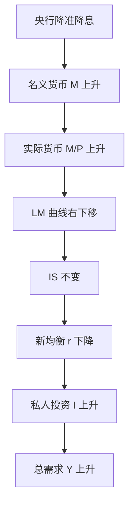

# 首都经济贸易大学 801 经济学 · 模拟卷（三）

<a href="../../exam.html" target="_blank" style="display:inline-block;padding:6px 16px;background:#2563eb;color:#fff;border-radius:6px;text-decoration:none;font-size:14px;">📝 开始做题</a>

> **考试时间**：180 分钟　|　**满分**：150 分　|　**难度**：中等
> **适用教材**：马工程《西方经济学》（第二版）、《马克思主义政治经济学概论》（第二版）
> 政治经济学、西方经济学各占约 50%；简答题 6 题 × 15 分 = 90 分；论述题 2 题 × 30 分 = 60 分。

## 注意事项

1. 闭卷考试，**不得使用计算器**，计算题只做简单数的推导与口算。
2. 答案一律写在答题纸上，答在试卷上无效。
3. 简答题建议每题 12 分钟左右，论述题建议每题 35 分钟左右。
4. 主观题须用「一、(一)、1、(1)、①」层级序号踩分；公式用规范经济学术语写出，图形可用文字描述坐标、曲线位置与移动方向。
5. 本卷共 8 题：简答 1–6，论述 1–2；卷末附【考点对照表】。

---

## 第一部分　简答与计算题（每题 15 分，共 90 分）

### 简答 1：简述价值规律的基本内容、表现形式及其在商品经济中的作用（政治经济学）

> 📚 **不懂就看：** [[../07_政治经济学/01_商品与货币/知识点/KP08_价值规律|📖 KP·价值规律]] ｜ [[../07_政治经济学/01_商品与货币/知识点/KP04_商品价值量|📖 KP·商品价值量]] ｜ [[../../经济统计学论文从0基础到精通/15_政治经济学基础/02_价值规律是什么|🐮 教程·价值规律是什么]]

**【考什么】** 对应知识点 [[../07_政治经济学/01_商品与货币/知识点/KP08_价值规律|价值规律]]，对应《概论》第二章；题型属于概念简答＋作用分析类，是政治经济学商品货币部分的最高频考点。

**【答题框架】**
- 第 1 段：价值规律的地位与基本内容（5 分）
- 第 2 段：表现形式——价格围绕价值波动（4 分）
- 第 3 段：三大作用（4 分）
- 第 4 段：作用的局限性与现实意义（2 分）

**【参考答案】**

一、价值规律是商品经济的基本规律。只要存在商品生产和商品交换，价值规律就必然存在并发挥作用。

(一) 基本内容。
1. 商品的价值量由生产商品的**社会必要劳动时间**决定，而不是由个别劳动时间决定。
2. 商品交换要以价值量为基础，按照**等价交换**的原则进行，即价格与价值相符。
(1) 社会必要劳动时间，是指在现有的社会正常生产条件下，在社会平均劳动熟练程度和强度下制造某种使用价值所需要的劳动时间。

(二) 表现形式。
1. 价值规律的表现形式是：商品的**价格围绕价值上下波动**。
2. 价格以价值为轴心，由于市场供求关系不平衡，供过于求时价格跌到价值以下，供不应求时价格涨到价值以上。
(1) 价格与价值的不一致**不是对价值规律的否定**，而正是价值规律发生作用的唯一可能形式。从较长时期和全社会看，商品的平均价格和价值是一致的。

(三) 价值规律的作用。
1. **自发地调节生产资料和劳动力在社会各生产部门之间的分配**，即调节社会资源配置。价格涨跌像"看不见的手"引导资本流入价高利大部门、流出价低利小部门。
2. **自发地刺激社会生产力的发展**。个别劳动时间低于社会必要劳动时间的商品生产者可获得额外收益，这促使各生产者改进技术、改善经营管理、提高劳动生产率。
3. **引起和促进商品生产者的两极分化**。条件好的生产者在竞争中取胜致富，条件差的破产倒闭，在一定历史条件下导致资本主义生产关系的产生。

(四) 作用的局限性。价值规律是自发调节，具有**自发性、盲目性和滞后性**，会造成社会劳动的浪费、技术垄断阻碍进步和贫富分化，因此在现代市场经济中需要国家宏观调控加以弥补。

**【解析·得分点】** 采分点：①社会必要劳动时间决定价值量（3 分）；②等价交换（2 分）；③价格围绕价值上下波动且长期一致（4 分）；④三大作用各 1–2 分。容易丢分：只写作用不写"表现形式"段；误以为价格偏离价值就是否定价值规律。

**【生活实例】** 同一杯奶茶，A 店熟练工 5 分钟做一杯，B 店新手 15 分钟做一杯，但市场只认"社会平均 8 分钟"这个价值；谁效率高谁赚钱。奶茶店排长队时老板涨价，冷清时打折，价格围着成本这条"轴心"上下跳，但一个月算下来均价差不多等于成本加合理利润——这就是价值规律在奶茶街的样子。

**【双链接】** 🔗 [[../07_政治经济学/01_商品与货币/知识点/KP08_价值规律|回知识点·价值规律]] ｜ [[../07_政治经济学/01_商品与货币/知识点/KP04_商品价值量|商品价值量]] ｜ 📖 [[../../原文件/经济学/马克思主义政治经济学概论_全书|《概论》第二章]]

---

### 简答 2：简述平均利润和生产价格是怎样形成的（政治经济学）

> 📚 **不懂就看：** [[../07_政治经济学/03_资本流通与剩余价值分配/知识点/KP05_平均利润与生产价格|📖 KP·平均利润与生产价格]] ｜ [[../../经济统计学论文从0基础到精通/15_政治经济学基础/08_平均利润与生产价格|🐮 教程·平均利润与生产价格]]

**【考什么】** 对应知识点 [[../07_政治经济学/03_资本流通与剩余价值分配/知识点/KP05_平均利润与生产价格|平均利润与生产价格]]，对应《概论》第七章；题型属于分析推导类，首经贸反复考过"利润转化为平均利润、价值转化为生产价格"。

**【答题框架】**
- 第 1 段：利润与利润率（3 分）
- 第 2 段：部门间竞争与资本转移（5 分）
- 第 3 段：平均利润与生产价格的形成（5 分）
- 第 4 段：理论意义（2 分）

**【参考答案】**

一、利润本质上是剩余价值。当剩余价值被看作全部预付资本（不变资本 c＋可变资本 v）的产物时，就取得了利润 p 的形式。利润率为：

$$p' = \frac{m}{c+v}$$

(一) 不同生产部门利润率存在差别。
1. 各部门资本有机构成（c∶v）不同。在剩余价值率相同的条件下，资本有机构成高的部门利润率低，有机构成低的部门利润率高。
2. 例如，重工业 c∶v 高、利润率低；轻纺工业 c∶v 低、利润率高。

(二) 部门之间的竞争和资本的自由转移使利润率平均化。
1. 追逐更高利润是资本的本性。资本家必然把资本从利润率低的部门抽出，投到利润率高的部门。
2. 资本大量流入高利润部门后，该部门生产扩大、商品供过于求，价格下跌，利润率随之下降；反之，资本流出的部门生产缩减、供不应求，价格回升，利润率上升。
3. 这种资本在各部门间反复转移的运动，一直持续到各部门利润率大体相等才会暂时停止。由此形成**平均利润率**：

$$\bar p' = \frac{\text{社会剩余价值总额}}{\text{社会预付总资本}}$$

4. 各部门预付资本按平均利润率获得的利润，就是**平均利润** $\bar p = C \times \bar p'$。

(三) 价值转化为生产价格。
1. 随着利润转化为平均利润，商品不再按价值 $(c+v+m)$ 出售，而是按**成本价格加平均利润**出售，即：

$$\text{生产价格} = k + \bar p = (c+v)+\bar p$$

2. 生产价格是价值的转化形式。从全社会看，生产价格总额等于价值总额，平均利润总额等于剩余价值总额。

(四) 理论意义。生产价格理论科学地解决了价值规律同等量资本获得等量利润之间的表面矛盾：生产价格不是对价值规律的否定，而是价值规律在自由竞争资本主义阶段发挥作用的转化形式。

**【解析·得分点】** 采分点：①p′＝m/(c＋v)（2 分）；②资本有机构成不同→利润率不同（3 分）；③资本转移机制：供过于求→价跌→利降（5 分）；④平均利润率公式（2 分）；⑤生产价格＝k＋平均利润且总额一致（3 分）。容易丢分：把平均利润写成"个别利润的简单平均"；漏掉"生产价格总额＝价值总额"这一守恒关系。

**【生活实例】** 一条街上，开奶茶店赚钱快（轻资产、人工多），开重型机械厂赚钱慢（重资产、机器贵）。于是老板们把钱从机械厂撤出来、涌进奶茶店；奶茶店越开越多、卷到不赚钱，机械厂没竞争了反而利润回升。最后各行各业"赚的钱差不多"——这就是利润率平均化。商品卖价也随之从"按卖一杯赚多少"变成"按成本＋平均该赚多少"定价，这就是生产价格。

**【双链接】** 🔗 [[../07_政治经济学/03_资本流通与剩余价值分配/知识点/KP05_平均利润与生产价格|回知识点·平均利润与生产价格]] ｜ [[../07_政治经济学/02_资本主义经济制度与生产/知识点/KP06_剩余价值率|剩余价值率 vs 利润率]] ｜ 📖 [[../../原文件/经济学/马克思主义政治经济学概论_全书|《概论》第七章]]

---

### 简答 3：简述社会主义市场经济体制的基本特征（政治经济学）

> 📚 **不懂就看：** [[../07_政治经济学/06_社会主义市场经济与发展/知识点/KP01_政府与市场关系|📖 KP·政府与市场关系]] ｜ [[../07_政治经济学/05_社会主义经济制度/知识点/KP02_中国特色社会主义所有制|📖 KP·中国特色社会主义所有制]] ｜ [[../../经济统计学论文从0基础到精通/15_政治经济学基础/11_社会主义市场经济|🐮 教程·社会主义市场经济]]

**【考什么】** 对应知识点 [[../07_政治经济学/06_社会主义市场经济与发展/知识点/KP01_政府与市场关系|政府与市场关系]]、[[../07_政治经济学/05_社会主义经济制度/知识点/KP02_中国特色社会主义所有制|所有制结构]]；题型属于理论类简答，核心是"社会主义基本制度与市场经济相结合"。

**【答题框架】**
- 第 1 段：总体定位（3 分）
- 第 2 段：所有制特征（4 分）
- 第 3 段：分配制度特征（4 分）
- 第 4 段：宏观调控与根本目的（4 分）

**【参考答案】**

一、社会主义市场经济体制是同社会主义基本制度结合在一起的市场经济体制，既可以发挥市场经济的长处，又可以发挥社会主义制度的优越性。其基本特征主要表现在以下三个方面。

(一) 在所有制结构上，以公有制为主体、多种所有制经济共同发展。
1. 毫不动摇巩固和发展公有制经济，毫不动摇鼓励、支持、引导非公有制经济发展。
2. 国有企业、集体企业等公有制经济在关系国家安全、国民经济命脉的重要行业和关键领域占支配地位；个体、私营、外资等非公有制经济是社会主义市场经济的重要组成部分。
3. 不同所有制经济在市场竞争中发挥各自优势、相互促进、共同发展。

(二) 在分配制度上，以按劳分配为主体、多种分配方式并存。
1. 按劳分配是公有制经济中个人消费品分配的基本原则；劳动、资本、土地、知识、技术、管理、数据等生产要素按贡献参与分配。
2. 这一分配制度既鼓励先进、提高效率，合理拉开收入差距，又防止两极分化，以逐步实现共同富裕为根本目标。

(三) 在宏观调控上，能够把人民的当前利益与长远利益、局部利益与整体利益结合起来，更好发挥政府作用。
1. 社会主义国家以公有制为基础，对经济的调控具有更雄厚的物质基础、更广泛的民意基础和更强的执行力。
2. 正确处理政府和市场的关系，使市场在资源配置中起**决定性作用**，同时更好发挥政府作用，推动有效市场和有为政府更好结合。
3. 坚持党的领导是社会主义市场经济体制的重要特征，能够集中力量办大事，保持经济持续健康发展。

**【解析·得分点】** 采分点：①"基本制度与市场经济结合"破题（3 分）；②所有制"两个毫不动摇"（4 分）；③分配制度＋共同富裕（4 分）；④市场决定性作用＋更好政府作用＋党的领导（4 分）。容易丢分：只写市场经济一般特征（等价交换、竞争），忘记"社会主义"限定；把"基础性作用"写成旧提法，现行为"决定性作用"。

**【生活实例】** 同样是开网约车：平台算法按市场规则派单、定价（这是市场经济）；但出租车牌照、城市地铁、电网这些命脉由国企把控（这是公有制为主体）；司机跑单赚钱归自己，同时国家还有最低工资、社保和税收调节防止贫富悬殊（这是按劳分配为主、多种分配并存）；早高峰、极端天气政府还能出面调度运力（这是更好发挥政府作用）。四件套合在一起，就是社会主义市场经济。

**【双链接】** 🔗 [[../07_政治经济学/06_社会主义市场经济与发展/知识点/KP01_政府与市场关系|回知识点·政府与市场关系]] ｜ [[../07_政治经济学/05_社会主义经济制度/知识点/KP02_中国特色社会主义所有制|所有制结构]] ｜ [[../07_政治经济学/05_社会主义经济制度/知识点/KP04_共同富裕|共同富裕]] ｜ 📖 [[../../原文件/经济学/马克思主义政治经济学概论_全书|《概论》第九章]]

---

### 简答 4：画图并说明完全竞争厂商的短期均衡的几种情况，以及厂商的短期供给曲线是怎样形成的（西方经济学）

> 📚 **不懂就看：** [[../06_西方经济学/04_完全竞争市场/知识点/KP03_短期均衡与停止营业点|📖 KP·短期均衡与停止营业点]] ｜ [[../06_西方经济学/04_完全竞争市场/知识点/KP02_完全竞争厂商的需求与收益|📖 KP·厂商需求与收益]] ｜ [[../../经济统计学论文从0基础到精通/13_微观经济学基础/09_完全竞争市场是什么|🐮 教程·完全竞争市场是什么]]

**【考什么】** 对应知识点 [[../06_西方经济学/04_完全竞争市场/知识点/KP03_短期均衡与停止营业点|短期均衡与停止营业点]]，对应马工程《西经》微观第六章；题型属于模型分析类，要求有图形意识。

**【答题框架】**
- 第 1 段：短期均衡条件（3 分）
- 第 2 段：四种盈亏情况（8 分）
- 第 3 段：短期供给曲线（4 分）

**【参考答案】**

一、完全竞争厂商是价格的接受者，其需求曲线、平均收益曲线 AR 和边际收益曲线 MR 重合为一条由市场价格决定的水平线。厂商实现最大利润（或最小亏损）的条件为 $MR=MC$，由于 $MR=P$，故短期均衡条件为：

$$P = SMC$$

(一) 短期内，按 $P=SMC$ 确定产量后，根据价格与平均成本 AC、平均可变成本 AVC 的相对位置，有四种情况。

1. **盈利情况**：当市场价格 $P$ 高于平均成本最低点（$P>AC_{\min}$）时，厂商获得超额利润，单位利润为 $(P-AC)$，总利润为 $(P-AC)\times Q$。
2. **盈亏平衡**：当 $P$ 恰好等于平均成本最低点（$P=AC_{\min}$）时，总收益等于总成本，厂商获得**正常利润**，该点称为收支相抵点。
3. **亏损但继续生产**：当 $AVC_{\min}<P<AC_{\min}$ 时，厂商亏损，但收益在弥补全部可变成本后尚能补偿部分不变成本；若停产则不变成本全损，故理性选择是继续生产。
4. **停止营业点**：当 $P$ 恰好等于平均可变成本最低点（$P=AVC_{\min}$）时，生产与不生产结果相同——收益刚好弥补可变成本，不变成本全损，该点即停止营业点。若 $P<AVC_{\min}$，厂商停止营业。

(二) 短期供给曲线的形成。
1. 短期均衡条件 $P=SMC$ 表明：每一个市场价格 $P$，厂商都对应 $SMC$ 曲线上一个最优产量。
2. 因此，厂商的**短期供给曲线就是 SMC 曲线位于 AVC 最低点以上的部分**。
3. 图形描述：横轴产量 Q、纵轴价格 P；向右上方倾斜的 SMC 穿过 AVC 最低点与 AC 最低点，AVC 最低点以上的 SMC 描粗即为短期供给曲线。

**【解析·得分点】** 采分点：①P=SMC 均衡条件（3 分）；②四种情况逐一对应 P 与 AC、AVC 关系（各 2 分）；③"停止营业点"定义（2 分）；④短期供给曲线＝AVC 最低点以上的 SMC（3 分）。容易丢分：混淆收支相抵点（P＝AC 最低点）与停止营业点（P＝AVC 最低点）；漏掉"为什么亏损仍要生产"的推理逻辑。

**【生活实例】** 一家小饭馆：每月房租（不变成本）5000 元，买菜人工（可变成本）每桌 30 元。客单价 60 元时赚得欢；客单价跌到 40 元时虽亏房租但每桌还能补一点现金，硬撑；客单价跌到 25 元时，卖一桌连买菜钱都收不回，不如关门省电费——那个 30 元的临界客单价就是停止营业点。饭馆老板沿"价格多高就敢开几桌"画出的那条线，就是短期供给曲线。

**【双链接】** 🔗 [[../06_西方经济学/04_完全竞争市场/知识点/KP03_短期均衡与停止营业点|回知识点·短期均衡与停止营业点]] ｜ [[../06_西方经济学/04_完全竞争市场/知识点/KP02_完全竞争厂商的需求与收益|厂商需求与收益]] ｜ 📖 [[../../原文件/经济学/西方经济学上册_微观_全书|《西经》微观第六章]]

---

### 简答 5：简述价格歧视的含义、三种类型及其实现条件（西方经济学）

> 📚 **不懂就看：** [[../06_西方经济学/05_不完全竞争市场/知识点/KP03_价格歧视|📖 KP·价格歧视]] ｜ [[../06_西方经济学/05_不完全竞争市场/知识点/KP01_完全垄断市场|📖 KP·完全垄断市场]] ｜ [[../../经济统计学论文从0基础到精通/13_微观经济学基础/10_完全垄断与价格歧视是什么|🐮 教程·完全垄断与价格歧视]]

**【考什么】** 对应知识点 [[../06_西方经济学/05_不完全竞争市场/知识点/KP03_价格歧视|价格歧视]]，对应马工程《西经》微观第七章；题型属于概念＋条件分析类。

**【答题框架】**
- 第 1 段：含义与实现条件（4 分）
- 第 2 段：一级价格歧视（4 分）
- 第 3 段：二级价格歧视（3 分）
- 第 4 段：三级价格歧视（4 分）

**【参考答案】**

一、价格歧视是指垄断厂商凭借其对价格的垄断力量，对**同一种成本相同的商品**向不同购买者索取不同价格，以攫取更多消费者剩余的行为。

(一) 实现价格歧视必须具备三个条件。
1. 厂商具有一定的**垄断力量**，能够控制价格。
2. 市场可以被有效地**分隔开**，顾客之间不能转卖或套利——低价买入者无法把商品倒卖给高价市场的人。
3. 各个市场（或各类消费者）的**需求价格弹性不同**，这样厂商才能在弹性小的市场定高价、弹性大的市场定低价。

(二) 一级价格歧视（完全价格歧视）。
1. 厂商对每一单位产品都按消费者**愿意支付的最高价格**（保留价格）出售。
2. 结果是全部消费者剩余都被垄断厂商榨取，消费者剩余为零；但产量恰好达到完全竞争水平，无谓损失消失。

(三) 二级价格歧视。
1. 厂商按**不同购买数量段**规定不同价格，即"买得越多越便宜"。
2. 例如电、水的阶梯定价、批量折扣。厂商只能榨取部分消费者剩余。

(四) 三级价格歧视。
1. 厂商对同一种产品在**不同的市场（或对不同消费群）**上收取不同价格。
2. 厂商利润最大化条件为各市场边际收益相等且等于边际成本：$MR_1=MR_2=MC$。
3. 由此可得定价原则：需求价格弹性小的市场定价高，弹性大的市场定价低：

$$\frac{P_1}{P_2}=\frac{1-1/|E_{d2}|}{1-1/|E_{d1}|}$$

(1) 例如同一本教材对学生和非学生定不同价、同一景区对本地人和外地人定不同价、机票对旅游客与商务客定不同价。

**【解析·得分点】** 采分点：①三个实现条件（4 分）；②一级＝按保留价格逐单位定价（3 分）；③二级＝按数量段定价（3 分）；④三级＝分市场定价＋$MR_1=MR_2=MC$＋弹性小价高（5 分）。容易丢分：忘记"同一种成本相同的商品"这一前提；三级歧视只举例子不写定价公式与弹性关系。

**【生活实例】** 电影院同一场电影：老年人半价（一级思路的变种）、买 10 张团购票更便宜（二级，按数量）、学生凭证打折而商务楼白领全价（三级，不同人群弹性不同——学生价格敏感弹性大所以低价，商务客不敏感所以高价）。前提是电影票不能倒买倒卖套利，否则学生买了转手卖给白领，价格歧视就崩了。

**【双链接】** 🔗 [[../06_西方经济学/05_不完全竞争市场/知识点/KP03_价格歧视|回知识点·价格歧视]] ｜ [[../06_西方经济学/05_不完全竞争市场/知识点/KP01_完全垄断市场|完全垄断市场]] ｜ 📖 [[../../原文件/经济学/西方经济学上册_微观_全书|《西经》微观第七章]]

---

### 简答 6：简述帕累托最优的三个条件以及福利经济学第一、第二定理（西方经济学）

> 📚 **不懂就看：** [[../06_西方经济学/07_一般均衡与效率/知识点/KP02_帕累托最优|📖 KP·帕累托最优]] ｜ [[../06_西方经济学/07_一般均衡与效率/知识点/KP03_交换的帕累托最优|📖 KP·交换的帕累托最优]] ｜ [[../../经济统计学论文从0基础到精通/13_微观经济学基础/12_外部性与公共品是什么|🐮 教程·外部性与公共品（帕累托的破坏）]]

**【考什么】** 对应知识点 [[../06_西方经济学/07_一般均衡与效率/知识点/KP02_帕累托最优|帕累托最优]]，对应马工程《西经》微观第十章；题型属于理论类简答，公式与图形意识并重。

**【答题框架】**
- 第 1 段：帕累托最优定义（3 分）
- 第 2 段：交换最优条件（4 分）
- 第 3 段：生产最优条件（3 分）
- 第 4 段：交换与生产联合条件（2 分）
- 第 5 段：两大定理（3 分）

**【参考答案】**

一、帕累托最优（帕累托效率）是指这样一种资源配置状态：任何改变都不可能使至少一个人的状况变好而又不使任何其他人的状况变坏。如果还存在帕累托改进，则说明尚未达到帕累托最优。

(一) 交换的帕累托最优条件。
1. 两种商品在两个消费者之间的分配达到帕累托最优时，两个消费者对这两种商品的**边际替代率相等**：

$$MRS_{XY}^{A}=MRS_{XY}^{B}$$

2. 图形为埃奇渥斯盒状图中两个消费者无差异曲线切点的轨迹，即交换契约曲线；曲线上每一点都是交换帕累托最优点。

(二) 生产的帕累托最优条件。
1. 两种生产要素在两个生产者之间的配置达到帕累托最优时，两个生产者对这两种要素的**边际技术替代率相等**：

$$MRTS_{LK}^{C}=MRTS_{LK}^{D}$$

2. 其轨迹为生产契约曲线，由此可推导出生产可能性边界。

(三) 交换与生产的帕累托最优条件。
1. 把交换和生产结合起来，要求产品的**边际转换率等于任何消费者的边际替代率**：

$$MRT_{XY}=MRS_{XY}$$

2. 即生产可能性边界的斜率与消费者无差异曲线的斜率相等。

(四) 福利经济学两大定理。
1. **第一定理**：在完全竞争、无外部性、信息完全等条件下，完全竞争市场的一般均衡配置就是帕累托最优，即"看不见的手"原理。
2. **第二定理**：任何一个帕累托最优配置，都可以通过**初始资源禀赋的再分配**（一次总付税或转移支付），然后利用完全竞争市场来实现。
3. 第一定理说明竞争能"做大蛋糕"（效率），第二定理说明公平与效率可以分开——政府只需调整起点分配，效率交给市场。

**【解析·得分点】** 采分点：①帕累托最优定义（3 分）；②MRS 相等（4 分）；③MRTS 相等（3 分）；④MRT＝MRS（2 分）；⑤第一定理内容（2 分）；⑥第二定理内容＋"效率与公平分开"含义（2 分）。容易丢分：把三个条件写成一个；混淆边际替代率 MRS、边际技术替代率 MRTS、边际转换率 MRT 三个符号。

**【生活实例】** 宿舍里分两块披萨两杯可乐：如果还能"小王用半杯可乐换小李一块披萨后两人都更开心"，说明没到帕累托最优；换无可换、谁再得好处都得让对方吃亏，就是最优。第一定理说：让舍友们自由交换，最终会落在"换无可换"的有效率状态。第二定理说：想让结果更公平（比如贫困生多分点），不用限制交换，直接开学时重新分配食物份额，之后再让大家自由交换即可。

**【双链接】** 🔗 [[../06_西方经济学/07_一般均衡与效率/知识点/KP02_帕累托最优|回知识点·帕累托最优]] ｜ [[../06_西方经济学/07_一般均衡与效率/知识点/KP03_交换的帕累托最优|交换最优]] ｜ [[../06_西方经济学/08_市场失灵与微观经济政策/知识点/KP02_外部性|外部性如何破坏最优]] ｜ 📖 [[../../原文件/经济学/西方经济学上册_微观_全书|《西经》微观第十章]]

---

## 第二部分　论述题（每题 30 分，共 60 分）

### 论述 1：结合 2024—2026 年我国经济工作实际，试论如何以社会主义基本经济制度为保障、以新发展理念为指导、以供给侧结构性改革为主线，推动高质量发展（政治经济学）

> 📚 **不懂就看：** [[../07_政治经济学/06_社会主义市场经济与发展/知识点/KP02_新发展理念与高质量发展|📖 KP·新发展理念与高质量发展]] ｜ [[../07_政治经济学/06_社会主义市场经济与发展/知识点/KP03_新发展格局|📖 KP·新发展格局]] ｜ [[../../经济统计学论文从0基础到精通/15_政治经济学基础/11_社会主义市场经济|🐮 教程·社会主义市场经济]]

**【考什么】** 跨 [[../07_政治经济学/05_社会主义经济制度/知识点/KP02_中国特色社会主义所有制|社会主义基本经济制度]]、[[../07_政治经济学/06_社会主义市场经济与发展/知识点/KP02_新发展理念与高质量发展|新发展理念]]、[[../07_政治经济学/06_社会主义市场经济与发展/知识点/KP03_新发展格局|新发展格局]] 三章；题型属于政策效应类论述，必须结合 2024—2026 年热点（新质生产力、现代化产业体系、十五五开局）。

**【答题框架】**
- 第 1 段：破题——高质量发展的地位（4 分）
- 第 2 段：社会主义基本经济制度的保障作用（8 分）
- 第 3 段：新发展理念的指导作用（8 分）
- 第 4 段：供给侧结构性改革主线与新质生产力（8 分）
- 第 5 段：总结（2 分）

**【参考答案】**

一、破题。党的二十大明确提出，高质量发展是全面建设社会主义现代化国家的**首要任务**。2024—2026 年是"十四五"规划收官、"十五五"规划谋篇开局的关键期，我国经济发展的环境和条件发生深刻变化：传统要素红利递减、房地产深度调整、地方债务风险化解、全球产业链重构。推动高质量发展，必须从制度、理念、主线三个维度协同发力。

(一) 以社会主义基本经济制度为制度保障。
1. 所有制层面，坚持公有制为主体、多种所有制经济共同发展。发挥国有经济在战略安全、公共产品、重大科技攻关中的"压舱石"作用；同时落实"两个毫不动摇"，2024 年以来持续出台促进民营经济发展壮大的政策（民营经济促进法立法、市场准入负面清单缩减），稳定民营企业家预期。
2. 分配层面，坚持按劳分配为主体、多种分配方式并存，健全劳动、资本、技术、数据等要素按贡献参与分配的机制，在做大蛋糕的同时通过税收、社保、转移支付分好蛋糕，为高质量发展扩大内需、夯实共同富裕基础。
3. 市场经济体制层面，坚持使市场在资源配置中起决定性作用、更好发挥政府作用。2024 年以来加快建设全国统一大市场，破除地方保护和行政性垄断，让资本、技术、劳动力自由流动，这是效率的制度来源。

(二) 以新发展理念为指导。
1. **创新**是第一动力：2024—2026 年我国研发投入强度持续提高，人工智能、量子计算、商业航天等前沿领域加速突破，把科技自立自强作为国家发展的战略支撑。
2. **协调**是内生特点：推进新型工业化、数字经济与实体经济融合，实施区域协调发展和乡村振兴，破解发展不平衡。
3. **绿色**是普遍形态："双碳"目标下推动全面绿色转型，发展新能源、储能、电动车等绿色产业——新能源汽车、光伏、锂电池"新三样"出口已成为标志性成果。
4. **开放**是必由之路：稳步扩大制度型开放，对接高标准国际经贸规则。
5. **共享**是根本目的：在高质量发展中保障和改善民生，解决好就业、教育、医疗、养老等问题。

(三) 以供给侧结构性改革为主线，加快培育新质生产力。
1. 供给侧结构性改革的重点是解放和发展社会生产力，用改革的办法推进结构调整，减少无效和低端供给，扩大有效和中高端供给。
2. 2023 年 9 月以来，党中央提出并持续部署**新质生产力**：以科技创新为主导，摆脱传统增长方式、生产力路径，具有高科技、高效能、高质量特征，符合新发展理念的先进生产力质态。
3. 具体抓手：改造提升传统产业（制造业数字化智能化绿色化转型）、培育壮大新兴产业（人工智能、生物制造、低空经济）、布局未来产业；同时稳妥化解房地产、地方债务等存量风险，为高质量发展清除障碍。

(四) 总结。高质量发展是"制度保障—理念指导—主线推进"的系统工程：基本经济制度保证方向，新发展理念保证价值坐标，供给侧改革与新质生产力提供具体路径，三者统一于以人民为中心的发展思想。

**【解析·得分点】** 采分点：①"首要任务"定位＋2024—2026 形势（4 分）；②所有制"两个毫不动摇"＋民营经济促进法等时效点（4 分）；③分配制度与共同富裕（4 分）；④五个发展理念逐一对应现实产业（8 分）；⑤供给侧主线＋新质生产力定义与三抓手（8 分）；⑥总结（2 分）。容易丢分：只背概念不挂 2024—2026 具体政策；把"新质生产力"写成"新兴产业"的同义反复；漏掉需求侧（内需、统一大市场）的呼应。

**【生活实例】** 一个家庭要从"省吃俭用多存粮"（粗放增长）转向"既会赚钱又会花钱、全家健康快乐"（高质量发展）：制度保障好比家里的分工规矩（谁主外谁主内、账目公开）；新发展理念好比家风——花钱讲创新（学新技能）、讲协调（大小孩兼顾）、讲绿色（少外卖多自己做）、讲开放（多跟亲戚走动）、讲共享（老人孩子都照顾到）；供给侧改革就是不再靠拼命加班赚钱，而是升级技能、开辟新副业（新质生产力）。规矩、家风、副业三件事一起抓，日子才能越过越好。

**【双链接】** 🔗 [[../07_政治经济学/06_社会主义市场经济与发展/知识点/KP02_新发展理念与高质量发展|回知识点·新发展理念与高质量发展]] ｜ [[../07_政治经济学/05_社会主义经济制度/知识点/KP02_中国特色社会主义所有制|基本经济制度]] ｜ [[../07_政治经济学/06_社会主义市场经济与发展/知识点/KP03_新发展格局|新发展格局]] ｜ 📖 [[../../原文件/经济学/马克思主义政治经济学概论_全书|《概论》第九、十章]]

---

### 论述 2：结合 2024—2026 年"双循环新发展格局"与"高水平对外开放"，试用蒙代尔—弗莱明模型（开放经济宏观模型）分析人民币汇率、跨境资本流动与我国内外均衡的关系（西方经济学）

> 📚 **不懂就看：** [[../06_西方经济学/14_开放条件下的宏观经济/知识点/KP03_蒙代尔弗莱明模型|📖 KP·蒙代尔-弗莱明模型]] ｜ [[../06_西方经济学/14_开放条件下的宏观经济/知识点/KP04_三元悖论|📖 KP·三元悖论]] ｜ [[../../经济统计学论文从0基础到精通/14_宏观经济学基础/13_汇率与开放经济|🐮 教程·汇率与开放经济]]

**【考什么】** 跨 [[../06_西方经济学/14_开放条件下的宏观经济/知识点/KP03_蒙代尔弗莱明模型|蒙代尔-弗莱明模型]]、[[../06_西方经济学/14_开放条件下的宏观经济/知识点/KP04_三元悖论|三元悖论]]、[[../06_西方经济学/14_开放条件下的宏观经济/知识点/KP01_汇率与国际收支|汇率与国际收支]]；题型属于政策效应类论述，要求模型机制＋中国现实。

**【答题框架】**
- 第 1 段：模型与开放经济破题（4 分）
- 第 2 段：蒙代尔—弗莱明模型机制（8 分）
- 第 3 段：三元悖论与中国政策组合（6 分）
- 第 4 段：2024—2026 现实：人民币汇率、资本流动、内外均衡（8 分）
- 第 5 段：高水平开放与双循环的政策含义（4 分）

**【参考答案】**

一、开放经济下，一国同时面对内部均衡（充分就业、物价稳定）与外部均衡（国际收支平衡）。蒙代尔—弗莱明模型（M-F 模型）在 IS-LM 框架中加入 BP 曲线，假设资本完全流动、价格短期不变，分析不同汇率制度下财政与货币政策的相对有效性。

(一) M-F 模型的基本结论。
1. **固定汇率制下：财政政策有效，货币政策无效。**扩张财政使利率上升、资本流入、本币有升值压力；央行为维持固定汇率必须买入外汇、投放本币，LM 被动右移，产出大幅增加。反之，扩张货币使利率下降、资本流出，央行必须卖出外汇收回本币，LM 回到原位，产出不变。
2. **浮动汇率制下：货币政策有效，财政政策无效。**扩张货币使利率下降、资本流出、本币贬值，净出口上升，产出增加。扩张财政使利率上升、本币升值，净出口下降完全挤出财政效果，产出不变。
3. 图形描述：横轴 Y、纵轴 r；资本完全流动时 BP 为水平线 $r=r_f$；固定汇率下财政扩张使 IS、LM 先后右移，浮动汇率下货币扩张使 LM 右移并经本币贬值带动 IS 右移。

(二) 三元悖论（不可能三角）。
1. 一国只能在"货币政策独立、固定汇率、资本自由流动"三目标中同时选两个：选固定汇率＋资本自由流动，必须放弃货币政策独立（如香港联系汇率）；选货币政策独立＋资本自由流动，必须实行浮动汇率（如美国）；选货币政策独立＋固定汇率，必须实行资本管制。
2. 我国的现实组合是**有管理的浮动汇率＋资本项目部分可兑换＋保持货币政策独立性**，走中间道路：汇率弹性不断扩大但未自由浮动；资本账户渐进开放，但保留跨境融资宏观审慎管理等工具。

(三) 2024—2026 年的现实映照。
1. 2022 年以来美联储加息后虽进入降息周期，但中美利差倒挂一度形成人民币贬值与资本流出压力。按 M-F 逻辑：利差→资本流动→汇率压力→央行干预。
2. 我国没有让汇率一次性大幅贬值，而是：①发挥汇率"自动稳定器"作用，允许人民币双向波动；②动用外汇存款准备金率、逆周期因子等工具稳预期；③坚持稳健货币政策，以降准、结构性工具支持国内需求，不受外部利差过度牵制。
3. 这一组合的实质：用"有管理的浮动＋宏观审慎资本流动管理"换取货币政策独立性，优先实现内部均衡（稳增长、稳就业），同时维护外部均衡（不出现资本大进大出、汇率单边预期）。

(四) 双循环与高水平对外开放的政策含义。
1. 双循环以国内大循环为主体。内需为主降低了外部冲击对内外均衡的牵制：国内消费和投资占比提高，使我国面对利差、汇率波动时有更大政策缓冲。
2. 高水平对外开放不是简单放松资本管制，而是"制度型开放"：缩减外资准入负面清单、扩大服务贸易开放、高质量共建"一带一路"。这符合 M-F 模型启示：开放节奏必须与汇率弹性、宏观审慎能力相匹配，先增强监管能力再扩大资本账户开放。
3. 长期方向：汇率形成机制更加市场化、资本账户更高水平开放，最终在"浮动汇率＋资本自由流动＋货币政策独立"方向上演进。

**【解析·得分点】** 采分点：①模型假设与框架（4 分）；②固定/浮动下财政货币政策效果各 2 分（8 分）；③三元悖论三个目标（3 分）；④中国中间组合与宏观审慎工具（3 分）；⑤2024—2026 中美利差、稳汇率工具（4 分）；⑥双循环缓冲作用＋制度型开放节奏（4 分）；⑦长期演进方向（4 分）。容易丢分：只背"固定财政有效"表格不推导；把中国说成完全固定汇率或完全浮动汇率；不联系利差、资本流出等时效背景。

**【生活实例】** 一个大家庭（国家）同时管三件事：自己定利率（货币政策独立）、对外币值稳定（汇率）、亲戚间钱随便转（资本自由流动）。这三件事像三角形的三个角，最多同时占两个——想自己定利率又让钱随便转，就只能让汇率自由浮动；想让汇率钉死又让钱随便转，就只能放弃自己定利率。中国的做法是：汇率有弹性但不随便飘、钱可转但有"门卫"（宏观审慎）、利率自己说了算。家里主要靠自己挣钱（双循环以内需为主），亲戚借钱（资本流动）带来的冲击就小得多。

**【双链接】** 🔗 [[../06_西方经济学/14_开放条件下的宏观经济/知识点/KP03_蒙代尔弗莱明模型|回知识点·蒙代尔-弗莱明模型]] ｜ [[../06_西方经济学/14_开放条件下的宏观经济/知识点/KP04_三元悖论|三元悖论]] ｜ [[../06_西方经济学/14_开放条件下的宏观经济/知识点/KP02_BP曲线|BP 曲线]] ｜ [[../06_西方经济学/11_IS-LM模型/知识点/KP04_ISLM共同均衡|IS-LM 共同均衡]] ｜ 📖 [[../../原文件/经济学/西方经济学下册_宏观_全书|《西经》宏观第十四章]]

### 论述 3：（曲线移动·LM 曲线）试用 IS-LM 模型，分析"央行降准 0.5 个百分点 + 下调政策利率 25bp"对均衡产出与利率的短期影响，并说明货币政策传导机制与"推绳子"局限 {#l3_m3}

**【建议字数】800–1200 字 ｜ 【建议时间】30 分钟 ｜ 【题型】曲线移动综合论述（货币政策）**

**【考什么】** 对应知识点 [[../06_西方经济学/11_IS-LM模型/知识点/KP03_LM曲线|LM 曲线]]、[[../06_西方经济学/11_IS-LM模型/知识点/KP04_ISLM共同均衡|IS-LM 共同均衡]]；题型属于货币政策下的 LM 曲线移动分析。

**【答题框架】**
- 第 1 段：政策定性——扩张性货币政策（4 分）
- 第 2 段：货币市场均衡与 LM 曲线怎么移（8 分）
- 第 3 段：新均衡 r↓Y↑（图形）（6 分）
- 第 4 段：传导机制四步走 + 流动性陷阱（8 分）
- 第 5 段：数学推导 + 中国实践（4 分）

**【参考答案】**

一、政策定性。央行降准（降低法定存款准备金率）+ 下调政策利率（MLF/OMO 降息）是典型的**扩张性货币政策**。降准让银行能放贷的钱变多；降息让借钱的成本变低。两者一起，目的是把实际货币供给 M/P 做大。

二、LM 曲线怎么移。
（一）货币市场均衡条件：实际货币需求 $L = L_1(Y) + L_2(r) = kY - hr$（交易需求+投机需求），实际货币供给 $M/P$ 由央行外生决定。
（二）均衡条件：$M/P = kY - hr$。
（三）整理成 r 关于 Y 的函数：$r = \frac{k}{h}Y - \frac{1}{h}\frac{M}{P}$。这就是 LM 曲线。
（四）降准降息 → 名义货币 M 上升（P 短期粘性）→ M/P 上升 → 截距 $-\frac{1}{h}\frac{M}{P}$ 变得更负 → **整条 LM 曲线向右（下）移动**。IS 曲线不变。

三、新均衡。
（一）图形：纵轴 r，横轴 Y。原 IS₁ 交 LM₁ 于 E₁(r₁, Y₁)。LM 右下移到 LM₂。新交点 E₂(r₂, Y₂)。
（二）结果：r₂ < r₁（利率下降），Y₂ > Y₁（产出上升）。
（三）与财政政策对比：财政扩张 IS 右移是 r↑Y↑（挤出）；货币扩张 LM 右移是 r↓Y↑（引致投资上升）。

四、传导机制四步走。
（一）第一步：央行公开市场买入债券 / 降准 → 银行准备金增加 → 基础货币 MB 上升 → 货币乘数 m 不变时广义货币 M2 上升。
（二）第二步：货币市场供大于求 → 利率 r 下降。
（三）第三步：利率下降 → 企业贷款成本下降 → 私人投资 I(r) 上升（I 是 r 的减函数）。
（四）第四步：投资通过乘数 $k_I = 1/(1-\beta)$ 放大 → 总需求 Y 上升。
（五）**"推绳子"局限**：当经济陷入流动性陷阱（LM 水平段）时，货币扩张不能再降利率（已经接近零下限），企业和家庭因预期悲观宁愿持币不投资——央行能把马牵到河边，但不能强迫马喝水。2008 年后日本、2008 年后美国量化宽松早期、2022-2024 年中国居民提前还房贷，都是这个问题。

五、数学推导。
（一）IS 方程：$Y = C + I + G = \bar{C} + \beta(Y-T) + \bar{I} - br + \bar{G}$。整理得：
$$Y = \frac{\bar{C} + \bar{I} + \bar{G} - \beta T}{1-\beta} - \frac{b}{1-\beta}r = \alpha(\bar{A} - br)$$
其中 $\alpha = 1/(1-\beta)$ 是乘数、$\bar{A}$ 是自发支出。
（二）LM 方程：$M/P = kY - hr$。
（三）联立解出均衡 Y：
$$Y^* = \frac{h\alpha\bar{A} + b\alpha(M/P)}{h + b\alpha k}$$
（四）对 M/P 求偏导：
$$\frac{\partial Y^*}{\partial(M/P)} = \frac{b\alpha}{h + b\alpha k} > 0$$
（五）含义：货币扩张对产出的效果取决于 b（投资对利率敏感程度）和 h（货币需求对利率敏感程度）。
- b 大 → 投资对利率敏感 → 货币传导通畅，∂Y/∂(M/P) 大。
- h 大 → 货币需求对利率敏感（流动性陷阱）→ 分母大，∂Y/∂(M/P) 小。

六、中国实践。2024-2025 年央行降准 0.5 个百分点释放约 1 万亿长期资金，7 天逆回购利率从 1.8% 降到 1.4%，1 年期 LPR 从 3.45% 降到 3.0%。但因为居民提前还贷、企业投资意愿弱，传导效果打折——这正是"推绳子"。

**【解析·得分点】** ①政策定性扩张货币（4 分）；②LM 方程 r=(k/h)Y - (1/h)(M/P)，M/P 上升截距更负，LM 右下移（8 分）；③新均衡 r↓Y↑（6 分）；④传导四步+流动性陷阱（8 分）；⑤联立解 Y* 并对 M/P 求偏导（4 分）。易丢分：把 LM 画成左上移（方向错）；忘记流动性陷阱；不写偏导公式。

**【生活实例】** 央行像开闸放水的水库。降准降息就是把闸门开大，让更多钱流到河里（银行体系）。河里水多了，抽水的"水压"（利率）自然下降——老百姓贷款买房、老板贷款开厂就更便宜。但如果老板对未来没信心，水放到河里也没人抽水灌溉（投资），那水就积在河里空转（银行超额准备金高企、M2 增速高但社融弱）——这就是推绳子。

---

## 【考点对照表】

| 题号 | 科目 | 考点 | 对应教材 | 难度 |
|---|---|---|---|---|
| 简答 1 | 政治经济学 | 价值规律的内容、表现形式与作用 | 《概论》第二章 | 中 |
| 简答 2 | 政治经济学 | 平均利润与生产价格的形成 | 《概论》第七章 | 中偏难 |
| 简答 3 | 政治经济学 | 社会主义市场经济体制的基本特征 | 《概论》第九章 | 中 |
| 简答 4 | 西方经济学 | 完全竞争厂商短期均衡四种情况与短期供给曲线 | 《西经》微观第六章 | 中 |
| 简答 5 | 西方经济学 | 价格歧视三种类型与实现条件 | 《西经》微观第七章 | 中 |
| 简答 6 | 西方经济学 | 帕累托最优三条件与福利经济学两定理 | 《西经》微观第十章 | 中偏难 |
| 论述 1 | 政治经济学 | 高质量发展：基本经济制度＋新发展理念＋供给侧改革／新质生产力 | 《概论》第九、十章 | 中偏难 |
| 论述 2 | 西方经济学 | 蒙代尔-弗莱明模型、三元悖论、人民币汇率与双循环／高水平开放 | 《西经》宏观第十四章 | 难 |
| 论述 3 | 西方经济学（曲线移动专题） | IS-LM 模型，央行降准降息，LM 右移与货币政策传导、推绳子局限 | 《西经》宏观第十一、十八章 | 中偏难 |

> 自检：简答题 6 道 × 15 分＝90 分；论述题 3 道（论述 1、2 各 30 分，论述 3 曲线专题 30 分）＝120 分；合计 210 分；政经 75 分、西经 135 分（论述 3 为曲线移动强化题，供训练用）。
