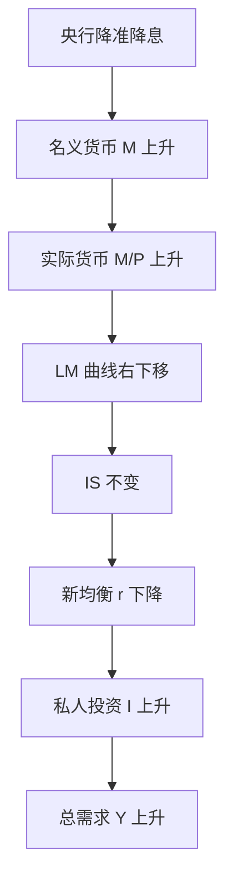

# 首都经济贸易大学 801 经济学 · 模拟卷（三）

<a href="../../exam.html" target="_blank" style="display:inline-block;padding:6px 16px;background:#2563eb;color:#fff;border-radius:6px;text-decoration:none;font-size:14px;">📝 开始做题</a>

> **考试时间**：180 分钟　|　**满分**：150 分　|　**难度**：中等
> **适用教材**：马工程《西方经济学》（第二版）、《马克思主义政治经济学概论》（第二版）
> 政治经济学、西方经济学各占约 50%；简答题 6 题 × 15 分 = 90 分；论述题 2 题 × 30 分 = 60 分。

## 注意事项

1. 闭卷考试，**不得使用计算器**，计算题只做简单数的推导与口算。
2. 答案一律写在答题纸上，答在试卷上无效。
3. 简答题建议每题 12 分钟左右，论述题建议每题 35 分钟左右。
4. 主观题须用「一、(一)、1、(1)、①」层级序号踩分；公式用规范经济学术语写出，图形可用文字描述坐标、曲线位置与移动方向。
5. 本卷共 8 题：简答 1–6，论述 1–2；卷末附【考点对照表】。

---

## 第一部分　简答与计算题（每题 15 分，共 90 分）

### 简答 1：简述价值规律的基本内容、表现形式及其在商品经济中的作用（政治经济学）

> 📚 **不懂就看：** [[../07_政治经济学/01_商品与货币/知识点/KP08_价值规律|📖 KP·价值规律]] ｜ [[../07_政治经济学/01_商品与货币/知识点/KP04_商品价值量|📖 KP·商品价值量]] ｜ [[../../经济统计学论文从0基础到精通/15_政治经济学基础/02_价值规律是什么|🐮 教程·价值规律是什么]]

**【考什么】** 对应知识点 [[../07_政治经济学/01_商品与货币/知识点/KP08_价值规律|价值规律]]，对应《概论》第二章；题型属于概念简答＋作用分析类，是政治经济学商品货币部分的最高频考点。

**【核心推导】**

**第一步 价值规律的基本内容（三句话）。**①商品的价值量由生产商品的社会必要劳动时间决定；②商品按价值量相等的原则进行交换（等价交换）；③价值规律是商品经济的基本规律，贯穿生产、交换、分配、消费全过程。

**第二步 价值量的决定机制（为什么是"社会必要"而不是"个别"）。**社会必要劳动时间有两种含义：第一种是**同一部门内部**在现有社会正常生产条件、社会平均劳动熟练程度和劳动强度下生产单位商品所需的劳动时间；第二种是**社会总劳动**按社会需要比例分配到各部门所必需的劳动时间。第一种决定单个商品的价值量，第二种决定价值能否实现（总量是否卖得出去）。

**第三步 表现形式：价格围绕价值上下波动。**在简单商品经济中价格直接以价值为中心波动；在资本主义商品经济中，价值转化为**生产价格**（成本价格 + 平均利润），价格便围绕生产价格波动。为什么波动不违背规律？因为：①波动的中心仍然是价值（或生产价格）；②从长期、从全社会看，价格总额与价值总额相等；③波动本身正是价值规律贯彻自己的形式——恩格斯称之为"规律通过不实现自己来实现自己"。

**第四步 三大作用（正面）。**
1. **调节生产资料和劳动力在社会各部门之间的分配**：价格涨 → 资本流入 → 供给增加；价格跌 → 资本流出 → 供给减少。这是市场机制配置资源的原初形式。
2. **刺激商品生产者改进技术、提高劳动生产率**：个别劳动时间低于社会必要劳动时间者可获得超额收益，形成"鞭策先进、淘汰落后"的机制。
3. **促进商品生产者的分化**：条件好的生产者越来越强，条件差的破产，这是商品经济发展到一定阶段产生资本主义生产关系的条件之一。

**第五步 作用的实现条件与限度（这是拉开分差的部分）。**三大作用不是无条件的：①需要**充分竞争**——垄断会扭曲价格信号；②需要**信息对称与要素自由流动**——地方保护与行政壁垒使"价格涨→资本流入"失灵；③存在**盲目性与滞后性**——价格信号是事后的，容易造成"一哄而上→产能过剩→一哄而下"的周期性波动；④公共品、外部性、垄断领域价值规律难以有效调节，需政府干预。

**第六步 现实含义。**中国的"有效市场 + 有为政府"正是对价值规律作用边界的回应：一方面通过统一大市场、价格机制改革让价值规律发挥作用（"使市场在资源配置中起决定性作用"）；另一方面用产业政策、反垄断、环保规制校正其盲目性（"更好发挥政府作用"）。2024—2026 年"反内卷式竞争"与产能治理，就是对"价格战→全行业亏损"这一价值规律负面效应的直接回应。

**【一句话】**价值规律既是配置资源的自动机，也是制造分化的离心机。

**【为什么要答这几点】**

**【满分 15 分的分点逻辑】**基本内容三句话（4 分）→ 社会必要劳动时间的两种含义（3 分）→ 表现形式与"波动不违背规律"的论证（4 分）→ 三大作用（3 分）→ 作用的限度（1 分，酌情加分）。

**【易失分点】**①只写"价值由社会必要劳动时间决定、等价交换"两句，内容过于单薄；②不区分社会必要劳动时间的**两种含义**，是本考点最高频的失分点；③表现形式只写"价格围绕价值波动"，不论证为什么不违背规律；④三大作用写成"配置资源、刺激技术、优胜劣汰"六个字，缺少机制说明；⑤不写作用的限度，答案显得教条。

**【加分点】**①引入"价值转化为生产价格"这一层，体现理论深度；②引恩格斯"规律通过不实现自己来实现自己"；③写出"一哄而上→产能过剩→一哄而下"的盲目性链条；④联系统一大市场、反内卷式竞争的现实。

**【阅卷心理】**本题是"原理型"简答，阅卷看三点：内容是否完整、机制是否讲透、边界是否写明。只罗列三句内容的，最多 7 分；能把"表现形式的合法性论证"写出来的，基本进一档。

**【字数与时间】**550—650 字，13 分钟。

**【如何分析题目】**

**【如何分析题目】**
1. 拆题干三层："基本内容"（是什么）+"表现形式"（怎么表现）+"作用"（起什么用），必须分三块答。
2. 内容部分抓两个关键：价值量由社会必要劳动时间决定、等价交换；并补社会必要劳动时间的两种含义。
3. 表现形式部分要做"论证"而非"陈述"：先说价格波动，再用"中心、总量、形式"三条说明不违背规律。
4. 作用部分逐条给机制：调节分配（价格信号→资本流动）、刺激技术（个别低于社会）、促进分化（条件差异累积）。
5. 加一层限度：垄断、信息不对称、滞后性、公共品与外部性，说明规律不是万能的。
6. 落到现实：有效市场与有为政府、反内卷式竞争。
7. 时间分配：2 分钟搭三层框架，9 分钟书写，2 分钟补经典表述与边界。

**【答题框架】**
- 第 1 段：价值规律的地位与基本内容（5 分）
- 第 2 段：表现形式——价格围绕价值波动（4 分）
- 第 3 段：三大作用（4 分）
- 第 4 段：作用的局限性与现实意义（2 分）

**【参考答案】**

一、价值规律是商品经济的基本规律。只要存在商品生产和商品交换，价值规律就必然存在并发挥作用。

(一) 基本内容。
1. 商品的价值量由生产商品的**社会必要劳动时间**决定，而不是由个别劳动时间决定。
2. 商品交换要以价值量为基础，按照**等价交换**的原则进行，即价格与价值相符。
(1) 社会必要劳动时间，是指在现有的社会正常生产条件下，在社会平均劳动熟练程度和强度下制造某种使用价值所需要的劳动时间。

(二) 表现形式。
1. 价值规律的表现形式是：商品的**价格围绕价值上下波动**。
2. 价格以价值为轴心，由于市场供求关系不平衡，供过于求时价格跌到价值以下，供不应求时价格涨到价值以上。
(1) 价格与价值的不一致**不是对价值规律的否定**，而正是价值规律发生作用的唯一可能形式。从较长时期和全社会看，商品的平均价格和价值是一致的。

(三) 价值规律的作用。
1. **自发地调节生产资料和劳动力在社会各生产部门之间的分配**，即调节社会资源配置。价格涨跌像"看不见的手"引导资本流入价高利大部门、流出价低利小部门。
2. **自发地刺激社会生产力的发展**。个别劳动时间低于社会必要劳动时间的商品生产者可获得额外收益，这促使各生产者改进技术、改善经营管理、提高劳动生产率。
3. **引起和促进商品生产者的两极分化**。条件好的生产者在竞争中取胜致富，条件差的破产倒闭，在一定历史条件下导致资本主义生产关系的产生。

(四) 作用的局限性。价值规律是自发调节，具有**自发性、盲目性和滞后性**，会造成社会劳动的浪费、技术垄断阻碍进步和贫富分化，因此在现代市场经济中需要国家宏观调控加以弥补。

**【解析·得分点】** 采分点：①社会必要劳动时间决定价值量（3 分）；②等价交换（2 分）；③价格围绕价值上下波动且长期一致（4 分）；④三大作用各 1–2 分。容易丢分：只写作用不写"表现形式"段；误以为价格偏离价值就是否定价值规律。

**【生活实例】** 同一杯奶茶，A 店熟练工 5 分钟做一杯，B 店新手 15 分钟做一杯，但市场只认"社会平均 8 分钟"这个价值；谁效率高谁赚钱。奶茶店排长队时老板涨价，冷清时打折，价格围着成本这条"轴心"上下跳，但一个月算下来均价差不多等于成本加合理利润——这就是价值规律在奶茶街的样子。

**【双链接】** 🔗 [[../07_政治经济学/01_商品与货币/知识点/KP08_价值规律|回知识点·价值规律]] ｜ [[../07_政治经济学/01_商品与货币/知识点/KP04_商品价值量|商品价值量]] ｜ 📖 [[../../原文件/经济学/马克思主义政治经济学概论_全书|《概论》第二章]]

---

### 简答 2：简述平均利润和生产价格是怎样形成的（政治经济学）

> 📚 **不懂就看：** [[../07_政治经济学/03_资本流通与剩余价值分配/知识点/KP05_平均利润与生产价格|📖 KP·平均利润与生产价格]] ｜ [[../../经济统计学论文从0基础到精通/15_政治经济学基础/08_平均利润与生产价格|🐮 教程·平均利润与生产价格]]

**【考什么】** 对应知识点 [[../07_政治经济学/03_资本流通与剩余价值分配/知识点/KP05_平均利润与生产价格|平均利润与生产价格]]，对应《概论》第七章；题型属于分析推导类，首经贸反复考过"利润转化为平均利润、价值转化为生产价格"。

**【核心推导】**

**第一步 前提：不同部门资本有机构成和周转速度不同。**剩余价值率相同（设为 100%）时，资本有机构成 $c:v$ 高的部门，同量资本雇用的工人少，生产的剩余价值少；构成低的部门则相反。

**第二步 数值示例（把利润率差异算出来）。**设社会总资本分三个部门，剩余价值率均为 100%：

| 部门 | 资本构成 | $c$ | $v$ | $m$ | 商品价值 $c+v+m$ | 利润率 $m/(c+v)$ |
|---|---|---|---|---|---|---|
| 甲（构成低） | 80c+20v | 80 | 20 | 20 | 120 | 20% |
| 乙（中） | 90c+10v | 90 | 10 | 10 | 110 | 10% |
| 丙（构成高） | 95c+5v | 95 | 5 | 5 | 105 | 5% |

三个部门若按价值出售，利润率依次为 20%、10%、5%，差异巨大 → 资本必然从利润率低的部门流向利润率高的部门。

**第三步 部门间竞争如何形成平均利润率。**
$$\bar p' = \frac{\sum m}{\sum (c+v)} = \frac{20+10+5}{300} = \frac{35}{300} \approx 11.67\%$$
资本转移使各部门供求关系改变、价格随之调整，最终各部门都获得按**平均利润率**计算的利润：甲部门利润 $100\times 11.67\% = 11.67$（低于其 $m=20$），丙部门利润 $11.67$（高于其 $m=5$）。这就是**剩余价值在部门间重新分配**。

**第四步 生产价格的形成与构成。**生产价格 $=$ 成本价格 $k$ $+$ 平均利润 $\bar p$，其中 $k=c+v$。
| 部门 | 成本价格 $k$ | 平均利润 | 生产价格 | 商品价值 | 偏离 |
|---|---|---|---|---|---|
| 甲 | 100 | 11.67 | 111.67 | 120 | $-8.33$ |
| 乙 | 100 | 11.67 | 111.67 | 110 | $+1.67$ |
| 丙 | 100 | 11.67 | 111.67 | 105 | $+6.67$ |

可见：**价值总额 = 生产价格总额（都是 335）**，只是部门间发生了再分配。马克思把这一转化称为"价值转化为生产价格"，是"第二个层次"的转化（第一个层次是价值转化为剩余价值）。

**第五步 两个层次的转化关系（必答的辨析）。**
1. 价值 → 生产价格：部门之间通过资本转移实现剩余价值再分配，形成平均利润率；
2. 价值 → 市场价值：部门内部通过竞争形成社会价值（个别价值平均化）。
二者的界限要分清：平均利润是**部门间**关系，超额剩余价值是**部门内**关系。

**第六步 理论意义与现实含义。**①生产价格理论解决了"价值规律与等量资本获得等量利润是否矛盾"这一古典经济学的难题：不矛盾，因为利润总额仍等于剩余价值总额，价格总额仍等于价值总额；②现实含义：资本有机构成高的行业（芯片、航天、新能源）在价格上"占便宜"，因此资本会持续流向高构成行业，这与中国的战略性新兴产业政策方向一致；③但高构成也意味着就业吸纳能力弱，这就是"资本有机构成提高 → 相对过剩人口"的联结点。

**【一句话】**平均利润不是"多创造了价值"，而是"重新瓜分了价值"。

**【为什么要答这几点】**

**【满分 15 分的分点逻辑】**前提（构成与周转速度不同）（3 分）→ 部门利润率差异的数值演示（3 分）→ 部门间竞争与平均利润率公式（4 分）→ 生产价格构成与"总额相等"（3 分）→ 两层转化辨析与理论意义（2 分）。

**【易失分点】**①平均利润率公式写成 $\sum m / \sum v$（分母必须是 $c+v$）；②说"平均利润是各部门自己创造的"——错，是再分配；③忘记写"价值总额=生产价格总额"这一关键结论；④不区分部门间（平均利润）与部门内（超额剩余价值）两层转化；⑤只有公式没有数值演示。

**【加分点】**①给三部门完整数值表（甲 80c+20v / 乙 90c+10v / 丙 95c+5v）；②点出"等量资本获得等量利润"表面与价值规律的矛盾如何被解决；③联系高构成行业的资源流向与就业吸纳能力弱。

**【阅卷心理】**计算型论述按"公式 + 数字 + 结论"三段给分：只写公式与文字的，最多 9 分；能列数值表并验证总额相等的，进一档。

**【字数与时间】**600—700 字（含两张表），14 分钟。

**【如何分析题目】**

**【如何分析题目】**
1. 先立前提：各部门资本有机构成 $c:v$ 与周转速度不同 → 利润率不同，这是起点。
2. 构造一个最简三部门数值例（构成高/中/低各一），令剩余价值率相同（100%），算出各自利润率。
3. 说明竞争机制：利润率低的部门资本流出 → 供给减少、价格上升；高的部门资本流入 → 供给增加、价格下降，直到利润率趋同。
4. 用公式 $\bar p'=\sum m/\sum(c+v)$ 算出平均利润率，验证各部门利润被重新分配。
5. 写生产价格的构成（$k+\bar p$），列表对比生产价格与价值，突出偏离方向与"总额相等"。
6. 补两层转化辨析（部门间 vs 部门内），避免与超额剩余价值混淆。
7. 收尾写理论意义（解决等量资本等量利润与价值规律的表面矛盾）与现实含义。
8. 时间分配：3 分钟列表与计算，9 分钟书写与解释，2 分钟检查公式与总额。

**【答题框架】**
- 第 1 段：利润与利润率（3 分）
- 第 2 段：部门间竞争与资本转移（5 分）
- 第 3 段：平均利润与生产价格的形成（5 分）
- 第 4 段：理论意义（2 分）

**【参考答案】**

一、利润本质上是剩余价值。当剩余价值被看作全部预付资本（不变资本 c＋可变资本 v）的产物时，就取得了利润 p 的形式。利润率为：

$$p' = \frac{m}{c+v}$$

(一) 不同生产部门利润率存在差别。
1. 各部门资本有机构成（c∶v）不同。在剩余价值率相同的条件下，资本有机构成高的部门利润率低，有机构成低的部门利润率高。
2. 例如，重工业 c∶v 高、利润率低；轻纺工业 c∶v 低、利润率高。

(二) 部门之间的竞争和资本的自由转移使利润率平均化。
1. 追逐更高利润是资本的本性。资本家必然把资本从利润率低的部门抽出，投到利润率高的部门。
2. 资本大量流入高利润部门后，该部门生产扩大、商品供过于求，价格下跌，利润率随之下降；反之，资本流出的部门生产缩减、供不应求，价格回升，利润率上升。
3. 这种资本在各部门间反复转移的运动，一直持续到各部门利润率大体相等才会暂时停止。由此形成**平均利润率**：

$$\bar p' = \frac{\text{社会剩余价值总额}}{\text{社会预付总资本}}$$

4. 各部门预付资本按平均利润率获得的利润，就是**平均利润** $\bar p = C \times \bar p'$。

(三) 价值转化为生产价格。
1. 随着利润转化为平均利润，商品不再按价值 $(c+v+m)$ 出售，而是按**成本价格加平均利润**出售，即：

$$\text{生产价格} = k + \bar p = (c+v)+\bar p$$

2. 生产价格是价值的转化形式。从全社会看，生产价格总额等于价值总额，平均利润总额等于剩余价值总额。

(四) 理论意义。生产价格理论科学地解决了价值规律同等量资本获得等量利润之间的表面矛盾：生产价格不是对价值规律的否定，而是价值规律在自由竞争资本主义阶段发挥作用的转化形式。

**【解析·得分点】** 采分点：①p′＝m/(c＋v)（2 分）；②资本有机构成不同→利润率不同（3 分）；③资本转移机制：供过于求→价跌→利降（5 分）；④平均利润率公式（2 分）；⑤生产价格＝k＋平均利润且总额一致（3 分）。容易丢分：把平均利润写成"个别利润的简单平均"；漏掉"生产价格总额＝价值总额"这一守恒关系。

**【生活实例】** 一条街上，开奶茶店赚钱快（轻资产、人工多），开重型机械厂赚钱慢（重资产、机器贵）。于是老板们把钱从机械厂撤出来、涌进奶茶店；奶茶店越开越多、卷到不赚钱，机械厂没竞争了反而利润回升。最后各行各业"赚的钱差不多"——这就是利润率平均化。商品卖价也随之从"按卖一杯赚多少"变成"按成本＋平均该赚多少"定价，这就是生产价格。

**【双链接】** 🔗 [[../07_政治经济学/03_资本流通与剩余价值分配/知识点/KP05_平均利润与生产价格|回知识点·平均利润与生产价格]] ｜ [[../07_政治经济学/02_资本主义经济制度与生产/知识点/KP06_剩余价值率|剩余价值率 vs 利润率]] ｜ 📖 [[../../原文件/经济学/马克思主义政治经济学概论_全书|《概论》第七章]]

---

### 简答 3：简述社会主义市场经济体制的基本特征（政治经济学）

> 📚 **不懂就看：** [[../07_政治经济学/06_社会主义市场经济与发展/知识点/KP01_政府与市场关系|📖 KP·政府与市场关系]] ｜ [[../07_政治经济学/05_社会主义经济制度/知识点/KP02_中国特色社会主义所有制|📖 KP·中国特色社会主义所有制]] ｜ [[../../经济统计学论文从0基础到精通/15_政治经济学基础/11_社会主义市场经济|🐮 教程·社会主义市场经济]]

**【考什么】** 对应知识点 [[../07_政治经济学/06_社会主义市场经济与发展/知识点/KP01_政府与市场关系|政府与市场关系]]、[[../07_政治经济学/05_社会主义经济制度/知识点/KP02_中国特色社会主义所有制|所有制结构]]；题型属于理论类简答，核心是"社会主义基本制度与市场经济相结合"。

**【核心推导】**

**第一步 立框架：社会主义市场经济体制的"三层特征"。**特征可分为①**制度基础层**（所有制与分配制度）、②**体制运行层**（市场机制 + 政府调控）、③**目标价值层**（共同富裕与人的全面发展）。三层缺一不可，也是十五分题的天然分段。

**第二步 制度基础层：公有制为主体、多种所有制经济共同发展；按劳分配为主体、多种分配方式并存。**这是与资本主义市场经济的**根本区别**——市场经济与社会主义基本制度结合，而不是与资本主义私有制结合。党的领导是根本保证，这是最本质的特征。

**第三步 体制运行层：市场在资源配置中起决定性作用，更好发挥政府作用。**①"决定性作用"的表述转变（从"基础性"到"决定性"，十八届三中全会）意味着资源配置主要由价格、竞争、供求决定；②"更好发挥政府作用"明确了政府职能边界：宏观调控、市场监管、公共服务、社会管理、环境保护；③二者不是替代关系而是**有机结合**——"有效市场 + 有为政府"。

**第四步 分配与目标层：共同富裕是本质要求。**社会主义市场经济的最终目标不是资本增值最大化，而是共同富裕与人的全面发展。实现机制包括：初次分配（按要素贡献、提高劳动报酬占比）、再分配（税收、社保、转移支付）、第三次分配（公益慈善）。这与资本主义市场经济"两极分化"的自发趋势形成根本对照。

**第五步 与资本主义市场经济的一般性比较（避免把"特殊性"当"全部"）。**

| 维度 | 共性（都遵循市场经济一般规律） | 特性（社会主义独有） |
|---|---|---|
| 资源配置 | 价格机制、竞争机制、供求机制 | 市场决定性作用 + 政府有效调控 |
| 所有制 | 存在多种所有制 | 公有制为主体 |
| 分配 | 按要素分配 | 按劳分配为主体、共同富裕目标 |
| 调控 | 宏观调控 | 党的领导 + 五年规划 + 集中力量办大事 |

**第六步 体制优势的制度性解释。**①集中力量办大事：五年规划、重大科技攻关、脱贫攻坚、疫情防控；②有效抑制两极分化：三次分配制度与区域协调发展战略；③长期主义的政策连续性：超长期特别国债、双碳目标、新质生产力布局；④与"全国统一大市场"结合，克服地方保护与市场分割，让价值规律在更大范围发挥作用。

**第七步 现实含义与完善方向。**2024—2026 年的重点：构建全国统一大市场（破除地方保护与"内卷式竞争"）、完善产权保护与公平竞争审查、深化要素市场化改革（土地、劳动力、资本、技术、数据）、健全宏观经济治理体系。这些都不是"加强管制"，而是让市场机制更完整地发挥作用——体现了"两个毫不动摇"与"有效市场有为政府"的统一。

**【一句话】**社会主义市场经济的独特之处不在"有没有市场"，而在"谁掌握基础、为谁服务"。

**【为什么要答这几点】**

**【满分 15 分的分点逻辑】**三层框架的提出（2 分）→ 制度基础层：所有制与分配 + 党的领导（4 分）→ 体制运行层：市场决定性作用与政府作用（4 分）→ 目标层：共同富裕（3 分）→ 与资本主义市场经济的比较（2 分）。

**【易失分点】**①只罗列"公有制为主体、按劳分配、宏观调控"三条标签，没有层次与机制；②漏掉"党的领导是根本特征"这一最本质的表述；③把"市场起决定性作用"写成"基础性作用"（这是旧表述）；④不写共同富裕，等于丢掉社会主义属性；⑤不谈政府与市场的关系，答案缺少体制运行这一层。

**【加分点】**①用"制度基础—体制运行—目标价值"三层结构组织答案；②引"从基础性到决定性"的表述演变（十八届三中全会）；③给共性与特性的对照表；④联系全国统一大市场、反内卷式竞争、要素市场化改革。

**【阅卷心理】**本题属"特征型"简答，阅卷最容易看出"是否背原文还是理解结构"：三层结构清晰 + 共同富裕 + 党的领导，基本满分；只列三四个标签的，7—9 分。

**【字数与时间】**550—650 字，13 分钟。

**【如何分析题目】**

**【如何分析题目】**
1. 题干问"基本特征"，先想"跟谁比"——比的对象是资本主义市场经济，因此答案必须写出**区别点**。
2. 搭三层框架：制度基础（所有制/分配/党的领导）→ 体制运行（市场+政府）→ 目标价值（共同富裕），三层自然成三段。
3. 每层写清"是什么 + 为什么是关键"，避免贴标签。
4. 体制运行层一定要写"决定性作用"与"更好发挥政府作用"，并说明二者结合而非对立。
5. 目标层落到共同富裕与三次分配，形成与资本主义两极分化的对照。
6. 补一张共性与特性的对照表，显示理解深度。
7. 收尾写完善方向（统一大市场、要素市场化、反内卷），体现现实感。
8. 时间分配：2 分钟搭框架，9 分钟书写，2 分钟补表述细节。

**【答题框架】**
- 第 1 段：总体定位（3 分）
- 第 2 段：所有制特征（4 分）
- 第 3 段：分配制度特征（4 分）
- 第 4 段：宏观调控与根本目的（4 分）

**【参考答案】**

一、社会主义市场经济体制是同社会主义基本制度结合在一起的市场经济体制，既可以发挥市场经济的长处，又可以发挥社会主义制度的优越性。其基本特征主要表现在以下三个方面。

(一) 在所有制结构上，以公有制为主体、多种所有制经济共同发展。
1. 毫不动摇巩固和发展公有制经济，毫不动摇鼓励、支持、引导非公有制经济发展。
2. 国有企业、集体企业等公有制经济在关系国家安全、国民经济命脉的重要行业和关键领域占支配地位；个体、私营、外资等非公有制经济是社会主义市场经济的重要组成部分。
3. 不同所有制经济在市场竞争中发挥各自优势、相互促进、共同发展。

(二) 在分配制度上，以按劳分配为主体、多种分配方式并存。
1. 按劳分配是公有制经济中个人消费品分配的基本原则；劳动、资本、土地、知识、技术、管理、数据等生产要素按贡献参与分配。
2. 这一分配制度既鼓励先进、提高效率，合理拉开收入差距，又防止两极分化，以逐步实现共同富裕为根本目标。

(三) 在宏观调控上，能够把人民的当前利益与长远利益、局部利益与整体利益结合起来，更好发挥政府作用。
1. 社会主义国家以公有制为基础，对经济的调控具有更雄厚的物质基础、更广泛的民意基础和更强的执行力。
2. 正确处理政府和市场的关系，使市场在资源配置中起**决定性作用**，同时更好发挥政府作用，推动有效市场和有为政府更好结合。
3. 坚持党的领导是社会主义市场经济体制的重要特征，能够集中力量办大事，保持经济持续健康发展。

**【解析·得分点】** 采分点：①"基本制度与市场经济结合"破题（3 分）；②所有制"两个毫不动摇"（4 分）；③分配制度＋共同富裕（4 分）；④市场决定性作用＋更好政府作用＋党的领导（4 分）。容易丢分：只写市场经济一般特征（等价交换、竞争），忘记"社会主义"限定；把"基础性作用"写成旧提法，现行为"决定性作用"。

**【生活实例】** 同样是开网约车：平台算法按市场规则派单、定价（这是市场经济）；但出租车牌照、城市地铁、电网这些命脉由国企把控（这是公有制为主体）；司机跑单赚钱归自己，同时国家还有最低工资、社保和税收调节防止贫富悬殊（这是按劳分配为主、多种分配并存）；早高峰、极端天气政府还能出面调度运力（这是更好发挥政府作用）。四件套合在一起，就是社会主义市场经济。

**【双链接】** 🔗 [[../07_政治经济学/06_社会主义市场经济与发展/知识点/KP01_政府与市场关系|回知识点·政府与市场关系]] ｜ [[../07_政治经济学/05_社会主义经济制度/知识点/KP02_中国特色社会主义所有制|所有制结构]] ｜ [[../07_政治经济学/05_社会主义经济制度/知识点/KP04_共同富裕|共同富裕]] ｜ 📖 [[../../原文件/经济学/马克思主义政治经济学概论_全书|《概论》第九章]]

---

### 简答 4：画图并说明完全竞争厂商的短期均衡的几种情况，以及厂商的短期供给曲线是怎样形成的（西方经济学）

> 📚 **不懂就看：** [[../06_西方经济学/04_完全竞争市场/知识点/KP03_短期均衡与停止营业点|📖 KP·短期均衡与停止营业点]] ｜ [[../06_西方经济学/04_完全竞争市场/知识点/KP02_完全竞争厂商的需求与收益|📖 KP·厂商需求与收益]] ｜ [[../../经济统计学论文从0基础到精通/13_微观经济学基础/09_完全竞争市场是什么|🐮 教程·完全竞争市场是什么]]

**【考什么】** 对应知识点 [[../06_西方经济学/04_完全竞争市场/知识点/KP03_短期均衡与停止营业点|短期均衡与停止营业点]]，对应马工程《西经》微观第六章；题型属于模型分析类，要求有图形意识。

**【核心推导】**

**第一步 均衡条件（先立工具）。**完全竞争厂商短期均衡条件是 $MR = MC$，且完全竞争下 $P = MR$，故均衡条件为 **$P = MC$**。是否生产还要看价格与平均可变成本的关系。

**第二步 五种情况（按价格与成本曲线位置分类）。**

| 情形 | 价格关系 | 均衡点位置 | 盈亏 | 决策 |
|---|---|---|---|---|
| ① 超额利润 | $P > AC$ 最低点 | $MC$ 上升段与 $P$ 线交点高于 $AC$ | $\pi>0$ | 生产 |
| ② 正常利润 | $P = AC$ 最低点 | $MC$ 与 $AC$ 最低点相交 | $\pi=0$ | 生产（收支相抵点） |
| ③ 亏损但继续生产 | $AVC$ 最低点 $< P < AC$ 最低点 | 交点在 $AVC$ 与 $AC$ 之间 | $\pi<0$，但亏损小于固定成本 | 继续生产 |
| ④ 停止营业点 | $P = AVC$ 最低点 | $MC$ 与 $AVC$ 最低点相交 | $\pi=-TFC$ | 生产与不生产一样 |
| ⑤ 停止生产 | $P < AVC$ 最低点 | $MC$ 上升段低于 $AVC$ 最低点 | 亏损大于固定成本 | 停产 |

**第三步 为什么情形③"亏损还生产"。**短期固定成本无法收回，只要价格能覆盖平均可变成本（$P>AVC$），生产就能收回全部可变成本并补偿部分固定成本，停产则固定成本全亏。数学上：$\pi = PQ - TC = PQ - (TVC + TFC) = (P - AVC)Q - TFC$，当 $P>AVC$ 时 $(P-AVC)Q>0$，亏损 $-\pi = TFC - (P-AVC)Q < TFC$ ✔。

**第四步 短期供给曲线的推导。**①$P < AVC$ 最低点时，厂商停产，供给量为 0；②$P \ge AVC$ 最低点时，供给量由 $P = MC$ 决定。故**厂商短期供给曲线是 $MC$ 曲线上不低于 $AVC$ 最低点的上升段**。这条曲线的形状解释：$MC$ 上升源于边际报酬递减规律（边际产量递减 → 边际成本递增）。

**第五步 从厂商到市场：横向加总。**市场短期供给曲线是各厂商短期供给曲线的**水平（横向）加总**，即各价格水平下各厂商供给量的求和。注意不是纵向加总（纵向加总是公共品的需求侧）。

**第六步 图形要点（画图题的给分点）。**①纵轴 $P$、横轴 $Q$；②$MC$ 从下往上穿过 $AVC$ 与 $AC$ 的最低点；③$AC$ 最低点在 $AVC$ 最低点右上方；④价格线是水平线（完全竞争厂商是价格接受者）；⑤用虚线标出五个价格水平与对应的均衡点。

**第七步 现实含义。**生猪养殖、果蔬种植是典型的完全竞争近似市场：价格跌破平均可变成本时（如生猪价格低于饲料与人工成本），养殖户大量退出；价格回升后再涌入，形成"猪周期"。这正是"停产点"与"供给曲线上升段"的现实投影。而航空、钢铁这类高固定成本行业，$AFC$ 摊薄效应强，即使亏损也常常继续运营，就落在情形③。

**【一句话】**短期均衡的判断只需两步：先看 $P=MC$ 定产量，再看 $P$ 与 $AVC$ 比高低定生死。

**【为什么要答这几点】**

**【满分 15 分的分点逻辑】**均衡条件 $P=MC$（2 分）→ 五种情况分类与盈亏判断（6 分）→ "亏损仍生产"的数学论证（3 分）→ 短期供给曲线的推导（3 分）→ 市场供给横向加总（1 分）。

**【易失分点】**①忘记"完全竞争下 $P=MR$"，直接写 $MR=MC$ 而不说明二者关系；②情形③与⑤混淆，把"亏损即停产"当作结论——这是本题最致命的错误；③停产点写成"$P=AC$ 最低点"（应为 $AVC$ 最低点）；④供给曲线写成"整条 $MC$ 曲线"，漏掉"不低于 $AVC$ 最低点"这一限制；⑤图形不标 (AVC) 与 $AC$ 的最低点位置关系。

**【加分点】**①给出 $\pi=(P-AVC)Q-TFC$ 的亏损分解式；②说明 $MC$ 上升源于边际报酬递减；③区分横向加总与纵向加总；④用猪周期、航空钢铁两类行业做对照举例。

**【阅卷心理】**画图题先看图：五个价格水平标齐基本满分一半；再看"停产点"是否写对。图形对而文字弱的，11—12 分；文字对而图没画的，封顶 10 分。

**【字数与时间】**600—700 字（含图与表），14 分钟。

**【如何分析题目】**

**【如何分析题目】**
1. 先写均衡条件：$MR=MC$，完全竞争下即 $P=MC$；补一句"厂商是价格接受者"。
2. 记住分类维度是"价格与两条均量曲线最低点的相对位置"，用这条主线串起五种情况。
3. 画图：$MC$ 从下往上穿 (AVC)、$AC$ 最低点；$AC$ 最低点在 $AVC$ 最低点右上方；价格线水平。
4. 逐一标出五个价格水平与对应决策，并写盈亏结论。
5. 用 $\pi=(P-AVC)Q-TFC$ 论证"$P>AVC$ 时亏损小于固定成本，故继续生产"。
6. 推导短期供给曲线：$P \ge$ 停产点取 $MC$ 上升段，$P<$ 停产点取 0。
7. 说明市场供给是厂商供给的横向加总，并点出 $MC$ 上升的成本原因。
8. 时间分配：3 分钟画图，8 分钟书写，3 分钟检查停产点与加总方向。

**【答题框架】**
- 第 1 段：短期均衡条件（3 分）
- 第 2 段：四种盈亏情况（8 分）
- 第 3 段：短期供给曲线（4 分）

**【参考答案】**

一、完全竞争厂商是价格的接受者，其需求曲线、平均收益曲线 AR 和边际收益曲线 MR 重合为一条由市场价格决定的水平线。厂商实现最大利润（或最小亏损）的条件为 $MR=MC$，由于 $MR=P$，故短期均衡条件为：

$$P = SMC$$

(一) 短期内，按 $P=SMC$ 确定产量后，根据价格与平均成本 AC、平均可变成本 AVC 的相对位置，有四种情况。

1. **盈利情况**：当市场价格 $P$ 高于平均成本最低点（$P>AC_{\min}$）时，厂商获得超额利润，单位利润为 $(P-AC)$，总利润为 $(P-AC)\times Q$。
2. **盈亏平衡**：当 $P$ 恰好等于平均成本最低点（$P=AC_{\min}$）时，总收益等于总成本，厂商获得**正常利润**，该点称为收支相抵点。
3. **亏损但继续生产**：当 $AVC_{\min}<P<AC_{\min}$ 时，厂商亏损，但收益在弥补全部可变成本后尚能补偿部分不变成本；若停产则不变成本全损，故理性选择是继续生产。
4. **停止营业点**：当 $P$ 恰好等于平均可变成本最低点（$P=AVC_{\min}$）时，生产与不生产结果相同——收益刚好弥补可变成本，不变成本全损，该点即停止营业点。若 $P<AVC_{\min}$，厂商停止营业。

(二) 短期供给曲线的形成。
1. 短期均衡条件 $P=SMC$ 表明：每一个市场价格 $P$，厂商都对应 $SMC$ 曲线上一个最优产量。
2. 因此，厂商的**短期供给曲线就是 SMC 曲线位于 AVC 最低点以上的部分**。
3. 图形描述：横轴产量 Q、纵轴价格 P；向右上方倾斜的 SMC 穿过 AVC 最低点与 AC 最低点，AVC 最低点以上的 SMC 描粗即为短期供给曲线。

**【解析·得分点】** 采分点：①P=SMC 均衡条件（3 分）；②四种情况逐一对应 P 与 AC、AVC 关系（各 2 分）；③"停止营业点"定义（2 分）；④短期供给曲线＝AVC 最低点以上的 SMC（3 分）。容易丢分：混淆收支相抵点（P＝AC 最低点）与停止营业点（P＝AVC 最低点）；漏掉"为什么亏损仍要生产"的推理逻辑。

**【生活实例】** 一家小饭馆：每月房租（不变成本）5000 元，买菜人工（可变成本）每桌 30 元。客单价 60 元时赚得欢；客单价跌到 40 元时虽亏房租但每桌还能补一点现金，硬撑；客单价跌到 25 元时，卖一桌连买菜钱都收不回，不如关门省电费——那个 30 元的临界客单价就是停止营业点。饭馆老板沿"价格多高就敢开几桌"画出的那条线，就是短期供给曲线。

**【双链接】** 🔗 [[../06_西方经济学/04_完全竞争市场/知识点/KP03_短期均衡与停止营业点|回知识点·短期均衡与停止营业点]] ｜ [[../06_西方经济学/04_完全竞争市场/知识点/KP02_完全竞争厂商的需求与收益|厂商需求与收益]] ｜ 📖 [[../../原文件/经济学/西方经济学上册_微观_全书|《西经》微观第六章]]

---

### 简答 5：简述价格歧视的含义、三种类型及其实现条件（西方经济学）

> 📚 **不懂就看：** [[../06_西方经济学/05_不完全竞争市场/知识点/KP03_价格歧视|📖 KP·价格歧视]] ｜ [[../06_西方经济学/05_不完全竞争市场/知识点/KP01_完全垄断市场|📖 KP·完全垄断市场]] ｜ [[../../经济统计学论文从0基础到精通/13_微观经济学基础/10_完全垄断与价格歧视是什么|🐮 教程·完全垄断与价格歧视]]

**【考什么】** 对应知识点 [[../06_西方经济学/05_不完全竞争市场/知识点/KP03_价格歧视|价格歧视]]，对应马工程《西经》微观第七章；题型属于概念＋条件分析类。

**【核心推导】**

**第一步 定义：价格歧视（差别定价）**指同一厂商在同一时期对**同一种商品**向不同购买者收取不同价格，或对同一购买者的不同购买量收取不同价格，而成本并无相应差别。

**第二步 三种类型的判据（不是按价格高低，而是按"榨取消费者剩余的程度"）。**

| 类型 | 别称 | 定价方式 | 消费者剩余 | 现实例子 |
|---|---|---|---|---|
| 一级 | 完全价格歧视 | 对每一单位按买方**最高愿意支付**定价 | 全部被榨取，$CS=0$ | 讨价还价的古玩市场、定制化报价 |
| 二级 | 数量歧视 | 按**购买数量**分段定价 | 部分被榨取 | 阶梯电价、水价、批量折扣、会员分级 |
| 三级 | 市场分割 | 按**可识别的买方群体**分别定价 | 部分被榨取 | 学生票、老人票、国内国外版定价、平台"大数据画像"定价 |

**第三步 实现的三个必要条件（缺一不可）。**
1. **市场势力**：厂商必须是价格制定者，否则无法定价差——完全竞争厂商做不到（$P=MC$）。
2. **可分割的市场 / 可识别的消费者**：能以较低成本把不同支付意愿的买方区分开，且**不能转卖**（否则套利会消除价格差）。这是"转售困难"条件。
3. **需求价格弹性不同**：弹性小的市场定高价、弹性大的市场定低价。

**第四步 定价公式（三级歧视的定量核心）。**利润最大化条件仍是 $MR_1 = MR_2 = MC$，配合 $MR = P\left(1 - \dfrac{1}{|e_d|}\right)$ 得：
$$\frac{P_1}{P_2} = \frac{1 - 1/|e_2|}{1 - 1/|e_1|}$$
即**弹性越小的市场定价越高**。数值例：市场 1 的 $|e_1|=2$、市场 2 的 $|e_2|=4$，则 $\dfrac{P_1}{P_2} = \dfrac{1-0.25}{1-0.5} = \dfrac{0.75}{0.5}=1.5$ ——市场 1 的价格是市场 2 的 1.5 倍。这条公式能解释为什么景区对本地人便宜、对学生打折。

**第五步 福利评价（这是拉开分差的部分）。**
- 一级价格歧视：产量达到 $P=MC$ 的有效率水平，**没有无谓损失**，但全部剩余归厂商，分配上极不公平（"有效率但极不公正"）。
- 二级价格歧视：产量高于单一定价，无谓损失减小。
- 三级价格歧视：总福利变化不确定——若它使总产量增加，福利可能改善；若只是把原有产量重新分配，福利可能恶化。
- 结论：**价格歧视的福利效应取决于它是否扩大了产出**，不能一概而论为"坏"。

**第六步 现实含义与规制。**①允许类：学生票、阶梯电价（有再分配与节约资源的正面效应）；②禁止类：如果企业利用数据与算法对同一商品向不同消费者报不同价，且消费者无法知情与选择，就构成"大数据杀熟"，属于滥用市场支配地位/价格欺诈，《个人信息保护法》《价格法》与平台反垄断规制均予约束（可参考 2021 年阿里"二选一"被罚 182.28 亿元、美团被罚 34.42 亿元的执法背景）。判断标准是"消费者是否知情同意、是否可自由选择"。

**【一句话】**价格歧视的技术是中性的，问题在于信息是否对称、选择是否自由。

**【为什么要答这几点】**

**【满分 15 分的分点逻辑】**定义（2 分）→ 三种类型的区分与举例（6 分）→ 三个实现条件（4 分）→ 定量公式与数值例（2 分）→ 福利评价与规制（1—2 分酌情）。

**【易失分点】**①按"价格高低"分类，而不是按"榨取消费者剩余的程度"；②把二级与三级搞混（二级按数量、三级按人群）；③漏掉"不能转卖"这一条件——这是三级歧视成立的关键；④忘记"市场势力"前提，把完全竞争市场也算进来；⑤福利评价一边倒地写"有害"。

**【加分点】**①给出 $\dfrac{P_1}{P_2}$ 的弹性公式并算数值；②区分一级歧视"有效率但分配不公"这一辩证结论；③指出福利效应取决于是否扩大产出；④联系大数据杀熟与《个人信息保护法》。

**【阅卷心理】**本题阅卷看"类型+条件"两块：三种类型写全、三个条件写全，基本 11 分起；能给出弹性定价公式的直接进一档。

**【字数与时间】**550—650 字，13 分钟。

**【如何分析题目】**

**【如何分析题目】**
1. 先定义：同一厂商、同一商品、不同价格、成本无差别——四个限定词都要写到。
2. 分类用"榨取消费者剩余的程度"作为主线，一级（全部）、二级（按数量部分）、三级（按人群部分），并各举一例。
3. 条件三段：市场势力（能定价）+ 可分割不可转卖（能隔离）+ 弹性不同（有价差空间）。
4. 定量：写 $MR=P(1-1/|e_d|)$，推出两市场价格比公式，代一组弹性数字算倍数。
5. 福利：分别评价三级歧视的福利效应，突出"是否扩大产出"这一判据，并写一级歧视的"有效率但不公平"。
6. 现实：区分允许（学生票、阶梯电价）与禁止（大数据杀熟），给出判断标准（知情、可选）。
7. 时间分配：2 分钟列提纲，8 分钟书写，3 分钟补公式与案例。

**【答题框架】**
- 第 1 段：含义与实现条件（4 分）
- 第 2 段：一级价格歧视（4 分）
- 第 3 段：二级价格歧视（3 分）
- 第 4 段：三级价格歧视（4 分）

**【参考答案】**

一、价格歧视是指垄断厂商凭借其对价格的垄断力量，对**同一种成本相同的商品**向不同购买者索取不同价格，以攫取更多消费者剩余的行为。

(一) 实现价格歧视必须具备三个条件。
1. 厂商具有一定的**垄断力量**，能够控制价格。
2. 市场可以被有效地**分隔开**，顾客之间不能转卖或套利——低价买入者无法把商品倒卖给高价市场的人。
3. 各个市场（或各类消费者）的**需求价格弹性不同**，这样厂商才能在弹性小的市场定高价、弹性大的市场定低价。

(二) 一级价格歧视（完全价格歧视）。
1. 厂商对每一单位产品都按消费者**愿意支付的最高价格**（保留价格）出售。
2. 结果是全部消费者剩余都被垄断厂商榨取，消费者剩余为零；但产量恰好达到完全竞争水平，无谓损失消失。

(三) 二级价格歧视。
1. 厂商按**不同购买数量段**规定不同价格，即"买得越多越便宜"。
2. 例如电、水的阶梯定价、批量折扣。厂商只能榨取部分消费者剩余。

(四) 三级价格歧视。
1. 厂商对同一种产品在**不同的市场（或对不同消费群）**上收取不同价格。
2. 厂商利润最大化条件为各市场边际收益相等且等于边际成本：$MR_1=MR_2=MC$。
3. 由此可得定价原则：需求价格弹性小的市场定价高，弹性大的市场定价低：

$$\frac{P_1}{P_2}=\frac{1-1/|E_{d2}|}{1-1/|E_{d1}|}$$

(1) 例如同一本教材对学生和非学生定不同价、同一景区对本地人和外地人定不同价、机票对旅游客与商务客定不同价。

**【解析·得分点】** 采分点：①三个实现条件（4 分）；②一级＝按保留价格逐单位定价（3 分）；③二级＝按数量段定价（3 分）；④三级＝分市场定价＋$MR_1=MR_2=MC$＋弹性小价高（5 分）。容易丢分：忘记"同一种成本相同的商品"这一前提；三级歧视只举例子不写定价公式与弹性关系。

**【生活实例】** 电影院同一场电影：老年人半价（一级思路的变种）、买 10 张团购票更便宜（二级，按数量）、学生凭证打折而商务楼白领全价（三级，不同人群弹性不同——学生价格敏感弹性大所以低价，商务客不敏感所以高价）。前提是电影票不能倒买倒卖套利，否则学生买了转手卖给白领，价格歧视就崩了。

**【双链接】** 🔗 [[../06_西方经济学/05_不完全竞争市场/知识点/KP03_价格歧视|回知识点·价格歧视]] ｜ [[../06_西方经济学/05_不完全竞争市场/知识点/KP01_完全垄断市场|完全垄断市场]] ｜ 📖 [[../../原文件/经济学/西方经济学上册_微观_全书|《西经》微观第七章]]

---

### 简答 6：简述帕累托最优的三个条件以及福利经济学第一、第二定理（西方经济学）

> 📚 **不懂就看：** [[../06_西方经济学/07_一般均衡与效率/知识点/KP02_帕累托最优|📖 KP·帕累托最优]] ｜ [[../06_西方经济学/07_一般均衡与效率/知识点/KP03_交换的帕累托最优|📖 KP·交换的帕累托最优]] ｜ [[../../经济统计学论文从0基础到精通/13_微观经济学基础/12_外部性与公共品是什么|🐮 教程·外部性与公共品（帕累托的破坏）]]

**【考什么】** 对应知识点 [[../06_西方经济学/07_一般均衡与效率/知识点/KP02_帕累托最优|帕累托最优]]，对应马工程《西经》微观第十章；题型属于理论类简答，公式与图形意识并重。

**【核心推导】**

**第一步 帕累托最优的定义与判据。**帕累托最优指资源配置已达到这样一种状态：任何重新配置都不可能在不使至少一个人境况变坏的前提下使任何人境况变好。它是**效率**概念，不涉及公平。

**第二步 帕累托最优的三个条件。**

| 条件 | 内容 | 数学表达 | 图形含义 |
|---|---|---|---|
| ①交换最优 | 任意两消费者对任意两种商品的边际替代率相等 | $MRS^A_{XY} = MRS^B_{XY}$ | 两人无差异曲线相切，埃奇沃思盒内切点连线（契约曲线） |
| ②生产最优 | 任意两产品生产的边际技术替代率相等 | $MRTS^X_{LK} = MRTS^Y_{LK}$ | 两条等产量线相切 |
| ③生产与交换最优（总体最优） | 边际转换率等于边际替代率 | $MRT_{XY} = MRS_{XY}$ | 生产可能性边界斜率 = 无差异曲线斜率 |

**第三步 三个条件的统一逻辑。**交换最优保证"给定产品组合下消费者满意最大化"；生产最优保证"给定要素下产出组合最有效率"；总体最优保证"生产出来的产品结构恰好是人们想要的"。三者合并即"一般均衡下的资源配置效率"。用公式统一说：所有边际替代率、边际技术替代率、边际转换率都相等，等于同一个价格比 $P_X/P_Y$——这正是完全竞争市场通过价格机制自动实现的结果。

**第四步 福利经济学第一定理：完全竞争均衡必为帕累托最优。**条件：①完全竞争（人人都是价格接受者）；②完备市场（不存在外部性与公共品）；③完全信息；④无规模报酬递增。推论：**"看不见的手"有严格的前提**。这条定理也为"市场万能论"设了边界——一旦前提被破坏（垄断、外部性、信息不对称、公共品），均衡就不再帕累托最优，这就是市场失灵。

**第五步 福利经济学第二定理：任一帕累托最优状态都可通过适当的一次总付转移支付 + 完全竞争均衡来实现。**含义：**效率与公平可以分离处理**——先通过竞争市场获得效率，再通过一次总付的转移支付（税收/补贴）实现想要的分配，而一次总付转移不改变价格信号，故不破坏效率。现实意义：这为"做大蛋糕 + 分好蛋糕"提供了理论支撑；但一次总付转移在实际中难以实施（政府不知道每个人的能力与偏好），故只能用所得税等扭曲性税种，效率与公平的现实张力由此产生。

**第六步 两个定理的对比与局限。**
| 维度 | 第一定理 | 第二定理 |
|---|---|---|
| 方向 | 均衡 → 最优 | 最优 → 均衡 |
| 政策含义 | 市场机制有效，政府少干预 | 可通过再分配实现公平而不损效率 |
| 隐含前提 | 完全竞争、无外部性、完全信息 | 一次总付转移可行、偏好凸性 |
| 现实局限 | 一律市场失灵即失效 | 一次总付不可行，信息不对称 |

**第七步 现实含义。**中国"有效市场 + 有为政府"正是两个定理的现实折中：一方面依靠市场实现资源配置效率（第一定理的方向），另一方面通过再分配、公共服务均等化、脱贫攻坚实现分配目标（第二定理的方向）。同时针对第一定理前提的破坏（垄断、外部性、数据壁垒），用反垄断、环保规制、公共数据开放等手段修复市场，这正是"更好发挥政府作用"的理论依据。

**【一句话】**第一定理说明市场能干什么，第二定理说明政府可以补什么。

**【为什么要答这几点】**

**【满分 15 分的分点逻辑】**帕累托最优定义（2 分）→ 三个条件及数学表达（6 分）→ 三条件的统一逻辑（2 分）→ 第一定理及前提（3 分）→ 第二定理及含义（2 分）。

**【易失分点】**①把帕累托最优等同于"公平"，定义跑偏；②三个条件写成两个（漏"总体最优"）；③数学表达写错：$MRS$（交换）、$MRTS$（生产）、$MRT$（转换）三者混用；④第一定理不写前提条件，等于说"市场永远最优"；⑤第二定理说成"任何最优都能通过市场实现"，漏掉一次总付转移。

**【加分点】**①指出三者最终统一于价格比 $P_X/P_Y$；②用埃奇沃思盒与契约曲线定位交换最优；③指出第一定理的四个前提即市场失灵的四个来源；④讨论"一次总付转移在现实中不可行"带来的效率—公平张力。

**【阅卷心理】**按"条件齐全 + 定理方向正确"给分：三个条件写全并给出数学表达基本 10 分；两个定理方向写反（把第一定理说成"最优→均衡"）直接降档。

**【字数与时间】**600—700 字，14 分钟。

**【如何分析题目】**

**【如何分析题目】**
1. 先给定义，强调"效率概念、不含公平"，为后面的定理讨论铺路。
2. 按"交换—生产—总体"三层列出三个条件，每个都给数学表达与图形含义，形成表格。
3. 用"所有边际替代率等于同一个价格比"把三条件统一，显示理解而非记忆。
4. 写第一定理：先说结论（完全竞争均衡是帕累托最优），再列四个前提，最后指出前提破坏即市场失灵。
5. 写第二定理：注意方向是"最优→均衡"，关键是"一次总付转移不改变价格信号"，再指出其现实不可行。
6. 做一张两定理对照表，比较方向、政策含义、前提与局限。
7. 落到中国"有效市场+有为政府"的现实含义。
8. 时间分配：3 分钟列表，9 分钟书写，2 分钟检查三位一体符号是否串位。

**【答题框架】**
- 第 1 段：帕累托最优定义（3 分）
- 第 2 段：交换最优条件（4 分）
- 第 3 段：生产最优条件（3 分）
- 第 4 段：交换与生产联合条件（2 分）
- 第 5 段：两大定理（3 分）

**【参考答案】**

一、帕累托最优（帕累托效率）是指这样一种资源配置状态：任何改变都不可能使至少一个人的状况变好而又不使任何其他人的状况变坏。如果还存在帕累托改进，则说明尚未达到帕累托最优。

(一) 交换的帕累托最优条件。
1. 两种商品在两个消费者之间的分配达到帕累托最优时，两个消费者对这两种商品的**边际替代率相等**：

$$MRS_{XY}^{A}=MRS_{XY}^{B}$$

2. 图形为埃奇渥斯盒状图中两个消费者无差异曲线切点的轨迹，即交换契约曲线；曲线上每一点都是交换帕累托最优点。

(二) 生产的帕累托最优条件。
1. 两种生产要素在两个生产者之间的配置达到帕累托最优时，两个生产者对这两种要素的**边际技术替代率相等**：

$$MRTS_{LK}^{C}=MRTS_{LK}^{D}$$

2. 其轨迹为生产契约曲线，由此可推导出生产可能性边界。

(三) 交换与生产的帕累托最优条件。
1. 把交换和生产结合起来，要求产品的**边际转换率等于任何消费者的边际替代率**：

$$MRT_{XY}=MRS_{XY}$$

2. 即生产可能性边界的斜率与消费者无差异曲线的斜率相等。

(四) 福利经济学两大定理。
1. **第一定理**：在完全竞争、无外部性、信息完全等条件下，完全竞争市场的一般均衡配置就是帕累托最优，即"看不见的手"原理。
2. **第二定理**：任何一个帕累托最优配置，都可以通过**初始资源禀赋的再分配**（一次总付税或转移支付），然后利用完全竞争市场来实现。
3. 第一定理说明竞争能"做大蛋糕"（效率），第二定理说明公平与效率可以分开——政府只需调整起点分配，效率交给市场。

**【解析·得分点】** 采分点：①帕累托最优定义（3 分）；②MRS 相等（4 分）；③MRTS 相等（3 分）；④MRT＝MRS（2 分）；⑤第一定理内容（2 分）；⑥第二定理内容＋"效率与公平分开"含义（2 分）。容易丢分：把三个条件写成一个；混淆边际替代率 MRS、边际技术替代率 MRTS、边际转换率 MRT 三个符号。

**【生活实例】** 宿舍里分两块披萨两杯可乐：如果还能"小王用半杯可乐换小李一块披萨后两人都更开心"，说明没到帕累托最优；换无可换、谁再得好处都得让对方吃亏，就是最优。第一定理说：让舍友们自由交换，最终会落在"换无可换"的有效率状态。第二定理说：想让结果更公平（比如贫困生多分点），不用限制交换，直接开学时重新分配食物份额，之后再让大家自由交换即可。

**【双链接】** 🔗 [[../06_西方经济学/07_一般均衡与效率/知识点/KP02_帕累托最优|回知识点·帕累托最优]] ｜ [[../06_西方经济学/07_一般均衡与效率/知识点/KP03_交换的帕累托最优|交换最优]] ｜ [[../06_西方经济学/08_市场失灵与微观经济政策/知识点/KP02_外部性|外部性如何破坏最优]] ｜ 📖 [[../../原文件/经济学/西方经济学上册_微观_全书|《西经》微观第十章]]

---

## 第二部分　论述题（每题 30 分，共 60 分）

### 论述 1：结合 2024—2026 年我国经济工作实际，试论如何以社会主义基本经济制度为保障、以新发展理念为指导、以供给侧结构性改革为主线，推动高质量发展（政治经济学）

> 📚 **不懂就看：** [[../07_政治经济学/06_社会主义市场经济与发展/知识点/KP02_新发展理念与高质量发展|📖 KP·新发展理念与高质量发展]] ｜ [[../07_政治经济学/06_社会主义市场经济与发展/知识点/KP03_新发展格局|📖 KP·新发展格局]] ｜ [[../../经济统计学论文从0基础到精通/15_政治经济学基础/11_社会主义市场经济|🐮 教程·社会主义市场经济]]

**【考什么】** 跨 [[../07_政治经济学/05_社会主义经济制度/知识点/KP02_中国特色社会主义所有制|社会主义基本经济制度]]、[[../07_政治经济学/06_社会主义市场经济与发展/知识点/KP02_新发展理念与高质量发展|新发展理念]]、[[../07_政治经济学/06_社会主义市场经济与发展/知识点/KP03_新发展格局|新发展格局]] 三章；题型属于政策效应类论述，必须结合 2024—2026 年热点（新质生产力、现代化产业体系、十五五开局）。

**【核心推导】**

**第一步 立论框架：三根支柱 + 一条主线。**高质量发展不是"高增速"，而是**以新发展理念为指导、以供给侧结构性改革为主线、以现代化经济体系为支撑**的发展。基本经济制度是"保障"（提供制度基础），新发展理念是"指导"（提供价值取向），供给侧结构性改革是"主线"（提供工作抓手）。

**第二步 基本经济制度如何提供保障（制度供给侧）。**三项制度各有功能：
1. **公有制为主体、多种所有制经济共同发展** → 保证发展方向与战略能力（集中力量办大事、重大科技攻关、基础设施与安全底线），同时以民营经济提供活力与就业（"两个毫不动摇"）。
2. **按劳分配为主体、多种分配方式并存** → 保证发展成果共享，直接对应"共同富裕"这一高质量发展的落脚点；机制上通过提高劳动报酬占比、完善三次分配，纠正"重资本轻劳动"的分配倾向。
3. **社会主义市场经济体制** → 保证资源配置效率，通过"市场决定性作用 + 政府更好作用"实现"有效市场 + 有为政府"。
补充：党的领导是根本保证，这是制度保障中最本质的一条。

**第三步 新发展理念如何提供指导（价值取向供给侧）。**创新（动力）、协调（内在要求）、绿色（必要条件）、开放（必由之路）、共享（本质要求）——五大理念对应五个发展难题：
| 理念 | 解决什么问题 | 对应指标/政策 |
|---|---|---|
| 创新 | 动力转换：从要素驱动到创新驱动 | 研发投入强度、全要素生产率、新质生产力 |
| 协调 | 结构失衡：城乡、区域、物质与精神 | 城乡收入比、区域协调战略、乡村振兴 |
| 绿色 | 人与自然关系：资源环境约束 | 双碳目标、能耗双控转碳排放双控 |
| 开放 | 内外联动：全球化逆流下的开放 | 一带一路、RCEP、制度型开放 |
| 共享 | 分配公平：共同富裕 | 居民收入占比、社保覆盖、公共服务均等化 |

**第四步 供给侧结构性改革如何作为主线（工作抓手）。**核心是"**从生产端入手，用改革的办法推进结构调整**"，减少无效低端供给、扩大有效中高端供给。三大手段：①**"三去一降一补"**（去产能、去库存、去杠杆、降成本、补短板）——解决存量结构问题；②**"巩固、增强、提升、畅通"八字方针**——巩固去产能成果、增强微观主体活力、提升产业链水平、畅通经济循环；③**与新质生产力结合**——以科技创新推动产业创新，改造传统产业、培育新兴产业、布局未来产业。

**第五步 三者的内在逻辑（本题的得分重心）。**三者不是并列关系，而是**条件—方向—路径**的关系：
- 基本经济制度提供"制度可能性"（谁来做、为谁做）；
- 新发展理念提供"判断标准"（什么叫做好）；
- 供给侧结构性改革提供"操作路径"（从哪里下手）。
缺任何一环都会变形：没有制度保障 → 发展偏离方向；没有理念指导 → 只看 GDP；没有结构性改革 → 政策空转。

**第六步 政策协同与现实举措（2024—2026）。**①宏观政策：更加积极的财政政策（提高赤字率、超长期特别国债、大规模设备更新与消费品以旧换新）+ 适度宽松的货币政策（降准降息、结构性工具支持科技创新）；②产业政策：全国统一大市场建设、破除"内卷式竞争"、反垄断与公平竞争审查；③科技政策：新型举国体制、基础研究投入、教育科技人才一体化；④民生政策：稳就业、提高居民收入占比、完善社会保障以提振消费。

**第七步 辩证判断（避免空喊口号）。**高质量发展的难点在三对张力：①短期稳增长与长期调结构的张力；②效率与公平的张力（对应福利经济学第二定理的现实困境）；③开放与安全的张力。破解要靠"以改革增动力"——用制度型开放、要素市场化改革释放红利，而不是靠加杠杆刺激。

**【一句话】**制度定方向，理念定标准，改革定路径——三者合起来才叫高质量发展。

**【为什么要答这几点】**

**【满分 30 分的分点逻辑】**立论框架（4 分）→ 基本经济制度三项保障（7 分）→ 新发展理念五大理念与问题对应（7 分）→ 供给侧结构性改革三大手段（6 分）→ 三者内在逻辑（4 分）→ 现实政策协同（2 分）。

**【易失分点】**①把"高质量发展"写成"经济增速下降"或"技术升级"，概念错位；②三个板块平行罗列，不写内在逻辑，最多 20 分；③新发展理念只列五个词而不说各解决什么问题；④供给侧结构性改革只写"三去一降一补"，漏掉"八字方针"与新质生产力；⑤通篇无数据、无政策，像政治背诵而非经济学论述。

**【加分点】**①用"制度可能性—判断标准—操作路径"给三者定位；②把五大理念与具体指标对应；③指出"能耗双控转碳排放双控"等政策演进；④讨论稳增长与调结构、效率与公平、开放与安全三对张力；⑤提到破除内卷式竞争与全国统一大市场。

**【阅卷心理】**30 分论述按"结构 + 逻辑 + 现实"三段给分：三段清楚且写出内在逻辑的，25 分以上；只堆砌政策词汇的，15 分左右；出现"高质量发展就是不要速度"这类误读的，直接降档。

**【字数与时间】**1000—1200 字，30 分钟。三个板块各 250—300 字，逻辑与现实各 150 字。

**【如何分析题目】**

**【如何分析题目】**
1. 先拆题干三个成分：保障（制度）、指导（理念）、主线（改革），这就是天然的三段结构，也是判卷的骨架。
2. 开头给总纲一句：高质量发展 = 理念为魂 + 制度为基 + 改革为径，不以增速论英雄。
3. 第一段写基本经济制度：三项制度各给"功能 + 机制 + 一句政策"，补"党的领导是根本特征"。
4. 第二段写新发展理念：五个理念逐一对"解决什么问题"，配指标或政策，避免只背五个词。
5. 第三段写供给侧结构性改革：先定义（从生产端、用改革办法调结构），再列三大手段（三去一降一补、八字方针、新质生产力）。
6. 关键一段：写三者内在逻辑（条件—方向—路径），说明缺一环会怎样，这是拿高分的分水岭。
7. 现实段：2024—2026 财政货币产业科技民生五方面政策，各一两句。
8. 结尾写三对张力与"以改革增动力"的判断，体现辩证思维。
9. 时间分配：6 分钟列提纲（三段 + 逻辑 + 现实 + 张力），21 分钟书写，3 分钟检查术语表述。

**【答题框架】**
- 第 1 段：破题——高质量发展的地位（4 分）
- 第 2 段：社会主义基本经济制度的保障作用（8 分）
- 第 3 段：新发展理念的指导作用（8 分）
- 第 4 段：供给侧结构性改革主线与新质生产力（8 分）
- 第 5 段：总结（2 分）

**【参考答案】**

一、破题。党的二十大明确提出，高质量发展是全面建设社会主义现代化国家的**首要任务**。2024—2026 年是"十四五"规划收官、"十五五"规划谋篇开局的关键期，我国经济发展的环境和条件发生深刻变化：传统要素红利递减、房地产深度调整、地方债务风险化解、全球产业链重构。推动高质量发展，必须从制度、理念、主线三个维度协同发力。

(一) 以社会主义基本经济制度为制度保障。
1. 所有制层面，坚持公有制为主体、多种所有制经济共同发展。发挥国有经济在战略安全、公共产品、重大科技攻关中的"压舱石"作用；同时落实"两个毫不动摇"，2024 年以来持续出台促进民营经济发展壮大的政策（民营经济促进法立法、市场准入负面清单缩减），稳定民营企业家预期。
2. 分配层面，坚持按劳分配为主体、多种分配方式并存，健全劳动、资本、技术、数据等要素按贡献参与分配的机制，在做大蛋糕的同时通过税收、社保、转移支付分好蛋糕，为高质量发展扩大内需、夯实共同富裕基础。
3. 市场经济体制层面，坚持使市场在资源配置中起决定性作用、更好发挥政府作用。2024 年以来加快建设全国统一大市场，破除地方保护和行政性垄断，让资本、技术、劳动力自由流动，这是效率的制度来源。

(二) 以新发展理念为指导。
1. **创新**是第一动力：2024—2026 年我国研发投入强度持续提高，人工智能、量子计算、商业航天等前沿领域加速突破，把科技自立自强作为国家发展的战略支撑。
2. **协调**是内生特点：推进新型工业化、数字经济与实体经济融合，实施区域协调发展和乡村振兴，破解发展不平衡。
3. **绿色**是普遍形态："双碳"目标下推动全面绿色转型，发展新能源、储能、电动车等绿色产业——新能源汽车、光伏、锂电池"新三样"出口已成为标志性成果。
4. **开放**是必由之路：稳步扩大制度型开放，对接高标准国际经贸规则。
5. **共享**是根本目的：在高质量发展中保障和改善民生，解决好就业、教育、医疗、养老等问题。

(三) 以供给侧结构性改革为主线，加快培育新质生产力。
1. 供给侧结构性改革的重点是解放和发展社会生产力，用改革的办法推进结构调整，减少无效和低端供给，扩大有效和中高端供给。
2. 2023 年 9 月以来，党中央提出并持续部署**新质生产力**：以科技创新为主导，摆脱传统增长方式、生产力路径，具有高科技、高效能、高质量特征，符合新发展理念的先进生产力质态。
3. 具体抓手：改造提升传统产业（制造业数字化智能化绿色化转型）、培育壮大新兴产业（人工智能、生物制造、低空经济）、布局未来产业；同时稳妥化解房地产、地方债务等存量风险，为高质量发展清除障碍。

(四) 总结。高质量发展是"制度保障—理念指导—主线推进"的系统工程：基本经济制度保证方向，新发展理念保证价值坐标，供给侧改革与新质生产力提供具体路径，三者统一于以人民为中心的发展思想。

**【解析·得分点】** 采分点：①"首要任务"定位＋2024—2026 形势（4 分）；②所有制"两个毫不动摇"＋民营经济促进法等时效点（4 分）；③分配制度与共同富裕（4 分）；④五个发展理念逐一对应现实产业（8 分）；⑤供给侧主线＋新质生产力定义与三抓手（8 分）；⑥总结（2 分）。容易丢分：只背概念不挂 2024—2026 具体政策；把"新质生产力"写成"新兴产业"的同义反复；漏掉需求侧（内需、统一大市场）的呼应。

**【生活实例】** 一个家庭要从"省吃俭用多存粮"（粗放增长）转向"既会赚钱又会花钱、全家健康快乐"（高质量发展）：制度保障好比家里的分工规矩（谁主外谁主内、账目公开）；新发展理念好比家风——花钱讲创新（学新技能）、讲协调（大小孩兼顾）、讲绿色（少外卖多自己做）、讲开放（多跟亲戚走动）、讲共享（老人孩子都照顾到）；供给侧改革就是不再靠拼命加班赚钱，而是升级技能、开辟新副业（新质生产力）。规矩、家风、副业三件事一起抓，日子才能越过越好。

**【双链接】** 🔗 [[../07_政治经济学/06_社会主义市场经济与发展/知识点/KP02_新发展理念与高质量发展|回知识点·新发展理念与高质量发展]] ｜ [[../07_政治经济学/05_社会主义经济制度/知识点/KP02_中国特色社会主义所有制|基本经济制度]] ｜ [[../07_政治经济学/06_社会主义市场经济与发展/知识点/KP03_新发展格局|新发展格局]] ｜ 📖 [[../../原文件/经济学/马克思主义政治经济学概论_全书|《概论》第九、十章]]

---

### 论述 2：结合 2024—2026 年"双循环新发展格局"与"高水平对外开放"，试用蒙代尔—弗莱明模型（开放经济宏观模型）分析人民币汇率、跨境资本流动与我国内外均衡的关系（西方经济学）

> 📚 **不懂就看：** [[../06_西方经济学/14_开放条件下的宏观经济/知识点/KP03_蒙代尔弗莱明模型|📖 KP·蒙代尔-弗莱明模型]] ｜ [[../06_西方经济学/14_开放条件下的宏观经济/知识点/KP04_三元悖论|📖 KP·三元悖论]] ｜ [[../../经济统计学论文从0基础到精通/14_宏观经济学基础/13_汇率与开放经济|🐮 教程·汇率与开放经济]]

**【考什么】** 跨 [[../06_西方经济学/14_开放条件下的宏观经济/知识点/KP03_蒙代尔弗莱明模型|蒙代尔-弗莱明模型]]、[[../06_西方经济学/14_开放条件下的宏观经济/知识点/KP04_三元悖论|三元悖论]]、[[../06_西方经济学/14_开放条件下的宏观经济/知识点/KP01_汇率与国际收支|汇率与国际收支]]；题型属于政策效应类论述，要求模型机制＋中国现实。

**【核心推导】**

**第一步 模型框架：蒙代尔—弗莱明模型（M-F 模型）的设定。**M-F 模型是 **IS-LM 的开放经济版本**：纵轴是利率 $i$，横轴是产出 $Y$，核心新增一条**国际收支/资本流动**关系。三个关键假设：①资本完全自由流动（$i = i^*$，本国利率等于世界利率）；②小型开放经济（本国是价格接受者）；③价格短期黏性。$BP$ 线在资本完全流动时是**水平线**（$i=i^*$）。

**第二步 浮动汇率制下的政策有效性（核心结论：货币政策有效、财政政策无效）。**
1. **货币政策**：扩张货币 $M\uparrow$ → $LM$ 右移 → $i$ 下降（$i<i^*$）→ 资本流出 → 本币**贬值** → 净出口 $NX\uparrow$ → $IS$ 右移 → 产出上升。两段移动叠加，产出显著增加，**货币政策有效**。
2. **财政政策**：扩张财政 $G\uparrow$ → $IS$ 右移 → $i$ 上升（$i>i^*$）→ 资本流入 → 本币**升值** → 净出口 $NX\downarrow$ → $IS$ 回移原位。结果：**产出不变，只有汇率升值与净出口下降**，即**完全挤出**（挤出的是净出口，不是投资）。财政政策无效。

**第三步 固定汇率制下的政策有效性（核心结论：财政政策有效、货币政策无效）。**
1. **财政政策**：$G\uparrow$ → $IS$ 右移 → $i$ 上升 → 资本流入 → 本币面临升值压力 → 央行为维持汇率**买入外汇、投放本币** → $LM$ 右移 → 产出上升。**财政政策有效**（且货币政策被动配合）。
2. **货币政策**：扩张货币 $M\uparrow$ → $LM$ 右移 → $i$ 下降 → 资本流出 → 本币面临贬值压力 → 央行为维持汇率**卖出外汇、回笼本币** → $LM$ 左移回原位。结果：**产出不变**，只有外汇储备减少。**货币政策完全无效**。

**第四步 结论对照表（本题的答题主干）。**

| 制度 | 财政政策 | 货币政策 | 机制要点 |
|---|---|---|---|
| 浮动汇率 | 无效（完全挤出净出口） | 有效（汇率贬值带动净出口） | 汇率由市场决定，调整的是 $NX$ |
| 固定汇率 | 有效（货币被动扩张配合） | 无效（外汇干预抵消货币扩张） | 汇率固定，调整的是外汇储备 |

**第五步 中国现实：为什么不是教科书式的"浮动"或"固定"。**中国实行**有管理的浮动汇率制度**，同时存在资本管制（不完全流动）。这带来两个后果：①$BP$ 线不是水平而是**向上倾斜**，政策效果介于两种极端之间——财政政策有效但会被部分抵消，货币政策有效但受资本流动约束；②这实际上构成了**"不可能三角"**的中间安排：在汇率稳定、资本流动、货币独立性三者之间做有管理权衡，优先保住"汇率基本稳定 + 一定货币独立性"，用资本流动管理来换取空间。

**第六步 内外均衡的政策搭配（丁伯根法则与蒙代尔指派法则）。**①丁伯根法则：要实现 $N$ 个目标，至少需要 $N$ 个独立政策工具；②蒙代尔指派法则：把工具指派给它影响最大的目标——**财政政策管内部均衡**（产出、就业），**货币政策管外部均衡**（汇率、国际收支）。因此在资本流动下，用财政政策扩内需、用汇率与外汇管理稳住外部，是中国近年"以我为主"政策取向的理论依据。

**第七步 现实判断（2024—2026）。**人民币汇率双向波动加大，央行强调"保持人民币汇率在合理均衡水平上的基本稳定"，同时通过降准降息支持内需。这正是 M-F 模型的政策含义：**在资本流动与汇率稳定约束下，货币政策的独立性是有代价的，因此更需要财政政策发力**——这也是"更加积极的财政政策"在开放经济视角下的必要性。同时以人民币跨境结算、离岸市场建设、外汇衍生品工具降低汇率风险，减轻"汇率—利率"联动压力。

**【一句话】**浮动汇率下货币管用、财政白干；固定汇率下财政管用、货币白干——中国在两个极端之间做有管理的取舍。

**【为什么要答这几点】**

**【满分 30 分的分点逻辑】**M-F 模型设定与三假设（5 分）→ 浮动汇率下货币有效（5 分）+ 财政无效且挤出净出口（5 分）→ 固定汇率下财政有效（5 分）+ 货币无效（5 分）→ 结论对照表（2 分）→ 中国有管理浮动的特殊性（2 分）→ 内外均衡指派与现实判断（1 分）。

**【易失分点】**①把 M-F 模型当成"IS-LM 加一条曲线"而说不出三假设；②浮动汇率下说"财政政策有效"，结论反了；③挤出效应说成"挤出投资"（在 M-F 里挤出的是净出口）；④固定汇率下忘记"央行干预货币供给"这一被动环节；⑤不区分小型开放经济与大国经济；⑥通篇不涉及中国汇率制度，与现实脱节。

**【加分点】**①用"$i$ 与 $i^*$ 的偏离 → 资本流动 → 汇率变动 → 净出口 → IS 回移"这条链条统一解释四种情形；②指出固定汇率下货币政策无效的本质是"货币供给内生化"；③引不可能三角与中国资本管制下的 $BP$ 线倾斜；④提丁伯根法则与蒙代尔指派法则；⑤落到 2024—2026 人民币汇率与降准降息的实际政策取向。

**【阅卷心理】**本题按"制度×工具"四格是否填对给分：四格全对 20 分起，能补中国现实与不可能三角的进 25 分以上。四格有一格反了的，降一档。

**【字数与时间】**1000—1200 字，30 分钟。四种情形各 180—200 字，现实与政策搭配各 150 字。先画两张小图（浮动、固定各一），比纯文字更易得分。

**【如何分析题目】**

**【如何分析题目】**
1. 先立模型：IS-LM + 资本完全流动（$i=i^*$，$BP$ 水平线）+ 小型开放 + 价格黏性，三句话说清设定。
2. 按"汇率制度 × 政策工具"四格分解，一格一段，问题结构立刻清楚。
3. 浮动汇率：先货币（$LM$ 右移 → $i<i^*$ → 贬值 → $NX\uparrow$ → $IS$ 右移），再财政（$IS$ 右移 → $i>i^*$ → 升值 → $NX\downarrow$ → 回移），强调"挤出净出口"。
4. 固定汇率：先财政（干预买汇 → $LM$ 右移 → 有效），再货币（干预卖汇 → $LM$ 回移 → 无效），强调"货币供给内生化"。
5. 画两张图分别标出两个均衡点的移动轨迹，用箭头表示两段移动。
6. 做四格结论表，一句机制总结每格。
7. 补中国现实：有管理的浮动 + 资本管制 → $BP$ 向上倾斜 → 政策效果居中；引不可能三角。
8. 结尾用丁伯根与蒙代尔指派法则谈内外均衡政策搭配，落到 2024—2026 的政策取向。
9. 时间分配：6 分钟画图与列表，21 分钟书写，3 分钟补现实与检查结论方向。

**【答题框架】**
- 第 1 段：模型与开放经济破题（4 分）
- 第 2 段：蒙代尔—弗莱明模型机制（8 分）
- 第 3 段：三元悖论与中国政策组合（6 分）
- 第 4 段：2024—2026 现实：人民币汇率、资本流动、内外均衡（8 分）
- 第 5 段：高水平开放与双循环的政策含义（4 分）

**【参考答案】**

一、开放经济下，一国同时面对内部均衡（充分就业、物价稳定）与外部均衡（国际收支平衡）。蒙代尔—弗莱明模型（M-F 模型）在 IS-LM 框架中加入 BP 曲线，假设资本完全流动、价格短期不变，分析不同汇率制度下财政与货币政策的相对有效性。

(一) M-F 模型的基本结论。
1. **固定汇率制下：财政政策有效，货币政策无效。**扩张财政使利率上升、资本流入、本币有升值压力；央行为维持固定汇率必须买入外汇、投放本币，LM 被动右移，产出大幅增加。反之，扩张货币使利率下降、资本流出，央行必须卖出外汇收回本币，LM 回到原位，产出不变。
2. **浮动汇率制下：货币政策有效，财政政策无效。**扩张货币使利率下降、资本流出、本币贬值，净出口上升，产出增加。扩张财政使利率上升、本币升值，净出口下降完全挤出财政效果，产出不变。
3. 图形描述：横轴 Y、纵轴 r；资本完全流动时 BP 为水平线 $r=r_f$；固定汇率下财政扩张使 IS、LM 先后右移，浮动汇率下货币扩张使 LM 右移并经本币贬值带动 IS 右移。

(二) 三元悖论（不可能三角）。
1. 一国只能在"货币政策独立、固定汇率、资本自由流动"三目标中同时选两个：选固定汇率＋资本自由流动，必须放弃货币政策独立（如香港联系汇率）；选货币政策独立＋资本自由流动，必须实行浮动汇率（如美国）；选货币政策独立＋固定汇率，必须实行资本管制。
2. 我国的现实组合是**有管理的浮动汇率＋资本项目部分可兑换＋保持货币政策独立性**，走中间道路：汇率弹性不断扩大但未自由浮动；资本账户渐进开放，但保留跨境融资宏观审慎管理等工具。

(三) 2024—2026 年的现实映照。
1. 2022 年以来美联储加息后虽进入降息周期，但中美利差倒挂一度形成人民币贬值与资本流出压力。按 M-F 逻辑：利差→资本流动→汇率压力→央行干预。
2. 我国没有让汇率一次性大幅贬值，而是：①发挥汇率"自动稳定器"作用，允许人民币双向波动；②动用外汇存款准备金率、逆周期因子等工具稳预期；③坚持稳健货币政策，以降准、结构性工具支持国内需求，不受外部利差过度牵制。
3. 这一组合的实质：用"有管理的浮动＋宏观审慎资本流动管理"换取货币政策独立性，优先实现内部均衡（稳增长、稳就业），同时维护外部均衡（不出现资本大进大出、汇率单边预期）。

(四) 双循环与高水平对外开放的政策含义。
1. 双循环以国内大循环为主体。内需为主降低了外部冲击对内外均衡的牵制：国内消费和投资占比提高，使我国面对利差、汇率波动时有更大政策缓冲。
2. 高水平对外开放不是简单放松资本管制，而是"制度型开放"：缩减外资准入负面清单、扩大服务贸易开放、高质量共建"一带一路"。这符合 M-F 模型启示：开放节奏必须与汇率弹性、宏观审慎能力相匹配，先增强监管能力再扩大资本账户开放。
3. 长期方向：汇率形成机制更加市场化、资本账户更高水平开放，最终在"浮动汇率＋资本自由流动＋货币政策独立"方向上演进。

**【解析·得分点】** 采分点：①模型假设与框架（4 分）；②固定/浮动下财政货币政策效果各 2 分（8 分）；③三元悖论三个目标（3 分）；④中国中间组合与宏观审慎工具（3 分）；⑤2024—2026 中美利差、稳汇率工具（4 分）；⑥双循环缓冲作用＋制度型开放节奏（4 分）；⑦长期演进方向（4 分）。容易丢分：只背"固定财政有效"表格不推导；把中国说成完全固定汇率或完全浮动汇率；不联系利差、资本流出等时效背景。

**【生活实例】** 一个大家庭（国家）同时管三件事：自己定利率（货币政策独立）、对外币值稳定（汇率）、亲戚间钱随便转（资本自由流动）。这三件事像三角形的三个角，最多同时占两个——想自己定利率又让钱随便转，就只能让汇率自由浮动；想让汇率钉死又让钱随便转，就只能放弃自己定利率。中国的做法是：汇率有弹性但不随便飘、钱可转但有"门卫"（宏观审慎）、利率自己说了算。家里主要靠自己挣钱（双循环以内需为主），亲戚借钱（资本流动）带来的冲击就小得多。

**【双链接】** 🔗 [[../06_西方经济学/14_开放条件下的宏观经济/知识点/KP03_蒙代尔弗莱明模型|回知识点·蒙代尔-弗莱明模型]] ｜ [[../06_西方经济学/14_开放条件下的宏观经济/知识点/KP04_三元悖论|三元悖论]] ｜ [[../06_西方经济学/14_开放条件下的宏观经济/知识点/KP02_BP曲线|BP 曲线]] ｜ [[../06_西方经济学/11_IS-LM模型/知识点/KP04_ISLM共同均衡|IS-LM 共同均衡]] ｜ 📖 [[../../原文件/经济学/西方经济学下册_宏观_全书|《西经》宏观第十四章]]

### 论述 3：（曲线移动·LM 曲线）试用 IS-LM 模型，分析"央行降准 0.5 个百分点 + 下调政策利率 25bp"对均衡产出与利率的短期影响，并说明货币政策传导机制与"推绳子"局限

**【建议字数】800–1200 字 ｜ 【建议时间】30 分钟 ｜ 【题型】曲线移动综合论述（货币政策）**

**【考什么】** 对应知识点 [[../06_西方经济学/11_IS-LM模型/知识点/KP03_LM曲线|LM 曲线]]、[[../06_西方经济学/11_IS-LM模型/知识点/KP04_ISLM共同均衡|IS-LM 共同均衡]]；题型属于货币政策下的 LM 曲线移动分析。

**【核心推导】**

**第一步 政策性质定性：这是"货币+信贷"双宽的数量与价格组合。**降准 0.5 个百分点是**数量型工具**（释放长期流动性、提高货币乘数），降息 25bp 是**价格型工具**（降低资金成本、压低无风险利率）。二者同向发力，属于典型的**扩张性货币政策组合**，在 IS-LM 框架中表现为 **$LM$ 曲线右移**。

**第二步 $LM$ 右移的机制（货币侧推导）。**
1. **降准的货币乘数效应**：货币乘数 $m = \dfrac{1+r_d + e + c}{\cdot}$ 的简化形式 $m \approx \dfrac{1}{r_d}$（忽略超额准备金与现金漏损）。若存款准备金率由 $r_d=7.5\%$ 降到 $7.0\%$，则 $m$ 由 $1/0.075 \approx 13.33$ 升到 $1/0.07 \approx 14.29$，即同样基础货币可支撑的存款总量增加约 $7\%$。按基础货币约 30 万亿元估算，理论可释放约 2 万亿元量级的流动性（数量级估算，实际受超额准备金与信贷需求约束）。
2. **降息的成本效应**：无风险利率 $\downarrow$ → 企业融资成本 $\downarrow$ → 投资项目的现值 $\uparrow$（$NPV=\sum \frac{CF_t}{(1+r)^t}$ 中 $r$ 下降使 NPV 上升）→ 投资意愿 $\uparrow$。
3. **资产价格渠道**：利率下降 → 债券价格上涨、股票估值上升（$P/E$ 的折现率下降）→ 财富效应 → 消费 $\uparrow$。
三者叠加 → $LM$ 右移 → 沿 $IS$ 曲线向右下移动：利率下降、产出上升。

**第三步 $IS$ 侧的反应与"政策传导的断点"。**理论上 $LM$ 右移后利率下降会刺激投资。但现实有三个断点：
1. **流动性陷阱倾向**：利率已接近下限，继续降息对投资的边际刺激递减；此时 $LM$ 右端趋于水平，"推绳子"（推绳子推得动，拉绳子拉不动）——扩张货币能压低利率，但企业不借钱。
2. **信贷需求不足**：这是"宽货币"难变"宽信用"的核心——问题不在银行不放贷（可贷资金已充裕），而在企业看不到需求、居民不愿加杠杆。需求不足型收缩中，货币扩张的第一环就断了。
3. **银行风险偏好与息差压力**：降息压缩净息差（$NIM$），银行在不良压力下"惜贷"，微观上削弱了传导。
结论：**$LM$ 右移在图上有效，在现实中会遇到"斜率失效"**——这正是 IS-LM 模型解释力的边界，需要财政政策补位。

**第四步 与财政政策的协同（$IS$ 侧的配合）。**货币扩张降低了政府债发行成本、维持流动性充裕，为财政扩张创造条件；财政扩张（提高赤字率、超长期特别国债、设备更新与以旧换新）直接推 $IS$ 右移，创造信贷需求。二者叠加时，$IS$ 与 $LM$ 同时右移：产出上升更确定，利率变动方向取决于两者相对幅度——若 $IS$ 右移幅度大于 $LM$，利率反而可能上升，此时"财政主导"。

**第五步 政策的限制与副作用（必须写的辩证部分）。**
1. **汇率与外部约束**：降息使中美利差扩大 → 资本流出压力与人民币贬值压力 → 央行需在"降息"与"稳汇率"之间权衡（对应 M-F 模型与不可能三角）。
2. **银行息差与金融稳定**：持续降息压缩净息差，需同步下调存款利率以稳定银行盈利。
3. **资产价格与杠杆风险**：宽货币若主要流向资产市场而非实体，会推高资产泡沫、加剧"资金空转"。
4. **预期陷阱**：若市场认为政策"力度不够、不可持续"，宽松反而强化"通缩预期"，实际利率（名义利率 - 通胀预期）不降反升——这是"降息反而收紧"的悖论，也是需求不足型萧条中最棘手的问题。

**第六步 判断标准与政策含义。**评价"降准+降息"是否成功，不能看政策出台，要看三个可观察指标：①**社融与 M1 增速是否回升**（宽信用是否实现）；②**企业中长贷是否扩张**（投资意愿是否修复）；③**实际利率是否下降**（若通胀为负，名义利率下调后实际利率仍在上升，说明政策力度不足）。因此配套措施包括：财政加力、结构性货币工具（科技创新再贷款、保障房再贷款）、降低存量房贷利率以修复居民资产负债表、稳定预期的一致性沟通。

**【一句话】**降准降息能让 $LM$ 右移，能不能让产出上升，取决于 $IS$ 是否被财政与预期一起推起来。

**【为什么要答这几点】**

**【满分 30 分的分点逻辑】**政策定性与 $LM$ 右移（5 分）→ 三条传导渠道与乘数/净现值演算（8 分）→ $IS$ 侧反应与三个传导断点（8 分）→ 与财政政策协同（4 分）→ 限制与副作用（4 分）→ 判断标准与配套（1 分）。

**【易失分点】**①只写"降准降息→货币增加→利率下降→投资增加"，没有 $LM$ 与 $IS$ 的图形移动与均衡点变化；②不区分降准（数量型）与降息（价格型）的作用机制；③漏掉"宽货币难变宽信用"这一核心梗阻，答案停在教科书层面；④不写汇率与银行息差的副作用；⑤不提实际利率与通胀预期，缺少对需求不足型场景的针对性。

**【加分点】**①算货币乘数变化（$1/0.075 \to 1/0.07$）；②用 NPV 折现解释降息如何刺激投资；③引"推绳子"与流动性陷阱；④指出"实际利率 = 名义利率 - 通胀预期"，解释为何降息可能反而收紧；⑤给出三个可检验指标（社融/M1、企业中长贷、实际利率）；⑥联系中美利差与不可能三角。

**【阅卷心理】**本题是"曲线移动+政策效应"双考点的论述，阅卷关注两点：**图形移动是否正确**（$LM$ 右移沿 $IS$）、**是否讨论传导失效**。只写"宽松的好处"最多 18 分；能讨论"推绳子"与"宽货币到宽信用"梗阻的进 25 分以上。

**【字数与时间】**1000—1200 字，30 分钟。画一张 IS-LM 图（$LM$ 右移、均衡点右下移），再画一张"传导链 + 断点"示意图。

**【如何分析题目】**

**【如何分析题目】**
1. 先定性：降准=数量型、降息=价格型，同向扩张 → $LM$ 右移；第一句就把图形方向定住。
2. 画 IS-LM 图：标原均衡 $E_1$、$LM$ 右移到 $LM'$、新均衡 $E_2$（利率下降、产出上升），用箭头标移动方向。
3. 分三条渠道写传导：货币乘数（给数值）、融资成本与 NPV、资产价格与财富效应。
4. 转 $IS$ 侧：写利率下降如何刺激投资，然后立即写三个断点（流动性陷阱、信贷需求不足、银行惜贷）——这是深度所在。
5. 写协同：货币为财政创造条件、财政为货币创造信贷需求，$IS$ 与 $LM$ 同向右移，讨论利率的净变化。
6. 写副作用四条：汇率与利差、银行息差、资产泡沫与资金空转、预期陷阱（实际利率）。
7. 给判断标准：社融/M1、企业中长贷、实际利率三指标，再配结构性工具与存量房贷利率等配套。
8. 时间分配：5 分钟画图 + 列提纲，22 分钟书写，3 分钟检查图形方向与结论。

**【答题框架】**
- 第 1 段：政策定性——扩张性货币政策（4 分）
- 第 2 段：货币市场均衡与 LM 曲线怎么移（8 分）
- 第 3 段：新均衡 r↓Y↑（图形）（6 分）
- 第 4 段：传导机制四步走 + 流动性陷阱（8 分）
- 第 5 段：数学推导 + 中国实践（4 分）

**【参考答案】**

一、政策定性。央行降准（降低法定存款准备金率）+ 下调政策利率（MLF/OMO 降息）是典型的**扩张性货币政策**。降准让银行能放贷的钱变多；降息让借钱的成本变低。两者一起，目的是把实际货币供给 M/P 做大。

二、LM 曲线怎么移。
（一）货币市场均衡条件：实际货币需求 $L = L_1(Y) + L_2(r) = kY - hr$（交易需求+投机需求），实际货币供给 $M/P$ 由央行外生决定。
（二）均衡条件：$M/P = kY - hr$。
（三）整理成 r 关于 Y 的函数：$r = \frac{k}{h}Y - \frac{1}{h}\frac{M}{P}$。这就是 LM 曲线。
（四）降准降息 → 名义货币 M 上升（P 短期粘性）→ M/P 上升 → 截距 $-\frac{1}{h}\frac{M}{P}$ 变得更负 → **整条 LM 曲线向右（下）移动**。IS 曲线不变。

三、新均衡。
（一）图形：纵轴 r，横轴 Y。原 IS₁ 交 LM₁ 于 E₁(r₁, Y₁)。LM 右下移到 LM₂。新交点 E₂(r₂, Y₂)。
（二）结果：r₂ < r₁（利率下降），Y₂ > Y₁（产出上升）。
（三）与财政政策对比：财政扩张 IS 右移是 r↑Y↑（挤出）；货币扩张 LM 右移是 r↓Y↑（引致投资上升）。

四、传导机制四步走。
（一）第一步：央行公开市场买入债券 / 降准 → 银行准备金增加 → 基础货币 MB 上升 → 货币乘数 m 不变时广义货币 M2 上升。
（二）第二步：货币市场供大于求 → 利率 r 下降。
（三）第三步：利率下降 → 企业贷款成本下降 → 私人投资 I(r) 上升（I 是 r 的减函数）。
（四）第四步：投资通过乘数 $k_I = 1/(1-\beta)$ 放大 → 总需求 Y 上升。
（五）**"推绳子"局限**：当经济陷入流动性陷阱（LM 水平段）时，货币扩张不能再降利率（已经接近零下限），企业和家庭因预期悲观宁愿持币不投资——央行能把马牵到河边，但不能强迫马喝水。2008 年后日本、2008 年后美国量化宽松早期、2022-2024 年中国居民提前还房贷，都是这个问题。

五、数学推导。
（一）IS 方程：$Y = C + I + G = \bar{C} + \beta(Y-T) + \bar{I} - br + \bar{G}$。整理得：
$$Y = \frac{\bar{C} + \bar{I} + \bar{G} - \beta T}{1-\beta} - \frac{b}{1-\beta}r = \alpha(\bar{A} - br)$$
其中 $\alpha = 1/(1-\beta)$ 是乘数、$\bar{A}$ 是自发支出。
（二）LM 方程：$M/P = kY - hr$。
（三）联立解出均衡 Y：
$$Y^* = \frac{h\alpha\bar{A} + b\alpha(M/P)}{h + b\alpha k}$$
（四）对 M/P 求偏导：
$$\frac{\partial Y^*}{\partial(M/P)} = \frac{b\alpha}{h + b\alpha k} > 0$$
（五）含义：货币扩张对产出的效果取决于 b（投资对利率敏感程度）和 h（货币需求对利率敏感程度）。
- b 大 → 投资对利率敏感 → 货币传导通畅，∂Y/∂(M/P) 大。
- h 大 → 货币需求对利率敏感（流动性陷阱）→ 分母大，∂Y/∂(M/P) 小。

六、中国实践。2024-2025 年央行降准 0.5 个百分点释放约 1 万亿长期资金，7 天逆回购利率从 1.8% 降到 1.4%，1 年期 LPR 从 3.45% 降到 3.0%。但因为居民提前还贷、企业投资意愿弱，传导效果打折——这正是"推绳子"。

**【解析·得分点】** ①政策定性扩张货币（4 分）；②LM 方程 r=(k/h)Y - (1/h)(M/P)，M/P 上升截距更负，LM 右下移（8 分）；③新均衡 r↓Y↑（6 分）；④传导四步+流动性陷阱（8 分）；⑤联立解 Y* 并对 M/P 求偏导（4 分）。易丢分：把 LM 画成左上移（方向错）；忘记流动性陷阱；不写偏导公式。

**【生活实例】** 央行像开闸放水的水库。降准降息就是把闸门开大，让更多钱流到河里（银行体系）。河里水多了，抽水的"水压"（利率）自然下降——老百姓贷款买房、老板贷款开厂就更便宜。但如果老板对未来没信心，水放到河里也没人抽水灌溉（投资），那水就积在河里空转（银行超额准备金高企、M2 增速高但社融弱）——这就是推绳子。

---

## 【考点对照表】

| 题号 | 科目 | 考点 | 对应教材 | 难度 |
|---|---|---|---|---|
| 简答 1 | 政治经济学 | 价值规律的内容、表现形式与作用 | 《概论》第二章 | 中 |
| 简答 2 | 政治经济学 | 平均利润与生产价格的形成 | 《概论》第七章 | 中偏难 |
| 简答 3 | 政治经济学 | 社会主义市场经济体制的基本特征 | 《概论》第九章 | 中 |
| 简答 4 | 西方经济学 | 完全竞争厂商短期均衡四种情况与短期供给曲线 | 《西经》微观第六章 | 中 |
| 简答 5 | 西方经济学 | 价格歧视三种类型与实现条件 | 《西经》微观第七章 | 中 |
| 简答 6 | 西方经济学 | 帕累托最优三条件与福利经济学两定理 | 《西经》微观第十章 | 中偏难 |
| 论述 1 | 政治经济学 | 高质量发展：基本经济制度＋新发展理念＋供给侧改革／新质生产力 | 《概论》第九、十章 | 中偏难 |
| 论述 2 | 西方经济学 | 蒙代尔-弗莱明模型、三元悖论、人民币汇率与双循环／高水平开放 | 《西经》宏观第十四章 | 难 |
| 论述 3 | 西方经济学（曲线移动专题） | IS-LM 模型，央行降准降息，LM 右移与货币政策传导、推绳子局限 | 《西经》宏观第十一、十八章 | 中偏难 |

> 自检：简答题 6 道 × 15 分＝90 分；论述题 3 道（论述 1、2 各 30 分，论述 3 曲线专题 30 分）＝120 分；合计 210 分；政经 75 分、西经 135 分（论述 3 为曲线移动强化题，供训练用）。
