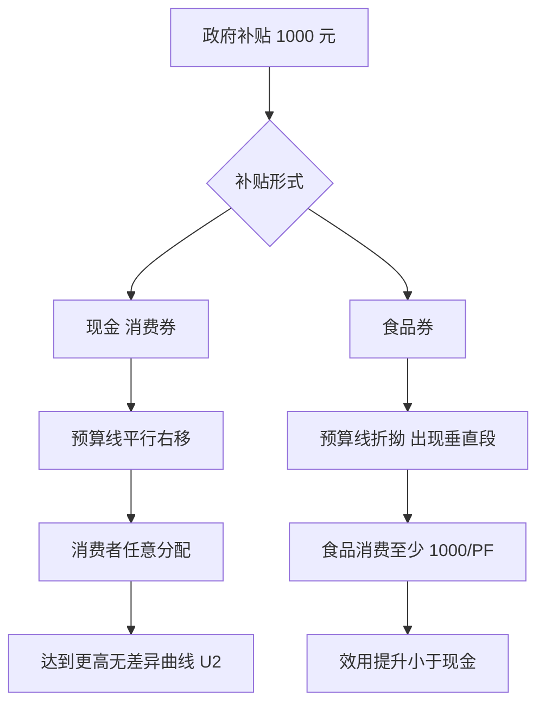

# 首都经济贸易大学 801 经济学·模拟卷（四）

<a href="../../exam.html" target="_blank" style="display:inline-block;padding:6px 16px;background:#2563eb;color:#fff;border-radius:6px;text-decoration:none;font-size:14px;">📝 开始做题</a>

> **难度定位**：中等（覆盖高频考点 + 跨章节综合，题型贴合真题风格）
> **考试时间**：180 分钟　　**满分**：150 分
> **适用参考书**：马工程《西方经济学》（第二版）、《马克思主义政治经济学概论》（第二版）

---

## 注意事项

1. 本卷为闭卷考试，答案一律写在答题纸上，写在试题册上无效。
2. 允许使用黑色或蓝黑色钢笔、圆珠笔答题，不得使用铅笔、红色笔。
3. 考试过程中不得使用计算器、手机及任何电子设备，计算题数字均为可心算整数。
4. 答题须分点作答，标明题号；论述题须结合中国经济实际与 2024—2026 年热点。
5. 考试结束后，试题册与答题纸一并交回。

---

## 一、简答与计算题（共 6 题，每题 15 分，合计 90 分）

---

### 简答 1：简述资本积累的实质、资本有机构成提高对工人阶级就业的影响，并说明相对过剩人口的三种主要形式。（15 分）

> 📚 **不懂就看：** [[../07_政治经济学/02_资本主义经济制度与生产/知识点/KP09_资本积累|📖 KP·资本积累]] ｜ [[../07_政治经济学/02_资本主义经济制度与生产/知识点/KP10_资本有机构成|📖 KP·资本有机构成]] ｜ [[../../经济统计学论文从0基础到精通/15_政治经济学基础/06_资本积累与资本有机构成|🐮 教程·资本积累与资本有机构成]]

**【考什么】** 对应政治经济学"剩余价值与资本积累"章节；题型属于概念简答 + 关系分析 + 分类列举综合题。核心考点：剩余价值资本化、资本技术构成 / 价值构成 / 有机构成（$c:v$）、相对过剩人口（产业后备军）。

**【核心推导】**

**第一步 资本积累的实质（先立定义）。**资本积累是**把剩余价值转化为资本**，即剩余价值资本化。它不是"资本家省吃俭用"，而是"用无偿占有的剩余价值去扩大无偿占有的规模"。公式表达：$\Delta K = m - m_{\text{资本家消费}}$，即剩余价值分割为积累基金与消费基金。

**第二步 资本积累的必然性（两条动因）。**①**内在动力**：追逐剩余价值是资本的本性，扩大规模才能获得更多剩余价值；②**外在压力**：竞争强制每个资本家不断扩大生产规模，不积累就被淘汰。所以积累不是道德选择，而是资本生存的条件。

**第三步 资本有机构成及其提高。**资本技术构成（生产资料与劳动力的比例）反映资本价值构成（$c:v$），这种由技术构成决定并反映技术构成变化的价值构成，叫**资本有机构成** $\dfrac{c}{v}$。积累过程中，劳动生产率的提高使每个工人推动的生产资料增多 → $c$ 相对增大、$v$ 相对缩小 → **资本有机构成提高**，这是积累的必然伴生现象。

**第四步 有机构成提高如何导致相对过剩人口（本题的核心链条）。**
1. 有机构成提高 → 总资本中可变资本 $v$ 占比下降；
2. 可变资本是**雇佣工人的工资总额**，$v$ 相对缩小 → 对劳动力的需求相对减少；
3. 同时劳动力供给因人口增长、农业机械化、妇女与儿童进入劳动力市场、破产小生产者加入而增加；
4. 供给增、需求相对减 → **相对过剩人口**（不是绝对过剩，而是相对于资本增值需要而言的过剩）。
用公式看：$\text{就业量} \approx \dfrac{v}{w}$（$w$ 为工资），$v$ 相对缩小即意味着同量资本吸纳的就业减少。数值感：若总资本从 100 增到 200，$c:v$ 从 4:1 变成 7:1，则 $v$ 从 20 增到 25（仅增 25%），而总资本增了 100%——就业增长速度远低于资本增长速度。

**第五步 相对过剩人口的三种形式。**

| 形式 | 特征 | 现实对应 |
|---|---|---|
| 流动的过剩人口 | 在现代工业中心，因经济周期与部门兴衰而时而被排斥、时而被吸收 | 制造业周期性裁员、订单波动下的临时工 |
| 潜在的过剩人口 | 农村与农业中的过剩劳动力，形式上还占有土地，实为待转移的剩余劳动力 | 农村转移劳动力、返乡农民工 |
| 停滞的过剩人口 | 就业极不规则、劳动时间长、工资低于平均水平 | 零工、日结工、部分平台灵活就业者 |

**第六步 相对过剩人口的双重作用（辩证）。**①对资本：形成**产业后备军**，经济高涨时提供劳动力、危机时吸收失业压力，同时以"随时可替代"的威胁压低在业工人工资、强化劳动纪律——这是资本积累的必要条件；②对工人：造成贫困积累，形成"一极是财富积累、另一极是贫困积累"的资本积累一般规律。

**第七步 现实含义。**平台经济中的"灵活就业蓄水池"（外卖骑手、网约车司机）在功能上类似产业后备军：进入门槛低、可随时进出、工资由算法与竞争压力决定。2024—2026 年青年失业率与"灵活就业"规模扩大，说明有机构成提高（自动化、AI 替代常规劳动）与就业吸纳能力下降之间的关系依然有效。对策上，中国通过职业技能培训、社会保障扩面（新就业形态职业伤害保障）、以工代赈等方式缓解，但根本上要靠提高劳动者技能与拓展新产业来对冲。

**【一句话】**资本积累一边扩大财富的规模，一边缩小吸纳劳动的能力。

**【为什么要答这几点】**

**【满分 15 分的分点逻辑】**积累实质与公式（3 分）→ 积累的两条动因（2 分）→ 资本有机构成定义与提高（3 分）→ 有机构成提高导致相对过剩人口的链条（4 分）→ 三种形式（3 分）。

**【易失分点】**①把资本积累说成"资本家节俭"或"储蓄增加"，这是斯密式误读；②有机构成的定义只写 $c:v$，漏掉"由技术构成决定并反映其变化"这一限定；③相对过剩人口说成"人口绝对过剩"——一字之差即失分；④三种形式名称写错（流动/潜在/停滞）；⑤不写"产业后备军"的作用，答案缺一半。

**【加分点】**①写出 $\Delta K = m - $ 资本家消费的积累公式；②给"总资本 100→200、构成 4:1→7:1"的数值感；③指出相对过剩人口的双重作用（资本的条件 + 工人的贫困）；④联系平台灵活就业与 AI 替代。

**【阅卷心理】**阅卷看"链条是否完整"：能写出"有机构成提高 → 可变资本相对减少 → 劳动力需求相对减少 → 相对过剩人口"这条因果链的进一档；只背三种形式名称的，封顶 9 分。

**【字数与时间】**550—650 字，13 分钟。

**【如何分析题目】**

**【如何分析题目】**
1. 拆题干三问：实质、影响就业、三种形式，必须分三块答。
2. 实质部分用"剩余价值资本化"一句话立住，并补两条动因（内在追逐 + 外在竞争）。
3. 有机构成部分先给完整定义（技术构成 → 价值构成 → 有机构成），再说明积累必然使其提高。
4. 就业影响写成因果链：$c$ 增 $v$ 相对减 → 劳动力需求相对减 → 供给增 → 相对过剩人口，并给一个数值例子。
5. 三种形式用表格列名称 + 特征 + 现实对应，避免空背。
6. 补"产业后备军"的双重作用与资本积累一般规律，体现理论深度。
7. 收尾联系平台灵活就业与 AI 自动化，落到中国对策。
8. 时间分配：2 分钟搭框架，9 分钟书写，2 分钟补定义与链条。

**【答题框架】**
- 第 1 段：资本积累的定义与实质（3 分）
- 第 2 段：资本有机构成的两层含义及其提高趋势（4 分）
- 第 3 段：相对过剩人口的形成机制（4 分）
- 第 4 段：相对过剩人口的三种形式（3 分）
- 第 5 段：小结——资本主义人口规律（1 分）

**【参考答案】**

一、资本积累的实质

（一）资本积累是指把剩余价值的一部分转化为资本，即剩余价值的资本化。

（二）其实质是：资本家不断用无偿占有的工人创造的剩余价值，去扩大无偿占有更多剩余价值的规模。

二、资本有机构成及其提高趋势

（一）资本构成可从两方面考察：

1. 从物质形态看，资本由一定数量的生产资料和劳动力构成，二者比例由生产技术水平决定，称资本技术构成。
2. 从价值形态看，资本由不变资本 $c$（生产资料价值）和可变资本 $v$（劳动力价值）构成，称资本价值构成。

（二）由资本技术构成决定并反映技术构成变化的资本价值构成，叫资本有机构成，公式表示为 $c:v$。

（三）在扩大再生产过程中，资本家为追逐超额剩余价值并在竞争中取胜，不断改进技术、采用新设备，使不变资本比重日益增大、可变资本比重相对缩小，因而资本有机构成呈现不断提高的趋势。

三、相对过剩人口的形成

（一）资本对劳动力的需求不是由总资本大小决定，而是由其中可变资本部分决定。当资本有机构成提高时，可变资本在总资本中所占比重下降，资本对劳动力的需求相对减少。

（二）与此同时，劳动力对资本的供给却在不断增加：机器排挤工人、女工童工进厂、小生产者和中小资本家破产流入市场。

（三）于是劳动力供给超过需求，形成相对于资本增殖需要而言过剩的、即多余的劳动人口，这就是相对过剩人口，亦称产业后备军。

四、相对过剩人口的三种主要形式

（一）流动的过剩人口：临时失业、时而被吸收时而被排斥的工人，主要存在于现代工业中心。

（二）潜在的过剩人口：农村中因资本主义发展而游离出来、随时准备流入城市出卖劳动力的人口。

（三）停滞的过剩人口：没有固定职业、从事家内劳动和临时工作的人口，其就业极不规则、生活状况低于普通工人水平。

五、小结

相对过剩人口是资本积累的必然产物，又是资本主义生产方式存在和发展的必要条件——它构成产业后备军，随时可供资本剥削，并压低在业工人工资。这是资本主义特有的人口规律。

**【解析·得分点】** 本题采分点：①剩余价值资本化定义（2 分）；②技术构成 / 价值构成 / 有机构成三层区分（3 分）；③$c:v$ 公式（1 分）；④有机构成提高趋势（2 分）；⑤可变资本相对减少导致需求相对下降 + 劳动力供给增加（3 分）；⑥相对过剩人口三种形式各 1 分（3 分）；⑦"产业后备军 / 资本主义人口规律"收尾（1 分）。容易丢分：把"相对过剩"写成"绝对过剩"；混淆技术构成与价值构成；漏写"女工童工、小生产者破产"两条供给增加原因；三种形式只写名称不解释。

**【生活实例】** 一家奶茶店老板把第一年赚的 10 万再开店（资本积累），第二年引入全自动封口机和点单系统，原来 10 个店员现在只留 4 个（可变资本 $v$ 下降、不变资本 $c$ 上升，有机构成提高）。被裁掉的 6 个人不是"没人要"，而是相对于老板现在的经营规模"多出来了"——这就是相对过剩人口。他们中有人去送外卖（流动）、有人回乡下等机会再进城（潜在）、有人在朋友圈接散单打杂（停滞）。

**【双链接】** 🔗 政治经济学 · 剩余价值与资本积累 ｜ 📖 《马克思主义政治经济学概论》资本主义部分

---

### 简答 2：简述我国对外开放基本格局的形成过程，并说明共建"一带一路"和 RCEP 在新时代高水平对外开放中的作用。（15 分）

> 📚 **不懂就看：** [[../07_政治经济学/07_民生开放与全球治理/知识点/KP03_对外开放|📖 KP·对外开放]] ｜ [[../07_政治经济学/07_民生开放与全球治理/知识点/KP04_经济全球化与全球治理|📖 KP·经济全球化与全球治理]] ｜ [[../../经济统计学论文从0基础到精通/15_政治经济学基础/11_社会主义市场经济|🐮 教程·社会主义市场经济]]

**【考什么】** 对应政治经济学"社会主义对外开放与经济全球化"章节；题型属于历史过程梳理 + 政策意义分析。核心考点：经济特区—沿海开放城市—沿海经济开放区—内地的格局、一带一路、RCEP、制度型开放。

**【核心推导】**

**第一步 对外开放基本格局的形成过程（四阶段）。**
1. **起步（1978—1991）**：设立经济特区（1980 年深圳、珠海、汕头、厦门；1988 年海南）→ 开放 14 个沿海港口城市（1984）→ 沿海经济开放区 → "点—线—面"梯度开放格局。
2. **扩大（1992—2001）**：邓小平南方谈话后，开放沿江（浦东新区 1990、沿江城市）、沿边、内陆省会城市，形成"经济特区—沿海开放城市—沿海经济开放区—内地"的全方位格局。
3. **制度接轨（2001—2012）**：加入 WTO，从"政策性开放"转向"制度性开放"，关税总水平大幅下降（从 15.3% 降至约 9.8%，再到目前的 7.3% 左右），外贸依存度快速上升。
4. **高水平开放（2013 至今）**：自贸试验区（2013 上海首设，已扩至 22 个）、自由贸易港（海南 2020）、进博会、共建"一带一路"（2013）、RCEP（2022 生效）、制度型开放（规则、规制、管理、标准对接）。

**第二步 这个格局的三个结构特征。**①**从点到面、从沿海到内陆**的空间梯度；②**从政策性优惠到制度性接轨**的方式演进；③**从"引进来"到"引进来+走出去"** 的双向开放。三条合起来就是"全方位、多层次、宽领域"的开放格局。

**第三步 一带一路的作用与机制。**
1. **功能定位**：不是对外援助计划，而是**国际合作平台**，遵循"共商共建共享"原则，五大方向（政策沟通、设施联通、贸易畅通、资金融通、民心相通）。
2. **经济机制**：①基础设施投资降低交易成本（运输时间与物流费用下降）→ 贸易潜力释放；②通过产能合作实现"优势互补"——中国具有完整产业链与工程能力，沿线国家具有资源与市场；③以中欧班列为代表形成陆海内外联动。
3. **数据感（按公开统计口径）**：中国与共建国家货物贸易额占外贸总额比重已超过 50%，中欧班列累计开行超过 10 万列；相关项目覆盖 150 多个国家。
4. **风险与应对**：债务可持续性、地缘政治、项目回报周期长——对应"小而美"项目转型、绿色与数字丝绸之路、多边金融机构参与。

**第四步 RCEP 的作用与机制。**
1. **规模**：15 个成员国（东盟 10 + 中、日、韩、澳、新），覆盖全球约 30% 的 GDP、人口与贸易额，是全球最大的自贸区。
2. **核心机制**：①**关税减让**——区域内 90% 以上产品最终实现零关税；②**原产地累积规则**——区域价值成分可在 15 国累计，显著降低享受优惠门槛，促进区域内产业链分工；③**服务贸易与投资**负面清单开放；④**贸易便利化**——海关程序、检验检疫互认，缩短通关时间。
3. **战略意义**：①首次把中日纳入同一自贸安排（中日之间首次关税减让）；②在全球化逆流中提供"区域一体化"的制度锚；③与一带一路形成"陆海联动 + 规则融合"的双轮驱动。

**第五步 二者的关系（本题的落点）。**一带一路是**平台型、发展导向**的开放（做增量、建联通），RCEP 是**规则型、制度导向**的开放（定标准、降壁垒）。两者互补：一带一路为 RCEP 提供基础设施与产能基础，RCEP 为一带一路提供规则模板与制度保障。共同服务于**从要素流动型开放向制度型开放**的转变。

**第六步 现实含义与判断。**2024—2026 年全球化逆流（关税壁垒、产业回流、供应链"友岸外包"）背景下，中国的应对是"以开放对冲封闭"：一方面扩大自主开放与单边开放（对最不发达国家零关税、制造业外资准入负面清单清零），另一方面以 RCEP、中国—东盟自贸区 3.0、加入 CPTPP 与 DEPA 的申请提升规则话语权。判断标准不是签约数量，而是"制度型开放能否降低企业的跨境交易成本"。

**【一句话】**一带一路做增量、RCEP 定规则，二者合起来才是高水平的开放格局。

**【为什么要答这几点】**

**【满分 15 分的分点逻辑】**四阶段格局形成（4 分）→ 三个结构特征（2 分）→ 一带一路的定位、机制与数据（4 分）→ RCEP 的规模、核心机制与意义（4 分）→ 二者关系与制度型开放（1 分）。

**【易失分点】**①只列时间点不写"格局"的空间结构（点—线—面）；②一带一路只写"共商共建共享"一句口号，不写五通与机制；③RCEP 漏掉"原产地累积规则"——这是它最重要的技术机制；④不区分"政策性开放"与"制度性开放"；⑤不谈风险（债务可持续性、地缘政治），答案显得单薄。

**【加分点】**①指出 2013 年自贸区首设标志"制度型开放"起点；②写出 RCEP"区域价值成分可累计"这一机制；③指出 RCEP 首次把中日纳入同一自贸安排；④用"一带一路做增量、RCEP 定规则"一句话点出二者分工；⑤提到自主开放、单边开放与 CPTPP/DEPA 申请。

**【阅卷心理】**按"阶段 + 机制 + 关系"三段给分：只写历史时间表的，最多 9 分；能讲清 RCEP 原产地累积规则与一带一路五通的，进一档。

**【字数与时间】**550—650 字，13 分钟。

**【如何分析题目】**

**【如何分析题目】**
1. 拆题干两问："格局的形成过程"（纵向时间线）+"二者的作用"（横向机制），分开答。
2. 格局部分按四阶段写，每阶段给一个标志性事件与开放形态的转变，最后归纳"全方位、多层次、宽领域"。
3. 一带一路部分按"定位—五通—机制—数据—风险"五步写，重点是设施联通降低交易成本的机制。
4. RCEP 部分按"规模—核心机制—战略意义"三步写，务必写出原产地累积规则与服务贸易负面清单。
5. 单独一段写两者关系：平台型 vs 规则型，增量 vs 标准，互补而非替代。
6. 收尾落到"制度型开放"与 2024—2026 逆全球化背景下的中国应对（自主开放、单边开放、CPTPP）。
7. 时间分配：3 分钟列时间线与机制关键词，8 分钟书写，2 分钟补数据与关系句。

**【答题框架】**
- 第 1 段：对外开放是基本国策（2 分）
- 第 2 段：从经济特区到全方位开放格局的四步走（5 分）
- 第 3 段：新时代高水平对外开放的内涵（3 分）
- 第 4 段：一带一路与 RCEP 的作用（4 分）
- 第 5 段：小结（1 分）

**【参考答案】**

一、对外开放是我国长期基本国策

（一）对外开放是指在平等互利基础上扩大对外经济技术交流，积极参与国际分工与世界市场。

（二）1978 年十一届三中全会把对外开放确立为基本国策，逐步形成全方位、多层次、宽领域开放格局。

二、对外开放格局的形成过程

（一）第一步：1980 年设立深圳、珠海、汕头、厦门四个经济特区，实行特殊经济政策，作为对外开放的"窗口"和试验田。

（二）第二步：1984 年进一步开放大连、天津、青岛、上海、广州等 14 个沿海港口城市。

（三）第三步：1985 年起开辟长江三角洲、珠江三角洲、闽南厦漳泉三角地区以及辽东半岛、山东半岛等沿海经济开放区。

（四）第四步：1990 年开发开放上海浦东，随后向沿江、沿边和内地省会城市推进，形成"经济特区—沿海开放城市—沿海经济开放区—内地"这样一个多层次、有重点、点面结合的开放格局。加入 WTO（2001 年）标志着中国从政策性开放转向制度性开放。

三、新时代高水平对外开放的内涵

（一）党的十八大以来，我国进入高水平对外开放新阶段。其特征是：由商品和要素流动型开放转向规则、规制、管理、标准等制度型开放；由"引进来"为主转向"引进来"与"走出去"并重；由主动融入全球化转向主动引领全球化。

四、"一带一路"与 RCEP 的作用

（一）共建"一带一路"（2013 年提出）秉持共商共建共享原则，通过政策沟通、设施联通、贸易畅通、资金融通、民心相通（"五通"），打通向西开放的战略通道，推动陆海内外联动、东西双向互济。它不是中国版"马歇尔计划"，而是构建人类命运共同体的重要实践平台。

（二）《区域全面经济伙伴关系协定》（RCEP，2020 年签署、2022 年生效）覆盖东盟十国与中、日、韩、澳、新共 15 国，是全球人口最多、经贸规模最大的自由贸易区。其作用包括：

1. 区域内 90% 以上货物贸易最终实现零关税；
2. 统一原产地规则、简化海关程序，降低区域内产业链供应链成本；
3. 推动中日韩首次达成双边关税减让安排，为东亚经济一体化提供制度框架。

五、小结

从经济特区到一带一路、再到 RCEP，我国开放格局实现了由试点探索到制度型开放、由被动接轨到主动引领的历史性跨越。

**【解析·得分点】** 采分点：①四个经济特区名称（2 分）；②14 个沿海港口城市、沿海经济开放区、浦东开发的时序（2 分）；③加入 WTO 标志制度性开放（1 分）；④制度型开放内涵（3 分）；⑤一带一路"五通"（2 分）；⑥RCEP 15 国 + 90% 零关税 + 原产地累积规则（3 分）；⑦双循环 / 人类命运共同体收尾（2 分）。容易丢分：把经济特区写成"浦东"；把 RCEP 与 CPTPP 混淆；漏写"共商共建共享"原则；只罗列事件不点评作用。

**【生活实例】** 像开一家店：先在大学城开一家样板店（经济特区），验证模式后在地铁沿线开分店（沿海开放城市），再把整条商业街做成主题街区（沿海经济开放区），最后开到全城各个社区（内地）。一带一路相当于把店开到"丝绸之路"沿线国家去，RCEP 则是周边 15 家店签了联盟协议——互相拿货便宜、统一收银规则，整个区域的生意都更好做。

**【双链接】** 🔗 政治经济学 · 社会主义对外开放 ｜ 📖 《马克思主义政治经济学概论》社会主义部分

---

### 简答 3：简述供给侧结构性改革的科学内涵、重点任务（"三去一降一补"）及其现实意义。（15 分）

> 📚 **不懂就看：** [[../07_政治经济学/06_社会主义市场经济与发展/知识点/KP02_新发展理念与高质量发展|📖 KP·新发展理念与高质量发展]] ｜ [[../07_政治经济学/06_社会主义市场经济与发展/知识点/KP03_新发展格局|📖 KP·新发展格局]] ｜ [[../../经济统计学论文从0基础到精通/15_政治经济学基础/11_社会主义市场经济|🐮 教程·社会主义市场经济]]

**【考什么】** 对应政治经济学"社会主义经济发展与新常态"章节；题型属于政策内涵 + 任务列举 + 意义分析。核心考点：供给侧 vs 需求侧、三去一降一补、新常态、高质量发展。

**【核心推导】**

**第一步 科学内涵（一句话 + 三层理解）。**供给侧结构性改革，就是从**提高供给质量**出发，用**改革的办法**推进结构调整，减少无效和低端供给，扩大有效和中高端供给，增强供给结构对需求变化的适应性和灵活性。三层：①**主线是结构性**——问题在结构而非总量；②**手段是改革**——靠体制机制创新，不靠行政刺激；③**落点是供给质量**——提升全要素生产率。

**第二步 为什么是"供给侧"而不是"需求侧"。**因为矛盾的主要方面在供给侧：①部分行业产能严重过剩而高端供给不足（"低端过剩、高端不足"并存）；②要素成本上升使旧增长模式（低成本要素驱动）难以为继；③供给侧结构性改革着眼于**生产能力与效率**（长期），而需求管理着眼于**短期总量平衡**——两者是长短结合，不是二选一。

**第三步 重点任务："三去一降一补"。**
| 任务 | 内容 | 目标 | 机制/手段 |
|---|---|---|---|
| 去产能 | 化解钢铁、煤炭等过剩产能 | 供求再平衡、价格修复 | 环保、能耗、质量、安全等标准倒逼 + 市场化债转股、兼并重组 |
| 去库存 | 化解房地产与部分工业品库存 | 降低资金占用 | 棚改货币化（历史阶段）、租购并举、因城施策 |
| 去杠杆 | 降低企业尤其是国企杠杆率 | 防系统性金融风险 | 市场化法治化债转股、约束地方政府隐性债务、提高直接融资比重 |
| 降成本 | 降低实体经济企业成本 | 提高企业盈利与投资意愿 | 减税降费（营改增、增值税率下调）、降低融资与物流成本、清理涉企收费 |
| 补短板 | 补齐民生、基础设施、产业链短板 | 提升发展质量 | 脱贫攻坚、公共服务均等化、关键核心技术攻关 |

**第四步 深化阶段："巩固、增强、提升、畅通"八字方针（2018 年后）。**
1. **巩固**——巩固"三去一降一补"成果，防止已化解的过剩产能死灰复燃；
2. **增强**——增强微观主体活力，重点是产权保护、公平竞争、激发企业家精神（与"两个毫不动摇"一致）；
3. **提升**——提升产业链水平，向"微笑曲线"两端延伸，补链强链延链；
4. **畅通**——畅通国民经济循环，打通生产、分配、流通、消费各环节的堵点（与"全国统一大市场"直接衔接）。

**第五步 与新质生产力的衔接（当前阶段的关键）。**供给侧结构性改革的主线地位没有变，但着力点在演进：从"去产能、去库存"（做减法）转向"以科技创新推动产业创新"（做加法）——改造提升传统产业、培育壮大新兴产业、布局建设未来产业。机制上靠**新型举国体制**（关键核心技术攻关）、**教育科技人才一体化**、**耐心资本与多层次资本市场**。

**第六步 现实意义（四点）。**①**短期**：改善供求关系，修复企业利润与价格水平（PPI 由负转正的机制）；②**中期**：提高全要素生产率，支撑潜在增长率；③**结构**：推动产业升级与区域协调；④**风险**：通过去杠杆与去产能降低系统性风险，为高质量发展腾出空间。

**第七步 辩证与风险提示（拉开分差的部分）。**①执行中的偏差："一刀切"式去产能可能误伤先进产能，需以标准与市场手段为主；②去产能与稳就业的张力，需配套再就业培训与社会保障；③"补短板"若变成地方重复建设，则又回到"低端供给"；④供给侧改革不能替代需求管理——需求持续不足时，结构性改革见效慢，仍需宏观政策托底。这正是"供给侧结构性改革为主线 + 扩大内需为战略基点"并提的原因。

**【一句话】**供给侧结构性改革不是"少生产"，而是"生产得更对"。

**【为什么要答这几点】**

**【满分 15 分的分点逻辑】**科学内涵三层（3 分）→ 为什么在供给侧（3 分）→ 三去一降一补（5 分）→ 八字方针（2 分）→ 现实意义与风险（2 分）。

**【易失分点】**①内涵只背"减少无效供给、扩大有效供给"，不说"用改革的办法"这一手段特征；②把供给侧结构性改革理解为"扩大生产"或"减少生产"；③五项任务只列名称不写手段，尤其去产能不写"标准倒逼 + 市场化手段"；④不知道"八字方针"这一深化阶段的表述；⑤不写执行偏差与稳就业张力，答案显得口号化。

**【加分点】**①点明"主线是结构性、手段是改革、落点是供给质量"；②把去产能手段写成"环保、能耗、质量、安全标准 + 市场化重组"，体现"用改革办法"；③与全国统一大市场、新质生产力衔接；④指出与扩大内需并提的辩证关系。

**【阅卷心理】**本题高频考，阅卷看"内涵是否准确 + 任务是否成体系"。把供给侧改革说成"刺激供给扩张"的直接降档；能写"八字方针"与"新质生产力"衔接的进一档。

**【字数与时间】**550—650 字（含表），13 分钟。

**【如何分析题目】**

**【如何分析题目】**
1. 拆题干三问：科学内涵、重点任务、现实意义——三块结构固定。
2. 内涵先给一句准确表述（提高供给质量、用改革办法、调结构），再拆三层理解，避免只背一句。
3. 补一段"为什么是供给侧"：低端过剩 + 高端不足 + 要素成本上升，说明矛盾主要方面。
4. 重点任务用表：五项名称 + 内容 + 手段，特别把去产能的手段写成标准倒逼与市场化重组。
5. 加一层"八字方针"，说明改革在深化，体现不是旧知识。
6. 现实意义分短期（修价格、修利润）、中期（提 TFP）、结构（产业升级）、风险（降杠杆）四点。
7. 结尾写执行偏差与"与扩大内需并提"的辩证关系，显示思考深度。
8. 时间分配：2 分钟搭框架，9 分钟书写，2 分钟补手段与新质生产力。

**【答题框架】**
- 第 1 段：提出背景与定位（3 分）
- 第 2 段：科学内涵（3 分）
- 第 3 段：三去一降一补五项任务（5 分）
- 第 4 段：现实意义与深化方向（3 分）
- 第 5 段：小结（1 分）

**【参考答案】**

一、提出背景与定位

（一）供给侧结构性改革是 2015 年中央经济工作会议正式提出的重大战略。其背景是中国经济进入新常态：经济增速从高速转向中高速，结构出现产能过剩、库存高企、杠杆率偏高、成本上升、短板突出等问题。

（二）它与需求侧管理（投资、消费、出口"三驾马车"）不同：需求侧重在短期总量调节，供给侧重在长期结构优化，主攻方向是提高供给体系质量和效率。

二、科学内涵

（一）"供给侧"：指从供给、生产端入手，通过解放和发展生产力，提升产品和服务对需求变化的适应性。

（二）"结构性"：强调矛盾的主要方面在供给结构，而非总量不足，要去无效供给、扩有效供给。

（三）"改革"：根本靠体制机制创新，使市场在资源配置中起决定性作用，更好发挥政府作用。

三、重点任务——"三去一降一补"

（一）去产能：重点化解钢铁、煤炭、水泥、电解铝等传统行业过剩产能，处置"僵尸企业"，避免低效占用资源。

（二）去库存：重点化解三四线城市房地产库存，通过户籍制度改革、农民工市民化等措施消化存量商品房。

（三）去杠杆：降低企业部门和地方政府杠杆率，规范地方政府融资平台，防范化解系统性金融风险。

（四）降成本：降低实体经济企业税费负担、社会保险费、物流成本、用电成本、融资成本，即"降实体经济成本"。

（五）补短板：补齐基础设施、民生、脱贫攻坚、农业、科技创新、生态环保等领域短板，尤其是关键核心技术"卡脖子"短板。

四、现实意义

（一）短期意义：优化存量资源配置，缓解产能过剩和房地产库存风险，稳住宏观经济大盘。

（二）长期意义：推动经济发展从要素驱动、投资驱动转向创新驱动，为高质量发展和构建新发展格局奠定结构基础。

（三）新时代深化：重点转向"巩固、增强、提升、畅通"八字方针，与科技自立自强、扩大内需战略有机结合。

五、小结

供给侧结构性改革是适应和引领经济发展新常态的重大创新，是把握新一轮科技革命和产业变革机遇、实现中国式现代化的主线之一。

**【解析·得分点】** 采分点：①2015 年提出、新常态背景（2 分）；②供给侧 vs 需求侧的区别（2 分）；③"三去一降一补"五项各 1 分（5 分）；④去产能行业举例（钢铁煤炭）、去库存聚焦三四线房地产、补短板含"卡脖子"（3 分）；⑤"巩固增强提升畅通"八字方针（2 分）；⑥与高质量发展、新发展格局关系（1 分）。容易丢分：把"三去一降一补"写成"四去"；把供给侧改革等同于"计划经济"；漏写"市场在资源配置中起决定性作用"。

**【生活实例】** 一家餐厅生意不好，老板第一反应是"发优惠券打折"（需求侧），但顾客来了还是吐槽菜不好吃、上菜慢。真正要做的是换菜单、砍滞销菜、培训厨师、整改后厨（供给侧）。"去产能"就是把卖不动的菜下架；"去库存"就是把冻库里积压的食材清掉；"去杠杆"就是少借钱扩张；"降成本"就是跟房东谈租金、跟供应商压价；"补短板"就是把招牌菜研发出来、把卫生问题解决。

**【双链接】** 🔗 政治经济学 · 社会主义经济发展 ｜ 📖 《马克思主义政治经济学概论》社会主义部分

---

### 简答 4：简述劳动供给曲线向后弯曲的原因，并说明工资、地租、利息和利润是如何决定的。（15 分）

> 📚 **不懂就看：** [[../06_西方经济学/06_生产要素市场与收入分配/知识点/KP03_劳动供给与工资决定|📖 KP·劳动供给与工资决定]] ｜ [[../06_西方经济学/06_生产要素市场与收入分配/知识点/KP04_地租与利息|📖 KP·地租与利息]] ｜ [[../../经济统计学论文从0基础到精通/13_微观经济学基础/07_生产函数与边际报酬递减是什么|🐮 教程·生产函数与边际报酬（要素需求基础）]]

**【考什么】** 对应西经微观"生产要素市场与收入分配"章节；题型属于图形分析 + 要素价格决定综合。核心考点：替代效应与收入效应、向后弯曲劳动供给曲线、土地供给垂直、资本价格与利息、企业家才能与利润。

**【核心推导】**

**第一步 劳动供给曲线向后弯曲的现象。**横轴为劳动供给量 $L$（或工作时数），纵轴为工资率 $W$。曲线先向右上方倾斜（工资上升 → 劳动供给增加），到达某点后**向后弯折**（工资继续上升 → 劳动供给反而减少）。

**第二步 用替代效应与收入效应解释（核心推导）。**工资 $W$ 上升对劳动供给有两股相反的力：
1. **替代效应**：闲暇的机会成本上升（少工作 1 小时就少挣 $W$），劳动者用工作替代闲暇 → 劳动供给 $\uparrow$；
2. **收入效应**：工资上升使实际收入提高，而闲暇是正常品，收入提高后想多消费闲暇 → 劳动供给 $\downarrow$。
净效应：$\dfrac{\Delta L}{\Delta W} = $ 替代效应 $-$ 收入效应。
- 工资水平**较低**时：替代效应 > 收入效应 → 供给曲线向右上倾斜；
- 工资水平**较高**时：收入效应 > 替代效应 → 供给曲线向后弯折。
数学上，劳动供给的工资弹性 $\varepsilon = \dfrac{\partial L}{\partial W}\cdot\dfrac{W}{L}$ 在低工资时为**正**，在高工资时为**负**（这是"向后弯曲"的判据，也是与普通商品供给曲线最大的不同——普通商品供给弹性恒为正）。

**第三步 为什么普通商品的供给曲线不会向后弯。**因为普通商品的"供给者"是厂商，追求利润最大化，价格上涨提高边际收益，供给必然增加；而劳动的"供给者"既是决策者又是消费者，工资同时是成本（机会成本）和收入，因此必然产生两股相反的力。

**第四步 四种生产要素价格的决定（各自的机制不同）。**
| 要素 | 价格 | 需求侧 | 供给侧 | 均衡机制 |
|---|---|---|---|---|
| 劳动 | 工资 $W$ | 劳动的边际产品价值 $VMP_L = P\cdot MP_L$ | 劳动供给（可向后弯） | $VMP_L = W$（完全竞争） |
| 土地 | 地租 $R$ | 土地的边际产品价值 | **供给固定（完全无弹性）** | 地租完全由需求决定（"地租是剩余"） |
| 资本 | 利息 $i$ | 资本的边际产品价值 | 储蓄供给（时间偏好） | $VMP_K = i$，$i$ 是延期消费的补偿 |
| 企业家才能 | 利润 $\pi$ | 对组织与创新的需求 | 企业家供给 | 正常利润是成本、超额利润源于创新与垄断 |

**第五步 关键要点补充。**
1. 劳动需求曲线由 $VMP_L$ 给出且向下倾斜，源于边际报酬递减；厂商雇佣原则是 $VMP_L = W$（若为买方垄断，则 $MRP_L = MFC_L$，工资被压低）。
2. 地租的特殊性：土地供给曲线垂直，需求上升只提高地租而不增加供给 → **地租是"剩余"而非成本**（李嘉图地租论），这也是"土地财政"具有特殊性的理论根源。
3. 利息的两种视角：马克思的剩余价值分割说 vs 西方经济学的"时间偏好 + 资本边际生产率"说。
4. 利润：正常利润计入成本（企业家才能的报酬），**超额利润**来源于创新（熊彼特）、风险承担、垄断力量。

**第六步 现实含义。**①向后弯曲的劳动供给解释了"工资涨到一定程度后，人们选择更多休闲而非更多工作"——发达国家工时下降、四天工作制的讨论；②对中国而言，农民工群体的劳动供给在低工资区间弹性大（替代效应主导），而高技能劳动者收入效应明显（更重视闲暇与家庭），因此**同样的工资政策对不同群体的劳动供给反应不同**；③土地供给无弹性解释了为什么核心城市房价对需求冲击极其敏感；④资本的流动性与利息对货币政策的敏感度，是货币政策传导的基础。

**【一句话】**工资既是工作的报酬，也是闲暇的价格——所以劳动供给曲线会掉头。

**【为什么要答这几点】**

**【满分 15 分的分点逻辑】**向后弯曲现象与图形（2 分）→ 替代效应与收入效应的推导（5 分）→ 低工资与高工资区间的净效应与弹性判据（3 分）→ 四种要素价格决定（5 分）。

**【易失分点】**①只说"收入效应大于替代效应"而不解释两效应的定义；②把工资上升一律说成"增加劳动供给"；③不说明"劳动供给弹性由正转负"这一判据；④地租的"供给固定、完全无弹性"没说，导致地租与工资混为一谈；⑤利润部分漏掉"正常利润计入成本"这一关键区分。

**【加分点】**①写出 $\Delta L/\Delta W$ = 替代效应 − 收入效应；②对比普通商品供给弹性恒正；③指出地租是"剩余"而非成本（李嘉图）；④区分马克思与西方经济学对利息的解释；⑤联系四天工作制、农民工与高技能者的不同弹性。

**【阅卷心理】**本题是"曲线+要素定价"复合题，阅卷先看图（是否画出向后弯折）再看两效应。图形画对且两效应写清的基本 10 分；四种要素价格各写一句机制的进一档。

**【字数与时间】**600—700 字（含表与图），14 分钟。

**【如何分析题目】**

**【如何分析题目】**
1. 拆题干两问："向后弯曲的原因"（微观劳动供给）+ "四种要素价格如何决定"（要素市场），分两块答。
2. 先画图：横轴劳动量、纵轴工资，曲线先右上后左上弯折，标注转折区间。
3. 讲两效应：分别定义替代效应（闲暇的机会成本）与收入效应（闲暇是正常品），并写净效应公式。
4. 分段讨论：低工资区间替代效应占优、高工资区间收入效应占优，得出弹性由正转负。
5. 对比普通商品：厂商供给必然向右上倾斜，引出劳动供给者"双重身份"这一根本区别。
6. 四种要素列表：价格、需求侧依据（$VMP$）、供给侧特征、均衡条件；重点讲土地供给无弹性、正常利润计入成本。
7. 现实段用四天工作制、农民工与高技能者差异、核心城市房价说明。
8. 时间分配：3 分钟画图，8 分钟书写，3 分钟补要素表与现实。

**【答题框架】**
- 第 1 段：劳动供给的本质——时间在工作与闲暇之间分配（2 分）
- 第 2 段：替代效应与收入效应（5 分）
- 第 3 段：向后弯曲劳动供给曲线图形（3 分）
- 第 4 段：地租、利息、利润的决定（4 分）
- 第 5 段：小结（1 分）

**【参考答案】**

一、劳动供给的本质

（一）消费者面临的不是"劳动多少"，而是"时间如何在工作（获取收入）与闲暇（消费时间）之间分配"。

（二）工资率 $w$ 可视为闲暇的机会成本——工资越高，一小时闲暇的代价越大。

二、替代效应与收入效应

（一）替代效应：工资率上升意味着闲暇变得更贵，消费者倾向于用工作替代闲暇，即劳动供给量随工资上升而增加。

（二）收入效应：工资率上升使消费者总收入提高，在正常品假定下，他们对闲暇（高档品）的需求也会增加，从而减少劳动供给。

（三）两种效应方向相反：

1. 在工资率较低阶段，替代效应大于收入效应，劳动供给曲线向右上方倾斜；
2. 当工资率上升到一定水平后，收入效应超过替代效应，劳动供给量反而随工资上升而减少，曲线向后弯曲。

三、向后弯曲劳动供给曲线的图形

（一）横轴为劳动时间 $L$，纵轴为工资率 $w$。

（二）曲线从左下方向右上方延伸至某一拐点 $w^*$，随后向左上方弯曲，即 $w$ 继续上升而 $L$ 减少。

四、其他要素价格的决定

（一）工资：由劳动市场供求共同决定。完全竞争下均衡工资等于劳动的边际产品价值 $VMP = P \cdot MP_L$；买方垄断、工会力量、效率工资等会使工资偏离此水平。

（二）地租：

1. 土地作为自然资源，其自然供给总量固定，供给曲线垂直于数量轴。
2. 地租由土地需求曲线（由土地边际生产力决定）与垂直供给曲线的交点决定。地租是"使用土地的价格"，级差地租则由土地肥沃程度、位置差异形成。

（三）利息：

1. 利息是使用资本的价格，由资本的供求决定。资本需求来自厂商对资本边际收益产品 $MRP_K$ 的评价；资本供给来自家庭储蓄。
2. 均衡利率使储蓄等于投资。

（四）利润：

1. 正常利润是企业家才能的报酬，包含在成本之中。
2. 经济利润（超额利润）来源于：创新、承担风险、垄断（买方 / 卖方垄断）以及动态失衡。

五、小结

要素价格决定统一遵循"边际生产力 × 产品价格 = 要素需求"的原则，但劳动的特殊性在于时间在工作与闲暇间的配置，使其供给曲线向后弯曲；土地供给固定、资本来自储蓄、利润来自企业家才能与不确定性。

**【解析·得分点】** 采分点：①闲暇的机会成本即工资（2 分）；②替代效应 + 收入效应方向相反（3 分）；③低工资段替代 > 收入、高工资段收入 > 替代（3 分）；④图形坐标轴与拐点 $w^*$（2 分）；⑤地租由垂直供给曲线与需求曲线交点决定（2 分）；⑥利息由储蓄 = 投资决定（1 分）；⑦经济利润三来源（创新 / 风险 / 垄断）（2 分）。容易丢分：只写"向后弯曲"不解释两种效应；把土地供给画成向右上方倾斜；混淆正常利润与经济利润。

**【生活实例】** 大学生家教：一小时 30 元时你很愿意多接课（替代效应主导，工资低，多上课更划算）；涨到 300 元一小时时，你反而只上两天就休息了——因为已经赚够了，剩下时间要去看电影、健身（收入效应主导）。房东的地皮不随租金上涨而变多（土地供给垂直），所以租金高低全看多少企业想来租地。

**【双链接】** 🔗 西经微观 · 生产要素市场 ｜ 📖 马工程《西方经济学》上册 第七章

---

### 简答 5：什么是外部性？结合图形说明正外部性与负外部性如何导致市场失灵，并比较科斯定理与庇古税在解决外部性上的差异。（15 分）

> 📚 **不懂就看：** [[../06_西方经济学/08_市场失灵与微观经济政策/知识点/KP02_外部性|📖 KP·外部性]] ｜ [[../06_西方经济学/08_市场失灵与微观经济政策/知识点/KP03_公共物品|📖 KP·公共物品]] ｜ [[../../经济统计学论文从0基础到精通/13_微观经济学基础/12_外部性与公共品是什么|🐮 教程·外部性与公共品]]

**【考什么】** 对应西经微观"市场失灵与微观经济政策"章节；题型属于概念 + 图形 + 政策比较。核心考点：外部性分类、私人成本 / 社会成本、私人收益 / 社会收益、庇古税与补贴、科斯定理与产权。

**【核心推导】**

**第一步 外部性的定义与分类。**外部性（外部影响）指一个经济主体的活动对他人造成影响，而这种影响**没有通过市场价格反映**，即私人成本（收益）与社会成本（收益）不一致。
- **负外部性**：私人成本 < 社会成本（如污染、噪音），私人收益 = 社会收益；
- **正外部性**：私人收益 < 社会收益（如教育、疫苗、基础研究），私人成本 = 社会成本。

**第二步 图形说明与效率损失（用边际曲线说清）。**
负外部性（生产侧）：
- $MPC$（私人边际成本）位于 $MSC$（社会边际成本）之下，二者垂直距离为边际外部成本 $MEC$；
- 市场均衡在 $MPC=MPB$ 处，产量 $Q_m$；社会最优在 $MSC=MSB$ 处，产量 $Q^*$，$Q_m > Q^*$；
- **无谓损失**为该区间内 $MSC$ 与需求曲线之间的三角面积——生产过多。
正外部性（消费侧）：
- $MPB$ 低于 $MSB$，二者距离为边际外部收益 $MEB$；
- 市场均衡 $Q_m < Q^*$，**产量不足**，同样存在无谓损失三角。
一句话：负外部性 → 生产过多、价格偏低；正外部性 → 生产过少、价格偏高。

**第三步 科斯定理：用产权与市场交易解决。**内容：**只要产权界定清晰且交易成本为零（或足够低），无论产权初始如何界定，市场交易都能达到资源的帕累托最优配置。**机制：把"污染权"或"清洁权"明确赋给一方，受损方与施害方通过谈判达成补偿，外部性被"内部化"为交易价格。例如：上游工厂排污影响下游渔场，若赋予渔场清洁水权，工厂会付费购买排污额度；若赋予工厂排污权，渔场会付费请工厂减排。**两种初始产权都得到有效率的产量，只是分配不同**（这正是福利经济学"效率与分配可分离"思想的体现）。

**第四步 庇古税：用政府矫正税解决。**内容：对产生负外部性的活动征收等于**边际外部成本**的税（$t = MEC$），使 $MPC + t = MSC$，厂商的私人成本曲线抬升到社会成本曲线，产量自动落到社会最优 $Q^*$。正外部性则对应补贴（$s = MEB$）。这就是"庇古税/庇古补贴"，也称"排污税""矫正税"。

**第五步 两者的比较（本题的核心得分点）。**
| 维度 | 科斯定理（产权/市场） | 庇古税（政府/税收） |
|---|---|---|
| 前提条件 | 产权清晰 + 交易成本低 | 政府掌握 $MEC$ 的准确信息并有效征收 |
| 手段 | 自愿谈判、排污权交易 | 征税/补贴 |
| 优点 | 不依赖政府信息优势，尊重市场；结果与产权初始分配无关（效率上） | 简单直接、适用范围广；能带来财政收入（双重红利） |
| 缺点 | 交易成本高（人数多、信息不对称）时失效；初始产权影响分配（公平） | 需要准确估计 $MEC$；存在征收成本与避税；可能抑制合法生产 |
| 适用场景 | 当事人少、产权可界定（如上下游企业、渔业与化工） | 当事人众多、难以谈判（如汽车尾气、碳排放） |

**第六步 现实应用。**①碳市场（中国全国碳市场 2021 年上线）本质是**科斯思路**的实践——总量控制 + 配额交易，用产权交易实现减排；②碳税则是**庇古思路**；③"谁污染谁治理""生态补偿机制""排污权交易试点"都是两种手段的中国化表达。二者的选择取决于交易成本与信息成本的高低：当事人少、产权清晰 → 科斯；当事人众多、难以度量 → 庇古。实践中常混合使用（如碳市场与环保税并行）。

**第七步 补充判断（加分）。**①科斯定理常被误读为"只要界定产权就能解决一切"，其关键前提是**交易成本足够低**，现实中交易成本往往很高，故科斯本人更强调"比较不同制度安排的成本"；②庇古税的最优水平在存在其他扭曲时需做次优调整（次优理论）；③外部性内部化的第三条路：企业合并（把外部性变成内部问题）、社会规范与信息披露。

**【一句话】**科斯让当事人自己谈，庇古让政府定价——选哪个取决于交易成本和信息成本谁更低。

**【为什么要答这几点】**

**【满分 15 分的分点逻辑】**外部性定义与正负分类（3 分）→ 图形与效率损失（4 分）→ 科斯定理内容与机制（3 分）→ 庇古税内容（3 分）→ 两者比较（2 分）。

**【易失分点】**①不区分"生产的外部性"与"消费的外部性"，图形画错方向；②正负外部性导致的产量偏差说反（负外部性应为生产过多）；③科斯定理漏掉"交易成本为零"这一关键前提，是最高频的失分点；④庇古税写成"按产量随意征税"，应写"$t=MEC$"；⑤只写两者定义不做比较，等于没答"差异"。

**【加分点】**①写出 $MSC = MPC + MEC$、$MSB = MPB + MEB$；②指出科斯定理"效率与初始产权无关、分配有关"的双重含义；③指出庇古税需要政府掌握 $MEC$ 信息这一现实困难；④联系全国碳市场（科斯思路）与环保税（庇古思路）并行。

**【阅卷心理】**本题阅卷先看两张图（正、负外部性各一），再看"交易成本"与"$MEC$"两个关键词。图形画对、两个关键词都出现的，13 分以上；科斯定理不写前提的，扣 2 分。

**【字数与时间】**600—700 字（含两图与表），14 分钟。

**【如何分析题目】**

**【如何分析题目】**
1. 先给定义，立即分为正、负两类，并明确"私人与社会成本/收益的偏离"这一判据。
2. 画两张图：负外部性（$MPC$ 在 $MSC$ 之下，$Q_m>Q^*$）、正外部性（$MPB$ 在 $MSB$ 之下，$Q_m<Q^*$），标出无谓损失三角。
3. 写科斯定理：结论 + 两个前提（产权清晰、交易成本低）+ 机制（谈判使外部性内部化）+ 两重含义（效率无关初始产权、分配有关）。
4. 写庇古税：$t=MEC$，把 $MPC$ 抬到 $MSC$，产量落到 $Q^*$；正外部性用补贴 $s=MEB$。
5. 用对照表比较前提、手段、优缺点、适用场景，这是"差异"题的必答形式。
6. 现实段写碳市场（科斯）+ 碳税（庇古）+ 生态补偿，说明选择依据是交易成本与信息成本。
7. 加分句：指出交易成本是科斯定理的现实约束、庇古税需信息、第三条路是企业合并。
8. 时间分配：3 分钟画图，8 分钟书写，3 分钟补比较表与现实。

**【答题框架】**
- 第 1 段：外部性定义与分类（3 分）
- 第 2 段：负外部性与生产过剩（4 分）
- 第 3 段：正外部性与生产不足（3 分）
- 第 4 段：庇古税与科斯定理比较（4 分）
- 第 5 段：小结（1 分）

**【参考答案】**

一、外部性的定义与分类

（一）外部性是指经济主体的行为对旁观者福利产生了未被市场交易计入的影响。

（二）分类：

1. 负外部性：一方行为使第三方受损，如工厂排污、噪音。
2. 正外部性：一方行为使第三方受益而未获报酬，如教育、疫苗接种、研发创新。

二、负外部性导致生产过剩

（一）存在负外部性时，私人成本 $C_p$ 小于社会成本 $C_s = C_p +$ 外部成本。

（二）完全竞争厂商按私人边际成本 $MC_p$ 与需求曲线交点决定产量 $Q_p$；社会最优产量由社会边际成本 $MC_s$ 与需求曲线交点决定，为 $Q_s$。

（三）图形上 $MC_s$ 位于 $MC_p$ 左上方，于是 $Q_p > Q_s$，即产量过多、价格过低，资源过度配置到该部门，市场失灵。

三、正外部性导致生产不足

（一）存在正外部性时，私人收益 $R_p$ 小于社会收益 $R_s = R_p +$ 外部收益。

（二）消费者按私人边际收益 $MB_p$ 决定需求量，社会最优由社会边际收益 $MB_s$ 决定。

（三）图形上 $MB_s$ 位于 $MB_p$ 右上方，于是 $Q_p < Q_s$，即产量不足。

四、庇古税与科斯定理的比较

（一）庇古税（Pigou 税）：

1. 由政府对产生负外部性的厂商征收等于外部边际成本的税 $t = MEC$，使 $MC_p$ 上移至 $MC_s$，厂商自动把产量从 $Q_p$ 减至 $Q_s$。
2. 对正外部性则补贴 $s = MEB$，使私人需求曲线上移至社会需求曲线。
3. 优点：直接纠正价格信号；局限：政府须准确知道外部成本大小。

（二）科斯定理：

1. 只要产权明晰且交易成本为零，无论初始产权赋予哪一方，市场双方自愿谈判都能达到帕累托最优。
2. 例如工厂污染附近居民：若法律赋予居民清洁空气权，工厂须付钱买排污权；若赋予工厂排污权，居民可付钱让工厂减产。两种情况下谈判结果都是社会最优产量 $Q_s$。
3. 局限：现实中交易成本不为零，涉及人数众多时谈判几乎不可能。

（三）二者差异：

1. 庇古税强调政府干预，科斯定理强调产权与市场谈判；
2. 庇古税适用外部成本易度量、涉及面广的情形；科斯定理适用当事人少、交易成本低的情形；
3. 实践中常结合使用，如碳交易市场。

五、小结

外部性使私人成本 / 收益与社会成本 / 收益偏离，导致产量过多或不足；纠正思路有两条：庇古税用税收把外部性"内部化"，科斯定理用明晰产权让市场自行解决。现实中碳交易、排污许可证正是二者结合的产物。

**【解析·得分点】** 采分点：①外部性定义 + 正负分类（2 分）；②$C_s = C_p + MEC$、$R_s = R_p + MEB$（3 分）；③负外部性 $Q_p > Q_s$、正外部性 $Q_p < Q_s$（3 分）；④庇古税 $t = MEC$ 使 $MC_p$ 上移（3 分）；⑤科斯定理"产权明晰 + 交易成本为零"（2 分）；⑥二者比较 + 排污权交易结合（2 分）。容易丢分：把正外部性画成"生产过剩"；漏写"交易成本为零"这一关键前提；混淆庇古税与补贴方向。

**【生活实例】** 夜宵摊半夜炒螺丝，油烟飘到你家（负外部性）。老板只算菜钱气钱（私人成本），没算你被熏得睡不着的代价（外部成本），所以他开到凌晨三点——太多了。庇古税就是政府按你失眠的损失向老板收"扰民税"，他自己就会早点收摊。科斯定理则是：法律规定"居民区夜晚十点后不许炒菜"（产权给你），老板想继续炒就得跟你谈，给你交"安静费"；反过来如果法律允许炒到十二点（产权给老板），你可以凑钱让他十点后别炒。只要谈得拢，结果都是十点收摊。

**【双链接】** 🔗 西经微观 · 市场失灵 ｜ 📖 马工程《西方经济学》上册 第八章

---

### 简答 6：简述索洛增长模型的稳态条件，并说明黄金律水平与条件收敛的含义。（15 分）

> 📚 **不懂就看：** [[../06_西方经济学/16_经济增长/知识点/KP02_索洛模型稳态|📖 KP·索洛模型稳态]] ｜ [[../06_西方经济学/16_经济增长/知识点/KP04_黄金律水平|📖 KP·黄金律水平]] ｜ [[../../经济统计学论文从0基础到精通/14_宏观经济学基础/12_索洛模型与经济增长|🐮 教程·索洛模型与经济增长]]

**【考什么】** 对应西经宏观"经济增长"章节；题型属于模型推导 + 概念辨析。核心考点：人均生产函数 $y=f(k)$、投资 $i=sf(k)$、持平投资 $(n+\delta)k$、稳态 $sf(k)=(n+\delta)k$、黄金律 $MP_k=n+\delta$、绝对收敛 vs 条件收敛。

**【核心推导】**

**第一步 索洛模型的基本设定（先立方程）。**总量生产函数 $Y = A F(K,L)$，规模报酬不变（一次齐次），故可写成人均形式 $y = A f(k)$，其中 $y=Y/L$、$k=K/L$。资本积累方程：
$$\dot{k} = s\,A f(k) - (n+\delta)k$$
其中 $s$ 为储蓄率、$n$ 为人口增长率、$\delta$ 为折旧率。含义：人均资本的增加 = 人均储蓄（投资）− 折旧与人口增长所需的"持平投资"。

**第二步 稳态条件与求解。**稳态即 $\dot{k}=0$，故
$$s A f(k^*) = (n+\delta)k^*$$
含义：人均投资恰好等于维持人均资本不变所需的投资，此时人均产出 $y^*$ 也不再变化。**注意：稳态不是"经济停止增长"，而是人均量停止增长，总产出仍以 $n$ 的速度增长。**

**第三步 数值示例（CD 函数下算稳态）。**取 $y = Ak^{\alpha}$，$\alpha=1/3$、$s=0.4$、$n+\delta=0.08$、$A=1$：
$$k^* = \left(\frac{sA}{n+\delta}\right)^{1/(1-\alpha)} = \left(\frac{0.4}{0.08}\right)^{1.5} = 5^{1.5} \approx 11.18$$
$$y^* = (k^*)^{1/3} \approx 2.24, \quad c^* = (1-s)y^* = 0.6\times 2.24 \approx 1.34$$
若储蓄率由 0.4 升到 0.5：$k^* = (0.5/0.08)^{1.5} = 6.25^{1.5} \approx 15.63$，$y^* \approx 2.50$，$c^* \approx 1.25$ ——**产出上升但消费下降**，这正好引出黄金律。

**第四步 黄金律：使人均消费最大的储蓄率。**$c^* = (1-s)y^*$，使 $c^*$ 最大的条件是对 $k^*$ 求导并令其为零：
$$\frac{dc^*}{dk} = \frac{dy}{dk} - (n+\delta) = 0 \Rightarrow MPK = n + \delta$$
即**资本的边际产品等于折旧率与人口增长率之和**时，人均消费达到最大，此时的 $k^*_{gold}$ 称为黄金律资本存量。CD 函数下 $MPK = \alpha A k^{\alpha-1}$，可解出 $k^*_{gold} = \left(\dfrac{\alpha A}{n+\delta}\right)^{1/(1-\alpha)} = \left(\dfrac{1/3}{0.08}\right)^{1.5} \approx 4.17^{1.5}\approx 8.5$。上例 $k^*=11.18 > k^*_{gold}=8.5$，说明储蓄率过高、属于"动态无效率"，减少储蓄反而提高长期消费。

**第五步 条件收敛的三种含义。**
1. **绝对收敛**：若各国具有相同的 $s$、$n$、$\delta$、$A$ 与生产函数，则初始人均资本低的国家增长率更高，最终收敛到同一 $y^*$。现实中不成立（各国差异大）。
2. **条件收敛**：各国收敛到**各自的**稳态，条件是控制住 $s$、$n$、$A$ 等结构变量。即"离自己稳态越远，增长越快"。实证上条件收敛得到广泛支持（约 2% 的收敛速度）。
3. **俱乐部收敛**：只在结构特征相似的群体内收敛（如 OECD 内部、中国东中西部分别收敛），群体之间可能分化。
推论：**技术进步 $A$ 提高会抬高稳态水平，从而扩大收敛空间**；但若落后国不能吸收技术，则出现"分化"而非收敛。

**第六步 模型的政策含义与局限。**
1. 政策含义：①提高 $s$ 只能**一次性**提高人均产出水平，不能带来持续的增长率（这是最容易被误读的一点）；②**只有 $A$（技术进步）的持续增长才能带来人均产出的持续增长**——这是索洛模型最重要的结论；③开放与制度改进可提高 $A$ 与配置效率。
2. 局限：①把技术进步视为外生（$A$ 从天而降），未解释其来源 → 催生内生增长理论（罗默的知识积累、卢卡斯的人力资本）；②预测的收敛速度（约 2%）与实际（更快）不符，催生"条件收敛 + 人力资本"扩展；③忽略结构异质性、金融因素与制度质量。

**第七步 现实含义。**中国改革开放以来的高增长可分解为：高储蓄率（$s$ 高）+ 劳动力转移（$n$ 与结构效应）+ 全要素生产率提升（$A$）+ 对外开放带来的技术扩散。当前潜在增长率下降，正是"$s$ 已高（甚至超过黄金律）、劳动力增长转负、$A$ 增速放缓"的结果。因此政策重心转向提升 $A$：基础研究、教育科技人才一体化、新质生产力、统一大市场降低配置扭曲。

**【一句话】**储蓄率决定你有多高，技术进步决定你能长多久。

**【为什么要答这几点】**

**【满分 15 分的分点逻辑】**模型设定与资本积累方程（3 分）→ 稳态条件与求解（3 分）→ 数值示例（2 分）→ 黄金律条件 $MPK=n+\delta$（4 分）→ 条件收敛（3 分）→ 政策含义与局限（1—2 分酌情）。

**【易失分点】**①稳态条件漏掉折旧 $\delta$，写成 $sf(k)=nk$；②把稳态说成"经济停止增长"（应为人均停止增长、总量仍按 $n$ 增长）；③黄金律条件写成"$c^*$ 最大时 $s$ 最大"，应写 $MPK=n+\delta$；④绝对收敛与条件收敛不区分；⑤误以为提高储蓄率能带来持续增长——这是索洛模型最经典的误读。

**【加分点】**①写出 $\dot k = sAf(k)-(n+\delta)k$ 微分方程形式；②给出 CD 函数的解析解 $k^*=\left(\frac{sA}{n+\delta}\right)^{1/(1-\alpha)}$ 并算数值；③用数值说明"储蓄率过高属于动态无效率"；④区分绝对/条件/俱乐部收敛，并提约 2% 的收敛速度；⑤指出外生技术进步的局限与内生增长理论的接续。

**【阅卷心理】**本题阅卷看两条：稳态条件是否正确、黄金律条件是否写对。这两点错任一，直接降一档。能补数值例与收敛分类的，基本满分。

**【字数与时间】**600—700 字（含公式），14 分钟。

**【如何分析题目】**

**【如何分析题目】**
1. 先写生产函数与资本积累方程，明确 $y=Af(k)$ 与 $\dot k = sAf(k)-(n+\delta)k$。
2. 令 $\dot k=0$ 得稳态条件，强调"人均量不变、总量仍增长"这一辨析。
3. 取 CD 函数代入求 $k^*$ 与 $y^*$，给一组具体参数算数值（$s=0.4$、$n+\delta=0.08$、$\alpha=1/3$）。
4. 推导黄金律：$c^*=(1-s)y^*$ 对 $k$ 求导为零 → $MPK=n+\delta$，再解出 $k^*_{gold}$ 并与上例比较，说明"储蓄率过高"。
5. 讲收敛：先绝对收敛（同结构）、再条件收敛（各自稳态）、再俱乐部收敛（群体内），并给收敛速度的实证数字。
6. 政策含义：$s$ 只有水平效应、$A$ 才有增长效应，这是最重要的一句结论。
7. 局限与接续：技术进步外生 → 内生增长理论。
8. 现实段：中国高增长分解与当前 TFP 提升的政策取向。
9. 时间分配：3 分钟写方程与推导路线，9 分钟书写，2 分钟检查稳态与黄金律条件。

**【答题框架】**
- 第 1 段：模型基本假定与人均生产函数（3 分）
- 第 2 段：资本积累方程与稳态条件（4 分）
- 第 3 段：稳态图形与比较静态（3 分）
- 第 4 段：黄金律水平（3 分）
- 第 5 段：收敛与政策含义（2 分）

**【参考答案】**

一、模型基本假定

（一）索洛模型研究长期经济增长的源泉。设总量生产函数 $Y=F(K,L)$，假定规模报酬不变、劳动 $L$ 按外生速率 $n$ 增长、技术进步外生（基础模型中先省略）。

（二）由规模报酬不变可写为人均形式 $y = Y/L = f(k)$，其中 $k=K/L$ 为人均资本。

（三）假定社会储蓄率为 $s$，资本折旧率为 $\delta$。

二、资本积累方程与稳态条件

（一）人均投资 $i = I/L = sY/L = sf(k)$。

（二）为保持人均资本 $k$ 不变，须同时抵消两件事：

1. 折旧：$\delta k$；
2. 劳动增长带来的资本广化：$nk$。

（三）故"持平投资"为 $(n+\delta)k$。

（四）人均资本动态方程：

$$\dot{k} = sf(k) - (n+\delta)k$$

（五）稳态即 $\dot{k}=0$，人均资本不再变化：

$$sf(k^*) = (n+\delta)k^*$$

对应人均产出 $y^*=f(k^*)$，人均消费 $c^*=(1-s)f(k^*)$。

三、稳态图形

（一）横轴为 $k$，纵轴为 $y$。

（二）$sf(k)$ 是一条递增但斜率递减的曲线（受边际报酬递减）；$(n+\delta)k$ 是一条从原点出发、斜率为 $n+\delta$ 的直线。

（三）两线交点即稳态 $k^*$。当 $k<k^*$ 时 $sf(k)>(n+\delta)k$，$k$ 上升；当 $k>k^*$ 时 $sf(k)<(n+\delta)k$，$k$ 下降——经济自动收敛到稳态。

四、黄金律水平

（一）稳态消费 $c^* = f(k^*) - (n+\delta)k^*$。

（二）使稳态人均消费最大化的 $k^*$ 称为黄金律水平 $k_{gold}$。

（三）一阶条件：$MP_k = n+\delta$，即资本的边际产出等于持平投资斜率。图形上 $f(k)$ 的切线斜率等于直线 $(n+\delta)k$ 的斜率。

（四）若实际 $k>k_{gold}$，经济处于动态无效率——减少储蓄率可使当前与未来消费同时上升；若 $k<k_{gold}$，则需提高储蓄率以积累资本。

五、收敛与政策含义

（一）绝对收敛：贫穷国家无论参数如何，最终都收敛到同一稳态——索洛模型并不支持，只支持条件收敛。

（二）条件收敛：各国在储蓄率、人口增长率、技术水平等参数给定下，各自收敛到自身稳态；初始人均产出越低，增长速度越快（追赶效应），但稳态水平本身由这些参数决定。

（三）政策含义：储蓄率、教育投入、技术进步、制度质量决定长期稳态；单纯增加资本投入不能维持长期人均增长，长期人均增长只能来自外生（或内生）技术进步。

**【解析·得分点】** 采分点：①$y=f(k)$ 规模报酬不变（2 分）；②$\dot{k}=sf(k)-(n+\delta)k$（3 分）；③稳态条件 $sf(k^*)=(n+\delta)k^*$（2 分）；④图形：曲线 + 直线 + 交点（2 分）；⑤黄金律 $MP_k=n+\delta$（3 分）；⑥条件收敛 vs 绝对收敛（2 分）；⑦长期增长靠技术进步（1 分）。容易丢分：把稳态写成 $sf(k)=0$；漏写人口增长 $n$ 项；把黄金律写成 $MP_k=\delta$；把条件收敛说成绝对收敛。

**【生活实例】** 一个学生攒钱买参考书（投资 $sf(k)$），但书会旧（折旧 $\delta k$），而且同学越来越多、人均分到的书被摊薄（人口增长 $nk$）。攒到一定程度，每年新买的书刚好抵掉旧书损耗和同学摊薄，人均书数就稳定了——这就是稳态。黄金律是指：留多少生活费买书、多少留着吃饭，才能让长期"学习 + 生活"综合水平最高。穷同学一开始进步快（追赶效应），但如果他学习方法、时间投入（参数）不变，最后只能追上自己的稳态，不一定追上富同学。

**【双链接】** 🔗 西经宏观 · 经济增长 ｜ 📖 马工程《西方经济学》下册 第十六章

---

## 二、论述题（共 2 题，每题 30 分，合计 60 分）

---

### 论述 1：结合 2024—2026 年中国与世界经济政治形势，运用社会主义发展道路与人类命运共同体理论，论述中国式现代化的科学内涵、本质要求及其世界意义。（30 分）

> 📚 **不懂就看：** [[../07_政治经济学/05_社会主义经济制度/知识点/KP01_社会主义的本质与根本任务|📖 KP·社会主义的本质]] ｜ [[../07_政治经济学/07_民生开放与全球治理/知识点/KP04_经济全球化与全球治理|📖 KP·经济全球化与全球治理]] ｜ [[../../经济统计学论文从0基础到精通/15_政治经济学基础/11_社会主义市场经济|🐮 教程·社会主义市场经济]]

**【考什么】** 跨"社会主义本质与发展阶段""经济全球化与人类命运共同体"两章；题型属于理论类 + 政策类综合。核心考点：中国式现代化五大特征、两步走战略、共同富裕、人类命运共同体、全球治理观、一带一路实践。

**【核心推导】**

**第一步 立论：中国式现代化是"现代化一般规律"与"中国特色"的统一。**它既有各国现代化的共同特征（工业化、城市化、市场化、人的现代化），又有基于国情的中国特色。因此论述必须走"共同特征 + 中国特色 + 世界意义"三段，而不是只讲特色。

**第二步 中国式现代化的科学内涵（五个特征 + 九条本质要求）。**
五大特征：
1. **人口规模巨大**的现代化——14 亿人口整体迈进现代化，规模超过现有发达国家人口总和，艰巨性与复杂性前所未有；
2. **全体人民共同富裕**的现代化——不是少数人富裕，这是与资本主义现代化的根本区别；
3. **物质文明和精神文明相协调**的现代化——不搞物质主义膨胀；
4. **人与自然和谐共生**的现代化——不走"先污染后治理"老路；
5. **走和平发展道路**的现代化——不搞殖民掠夺、不搞国强必霸。
本质要求（九条）：坚持中国共产党领导，坚持中国特色社会主义，实现高质量发展，发展全过程人民民主，丰富人民精神世界，实现全体人民共同富裕，促进人与自然和谐共生，推动构建人类命运共同体，创造人类文明新形态。

**第三步 人类命运共同体的科学内涵（五个世界）。**①持久和平的世界；②普遍安全的世界；③共同繁荣的世界；④开放包容的世界；⑤清洁美丽的世界。核心理念是**共商共建共享**的全球治理观，反对零和博弈与霸权主义。

**第四步 二者的内在逻辑（本题重心）。**关键在三条纽带：
1. **价值纽带**：中国式现代化的"共同富裕""和平发展"直接对应人类命运共同体的"共同繁荣""持久和平"——内政的价值取向外化为国际主张，不是两套话语。
2. **实践纽带**：共建"一带一路"、全球发展倡议（减贫、粮食安全、发展融资）、全球安全倡议、全球文明倡议，是把"命运共同体"从理念变为可操作的国际公共产品。
3. **制度纽带**：坚持真正的多边主义，推动全球治理体系改革（IMF 份额、WTO 改革、气候治理"共同但有区别的责任"），以制度方式承载共同体理念。

**第五步 世界意义（四点）。**
1. **打破"现代化=西方化"的迷思**：证明现代化道路可以多样，拓展了发展中国家走向现代化的途径；
2. **提供新的发展公共产品**：一带一路、亚投行、进博会、全球发展倡议；
3. **重塑全球治理逻辑**：从"霸权稳定"到"共商共建共享"，从"零和"到"正和"；
4. **为人类文明新形态探路**：物质、政治、精神、社会、生态文明协调发展，超越"以资本为中心"的文明形态。

**第六步 现实挑战（必须写的辩证部分）。**①外部：逆全球化、技术脱钩、"去风险"叙事与地缘冲突使和平发展环境承压；②内部：人口老龄化、区域与城乡差距、需求不足与潜在增长率下行；③话语：共同体理念需要更多可量化的公共产品与成功案例支撑，避免"理念强、案例弱"；④责任边界：作为最大发展中国家，既要承担大国责任，也须坚持"共同但有区别的责任"，不做超出阶段的承诺。

**第七步 政策与现实（2024—2026）。**①对内：以高质量发展为首要任务，发展新质生产力，扩大内需，推进共同富裕（浙江示范区经验推广）；②对外：高质量共建一带一路（"小而美"项目、绿色与数字丝路）、推动 RCEP 深化与加入 CPTPP/DEPA、落实全球发展倡议与全球安全倡议、在气候与人工智能治理上提出中国方案（全球人工智能治理倡议）；③方法论：坚持"两个结合"，把马克思主义基本原理同中国具体实际、同中华优秀传统文化相结合。

**【一句话】**中国式现代化是"走自己的路"，人类命运共同体是"让别人也能走路"。

**【为什么要答这几点】**

**【满分 30 分的分点逻辑】**立论（4 分）→ 中国式现代化五大特征 + 本质要求（8 分）→ 人类命运共同体五个世界（5 分）→ 二者内在逻辑三条纽带（8 分）→ 世界意义（3 分）→ 现实挑战与政策（2 分）。

**【易失分点】**①只罗列"五个特征"与"五个世界"而不写内在逻辑——这是本题唯一的重心，不写最多 18 分；②把中国式现代化写成"中国特色社会主义"的同义反复，没有现代化的一般内容；③漏掉"九条本质要求"；④只讲成就与意义，不写挑战，答案显得宣传化；⑤混淆"全球发展倡议""全球安全倡议""全球文明倡议"的各自内容。

**【加分点】**①用"价值纽带—实践纽带—制度纽带"三层解释二者关系；②点出"打破现代化=西方化的迷思"这一世界意义；③列具体制度性载体（IMF 份额、WTO 改革、共同但有区别的责任）；④讨论"理念强、案例弱"的话语困境；⑤提到全球人工智能治理倡议等新议题。

**【阅卷心理】**30 分论述看"是否有内在逻辑"。两段清单并列的最多 20 分；能写出"内政价值外化为国际主张"这一层，直接进 25 分以上；通篇无挑战与风险的，扣 3—5 分。

**【字数与时间】**1000—1200 字，30 分钟。特征与五个世界各 250 字，逻辑纽带 300 字，意义与挑战各 150 字。

**【如何分析题目】**

**【如何分析题目】**
1. 先立总纲：现代化共同特征 + 中国特色，避免写成"只有特色"。
2. 特征段用五条并各配一句"为什么是中国特有"（人口规模、共同富裕、两个文明、人与自然、和平发展）。
3. 补九条本质要求，至少点出党的领导、高质量发展、共同富裕、命运共同体四项。
4. 共同体段写五个世界 + 共商共建共享，明确它是全球治理观。
5. 逻辑段是得分重心：从"价值—实践—制度"三条纽带论证二者是一体两面，引一带一路与三大全球倡议作实践载体。
6. 世界意义写四点，重点是"打破现代化=西方化的迷思"。
7. 挑战段写外部（逆全球化、技术脱钩）+ 内部（老龄化、差距、需求不足）+ 话语（理念强案例弱）+ 责任边界。
8. 政策段分对内（新质生产力、共同富裕）与对外（一带一路小而美、RCEP、CPTPP、AI 治理倡议）。
9. 时间分配：6 分钟列三段提纲与纽带关键词，21 分钟书写，3 分钟补挑战与检查表述准确性。

**【答题框架】**
- 第 1 段：破题——中国式现代化的时代背景（4 分）
- 第 2 段：中国式现代化的科学内涵（五大特征）（6 分）
- 第 3 段：本质要求与社会主义发展道路（6 分）
- 第 4 段：人类命运共同体理论与全球治理观（6 分）
- 第 5 段：2024—2026 现实分析与世界意义（6 分）
- 第 6 段：小结（2 分）

**【参考答案】**

一、破题：时代背景

（一）党的二十大报告明确提出"以中国式现代化全面推进中华民族伟大复兴"。2024—2026 年，世界进入新的动荡变革期：逆全球化抬头、地缘冲突延宕、全球债务高企、气候变化加剧；与此同时，中国经济在转型升级中展现韧性，成为全球增长的重要引擎。

二、中国式现代化的科学内涵——五大特征

（一）人口规模巨大的现代化：中国 14 亿多人口整体迈入现代化，规模超过现有发达国家人口总和，其难度和深刻性前所未有。

（二）全体人民共同富裕的现代化：不是少数人富裕、不是两极分化，而是坚持以人民为中心，在做大蛋糕的同时分好蛋糕。脱贫攻坚战如期打赢、共同富裕示范区落地浙江，是其实践起点。

（三）物质文明和精神文明相协调的现代化：既要物质财富极大丰富，又要理想信念、价值观念、文化自信的提升。

（四）人与自然和谐共生的现代化：不走"先污染后治理"老路，而是走绿色发展之路，"双碳"目标（2030 碳达峰、2060 碳中和）是其庄严承诺。

（五）走和平发展道路的现代化：不同于西方殖民扩张、战争掠夺的现代化老路，而是通过和平发展、合作共赢实现现代化。

三、本质要求与社会主义发展道路

（一）中国式现代化是中国共产党领导的社会主义现代化。这是定性问题：党的领导决定方向，社会主义制度决定归宿。

（二）其本质要求包括：坚持中国共产党领导、坚持中国特色社会主义、实现高质量发展、发展全过程人民民主、丰富人民精神世界、实现全体人民共同富裕、促进人与自然和谐共生、推动构建人类命运共同体、创造人类文明新形态。

（三）中国式现代化坚持"两个毫不动摇"——毫不动摇巩固和发展公有制经济，毫不动摇鼓励、支持、引导非公有制经济发展；坚持按劳分配为主体、多种分配方式并存；使市场在资源配置中起决定性作用，更好发挥政府作用。

四、人类命运共同体理论与全球治理观

（一）回应"世界怎么了、我们怎么办"的时代之问，新时代中国特色大国外交提出构建人类命运共同体理念：各国相互联系、相互依存的程度空前加深，越来越成为你中有我、我中有你的命运共同体。

（二）核心内涵：持久和平、普遍安全、共同繁荣、清洁美丽。

（三）治理观：共商共建共享；全球发展倡议、全球安全倡议、全球文明倡议（三大全球倡议）。

（四）实践平台：共建"一带一路"；亚投行、新开发银行；进博会、服贸会；RCEP 生效实施。

五、2024—2026 现实分析与世界意义

（一）国内方面：

1. 2024—2026 年中国着力推动高质量发展，加快发展新质生产力，以科技创新引领现代化产业体系建设；
2. 面对房地产深度调整、地方债务化解、人口老龄化等挑战，通过供给侧结构性改革与扩大内需战略相结合，稳住宏观经济大盘；
3. 脱贫攻坚成果同乡村振兴有效衔接，扎实推进共同富裕。

（二）国际方面：

1. 在逆全球化浪潮中，中国坚定维护以 WTO 为核心的多边贸易体制，积极推动加入 CPTPP、DEPA；
2. 推动"一带一路"高质量发展，雅万高铁、中老铁路、匈塞铁路等标志性项目落地，为沿线国家创造就业和税收；

（三）世界意义：

1. 中国式现代化打破了"现代化=西方化"的迷思，证明现代化道路不是唯一的；
2. 它为发展中国家走向现代化提供了新选择——不是殖民掠夺、不是依附大国，而是独立自主、和平发展；
3. 人类命运共同体理念超越了零和博弈、文明冲突的旧思维，为全球治理提供了中国方案。

六、小结

中国式现代化是社会主义发展道路在 21 世纪的崭新形态，它既造福中国人民，又通过人类命运共同体实践惠及世界。它不是"中国版华盛顿共识"，而是一条不同于西方的、可借鉴但不可复制的现代化新路。

**【解析·得分点】** 采分点：①二十大定位 + 2024—2026 国内外背景（3 分）；②五大特征每条 1 分（5 分）；③党的领导 + 社会主义定性（2 分）；④两个毫不动摇、基本经济制度（4 分）；⑤人类命运共同体内涵 + 三大全球倡议（4 分）；⑥一带一路、RCEP、进博会等实践平台（4 分）；⑦新质生产力、房地产、地方债、老龄化现实问题（4 分）；⑧世界意义：打破现代化等于西方化的迷思、为发展中国家提供新选择（4 分）。容易丢分：只罗列五大特征不展开；忽视社会主义定性；漏写和平发展这一与西方老路的本质区别；不结合 2024—2026 现实。

**【生活实例】** 村里脱贫致富，有两种模式：李老板靠把邻村土地抢过来、把别家牛羊赶走（殖民式现代化），自己富了但四邻不安；王同学靠自己读书、搞合作社、修水利、跟邻村换农产品，慢慢把全村带富（中国式现代化）。王同学还跟邻村签了互助条约——谁家闹旱灾大家一起帮，这就是人类命运共同体。2024—2026 年王同学家里也要面对老人多了、以前盖的新房空了几套（人口老龄化、房地产调整），他没有躺平，而是搞新种植技术（新质生产力）、修村里养老中心（共同富裕），还请邻村一起来学习。

**【双链接】** 🔗 政治经济学 · 社会主义经济制度 ｜ 🔗 政治经济学 · 民生开放与全球治理 ｜ 📖 《马克思主义政治经济学概论》社会主义部分

---

### 论述 2：结合 2024—2026 年中国经济潜在增长率下降、人口老龄化加剧的现实，运用 IS-LM 模型与索洛增长模型，分析中国经济长期增长潜力、宏观政策选择以及短期与长期政策的协调。（30 分）

> 📚 **不懂就看：** [[../06_西方经济学/11_IS-LM模型/知识点/KP04_ISLM共同均衡|📖 KP·IS-LM 共同均衡]] ｜ [[../06_西方经济学/16_经济增长/知识点/KP02_索洛模型稳态|📖 KP·索洛模型稳态]] ｜ [[../../经济统计学论文从0基础到精通/14_宏观经济学基础/12_索洛模型与经济增长|🐮 教程·索洛模型与经济增长]]

**【考什么】** 跨"IS-LM 模型""宏观经济政策""经济增长"三章；题型属于现象类 + 政策类综合。核心考点：IS 曲线斜率与移动、LM 曲线、财政政策 / 货币政策有效性、索洛稳态、储蓄率、人口增长率 n、技术进步、潜在产出缺口、人口老龄化对 n 和储蓄率的双重影响。

**【核心推导】**

**第一步 事实诊断：两个"慢变量"同时转向。**①**潜在增长率下降**：人口红利消失（劳动年龄人口自 2012 年前后开始下降）、资本边际报酬递减、TFP 增速放缓，三重因素叠加使潜在增长率由高速转向中速；②**人口老龄化加剧**：65 岁以上人口占比已超过 15%，总抚养比上升，储蓄率与劳动供给双双承压。这两个慢变量决定的是**长期供给能力**，因此必须用**索洛模型**分析；而它们通过影响总需求（消费、投资、财政）产生的短期波动，则用 **IS-LM 模型**分析。

**第二步 索洛模型分析（长期供给侧）。**
1. **老龄化通过 $n$ 与劳动供给起作用**：$n$ 下降甚至为负 → 持平投资线 $(n+\delta)k$ 斜率变缓 → 对给定 $s$，稳态 $k^*$ 上升、$y^*$ 上升。但这是"人均"的机械结果，**总产出 $Y = yL$ 因 $L$ 减少而承压**，若 $n<0$ 则总产出趋于下降。这是老龄化最重要的宏观含义：人均或许改善，总量与财政基础却恶化。
2. **储蓄率 $s$ 下降**：生命周期理论下，老年人口占比上升使社会储蓄率下降 → $sAf(k)$ 曲线上移幅度减小 → 稳态 $k^*$ 与 $y^*$ 下降。
3. **劳动供给质量与 $A$**：老龄化削弱创新活力与技术吸收能力，使 $A$ 增速放缓 → 稳态水平与长期增长率双双下移。**索洛模型的核心结论在此显威：只有 $A$ 能带来持续增长，劳动与资本都只是水平效应。**
数值感：若 $n$ 由 0.01 降到 −0.005，$\delta=0.06$、$s=0.4$、$\alpha=1/3$、$A=1$，则 $k^*=\left(\frac{0.4}{0.055}\right)^{1.5}\approx 15.0$（原 $n=0.01$ 时为 $\left(\frac{0.4}{0.07}\right)^{1.5}\approx 13.6$），人均资本上升；但同一时期若 $s$ 由 0.4 降到 0.32，$k^*=\left(\frac{0.32}{0.055}\right)^{1.5}\approx 11.0$，人均资本反而下降——**说明老龄化对稳态的净效应取决于 $s$ 与 $n$ 的相对变化**，不能只看一端。

**第三步 IS-LM 分析（短期需求侧）。**
1. **老龄化提高预防性储蓄 → 消费需求下降**：$C$ 下降使 $IS$ 左移 → 产出下降、利率下降。这就是"储蓄过剩—需求不足"的机制，与物价低位（CPI 温和、PPI 负增长）相互印证。
2. **劳动供给减少 → 潜在产出下降 → 自然利率下降**：在 IS-LM 中表现为 $IS$ 长期左移，均衡利率下行；若名义利率触及下限，则落入**流动性陷阱区间（LM 水平段）**，此时货币政策效力大幅削弱（"推绳子"）。
3. **财政压力上升 → 支出结构变化**：养老金与医疗支出刚性增长，挤压生产性支出，同时推高政府债务；若为赤字融资而发债，可能推高利率形成**挤出效应**（LM 陡峭时更明显）。
4. **政策取向**：由于货币政策在流动性陷阱区间效力弱，**财政政策应主导**（IS 右移有效）；货币配合维持低利率以降低政府债成本；同时以结构性改革提高 $A$，把 $IS$ 长期推回右侧。

**第四步 两个模型的接合（本题的核心难点）。**IS-LM 是短期、价格黏性、需求决定产出；索洛是长期、价格灵活、供给决定产出。二者接合的桥梁是**潜在产出 $Y^*$**：①索洛决定的 $Y^*$ 构成 IS-LM 中垂直的长期总供给线（LRAS）；②IS-LM 的短期均衡产出若低于 $Y^*$，则出现负产出缺口（需求不足）；③老龄化同时压低 $Y^*$（长期）与总需求（短期），因此**负产出缺口与潜在增长率下降可能同时出现**——这就是"低增长 + 低通胀"并存的理论解释，也是最容易被误判为"周期性问题"的地方。

**第五步 政策组合（分层给出）。**
| 目标 | 工具 | 具体措施 | 理论依据 |
|---|---|---|---|
| 提高潜在增长率 | 供给侧结构性改革 | 提高劳动参与率（延迟退休、育儿支持）、提升人力资本、基础研究与新质生产力 | 提高索洛模型中的 $L$ 与 $A$ |
| 扩大总需求 | 财政政策主导 | 提高赤字率、超长期特别国债、育儿补贴与养老服务、以旧换新 | IS 右移，在 LM 水平段效力最强 |
| 降低融资成本 | 货币政策配合 | 降准降息、结构性工具、降低存量房贷利率 | LM 右移，缓解债务负担 |
| 提高储蓄向投资转化 | 金融与社保改革 | 完善养老金三支柱、发展直接融资、耐心资本 | 提高 $s$ 的配置效率而非单纯提高 $s$ |
| 应对外部约束 | 汇率与开放 | 有管理的浮动、人民币跨境使用、制度型开放 | 不可能三角下的取舍 |

**第六步 判断标准与风险。**判断政策是否有效，看三个指标：①潜在增长率的估算是否止跌（TFP 增速、劳动参与率）；②负产出缺口是否收窄（核心 CPI、产能利用率）；③债务增速是否低于名义 GDP 增速（债务可持续性）。三个风险：①延迟退休与青年就业的张力；②财政扩张的债务可持续性；③技术进步替代劳动速度快于劳动力转型速度，导致结构性失业。

**【一句话】**老龄化压低的是潜在产出，需求不足压低的是实际产出，两者叠加才会有"低增长低通胀"的困局。

**【为什么要答这几点】**

**【满分 30 分的分点逻辑】**事实诊断与两模型分工（5 分）→ 索洛分析三条渠道 + 数值（8 分）→ IS-LM 分析四条渠道（8 分）→ 两模型接合（6 分）→ 政策组合表（2 分）→ 判断标准与风险（1 分）。

**【易失分点】**①只用 IS-LM 或只用索洛，不写"为什么用两个模型"；②索洛分析中把 $n$ 下降说成"必然提高人均产出"，忽略 $s$ 同时下降的抵消；③IS-LM 中不说明老龄化使 $IS$ 左移的方向；④不写"潜在产出 $Y^*$ 是两模型的接合点"，两段分析彼此割裂；⑤政策建议与前面的分析不对应（比如分析出流动性陷阱却主张靠降息）。

**【加分点】**①明确"老龄化是长期供给冲击，用索洛；需求不足是短期问题，用 IS-LM"；②给 $n$ 与 $s$ 同时变化的数值例，说明净效应不确定；③指出名义利率下限 → LM 水平段 → 货币政策"推绳子"；④用 LRAS 接合两个模型，解释"低增长 + 低通胀"并存；⑤给出可检验的三指标与三个风险。

**【阅卷心理】**本题按"双模型 + 接合"给分：只用单一模型的封顶 18 分；能说出 $Y^*$ 是接合桥梁的进 25 分以上。政策建议与分析脱节的，扣 3 分。

**【字数与时间】**1000—1200 字，30 分钟。两个模型各 300—350 字，接合与政策各 200 字。先画两张图（索洛稳态移动、IS-LM 左移）。

**【如何分析题目】**

**【如何分析题目】**
1. 先定"用哪个模型"：题干同时给"潜在增长率"（长期供给）与"老龄化"（人口结构），这决定要双模型；写成一句方法论声明，直接体现分析能力。
2. 索洛部分：分别讨论 $n$ 下降（持平投资线斜率变缓）、$s$ 下降（投资曲线上移幅度减小）、$A$ 放缓（稳态水平与增长率下移）三条渠道，各配一句结论。
3. 给一组数值例，演示 $n$ 与 $s$ 同时变化时净效应不确定——这一步能显著拉开差距。
4. IS-LM 部分：写预防性储蓄上升 → $C$ 下降 → $IS$ 左移；自然利率下降 → 可能触及下限 → LM 水平段 → 货币政策弱化。
5. 接合段：用潜在产出 $Y^*$（LRAS）作为桥梁，解释负产出缺口与潜在增长率下降并存，从而解释"低增长 + 低通胀"。
6. 政策表按"目标—工具—措施—依据"四列写，确保每条政策都能对应前面的分析。
7. 收尾给三个判断指标与三个风险，避免政策建议空转。
8. 时间分配：6 分钟画两图并列提纲，21 分钟书写，3 分钟补指标与风险。

**【答题框架】**
- 第 1 段：现实背景——潜在增长率下降与老龄化（4 分）
- 第 2 段：索洛模型视角——长期增长潜力分析（8 分）
- 第 3 段：IS-LM 视角——短期需求管理（8 分）
- 第 4 段：短期政策与长期政策的协调（6 分）
- 第 5 段：2024—2026 政策选择评价（4 分）

**【参考答案】**

一、现实背景

（一）2024—2026 年中国经济呈现两大趋势：

1. 潜在增长率由过去高速增长阶段的 8%—10% 逐步回落至中速增长区间（5% 左右）；
2. 人口老龄化加剧，劳动年龄人口绝对数量自 2012 年起下降，总和生育率低于更替水平，60 岁以上人口占比突破 22%。

（二）理解这些现象，短期用 IS-LM 分析需求管理，长期用索洛模型分析供给潜力。

二、索洛模型视角：长期增长潜力

（一）根据索洛模型，稳态条件为

$$sf(k^*) = (n+\delta)k^*$$

稳态人均产出 y*=f(k*)，长期人均增长率取决于外生技术进步率 g。

（二）人口老龄化对索洛模型的影响有三：

1. 劳动增长率 n 下降甚至接近零。在其他参数不变下，稳态人均资本 k* 上升（持平投资线 (n+delta)k 更平缓），短期人均产出增速放缓，但人均资本深化本身可带来人均产出水平的提高；
2. 储蓄率 s 发生结构性变化：老年人消费倾向高、储蓄倾向低，社会总储蓄率趋于下降，这会压低 k*；
3. 有效劳动投入下降，如果全要素生产率 TFP 不能同步提升，潜在增长率将趋势性下行。

（三）结论：长期人均增长潜力取决于 TFP 增速，这就是为什么强调科技自立自强、新质生产力。

（四）黄金律视角：当人口 n 下降时，黄金律 MP_k=n+delta 下降，意味着经济应从过度投资转向提高消费率，这与扩大内需、提高居民消费率政策方向一致。

三、IS-LM 视角：短期需求管理

（一）IS 曲线描述产品市场均衡：Y=C+I+G+NX，斜率由边际消费倾向、投资利率弹性决定。LM 曲线描述货币市场均衡：M/P=L1(Y)+L2(r)。

（二）当前中国经济特征：

1. 居民和企业预期偏弱，MPC 下降、投资对利率不敏感，IS 曲线较为陡峭；
2. 货币政策传导不畅，存在流动性偏好陷阱迹象，LM 曲线较平缓；
3. 在这种组合下，财政政策挤出效应小、乘数效应大，货币政策相对失效。

（三）图形分析：

1. 扩张性财政政策（增发国债、提高赤字率、家电以旧换新、社保扩面）使 IS 曲线右移，均衡产出 Y 上升，利率小幅上升——由于 LM 平缓，挤出效应小；
2. 扩张性货币政策（降准降息、结构性工具）使 LM 曲线右移，但因 IS 陡峭、企业不愿借贷，产出提升有限。

（四）故宏观政策组合应是积极财政政策加稳健货币政策，财政打头、货币配合。

四、短期政策与长期政策的协调

（一）短期需求管理（IS-LM 层）解决的是产出缺口问题——让实际产出接近潜在产出 Y 约等于 Y*，避免通缩和失业；但它不能提高潜在产出本身。

（二）长期供给侧政策（索洛层）解决的是潜在增长率问题——通过提高 TFP、改善人力资本、优化储蓄率与投资效率、制度创新，把 Y* 本身抬上去。

（三）协调原则：

1. 短期政策不能损害长期潜力——避免强刺激导致僵尸企业、产能过剩、债务高企（这正是 2009 年后教训）；
2. 长期政策要为短期政策腾挪空间——通过改革稳定预期、提高投资乘数；
3. 扩大内需战略与供给侧结构性改革结合：需求侧给居民消费能力（社保、收入分配），供给侧给有效供给（新质生产力、产业链升级）。

（四）应对老龄化：短期延迟退休、发展银发经济；长期用资本深化和 TFP 提升弥补劳动数量下降。

五、2024—2026 政策评价与结论

（一）观察 2024—2026 年政策实践：

1. 财政端：赤字率提高至 4% 左右、发行超长期特别国债、地方政府债务置换（化债）、推动保障性住房建设——对应 IS 右移；
2. 货币端：多次降准降息、创设科技创新和技术改造再贷款、房地产金融白名单——对应 LM 右移加结构性导向；
3. 供给端：大规模设备更新、消费品以旧换新、人工智能加行动、东数西算——对应 TFP 与 g 提升。

（二）结论：在潜在增长率下行加老龄化的大背景下，中国经济不能再依靠资本驱动和地产驱动，而要转向 TFP 驱动；短期宏观政策应以财政为主、货币配合，守住不发生系统性风险底线；长期必须通过教育、科技、制度改革提高索洛模型中的技术进步率 g，并通过收入分配改革提高消费率，使稳态路径更接近黄金律水平。

**【解析·得分点】** 采分点：①潜在增长率下行加老龄化现实数据（2 分）；②索洛稳态公式加 n 下降加 s 下降双重效应（6 分）；③长期增长靠 TFP 与 g（3 分）；④黄金律 MP_k=n+delta 下降对应提高消费率（3 分）；⑤IS 陡峭加 LM 平缓对应财政政策有效（6 分）；⑥图形描述：IS/LM 移动方向（3 分）；⑦短期与长期政策区分：产出缺口与潜在产出（4 分）；⑧2024—2026 政策实例：特别国债、化债、新质生产力（3 分）。容易丢分：把 IS-LM 与索洛模型割裂，不说明二者分工；只讲货币政策不讲财政；漏写人口老龄化同时影响 n 和 s；不结合 2024—2026 年具体政策。

**【生活实例】** 一个家庭收入增速变慢（潜在增长率下降），家里老人越来越多（老龄化），孩子不敢生、大人不敢花钱（预期弱）。怎么办？短期（IS-LM）：家长临时多加班、把存款拿出来改善伙食（扩张财政），但银行降息大家也不敢多借（货币政策失效）——所以主要靠家庭主动增加支出。长期（索洛）：让孩子学新技能（TFP）、买机器代替人工（资本深化）、调整养老和育儿制度（提高储蓄率和消费率平衡）。只靠借钱吃饭（大水漫灌）撑不久，只让孩子苦读不改善生活（只供给不需求）也走不通，必须两条腿走路。

**【双链接】** 🔗 西经宏观 · IS-LM 模型 ｜ 🔗 西经宏观 · 经济增长 ｜ 🔗 西经宏观 · 宏观经济政策 ｜ 📖 马工程《西方经济学》下册 第十一、十五、十六章

### 论述 3：（曲线移动·预算线与无差异曲线）试用预算线与无差异曲线模型，分析"政府发 1000 元现金消费券"与"政府发 1000 元食品券（只能买食品）"两种补贴方式，对消费者最优选择和效用水平的不同影响，并画图说明

**【建议字数】800–1200 字 ｜ 【建议时间】30 分钟 ｜ 【题型】曲线移动综合论述（微观预算线）**

**【考什么】** 对应知识点 [[../06_西方经济学/02_消费者选择/00_章节总结|消费者选择理论]]；题型属于预算线移动与消费者均衡分析。

**【核心推导】**

**第一步 建模：把"补贴"翻译成预算线的移动。**设两种商品：食品 $F$（价格 $P_F$）与其他消费品 $X$（价格 $P_X$，令 $P_X=1$ 为计价物），收入为 $M$。
- **现金补贴 1000 元**：预算线**平行外移**。新约束 $P_F F + X = M + 1000$，斜率不变（$-P_F$），截距（$X$ 轴）增加 1000。
- **食品券 1000 元（仅限购买食品）**：预算线**折线形**。约束为 $P_F F + X = M + 1000$ 且 $X \ge 0$、食品券不能挪作他用，等价于"食品支出超过原水平的部分最多可用 1000 元券支付"。图形上：在 $F \le 1000/P_F$ 的区间，预算线以更平的斜率延伸（食品相当于免费或以券支付）；超过该点后，预算线恢复原斜率并与现金补贴的预算线**平行重合**。即**食品券的预算线在现金补贴预算线的内侧（原点一侧），且只在食品消费较多的区间与现金补贴线重合**。

**第二步 用无差异曲线定位均衡（分三种情形讨论）。**
设原均衡为 $E_0$（无差异曲线 $IC_0$ 与预算线相切）。

| 情形 | 新均衡位置 | 结论 |
|---|---|---|
| ① 消费者本就想多买食品（食品是正常品且偏好偏食品） | 在两种补贴下都选择同一组合 $E_1$ | 两种补贴**效果完全相同**，券与现金等价 |
| ② 消费者偏好其他消费品 | 现金补贴下选 $E_c$（食品较少、$X$ 较多）；食品券下受约束选 $E_v$（食品较多、$X$ 较少），$E_v$ 位于较低的无差异曲线上 | **现金补贴效用更高**（$U_c > U_v$），券造成福利损失 |
| ③ 消费者食品支出本就超过 1000 元 | 券与现金等效 | 券的约束不再绑定（"非紧约束"） |

**第三步 定量描述（"券的约束什么时候起作用"）。**设原食品支出为 $P_F F_0$。当 $P_F F_0 \ge 1000$ 时，券不构成额外约束（钱原本就要花在食品上）→ 等价；当 $P_F F_0 < 1000$ 时，券构成有效约束 → 现金更优。所以判据是：**补贴额度是否超过消费者原本的食品支出**。数值例：$P_F=20$ 元/单位、原食品消费 $F_0=30$ 单位（支出 600 元），券 1000 元 > 600 元 → 券有约束，现金更优；若 $F_0=80$ 单位（1600 元），券 1000 元 < 1600 元 → 券无约束，两者等价。

**第四步 福利经济学解释（为什么要区分）。**现金补贴不改变相对价格，消费者可自由选择，因而在给定支出下能达到**最高的无差异曲线**；指定用途的实物补贴（券）等价于对食品的**价格补贴 + 数量上限**，它改变了相对价格，形成"折点"约束，从而可能把消费者推到较低的效用水平。这就是"**实物转移的效率损失**"命题（与"补贴现金 vs 补贴实物"的经典比较一致）。但实物补贴并非无效率可言——它的目标是** paternalism（父爱主义）**：确保补贴真的用于食品（营养改善、防止挪用于烟酒），这是"效率换目标"的自觉选择。

**第五步 政策含义与中国的实践。**①现金补贴：低保、育儿补贴、消费券（近似现金但有时限定品类）、直接转移支付——尊重偏好、行政成本低，是扩大内需的通用工具；②实物补贴/券：食品券（美国 SNAP）、学生营养餐、医保报销（指定用途）、以旧换新补贴（限定品类）——精准但有效率损失；③选择标准：目标是"提高总效用"还是"保证特定消费"？若为前者→现金；若为后者（营养、健康、教育外部性）→ 券。中国的"以旧换新"限定品类，正是把外部性（节能减排、产业升级）纳入考量后对效率损失的有意承担。

**第六步 扩展分析（加分）。**①如果食品与其他消费品是**完全替代品**（无差异曲线为直线），券与现金的差别可能消失（消费者本就会在折点消费）；②如果食品是**劣等品**，结论会更复杂；③存在**黑市**时（券可折价交易），券的约束被削弱，效果向现金靠拢——这是现实中券制度失效的常见原因；④长期看，现金补贴可能通过提高营养与人力资本产生正外部性，从而在动态上优于静态分析的结论——静态无差异曲线分析无法捕捉这一层，需引入跨期或人力资本视角。

**【一句话】**现金给自由，券给方向——谁更优，取决于你更在意效用还是目标。

**【为什么要答这几点】**

**【满分 30 分的分点逻辑】**两类补贴的预算线形状（8 分）→ 三种情形下的均衡比较（8 分）→ "约束是否绑定"的定量判据与数值例（5 分）→ 福利经济学解释（5 分）→ 政策含义与选择标准（2 分）→ 扩展（2 分）。

**【易失分点】**①把现金补贴的预算线画成折线、券画成直线（正好画反）；②不说明券的预算线是"折线 + 与原线平行重合的那一段"；③只说"券效用更低"而不分情形（当券额小于原食品支出时二者等价）；④画图不标折点（$F=1000/P_F$ 处）；⑤不解释为什么仍要使用券（漏掉父爱主义与外部性）。

**【加分点】**①给出"补贴额度 vs 原食品支出"这一可操作判据并配数值；②指出券等价于"价格补贴 + 数量上限"；③讨论黑市使券向现金靠拢；④提出动态视角（营养—人力资本—正外部性）可能改变静态结论；⑤联系 SNAP、学生营养餐、以旧换新。

**【阅卷心理】**本题是"曲线移动专题"，阅卷第一眼看**两条预算线的形状与相对位置**：折线在内、直线在外即对。图画反直接降档。其次是"三种情形"的分析，缺情形的封顶 20 分。能讨论黑市与父爱主义的进 25 分以上。

**【字数与时间】**1000—1200 字，30 分钟。作图约 5 分钟（画两条预算线与三条无差异曲线），文字分析 22 分钟，检查 3 分钟。

**【如何分析题目】**

**【如何分析题目】**
1. 先把题干翻译成模型：两种商品（食品、其他）、一笔 1000 元、两种给付方式，工具是预算线 + 无差异曲线。
2. 画坐标：横轴食品 $F$、纵轴其他消费品 $X$；先画原预算线。
3. 画现金补贴：平行外移 1000 元（纵轴截距 +1000），斜率不变。
4. 画食品券：先画到折点（$F=1000/P_F$、$X$ 不变）的更平段，再从这个折点起恢复原斜率向右上延伸，与现金线平行——折线在内、平行段重合。
5. 找均衡：画三条无差异曲线分别与两条预算线相切，逐一分析三种情形（偏好食品、偏好其他、原食品支出已超券额）。
6. 给判据与数值例："券额是否超过原食品支出"决定券是否绑定约束。
7. 写福利解释：现金不改变相对价格 → 效用最高；券 = 价格补贴 + 数量上限 → 折点约束 → 效率损失。
8. 写政策含义：现金（低保、育儿补贴、消费券）vs 券（SNAP、营养餐、以旧换新），并说明选择标准是"效用最大化 vs 特定目标"。
9. 加分扩展：黑市、完全替代、动态人力资本视角。
10. 时间分配：5 分钟作图，22 分钟书写，3 分钟检查折点与相对位置。

**【答题框架】**
- 第 1 段：模型设定——两种商品、预算线、无差异曲线（4 分）
- 第 2 段：现金补贴下预算线怎么移（8 分）
- 第 3 段：食品券下预算线怎么移（8 分）
- 第 4 段：新均衡与效用比较（6 分）
- 第 5 段：数学推导 + 政策含义（4 分）

**【参考答案】**

一、模型设定。设消费者收入 M，两种商品：食品 F（价格 P_F）和其他商品 X（价格 P_X）。
（一）预算线：$P_F \cdot F + P_X \cdot X = M$。
（二）纵轴 X，横轴 F。预算线斜率 $-P_F/P_X$，纵截距 M/P_X，横截距 M/P_F。
（三）无差异曲线 U(F, X) 凸向原点，消费者选择预算线与最高无差异曲线的切点。

二、现金消费券 1000 元。
（一）理论：现金补贴让消费者收入从 M 升到 M+1000，**预算线整体向右上方平移**（斜率不变，因为相对价格 P_F/P_X 没变）。
（二）新预算线：$P_F \cdot F + P_X \cdot X = M + 1000$。
（三）新切点 E_cash：在更高的无差异曲线 U₂ 上。消费者可以把 1000 元任意分配在 F 和 X 上——他可能拿去买衣服、下馆子、存起来，不一定买食品。

三、食品券 1000 元。
（一）理论：食品券只能买食品，相当于在食品消费上"捆绑"了 1000 元。预算线变成**折拗形**：
- 当 F ≥ 1000/P_F 时：消费者用券+自己的钱买食品，剩余收入买 X，预算线方程与现金补贴相同：$P_F F + P_X X = M + 1000$。
- 当 F < 1000/P_F 时：消费者已把券用完但不愿多买食品，券被"浪费"（没花完），预算线退化为 $P_X X = M$（纵截距 M/P_X 不变）。
（二）图形：在横截距附近，预算线出现一段**垂直段**（消费者不能用食品券换 X）。

四、新均衡与效用比较。
（一）现金补贴：消费者自由选择，达到 E_cash，效用 U_cash = U₂。
（二）食品券：若消费者原本就计划买超过 1000/P_F 的食品，则 E_food = E_cash（两者等价）。
（三）若消费者原本食品消费低于 1000/P_F，则被迫多买食品、少买 X，新切点 E_food 在折拗点上，效用 U_food < U_cash（因为限制了选择自由）。
（四）结论：**现金补贴在效用上不劣于食品券**（至少一样好），食品券只在政府想"定向"增加食品消费时才优于现金（但代价是消费者效用损失）。

五、数学推导。
（一）Cobb-Douglas 效用函数 $U = F^\alpha X^{1-\alpha}$。
（二）无补贴时：消费者最优 $F^* = \alpha M / P_F$，$X^* = (1-\alpha) M / P_X$。
（三）现金补贴 1000 后：$F_c = \alpha (M+1000) / P_F$，$X_c = (1-\alpha)(M+1000)/P_X$。
（四）食品券 1000 后：
- 若 $\alpha (M+1000)/P_F \ge 1000/P_F$（即消费者愿把券全用掉还自己加钱），则 $F_f = F_c$，$X_f = X_c$，与现金相同。
- 若 $\alpha M / P_F < 1000/P_F$（即消费者原本食品消费少），则 $F_f = 1000/P_F$（被迫全用券），剩余收入 M 全买 X：$X_f = M/P_X$。
（五）比较 $U_c = U(F_c, X_c)$ 与 $U_f = U(F_f, X_f)$：因为现金补贴给了消费者更多选择空间，$U_c \ge U_f$。

六、政策含义。
（一）从"消费者效用最大化"角度：现金补贴优于实物补贴。
（二）但从"政策目标"角度：若政府想确保食品消费增加（如扶贫、学生营养餐），食品券更有效率（定向）。
（三）这就是美国食品券（SNAP）、中国助学金、粮食直补的政策权衡——要自由还是要定向。

**【解析·得分点】** ①预算线方程 P_F·F + P_X·X = M（4 分）；②现金补贴预算线平行右移（8 分）；③食品券预算线折拗+垂直段（8 分）；④新均衡效用比较 U_c ≥ U_f（6 分）；⑤Cobb-Douglas 推导 F* = αM/P_F（4 分）。易丢分：把食品券也画成平行右移（忘了折拗）；不比较效用；不画图。

**【生活实例】** 你这个月生活费 2000 元。爸妈说："给你 500 块。"
- 方式 A（现金）：你多 500 块，想买奶茶买奶茶、想买书买书——你最爽。
- 方式 B（食堂饭票 500）：你只能在食堂吃饭。如果你本来就要花 400 在食堂，那这 500 饭票等于帮你省了 400 现金，你还多 100 饭票被迫多吃饭——稍微不爽。
- 如果你本来食堂只吃 200，那 500 饭票逼你多吃 300，你本来想花在游戏上的钱被挤走了——最不爽。
这就是预算线折拗和效用损失。

---

## 三、考点对照表

| 题号 | 科目 | 考点 | 对应章节 | 难度 |
|---|---|---|---|---|
| 简答 1 | 政治经济学 | 资本积累、资本有机构成、相对过剩人口 | 《概论》资本主义部分 · 剩余价值理论 | 中 |
| 简答 2 | 政治经济学 | 对外开放格局、一带一路、RCEP、制度型开放 | 政治经济学 · 社会主义对外开放 | 中 |
| 简答 3 | 政治经济学 | 供给侧结构性改革、三去一降一补 | 政治经济学 · 社会主义经济发展 | 中 |
| 简答 4 | 西方经济学 | 向后弯曲劳动供给曲线、工资 / 地租 / 利息 / 利润决定 | 西经微观 · 生产要素市场 | 中 |
| 简答 5 | 西方经济学 | 外部性、庇古税、科斯定理 | 西经微观 · 市场失灵 | 中 |
| 简答 6 | 西方经济学 | 索洛模型稳态、黄金律、条件收敛 | 西经宏观 · 经济增长 | 中 |
| 论述 1 | 政治经济学 | 中国式现代化五大特征、人类命运共同体、2024—2026 全球治理 | 政治经济学 · 社会主义本质 + 全球治理 | 中偏上 |
| 论述 2 | 西方经济学 | 潜在增长率下降、老龄化、IS-LM + 索洛综合分析 | 西经宏观 · IS-LM + 增长 + 政策 | 中偏上 |
| 论述 3 | 西方经济学（曲线移动专题） | 预算线与无差异曲线，现金补贴 vs 食品券，消费者均衡 | 西经微观 · 消费者选择 | 中偏难 |

---

### 命题说明

1. 本卷严格遵循首经贸 801 试卷结构：简答与计算题 6×15 + 论述 2×30 = 150 分。
2. 政治经济学与西方经济学各占 50%。
3. 论述题均结合 2024—2026 年最新热点（新质生产力、中国式现代化、RCEP、人口老龄化、房地产调整、地方债化解）。
4. 所有公式用 LaTeX，所有图形用文字描述坐标轴、曲线与移动方向，闭卷可答。
5. 本卷中等难度：覆盖高频考点，区分度主要体现在论述题的跨章节综合与现实结合上。

—— 模拟卷（四）完 ——
