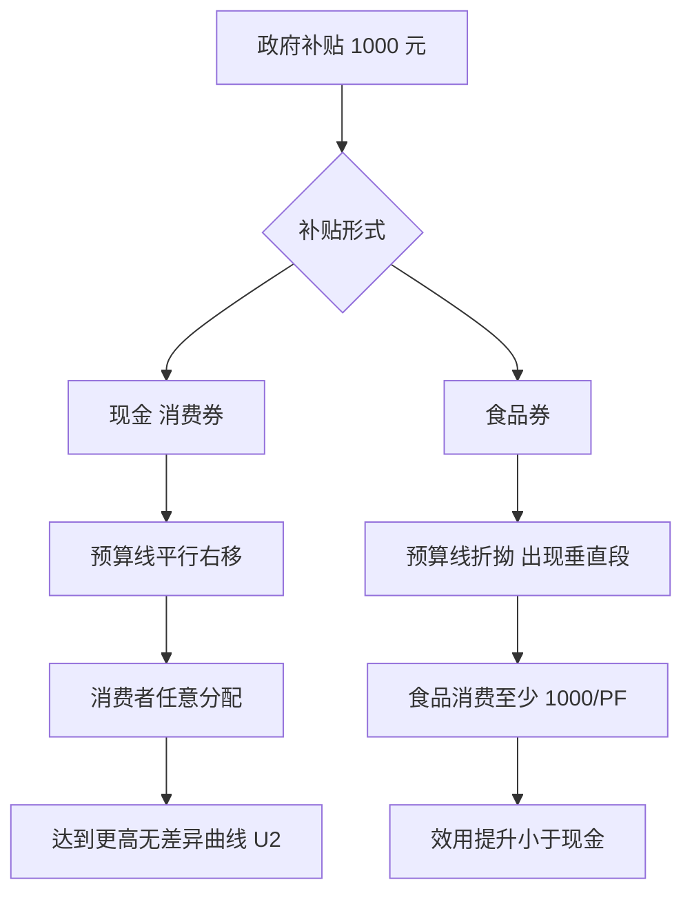

# 首都经济贸易大学 801 经济学·模拟卷（四）

<a href="../../exam.html" target="_blank" style="display:inline-block;padding:6px 16px;background:#2563eb;color:#fff;border-radius:6px;text-decoration:none;font-size:14px;">📝 开始做题</a>

> **难度定位**：中等（覆盖高频考点 + 跨章节综合，题型贴合真题风格）
> **考试时间**：180 分钟　　**满分**：150 分
> **适用参考书**：马工程《西方经济学》（第二版）、《马克思主义政治经济学概论》（第二版）

---

## 注意事项

1. 本卷为闭卷考试，答案一律写在答题纸上，写在试题册上无效。
2. 允许使用黑色或蓝黑色钢笔、圆珠笔答题，不得使用铅笔、红色笔。
3. 考试过程中不得使用计算器、手机及任何电子设备，计算题数字均为可心算整数。
4. 答题须分点作答，标明题号；论述题须结合中国经济实际与 2024—2026 年热点。
5. 考试结束后，试题册与答题纸一并交回。

---

## 一、简答与计算题（共 6 题，每题 15 分，合计 90 分）

---

### 简答 1：简述资本积累的实质、资本有机构成提高对工人阶级就业的影响，并说明相对过剩人口的三种主要形式。（15 分）

> 📚 **不懂就看：** [[../07_政治经济学/02_资本主义经济制度与生产/知识点/KP09_资本积累|📖 KP·资本积累]] ｜ [[../07_政治经济学/02_资本主义经济制度与生产/知识点/KP10_资本有机构成|📖 KP·资本有机构成]] ｜ [[../../经济统计学论文从0基础到精通/15_政治经济学基础/06_资本积累与资本有机构成|🐮 教程·资本积累与资本有机构成]]

**【考什么】** 对应政治经济学"剩余价值与资本积累"章节；题型属于概念简答 + 关系分析 + 分类列举综合题。核心考点：剩余价值资本化、资本技术构成 / 价值构成 / 有机构成（$c:v$）、相对过剩人口（产业后备军）。

**【答题框架】**
- 第 1 段：资本积累的定义与实质（3 分）
- 第 2 段：资本有机构成的两层含义及其提高趋势（4 分）
- 第 3 段：相对过剩人口的形成机制（4 分）
- 第 4 段：相对过剩人口的三种形式（3 分）
- 第 5 段：小结——资本主义人口规律（1 分）

**【参考答案】**

一、资本积累的实质

（一）资本积累是指把剩余价值的一部分转化为资本，即剩余价值的资本化。

（二）其实质是：资本家不断用无偿占有的工人创造的剩余价值，去扩大无偿占有更多剩余价值的规模。

二、资本有机构成及其提高趋势

（一）资本构成可从两方面考察：

1. 从物质形态看，资本由一定数量的生产资料和劳动力构成，二者比例由生产技术水平决定，称资本技术构成。
2. 从价值形态看，资本由不变资本 $c$（生产资料价值）和可变资本 $v$（劳动力价值）构成，称资本价值构成。

（二）由资本技术构成决定并反映技术构成变化的资本价值构成，叫资本有机构成，公式表示为 $c:v$。

（三）在扩大再生产过程中，资本家为追逐超额剩余价值并在竞争中取胜，不断改进技术、采用新设备，使不变资本比重日益增大、可变资本比重相对缩小，因而资本有机构成呈现不断提高的趋势。

三、相对过剩人口的形成

（一）资本对劳动力的需求不是由总资本大小决定，而是由其中可变资本部分决定。当资本有机构成提高时，可变资本在总资本中所占比重下降，资本对劳动力的需求相对减少。

（二）与此同时，劳动力对资本的供给却在不断增加：机器排挤工人、女工童工进厂、小生产者和中小资本家破产流入市场。

（三）于是劳动力供给超过需求，形成相对于资本增殖需要而言过剩的、即多余的劳动人口，这就是相对过剩人口，亦称产业后备军。

四、相对过剩人口的三种主要形式

（一）流动的过剩人口：临时失业、时而被吸收时而被排斥的工人，主要存在于现代工业中心。

（二）潜在的过剩人口：农村中因资本主义发展而游离出来、随时准备流入城市出卖劳动力的人口。

（三）停滞的过剩人口：没有固定职业、从事家内劳动和临时工作的人口，其就业极不规则、生活状况低于普通工人水平。

五、小结

相对过剩人口是资本积累的必然产物，又是资本主义生产方式存在和发展的必要条件——它构成产业后备军，随时可供资本剥削，并压低在业工人工资。这是资本主义特有的人口规律。

**【解析·得分点】** 本题采分点：①剩余价值资本化定义（2 分）；②技术构成 / 价值构成 / 有机构成三层区分（3 分）；③$c:v$ 公式（1 分）；④有机构成提高趋势（2 分）；⑤可变资本相对减少导致需求相对下降 + 劳动力供给增加（3 分）；⑥相对过剩人口三种形式各 1 分（3 分）；⑦"产业后备军 / 资本主义人口规律"收尾（1 分）。容易丢分：把"相对过剩"写成"绝对过剩"；混淆技术构成与价值构成；漏写"女工童工、小生产者破产"两条供给增加原因；三种形式只写名称不解释。

**【生活实例】** 一家奶茶店老板把第一年赚的 10 万再开店（资本积累），第二年引入全自动封口机和点单系统，原来 10 个店员现在只留 4 个（可变资本 $v$ 下降、不变资本 $c$ 上升，有机构成提高）。被裁掉的 6 个人不是"没人要"，而是相对于老板现在的经营规模"多出来了"——这就是相对过剩人口。他们中有人去送外卖（流动）、有人回乡下等机会再进城（潜在）、有人在朋友圈接散单打杂（停滞）。

**【双链接】** 🔗 政治经济学 · 剩余价值与资本积累 ｜ 📖 《马克思主义政治经济学概论》资本主义部分

---

### 简答 2：简述我国对外开放基本格局的形成过程，并说明共建"一带一路"和 RCEP 在新时代高水平对外开放中的作用。（15 分）

> 📚 **不懂就看：** [[../07_政治经济学/07_民生开放与全球治理/知识点/KP03_对外开放|📖 KP·对外开放]] ｜ [[../07_政治经济学/07_民生开放与全球治理/知识点/KP04_经济全球化与全球治理|📖 KP·经济全球化与全球治理]] ｜ [[../../经济统计学论文从0基础到精通/15_政治经济学基础/11_社会主义市场经济|🐮 教程·社会主义市场经济]]

**【考什么】** 对应政治经济学"社会主义对外开放与经济全球化"章节；题型属于历史过程梳理 + 政策意义分析。核心考点：经济特区—沿海开放城市—沿海经济开放区—内地的格局、一带一路、RCEP、制度型开放。

**【答题框架】**
- 第 1 段：对外开放是基本国策（2 分）
- 第 2 段：从经济特区到全方位开放格局的四步走（5 分）
- 第 3 段：新时代高水平对外开放的内涵（3 分）
- 第 4 段：一带一路与 RCEP 的作用（4 分）
- 第 5 段：小结（1 分）

**【参考答案】**

一、对外开放是我国长期基本国策

（一）对外开放是指在平等互利基础上扩大对外经济技术交流，积极参与国际分工与世界市场。

（二）1978 年十一届三中全会把对外开放确立为基本国策，逐步形成全方位、多层次、宽领域开放格局。

二、对外开放格局的形成过程

（一）第一步：1980 年设立深圳、珠海、汕头、厦门四个经济特区，实行特殊经济政策，作为对外开放的"窗口"和试验田。

（二）第二步：1984 年进一步开放大连、天津、青岛、上海、广州等 14 个沿海港口城市。

（三）第三步：1985 年起开辟长江三角洲、珠江三角洲、闽南厦漳泉三角地区以及辽东半岛、山东半岛等沿海经济开放区。

（四）第四步：1990 年开发开放上海浦东，随后向沿江、沿边和内地省会城市推进，形成"经济特区—沿海开放城市—沿海经济开放区—内地"这样一个多层次、有重点、点面结合的开放格局。加入 WTO（2001 年）标志着中国从政策性开放转向制度性开放。

三、新时代高水平对外开放的内涵

（一）党的十八大以来，我国进入高水平对外开放新阶段。其特征是：由商品和要素流动型开放转向规则、规制、管理、标准等制度型开放；由"引进来"为主转向"引进来"与"走出去"并重；由主动融入全球化转向主动引领全球化。

四、"一带一路"与 RCEP 的作用

（一）共建"一带一路"（2013 年提出）秉持共商共建共享原则，通过政策沟通、设施联通、贸易畅通、资金融通、民心相通（"五通"），打通向西开放的战略通道，推动陆海内外联动、东西双向互济。它不是中国版"马歇尔计划"，而是构建人类命运共同体的重要实践平台。

（二）《区域全面经济伙伴关系协定》（RCEP，2020 年签署、2022 年生效）覆盖东盟十国与中、日、韩、澳、新共 15 国，是全球人口最多、经贸规模最大的自由贸易区。其作用包括：

1. 区域内 90% 以上货物贸易最终实现零关税；
2. 统一原产地规则、简化海关程序，降低区域内产业链供应链成本；
3. 推动中日韩首次达成双边关税减让安排，为东亚经济一体化提供制度框架。

五、小结

从经济特区到一带一路、再到 RCEP，我国开放格局实现了由试点探索到制度型开放、由被动接轨到主动引领的历史性跨越。

**【解析·得分点】** 采分点：①四个经济特区名称（2 分）；②14 个沿海港口城市、沿海经济开放区、浦东开发的时序（2 分）；③加入 WTO 标志制度性开放（1 分）；④制度型开放内涵（3 分）；⑤一带一路"五通"（2 分）；⑥RCEP 15 国 + 90% 零关税 + 原产地累积规则（3 分）；⑦双循环 / 人类命运共同体收尾（2 分）。容易丢分：把经济特区写成"浦东"；把 RCEP 与 CPTPP 混淆；漏写"共商共建共享"原则；只罗列事件不点评作用。

**【生活实例】** 像开一家店：先在大学城开一家样板店（经济特区），验证模式后在地铁沿线开分店（沿海开放城市），再把整条商业街做成主题街区（沿海经济开放区），最后开到全城各个社区（内地）。一带一路相当于把店开到"丝绸之路"沿线国家去，RCEP 则是周边 15 家店签了联盟协议——互相拿货便宜、统一收银规则，整个区域的生意都更好做。

**【双链接】** 🔗 政治经济学 · 社会主义对外开放 ｜ 📖 《马克思主义政治经济学概论》社会主义部分

---

### 简答 3：简述供给侧结构性改革的科学内涵、重点任务（"三去一降一补"）及其现实意义。（15 分）

> 📚 **不懂就看：** [[../07_政治经济学/06_社会主义市场经济与发展/知识点/KP02_新发展理念与高质量发展|📖 KP·新发展理念与高质量发展]] ｜ [[../07_政治经济学/06_社会主义市场经济与发展/知识点/KP03_新发展格局|📖 KP·新发展格局]] ｜ [[../../经济统计学论文从0基础到精通/15_政治经济学基础/11_社会主义市场经济|🐮 教程·社会主义市场经济]]

**【考什么】** 对应政治经济学"社会主义经济发展与新常态"章节；题型属于政策内涵 + 任务列举 + 意义分析。核心考点：供给侧 vs 需求侧、三去一降一补、新常态、高质量发展。

**【答题框架】**
- 第 1 段：提出背景与定位（3 分）
- 第 2 段：科学内涵（3 分）
- 第 3 段：三去一降一补五项任务（5 分）
- 第 4 段：现实意义与深化方向（3 分）
- 第 5 段：小结（1 分）

**【参考答案】**

一、提出背景与定位

（一）供给侧结构性改革是 2015 年中央经济工作会议正式提出的重大战略。其背景是中国经济进入新常态：经济增速从高速转向中高速，结构出现产能过剩、库存高企、杠杆率偏高、成本上升、短板突出等问题。

（二）它与需求侧管理（投资、消费、出口"三驾马车"）不同：需求侧重在短期总量调节，供给侧重在长期结构优化，主攻方向是提高供给体系质量和效率。

二、科学内涵

（一）"供给侧"：指从供给、生产端入手，通过解放和发展生产力，提升产品和服务对需求变化的适应性。

（二）"结构性"：强调矛盾的主要方面在供给结构，而非总量不足，要去无效供给、扩有效供给。

（三）"改革"：根本靠体制机制创新，使市场在资源配置中起决定性作用，更好发挥政府作用。

三、重点任务——"三去一降一补"

（一）去产能：重点化解钢铁、煤炭、水泥、电解铝等传统行业过剩产能，处置"僵尸企业"，避免低效占用资源。

（二）去库存：重点化解三四线城市房地产库存，通过户籍制度改革、农民工市民化等措施消化存量商品房。

（三）去杠杆：降低企业部门和地方政府杠杆率，规范地方政府融资平台，防范化解系统性金融风险。

（四）降成本：降低实体经济企业税费负担、社会保险费、物流成本、用电成本、融资成本，即"降实体经济成本"。

（五）补短板：补齐基础设施、民生、脱贫攻坚、农业、科技创新、生态环保等领域短板，尤其是关键核心技术"卡脖子"短板。

四、现实意义

（一）短期意义：优化存量资源配置，缓解产能过剩和房地产库存风险，稳住宏观经济大盘。

（二）长期意义：推动经济发展从要素驱动、投资驱动转向创新驱动，为高质量发展和构建新发展格局奠定结构基础。

（三）新时代深化：重点转向"巩固、增强、提升、畅通"八字方针，与科技自立自强、扩大内需战略有机结合。

五、小结

供给侧结构性改革是适应和引领经济发展新常态的重大创新，是把握新一轮科技革命和产业变革机遇、实现中国式现代化的主线之一。

**【解析·得分点】** 采分点：①2015 年提出、新常态背景（2 分）；②供给侧 vs 需求侧的区别（2 分）；③"三去一降一补"五项各 1 分（5 分）；④去产能行业举例（钢铁煤炭）、去库存聚焦三四线房地产、补短板含"卡脖子"（3 分）；⑤"巩固增强提升畅通"八字方针（2 分）；⑥与高质量发展、新发展格局关系（1 分）。容易丢分：把"三去一降一补"写成"四去"；把供给侧改革等同于"计划经济"；漏写"市场在资源配置中起决定性作用"。

**【生活实例】** 一家餐厅生意不好，老板第一反应是"发优惠券打折"（需求侧），但顾客来了还是吐槽菜不好吃、上菜慢。真正要做的是换菜单、砍滞销菜、培训厨师、整改后厨（供给侧）。"去产能"就是把卖不动的菜下架；"去库存"就是把冻库里积压的食材清掉；"去杠杆"就是少借钱扩张；"降成本"就是跟房东谈租金、跟供应商压价；"补短板"就是把招牌菜研发出来、把卫生问题解决。

**【双链接】** 🔗 政治经济学 · 社会主义经济发展 ｜ 📖 《马克思主义政治经济学概论》社会主义部分

---

### 简答 4：简述劳动供给曲线向后弯曲的原因，并说明工资、地租、利息和利润是如何决定的。（15 分）

> 📚 **不懂就看：** [[../06_西方经济学/06_生产要素市场与收入分配/知识点/KP03_劳动供给与工资决定|📖 KP·劳动供给与工资决定]] ｜ [[../06_西方经济学/06_生产要素市场与收入分配/知识点/KP04_地租与利息|📖 KP·地租与利息]] ｜ [[../../经济统计学论文从0基础到精通/13_微观经济学基础/07_生产函数与边际报酬递减是什么|🐮 教程·生产函数与边际报酬（要素需求基础）]]

**【考什么】** 对应西经微观"生产要素市场与收入分配"章节；题型属于图形分析 + 要素价格决定综合。核心考点：替代效应与收入效应、向后弯曲劳动供给曲线、土地供给垂直、资本价格与利息、企业家才能与利润。

**【答题框架】**
- 第 1 段：劳动供给的本质——时间在工作与闲暇之间分配（2 分）
- 第 2 段：替代效应与收入效应（5 分）
- 第 3 段：向后弯曲劳动供给曲线图形（3 分）
- 第 4 段：地租、利息、利润的决定（4 分）
- 第 5 段：小结（1 分）

**【参考答案】**

一、劳动供给的本质

（一）消费者面临的不是"劳动多少"，而是"时间如何在工作（获取收入）与闲暇（消费时间）之间分配"。

（二）工资率 $w$ 可视为闲暇的机会成本——工资越高，一小时闲暇的代价越大。

二、替代效应与收入效应

（一）替代效应：工资率上升意味着闲暇变得更贵，消费者倾向于用工作替代闲暇，即劳动供给量随工资上升而增加。

（二）收入效应：工资率上升使消费者总收入提高，在正常品假定下，他们对闲暇（高档品）的需求也会增加，从而减少劳动供给。

（三）两种效应方向相反：

1. 在工资率较低阶段，替代效应大于收入效应，劳动供给曲线向右上方倾斜；
2. 当工资率上升到一定水平后，收入效应超过替代效应，劳动供给量反而随工资上升而减少，曲线向后弯曲。

三、向后弯曲劳动供给曲线的图形

（一）横轴为劳动时间 $L$，纵轴为工资率 $w$。

（二）曲线从左下方向右上方延伸至某一拐点 $w^*$，随后向左上方弯曲，即 $w$ 继续上升而 $L$ 减少。

四、其他要素价格的决定

（一）工资：由劳动市场供求共同决定。完全竞争下均衡工资等于劳动的边际产品价值 $VMP = P \cdot MP_L$；买方垄断、工会力量、效率工资等会使工资偏离此水平。

（二）地租：

1. 土地作为自然资源，其自然供给总量固定，供给曲线垂直于数量轴。
2. 地租由土地需求曲线（由土地边际生产力决定）与垂直供给曲线的交点决定。地租是"使用土地的价格"，级差地租则由土地肥沃程度、位置差异形成。

（三）利息：

1. 利息是使用资本的价格，由资本的供求决定。资本需求来自厂商对资本边际收益产品 $MRP_K$ 的评价；资本供给来自家庭储蓄。
2. 均衡利率使储蓄等于投资。

（四）利润：

1. 正常利润是企业家才能的报酬，包含在成本之中。
2. 经济利润（超额利润）来源于：创新、承担风险、垄断（买方 / 卖方垄断）以及动态失衡。

五、小结

要素价格决定统一遵循"边际生产力 × 产品价格 = 要素需求"的原则，但劳动的特殊性在于时间在工作与闲暇间的配置，使其供给曲线向后弯曲；土地供给固定、资本来自储蓄、利润来自企业家才能与不确定性。

**【解析·得分点】** 采分点：①闲暇的机会成本即工资（2 分）；②替代效应 + 收入效应方向相反（3 分）；③低工资段替代 > 收入、高工资段收入 > 替代（3 分）；④图形坐标轴与拐点 $w^*$（2 分）；⑤地租由垂直供给曲线与需求曲线交点决定（2 分）；⑥利息由储蓄 = 投资决定（1 分）；⑦经济利润三来源（创新 / 风险 / 垄断）（2 分）。容易丢分：只写"向后弯曲"不解释两种效应；把土地供给画成向右上方倾斜；混淆正常利润与经济利润。

**【生活实例】** 大学生家教：一小时 30 元时你很愿意多接课（替代效应主导，工资低，多上课更划算）；涨到 300 元一小时时，你反而只上两天就休息了——因为已经赚够了，剩下时间要去看电影、健身（收入效应主导）。房东的地皮不随租金上涨而变多（土地供给垂直），所以租金高低全看多少企业想来租地。

**【双链接】** 🔗 西经微观 · 生产要素市场 ｜ 📖 马工程《西方经济学》上册 第七章

---

### 简答 5：什么是外部性？结合图形说明正外部性与负外部性如何导致市场失灵，并比较科斯定理与庇古税在解决外部性上的差异。（15 分）

> 📚 **不懂就看：** [[../06_西方经济学/08_市场失灵与微观经济政策/知识点/KP02_外部性|📖 KP·外部性]] ｜ [[../06_西方经济学/08_市场失灵与微观经济政策/知识点/KP03_公共物品|📖 KP·公共物品]] ｜ [[../../经济统计学论文从0基础到精通/13_微观经济学基础/12_外部性与公共品是什么|🐮 教程·外部性与公共品]]

**【考什么】** 对应西经微观"市场失灵与微观经济政策"章节；题型属于概念 + 图形 + 政策比较。核心考点：外部性分类、私人成本 / 社会成本、私人收益 / 社会收益、庇古税与补贴、科斯定理与产权。

**【答题框架】**
- 第 1 段：外部性定义与分类（3 分）
- 第 2 段：负外部性与生产过剩（4 分）
- 第 3 段：正外部性与生产不足（3 分）
- 第 4 段：庇古税与科斯定理比较（4 分）
- 第 5 段：小结（1 分）

**【参考答案】**

一、外部性的定义与分类

（一）外部性是指经济主体的行为对旁观者福利产生了未被市场交易计入的影响。

（二）分类：

1. 负外部性：一方行为使第三方受损，如工厂排污、噪音。
2. 正外部性：一方行为使第三方受益而未获报酬，如教育、疫苗接种、研发创新。

二、负外部性导致生产过剩

（一）存在负外部性时，私人成本 $C_p$ 小于社会成本 $C_s = C_p +$ 外部成本。

（二）完全竞争厂商按私人边际成本 $MC_p$ 与需求曲线交点决定产量 $Q_p$；社会最优产量由社会边际成本 $MC_s$ 与需求曲线交点决定，为 $Q_s$。

（三）图形上 $MC_s$ 位于 $MC_p$ 左上方，于是 $Q_p > Q_s$，即产量过多、价格过低，资源过度配置到该部门，市场失灵。

三、正外部性导致生产不足

（一）存在正外部性时，私人收益 $R_p$ 小于社会收益 $R_s = R_p +$ 外部收益。

（二）消费者按私人边际收益 $MB_p$ 决定需求量，社会最优由社会边际收益 $MB_s$ 决定。

（三）图形上 $MB_s$ 位于 $MB_p$ 右上方，于是 $Q_p < Q_s$，即产量不足。

四、庇古税与科斯定理的比较

（一）庇古税（Pigou 税）：

1. 由政府对产生负外部性的厂商征收等于外部边际成本的税 $t = MEC$，使 $MC_p$ 上移至 $MC_s$，厂商自动把产量从 $Q_p$ 减至 $Q_s$。
2. 对正外部性则补贴 $s = MEB$，使私人需求曲线上移至社会需求曲线。
3. 优点：直接纠正价格信号；局限：政府须准确知道外部成本大小。

（二）科斯定理：

1. 只要产权明晰且交易成本为零，无论初始产权赋予哪一方，市场双方自愿谈判都能达到帕累托最优。
2. 例如工厂污染附近居民：若法律赋予居民清洁空气权，工厂须付钱买排污权；若赋予工厂排污权，居民可付钱让工厂减产。两种情况下谈判结果都是社会最优产量 $Q_s$。
3. 局限：现实中交易成本不为零，涉及人数众多时谈判几乎不可能。

（三）二者差异：

1. 庇古税强调政府干预，科斯定理强调产权与市场谈判；
2. 庇古税适用外部成本易度量、涉及面广的情形；科斯定理适用当事人少、交易成本低的情形；
3. 实践中常结合使用，如碳交易市场。

五、小结

外部性使私人成本 / 收益与社会成本 / 收益偏离，导致产量过多或不足；纠正思路有两条：庇古税用税收把外部性"内部化"，科斯定理用明晰产权让市场自行解决。现实中碳交易、排污许可证正是二者结合的产物。

**【解析·得分点】** 采分点：①外部性定义 + 正负分类（2 分）；②$C_s = C_p + MEC$、$R_s = R_p + MEB$（3 分）；③负外部性 $Q_p > Q_s$、正外部性 $Q_p < Q_s$（3 分）；④庇古税 $t = MEC$ 使 $MC_p$ 上移（3 分）；⑤科斯定理"产权明晰 + 交易成本为零"（2 分）；⑥二者比较 + 排污权交易结合（2 分）。容易丢分：把正外部性画成"生产过剩"；漏写"交易成本为零"这一关键前提；混淆庇古税与补贴方向。

**【生活实例】** 夜宵摊半夜炒螺丝，油烟飘到你家（负外部性）。老板只算菜钱气钱（私人成本），没算你被熏得睡不着的代价（外部成本），所以他开到凌晨三点——太多了。庇古税就是政府按你失眠的损失向老板收"扰民税"，他自己就会早点收摊。科斯定理则是：法律规定"居民区夜晚十点后不许炒菜"（产权给你），老板想继续炒就得跟你谈，给你交"安静费"；反过来如果法律允许炒到十二点（产权给老板），你可以凑钱让他十点后别炒。只要谈得拢，结果都是十点收摊。

**【双链接】** 🔗 西经微观 · 市场失灵 ｜ 📖 马工程《西方经济学》上册 第八章

---

### 简答 6：简述索洛增长模型的稳态条件，并说明黄金律水平与条件收敛的含义。（15 分）

> 📚 **不懂就看：** [[../06_西方经济学/16_经济增长/知识点/KP02_索洛模型稳态|📖 KP·索洛模型稳态]] ｜ [[../06_西方经济学/16_经济增长/知识点/KP04_黄金律水平|📖 KP·黄金律水平]] ｜ [[../../经济统计学论文从0基础到精通/14_宏观经济学基础/12_索洛模型与经济增长|🐮 教程·索洛模型与经济增长]]

**【考什么】** 对应西经宏观"经济增长"章节；题型属于模型推导 + 概念辨析。核心考点：人均生产函数 $y=f(k)$、投资 $i=sf(k)$、持平投资 $(n+\delta)k$、稳态 $sf(k)=(n+\delta)k$、黄金律 $MP_k=n+\delta$、绝对收敛 vs 条件收敛。

**【答题框架】**
- 第 1 段：模型基本假定与人均生产函数（3 分）
- 第 2 段：资本积累方程与稳态条件（4 分）
- 第 3 段：稳态图形与比较静态（3 分）
- 第 4 段：黄金律水平（3 分）
- 第 5 段：收敛与政策含义（2 分）

**【参考答案】**

一、模型基本假定

（一）索洛模型研究长期经济增长的源泉。设总量生产函数 $Y=F(K,L)$，假定规模报酬不变、劳动 $L$ 按外生速率 $n$ 增长、技术进步外生（基础模型中先省略）。

（二）由规模报酬不变可写为人均形式 $y = Y/L = f(k)$，其中 $k=K/L$ 为人均资本。

（三）假定社会储蓄率为 $s$，资本折旧率为 $\delta$。

二、资本积累方程与稳态条件

（一）人均投资 $i = I/L = sY/L = sf(k)$。

（二）为保持人均资本 $k$ 不变，须同时抵消两件事：

1. 折旧：$\delta k$；
2. 劳动增长带来的资本广化：$nk$。

（三）故"持平投资"为 $(n+\delta)k$。

（四）人均资本动态方程：

$$\dot{k} = sf(k) - (n+\delta)k$$

（五）稳态即 $\dot{k}=0$，人均资本不再变化：

$$sf(k^*) = (n+\delta)k^*$$

对应人均产出 $y^*=f(k^*)$，人均消费 $c^*=(1-s)f(k^*)$。

三、稳态图形

（一）横轴为 $k$，纵轴为 $y$。

（二）$sf(k)$ 是一条递增但斜率递减的曲线（受边际报酬递减）；$(n+\delta)k$ 是一条从原点出发、斜率为 $n+\delta$ 的直线。

（三）两线交点即稳态 $k^*$。当 $k<k^*$ 时 $sf(k)>(n+\delta)k$，$k$ 上升；当 $k>k^*$ 时 $sf(k)<(n+\delta)k$，$k$ 下降——经济自动收敛到稳态。

四、黄金律水平

（一）稳态消费 $c^* = f(k^*) - (n+\delta)k^*$。

（二）使稳态人均消费最大化的 $k^*$ 称为黄金律水平 $k_{gold}$。

（三）一阶条件：$MP_k = n+\delta$，即资本的边际产出等于持平投资斜率。图形上 $f(k)$ 的切线斜率等于直线 $(n+\delta)k$ 的斜率。

（四）若实际 $k>k_{gold}$，经济处于动态无效率——减少储蓄率可使当前与未来消费同时上升；若 $k<k_{gold}$，则需提高储蓄率以积累资本。

五、收敛与政策含义

（一）绝对收敛：贫穷国家无论参数如何，最终都收敛到同一稳态——索洛模型并不支持，只支持条件收敛。

（二）条件收敛：各国在储蓄率、人口增长率、技术水平等参数给定下，各自收敛到自身稳态；初始人均产出越低，增长速度越快（追赶效应），但稳态水平本身由这些参数决定。

（三）政策含义：储蓄率、教育投入、技术进步、制度质量决定长期稳态；单纯增加资本投入不能维持长期人均增长，长期人均增长只能来自外生（或内生）技术进步。

**【解析·得分点】** 采分点：①$y=f(k)$ 规模报酬不变（2 分）；②$\dot{k}=sf(k)-(n+\delta)k$（3 分）；③稳态条件 $sf(k^*)=(n+\delta)k^*$（2 分）；④图形：曲线 + 直线 + 交点（2 分）；⑤黄金律 $MP_k=n+\delta$（3 分）；⑥条件收敛 vs 绝对收敛（2 分）；⑦长期增长靠技术进步（1 分）。容易丢分：把稳态写成 $sf(k)=0$；漏写人口增长 $n$ 项；把黄金律写成 $MP_k=\delta$；把条件收敛说成绝对收敛。

**【生活实例】** 一个学生攒钱买参考书（投资 $sf(k)$），但书会旧（折旧 $\delta k$），而且同学越来越多、人均分到的书被摊薄（人口增长 $nk$）。攒到一定程度，每年新买的书刚好抵掉旧书损耗和同学摊薄，人均书数就稳定了——这就是稳态。黄金律是指：留多少生活费买书、多少留着吃饭，才能让长期"学习 + 生活"综合水平最高。穷同学一开始进步快（追赶效应），但如果他学习方法、时间投入（参数）不变，最后只能追上自己的稳态，不一定追上富同学。

**【双链接】** 🔗 西经宏观 · 经济增长 ｜ 📖 马工程《西方经济学》下册 第十六章

---

## 二、论述题（共 2 题，每题 30 分，合计 60 分）

---

### 论述 1：结合 2024—2026 年中国与世界经济政治形势，运用社会主义发展道路与人类命运共同体理论，论述中国式现代化的科学内涵、本质要求及其世界意义。（30 分）

> 📚 **不懂就看：** [[../07_政治经济学/05_社会主义经济制度/知识点/KP01_社会主义的本质与根本任务|📖 KP·社会主义的本质]] ｜ [[../07_政治经济学/07_民生开放与全球治理/知识点/KP04_经济全球化与全球治理|📖 KP·经济全球化与全球治理]] ｜ [[../../经济统计学论文从0基础到精通/15_政治经济学基础/11_社会主义市场经济|🐮 教程·社会主义市场经济]]

**【考什么】** 跨"社会主义本质与发展阶段""经济全球化与人类命运共同体"两章；题型属于理论类 + 政策类综合。核心考点：中国式现代化五大特征、两步走战略、共同富裕、人类命运共同体、全球治理观、一带一路实践。

**【答题框架】**
- 第 1 段：破题——中国式现代化的时代背景（4 分）
- 第 2 段：中国式现代化的科学内涵（五大特征）（6 分）
- 第 3 段：本质要求与社会主义发展道路（6 分）
- 第 4 段：人类命运共同体理论与全球治理观（6 分）
- 第 5 段：2024—2026 现实分析与世界意义（6 分）
- 第 6 段：小结（2 分）

**【参考答案】**

一、破题：时代背景

（一）党的二十大报告明确提出"以中国式现代化全面推进中华民族伟大复兴"。2024—2026 年，世界进入新的动荡变革期：逆全球化抬头、地缘冲突延宕、全球债务高企、气候变化加剧；与此同时，中国经济在转型升级中展现韧性，成为全球增长的重要引擎。

二、中国式现代化的科学内涵——五大特征

（一）人口规模巨大的现代化：中国 14 亿多人口整体迈入现代化，规模超过现有发达国家人口总和，其难度和深刻性前所未有。

（二）全体人民共同富裕的现代化：不是少数人富裕、不是两极分化，而是坚持以人民为中心，在做大蛋糕的同时分好蛋糕。脱贫攻坚战如期打赢、共同富裕示范区落地浙江，是其实践起点。

（三）物质文明和精神文明相协调的现代化：既要物质财富极大丰富，又要理想信念、价值观念、文化自信的提升。

（四）人与自然和谐共生的现代化：不走"先污染后治理"老路，而是走绿色发展之路，"双碳"目标（2030 碳达峰、2060 碳中和）是其庄严承诺。

（五）走和平发展道路的现代化：不同于西方殖民扩张、战争掠夺的现代化老路，而是通过和平发展、合作共赢实现现代化。

三、本质要求与社会主义发展道路

（一）中国式现代化是中国共产党领导的社会主义现代化。这是定性问题：党的领导决定方向，社会主义制度决定归宿。

（二）其本质要求包括：坚持中国共产党领导、坚持中国特色社会主义、实现高质量发展、发展全过程人民民主、丰富人民精神世界、实现全体人民共同富裕、促进人与自然和谐共生、推动构建人类命运共同体、创造人类文明新形态。

（三）中国式现代化坚持"两个毫不动摇"——毫不动摇巩固和发展公有制经济，毫不动摇鼓励、支持、引导非公有制经济发展；坚持按劳分配为主体、多种分配方式并存；使市场在资源配置中起决定性作用，更好发挥政府作用。

四、人类命运共同体理论与全球治理观

（一）回应"世界怎么了、我们怎么办"的时代之问，新时代中国特色大国外交提出构建人类命运共同体理念：各国相互联系、相互依存的程度空前加深，越来越成为你中有我、我中有你的命运共同体。

（二）核心内涵：持久和平、普遍安全、共同繁荣、清洁美丽。

（三）治理观：共商共建共享；全球发展倡议、全球安全倡议、全球文明倡议（三大全球倡议）。

（四）实践平台：共建"一带一路"；亚投行、新开发银行；进博会、服贸会；RCEP 生效实施。

五、2024—2026 现实分析与世界意义

（一）国内方面：

1. 2024—2026 年中国着力推动高质量发展，加快发展新质生产力，以科技创新引领现代化产业体系建设；
2. 面对房地产深度调整、地方债务化解、人口老龄化等挑战，通过供给侧结构性改革与扩大内需战略相结合，稳住宏观经济大盘；
3. 脱贫攻坚成果同乡村振兴有效衔接，扎实推进共同富裕。

（二）国际方面：

1. 在逆全球化浪潮中，中国坚定维护以 WTO 为核心的多边贸易体制，积极推动加入 CPTPP、DEPA；
2. 推动"一带一路"高质量发展，雅万高铁、中老铁路、匈塞铁路等标志性项目落地，为沿线国家创造就业和税收；

（三）世界意义：

1. 中国式现代化打破了"现代化=西方化"的迷思，证明现代化道路不是唯一的；
2. 它为发展中国家走向现代化提供了新选择——不是殖民掠夺、不是依附大国，而是独立自主、和平发展；
3. 人类命运共同体理念超越了零和博弈、文明冲突的旧思维，为全球治理提供了中国方案。

六、小结

中国式现代化是社会主义发展道路在 21 世纪的崭新形态，它既造福中国人民，又通过人类命运共同体实践惠及世界。它不是"中国版华盛顿共识"，而是一条不同于西方的、可借鉴但不可复制的现代化新路。

**【解析·得分点】** 采分点：①二十大定位 + 2024—2026 国内外背景（3 分）；②五大特征每条 1 分（5 分）；③党的领导 + 社会主义定性（2 分）；④两个毫不动摇、基本经济制度（4 分）；⑤人类命运共同体内涵 + 三大全球倡议（4 分）；⑥一带一路、RCEP、进博会等实践平台（4 分）；⑦新质生产力、房地产、地方债、老龄化现实问题（4 分）；⑧世界意义：打破现代化等于西方化的迷思、为发展中国家提供新选择（4 分）。容易丢分：只罗列五大特征不展开；忽视社会主义定性；漏写和平发展这一与西方老路的本质区别；不结合 2024—2026 现实。

**【生活实例】** 村里脱贫致富，有两种模式：李老板靠把邻村土地抢过来、把别家牛羊赶走（殖民式现代化），自己富了但四邻不安；王同学靠自己读书、搞合作社、修水利、跟邻村换农产品，慢慢把全村带富（中国式现代化）。王同学还跟邻村签了互助条约——谁家闹旱灾大家一起帮，这就是人类命运共同体。2024—2026 年王同学家里也要面对老人多了、以前盖的新房空了几套（人口老龄化、房地产调整），他没有躺平，而是搞新种植技术（新质生产力）、修村里养老中心（共同富裕），还请邻村一起来学习。

**【双链接】** 🔗 政治经济学 · 社会主义经济制度 ｜ 🔗 政治经济学 · 民生开放与全球治理 ｜ 📖 《马克思主义政治经济学概论》社会主义部分

---

### 论述 2：结合 2024—2026 年中国经济潜在增长率下降、人口老龄化加剧的现实，运用 IS-LM 模型与索洛增长模型，分析中国经济长期增长潜力、宏观政策选择以及短期与长期政策的协调。（30 分）

> 📚 **不懂就看：** [[../06_西方经济学/11_IS-LM模型/知识点/KP04_ISLM共同均衡|📖 KP·IS-LM 共同均衡]] ｜ [[../06_西方经济学/16_经济增长/知识点/KP02_索洛模型稳态|📖 KP·索洛模型稳态]] ｜ [[../../经济统计学论文从0基础到精通/14_宏观经济学基础/12_索洛模型与经济增长|🐮 教程·索洛模型与经济增长]]

**【考什么】** 跨"IS-LM 模型""宏观经济政策""经济增长"三章；题型属于现象类 + 政策类综合。核心考点：IS 曲线斜率与移动、LM 曲线、财政政策 / 货币政策有效性、索洛稳态、储蓄率、人口增长率 n、技术进步、潜在产出缺口、人口老龄化对 n 和储蓄率的双重影响。

**【答题框架】**
- 第 1 段：现实背景——潜在增长率下降与老龄化（4 分）
- 第 2 段：索洛模型视角——长期增长潜力分析（8 分）
- 第 3 段：IS-LM 视角——短期需求管理（8 分）
- 第 4 段：短期政策与长期政策的协调（6 分）
- 第 5 段：2024—2026 政策选择评价（4 分）

**【参考答案】**

一、现实背景

（一）2024—2026 年中国经济呈现两大趋势：

1. 潜在增长率由过去高速增长阶段的 8%—10% 逐步回落至中速增长区间（5% 左右）；
2. 人口老龄化加剧，劳动年龄人口绝对数量自 2012 年起下降，总和生育率低于更替水平，60 岁以上人口占比突破 22%。

（二）理解这些现象，短期用 IS-LM 分析需求管理，长期用索洛模型分析供给潜力。

二、索洛模型视角：长期增长潜力

（一）根据索洛模型，稳态条件为

$$sf(k^*) = (n+\delta)k^*$$

稳态人均产出 y*=f(k*)，长期人均增长率取决于外生技术进步率 g。

（二）人口老龄化对索洛模型的影响有三：

1. 劳动增长率 n 下降甚至接近零。在其他参数不变下，稳态人均资本 k* 上升（持平投资线 (n+delta)k 更平缓），短期人均产出增速放缓，但人均资本深化本身可带来人均产出水平的提高；
2. 储蓄率 s 发生结构性变化：老年人消费倾向高、储蓄倾向低，社会总储蓄率趋于下降，这会压低 k*；
3. 有效劳动投入下降，如果全要素生产率 TFP 不能同步提升，潜在增长率将趋势性下行。

（三）结论：长期人均增长潜力取决于 TFP 增速，这就是为什么强调科技自立自强、新质生产力。

（四）黄金律视角：当人口 n 下降时，黄金律 MP_k=n+delta 下降，意味着经济应从过度投资转向提高消费率，这与扩大内需、提高居民消费率政策方向一致。

三、IS-LM 视角：短期需求管理

（一）IS 曲线描述产品市场均衡：Y=C+I+G+NX，斜率由边际消费倾向、投资利率弹性决定。LM 曲线描述货币市场均衡：M/P=L1(Y)+L2(r)。

（二）当前中国经济特征：

1. 居民和企业预期偏弱，MPC 下降、投资对利率不敏感，IS 曲线较为陡峭；
2. 货币政策传导不畅，存在流动性偏好陷阱迹象，LM 曲线较平缓；
3. 在这种组合下，财政政策挤出效应小、乘数效应大，货币政策相对失效。

（三）图形分析：

1. 扩张性财政政策（增发国债、提高赤字率、家电以旧换新、社保扩面）使 IS 曲线右移，均衡产出 Y 上升，利率小幅上升——由于 LM 平缓，挤出效应小；
2. 扩张性货币政策（降准降息、结构性工具）使 LM 曲线右移，但因 IS 陡峭、企业不愿借贷，产出提升有限。

（四）故宏观政策组合应是积极财政政策加稳健货币政策，财政打头、货币配合。

四、短期政策与长期政策的协调

（一）短期需求管理（IS-LM 层）解决的是产出缺口问题——让实际产出接近潜在产出 Y 约等于 Y*，避免通缩和失业；但它不能提高潜在产出本身。

（二）长期供给侧政策（索洛层）解决的是潜在增长率问题——通过提高 TFP、改善人力资本、优化储蓄率与投资效率、制度创新，把 Y* 本身抬上去。

（三）协调原则：

1. 短期政策不能损害长期潜力——避免强刺激导致僵尸企业、产能过剩、债务高企（这正是 2009 年后教训）；
2. 长期政策要为短期政策腾挪空间——通过改革稳定预期、提高投资乘数；
3. 扩大内需战略与供给侧结构性改革结合：需求侧给居民消费能力（社保、收入分配），供给侧给有效供给（新质生产力、产业链升级）。

（四）应对老龄化：短期延迟退休、发展银发经济；长期用资本深化和 TFP 提升弥补劳动数量下降。

五、2024—2026 政策评价与结论

（一）观察 2024—2026 年政策实践：

1. 财政端：赤字率提高至 4% 左右、发行超长期特别国债、地方政府债务置换（化债）、推动保障性住房建设——对应 IS 右移；
2. 货币端：多次降准降息、创设科技创新和技术改造再贷款、房地产金融白名单——对应 LM 右移加结构性导向；
3. 供给端：大规模设备更新、消费品以旧换新、人工智能加行动、东数西算——对应 TFP 与 g 提升。

（二）结论：在潜在增长率下行加老龄化的大背景下，中国经济不能再依靠资本驱动和地产驱动，而要转向 TFP 驱动；短期宏观政策应以财政为主、货币配合，守住不发生系统性风险底线；长期必须通过教育、科技、制度改革提高索洛模型中的技术进步率 g，并通过收入分配改革提高消费率，使稳态路径更接近黄金律水平。

**【解析·得分点】** 采分点：①潜在增长率下行加老龄化现实数据（2 分）；②索洛稳态公式加 n 下降加 s 下降双重效应（6 分）；③长期增长靠 TFP 与 g（3 分）；④黄金律 MP_k=n+delta 下降对应提高消费率（3 分）；⑤IS 陡峭加 LM 平缓对应财政政策有效（6 分）；⑥图形描述：IS/LM 移动方向（3 分）；⑦短期与长期政策区分：产出缺口与潜在产出（4 分）；⑧2024—2026 政策实例：特别国债、化债、新质生产力（3 分）。容易丢分：把 IS-LM 与索洛模型割裂，不说明二者分工；只讲货币政策不讲财政；漏写人口老龄化同时影响 n 和 s；不结合 2024—2026 年具体政策。

**【生活实例】** 一个家庭收入增速变慢（潜在增长率下降），家里老人越来越多（老龄化），孩子不敢生、大人不敢花钱（预期弱）。怎么办？短期（IS-LM）：家长临时多加班、把存款拿出来改善伙食（扩张财政），但银行降息大家也不敢多借（货币政策失效）——所以主要靠家庭主动增加支出。长期（索洛）：让孩子学新技能（TFP）、买机器代替人工（资本深化）、调整养老和育儿制度（提高储蓄率和消费率平衡）。只靠借钱吃饭（大水漫灌）撑不久，只让孩子苦读不改善生活（只供给不需求）也走不通，必须两条腿走路。

**【双链接】** 🔗 西经宏观 · IS-LM 模型 ｜ 🔗 西经宏观 · 经济增长 ｜ 🔗 西经宏观 · 宏观经济政策 ｜ 📖 马工程《西方经济学》下册 第十一、十五、十六章

### 论述 3：（曲线移动·预算线与无差异曲线）试用预算线与无差异曲线模型，分析"政府发 1000 元现金消费券"与"政府发 1000 元食品券（只能买食品）"两种补贴方式，对消费者最优选择和效用水平的不同影响，并画图说明 {#l3_m4}

**【建议字数】800–1200 字 ｜ 【建议时间】30 分钟 ｜ 【题型】曲线移动综合论述（微观预算线）**

**【考什么】** 对应知识点 [[../06_西方经济学/02_消费者选择/00_章节总结|消费者选择理论]]；题型属于预算线移动与消费者均衡分析。

**【答题框架】**
- 第 1 段：模型设定——两种商品、预算线、无差异曲线（4 分）
- 第 2 段：现金补贴下预算线怎么移（8 分）
- 第 3 段：食品券下预算线怎么移（8 分）
- 第 4 段：新均衡与效用比较（6 分）
- 第 5 段：数学推导 + 政策含义（4 分）

**【参考答案】**

一、模型设定。设消费者收入 M，两种商品：食品 F（价格 P_F）和其他商品 X（价格 P_X）。
（一）预算线：$P_F \cdot F + P_X \cdot X = M$。
（二）纵轴 X，横轴 F。预算线斜率 $-P_F/P_X$，纵截距 M/P_X，横截距 M/P_F。
（三）无差异曲线 U(F, X) 凸向原点，消费者选择预算线与最高无差异曲线的切点。

二、现金消费券 1000 元。
（一）理论：现金补贴让消费者收入从 M 升到 M+1000，**预算线整体向右上方平移**（斜率不变，因为相对价格 P_F/P_X 没变）。
（二）新预算线：$P_F \cdot F + P_X \cdot X = M + 1000$。
（三）新切点 E_cash：在更高的无差异曲线 U₂ 上。消费者可以把 1000 元任意分配在 F 和 X 上——他可能拿去买衣服、下馆子、存起来，不一定买食品。

三、食品券 1000 元。
（一）理论：食品券只能买食品，相当于在食品消费上"捆绑"了 1000 元。预算线变成**折拗形**：
- 当 F ≥ 1000/P_F 时：消费者用券+自己的钱买食品，剩余收入买 X，预算线方程与现金补贴相同：$P_F F + P_X X = M + 1000$。
- 当 F < 1000/P_F 时：消费者已把券用完但不愿多买食品，券被"浪费"（没花完），预算线退化为 $P_X X = M$（纵截距 M/P_X 不变）。
（二）图形：在横截距附近，预算线出现一段**垂直段**（消费者不能用食品券换 X）。

四、新均衡与效用比较。
（一）现金补贴：消费者自由选择，达到 E_cash，效用 U_cash = U₂。
（二）食品券：若消费者原本就计划买超过 1000/P_F 的食品，则 E_food = E_cash（两者等价）。
（三）若消费者原本食品消费低于 1000/P_F，则被迫多买食品、少买 X，新切点 E_food 在折拗点上，效用 U_food < U_cash（因为限制了选择自由）。
（四）结论：**现金补贴在效用上不劣于食品券**（至少一样好），食品券只在政府想"定向"增加食品消费时才优于现金（但代价是消费者效用损失）。

五、数学推导。
（一）Cobb-Douglas 效用函数 $U = F^\alpha X^{1-\alpha}$。
（二）无补贴时：消费者最优 $F^* = \alpha M / P_F$，$X^* = (1-\alpha) M / P_X$。
（三）现金补贴 1000 后：$F_c = \alpha (M+1000) / P_F$，$X_c = (1-\alpha)(M+1000)/P_X$。
（四）食品券 1000 后：
- 若 $\alpha (M+1000)/P_F \ge 1000/P_F$（即消费者愿把券全用掉还自己加钱），则 $F_f = F_c$，$X_f = X_c$，与现金相同。
- 若 $\alpha M / P_F < 1000/P_F$（即消费者原本食品消费少），则 $F_f = 1000/P_F$（被迫全用券），剩余收入 M 全买 X：$X_f = M/P_X$。
（五）比较 $U_c = U(F_c, X_c)$ 与 $U_f = U(F_f, X_f)$：因为现金补贴给了消费者更多选择空间，$U_c \ge U_f$。

六、政策含义。
（一）从"消费者效用最大化"角度：现金补贴优于实物补贴。
（二）但从"政策目标"角度：若政府想确保食品消费增加（如扶贫、学生营养餐），食品券更有效率（定向）。
（三）这就是美国食品券（SNAP）、中国助学金、粮食直补的政策权衡——要自由还是要定向。

**【解析·得分点】** ①预算线方程 P_F·F + P_X·X = M（4 分）；②现金补贴预算线平行右移（8 分）；③食品券预算线折拗+垂直段（8 分）；④新均衡效用比较 U_c ≥ U_f（6 分）；⑤Cobb-Douglas 推导 F* = αM/P_F（4 分）。易丢分：把食品券也画成平行右移（忘了折拗）；不比较效用；不画图。

**【生活实例】** 你这个月生活费 2000 元。爸妈说："给你 500 块。"
- 方式 A（现金）：你多 500 块，想买奶茶买奶茶、想买书买书——你最爽。
- 方式 B（食堂饭票 500）：你只能在食堂吃饭。如果你本来就要花 400 在食堂，那这 500 饭票等于帮你省了 400 现金，你还多 100 饭票被迫多吃饭——稍微不爽。
- 如果你本来食堂只吃 200，那 500 饭票逼你多吃 300，你本来想花在游戏上的钱被挤走了——最不爽。
这就是预算线折拗和效用损失。

---

## 三、考点对照表

| 题号 | 科目 | 考点 | 对应章节 | 难度 |
|---|---|---|---|---|
| 简答 1 | 政治经济学 | 资本积累、资本有机构成、相对过剩人口 | 《概论》资本主义部分 · 剩余价值理论 | 中 |
| 简答 2 | 政治经济学 | 对外开放格局、一带一路、RCEP、制度型开放 | 政治经济学 · 社会主义对外开放 | 中 |
| 简答 3 | 政治经济学 | 供给侧结构性改革、三去一降一补 | 政治经济学 · 社会主义经济发展 | 中 |
| 简答 4 | 西方经济学 | 向后弯曲劳动供给曲线、工资 / 地租 / 利息 / 利润决定 | 西经微观 · 生产要素市场 | 中 |
| 简答 5 | 西方经济学 | 外部性、庇古税、科斯定理 | 西经微观 · 市场失灵 | 中 |
| 简答 6 | 西方经济学 | 索洛模型稳态、黄金律、条件收敛 | 西经宏观 · 经济增长 | 中 |
| 论述 1 | 政治经济学 | 中国式现代化五大特征、人类命运共同体、2024—2026 全球治理 | 政治经济学 · 社会主义本质 + 全球治理 | 中偏上 |
| 论述 2 | 西方经济学 | 潜在增长率下降、老龄化、IS-LM + 索洛综合分析 | 西经宏观 · IS-LM + 增长 + 政策 | 中偏上 |
| 论述 3 | 西方经济学（曲线移动专题） | 预算线与无差异曲线，现金补贴 vs 食品券，消费者均衡 | 西经微观 · 消费者选择 | 中偏难 |

---

### 命题说明

1. 本卷严格遵循首经贸 801 试卷结构：简答与计算题 6×15 + 论述 2×30 = 150 分。
2. 政治经济学与西方经济学各占 50%。
3. 论述题均结合 2024—2026 年最新热点（新质生产力、中国式现代化、RCEP、人口老龄化、房地产调整、地方债化解）。
4. 所有公式用 LaTeX，所有图形用文字描述坐标轴、曲线与移动方向，闭卷可答。
5. 本卷中等难度：覆盖高频考点，区分度主要体现在论述题的跨章节综合与现实结合上。

—— 模拟卷（四）完 ——
