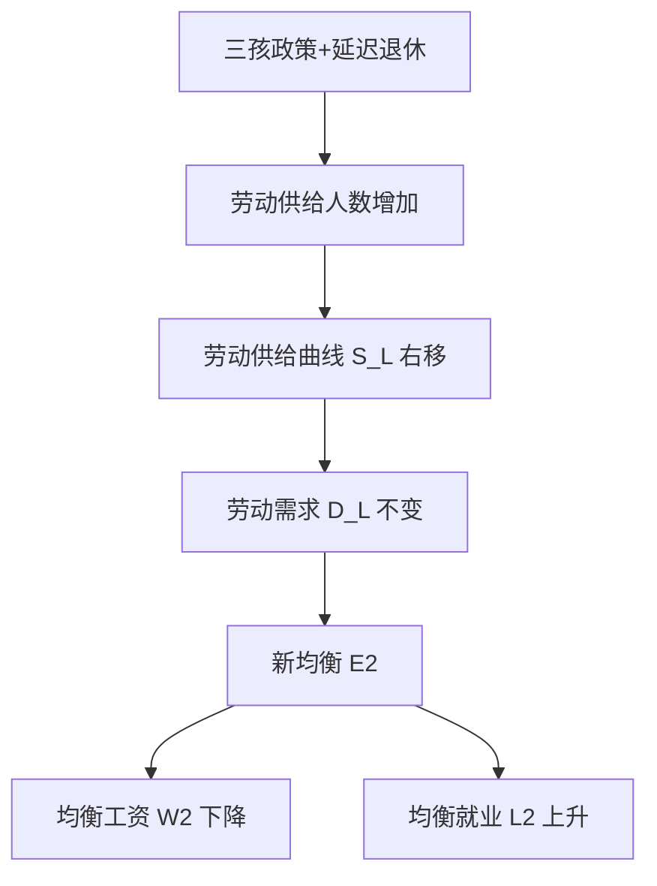

# 首都经济贸易大学801经济学·模拟卷（五）

<a href="../../exam.html" target="_blank" style="display:inline-block;padding:6px 16px;background:#2563eb;color:#fff;border-radius:6px;text-decoration:none;font-size:14px;">📝 开始做题</a>

> **难度定位**：拔高卷（区分度卷）。题目更综合、跨章节，主观题答案要求原理推导 + 图形分析 + 中国实际热点三位一体。
> **考试时间**：180 分钟　**满分**：150 分
> **政治经济学 75 分　西方经济学 75 分**

---

## 注意事项

一、本试卷为闭卷考试，答题前不得翻阅任何资料。
二、答案一律写在答题纸上，写在试题册上无效。
三、考试过程中**不得使用计算器**，所有计算均为整数或简单分数口算。
四、计算题需写出公式、代入过程和结果；简答与论述题需分点作答，使用"一、（一）、1、（1）、①"层级。
五、图形题用文字描述坐标轴、曲线位置与移动方向即可，不要求手绘。
六、考试结束后，试题册与答题纸一并交回。

---

## 一、简答与计算题（共 6 题，每题 15 分，合计 90 分）

---

### 简答 1（政治经济学，15 分）：试述社会资本简单再生产的实现条件与扩大再生产的前提条件和实现条件，并说明二者的内在联系。

> 📚 **不懂就看：** [[../07_政治经济学/03_资本流通与剩余价值分配/知识点/KP04_社会总资本再生产|📖 KP·社会总资本再生产]] ｜ [[../../经济统计学论文从0基础到精通/15_政治经济学基础/07_资本循环与周转|🐮 教程·资本循环与周转]]

**【考什么】** 对应政治经济学"社会总资本再生产理论"知识点，题型属于**模型分析 + 关系推导**类。要求在两部类划分（Ⅰ生产资料、Ⅱ消费资料）框架下，从价值补偿和实物补偿两个维度推导实现条件公式。

**【答题框架】**
- 第 1 段：社会总资本再生产的核心问题是社会总产品的实现（价值补偿 + 实物补偿）（2 分）
- 第 2 段：简单再生产的三个实现条件（4 分）
- 第 3 段：扩大再生产的两个前提条件（4 分）
- 第 4 段：扩大再生产的三个实现条件（4 分）
- 第 5 段：二者内在联系与现实意义（1 分）

**【参考答案】**

一、社会总资本再生产的核心问题

（一）社会总产品在价值上分为 $c$（不变资本）、$v$（可变资本）、$m$（剩余价值）；在实物上分为生产资料和消费资料，相应划分为两大部类：Ⅰ生产资料生产、Ⅱ消费资料生产。
（二）社会总资本再生产的核心问题是社会总产品的实现，即价值补偿（卖得出去）和实物补偿（买得进来），要求两大部类之间、各部类内部保持一定的比例关系。

二、简单再生产的实现条件

（一）基本实现条件：第一部类的可变资本与剩余价值之和，必须等于第二部类的不变资本，即：

$$\mathrm{I}(v+m) = \mathrm{II}c$$

（二）由基本条件引申出两个派生条件：
1. $\mathrm{I}(c+v+m) = \mathrm{I}c + \mathrm{II}c$（全年生产资料总供给等于两大部类对生产资料的总需求）；
2. $\mathrm{II}(c+v+m) = \mathrm{I}(v+m) + \mathrm{II}(v+m)$（全年消费资料总供给等于两大部类对消费资料的总需求）。

三、扩大再生产的前提条件

（一）第一部类生产的生产资料，在补偿两大部类已消耗的生产资料之后还有剩余，即：

$$\mathrm{I}(v+m) > \mathrm{II}c \quad \Longleftrightarrow \quad \mathrm{I}(c+v+m) > \mathrm{I}c + \mathrm{II}c$$

（二）第二部类生产的消费资料，在补偿两大部类工人和资本家原有的消费之后还有剩余，即：

$$\mathrm{II}\left(c + m - \dfrac{m}{x}\right) > \mathrm{I}\left(v + \dfrac{m}{x}\right)$$

其中 $\dfrac{m}{x}$ 为资本家个人消费部分，$m-\dfrac{m}{x}$ 为用于积累的部分。

四、扩大再生产的实现条件

（一）基本实现条件：

$$\mathrm{I}\left(v + \Delta v + \dfrac{m}{x}\right) = \mathrm{II}(c + \Delta c)$$

其中 $\Delta c$ 为追加的不变资本，$\Delta v$ 为追加的可变资本。
（二）派生条件：
1. $\mathrm{I}(c+v+m) = \mathrm{I}(c+\Delta c) + \mathrm{II}(c+\Delta c)$；
2. $\mathrm{II}(c+v+m) = \mathrm{I}\left(v+\Delta v+\dfrac{m}{x}\right) + \mathrm{II}\left(v+\Delta v+\dfrac{m}{x}\right)$。

五、二者的内在联系

简单再生产是扩大再生产的基础和出发点，扩大再生产实现条件是简单再生产实现条件在积累条件下的推广：把 $v$ 换成 $v+\Delta v$、把 $c$ 换成 $c+\Delta c$、再加上资本家消费 $\dfrac{m}{x}$，即得到扩大再生产条件。它揭示了国民经济按比例协调发展是社会化大生产的客观规律。

**【解析·得分点】** 采分点：①两大部类划分 + 价值三划分（2 分）；②简单再生产基本条件 $\mathrm{I}(v+m)=\mathrm{II}c$（3 分）；③两个前提条件（4 分）；④扩大再生产基本条件 $\mathrm{I}(v+\Delta v+m/x)=\mathrm{II}(c+\Delta c)$（4 分）；⑤内在联系（2 分）。容易丢分：把前提条件和实现条件混淆——前提条件是"能不能扩大"（不等式），实现条件是"扩大能否顺利实现"（等式）。

**【生活实例】** 一个村子里，Ⅰ组造农具、Ⅱ组种粮食。简单再生产就是今年造的农具刚好够两组明年用坏换新，打的粮食刚好够两组人吃饱。扩大再生产则要求今年多造些农具、多留点余粮，才能招新工人、买新设备，把生产规模做大。如果农具造多了、粮食留少了，新工人来了没饭吃，再生产就会卡壳。

**【双链接】** 🔗 社会总资本再生产理论 ｜ 📖 《马克思主义政治经济学概论》第 4 章

---

### 简答 2（政治经济学，15 分）：试述资本主义基本矛盾的主要表现，并说明为什么社会主义代替资本主义是历史的必然趋势。

> 📚 **不懂就看：** [[../07_政治经济学/04_经济危机与历史趋势/知识点/KP01_资本主义经济危机|📖 KP·资本主义经济危机]] ｜ [[../07_政治经济学/04_经济危机与历史趋势/知识点/KP03_资本主义发展的历史趋势|📖 KP·资本主义发展的历史趋势]] ｜ [[../../经济统计学论文从0基础到精通/15_政治经济学基础/10_资本主义经济危机|🐮 教程·资本主义经济危机]]

**【考什么】** 对应政治经济学"资本主义基本矛盾与历史趋势"知识点，题型属于**原因分析 + 理论类**。要求从生产力与生产关系矛盾运动规律出发，论证"两个必然"。

**【答题框架】**
- 第 1 段：资本主义基本矛盾的内涵（3 分）
- 第 2 段：基本矛盾的两大主要表现（5 分）
- 第 3 段：经济危机是基本矛盾的强制爆发（3 分）
- 第 4 段：社会主义代替资本主义的历史必然性（4 分）

**【参考答案】**

一、资本主义基本矛盾的内涵

（一）资本主义基本矛盾是**生产社会化和生产资料资本主义私人占有之间的矛盾**。
（二）生产社会化表现为生产资料使用社会化、生产过程社会化、产品社会化，整个社会生产联结成一个有机整体；但生产资料和产品却归资本家私人占有，这就形成了社会化大生产与资本主义私有制之间的对抗性矛盾。

二、基本矛盾的主要表现

（一）个别企业内部生产的有组织性与整个社会生产无政府状态之间的矛盾。
1. 单个企业为追逐剩余价值，内部生产严格计划、组织严密；
2. 但社会分工要求各部门按比例分配社会劳动，私有制使每个企业不知道市场真正需要多少，盲目追逐利润导致部门比例失调。

（二）资本主义生产无限扩大的趋势与劳动人民有支付能力的需求相对缩小之间的矛盾。
1. 资本家为追逐超额剩余价值不断改进技术、扩大生产，生产有无限扩张趋势；
2. 同时资本积累又造成相对过剩人口，工人阶级受剥削程度加深，工资增长落后于生产增长，市场扩张赶不上生产扩张，导致生产相对过剩。

三、经济危机是基本矛盾的强制爆发

（一）矛盾积累到尖锐程度，就爆发生产相对过剩的经济危机：商品积压、工厂倒闭、工人失业。
（二）危机通过破坏一部分生产力，强制使生产和消费暂时恢复平衡，但没有消除基本矛盾，矛盾在更高层次重新积累，形成危机的周期性。

四、社会主义代替资本主义的历史必然性

（一）生产力的发展要求。生产社会化程度越来越高，客观上要求由社会共同占有生产资料、统一调节生产，资本主义私有制日益成为生产力进一步发展的桎梏。
（二）资本主义为自身灭亡准备了物质条件（高度社会化的生产力）和社会力量（现代无产阶级）。
（三）资本主义的自我调整（国家垄断资本主义、福利制度）只能缓和矛盾，不能从根本上消除基本矛盾。
（四）因此，"两个必然"——资本主义必然灭亡、社会主义必然胜利——是生产关系一定要适应生产力发展规律作用的必然结果，是一个长期、曲折的历史过程。

**【解析·得分点】** 采分点：①基本矛盾内涵（3 分）；②两大表现各 2.5 分（5 分）；③经济危机作为强制爆发（3 分）；④"两个必然"四点论证（4 分）。容易丢分：只写"资本主义不好"，没从生产力与生产关系矛盾运动规律论证；忘记强调"长期曲折过程"，把历史必然性等同于"马上灭亡"。

**【生活实例】** 一个大工厂里，几百个工人配合得像一台机器（生产社会化），但机器是老板一个人的。老板让大家拼命干，产品越堆越多；可工人工资就那么多，买不起自己造的东西。最后仓库爆仓、工厂倒闭——这就是经济危机。要解决这个问题，就得让大家共同拥有这台机器、按社会需要安排生产。

**【双链接】** 🔗 资本主义基本矛盾与经济危机 ｜ 📖 《马克思主义政治经济学概论》第 5 章

---

### 简答 3（政治经济学，15 分）：试述共同富裕的科学内涵、客观必然性，并说明初次分配、再分配、第三次分配在实现共同富裕中的各自定位。

> 📚 **不懂就看：** [[../07_政治经济学/05_社会主义经济制度/知识点/KP04_共同富裕|📖 KP·共同富裕]] ｜ [[../07_政治经济学/05_社会主义经济制度/知识点/KP03_按劳分配与多种分配方式|📖 KP·按劳分配与多种分配方式]] ｜ [[../../经济统计学论文从0基础到精通/15_政治经济学基础/11_社会主义市场经济|🐮 教程·社会主义市场经济]]

**【考什么】** 对应政治经济学"社会主义本质与分配制度"知识点，题型属于**概念简答 + 解决对策**类，结合 2024-2026 年中央关于共同富裕示范区和收入分配改革的最新表述。

**【答题框架】**
- 第 1 段：共同富裕的科学内涵（4 分）
- 第 2 段：客观必然性（4 分）
- 第 3 段：三次分配的各自定位（6 分）
- 第 4 段：小结（1 分）

**【参考答案】**

一、共同富裕的科学内涵

（一）共同富裕是**全体人民**的富裕，不是少数人的富裕；
（二）是**全面**富裕，既包括物质生活富裕，也包括精神生活富裕、公共服务均等化、生态环境宜居；
（三）是**共建共富**，靠全体人民辛勤劳动和相互帮助实现，不是"杀富济贫"式的平均主义；
（四）是**逐步共富**，是一个长期历史过程，不是同时同步同等富裕，允许先富带后富。

二、共同富裕的客观必然性

（一）是社会主义的本质要求。社会主义本质是解放生产力、发展生产力、消灭剥削、消除两极分化，最终达到共同富裕。
（二）是以人民为中心发展思想的集中体现，发展为了人民、发展依靠人民、发展成果由人民共享。
（三）是高质量发展的必然要求。中等收入群体扩大才能支撑内需扩大、形成双循环新发展格局。
（四）是维护社会公平正义、保持社会稳定的需要。收入差距过大将制约消费、激化社会矛盾。

三、三次分配的各自定位

（一）初次分配：**注重效率**，发挥市场在资源配置中的决定性作用。
1. 坚持按劳分配为主体、多种分配方式并存；
2. 健全劳动、资本、土地、知识、技术、管理、数据等生产要素由市场评价贡献、按贡献决定报酬的机制；
3. 重点是规范收入分配秩序，提高劳动报酬在初次分配中的比重。

（二）再分配：**注重公平**，更好发挥政府作用。
1. 税收：个人所得税综合税制、房地产税试点探索、消费税调节；
2. 社会保障：养老保险全国统筹、医保跨省异地结算、社会救助兜底；
3. 转移支付：中央对地方一般性转移支付、对欠发达地区和农村的倾斜支持。

（三）第三次分配：**注重自愿**，发展慈善等社会公益事业。
1. 是对初次分配和再分配的有益补充；
2. 依靠道德力量、社会责任，鼓励高收入群体和企业回报社会；
3. 需要完善慈善捐赠税收优惠政策、规范慈善组织运作。

四、小结

三次分配是一个有机整体：初次分配做大蛋糕，再分配分好蛋糕，第三次分配升华蛋糕。三者协调配合，才能在发展中保障和改善民生，扎实推进共同富裕。

**【解析·得分点】** 采分点：①共同富裕四内涵（4 分）；②必然性四点（4 分）；③三次分配定位及具体手段各 2 分（6 分）；④有机整体小结（1 分）。容易丢分：把第三次分配写成"强制捐款"，忘记"自愿"二字；把初次分配和再分配的"效率 vs 公平"定位写反。

**【生活实例】** 一个村子搞旅游：初次分配是村民自己开民宿、卖特产，多劳多得；再分配是村委会从利润里提一笔，给老人发养老金、给困难户发补助；第三次分配是赚了大钱的村民自愿出钱修图书馆、奖学。三次一起上，全村才能既有钱又和睦。

**【双链接】** 🔗 社会主义分配制度与共同富裕 ｜ 📖 《马克思主义政治经济学概论》第 10 章

---

### 简答 4（西方经济学，15 分）：比较古诺模型、斯威齐模型和卡特尔模型的基本假定、均衡结果与政策含义。

> 📚 **不懂就看：** [[../06_西方经济学/05_不完全竞争市场/知识点/KP05_寡头市场与囚徒困境|📖 KP·寡头市场与囚徒困境]] ｜ [[../../经济统计学论文从0基础到精通/13_微观经济学基础/11_寡头与囚徒困境是什么|🐮 教程·寡头与囚徒困境]]

**【考什么】** 对应微观经济学"不完全竞争市场·寡头"知识点，题型属于**模型分析 + 关系对比**类。要求掌握三个寡头模型的核心差异：产量竞争 vs 价格刚性 vs 公开勾结。

**【答题框架】**
- 第 1 段：寡头市场特征引入（2 分）
- 第 2 段：古诺模型（4 分）
- 第 3 段：斯威齐模型（4 分）
- 第 4 段：卡特尔模型（4 分）
- 第 5 段：对比小结（1 分）

**【参考答案】**

一、寡头市场的特征

少数几家大企业控制整个行业，企业之间相互依存（任何一家的决策都会影响对手），价格和产量决策具有博弈性质。

二、古诺模型（产量竞争模型）

（一）基本假定：两个生产者生产同质产品，假定对方产量不变，各自决定自己利润最大化的产量。
（二）均衡推导：设市场需求 $P=a-bQ$，边际成本为 $c$。企业 1 的反应函数为：

$$q_1 = \dfrac{a-c}{2b} - \dfrac{q_2}{2}$$

同理 $q_2 = \dfrac{a-c}{2b} - \dfrac{q_1}{2}$。联立解得古诺均衡：

$$q_1 = q_2 = \dfrac{a-c}{3b}, \quad Q = \dfrac{2(a-c)}{3b}$$

（三）均衡结果：总产量介于完全竞争 $(a-c)/b$ 与完全垄断 $(a-c)/(2b)$ 之间，价格介于二者之间。
（四）政策含义：双寡头竞争仍会造成效率损失，企业数量增加则产量趋近竞争水平。

三、斯威齐模型（弯折的需求曲线模型）

（一）基本假定：寡头企业跟跌不跟涨——自己降价，对手必跟进降价；自己提价，对手不跟进提价。
（二）图形描述：需求曲线在现行价格处出现弯折。弯折点以上需求曲线富有弹性（提价丢市场），弯折点以下需求曲线缺乏弹性（降价也丢份额）。
（三）均衡结果：由弯折点导致边际收益曲线出现**垂直缺口**。只要边际成本 MC 在缺口内移动，企业利润最大化的价格和产量就保持不变，即**价格刚性**。
（四）政策含义：解释了寡头市场为什么价格不随成本小幅变化而频繁波动。

四、卡特尔模型（公开勾结模型）

（一）基本假定：行业内所有企业公开达成协议，像一个完全垄断者一样统一决定价格和产量，再分配配额。
（二）均衡结果：卡特尔整体按 $MR=MC$ 确定垄断价格和总产量，再按各企业边际成本相等原则分配产量配额。
（三）不稳定性：每个成员都有**欺骗动机**——偷偷降价或超产，可在高价下获得更大份额。一旦被其他成员发现，卡特尔瓦解。
（四）政策含义：卡特尔抬高价格、限制产量、损害消费者剩余，各国《反垄断法》均明确禁止。

五、对比小结

古诺是非合作产量竞争，斯威齐解释价格刚性，卡特尔是公开勾结。三者分别对应寡头市场三种典型行为模式。

**【解析·得分点】** 采分点：①古诺反应函数与均衡产量（4 分）；②弯折需求曲线 + MR 垂直缺口 + 价格刚性（4 分）；③卡特尔统一定价 + 欺骗动机 + 不稳定（4 分）；④寡头相互依存特征（2 分）；⑤对比小结（1 分）。容易丢分：把斯威齐模型写成"弯折供给曲线"；忘记卡特尔的欺骗动机。

**【生活实例】** 两条街就两家奶茶店。古诺是各卖各的，你卖多少我就定我的量；斯威齐是价格定在 15 块后谁也不敢先涨（涨了客人跑对面）、谁也不敢先降（降了对面跟着降，白忙活）；卡特尔是两家坐下来签协议"都卖 15 块"，但每家都想偷偷打 8 折抢客人。

**【双链接】** 🔗 寡头市场模型 ｜ 📖 《西方经济学（微观）》第 7 章

---

### 简答 5（西方经济学，15 分）：什么是信息不对称？用逆向选择和道德风险说明二手车市场与保险市场的市场失灵，并提出解决思路。

> 📚 **不懂就看：** [[../06_西方经济学/08_市场失灵与微观经济政策/知识点/KP04_信息不对称与逆向选择道德风险|📖 KP·信息不对称与逆向选择道德风险]] ｜ [[../../经济统计学论文从0基础到精通/13_微观经济学基础/13_信息不对称是什么|🐮 教程·信息不对称是什么]]

**【考什么】** 对应微观经济学"市场失灵与微观经济政策·信息不对称"知识点，题型属于**经济现象 + 理论分析**类。要求区分事前（逆向选择）与事后（道德风险）。

**【答题框架】**
- 第 1 段：信息不对称的含义（2 分）
- 第 2 段：逆向选择——二手车市场（5 分）
- 第 3 段：道德风险——保险市场（5 分）
- 第 4 段：解决思路（3 分）

**【参考答案】**

一、信息不对称的含义

（一）信息不对称是指交易双方掌握的信息不一样多，一方比另一方拥有更充分的信息。
（二）按发生时间分为：**事前**信息不对称导致逆向选择，**事后**信息不对称导致道德风险。

二、逆向选择——二手车市场（柠檬市场）

（一）阿克洛夫 1970 年提出。在二手车市场上，卖方知道车的真实质量，买方只知道平均质量，只愿意按平均质量出价。
（二）结果：高质量车卖家觉得价格低不愿卖，退出市场；留在市场上的平均质量进一步下降，买方进一步压低出价。如此循环，最终市场上只剩下最差的"柠檬车"，高质量车被驱逐出市场，市场萎缩甚至消失。
（三）图形描述：需求曲线随质量下降而左移，均衡交易量小于完全信息下的最优交易量，出现市场失灵。

三、道德风险——保险市场

（一）道德风险是指交易达成后，拥有信息优势的一方改变行为，损害另一方利益。
（二）以车险为例：买了全险的车主开车可能更不小心（不锁车、乱停），因为事故损失由保险公司承担。这使得事故概率高于保险公司在定价时预估的概率，保险公司赔付率上升，被迫提高保费。
（三）保费上升又会把低风险投保人挤出市场（这又回到逆向选择），形成恶性循环。

四、解决思路

（一）信号传递（斯宾塞）：拥有信息优势的一方主动发送可信信号，如二手车商提供质保、学历作为能力信号。
（二）信息甄别：处于信息劣势的一方设计合同让对方自我选择，如保险公司设置不同免赔额和保费组合。
（三）声誉机制与标准化：连锁店、品牌认证、第三方检测（如二手车检测报告）。
（四）政府管制：强制信息披露、禁止虚假宣传、建立征信体系。

**【解析·得分点】** 采分点：①信息不对称含义 + 事前/事后区分（2 分）；②逆向选择 + 二手车"劣币驱逐良币"逻辑链（5 分）；③道德风险 + 保险市场例子（5 分）；④四种解决思路（3 分）。容易丢分：把逆向选择和道德风险的时间顺序写反；只举一个市场例子。

**【生活实例】** 买二手手机：你不知道屏幕有没有换过，只能按"平均成色"出价，结果真机皇卖家不乐意卖，市场上全是翻新机——这是逆向选择。买了碎屏险之后你手机更容易摔地上不心疼——这是道德风险。

**【双链接】** 🔗 信息不对称与市场失灵 ｜ 📖 《西方经济学（微观）》第 11 章

---

### 简答 6（西方经济学，15 分）：用蒙代尔-弗莱明模型分析：在浮动汇率制和固定汇率制下，财政政策与货币政策的有效性有何不同？

> 📚 **不懂就看：** [[../06_西方经济学/14_开放条件下的宏观经济/知识点/KP03_蒙代尔弗莱明模型|📖 KP·蒙代尔-弗莱明模型]] ｜ [[../06_西方经济学/14_开放条件下的宏观经济/知识点/KP04_三元悖论|📖 KP·三元悖论]] ｜ [[../../经济统计学论文从0基础到精通/14_宏观经济学基础/13_汇率与开放经济|🐮 教程·汇率与开放经济]]

**【考什么】** 对应宏观经济学"开放条件下的宏观经济"知识点，题型属于**模型分析 + 政策效应**类。要求区分汇率制度对宏观政策效果的决定性影响（"三元悖论"基础）。

**【答题框架】**
- 第 1 段：模型假定与框架（2 分）
- 第 2 段：浮动汇率制下财政政策无效、货币政策有效（5 分）
- 第 3 段：固定汇率制下财政政策有效、货币政策无效（5 分）
- 第 4 段：结论与政策含义（3 分）

**【参考答案】**

一、模型框架

（一）蒙代尔-弗莱明模型是 IS-LM 模型在开放经济中的扩展，假定资本完全流动，国内利率等于世界利率 $r=r^*$。
（二）关键方程：
1. $IS^*$：$Y=C(Y-T)+I(r^*)+G+NX(e)$（$e$ 为直接标价法汇率）；
2. $LM^*$：$M/P=L(r^*,Y)$。
（三）图形：横轴为产出 $Y$，纵轴为汇率 $e$，$LM^*$ 垂直（因为 $r=r^*$ 固定，由货币市场均衡决定唯一 $Y$）。

二、浮动汇率制下

（一）财政政策**无效**：
1. 政府购买增加 → IS 曲线右移 → 利率有上升压力 → 资本流入 → 本币升值；
2. 本币升值 → 净出口 $NX$ 下降 → 完全挤出政府支出 → IS 曲线回到原位 → 产出不变。

（二）货币政策**有效**：
1. 货币供给增加 → $LM^*$ 右移 → 利率有下降压力 → 资本流出 → 本币贬值；
2. 本币贬值 → 净出口增加 → 产出 $Y$ 上升。
3. 结论：浮动汇率下，货币政策通过汇率—净出口渠道影响产出，财政政策被汇率挤出。

三、固定汇率制下

（一）财政政策**有效**：
1. 政府购买增加 → IS 右移 → 利率上升压力 → 资本流入 → 本币升值压力；
2. 央行为维持固定汇率，必须买入外汇、抛出本币 → 货币供给自动增加 → $LM^*$ 右移；
3. 最终产出进一步扩大，财政政策效果被强化。

（二）货币政策**无效**：
1. 央行扩张货币 → $LM^*$ 右移 → 利率下降压力 → 资本流出 → 本币贬值压力；
2. 央行为维持固定汇率，必须买入本币、抛出外汇 → 货币供给自动缩回原位；
3. 货币政策完全失效，无法独立影响产出。

四、结论与政策含义

（一）浮动汇率 + 资本完全流动：货币政策有效，财政政策无效。
（二）固定汇率 + 资本完全流动：财政政策有效，货币政策无效。
（三）这就是"三元悖论"（不可能三角）的理论基础：货币政策独立性、汇率稳定、资本自由流动三者只能取其二。

**【解析·得分点】** 采分点：①模型框架 + $LM^*$ 垂直（2 分）；②浮动汇率下财政无效的传导链（2.5 分）、货币有效（2.5 分）；③固定汇率下财政有效（2.5 分）、货币无效（2.5 分）；④三元悖论结论（3 分）。容易丢分：汇率标价方向搞反（直接标价 vs 间接标价），导致升值贬值写反；忘记画图说明 $LM^*$ 垂直。

**【生活实例】** 想象一个小国家跟美元挂钩。固定汇率就像把自己的水龙头跟美元绑死，央行没法自己开水龙头放水（货币政策无效），但政府花钱时央行必须自动配合印钱，效果被放大（财政有效）。浮动汇率则相反：央行可以自己调节水量（货币有效），但政府花钱会让本币变贵、出口变弱，钱白花（财政无效）。

**【双链接】** 🔗 蒙代尔-弗莱明模型与三元悖论 ｜ 📖 《西方经济学（宏观）》第 13 章

---

## 二、论述题（共 2 题，每题 30 分，合计 60 分）

---

### 论述 1（政治经济学，30 分）：综合运用劳动价值论、剩余价值论和资本积累理论，分析当代资本主义（平台资本主义、数字劳动、全球价值链）出现的新变化，并说明这些新变化是否改变了资本主义剥削的实质。

> 📚 **不懂就看：** [[../07_政治经济学/01_商品与货币/知识点/KP01_商品二因素|📖 KP·商品二因素]] ｜ [[../07_政治经济学/02_资本主义经济制度与生产/知识点/KP09_资本积累|📖 KP·资本积累]] ｜ [[../../经济统计学论文从0基础到精通/15_政治经济学基础/10_资本主义经济危机|🐮 教程·资本主义经济危机]]

**【考什么】** 跨"劳动价值论""剩余价值生产""资本积累与历史趋势"三章，题型属于**理论类 + 现象类**综合题。要求用马克思主义政治经济学基本原理分析 2024-2026 年平台经济、零工经济、数字劳动等新现象，体现拔高卷的理论深度。

**【答题框架】**
- 第 1 段：破题——当代资本主义出现了哪些新变化（4 分）
- 第 2 段：用劳动价值论分析数字劳动（8 分）
- 第 3 段：用剩余价值论分析平台剥削新形式（8 分）
- 第 4 段：用资本积累理论分析全球价值链（6 分）
- 第 5 段：剥削实质未变 + 中国应对（4 分）

**【参考答案】**

一、当代资本主义的新变化

（一）进入 21 世纪特别是近十年，资本主义生产方式出现三大新变化：
1. 平台资本主义兴起：谷歌、亚马逊、Meta、字节跳动等平台企业成为新型垄断资本；
2. 数字劳动普遍化：外卖骑手、网约车司机、内容创作者、甚至用户的数据浏览行为都被纳入资本增殖过程；
3. 全球价值链深化：生产环节跨国分割，发达国家控制研发和品牌，发展中国家承担加工制造。
（二）表面看，工作更灵活、福利更完善、股权更分散；但用马克思主义政治经济学透视，剥削的实质和逻辑并未改变。

二、用劳动价值论分析数字劳动

（一）劳动二重性原理：抽象劳动创造价值，具体劳动转移生产资料价值。数字劳动同样具有二重性。
（二）外卖骑手的送餐劳动：具体劳动是把餐品从餐馆送到顾客手中（使用价值），抽象劳动形成新价值，其中相当于工资的部分补偿可变资本，超出部分形成剩余价值被平台和商家瓜分。
（三）用户的"免费劳动"：用户在社交平台浏览、点赞、评论，看似免费娱乐，实则生产数据商品。平台通过算法提取用户数据→精准投放广告→获得广告利润。用户的注意力和行为是一种"产消合一"的免费劳动，其创造的剩余价值被平台无偿占有。
（四）结论：数字劳动没有逃离劳动价值规律，只是劳动的形态从工厂车间转移到了网络空间。

三、用剩余价值论分析平台剥削新形式

（一）绝对剩余价值生产的新形式：算法控制下的"系统压榨"——外卖骑手被算法压缩配送时间、延长在线时长、压缩休息时间，等同于延长工作日。
（二）相对剩余价值生产的新形式：算法派单优化、路线规划提高劳动强度，在同样工时内榨取更多剩余价值。
（三）剩余价值分配的新层级：平台抽成（通常 20%-30%）相当于产业资本与商业资本、金融资本的分割；广告商、云服务商、硬件厂商共同参与剩余价值瓜分。
（四）关键变化：雇佣关系模糊化。平台宣称骑手是"独立承包商"，规避最低工资、社保、工伤等雇主责任。这本质上是对劳动法的规避，使剩余价值率进一步提高。

四、用资本积累理论分析全球价值链

（一）资本积累规律：一极是财富积累，一极是贫困积累。在全球化下，这两极被空间化：
1. 中心国家（美欧日）控制核心技术、品牌、标准，获取高额垄断利润；
2. 外围国家（发展中国家）从事低附加值加工制造，赚取微薄加工费。
（二）以苹果手机为例：苹果公司凭品牌和操作系统获取整机利润的 60%-80%，中国组装企业只拿到 1%-3%。这正是资本积累规律在全球范围的表现——技术垄断使中心国家不费多少劳动即可占有外围国家工人创造的剩余价值。
（三）资本积累还导致：数字鸿沟、平台垄断加剧、数据成为新型生产资料并被少数寡头占有，生产社会化与生产资料私人占有的基本矛盾在数字时代进一步激化。

五、剥削实质未变与中国应对

（一）无论劳动形态如何变化（工厂劳动→服务劳动→数字劳动），剩余价值的唯一源泉仍然是工人的剩余劳动；无论资本形态如何变化（产业资本→金融资本→平台资本），资本追逐剩余价值的本性没有改变。
（二）中国的应对：
1. 规范平台经济发展，强化反垄断和防止资本无序扩张；
2. 完善新就业形态劳动者权益保障（外卖骑手社保、算法取中、最长工时限制）；
3. 坚持自主创新，攀升全球价值链中高端，破解"中心—外围"结构。
（三）结论：当代资本主义的新变化是资本主义基本矛盾在新科技革命条件下的展开，不是对剥削的消除，而是剥削形式的升级；社会主义代替资本主义的历史必然性依然成立。

**【解析·得分点】** 采分点：①三大新变化破题（4 分）；②劳动价值论 + 数字劳动二重性 + 用户免费劳动（8 分）；③剩余价值论 + 算法控制 + 雇佣关系模糊化（8 分）；④资本积累 + 全球价值链中心外围 + 苹果例子（6 分）；⑤实质未变 + 中国应对（4 分）。容易丢分：只罗列现象不用原理分析；把平台经济写成"新经济没有剥削"；忘记跨章调用三个理论。

**【生活实例】** 你刷短视频刷了两小时，感觉在"玩"，但平台把你的注意力卖给了广告商，你顺便还帮它训练了推荐算法。你以为自己是用户，其实你是免费打工的——这就是数字劳动。外卖骑手拼了命跑，算法还在催"超时扣钱"，这就是绝对剩余价值和相对剩余价值一起上。

**【双链接】** 🔗 劳动价值论 ｜ 🔗 剩余价值论 ｜ 🔗 资本积累与历史趋势 ｜ 📖 《马克思主义政治经济学概论》第 2、3、5 章

---

### 论述 2（西方经济学，30 分）：结合 2024-2026 年"平台经济反垄断"与"宏观政策协同"热点，用市场失灵理论（垄断、外部性、信息不对称）和 IS-LM 模型，分析平台经济监管的经济学逻辑，并提出政策建议。

> 📚 **不懂就看：** [[../06_西方经济学/08_市场失灵与微观经济政策/知识点/KP01_垄断与政府管制|📖 KP·垄断与政府管制]] ｜ [[../06_西方经济学/11_IS-LM模型/知识点/KP04_ISLM共同均衡|📖 KP·IS-LM 共同均衡]] ｜ [[../../经济统计学论文从0基础到精通/14_宏观经济学基础/11_财政政策与货币政策|🐮 教程·财政政策与货币政策]]

**【考什么】** 跨"市场失灵与微观政策""IS-LM 模型""宏观经济政策"三章，题型属于**政策效应类**综合题。要求微观失灵诊断 + 宏观政策对冲双向结合，体现拔高卷的综合分析能力。

**【答题框架】**
- 第 1 段：破题——平台经济为什么需要监管（3 分）
- 第 2 段：微观层面——三大市场失灵（12 分）
- 第 3 段：宏观层面——IS-LM 框架下监管的短期影响与政策对冲（10 分）
- 第 4 段：政策建议（5 分）

**【参考答案】**

一、破题

（一）2020 年底以来，中国启动平台经济专项整改，2024-2026 年进入常态化监管阶段。平台经济既具有网络效应、规模经济等积极属性，也带来垄断、外部性、信息不对称等市场失灵问题。监管不是否定平台经济，而是让它在合规轨道上健康发展。

二、微观层面：三大市场失灵

（一）垄断失灵。
1. 平台经济具有双边市场特征：一边连接用户、一边连接商家，网络效应导致"赢者通吃"——用户越多对商家越有吸引力，商家越多对用户越有吸引力，最终形成少数寡头垄断。
2. 垄断行为表现：二选一（强制商家只能在本平台开店）、扼杀式并购（收购潜在竞争对手）、自我优待（搜索排名偏向自家商品）、大数据杀熟。
3. 福利损失：垄断高价、商家利润被抽成挤压、消费者剩余减少，与完全竞争相比产生无谓损失。

（二）外部性失灵。
1. 负外部性：平台过度收集个人数据造成隐私泄露风险；算法推荐导致信息茧房、青少年沉迷；外卖骑手算法压迫引发劳动权益问题。这些成本由社会承担，平台私人成本小于社会成本。
2. 正外部性未充分内化：平台数据基础设施本可服务公共治理，但被商业利益封闭。

（三）信息不对称失灵。
1. 平台掌握商家和消费者双方数据，利用算法对不同用户实施差别定价（大数据杀熟）；
2. 虚假评价、刷单炒信扭曲市场信号；
3. 算法黑箱使消费者无法知道自己被如何定价、如何排序。

三、宏观层面：IS-LM 框架下监管的短期影响与政策对冲

（一）短期监管对宏观经济的影响：
1. 监管趋严 → 平台企业合规成本上升、扩张放缓 → 私人投资下降 → $IS$ 曲线左移 → 产出下降、利率下降；
2. 商家预期不稳 → 消费和投资意愿减弱 → 进一步压制总需求。

（二）需要宏观政策对冲：
1. 财政政策：定向减税降费支持中小商家、数字经济新基建投资 → $IS$ 右移对冲左移；
2. 货币政策：保持流动性合理充裕、降低实际利率 → $LM$ 右移，降低企业融资成本；
3. 图形描述：横轴 $Y$、纵轴利率 $r$，监管使 $IS_0$ 左移至 $IS_1$；积极财政 + 稳健货币推动 $IS$ 右移、$LM$ 右移，使产出回到潜在产出水平 $Y^*$。

（三）长期效果：
1. 公平竞争环境使更多中小企业进入平台生态，激发创新活力；
2. 消费者权益改善提振消费信心；
3. 数据要素市场化配置提高资源配置效率，长期 $AS$ 右移，潜在产出上升。

四、政策建议

（一）反垄断常态化：明确平台并购审查标准、禁止二选一和自我优待、打开数据孤岛。
（二）数据治理：落实《个人信息保护法》《数据安全法》，推行数据可携带权、算法备案制度。
（三）劳动者权益保障：算法取中（不得将最严配送时间作为标准）、新就业形态职业伤害保障试点扩面。
（四）宏观政策协同：监管力度与财政货币政策协调，避免"监管冲击"与经济下行叠加；对平台经济不是"一刀切"，而是"规范与发展并重"。
（五）借鉴国际经验：欧盟《数字市场法》（DMA）、美国针对大型科技公司的反垄断诉讼，同时立足中国实际，发挥社会主义市场经济体制优势。

**【解析·得分点】** 采分点：①破题（3 分）；②垄断失灵——双边市场 + 网络效应 + 赢者通吃 + 二选一/杀熟（5 分）；③外部性——隐私/算法茧房/劳动权益（4 分）；④信息不对称——大数据杀熟/算法黑箱（3 分）；⑤IS-LM 监管短期左移 + 财政货币对冲（10 分）；⑥五条政策建议（5 分）。容易丢分：只写微观失灵不写宏观对冲；把 IS-LM 方向画反；忘记结合 2024-2026 年具体政策（DMA、数据安全法、骑手社保）。

**【生活实例】** 一条街上只有一家大型连锁超市，它收高额进场费、把自家品牌摆最好位置、对老顾客收更高价——这就是平台垄断。政府出面管它，短期超市扩建会慢一点（投资下降），但同时给小店减税、给消费者发消费券，整条街的生意不会垮。长期看，超市规矩了，小店活了，顾客得到实惠。

**【双链接】** 🔗 市场失灵与微观政策 ｜ 🔗 IS-LM 模型 ｜ 🔗 宏观经济政策 ｜ 📖 《西方经济学（微观）》第 11 章、《西方经济学（宏观）》第 11、14 章

### 论述 3：（曲线移动·劳动供给曲线）试用劳动供给曲线模型，分析"全面三孩政策放开 + 延迟退休方案落地"对中国劳动市场均衡工资和就业量的长期影响，并画图说明 {#l3_m5}

**【建议字数】800–1200 字 ｜ 【建议时间】30 分钟 ｜ 【题型】曲线移动综合论述（要素市场）**

**【考什么】** 对应知识点 [[../06_西方经济学/06_生产要素市场与收入分配/00_章节总结|生产要素市场]]；题型属于劳动供给曲线移动分析。

**【答题框架】**
- 第 1 段：事件定性——劳动供给冲击（4 分）
- 第 2 段：劳动供给曲线怎么移（理论+图形）（8 分）
- 第 3 段：劳动需求曲线为什么不变（6 分）
- 第 4 段：新均衡工资就业量变化（8 分）
- 第 5 段：数学推导 + 政策含义（4 分）

**【参考答案】**

一、事件定性。三孩政策放开 → 未来 20 年新增劳动力（今天的孩子 20 年后进入劳动市场）；延迟退休 → 当前 50-65 岁人群继续工作。两者都是**劳动供给曲线的整体移动**（不是沿曲线移动——沿曲线移动是工资率变化引起的，这里是外生人口政策）。

二、劳动供给曲线怎么移。
（一）纵轴工资率 W，横轴劳动量 L。劳动供给曲线 S_L 向右上方倾斜（工资越高，愿意工作的人越多）。
（二）三孩+延迟退休 → 在每一工资率下，愿意并能够工作的人数都增加 → **劳动供给曲线 S_L 向右移动**（S₁ → S₂）。
（三）注意：短期（5 年内）延迟退休立刻增加劳动供给；长期（20 年后）三孩新增的劳动力才进入市场。所以是**两步右移**：先小幅右移（延迟退休），后大幅右移（新生儿成长）。

三、劳动需求曲线为什么不变。
（一）劳动需求是引致需求——厂商根据产品价格和劳动边际产量 MPL 决定雇佣量：$W = P \cdot MPL$（完全竞争）。
（二）三孩政策不直接改变 P 和 MPL（技术、资本存量短期不变），所以**劳动需求曲线 D_L 不变**。
（三）长期看，新生儿长大需要教育投资、母婴消费，可能拉动相关产业，间接让 D_L 右移——但这是二阶效应，分析主线时先假定 D_L 不变。

四、新均衡。
（一）原均衡 E₁：S₁ 交 D_L 于 (W₁, L₁)。
（二）新均衡 E₂：S₂ 交 D_L 于 (W₂, L₂)。
（三）结果：W₂ < W₁（均衡工资下降），L₂ > L₁（就业量上升）。
（四）政策含义：劳动供给增加会压低工资——这就是为什么老年职工和年轻人担心"延迟退休抢工作"。但从社会角度，总产出 L·W 上升（L 升的幅度大于 W 降的幅度，因为需求弹性）。

五、数学推导。
（一）劳动需求：$W = P \cdot MPL$。Cobb-Douglas $Y = AK^\alpha L^{1-\alpha}$，$MPL = (1-\alpha)AK^\alpha L^{-\alpha}$。
（二）反需求函数：$W = P(1-\alpha)AK^\alpha L^{-\alpha}$，即 $L^d = \left[\frac{P(1-\alpha)AK^\alpha}{W}\right]^{1/\alpha}$。
（三）劳动供给：假设 $L^s = \gamma \cdot W \cdot N$（N 是适龄劳动人口）。
（四）均衡 $L^d = L^s$：
$$\left[\frac{P(1-\alpha)AK^\alpha}{W}\right]^{1/\alpha} = \gamma W N$$
（五）解出均衡工资：
$$W^* = \left[\frac{P(1-\alpha)AK^\alpha}{(\gamma N)^\alpha}\right]^{1/(1+\alpha)}$$
（六）对 N 求偏导：N 上升（劳动供给增加）→ W* 下降（因为 N 在分母）。就业量 L* 上升。
（七）弹性分析：$\partial \ln W^*/\partial \ln N = -\alpha/(1+\alpha) < 0$——N 升 1%，W 降 α/(1+α)%。

六、政策含义与局限。
（一）短期：延迟退休立即增加劳动供给，可能对青年就业形成挤压（尤其是体制内岗位）。
（二）长期：三孩效果 20 年后才显现，但当下抚养负担加重（育儿支出挤压储蓄）。
（三）配套政策：政府必须同时提升 MPL（教育、培训、技术进步）让 D_L 也右移，才能避免工资长期下行。否则劳动供给右移 + 需求不动 = 工资停滞。

**【解析·得分点】** ①判断是供给冲击不是需求冲击（4 分）；②S_L 整体右移而非沿曲线移动（8 分）；③D_L 不变的理由（MPL 和 P 短期不变）（6 分）；④新均衡 W↓L↑（8 分）；⑤数学推导 W* 对 N 的弹性（4 分）。易丢分：把三孩当成需求变化；不区分短期延迟退休和长期新生儿；不写偏导。

**【生活实例】** 一个外卖平台，原本 100 个骑手抢 1000 单，每单 8 元。现在平台突然让 50 个原来送快递的也来送外卖（劳动供给增加），单量没变——结果每单价格降到 6 元，但总接单量从 1000 涨到 1100。这就是劳动供给右移：单价降了、总工作量多了。国家三孩+延迟退休，长期就是让中国劳动市场从"骑手稀缺"变成"骑手充裕"，工资承压、总产出上升。

---

## 三、考点对照表

| 题号 | 科目 | 分值 | 考点 | 难度 |
|---|---|---|---|---|
| 简答 1 | 政经 | 15 | 社会资本简单再生产与扩大再生产实现条件 | 拔高 |
| 简答 2 | 政经 | 15 | 资本主义基本矛盾与历史必然性 | 拔高 |
| 简答 3 | 政经 | 15 | 共同富裕内涵与三次分配 | 拔高 |
| 简答 4 | 西经 | 15 | 寡头市场三模型对比 | 拔高 |
| 简答 5 | 西经 | 15 | 信息不对称：逆向选择与道德风险 | 拔高 |
| 简答 6 | 西经 | 15 | 蒙代尔-弗莱明模型与三元悖论 | 拔高 |
| 论述 1 | 政经 | 30 | 劳动价值论+剩余价值论+资本积累论分析当代资本主义新变化 | 拔高 |
| 论述 2 | 西经 | 30 | 市场失灵理论+IS-LM 分析平台经济反垄断与宏观政策 | 拔高 |
| 论述 3 | 西经（曲线移动专题） | 30 | 劳动供给曲线 S_L 右移，三孩+延迟退休对均衡工资与就业的影响 | 拔高 |

> **政经合计**：简答 1-3（45 分）+ 论述 1（30 分）= 75 分
> **西经合计**：简答 4-6（45 分）+ 论述 2（30 分）+ 论述 3（30 分）= 105 分
> **总分**：180 分（论述 3 为曲线移动强化专题）
