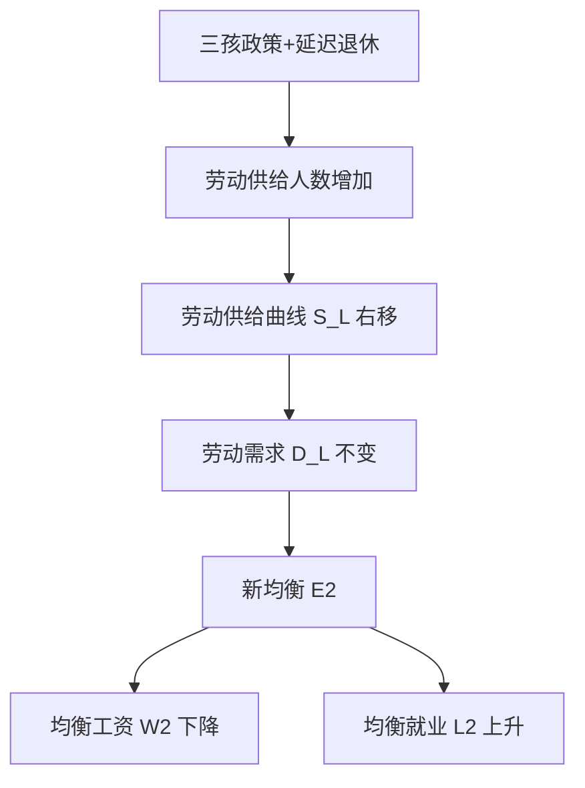

# 首都经济贸易大学801经济学·模拟卷（五）

<a href="../../exam.html" target="_blank" style="display:inline-block;padding:6px 16px;background:#2563eb;color:#fff;border-radius:6px;text-decoration:none;font-size:14px;">📝 开始做题</a>

> **难度定位**：拔高卷（区分度卷）。题目更综合、跨章节，主观题答案要求原理推导 + 图形分析 + 中国实际热点三位一体。
> **考试时间**：180 分钟　**满分**：150 分
> **政治经济学 75 分　西方经济学 75 分**

---

## 注意事项

一、本试卷为闭卷考试，答题前不得翻阅任何资料。
二、答案一律写在答题纸上，写在试题册上无效。
三、考试过程中**不得使用计算器**，所有计算均为整数或简单分数口算。
四、计算题需写出公式、代入过程和结果；简答与论述题需分点作答，使用"一、（一）、1、（1）、①"层级。
五、图形题用文字描述坐标轴、曲线位置与移动方向即可，不要求手绘。
六、考试结束后，试题册与答题纸一并交回。

---

## 一、简答与计算题（共 6 题，每题 15 分，合计 90 分）

---

### 简答 1（政治经济学，15 分）：试述社会资本简单再生产的实现条件与扩大再生产的前提条件和实现条件，并说明二者的内在联系。

> 📚 **不懂就看：** [[../07_政治经济学/03_资本流通与剩余价值分配/知识点/KP04_社会总资本再生产|📖 KP·社会总资本再生产]] ｜ [[../../经济统计学论文从0基础到精通/15_政治经济学基础/07_资本循环与周转|🐮 教程·资本循环与周转]]

**【考什么】** 对应政治经济学"社会总资本再生产理论"知识点，题型属于**模型分析 + 关系推导**类。要求在两部类划分（Ⅰ生产资料、Ⅱ消费资料）框架下，从价值补偿和实物补偿两个维度推导实现条件公式。

**【核心推导】**

**第一步 前提：社会总产品在价值上分为三部分，在实物上分为两大部类。**价值构成：$c$（不变资本）+ $v$（可变资本）+ $m$（剩余价值）。实物构成：**第 I 部类**生产生产资料，**第 II 部类**生产消费资料。社会资本再生产要能顺利进行，两大部类之间必须保持比例关系。

**第二步 简单再生产的前提与实现条件。**简单再生产的特征是全部剩余价值用于资本家个人消费，生产规模不变。

前提条件：$I(v+m) = IIc$（第 I 部类对消费资料的需求 = 第 II 部类对生产资料的需求）。
由 $I(v+m)=IIc$ 可推出两个派生条件：
$$I(c+v+m) = Ic + IIc \quad \text{（生产资料的总供给 = 两大部类对生产资料的总需求）}$$
$$II(c+v+m) = I(v+m) + II(v+m) \quad \text{（消费资料的总供给 = 两大部类对消费资料的总需求）}$$

**第三步 扩大再生产的前提条件与实现条件。**

前提条件（三条，注意"不等式"）：
1. $I(v+m) > IIc$ ——第 I 部类提供的生产资料除满足第 II 部类简单再生产需要外还有剩余，可供两大部类扩大生产；
2. $I\left(c+v+\frac{m}{x}\right) > I\left(v+\frac{m}{x}\right)$ 的具体化即 $I\left(c + v + m\right) > Ic + IIc$ ——生产资料总供给大于两大部类简单再生产对生产资料的需求（一般形式）。
   常用更清晰的表述：$I\left(v+m\right) > IIc$（第 I 部类）与 $II\left(c+m-\frac{m}{x}\right) > I\left(v+\frac{m}{x}\right)$（第 II 部类：消费资料总供给大于两大部类原有工人的消费需求，有剩余供新增工人消费）。
3. 两大部类都要有可供追加的不变资本与可变资本的实物。

实现条件（三条平衡式，是"不等式"加上资本积累后的等式化）：
$$I\left(v + \Delta v + \frac{m}{x}\right) = II(c + \Delta c)$$
$$I(c+v+m) = I(c+\Delta c) + II(c+\Delta c)$$
$$II(c+v+m) = I\left(v+\Delta v+\frac{m}{x}\right) + II\left(v+\Delta v+\frac{m}{x}\right)$$
其中 $\Delta c$、$\Delta v$ 为追加的不变资本与可变资本，$\frac{m}{x}$ 为资本家个人消费部分。

**第四步 数值示例（把等式走一遍）。**
简单再生产：设 $I: 4000c+1000v+1000m = 6000$，$II: 2000c+500v+500m=3000$。检验 $I(v+m)=1000+1000=2000 = IIc=2000$ ✔，社会总产品 9000。
扩大再生产：设 $I: 4000c+1000v+1000m$，$II: 1500c+750v+750m$。$I(v+m)=2000 > IIc=1500$ ✔ 有扩大可能。设第 I 部类积累 500（其中 $\Delta c=400$、$\Delta v=100$），资本家消费 500；则 $I(v+\Delta v+\frac{m}{x}) = 1000+100+500 = 1600$，而 $II(c+\Delta c)$ 需为 1600，故 $\Delta c = 1600-1500 = 100$。这就是两大部类按比例积累的平衡关系。

**第五步 二者的内在联系（本题的得分重心）。**
1. **简单再生产是扩大再生产的组成部分与基础**：扩大再生产的每一时期都可以看作以简单再生产为"起点 + 主体 + 现实要素的一部分"——马克思说"简单再生产是扩大再生产的一个现实因素"。
2. **扩大再生产是简单再生产的前提**：简单再生产的实现条件揭示了社会生产按比例发展的客观要求，扩大再生产的"不等式"只是在平衡式上加了追加资本，本质上仍是按比例规律。
3. **逻辑关系**：$I(v+m)=IIc$ 是**平衡**，$I(v+m)>IIc$ 是**平衡被打破后通过积累重建的更大平衡**；即扩大再生产是社会再生产在技术进步与资本积累条件下的常态形式，简单再生产是理论抽象与分析的起点。
4. **方法论意义**：从简单再生产入手，便于在纯净状态下揭示两大部类的比例关系；再引入积累，说明比例关系的动态调整。这是抽象到具体的科学抽象法。

**第六步 现实含义。**①两大部类比例失衡的当代表现：产能过剩（第 I 部类相对第 II 部类的需求过度扩张）与消费不足（第 II 部类相对不足）并存，正是"低端过剩、高端不足"的结构问题；②中国的供给侧结构性改革与扩大内需战略，本质是对两大部类比例关系的调整（补消费短板、去过剩产能）；③"按比例发展规律"在现代经济学中对应投入产出表（列昂惕夫的投入产出分析可视作两大部类模型的扩展），用于测算产业关联与最终需求对产出的拉动。

**【一句话】**简单再生产揭示比例，扩大再生产说明比例如何在积累中被重建。

**【为什么要答这几点】**

**【满分 15 分的分点逻辑】**两大部类与价值构成的设定（2 分）→ 简单再生产的实现条件（4 分）→ 扩大再生产的前提与实现条件（5 分）→ 二者内在联系（3 分）→ 现实含义（1 分）。

**【易失分点】**①漏写"两大部类"的划分（生产资料/消费资料），只写 $c+v+m$；②简单再生产条件写成 $I(c+v+m)=IIc$；③扩大再生产的前提条件用等号（应为大于号），实现条件用大于号（应为等号）——这是本题最致命的错误；④不区分 $\Delta c$ 与 $c$、$\frac{m}{x}$ 与 $m$；⑤不写内在联系，只把两个模型并置。

**【加分点】**①给出三条前提条件与三条实现条件的完整式；②给数值例演算两大部类比例；③引"简单再生产是扩大再生产的一个现实因素"；④把两大部类模型与投入产出分析衔接。

**【阅卷心理】**本题是"条件式"题，阅卷直接对着式子给分：不等式与等式搞反，扣 4 分以上。前提条件与实现条件都写全的，基本满分。

**【字数与时间】**550—650 字（含公式），13 分钟。

**【如何分析题目】**

**【如何分析题目】**
1. 先立框架：价值三部分（$c+v+m$）+ 实物两大部类（I 生产资料、II 消费资料），坐标立好再谈条件。
2. 简单再生产：写核心条件 $I(v+m)=IIc$，再推两个派生条件的等式。
3. 扩大再生产：先写三条**前提条件（大于号）**，再写三条**实现条件（等号 + $\Delta c$、$\Delta v$）**，明确两者差别。
4. 用一组数字演算：设 $I$ 部类积累额，反解 $II$ 部类需要追加多少不变资本，验证平衡。
5. 内在联系写三层：简单再生产是扩大再生产的现实因素、"不等式→等式"体现按比例规律、抽象到具体的方法论。
6. 现实段联系产能过剩与消费不足、供给侧改革与扩大内需、投入产出表。
7. 时间分配：3 分钟写公式框架，8 分钟书写与演算，2 分钟检查不等号方向。

**【答题框架】**
- 第 1 段：社会总资本再生产的核心问题是社会总产品的实现（价值补偿 + 实物补偿）（2 分）
- 第 2 段：简单再生产的三个实现条件（4 分）
- 第 3 段：扩大再生产的两个前提条件（4 分）
- 第 4 段：扩大再生产的三个实现条件（4 分）
- 第 5 段：二者内在联系与现实意义（1 分）

**【参考答案】**

一、社会总资本再生产的核心问题

（一）社会总产品在价值上分为 $c$（不变资本）、$v$（可变资本）、$m$（剩余价值）；在实物上分为生产资料和消费资料，相应划分为两大部类：Ⅰ生产资料生产、Ⅱ消费资料生产。
（二）社会总资本再生产的核心问题是社会总产品的实现，即价值补偿（卖得出去）和实物补偿（买得进来），要求两大部类之间、各部类内部保持一定的比例关系。

二、简单再生产的实现条件

（一）基本实现条件：第一部类的可变资本与剩余价值之和，必须等于第二部类的不变资本，即：

$$\mathrm{I}(v+m) = \mathrm{II}c$$

（二）由基本条件引申出两个派生条件：
1. $\mathrm{I}(c+v+m) = \mathrm{I}c + \mathrm{II}c$（全年生产资料总供给等于两大部类对生产资料的总需求）；
2. $\mathrm{II}(c+v+m) = \mathrm{I}(v+m) + \mathrm{II}(v+m)$（全年消费资料总供给等于两大部类对消费资料的总需求）。

三、扩大再生产的前提条件

（一）第一部类生产的生产资料，在补偿两大部类已消耗的生产资料之后还有剩余，即：

$$\mathrm{I}(v+m) > \mathrm{II}c \quad \Longleftrightarrow \quad \mathrm{I}(c+v+m) > \mathrm{I}c + \mathrm{II}c$$

（二）第二部类生产的消费资料，在补偿两大部类工人和资本家原有的消费之后还有剩余，即：

$$\mathrm{II}\left(c + m - \dfrac{m}{x}\right) > \mathrm{I}\left(v + \dfrac{m}{x}\right)$$

其中 $\dfrac{m}{x}$ 为资本家个人消费部分，$m-\dfrac{m}{x}$ 为用于积累的部分。

四、扩大再生产的实现条件

（一）基本实现条件：

$$\mathrm{I}\left(v + \Delta v + \dfrac{m}{x}\right) = \mathrm{II}(c + \Delta c)$$

其中 $\Delta c$ 为追加的不变资本，$\Delta v$ 为追加的可变资本。
（二）派生条件：
1. $\mathrm{I}(c+v+m) = \mathrm{I}(c+\Delta c) + \mathrm{II}(c+\Delta c)$；
2. $\mathrm{II}(c+v+m) = \mathrm{I}\left(v+\Delta v+\dfrac{m}{x}\right) + \mathrm{II}\left(v+\Delta v+\dfrac{m}{x}\right)$。

五、二者的内在联系

简单再生产是扩大再生产的基础和出发点，扩大再生产实现条件是简单再生产实现条件在积累条件下的推广：把 $v$ 换成 $v+\Delta v$、把 $c$ 换成 $c+\Delta c$、再加上资本家消费 $\dfrac{m}{x}$，即得到扩大再生产条件。它揭示了国民经济按比例协调发展是社会化大生产的客观规律。

**【解析·得分点】** 采分点：①两大部类划分 + 价值三划分（2 分）；②简单再生产基本条件 $\mathrm{I}(v+m)=\mathrm{II}c$（3 分）；③两个前提条件（4 分）；④扩大再生产基本条件 $\mathrm{I}(v+\Delta v+m/x)=\mathrm{II}(c+\Delta c)$（4 分）；⑤内在联系（2 分）。容易丢分：把前提条件和实现条件混淆——前提条件是"能不能扩大"（不等式），实现条件是"扩大能否顺利实现"（等式）。

**【生活实例】** 一个村子里，Ⅰ组造农具、Ⅱ组种粮食。简单再生产就是今年造的农具刚好够两组明年用坏换新，打的粮食刚好够两组人吃饱。扩大再生产则要求今年多造些农具、多留点余粮，才能招新工人、买新设备，把生产规模做大。如果农具造多了、粮食留少了，新工人来了没饭吃，再生产就会卡壳。

**【双链接】** 🔗 社会总资本再生产理论 ｜ 📖 《马克思主义政治经济学概论》第 4 章

---

### 简答 2（政治经济学，15 分）：试述资本主义基本矛盾的主要表现，并说明为什么社会主义代替资本主义是历史的必然趋势。

> 📚 **不懂就看：** [[../07_政治经济学/04_经济危机与历史趋势/知识点/KP01_资本主义经济危机|📖 KP·资本主义经济危机]] ｜ [[../07_政治经济学/04_经济危机与历史趋势/知识点/KP03_资本主义发展的历史趋势|📖 KP·资本主义发展的历史趋势]] ｜ [[../../经济统计学论文从0基础到精通/15_政治经济学基础/10_资本主义经济危机|🐮 教程·资本主义经济危机]]

**【考什么】** 对应政治经济学"资本主义基本矛盾与历史趋势"知识点，题型属于**原因分析 + 理论类**。要求从生产力与生产关系矛盾运动规律出发，论证"两个必然"。

**【核心推导】**

**第一步 基本矛盾的主要表现（先说清是"哪些表现"）。**资本主义基本矛盾是生产社会化与生产资料私人占有之间的矛盾，其表现有四层：
1. **个别企业生产的有组织性 vs 整个社会生产的无政府状态**——企业内部计划严密，全社会无计划，比例失调；
2. **生产无限扩大的趋势 vs 劳动人民有支付能力的需求相对缩小**——资本积累推动产能扩张，剥削压低工资，形成"产能过剩 + 消费不足"；
3. **资产阶级与无产阶级的对立**——生产关系中两大阶级利益根本对立；
4. **经济危机与周期波动**——矛盾积累的爆发形式（相对生产过剩）。

**第二步 为什么"两个必然"是历史的必然（逻辑链条，不能只说结论）。**
1. **生产力层面**：资本主义生产关系曾是生产力发展的形式，但随着生产社会化程度提高（大工业、全球产业链、数字平台），私人占有成为生产力的桎梏——生产关系从"发展形式"变成"桎梏"，这是"必然"的**物质条件**。
2. **阶级层面**：资本主义生产出了自己的掘墓人——无产阶级。生产社会化使工人集中、组织化、形成阶级意识，这是"必然"的**主体条件**。
3. **规律层面**：生产关系一定要适合生产力性质的规律是社会发展的根本规律，不以人的意志为转移；资本主义内在矛盾（基本矛盾）不断积累且无法在资本主义制度内根本解决，只能通过制度更替解决。
4. **趋势层面**：资本积累的一般规律（一极财富积累、一极贫困积累）使矛盾趋于尖锐；利润率趋向下降规律使资本积累遇到内在限制。

**第三步"两个决不会"的限定（必须写，否则是教条）。**马克思在《〈政治经济学批判〉序言》中指出："无论哪一个社会形态，在它所能容纳的全部生产力发挥出来以前，是决不会灭亡的；而新的更高的生产关系，在它的物质存在条件在旧社会的胎胞里成熟以前，是决不会出现的。"含义：
- 资本主义仍有容纳生产力发展的空间（科技革命、全球化、福利国家、平台经济都在延长其寿命）；
- 社会主义的建立需要物质条件（高度发达的生产力与社会化程度）成熟；
- 因此"两个必然"是**总趋势判断**，"两个决不会"是**时间与条件的限定**，二者统一才是完整的历史唯物主义结论。

**第四步 二者的统一（本题重心）。**
| 层次 | 两个必然 | 两个决不会 |
|---|---|---|
| 回答的问题 | 方向：向哪里去 | 时间与条件：什么时候、凭什么 |
| 哲学基础 | 历史唯物主义的发展观 | 生产力决定论 |
| 方法论意义 | 反对改良主义的"永久繁荣论" | 反对冒进主义的"立刻取代论" |
| 实践要求 | 坚定方向、坚持社会主义 | 尊重规律、发展生产力、长期斗争 |

统一起来的表述是：**社会主义代替资本主义是历史的必然，但这是一个长期的、曲折的、有条件的历史过程**——既不能因为过程漫长就否认趋势，也不能因为趋势确定就忽视条件。

**第五步 现实含义（当代资本主义为何仍有生命力）。**
1. **自我调节**：福利国家、凯恩斯主义宏观调控、反垄断法，缓解了分配与垄断矛盾；
2. **技术革命**：信息技术、平台经济、人工智能拓展了生产力空间（这正是"容纳生产力的空间"的当代形态）；
3. **全球化**：把矛盾转移到世界范围（发展中国家承担成本、国际市场吸纳过剩产能）；
4. **但矛盾的根源未消除**：2008 年国际金融危机、2020 年以来的贫富分化加剧（全球最富 1% 人群财富增量约为其余人群的两倍）、2024—2026 逆全球化与债务压力，说明自我调节只能延缓、不能消除。

**第六步 中国的实践意义。**中国坚持"两个必然"的方向（社会主义道路、共同富裕），同时尊重"两个决不会"的条件性（社会主义初级阶段长期性、"两个毫不动摇"、发展是解决一切问题的基础与关键）。这正是"既不走封闭僵化的老路，也不走改旗易帜的邪路"的理论依据。

**【一句话】**方向是必然的，过程是长期的——把两者统一起来才是历史唯物主义。

**【为什么要答这几点】**

**【满分 15 分的分点逻辑】**基本矛盾的四层表现（3 分）→ "两个必然"的四条逻辑（5 分）→ "两个决不会"的内容与限定（3 分）→ 二者统一（3 分）→ 现实含义（1 分）。

**【易失分点】**①只说"两个必然"，不写"两个决不会"——答案变成宣传口号，必降档；②"两个必然"只写结论不写逻辑链（生产力桎梏 + 阶级主体 + 规律 + 趋势）；③把"两个决不会"理解为"资本主义不会灭亡"（应是"条件未成熟不会灭亡"）；④基本矛盾表现只写一条；⑤不谈当代资本主义为何仍有生命力，缺少辩证性。

**【加分点】**①完整引用马克思"两个决不会"的原意；②用表格对比二者回答问题、哲学基础、实践要求；③写出"既反对永久繁荣论，也反对立刻取代论"；④用 2008 危机与全球贫富分化数据说明矛盾未除；⑤落到社会主义初级阶段长期性。

**【阅卷心理】**本题阅卷最能看出立场与深度：只写"两个必然"的，最多 9 分；能把"两个决不会"与"必然"统一起来的，直接进一档。出现"资本主义已经不具备任何生命力"这类绝对表述的，扣分。

**【字数与时间】**550—650 字，13 分钟。

**【如何分析题目】**

**【如何分析题目】**
1. 拆题干两问："主要表现"（列举 + 机制）+"为什么是历史必然"（论证），分两块。
2. 表现部分列四层，每层给"对立的两极"，突出矛盾张力（有组织 vs 无政府、无限扩大 vs 相对缩小）。
3. "必然"部分走四步论证：生产力桎梏（物质）+ 掘墓人（主体）+ 规律（必然性）+ 趋势（积累规律），避免只喊结论。
4. 立即补"两个决不会"：引原文意思，说明"能容纳的生产力未耗尽不会灭亡"与"新生产关系条件未成熟不会出现"。
5. 用一段（或一个表）写二者统一：方向 vs 时间条件、反改良主义 vs 反冒进主义。
6. 现实段写当代资本主义的四条自我调节与"根源未除"的证据（2008 危机、贫富分化、逆全球化）。
7. 收尾落到中国"既不走老路也不走邪路"的实践。
8. 时间分配：2 分钟搭框架，9 分钟书写，2 分钟补引用与现实。

**【答题框架】**
- 第 1 段：资本主义基本矛盾的内涵（3 分）
- 第 2 段：基本矛盾的两大主要表现（5 分）
- 第 3 段：经济危机是基本矛盾的强制爆发（3 分）
- 第 4 段：社会主义代替资本主义的历史必然性（4 分）

**【参考答案】**

一、资本主义基本矛盾的内涵

（一）资本主义基本矛盾是**生产社会化和生产资料资本主义私人占有之间的矛盾**。
（二）生产社会化表现为生产资料使用社会化、生产过程社会化、产品社会化，整个社会生产联结成一个有机整体；但生产资料和产品却归资本家私人占有，这就形成了社会化大生产与资本主义私有制之间的对抗性矛盾。

二、基本矛盾的主要表现

（一）个别企业内部生产的有组织性与整个社会生产无政府状态之间的矛盾。
1. 单个企业为追逐剩余价值，内部生产严格计划、组织严密；
2. 但社会分工要求各部门按比例分配社会劳动，私有制使每个企业不知道市场真正需要多少，盲目追逐利润导致部门比例失调。

（二）资本主义生产无限扩大的趋势与劳动人民有支付能力的需求相对缩小之间的矛盾。
1. 资本家为追逐超额剩余价值不断改进技术、扩大生产，生产有无限扩张趋势；
2. 同时资本积累又造成相对过剩人口，工人阶级受剥削程度加深，工资增长落后于生产增长，市场扩张赶不上生产扩张，导致生产相对过剩。

三、经济危机是基本矛盾的强制爆发

（一）矛盾积累到尖锐程度，就爆发生产相对过剩的经济危机：商品积压、工厂倒闭、工人失业。
（二）危机通过破坏一部分生产力，强制使生产和消费暂时恢复平衡，但没有消除基本矛盾，矛盾在更高层次重新积累，形成危机的周期性。

四、社会主义代替资本主义的历史必然性

（一）生产力的发展要求。生产社会化程度越来越高，客观上要求由社会共同占有生产资料、统一调节生产，资本主义私有制日益成为生产力进一步发展的桎梏。
（二）资本主义为自身灭亡准备了物质条件（高度社会化的生产力）和社会力量（现代无产阶级）。
（三）资本主义的自我调整（国家垄断资本主义、福利制度）只能缓和矛盾，不能从根本上消除基本矛盾。
（四）因此，"两个必然"——资本主义必然灭亡、社会主义必然胜利——是生产关系一定要适应生产力发展规律作用的必然结果，是一个长期、曲折的历史过程。

**【解析·得分点】** 采分点：①基本矛盾内涵（3 分）；②两大表现各 2.5 分（5 分）；③经济危机作为强制爆发（3 分）；④"两个必然"四点论证（4 分）。容易丢分：只写"资本主义不好"，没从生产力与生产关系矛盾运动规律论证；忘记强调"长期曲折过程"，把历史必然性等同于"马上灭亡"。

**【生活实例】** 一个大工厂里，几百个工人配合得像一台机器（生产社会化），但机器是老板一个人的。老板让大家拼命干，产品越堆越多；可工人工资就那么多，买不起自己造的东西。最后仓库爆仓、工厂倒闭——这就是经济危机。要解决这个问题，就得让大家共同拥有这台机器、按社会需要安排生产。

**【双链接】** 🔗 资本主义基本矛盾与经济危机 ｜ 📖 《马克思主义政治经济学概论》第 5 章

---

### 简答 3（政治经济学，15 分）：试述共同富裕的科学内涵、客观必然性，并说明初次分配、再分配、第三次分配在实现共同富裕中的各自定位。

> 📚 **不懂就看：** [[../07_政治经济学/05_社会主义经济制度/知识点/KP04_共同富裕|📖 KP·共同富裕]] ｜ [[../07_政治经济学/05_社会主义经济制度/知识点/KP03_按劳分配与多种分配方式|📖 KP·按劳分配与多种分配方式]] ｜ [[../../经济统计学论文从0基础到精通/15_政治经济学基础/11_社会主义市场经济|🐮 教程·社会主义市场经济]]

**【考什么】** 对应政治经济学"社会主义本质与分配制度"知识点，题型属于**概念简答 + 解决对策**类，结合 2024-2026 年中央关于共同富裕示范区和收入分配改革的最新表述。

**【核心推导】**

**第一步 共同富裕的科学内涵（三层含义，不要只写"大家都富"）。**
1. **是全体人民的富裕，不是少数人的富裕**：覆盖全体人民，是"共同"的规定性；
2. **是物质与精神生活都富裕**：既有物质财富的丰富，也有精神文化的充实，还包括教育、健康、公平正义等；
3. **是分阶段推进的富裕**：不是同时同步平均富裕，也不是"等靠要"，而是鼓励勤劳创新致富、允许一部分人先富起来并带动后富，逐步实现。
补充两点规定性：①共同富裕不是"平均主义"（反对"杀富济贫"式平均）；②不是"福利养懒汉"（坚持尽力而为、量力而行）。

**第二步 客观必然性（为什么必然要提、必然能实现）。**
1. **制度必然**：社会主义本质要求——"社会主义的本质，是解放生产力，发展生产力，消灭剥削，消除两极分化，最终达到共同富裕"（邓小平）；公有制为主体与按劳分配为主体提供制度基础。
2. **生产力必然**：共同富裕以高质量发展为前提，全面建成小康社会后具备了物质条件（人均 GDP 超过 1.2 万美元、脱贫攻坚战全面胜利）。
3. **执政必然**：党的根本宗旨是全心全意为人民服务，发展成果由人民共享，共同富裕是党的初心使命的体现。
4. **现实必要**：收入差距与财富差距问题（基尼系数长期在 0.46—0.47 区间）、居民消费率偏低（约 38%，低于主要经济体）制约内需与长期增长，共同富裕既是公平问题也是效率问题。

**第三步 三次分配的内涵与定位（本题重心）。**

| 分配层次 | 主体 | 机制 | 定位与作用 | 现实工具 |
|---|---|---|---|---|
| **初次分配** | 市场 | 按要素贡献分配（劳动、资本、土地、知识、技术、数据） | **基础性**——由市场决定，讲效率 | 工资集体协商、提高最低工资、规范资本所得、要素市场化改革、提高劳动报酬占比 |
| **再分配** | 政府 | 税收、社会保障、转移支付 | **调节性**——由政府主导，讲公平 | 个人所得税与财产税体系、社保统筹、公共服务均等化、转移支付（中央对地方）、医保与养老 |
| **第三次分配** | 社会 | 自愿捐赠、慈善事业、志愿服务 | **补充性**——道德力量驱动，讲自愿 | 公益慈善组织、企业社会责任、公益基金、乡村振兴捐赠 |

**第四步 三者的关系（关键辨析）。**
1. **初次分配是主体**：占分配总量的绝大部分（劳动报酬 + 资本收入），因此"提高劳动报酬在初次分配中的比重"是最重要的改革方向；
2. **再分配是关键调节器**：市场机制自发倾向于扩大差距（资本收益 > 劳动收入增长、财产性收入集中），只有再分配能实现"逆向调节"；
3. **第三次分配是补充而非主力**：其规模取决于社会文明程度与道德水平，不能替代制度性分配，但能培育社会共识；
4. **制度定位**：十九届四中全会提出"重视发挥第三次分配作用"，十九届五中全会与二十大进一步确立为基础性制度安排——三次分配是一个**体系**，而非三个平行手段。

**第五步 政策机制与现实举措（2024—2026）。**
1. 初次分配：提高劳动报酬占比、完善最低工资与工资增长机制、加强对平台劳动者与新就业形态的权益保障、深化要素市场化改革（让技术、数据要素按贡献参与分配）；
2. 再分配：优化税制结构（提高直接税比重）、健全社会保障体系（多层次养老保险三支柱）、推进基本公共服务均等化、加大中央对中西部转移支付；
3. 第三次分配：完善慈善税收优惠、健全公益组织监管、鼓励企业与社会力量参与乡村振兴与教育医疗公益；
4. 底层支撑：高质量发展与就业优先政策（"做大蛋糕"）+ 城乡区域协调发展（缩小差距的"分好蛋糕"）。

**第六步 现实难点（辩证部分）。**①效率与公平的张力：过度再分配可能削弱激励，不足则差距扩大（对应福利经济学第二定理中"一次总付转移不可行"的现实困境）；②**扩大中等收入群体**是关键抓手——形成"橄榄型"分配结构，而非简单地"削高补低"；③第三次分配不能变成"道德绑架"或"运动式捐赠"，需法治化、规范化；④共同富裕是长期过程，需与经济增长阶段相适应，避免"福利赶超"陷阱。

**【一句话】**初次分配做大蛋糕，再分配分好蛋糕，第三次分配添暖意——三者是一个体系，不是三个口号。

**【为什么要答这几点】**

**【满分 15 分的分点逻辑】**科学内涵三层（3 分）→ 客观必然性四条（3 分）→ 三次分配的内涵与定位（6 分）→ 三者关系（2 分）→ 现实举措与难点（1—2 分酌情）。

**【易失分点】**①把共同富裕写成"平均分配"或"同步富裕"——两个最典型的错误；②只写"三次分配"，不写各自的**主体与机制**（市场/政府/社会）；③漏掉"初次分配是主体、第三次分配是补充"这一层次定位，变成三者并列；④不写"提高劳动报酬占比"这一最重要的机制；⑤不谈效率与公平的张力，答案显得单向。

**【加分点】**①引邓小平关于社会主义本质的五句话；②写出基尼系数 0.46—0.47、居民消费率约 38% 等数据，论证"共同富裕既是公平也是效率"；③给出三次分配的"主体—机制—定位—工具"四列表；④指出扩大中等收入群体形成橄榄型结构；⑤提"避免福利赶超陷阱"与"防止道德绑架"。

**【阅卷心理】**本题阅卷看两点：是否把三次分配写成**体系**（有主次）、是否避免平均主义误读。写成三者并列的最多 10 分；能点出"初次分配为主体 + 提高劳动报酬占比"的进一档。

**【字数与时间】**550—650 字（含表），13 分钟。

**【如何分析题目】**

**【如何分析题目】**
1. 拆题干三问：科学内涵、客观必然性、三次分配定位——三块分开答。
2. 内涵先立三层（全体人民、物质精神双富裕、分阶段推进），再补两条"不是什么"（不是平均主义、不是养懒汉），防止误读。
3. 必然性走四条：制度（社会主义本质）+ 生产力（物质条件具备）+ 执政（宗旨）+ 现实（差距与消费率数据）。
4. 三次分配用四列表：主体—机制—定位—工具，逐层写清"市场/政府/社会"。
5. 单独写关系：初次分配主体、再分配调节、第三次补充，并指出"提高劳动报酬占比"是最关键改革。
6. 举措按三层 + 底层支撑（做大蛋糕）写，各 1—2 条。
7. 难点段写效率公平张力、橄榄型结构、慈善法治化、避免福利赶超。
8. 时间分配：2 分钟搭框架，9 分钟书写，2 分钟补数据与定位表述。

**【答题框架】**
- 第 1 段：共同富裕的科学内涵（4 分）
- 第 2 段：客观必然性（4 分）
- 第 3 段：三次分配的各自定位（6 分）
- 第 4 段：小结（1 分）

**【参考答案】**

一、共同富裕的科学内涵

（一）共同富裕是**全体人民**的富裕，不是少数人的富裕；
（二）是**全面**富裕，既包括物质生活富裕，也包括精神生活富裕、公共服务均等化、生态环境宜居；
（三）是**共建共富**，靠全体人民辛勤劳动和相互帮助实现，不是"杀富济贫"式的平均主义；
（四）是**逐步共富**，是一个长期历史过程，不是同时同步同等富裕，允许先富带后富。

二、共同富裕的客观必然性

（一）是社会主义的本质要求。社会主义本质是解放生产力、发展生产力、消灭剥削、消除两极分化，最终达到共同富裕。
（二）是以人民为中心发展思想的集中体现，发展为了人民、发展依靠人民、发展成果由人民共享。
（三）是高质量发展的必然要求。中等收入群体扩大才能支撑内需扩大、形成双循环新发展格局。
（四）是维护社会公平正义、保持社会稳定的需要。收入差距过大将制约消费、激化社会矛盾。

三、三次分配的各自定位

（一）初次分配：**注重效率**，发挥市场在资源配置中的决定性作用。
1. 坚持按劳分配为主体、多种分配方式并存；
2. 健全劳动、资本、土地、知识、技术、管理、数据等生产要素由市场评价贡献、按贡献决定报酬的机制；
3. 重点是规范收入分配秩序，提高劳动报酬在初次分配中的比重。

（二）再分配：**注重公平**，更好发挥政府作用。
1. 税收：个人所得税综合税制、房地产税试点探索、消费税调节；
2. 社会保障：养老保险全国统筹、医保跨省异地结算、社会救助兜底；
3. 转移支付：中央对地方一般性转移支付、对欠发达地区和农村的倾斜支持。

（三）第三次分配：**注重自愿**，发展慈善等社会公益事业。
1. 是对初次分配和再分配的有益补充；
2. 依靠道德力量、社会责任，鼓励高收入群体和企业回报社会；
3. 需要完善慈善捐赠税收优惠政策、规范慈善组织运作。

四、小结

三次分配是一个有机整体：初次分配做大蛋糕，再分配分好蛋糕，第三次分配升华蛋糕。三者协调配合，才能在发展中保障和改善民生，扎实推进共同富裕。

**【解析·得分点】** 采分点：①共同富裕四内涵（4 分）；②必然性四点（4 分）；③三次分配定位及具体手段各 2 分（6 分）；④有机整体小结（1 分）。容易丢分：把第三次分配写成"强制捐款"，忘记"自愿"二字；把初次分配和再分配的"效率 vs 公平"定位写反。

**【生活实例】** 一个村子搞旅游：初次分配是村民自己开民宿、卖特产，多劳多得；再分配是村委会从利润里提一笔，给老人发养老金、给困难户发补助；第三次分配是赚了大钱的村民自愿出钱修图书馆、奖学。三次一起上，全村才能既有钱又和睦。

**【双链接】** 🔗 社会主义分配制度与共同富裕 ｜ 📖 《马克思主义政治经济学概论》第 10 章

---

### 简答 4（西方经济学，15 分）：比较古诺模型、斯威齐模型和卡特尔模型的基本假定、均衡结果与政策含义。

> 📚 **不懂就看：** [[../06_西方经济学/05_不完全竞争市场/知识点/KP05_寡头市场与囚徒困境|📖 KP·寡头市场与囚徒困境]] ｜ [[../../经济统计学论文从0基础到精通/13_微观经济学基础/11_寡头与囚徒困境是什么|🐮 教程·寡头与囚徒困境]]

**【考什么】** 对应微观经济学"不完全竞争市场·寡头"知识点，题型属于**模型分析 + 关系对比**类。要求掌握三个寡头模型的核心差异：产量竞争 vs 价格刚性 vs 公开勾结。

**【核心推导】**

**第一步 三模型的基本假定对比（先立假设，才能比较结论）。**

| 维度 | 古诺模型 | 斯威齐模型（弯折需求曲线） | 卡特尔模型 |
|---|---|---|---|
| 厂商数量 | 寡头（以双寡头最典型） | 寡头（通常双寡头） | 寡头联合为一个"垄断者" |
| 关键假定 | 每家假定**对手产量不变**，各自选择产量 | 假定**对手价格跟随降价但不跟随涨价** | 各家**联合行动**，共同定产量与价格 |
| 决策变量 | 产量 | 价格 | 产量 + 价格 + 市场划分 |
| 博弈性质 | 同时行动、非合作 | 价格刚性（假定的行为模式） | 合作（共谋） |

**第二步 古诺模型的推导（数值例）。**设市场需求 $P = a - bQ$，$Q = q_1 + q_2$，两家边际成本均为 $c$（无固定成本）。
厂商 1 利润 $\pi_1 = (a - b(q_1+q_2))q_1 - c q_1$，对 $q_1$ 求导并令零：
$$a - 2b q_1 - b q_2 - c = 0 \Rightarrow q_1 = \frac{a - c - b q_2}{2b}$$
这就是厂商 1 的**反应函数**（反应曲线）。对称均衡下 $q_1 = q_2 = q^*$：
$$q^* = \frac{a-c}{3b}, \quad Q^C = \frac{2(a-c)}{3b}, \quad P^C = a - bQ^C = \frac{a+2c}{3}$$
数值例：$a=100$、$b=1$、$c=10$ → $q^*=30$、$Q^C=60$、$P^C=40$，每家利润 $\pi = (40-10)\times 30 = 900$，行业总利润 1800。
对照：完全竞争 $P=c=10$、$Q=90$；垄断 $Q=\dfrac{a-c}{2b}=45$、$P=\dfrac{a+c}{2}=55$、$\pi=2025$。可见**古诺结果介于竞争与垄断之间**。

**第三步 斯威齐模型的机制（价格为何刚性）。**假定：厂商提价时对手**不跟随**（销量大幅流失，需求弹性大、曲线平缓）；厂商降价时对手**跟随**（销量增加有限，需求弹性小、曲线陡峭）。结果需求曲线在现行价格处形成**折点**，对应的边际收益曲线在折点处**断开（垂直跳跃）**。只要边际成本曲线穿过这一断段，均衡价格与产量都**不变**——这就解释了寡头市场价格刚性（"价格战打不起来"）。局限：它只是**描述**了刚性，没有解释现行价格是怎么来的，被称为"解释一切的模型等于解释不了任何事"。

**第四步 卡特尔模型（联合利润最大化）。**各家联合使行业总利润最大，等价于一个垄断者：
$$\max_Q \ (a-bQ)Q - cQ \Rightarrow Q^K = \frac{a-c}{2b}, \quad P^K = \frac{a+c}{2}$$
数值例：$Q^K=45$、$P^K=55$、总利润 2025。若均分产量，每家 22.5 单位、利润 1012.5，**高于古诺的 900**——这是共谋的动机。
但卡特尔**内在不稳定**：给定对手产量 22.5，厂商 1 的最优反应是 $q_1 = \frac{100-10-22.5}{2}=33.75$，利润 $= (55-1\times33.75\ ...)$ 计算可得明显高于 1012.5 → **单方背叛有利可图**，这就是囚徒困境。因此卡特尔需要惩罚机制与监督，且往往因成员背叛或反垄断执法而瓦解（OPEC 的产量配额屡遭超产）。

**第五步 三者的产量、价格与福利比较（用统一数值，一图胜千言）。**
| 市场结构 | 总产量 | 价格 | 行业利润 | 消费者剩余 | 社会总福利 |
|---|---|---|---|---|---|
| 完全竞争 | 90 | 10 | 0 | 大 | 最大 |
| 古诺（双寡头） | 60 | 40 | 1800 | 中 | 中 |
| 卡特尔（垄断） | 45 | 55 | 2025 | 小 | 最小 |

结论：**产量：竞争 > 古诺 > 卡特尔；价格与利润：卡特尔 > 古诺 > 竞争；福利：竞争 > 古诺 > 卡特尔**。古诺是"非合作均衡"，卡特尔是"合作均衡"，斯威齐是"价格刚性的描述"。

**第六步 政策含义与反垄断。**①卡特尔（价格联盟、串通投标、分割市场）是《反垄断法》明确禁止的**横向垄断协议**，执法案例包括原料药垄断、建材价格联盟；②古诺均衡说明即使没有共谋，寡头市场的产量也低于竞争水平，因此**并购审查**（经营者集中申报）有必要——防止寡头数量减少使均衡趋向垄断；③斯威齐模型解释了"价格战"少见的现实，但也提示**非价格竞争**（质量、广告、平台补贴）成为寡头的主要竞争方式；④平台经济中的"算法合谋"是卡特尔的数字化形态，监管需识别"算法定价"背后的共谋意图（可参考阿里"二选一"被罚 182.28 亿元、美团被罚 34.42 亿元的执法背景）。

**【一句话】**古诺靠各自算计、卡特尔靠联手行动、斯威齐只解释价格为什么不乱动。

**【为什么要答这几点】**

**【满分 15 分的分点逻辑】**三模型假定对比（3 分）→ 古诺反应函数与均衡（4 分）→ 斯威齐折点与断开的 MR（4 分）→ 卡特尔联合最大化与不稳定性（3 分）→ 三者比较与政策含义（1—2 分酌情）。

**【易失分点】**①古诺模型不写"对手产量不变"这一核心假定；②反应函数推导错误（系数写成 $1/b$ 而非 $1/(2b)$）；③斯威齐模型只说"需求曲线弯折"，不说"边际收益断开"——断开的 MR 才是价格刚性的真正原因；④卡特尔只写"联合最大化"，不写"内在不稳定/囚徒困境"；⑤不比较三者的产量与福利顺序。

**【加分点】**①用统一数值（$a=100,b=1,c=10$）算出四种结构的产量与价格；②给出福利排序与"古诺介于竞争与垄断之间"的定位；③指出斯威齐模型"描述有余、解释不足"的局限；④提算法合谋作为卡特尔的数字化形态；⑤联系《反垄断法》与经营者集中审查。

**【阅卷心理】**本题阅卷看"假定—推导—比较"三段是否齐全。只写三个模型定义的，最多 8 分；能写出反应函数与断开的 MR 的，进一档；有统一数值比较表的，基本满分。

**【字数与时间】**600—700 字（含表与公式），14 分钟。

**【如何分析题目】**

**【如何分析题目】**
1. 先用一张表列三模型的关键假定（对手是否跟随、决策变量、是否合作），这是比较的地基。
2. 古诺：写利润函数 → 一阶条件 → 反应函数 → 对称均衡解，再代一组数值（$a=100,b=1,c=10$）算出 $q^*$、$Q$、$P$。
3. 斯威齐：写不对称的跟随假定 → 需求曲线折点 → MR 断开 → MC 在断段内移动价格不变 → 指出其局限。
4. 卡特尔：按垄断求解 → 对比古诺利润说明共谋动机 → 算单方背叛的收益 → 引出囚徒困境与不稳定性。
5. 汇总比较表：产量、价格、利润、消费者剩余、社会福利的排序。
6. 政策段：横向垄断协议、经营者集中审查、非价格竞争、算法合谋。
7. 时间分配：3 分钟列表，8 分钟书写与计算，3 分钟补政策与检验数值。

**【答题框架】**
- 第 1 段：寡头市场特征引入（2 分）
- 第 2 段：古诺模型（4 分）
- 第 3 段：斯威齐模型（4 分）
- 第 4 段：卡特尔模型（4 分）
- 第 5 段：对比小结（1 分）

**【参考答案】**

一、寡头市场的特征

少数几家大企业控制整个行业，企业之间相互依存（任何一家的决策都会影响对手），价格和产量决策具有博弈性质。

二、古诺模型（产量竞争模型）

（一）基本假定：两个生产者生产同质产品，假定对方产量不变，各自决定自己利润最大化的产量。
（二）均衡推导：设市场需求 $P=a-bQ$，边际成本为 $c$。企业 1 的反应函数为：

$$q_1 = \dfrac{a-c}{2b} - \dfrac{q_2}{2}$$

同理 $q_2 = \dfrac{a-c}{2b} - \dfrac{q_1}{2}$。联立解得古诺均衡：

$$q_1 = q_2 = \dfrac{a-c}{3b}, \quad Q = \dfrac{2(a-c)}{3b}$$

（三）均衡结果：总产量介于完全竞争 $(a-c)/b$ 与完全垄断 $(a-c)/(2b)$ 之间，价格介于二者之间。
（四）政策含义：双寡头竞争仍会造成效率损失，企业数量增加则产量趋近竞争水平。

三、斯威齐模型（弯折的需求曲线模型）

（一）基本假定：寡头企业跟跌不跟涨——自己降价，对手必跟进降价；自己提价，对手不跟进提价。
（二）图形描述：需求曲线在现行价格处出现弯折。弯折点以上需求曲线富有弹性（提价丢市场），弯折点以下需求曲线缺乏弹性（降价也丢份额）。
（三）均衡结果：由弯折点导致边际收益曲线出现**垂直缺口**。只要边际成本 MC 在缺口内移动，企业利润最大化的价格和产量就保持不变，即**价格刚性**。
（四）政策含义：解释了寡头市场为什么价格不随成本小幅变化而频繁波动。

四、卡特尔模型（公开勾结模型）

（一）基本假定：行业内所有企业公开达成协议，像一个完全垄断者一样统一决定价格和产量，再分配配额。
（二）均衡结果：卡特尔整体按 $MR=MC$ 确定垄断价格和总产量，再按各企业边际成本相等原则分配产量配额。
（三）不稳定性：每个成员都有**欺骗动机**——偷偷降价或超产，可在高价下获得更大份额。一旦被其他成员发现，卡特尔瓦解。
（四）政策含义：卡特尔抬高价格、限制产量、损害消费者剩余，各国《反垄断法》均明确禁止。

五、对比小结

古诺是非合作产量竞争，斯威齐解释价格刚性，卡特尔是公开勾结。三者分别对应寡头市场三种典型行为模式。

**【解析·得分点】** 采分点：①古诺反应函数与均衡产量（4 分）；②弯折需求曲线 + MR 垂直缺口 + 价格刚性（4 分）；③卡特尔统一定价 + 欺骗动机 + 不稳定（4 分）；④寡头相互依存特征（2 分）；⑤对比小结（1 分）。容易丢分：把斯威齐模型写成"弯折供给曲线"；忘记卡特尔的欺骗动机。

**【生活实例】** 两条街就两家奶茶店。古诺是各卖各的，你卖多少我就定我的量；斯威齐是价格定在 15 块后谁也不敢先涨（涨了客人跑对面）、谁也不敢先降（降了对面跟着降，白忙活）；卡特尔是两家坐下来签协议"都卖 15 块"，但每家都想偷偷打 8 折抢客人。

**【双链接】** 🔗 寡头市场模型 ｜ 📖 《西方经济学（微观）》第 7 章

---

### 简答 5（西方经济学，15 分）：什么是信息不对称？用逆向选择和道德风险说明二手车市场与保险市场的市场失灵，并提出解决思路。

> 📚 **不懂就看：** [[../06_西方经济学/08_市场失灵与微观经济政策/知识点/KP04_信息不对称与逆向选择道德风险|📖 KP·信息不对称与逆向选择道德风险]] ｜ [[../../经济统计学论文从0基础到精通/13_微观经济学基础/13_信息不对称是什么|🐮 教程·信息不对称是什么]]

**【考什么】** 对应微观经济学"市场失灵与微观经济政策·信息不对称"知识点，题型属于**经济现象 + 理论分析**类。要求区分事前（逆向选择）与事后（道德风险）。

**【核心推导】**

**第一步 定义与前提。**信息不对称指交易双方掌握的信息不同，一方拥有另一方难以获得或验证的信息。两类问题：
- **逆向选择（事前机会主义）**：签约**之前**信息不对称，导致市场出现"劣币驱逐良币"的质量退化（阿克洛夫"柠檬市场"1950/1970）；
- **道德风险（事后机会主义）**：签约**之后**信息不对称，一方的行为难以被观察，从而采取损害对方利益的行为。

**第二步 二手车市场（逆向选择的经典推导）。**设市场上好车价值 $V_H$、坏车（柠檬）价值 $V_L$，$V_H > V_L$，买卖双方对质量信息不对称，买方只知好车概率为 $\lambda$。
- 买方最高出价 = 期望价值 $= \lambda V_H + (1-\lambda)V_L$；
- 若 $\lambda$ 较低，则期望价格低于 $V_H$ → 好车车主不愿出售、退出市场；
- 好车退出后，市场上坏车比例上升 → $\lambda$ 下降 → 期望价格进一步下降 → 更多次好车退出……
- 结果：**市场只剩最差的商品，甚至市场消失**（极端情况下成交量趋于零）。
这就是"劣币驱逐良币"的机制：**信息不对称使价格无法区分质量，价格机制失灵**。

**第三步 保险市场（道德风险与逆向选择同时存在）。**①**逆向选择**：高风险者更愿意买保险且愿付更高保费 → 保险公司若统一定价，低风险者退出 → 参保人群风险上升 → 保费上升 → 进一步挤出低风险者（"死亡螺旋"）；②**道德风险**：投保后被保险人防范动机下降（如车辆全险后疏于防盗、医疗保险后过度就医），使保险公司赔付上升。机制核心是**行为不可观测**，保险人无法完美监控。

**第四步 解决思路（按机制分类，这是得分重点）。**
| 问题 | 解决工具 | 机制 |
|---|---|---|
| 逆向选择 | **信号传递（signaling）** | 信息优势方主动披露：二手车提供第三方检测报告与质保、企业提供品牌与信誉、求职者提供学历与证书（斯宾塞信号模型） |
| 逆向选择 | **信息甄别（screening）** | 信息劣势方设计菜单让对方自选：保险公司设不同免赔额/保费组合，高风险者自选高保障高保费、低风险者选高免赔低保费（罗斯柴尔德—斯蒂格利茨） |
| 逆向选择 | **强制与标准化** | 强制保险（交强险）、强制性信息披露、质量标准与认证（3C 认证）、二手车"一车一况一报告" |
| 道德风险 | **激励相容的合约设计** | 免赔额、共保比例、无赔款优待（NCD 折扣）、绩效工资、股权激励 |
| 道德风险 | **监督与审计** | 现场查勘、医疗审核、平台算法监控（如骑手轨迹） |
| 道德风险 | **重复博弈与声誉** | 长期关系使欺骗付出声誉代价（电商评价体系、平台信用分） |
| 通用 | **中介与担保** | 第三方平台（二手车平台检测与质保）、担保机构、征信体系 |

**第五步 现实应用与制度设计。**
1. **二手车与二手电商**：第三方检测 + 7 天无理由退换 + 平台质保（用制度替代信息）；
2. **保险业**：车险的 NCD 系数（无赔款优待）、健康险的等待期与既往症条款、强制交强险；
3. **信贷市场**：征信体系（解决逆向选择）与贷后监控（解决道德风险）；
4. **劳动力市场**：学历与职业资格证书（信号）、试用期与绩效考核（甄别 + 激励）；
5. **平台经济**：评价体系与信用分（声誉机制）、算法派单规则（监督）、保证金制度（担保）。中国的《个人信息保护法》《消费者权益保护法》与平台信息披露义务，正是用法律强制降低信息不对称。

**第六步 深层判断（加分）。**①信息不对称**不可能完全消除**，只能降低到"交易可进行"的程度——因为获取信息本身有成本（信息成本为正），因此最优制度不是"完全信息"，而是"信息成本与交易收益的平衡"；②政府的作用是**提供公共信息基础设施**（征信、质量标准、强制披露），而不是替代市场定价；③需警惕"信息优势方"利用信息不对称牟利（大数据杀熟、《个人信息保护法》约束）。

**【一句话】**逆向选择让市场"变差"，道德风险让人"变懒"——前者靠信号与甄别，后者靠激励与监督。

**【为什么要答这几点】**

**【满分 15 分的分点逻辑】**定义与两类区分（3 分）→ 二手车逆向选择的机制推导（4 分）→ 保险市场的逆向选择与道德风险（3 分）→ 解决思路分类（4 分）→ 现实应用（1 分）。

**【易失分点】**①把逆向选择与道德风险混为一谈（区分点是"事前/事后"）；②二手车市场只说"信息不对称"，不写出"期望价格 → 好车退出 → 质量下降"的迭代机制；③保险市场只写道德风险，漏掉逆向选择与死亡螺旋；④解决思路只写"加强监管"一句，缺具体机制（信号、甄别、激励相容）；⑤不举现实例子。

**【加分点】**①写出期望价格公式 $\lambda V_H + (1-\lambda)V_L$；②引阿克洛夫"柠檬市场"、斯宾塞信号模型、罗斯柴尔德—斯蒂格利茨甄别模型；③用表格按"信号/甄别/强制/激励/监督/声誉/担保"七类工具组织答案；④指出信息成本为正 → 最优制度是平衡而非完全信息；⑤联系征信体系、NCD 系数、平台信用分、大数据杀熟。

**【阅卷心理】**本题阅卷首先看"事前/事后"是否分清，混为一谈直接扣 3 分；再看"解决思路"是否成体系（是否分信号与甄别）。能给出两个以上经典模型的，基本满分。

**【字数与时间】**600—700 字（含表），14 分钟。

**【如何分析题目】**

**【如何分析题目】**
1. 先立定义并立即分成两类：逆向选择（事前）、道德风险（事后），这一步决定后面全题不跑偏。
2. 二手车用迭代机制推：期望价格 → 好车退出 → 概率下降 → 价格下降 → 更差车退出，落到"市场萎缩或消失"。
3. 保险市场两条都要写：逆向选择的死亡螺旋 + 道德风险的行为不可观测，并说明二者常同时存在。
4. 解决思路按"针对哪类问题 + 用什么工具 + 机制是什么"三列展开，重点写信号传递（优势方主动披露）与信息甄别（劣势方设计菜单）。
5. 道德风险侧重激励相容：免赔额、共保、NCD、绩效工资、声誉与重复博弈。
6. 现实段分五个市场举例（二手车、保险、信贷、劳动力、平台），每个一句机制。
7. 加分句：信息成本为正 → 制度目标是平衡而非消除；政府提供公共信息基础设施。
8. 时间分配：2 分钟搭框架，9 分钟书写，2 分钟补模型名称与现实案例。

**【答题框架】**
- 第 1 段：信息不对称的含义（2 分）
- 第 2 段：逆向选择——二手车市场（5 分）
- 第 3 段：道德风险——保险市场（5 分）
- 第 4 段：解决思路（3 分）

**【参考答案】**

一、信息不对称的含义

（一）信息不对称是指交易双方掌握的信息不一样多，一方比另一方拥有更充分的信息。
（二）按发生时间分为：**事前**信息不对称导致逆向选择，**事后**信息不对称导致道德风险。

二、逆向选择——二手车市场（柠檬市场）

（一）阿克洛夫 1970 年提出。在二手车市场上，卖方知道车的真实质量，买方只知道平均质量，只愿意按平均质量出价。
（二）结果：高质量车卖家觉得价格低不愿卖，退出市场；留在市场上的平均质量进一步下降，买方进一步压低出价。如此循环，最终市场上只剩下最差的"柠檬车"，高质量车被驱逐出市场，市场萎缩甚至消失。
（三）图形描述：需求曲线随质量下降而左移，均衡交易量小于完全信息下的最优交易量，出现市场失灵。

三、道德风险——保险市场

（一）道德风险是指交易达成后，拥有信息优势的一方改变行为，损害另一方利益。
（二）以车险为例：买了全险的车主开车可能更不小心（不锁车、乱停），因为事故损失由保险公司承担。这使得事故概率高于保险公司在定价时预估的概率，保险公司赔付率上升，被迫提高保费。
（三）保费上升又会把低风险投保人挤出市场（这又回到逆向选择），形成恶性循环。

四、解决思路

（一）信号传递（斯宾塞）：拥有信息优势的一方主动发送可信信号，如二手车商提供质保、学历作为能力信号。
（二）信息甄别：处于信息劣势的一方设计合同让对方自我选择，如保险公司设置不同免赔额和保费组合。
（三）声誉机制与标准化：连锁店、品牌认证、第三方检测（如二手车检测报告）。
（四）政府管制：强制信息披露、禁止虚假宣传、建立征信体系。

**【解析·得分点】** 采分点：①信息不对称含义 + 事前/事后区分（2 分）；②逆向选择 + 二手车"劣币驱逐良币"逻辑链（5 分）；③道德风险 + 保险市场例子（5 分）；④四种解决思路（3 分）。容易丢分：把逆向选择和道德风险的时间顺序写反；只举一个市场例子。

**【生活实例】** 买二手手机：你不知道屏幕有没有换过，只能按"平均成色"出价，结果真机皇卖家不乐意卖，市场上全是翻新机——这是逆向选择。买了碎屏险之后你手机更容易摔地上不心疼——这是道德风险。

**【双链接】** 🔗 信息不对称与市场失灵 ｜ 📖 《西方经济学（微观）》第 11 章

---

### 简答 6（西方经济学，15 分）：用蒙代尔-弗莱明模型分析：在浮动汇率制和固定汇率制下，财政政策与货币政策的有效性有何不同？

> 📚 **不懂就看：** [[../06_西方经济学/14_开放条件下的宏观经济/知识点/KP03_蒙代尔弗莱明模型|📖 KP·蒙代尔-弗莱明模型]] ｜ [[../06_西方经济学/14_开放条件下的宏观经济/知识点/KP04_三元悖论|📖 KP·三元悖论]] ｜ [[../../经济统计学论文从0基础到精通/14_宏观经济学基础/13_汇率与开放经济|🐮 教程·汇率与开放经济]]

**【考什么】** 对应宏观经济学"开放条件下的宏观经济"知识点，题型属于**模型分析 + 政策效应**类。要求区分汇率制度对宏观政策效果的决定性影响（"三元悖论"基础）。

**【核心推导】**

**第一步 模型设定（先把框架立住）。**蒙代尔—弗莱明模型是**开放经济的 IS-LM**：纵轴利率 $i$、横轴产出 $Y$。三个关键假定：①**资本完全自由流动** → 本国利率必须等于世界利率，$i = i^*$，故 $BP$ 线是**水平线**；②小型开放经济（对世界利率无影响）；③短期价格黏性。汇率制度分**浮动**与**固定**两种，这一点决定了政策效果完全不同。

**第二步 浮动汇率制下的财政政策：无效（完全挤出净出口）。**
传导链：$G\uparrow$ → $IS$ 右移 → $i$ 上升（$i > i^*$）→ 资本流入 → 对本币需求增加 → **本币升值** → 出口减少、进口增加 → 净出口 $NX\downarrow$ → $IS$ 左移回原位。
结果：**产出不变、利率不变，只有汇率升值与净出口下降**。财政政策被"汇率渠道"完全挤出（注意：挤出的是**净出口**，不是投资）。这是开放经济与封闭经济最大的差别。

**第三步 浮动汇率制下的货币政策：有效（汇率贬值放大效果）。**
传导链：$M\uparrow$ → $LM$ 右移 → $i$ 下降（$i<i^*$）→ 资本流出 → 本币**贬值** → 出口增加、进口减少 → $NX\uparrow$ → $IS$ 右移。
结果：$LM$ 右移 + $IS$ 右移**两段叠加**，产出显著上升，利率回到 $i^*$。货币政策在浮动汇率下**效果被放大**。

**第四步 固定汇率制下的财政政策：有效（货币政策被动配合）。**
传导链：$G\uparrow$ → $IS$ 右移 → $i$ 上升（$i>i^*$）→ 资本流入 → 本币面临**升值压力** → 央行为维持汇率**在外汇市场买入外汇、投放本币** → 货币供给 $M\uparrow$ → $LM$ 右移 → 产出上升、利率回到 $i^*$。
结果：**财政政策有效，且效果强于封闭经济**——因为货币政策被动扩张，不产生挤出。本质是"货币供给内生化"。

**第五步 固定汇率制下的货币政策：无效（被外汇干预完全抵消）。**
传导链：$M\uparrow$ → $LM$ 右移 → $i$ 下降 → 资本流出 → 本币面临**贬值压力** → 央行为维持汇率**卖出外汇、回笼本币** → 货币供给减少 → $LM$ 左移回原位。
结果：**产出不变，只有外汇储备减少**。货币政策完全无效——这就是"固定汇率下货币政策丧失独立性"的机制。

**第六步 结论对照表（本题答题主干）。**
| 汇率制度 | 财政政策 | 货币政策 | 起作用的变量 |
|---|---|---|---|
| 浮动汇率 | **无效**（挤出净出口） | **有效**（贬值带动净出口，效果放大） | 汇率调整 → 净出口 |
| 固定汇率 | **有效**（货币被动扩张） | **无效**（干预抵消货币变动） | 外汇储备 → 货币供给 |

一句话记：**浮动看货币，固定看财政。**

**第七步 理论延伸与局限。**
1. **不可能三角（三元悖论）**：资本自由流动、固定汇率、货币政策独立性三者不可兼得，只能取其二。M-F 模型的两种情形对应的正是"取资本流动 + 固定汇率（货币无效）"与"取资本流动 + 浮动汇率（货币有效）"。
2. **模型局限**：①假定价格黏性，只适用于短期；②假定资本完全流动，若存在管制则 $BP$ 线倾斜，政策效果介于两极端之间；③忽略预期、存量（经常账户累积）、大国效应。
3. **中国现实**：实行**有管理的浮动汇率制度** + 资本流动管理 → $BP$ 线向上倾斜 → 财政政策有效但部分被抵消，货币政策有效但受汇率与资本流动约束。中国选择"汇率基本稳定 + 一定货币独立性 + 资本流动管理"，是不可能有三角下的现实折中。
4. **政策搭配**：丁伯根法则（$N$ 个目标需 $N$ 个工具）+ 蒙代尔指派法则（财政管内需、货币管外需）→ 这是开放经济下内外均衡的政策框架。

**【一句话】**浮动汇率下汇率替财政干活，固定汇率下外汇储备替货币干活——政策从来不会消失，只会转移。

**【为什么要答这几点】**

**【满分 15 分的分点逻辑】**模型设定与三假定（2 分）→ 浮动：财政无效的传导链（3 分）+ 货币有效的传导链（3 分）→ 固定：财政有效的传导链（3 分）+ 货币无效的传导链（2 分）→ 结论对照（1 分）→ 不可能三角与现实（1 分）。

**【易失分点】**①不写三个假定（尤其 $i=i^*$、$BP$ 水平线），后面全乱；②浮动汇率下说"财政政策有效"——结论反了；③挤出效应说"挤出投资"（在 M-F 模型中挤出的是净出口）；④固定汇率下漏掉"央行外汇干预"这一被动环节，货币供给内生化说不清；⑤只写单个政策不写四格对照表。

**【加分点】**①用"$i$ 与 $i^*$ 偏离 → 资本流动 → 汇率变动 → 净出口 → IS 回移"这条统一链条；②指出固定汇率下货币政策无效的本质是"货币供给内生化"；③引不可能三角并说明中国的折中安排；④提丁伯根法则与蒙代尔指派法则；⑤指出模型的三个局限（价格黏性、资本完全流动、无预期）。

**【阅卷心理】**本题是"四格"题，阅卷直接对着四格给分。四格有一格反了，降一档；能画两张图（浮动、固定各一）并标出两段移动的，进一档。

**【字数与时间】**600—700 字（含表与两张小图），14 分钟。

**【如何分析题目】**

**【如何分析题目】**
1. 先立模型：IS-LM + 资本完全流动（$i=i^*$、$BP$ 水平）+ 小型开放 + 价格黏性，三句话写完。
2. 直接按"汇率制度 × 政策工具"四格分解，一格一段，结构立刻清晰。
3. 浮动-财政：写 $IS$ 右移 → $i>i^*$ → 资本流入 → 升值 → $NX\downarrow$ → $IS$ 回移，强调"挤出净出口"。
4. 浮动-货币：写 $LM$ 右移 → $i<i^*$ → 资本流出 → 贬值 → $NX\uparrow$ → $IS$ 右移，强调"两段叠加、效果放大"。
5. 固定-财政：写 $IS$ 右移 → $i>i^*$ → 升值压力 → 央行买汇投放本币 → $LM$ 右移 → 有效。
6. 固定-货币：写 $LM$ 右移 → $i<i^*$ → 贬值压力 → 央行卖汇回笼本币 → $LM$ 回移 → 无效。
7. 汇总四格表 + 一句口诀（浮动看货币、固定看财政）。
8. 补不可能三角、中国有管理浮动、丁伯根与指派法则。
9. 时间分配：4 分钟画两图并列表，8 分钟书写，2 分钟补现实与检查结论方向。

**【答题框架】**
- 第 1 段：模型假定与框架（2 分）
- 第 2 段：浮动汇率制下财政政策无效、货币政策有效（5 分）
- 第 3 段：固定汇率制下财政政策有效、货币政策无效（5 分）
- 第 4 段：结论与政策含义（3 分）

**【参考答案】**

一、模型框架

（一）蒙代尔-弗莱明模型是 IS-LM 模型在开放经济中的扩展，假定资本完全流动，国内利率等于世界利率 $r=r^*$。
（二）关键方程：
1. $IS^*$：$Y=C(Y-T)+I(r^*)+G+NX(e)$（$e$ 为直接标价法汇率）；
2. $LM^*$：$M/P=L(r^*,Y)$。
（三）图形：横轴为产出 $Y$，纵轴为汇率 $e$，$LM^*$ 垂直（因为 $r=r^*$ 固定，由货币市场均衡决定唯一 $Y$）。

二、浮动汇率制下

（一）财政政策**无效**：
1. 政府购买增加 → IS 曲线右移 → 利率有上升压力 → 资本流入 → 本币升值；
2. 本币升值 → 净出口 $NX$ 下降 → 完全挤出政府支出 → IS 曲线回到原位 → 产出不变。

（二）货币政策**有效**：
1. 货币供给增加 → $LM^*$ 右移 → 利率有下降压力 → 资本流出 → 本币贬值；
2. 本币贬值 → 净出口增加 → 产出 $Y$ 上升。
3. 结论：浮动汇率下，货币政策通过汇率—净出口渠道影响产出，财政政策被汇率挤出。

三、固定汇率制下

（一）财政政策**有效**：
1. 政府购买增加 → IS 右移 → 利率上升压力 → 资本流入 → 本币升值压力；
2. 央行为维持固定汇率，必须买入外汇、抛出本币 → 货币供给自动增加 → $LM^*$ 右移；
3. 最终产出进一步扩大，财政政策效果被强化。

（二）货币政策**无效**：
1. 央行扩张货币 → $LM^*$ 右移 → 利率下降压力 → 资本流出 → 本币贬值压力；
2. 央行为维持固定汇率，必须买入本币、抛出外汇 → 货币供给自动缩回原位；
3. 货币政策完全失效，无法独立影响产出。

四、结论与政策含义

（一）浮动汇率 + 资本完全流动：货币政策有效，财政政策无效。
（二）固定汇率 + 资本完全流动：财政政策有效，货币政策无效。
（三）这就是"三元悖论"（不可能三角）的理论基础：货币政策独立性、汇率稳定、资本自由流动三者只能取其二。

**【解析·得分点】** 采分点：①模型框架 + $LM^*$ 垂直（2 分）；②浮动汇率下财政无效的传导链（2.5 分）、货币有效（2.5 分）；③固定汇率下财政有效（2.5 分）、货币无效（2.5 分）；④三元悖论结论（3 分）。容易丢分：汇率标价方向搞反（直接标价 vs 间接标价），导致升值贬值写反；忘记画图说明 $LM^*$ 垂直。

**【生活实例】** 想象一个小国家跟美元挂钩。固定汇率就像把自己的水龙头跟美元绑死，央行没法自己开水龙头放水（货币政策无效），但政府花钱时央行必须自动配合印钱，效果被放大（财政有效）。浮动汇率则相反：央行可以自己调节水量（货币有效），但政府花钱会让本币变贵、出口变弱，钱白花（财政无效）。

**【双链接】** 🔗 蒙代尔-弗莱明模型与三元悖论 ｜ 📖 《西方经济学（宏观）》第 13 章

---

## 二、论述题（共 2 题，每题 30 分，合计 60 分）

---

### 论述 1（政治经济学，30 分）：综合运用劳动价值论、剩余价值论和资本积累理论，分析当代资本主义（平台资本主义、数字劳动、全球价值链）出现的新变化，并说明这些新变化是否改变了资本主义剥削的实质。

> 📚 **不懂就看：** [[../07_政治经济学/01_商品与货币/知识点/KP01_商品二因素|📖 KP·商品二因素]] ｜ [[../07_政治经济学/02_资本主义经济制度与生产/知识点/KP09_资本积累|📖 KP·资本积累]] ｜ [[../../经济统计学论文从0基础到精通/15_政治经济学基础/10_资本主义经济危机|🐮 教程·资本主义经济危机]]

**【考什么】** 跨"劳动价值论""剩余价值生产""资本积累与历史趋势"三章，题型属于**理论类 + 现象类**综合题。要求用马克思主义政治经济学基本原理分析 2024-2026 年平台经济、零工经济、数字劳动等新现象，体现拔高卷的理论深度。

**【核心推导】**

**第一步 定性：平台资本主义与数字劳动是"三论"的新场域，不是新理论。**题干给出三块理论（劳动价值论、剩余价值论、资本积累理论），因此论述必须**一论对应一节**，最后统一收束到"基本矛盾未变"这一判断上。

**第二步 用劳动价值论分析（价值从哪里来）。**
1. **价值仍是抽象人类劳动的凝结**：数字劳动（外卖骑手、网约车司机、内容创作者、数据标注员）同样付出抽象劳动，创造价值；算法不创造价值，它只是**劳动资料**（生产工具），只转移旧价值。
2. **社会必要劳动时间被算法重新定义**：平台用算法给出"预计送达时间"，实质是以行业最强者（最快骑手）的效率作为标准，把**社会必要劳动时间压到极限**，从而压低单位劳动的报酬。这印证"价值量由社会必要劳动时间决定"，只是这一时间由算法在实时计算。
3. **数据要素的辨析**：用户数据本身不是劳动产品（无价值），但数据的采集、清洗、标注是劳动，创造了价值；平台把"用户活动产生的数据"无偿占有，相当于**无酬劳动的占有**——这是劳动价值论在数字时代的延伸议题。
4. **生产性劳动与非生产性劳动的界限**：骑手的配送是生产性劳动（属于运输业，价值追加到商品上）；平台的营销、金融、法务则更多是非生产性劳动（参与剩余价值分配而非创造）。

**第三步 用剩余价值论分析（剩余如何被占有）。**
1. **绝对剩余价值**：延长在线时长、拉长"有效工时"——骑手日均在线 10 小时以上、"大小周"、算法派单使"等待"也算在岗，是延长工作日的数字形态。
2. **相对剩余价值**：算法优化路线、压缩单位配送时间 → 全行业效率提高 → 劳动力价值（再生产成本）相对下降 → 必要劳动时间缩短。**超额剩余价值**由率先使用算法的平台获得，随后行业普遍效仿形成相对剩余价值——与机器大工业的逻辑完全一致。
3. **剩余价值率** $m' = t_m / t_v$：若骑手每单收入分成中，平台抽成比例为 $\theta$（例如 20%—30%），则可视为对剩余劳动的占有；用"抽成率"近似替代 $m'$ 的变化趋势，可以看到技术越优化、抽成比例越稳定甚至上升，说明效率提升的收益主要流向平台资本。
4. **形式隶属与实质隶属**：平台名义上是"合作/众包"（形式上游离），实质上是**实质隶属**——算法决定派单、考核、处罚，劳动者对平台高度依赖。这正是"隐蔽的雇佣关系"。

**第四步 用资本积累理论分析（矛盾如何积累）。**
1. **资本积累实质仍是剩余价值资本化**：平台把抽成收入再投入技术研发与市场扩张（补贴、并购），规模不断扩大，是典型的积累过程。
2. **资本有机构成提高**：平台资本中，技术与数据（不变资本）占比高、人力（可变资本）占比相对下降 → 对常规劳动的需求相对减少 → 形成**相对过剩人口**（灵活就业蓄水池：外卖骑手、网约车司机成为"产业后备军"，随时可被算法调度进出）。
3. **集中与垄断**：网络效应 + 数据壁垒 + 并购（"杀手型并购"）→ 资本集中迅速，形成平台垄断 → 与列宁"垄断代替自由竞争"的判断相印证。中国的执法证据：阿里"二选一"被罚 182.28 亿元（2021）、美团被罚 34.42 亿元（2021）。
4. **一般规律的两极**：一极是平台市值与创始人财富的积累，另一极是零工劳动者收入不稳定、社会保障不足的贫困积累。基尼系数长期在 0.46—0.47 区间、劳动报酬占 GDP 比重偏低，都是这一规律的现实度量。

**第五步 世界市场与全球价值链（补一层国际维度）。**
数字平台的全球分工是"微笑曲线"的极端化：算法与品牌（高附加值）集中在少数国家，数据标注、内容审核、客服（低附加值）外包到劳动成本低的地区（"数字血汗工厂"）。这与资本国际化追逐更高利润率的逻辑一致，也使"生产社会化 vs 私人占有"的矛盾在国际层面展开。

**第六步 辩证判断与政策含义（必须写）。**
1. **不能简单否定**：平台经济提升了匹配效率、创造了就业（新就业形态劳动者数千万人）、降低了交易成本，是生产力的发展形式；
2. **问题在于生产关系**：算法不透明、抽成规则单方制定、社会保障缺位、劳动者议价能力弱；
3. **中国的治理路径**：①劳动者权益——新就业形态职业伤害保障试点、明确"不完全符合确立劳动关系情形"的权益保障、推动集体协商；②反垄断——"二选一"执法、经营者集中审查、平台经济领域反垄断指南；③算法治理——算法备案与公示、"算法取中"要求（不得以最严算法压榨）、《互联网信息服务算法推荐管理规定》；④收入分配——提高劳动报酬占比、完善灵活就业社保。
4. **判断标准**：不看平台规模，而看"劳动报酬占比是否上升、劳动者保障是否到位、市场是否可竞争"。

**【一句话】**算法不创造价值，它只是把劳动价值论、剩余价值论与积累规律以更精密的形式重演了一遍。

**【为什么要答这几点】**

**【满分 30 分的分点逻辑】**定性（4 分）→ 劳动价值论分析（6 分）→ 剩余价值论分析（7 分）→ 资本积累理论分析（7 分）→ 国际维度（2 分）→ 辩证判断与政策（4 分）。

**【易失分点】**①只描述平台现象（抽成、996、算法），不与"三论"一一对应——这是本题最大的失分点，最多 15 分；②说"算法创造价值"或"数据本身就是价值"——概念错误；③不区分绝对剩余价值与相对剩余价值；④不写"实质隶属"与雇佣关系的隐蔽性；⑤通篇批判，不承认平台经济的生产力贡献，答案片面；⑥不引中国执法与治理实践。

**【加分点】**①指出"算法实时计算社会必要劳动时间"这一当代机制；②用平台抽成比例近似分析 $m'$；③区分生产性劳动与非生产性劳动；④用阿里 182.28 亿、美团 34.42 亿罚款与"算法取中"规定作为中国治理证据；⑤提出可检验的判断标准（劳动报酬占比、保障水平、可竞争性）；⑥把全球价值链的"微笑曲线"与资本国际化挂钩。

**【阅卷心理】**30 分论述看"理论—现象"是否一一对应。写成"平台现象综述 + 结尾喊口号"的最多 16 分；能把三论各写一节、每节都有机制与数据的，进 26 分以上；缺辩证段（不承认生产力贡献）的扣 3—5 分。

**【字数与时间】**1000—1200 字，30 分钟。三论各 300 字，国际维度与政策各 150 字。

**【如何分析题目】**

**【如何分析题目】**
1. 先看清题干要求"综合运用三理论"，因此答案骨架就是**三节 + 收束**，不要写成现象综述。
2. 开头定性一句：平台是新的生产力形式，三论是其新的作用场域，性质未变。
3. 劳动价值论节：写价值仍是抽象劳动凝结、算法只是劳动资料、社会必要劳动时间被算法压到极限、数据要素的价值辨析。
4. 剩余价值论节：写绝对剩余价值（在线时长）、相对剩余价值与超额剩余价值（算法提效）、抽成率与 $m'$、实质隶属。
5. 资本积累节：写积累实质、有机构成提高 → 相对过剩人口（灵活就业蓄水池）、集中与垄断（配罚款数据）、两极积累。
6. 补一层国际维度：全球价值链的微笑曲线与数字劳动外包。
7. 辩证段：承认生产力贡献（匹配效率、就业规模），指出问题在生产关系，列中国四条治理路径。
8. 收尾给可检验判断标准（劳动报酬占比、保障、可竞争性），避免空喊。
9. 时间分配：6 分钟列三节提纲与要用的数据，21 分钟书写，3 分钟补辩证与判断标准。

**【答题框架】**
- 第 1 段：破题——当代资本主义出现了哪些新变化（4 分）
- 第 2 段：用劳动价值论分析数字劳动（8 分）
- 第 3 段：用剩余价值论分析平台剥削新形式（8 分）
- 第 4 段：用资本积累理论分析全球价值链（6 分）
- 第 5 段：剥削实质未变 + 中国应对（4 分）

**【参考答案】**

一、当代资本主义的新变化

（一）进入 21 世纪特别是近十年，资本主义生产方式出现三大新变化：
1. 平台资本主义兴起：谷歌、亚马逊、Meta、字节跳动等平台企业成为新型垄断资本；
2. 数字劳动普遍化：外卖骑手、网约车司机、内容创作者、甚至用户的数据浏览行为都被纳入资本增殖过程；
3. 全球价值链深化：生产环节跨国分割，发达国家控制研发和品牌，发展中国家承担加工制造。
（二）表面看，工作更灵活、福利更完善、股权更分散；但用马克思主义政治经济学透视，剥削的实质和逻辑并未改变。

二、用劳动价值论分析数字劳动

（一）劳动二重性原理：抽象劳动创造价值，具体劳动转移生产资料价值。数字劳动同样具有二重性。
（二）外卖骑手的送餐劳动：具体劳动是把餐品从餐馆送到顾客手中（使用价值），抽象劳动形成新价值，其中相当于工资的部分补偿可变资本，超出部分形成剩余价值被平台和商家瓜分。
（三）用户的"免费劳动"：用户在社交平台浏览、点赞、评论，看似免费娱乐，实则生产数据商品。平台通过算法提取用户数据→精准投放广告→获得广告利润。用户的注意力和行为是一种"产消合一"的免费劳动，其创造的剩余价值被平台无偿占有。
（四）结论：数字劳动没有逃离劳动价值规律，只是劳动的形态从工厂车间转移到了网络空间。

三、用剩余价值论分析平台剥削新形式

（一）绝对剩余价值生产的新形式：算法控制下的"系统压榨"——外卖骑手被算法压缩配送时间、延长在线时长、压缩休息时间，等同于延长工作日。
（二）相对剩余价值生产的新形式：算法派单优化、路线规划提高劳动强度，在同样工时内榨取更多剩余价值。
（三）剩余价值分配的新层级：平台抽成（通常 20%-30%）相当于产业资本与商业资本、金融资本的分割；广告商、云服务商、硬件厂商共同参与剩余价值瓜分。
（四）关键变化：雇佣关系模糊化。平台宣称骑手是"独立承包商"，规避最低工资、社保、工伤等雇主责任。这本质上是对劳动法的规避，使剩余价值率进一步提高。

四、用资本积累理论分析全球价值链

（一）资本积累规律：一极是财富积累，一极是贫困积累。在全球化下，这两极被空间化：
1. 中心国家（美欧日）控制核心技术、品牌、标准，获取高额垄断利润；
2. 外围国家（发展中国家）从事低附加值加工制造，赚取微薄加工费。
（二）以苹果手机为例：苹果公司凭品牌和操作系统获取整机利润的 60%-80%，中国组装企业只拿到 1%-3%。这正是资本积累规律在全球范围的表现——技术垄断使中心国家不费多少劳动即可占有外围国家工人创造的剩余价值。
（三）资本积累还导致：数字鸿沟、平台垄断加剧、数据成为新型生产资料并被少数寡头占有，生产社会化与生产资料私人占有的基本矛盾在数字时代进一步激化。

五、剥削实质未变与中国应对

（一）无论劳动形态如何变化（工厂劳动→服务劳动→数字劳动），剩余价值的唯一源泉仍然是工人的剩余劳动；无论资本形态如何变化（产业资本→金融资本→平台资本），资本追逐剩余价值的本性没有改变。
（二）中国的应对：
1. 规范平台经济发展，强化反垄断和防止资本无序扩张；
2. 完善新就业形态劳动者权益保障（外卖骑手社保、算法取中、最长工时限制）；
3. 坚持自主创新，攀升全球价值链中高端，破解"中心—外围"结构。
（三）结论：当代资本主义的新变化是资本主义基本矛盾在新科技革命条件下的展开，不是对剥削的消除，而是剥削形式的升级；社会主义代替资本主义的历史必然性依然成立。

**【解析·得分点】** 采分点：①三大新变化破题（4 分）；②劳动价值论 + 数字劳动二重性 + 用户免费劳动（8 分）；③剩余价值论 + 算法控制 + 雇佣关系模糊化（8 分）；④资本积累 + 全球价值链中心外围 + 苹果例子（6 分）；⑤实质未变 + 中国应对（4 分）。容易丢分：只罗列现象不用原理分析；把平台经济写成"新经济没有剥削"；忘记跨章调用三个理论。

**【生活实例】** 你刷短视频刷了两小时，感觉在"玩"，但平台把你的注意力卖给了广告商，你顺便还帮它训练了推荐算法。你以为自己是用户，其实你是免费打工的——这就是数字劳动。外卖骑手拼了命跑，算法还在催"超时扣钱"，这就是绝对剩余价值和相对剩余价值一起上。

**【双链接】** 🔗 劳动价值论 ｜ 🔗 剩余价值论 ｜ 🔗 资本积累与历史趋势 ｜ 📖 《马克思主义政治经济学概论》第 2、3、5 章

---

### 论述 2（西方经济学，30 分）：结合 2024-2026 年"平台经济反垄断"与"宏观政策协同"热点，用市场失灵理论（垄断、外部性、信息不对称）和 IS-LM 模型，分析平台经济监管的经济学逻辑，并提出政策建议。

> 📚 **不懂就看：** [[../06_西方经济学/08_市场失灵与微观经济政策/知识点/KP01_垄断与政府管制|📖 KP·垄断与政府管制]] ｜ [[../06_西方经济学/11_IS-LM模型/知识点/KP04_ISLM共同均衡|📖 KP·IS-LM 共同均衡]] ｜ [[../../经济统计学论文从0基础到精通/14_宏观经济学基础/11_财政政策与货币政策|🐮 教程·财政政策与货币政策]]

**【考什么】** 跨"市场失灵与微观政策""IS-LM 模型""宏观经济政策"三章，题型属于**政策效应类**综合题。要求微观失灵诊断 + 宏观政策对冲双向结合，体现拔高卷的综合分析能力。

**【核心推导】**

**第一步 定性：平台经济反垄断是"市场失灵"与"宏观政策协同"的双重命题。**平台经济的垄断属于**市场失灵**（垄断导致价格高于边际成本、产量低于最优），需要微观规制（反垄断）；而平台投资收缩、消费需求不足又影响总需求，需要宏观政策（IS-LM/AD-AS）协同。因此论述分两条主线：**微观矫正失灵 + 宏观协同稳需求**。

**第二步 市场失灵理论第一部分：垄断（平台垄断的特殊机制）。**
1. **网络效应与正反馈**：用户越多 → 数据越多 → 算法越准 → 体验越好 → 用户更多，形成自我强化，市场自然趋向"赢者通吃"。
2. **数据壁垒与进入障碍**：数据是平台的核心资产，新进入者无法复制历史数据，形成结构性壁垒（规模经济 + 范围经济的数字化形态）。
3. **多边市场与倾斜定价**：平台对一侧低价甚至补贴（消费者）、对另一侧收费（商家），用交叉补贴锁定双边，抬高新进入者的最小可行规模。
4. **排他行为**："二选一"（独家交易）、自我优待（自家服务优先展示）、"杀手型并购"（收购潜在竞争者后关停）、算法合谋。
5. **福利损失**：价格上升（商家佣金与推广费）、产量低于最优、创新受抑制（并购消灭潜在竞争者）、消费者选择减少。这正是完全竞争基准被破坏的典型。

**第三步 市场失灵第二部分：外部性（平台的双向外部性）。**
1. **负外部性**：①数据隐私侵害（个人信息被过度收集与滥用，产生"隐私外部性"——一个人的数据泄露影响他人）；②算法歧视与信息茧房（社会成本不由平台承担）；③劳动者权益（新就业形态的算法压榨，劳动条件的社会成本外溢）；④"内卷式竞争"（平台补贴大战造成资源浪费）。
2. **正外部性**：平台降低交易成本、提高匹配效率、促进中小企业销售渠道下沉（电商助农）——这解释了为什么监管要"规范与发展并重"。
3. 矫正工具（对应庇古与科斯两条路）：庇古思路——数据保护立法、算法备案与公示、劳动者保障强制；科斯思路——数据产权界定、平台间互联互通（降低交易成本）。

**第四步 公共物品（第三条市场失灵，加分项）。**平台提供的部分功能具有准公共物品属性：基础信用、身份认证、公共数据基础设施。这些若由单一平台垄断提供，容易出现"收费高、供给不足"的问题，因此需要政府提供公共数据平台与征信基础设施（如全国信用信息共享平台）。

**第五步 反垄断的政策工具与中国实践。**
1. **法律框架**：《反垄断法》（2022 年修订，明确纳入"平台经济领域"）、国务院反垄断委员会《关于平台经济领域的反垄断指南》（2021）、经营者集中申报标准修订。
2. **执法案例**：阿里"二选一"被罚 **182.28 亿元**（2021，按上年度中国境内销售额 4% 计）、美团"二选一"被罚 **34.42 亿元**（2021，按 3% 计）；多起平台并购被要求申报或附加限制性条件。
3. **行为规制**：禁止"二选一"、禁止大数据杀熟（《个人信息保护法》第 24 条自动化决策条款）、《互联网信息服务算法推荐管理规定》要求算法备案、公示与"便于用户关闭"。
4. **结构规制**：互联互通（外链开放）、并购审查强化。
5. **规范与发展并重**：2022 年后政策转向"促进平台经济健康发展"，强调常态化监管与可预期性，避免"运动式监管"。

**第六步 宏观政策协同（第二条主线，用 IS-LM 与 AD-AS）。**
1. **诊断**：平台投资收缩（资本开支下降）→ 投资需求下降 → $IS$ 左移 → 产出下降、利率下降；叠加居民消费信心不足 → $AD$ 左移 → 物价低位（CPI 温和、PPI 负增长）。
2. **财政政策**：扩张性财政（提高赤字率、超长期特别国债、设备更新与以旧换新、育儿与养老补贴）→ $IS$ 右移 → 产出上升；在 $LM$ 水平段（流动性陷阱区间）效力最强，挤出效应最小。
3. **货币政策**：降准降息 → $LM$ 右移 → 利率下降；但需注意"宽货币难变宽信用"（企业不借钱、银行惜贷），故要结构性工具（科技创新再贷款、平台企业合规经营的融资支持）配合。
4. **政策协同的机制**：财政为货币创造信贷需求，货币为财政压低发债成本；同时**监管政策要可预期**——反垄断的规则明确本身就是一种"预期管理"，能修复平台企业的投资意愿（这是"监管也是宏观政策"的当代含义）。
5. **判断指标**：平台企业资本开支增速、社融与 M1 增速、核心 CPI、青年就业。四条同时改善，才说明协同见效。

**第七步 辩证判断（必须写）。**
1. 反垄断不是"打压平台"，而是**恢复可竞争性**——垄断利润来自市场势力而非效率，矫正它反而能促进创新（"可竞争市场"理论）；
2. 平台经济的正外部性不可忽视：就业（新就业形态数千万人）、效率（交易成本下降）、普惠（下沉市场与助农）；
3. 监管的风险是"过度规制"抑制创新与"规制俘获"；宏观的风险是"刺激依赖"与债务积累。因此要"在发展中规范、在规范中发展"。

**【一句话】**反垄断修的是市场的失灵，宏观政策修的是需求的失灵——两个失灵一起修，平台经济才能从"赢者通吃"走向"可竞争的繁荣"。

**【为什么要答这几点】**

**【满分 30 分的分点逻辑】**定性双主线（4 分）→ 垄断机制与福利损失（6 分）→ 外部性（正负）与矫正工具（6 分）→ 反垄断工具与中国实践（6 分）→ 宏观诊断与财政货币协同（6 分）→ 辩证判断（2 分）。

**【易失分点】**①只写反垄断执法案例，不写市场失灵的理论机制；②把平台垄断等同于传统垄断（不提网络效应、数据壁垒、多边市场）；③漏掉正外部性，答案变成"平台有害论"；④宏观部分只写"应该扩张"，不画 IS-LM/AD-AS、不说传导链；⑤两条主线各写一半，不说明"微观矫正"与"宏观协同"的关系；⑥无数据、无案例。

**【加分点】**①用"网络效应 → 数据壁垒 → 多边锁定 → 排他行为 → 福利损失"的完整链条；②把数据隐私归入"外部性"，用庇古/科斯两种矫正思路分析；③补"准公共物品"作为第三条失灵；④引 182.28 亿与 34.42 亿罚款、算法推荐管理规定、"算法取中"；⑤提出"监管政策可预期性本身是预期管理"这一当代观点；⑥给四条可检验的判断指标。

**【阅卷心理】**本题按"失灵机制密度 + 政策对应度"给分：只列案例的最多 15 分；能把每种失灵对应到具体政策工具的进 25 分以上；宏观部分只喊口号的扣 3—5 分。

**【字数与时间】**1000—1200 字，30 分钟。微观失灵与政策约 700 字，宏观协同约 350 字，辩证 150 字。

**【如何分析题目】**

**【如何分析题目】**
1. 先拆题干两个要求："市场失灵理论"（微观）+ "宏观政策协同"（宏观），答案必须两条主线，不能只写反垄断。
2. 微观部分按"垄断—外部性—公共物品"三类失灵展开，每类写"机制 → 福利损失 → 矫正工具"，形成闭环。
3. 垄断机制要突出平台特性：网络效应、数据壁垒、多边市场交叉补贴、排他行为、杀手型并购。
4. 外部性要正负都写：负的（隐私、算法歧视、劳动权益、内卷）+ 正的（匹配效率、就业、普惠）。
5. 政策部分写四层：法律框架、执法案例（带具体罚款数额）、行为规制（二选一、大数据杀熟、算法备案）、结构规制（互联互通、并购审查）。
6. 宏观部分：先诊断（投资收缩 → IS 左移 + AD 左移 → 物价低位），再写财政主导、货币配合、监管可预期。
7. 补充"监管政策可预期性 = 预期管理"这一层，体现当代政策思维。
8. 结尾辩证：反垄断恢复可竞争性、承认正外部性、警惕过度规制与刺激依赖。
9. 时间分配：6 分钟列两条主线提纲与数据，21 分钟书写，3 分钟补判断指标与辩证段。

**【答题框架】**
- 第 1 段：破题——平台经济为什么需要监管（3 分）
- 第 2 段：微观层面——三大市场失灵（12 分）
- 第 3 段：宏观层面——IS-LM 框架下监管的短期影响与政策对冲（10 分）
- 第 4 段：政策建议（5 分）

**【参考答案】**

一、破题

（一）2020 年底以来，中国启动平台经济专项整改，2024-2026 年进入常态化监管阶段。平台经济既具有网络效应、规模经济等积极属性，也带来垄断、外部性、信息不对称等市场失灵问题。监管不是否定平台经济，而是让它在合规轨道上健康发展。

二、微观层面：三大市场失灵

（一）垄断失灵。
1. 平台经济具有双边市场特征：一边连接用户、一边连接商家，网络效应导致"赢者通吃"——用户越多对商家越有吸引力，商家越多对用户越有吸引力，最终形成少数寡头垄断。
2. 垄断行为表现：二选一（强制商家只能在本平台开店）、扼杀式并购（收购潜在竞争对手）、自我优待（搜索排名偏向自家商品）、大数据杀熟。
3. 福利损失：垄断高价、商家利润被抽成挤压、消费者剩余减少，与完全竞争相比产生无谓损失。

（二）外部性失灵。
1. 负外部性：平台过度收集个人数据造成隐私泄露风险；算法推荐导致信息茧房、青少年沉迷；外卖骑手算法压迫引发劳动权益问题。这些成本由社会承担，平台私人成本小于社会成本。
2. 正外部性未充分内化：平台数据基础设施本可服务公共治理，但被商业利益封闭。

（三）信息不对称失灵。
1. 平台掌握商家和消费者双方数据，利用算法对不同用户实施差别定价（大数据杀熟）；
2. 虚假评价、刷单炒信扭曲市场信号；
3. 算法黑箱使消费者无法知道自己被如何定价、如何排序。

三、宏观层面：IS-LM 框架下监管的短期影响与政策对冲

（一）短期监管对宏观经济的影响：
1. 监管趋严 → 平台企业合规成本上升、扩张放缓 → 私人投资下降 → $IS$ 曲线左移 → 产出下降、利率下降；
2. 商家预期不稳 → 消费和投资意愿减弱 → 进一步压制总需求。

（二）需要宏观政策对冲：
1. 财政政策：定向减税降费支持中小商家、数字经济新基建投资 → $IS$ 右移对冲左移；
2. 货币政策：保持流动性合理充裕、降低实际利率 → $LM$ 右移，降低企业融资成本；
3. 图形描述：横轴 $Y$、纵轴利率 $r$，监管使 $IS_0$ 左移至 $IS_1$；积极财政 + 稳健货币推动 $IS$ 右移、$LM$ 右移，使产出回到潜在产出水平 $Y^*$。

（三）长期效果：
1. 公平竞争环境使更多中小企业进入平台生态，激发创新活力；
2. 消费者权益改善提振消费信心；
3. 数据要素市场化配置提高资源配置效率，长期 $AS$ 右移，潜在产出上升。

四、政策建议

（一）反垄断常态化：明确平台并购审查标准、禁止二选一和自我优待、打开数据孤岛。
（二）数据治理：落实《个人信息保护法》《数据安全法》，推行数据可携带权、算法备案制度。
（三）劳动者权益保障：算法取中（不得将最严配送时间作为标准）、新就业形态职业伤害保障试点扩面。
（四）宏观政策协同：监管力度与财政货币政策协调，避免"监管冲击"与经济下行叠加；对平台经济不是"一刀切"，而是"规范与发展并重"。
（五）借鉴国际经验：欧盟《数字市场法》（DMA）、美国针对大型科技公司的反垄断诉讼，同时立足中国实际，发挥社会主义市场经济体制优势。

**【解析·得分点】** 采分点：①破题（3 分）；②垄断失灵——双边市场 + 网络效应 + 赢者通吃 + 二选一/杀熟（5 分）；③外部性——隐私/算法茧房/劳动权益（4 分）；④信息不对称——大数据杀熟/算法黑箱（3 分）；⑤IS-LM 监管短期左移 + 财政货币对冲（10 分）；⑥五条政策建议（5 分）。容易丢分：只写微观失灵不写宏观对冲；把 IS-LM 方向画反；忘记结合 2024-2026 年具体政策（DMA、数据安全法、骑手社保）。

**【生活实例】** 一条街上只有一家大型连锁超市，它收高额进场费、把自家品牌摆最好位置、对老顾客收更高价——这就是平台垄断。政府出面管它，短期超市扩建会慢一点（投资下降），但同时给小店减税、给消费者发消费券，整条街的生意不会垮。长期看，超市规矩了，小店活了，顾客得到实惠。

**【双链接】** 🔗 市场失灵与微观政策 ｜ 🔗 IS-LM 模型 ｜ 🔗 宏观经济政策 ｜ 📖 《西方经济学（微观）》第 11 章、《西方经济学（宏观）》第 11、14 章

### 论述 3：（曲线移动·劳动供给曲线）试用劳动供给曲线模型，分析"全面三孩政策放开 + 延迟退休方案落地"对中国劳动市场均衡工资和就业量的长期影响，并画图说明

**【建议字数】800–1200 字 ｜ 【建议时间】30 分钟 ｜ 【题型】曲线移动综合论述（要素市场）**

**【考什么】** 对应知识点 [[../06_西方经济学/06_生产要素市场与收入分配/00_章节总结|生产要素市场]]；题型属于劳动供给曲线移动分析。

**【核心推导】**

**第一步 定性：这是"劳动供给与劳动需求同时移动"的长期分析。**三孩政策作用于**劳动供给**（长期增加年轻劳动力），延迟退休同时作用于**供给**（增加老年劳动供给）与**需求**（减少岗位空缺）；而工资与就业的均衡结果，取决于**两条曲线移动的相对幅度**。因此标准分析路径：先分别分析供给侧与需求侧，再合成，最后讨论结构调整。

**第二步 建立基础模型：劳动供给与需求。**纵轴实际工资 $w/P$、横轴劳动量 $L$。
- 劳动需求曲线 $L^D$ 向下倾斜：由劳动的边际产品价值 $VMP_L = P\cdot MP_L$ 给出，源于边际报酬递减。
- 劳动供给曲线 $L^S$ 通常向右上倾斜，但可**向后弯曲**（工资高到一定程度时收入效应超过替代效应）。这一点在多孩政策与延迟退休的分析中很关键：**不同人群处在曲线的不同段上，供给反应方向不同**。

**第三步 延迟退休对均衡工资与就业的短期效应（供给冲击）。**
延迟退休 → 55—65 岁人口继续留在劳动力市场 → 劳动供给增加 → $L^S$ 右移 → 在需求不变时：**均衡工资下降、就业量上升**（沿 $L^D$ 向右下移动）。
- 数值感：设 $L^D: w = 100 - 0.5L$，$L^S: w = 20 + 0.5L$，原均衡 $L=80$、$w=60$。延迟退休使供给增加 20 单位（$L^S: w = 10 + 0.5L$），新均衡 $0.5L + 10 = 100-0.5L \Rightarrow L=90$、$w=55$：**就业 +10、工资 −5（约 −8.3%）**。
- 关键辨析：这里"就业量上升"是指总就业人数上升，但**青年就业可能被挤出**（同一岗位竞争加剧），尤其在有"岗位刚性"的体制内与技能门槛低的岗位。

**第四步 三孩政策对均衡工资与就业的长期效应（供给曲线右移，但有时滞）。**
1. **短期**：三孩政策对劳动供给**几乎没有影响**（新生儿需 15—20 年才进入劳动市场），但**短期劳动供给可能减少**——育儿责任主要由女性承担，导致女性劳动参与率下降（"母职惩罚"）。因此短期 $L^S$ 甚至**左移**，工资上升、就业下降。
2. **长期**：新生人口进入劳动市场后，$L^S$ 右移 → 工资下降、就业上升；同时总需求因人口规模扩大而上升，$L^D$ 也可能右移。
3. **净效应不确定**：取决于生育意愿能否提升（补贴、托育、住房、教育成本）、女性劳动参与率的恢复程度、以及资本积累与技术进步（$L^D$ 与人均资本的变化）。

**第五步 合成分析（本题的得分重心）：四种组合。**
| 情形 | 供给移动 | 需求移动 | 工资 | 就业 |
|---|---|---|---|---|
| ① 仅延迟退休 | $L^S$ 右移 | 不变 | 下降 | 上升 |
| ② 仅三孩（短期） | $L^S$ 左移（女性退出） | 不变 | 上升 | 下降 |
| ③ 仅三孩（长期） | $L^S$ 右移 | $L^D$ 右移（人口规模） | 不确定 | 上升 |
| ④ 两者叠加（长期） | $L^S$ 大幅右移 | $L^D$ 部分右移 | **倾向于下降** | 上升 |

结论：**长期看，延迟退休的供给效应比三孩政策更早、更确定**（延迟退休立即可见，三孩需 20 年），因此**中短期工资下行压力主要来自延迟退休**，而青年就业的结构性压力来自"岗位需求不增长时供给增加"。

**第六步 结构调整（关键，不能只看总量）。**
1. **技能错配**：延迟退休释放的是**经验型、技能型**老年劳动，而新增青年劳动是**通用型**，两者不完美替代 → 可能出现"高技能岗位缺人、青年岗位拥挤"并存的**结构性失业**；
2. **向后弯曲供给曲线的意义**：对高收入与高龄群体，工资上升的**收入效应**可能使其减少劳动供给（选择提前退休或兼职），因此延迟退休的政策效果取决于**养老金精算激励**（延迟退休的养老金增益是否足够）；
3. **需求侧的补偿**：若人口结构变化同时扩大内需（育儿、养老、健康服务），则 $L^D$ 右移可部分抵消工资下行——这是"银发经济""托育产业"的宏观意义；
4. **政策配套**：①托育与育儿补贴降低女性机会成本（减轻 $L^S$ 左移）；②职业培训与技能转换缓解结构错配；③反就业年龄歧视立法；④完善养老金多支柱，减轻延迟退休的抵触。

**第七步 现实判断（2024—2026）。**
中国 2025 年起实施渐进式延迟法定退休年龄（男职工逐步延至 63 岁、女职工分别延至 55/58 岁），同时推出育儿补贴与普惠托育。这意味着未来 10—15 年是"供给增加 + 青年就业压力 + 工资增速放缓"并存的阶段。宏观含义：①工资增速放缓有助于抑制成本推动型通胀，但也压低居民收入增速与消费（需财政补贴对冲）；②劳动供给增加会提高潜在产出（对应索洛模型中 $L$ 增加对总产出的贡献），但**人均**产出取决于资本深化与技术进步（$A$）；③因此政策重点是"提高劳动参与率 + 提升人力资本 + 提升 TFP"，而不是单纯依赖人口数量。

**【一句话】**延迟退休让供给先动，三孩让供给晚动——工资的中短期方向由前者决定，长期方向由两者与技术进步共同决定。

**【为什么要答这几点】**

**【满分 30 分的分点逻辑】**定性与模型（4 分）→ 延迟退休的供给冲击与数值例（6 分）→ 三孩政策的短期与长期效应（6 分）→ 合成分析四组合（6 分）→ 结构调整（技能错配、向后弯曲、需求补偿、政策配套）（6 分）→ 现实判断（2 分）。

**【易失分点】**①只写"供给增加 → 工资下降"，不区分短期与长期，也不区分两类政策的作用时点；②忽略三孩政策**短期反而减少**劳动供给（女性退出）这一关键点；③不写"向后弯曲的劳动供给曲线"，导致延迟退休的效果分析过于机械；④只做总量分析，不做技能结构分析，漏掉结构性失业；⑤不写政策配套（托育、培训、反年龄歧视），建议空泛。

**【加分点】**①给出供需方程的数值例（$L=80,w=60 \to L=90,w=55$）；②用"四种组合"表合成两条曲线移动；③指出"延迟退休的供给效应比三孩更早更确定"；④用向后弯曲曲线解释养老金精算激励的重要性；⑤把需求侧补偿（银发经济、托育产业）引入分析；⑥引 2025 年渐进式延迟退休政策。

**【阅卷心理】**本题按"图形移动 + 相对幅度 + 结构分析"三层给分：只写"工资下降就业增加"的封顶 15 分；能给出四种组合表并讨论技能错配的进 25 分以上；不写政策配套的扣 3 分。

**【字数与时间】**1000—1200 字，30 分钟。两条政策各 300 字，合成与结构各 250 字，现实与政策各 150 字。先画两张图（$L^S$ 右移、$L^S$ 左移）。

**【如何分析题目】**

**【如何分析题目】**
1. 先定框架：两条政策都作用于劳动市场，工具是 $L^S$-$L^D$；先声明"看两条曲线移动的相对幅度"。
2. 画基础图：$L^D$ 向下（由 $VMP_L$ 决定）、$L^S$ 向右上但可向后弯，标出原均衡。
3. 延迟退休：$L^S$ 右移 → 工资降、就业升，给一组供需方程的数值例，并点出"可能挤出青年就业"。
4. 三孩政策：分短期（女性退出 → $L^S$ 左移，工资升就业降）与长期（新生人口入市 → $L^S$ 右移 + $L^D$ 右移），强调 15—20 年的时滞。
5. 合成：做四种组合表（仅延迟、仅三孩短期、仅三孩长期、两者叠加），逐格判断工资与就业方向。
6. 结构调整：技能错配 → 结构性失业；向后弯曲 → 养老金精算激励；需求补偿 → 银发经济与托育产业；政策配套四条。
7. 现实段：2025 年渐进式延迟退休 + 育儿补贴与普惠托育，说明"供给增加 + 工资增速放缓 + 需财政对冲消费"的宏观含义。
8. 收尾：政策重点是劳动参与率、人力资本与 TFP，而非人口数量。
9. 时间分配：5 分钟画图与列表，22 分钟书写，3 分钟补政策与判断。

**【答题框架】**
- 第 1 段：事件定性——劳动供给冲击（4 分）
- 第 2 段：劳动供给曲线怎么移（理论+图形）（8 分）
- 第 3 段：劳动需求曲线为什么不变（6 分）
- 第 4 段：新均衡工资就业量变化（8 分）
- 第 5 段：数学推导 + 政策含义（4 分）

**【参考答案】**

一、事件定性。三孩政策放开 → 未来 20 年新增劳动力（今天的孩子 20 年后进入劳动市场）；延迟退休 → 当前 50-65 岁人群继续工作。两者都是**劳动供给曲线的整体移动**（不是沿曲线移动——沿曲线移动是工资率变化引起的，这里是外生人口政策）。

二、劳动供给曲线怎么移。
（一）纵轴工资率 W，横轴劳动量 L。劳动供给曲线 S_L 向右上方倾斜（工资越高，愿意工作的人越多）。
（二）三孩+延迟退休 → 在每一工资率下，愿意并能够工作的人数都增加 → **劳动供给曲线 S_L 向右移动**（S₁ → S₂）。
（三）注意：短期（5 年内）延迟退休立刻增加劳动供给；长期（20 年后）三孩新增的劳动力才进入市场。所以是**两步右移**：先小幅右移（延迟退休），后大幅右移（新生儿成长）。

三、劳动需求曲线为什么不变。
（一）劳动需求是引致需求——厂商根据产品价格和劳动边际产量 MPL 决定雇佣量：$W = P \cdot MPL$（完全竞争）。
（二）三孩政策不直接改变 P 和 MPL（技术、资本存量短期不变），所以**劳动需求曲线 D_L 不变**。
（三）长期看，新生儿长大需要教育投资、母婴消费，可能拉动相关产业，间接让 D_L 右移——但这是二阶效应，分析主线时先假定 D_L 不变。

四、新均衡。
（一）原均衡 E₁：S₁ 交 D_L 于 (W₁, L₁)。
（二）新均衡 E₂：S₂ 交 D_L 于 (W₂, L₂)。
（三）结果：W₂ < W₁（均衡工资下降），L₂ > L₁（就业量上升）。
（四）政策含义：劳动供给增加会压低工资——这就是为什么老年职工和年轻人担心"延迟退休抢工作"。但从社会角度，总产出 L·W 上升（L 升的幅度大于 W 降的幅度，因为需求弹性）。

五、数学推导。
（一）劳动需求：$W = P \cdot MPL$。Cobb-Douglas $Y = AK^\alpha L^{1-\alpha}$，$MPL = (1-\alpha)AK^\alpha L^{-\alpha}$。
（二）反需求函数：$W = P(1-\alpha)AK^\alpha L^{-\alpha}$，即 $L^d = \left[\frac{P(1-\alpha)AK^\alpha}{W}\right]^{1/\alpha}$。
（三）劳动供给：假设 $L^s = \gamma \cdot W \cdot N$（N 是适龄劳动人口）。
（四）均衡 $L^d = L^s$：
$$\left[\frac{P(1-\alpha)AK^\alpha}{W}\right]^{1/\alpha} = \gamma W N$$
（五）解出均衡工资：
$$W^* = \left[\frac{P(1-\alpha)AK^\alpha}{(\gamma N)^\alpha}\right]^{1/(1+\alpha)}$$
（六）对 N 求偏导：N 上升（劳动供给增加）→ W* 下降（因为 N 在分母）。就业量 L* 上升。
（七）弹性分析：$\partial \ln W^*/\partial \ln N = -\alpha/(1+\alpha) < 0$——N 升 1%，W 降 α/(1+α)%。

六、政策含义与局限。
（一）短期：延迟退休立即增加劳动供给，可能对青年就业形成挤压（尤其是体制内岗位）。
（二）长期：三孩效果 20 年后才显现，但当下抚养负担加重（育儿支出挤压储蓄）。
（三）配套政策：政府必须同时提升 MPL（教育、培训、技术进步）让 D_L 也右移，才能避免工资长期下行。否则劳动供给右移 + 需求不动 = 工资停滞。

**【解析·得分点】** ①判断是供给冲击不是需求冲击（4 分）；②S_L 整体右移而非沿曲线移动（8 分）；③D_L 不变的理由（MPL 和 P 短期不变）（6 分）；④新均衡 W↓L↑（8 分）；⑤数学推导 W* 对 N 的弹性（4 分）。易丢分：把三孩当成需求变化；不区分短期延迟退休和长期新生儿；不写偏导。

**【生活实例】** 一个外卖平台，原本 100 个骑手抢 1000 单，每单 8 元。现在平台突然让 50 个原来送快递的也来送外卖（劳动供给增加），单量没变——结果每单价格降到 6 元，但总接单量从 1000 涨到 1100。这就是劳动供给右移：单价降了、总工作量多了。国家三孩+延迟退休，长期就是让中国劳动市场从"骑手稀缺"变成"骑手充裕"，工资承压、总产出上升。

---

## 三、考点对照表

| 题号 | 科目 | 分值 | 考点 | 难度 |
|---|---|---|---|---|
| 简答 1 | 政经 | 15 | 社会资本简单再生产与扩大再生产实现条件 | 拔高 |
| 简答 2 | 政经 | 15 | 资本主义基本矛盾与历史必然性 | 拔高 |
| 简答 3 | 政经 | 15 | 共同富裕内涵与三次分配 | 拔高 |
| 简答 4 | 西经 | 15 | 寡头市场三模型对比 | 拔高 |
| 简答 5 | 西经 | 15 | 信息不对称：逆向选择与道德风险 | 拔高 |
| 简答 6 | 西经 | 15 | 蒙代尔-弗莱明模型与三元悖论 | 拔高 |
| 论述 1 | 政经 | 30 | 劳动价值论+剩余价值论+资本积累论分析当代资本主义新变化 | 拔高 |
| 论述 2 | 西经 | 30 | 市场失灵理论+IS-LM 分析平台经济反垄断与宏观政策 | 拔高 |
| 论述 3 | 西经（曲线移动专题） | 30 | 劳动供给曲线 S_L 右移，三孩+延迟退休对均衡工资与就业的影响 | 拔高 |

> **政经合计**：简答 1-3（45 分）+ 论述 1（30 分）= 75 分
> **西经合计**：简答 4-6（45 分）+ 论述 2（30 分）+ 论述 3（30 分）= 105 分
> **总分**：180 分（论述 3 为曲线移动强化专题）
