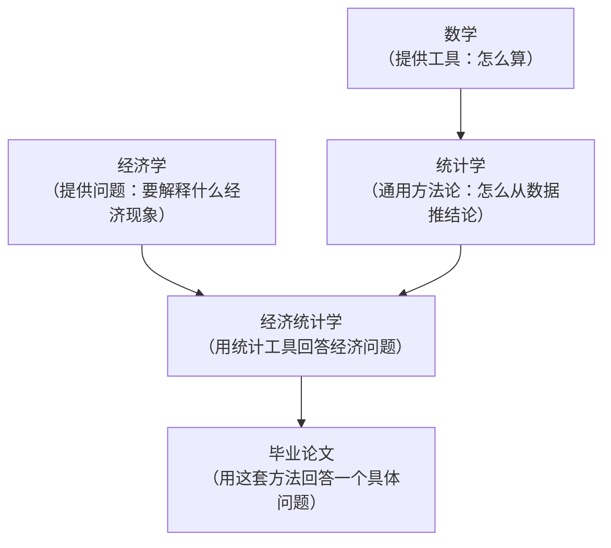

# 01 经济统计学到底是学什么的？

## 一、为什么要学这个？

**生活里的真实场景：**

你刷到一条新闻："研究发现，每天喝咖啡的人寿命更长。"

你的第一反应是什么？
- A："太好了，我多喝咖啡延寿。"
- B："真的假的，不会是咖啡商的广告吧？"
- C："等等，喝咖啡的人本来就更有钱、更有时间健身，是咖啡延寿还是钱延寿？"

**选 C 的人，已经具备统计思维了。**

经济统计学，就是教你从"喝咖啡的人寿命更长"这堆数据里，**判断**：
- 这是真的吗？（不是巧合？）
- 是咖啡导致长寿，还是别的原因？（因果还是相关？）
- 我能不能用它预测自己能活多久？（能不能预测？）
- 这个结论对别人成立吗？（对中国人、对穷人、对老年人一样吗？）

**不学会怎样？**
- 看新闻只会被标题党忽悠；
- 写论文时导师问"你这结果显著吗"，你一脸懵；
- 毕设答辩时被问"你为什么用这个模型"，你答"网上都这么用"。

---

## 二、是什么？（先打比方）

**想象你是一个侦探。**

- **数据** = 案发现场的脚印、指纹、监控录像；
- **描述统计** = 先把现场描述清楚："3 个脚印、2 枚指纹、监控显示 23:17 有人进出"；
- **相关分析** = 发现"脚印大的人，指纹也更清晰"——但你不知道这俩是不是同一个人；
- **回归分析** = 你想知道"如果这个人身高 180，他的脚大概多大"——从脚印推身高；
- **因果推断（内生性那章）** = 你想搞清楚"是他杀了人，还是他只是路过"——这是最难的；
- **预测（时间序列那章）** = 你想根据过去 10 年的案发规律，预测下次案发时间；
- **综合评价（第 7 章）** = 你想给全国 300 个城市的"宜居程度"打分排名。

**经济统计学** = 用数据当线索，回答经济问题的一整套侦探工具。

它**不是**让你当数学家。它是让你当一个"会用数据说话的经济侦探"。

---

## 三、严格定义（看完比喻再看这个）

> **经济统计学**：是一门收集、整理、分析经济数据，并据此对经济现象做出推断、预测和评价的方法论学科。

拆开看四个动词：

| 动词 | 对应章节 | 干什么 |
|------|----------|--------|
| 收集 | 02 描述统计 | [[03_数据从哪来|数据从哪来]]？统计局？问卷？爬虫？ |
| 整理 | 02 描述统计 | 脏数据怎么洗？缺失值怎么办？ |
| 分析 | 03~09 | 用模型找规律（回归、时序、降维……） |
| 推断/预测/评价 | 10~12 | 从[[../../教材笔记/05_统计学原理/06_抽样与参数估计/知识点/KP02_总体与样本|样本]]推[[../../教材笔记/05_统计学原理/01_绪论/知识点/KP01_统计总体与总体单位|总体]]、预测未来、给对象打分 |

---

## 四、它和"经济学""数学""统计学"什么关系？



- **数学**是工具的工具——你只要会用，不需要会造；
- **统计学**是通用方法论——医学、社会学都用同一套回归；
- **经济学**告诉你"该问什么问题"——比如"教育能不能提高工资"是经济学问题，"吃药能不能治病"是医学问题；
- **经济统计学** = 用统计工具，回答经济学问题。

---

## 五、一个完整的数字例子（先感受一下）

**问题**：想知道"上一年学，工资涨多少"。

**我们有 5 个人的数据**：

| 人 | 受教育年限 X（年） | 月工资 Y（元） |
|----|------|------|
| 张三 | 9 | 3000 |
| 李四 | 12 | 4500 |
| 王五 | 12 | 5000 |
| 赵六 | 16 | 7000 |
| 钱七 | 19 | 8500 |

**第一步：画个图（散点图）**

把这 5 个点画在坐标纸上，你会发现它们**大概在一条直线上**。

**第二步：用一条直线去"贴合"这些点**

我们猜真实世界满足：
$$Y = a + b X$$

意思是：工资 = 一个基础工资 a + 每年教育带来的涨薪 b × 受教育年限。

**第三步：用后面第 3 章会教你的 [[04_OLS截距和拟合值|OLS]] 方法，算出来**

$$\hat{a} \approx -1200, \quad \hat{b} \approx 500$$

（先别管怎么算的，第 3 章会手推给你看。）

**第四步：解释结果**

- $\hat{b} = 500$：**每多上一年学，月工资平均涨 500 元**。
- $\hat{a} = -1200$：这个数本身没啥意义——它是"0 年教育时的工资"，现实中没人是 0 年教育，负数只说明这条直线在 X=0 附近不准。

**第五步：我们能说"上学导致涨工资"吗？**

**不能。**

因为：爱学习的人本来就更自律，自律的人本来工资就高。
你看到的"上学→涨工资"，可能混着"自律→既爱上学又涨工资"。

这个"到底谁导致谁"的问题，就是第 5 章要解决的内生性。

---

## 六、什么时候用经济统计学？

当你遇到下面任何一种问题，就该想到它：

- "A 和 B 有没有关系？"（相关分析）
- "A 变化 1 单位，B 平均变多少？"（回归）
- "这个结论靠谱吗？是不是巧合？"（[[KP02_假设检验|假设检验]]）
- "明年 GDP 大概多少？"（时间序列预测）
- "31 个省份谁综合发展得最好？"（综合评价）
- "这两组人真的不一样吗？"（假设检验、均值比较）

---

## 七、什么时候不能用？（易错点）

1. **样本太少别乱说话**。你问了身边 3 个同学"上研工资涨了吗"，3 个人都说涨了——这不能说明读研有用，样本太小。
2. **相关 ≠ 因果**。冰淇淋销量和溺水人数高度相关，但不是冰淇淋导致溺水——是夏天来了。
3. **数据是假的别硬算**。问卷是瞎填的、统计局口径变了——模型再漂亮也是垃圾进垃圾出。
4. **别用相关去预测极端值**。你用 18~22 岁的数据估的"教育回报率"，不能推到"读到博士 22 年"——那是外推，很危险。

---

## 八、Stata / R 代码长什么样？（先看个热闹）

后面会教你写，这里先看一眼，消除恐惧：

```stata
-- Stata：上面那个 5 人例子
clear
input edu wage
9 3000
12 4500
12 5000
16 7000
19 8500
end

reg wage edu   // 就这一行：让 Stata 帮我们算 a 和 b
```

```r
# R：同样的事
edu <- c(9, 12, 12, 16, 19)
wage <- c(3000, 4500, 5000, 7000, 8500)
lm(wage ~ edu)   # 就这一行
```

**你看，真正干活的命令就一行。**
后面所有章节，本质上都是在教你：这一行命令背后是什么、什么时候能用、输出怎么读、什么时候结果是错的。

---

## 九、和别的学科对比

| 你想问的 | 去问谁 | 用什么工具 |
|----------|--------|-----------|
| 人为什么要上学？ | 教育学/哲学 | 不用统计 |
| 上学能涨多少工资？ | **劳动经济学 + 经济统计** | **回归** |
| 工资分布长什么样？ | 描述统计 | 均值/中位数/画图 |
| 明年最低工资会调多少？ | 宏观 + 时间序列 | [[05_ARIMA建模流程|ARIMA]] |
| 哪个城市最适合就业？ | 区域经济 + 综合评价 | [[05_TOPSIS法|TOPSIS]]/[[06_熵值法-TOPSIS组合|熵值法]] |

---

## 十、速记卡

> **经济统计学 = 用数据回答经济问题的侦探工具箱。**
> 它不要求你当数学家，只要求你：会选工具、会读结果、会识别工具在骗你。
> 记住第一原则：**相关 ≠ 因果，样本 ≠ 总体，垃圾进 = 垃圾出。**

---

下一篇：[[02_毕业论文到底长什么样]]
