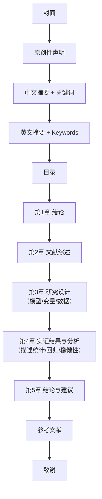

# 02 毕业论文到底长什么样？

## 一、为什么要学这个？

**生活里的真实痛点：**

你导师跟你说："这周把论文初稿给我。"

你打开 Word，新建空白文档，光标闪了十分钟，一个字也打不出来。

不是你不会写，是你**根本不知道一篇论文长什么样**。你脑子里只有"写作文"的印象——开头点题、中间叙事、结尾升华。但毕业论文不是作文，它有一套**固定到近乎刻板的零件清单**。

就像你第一次去宜家组装柜子：不知道要装成什么样，对着一堆螺丝木板当然发呆。

**这一节就是给你看成品照片。** 先把"一篇本科毕业论文从封面到致谢到底有哪些零件"看清楚，后面每学一个方法，你都知道"哦，这是要装在论文哪个位置的"。

**不学会怎样？**
- 写出来的东西像课程作业，没有"绪论—文献—实证—结论"的骨架；
- 摘要写成"本文探讨了……具有重要意义"这种空话；
- 被导师打回时，你不知道该补哪一段，只能全篇重写。

---

## 二、是什么？

### 生活比喻：论文就是一份"侦探调查报告"

回想你看过的刑侦剧，一份完整的卷宗长什么样：

1. **封面**：案号、案件名称、办案人；
2. **原创性声明**：这案子是我自己查的，没抄别人；
3. **摘要**：一页纸说清"我查了啥、怎么查的、发现了啥、建议啥"；
4. **目录**：卷宗页码索引；
5. **绪论**：为什么这个案子值得查？现在谁在关心？
6. **文献综述**：别人之前查过哪些类似案子？他们查到哪了？我接着查什么？
7. **实证分析**：我拿到了什么证据、用什么方法分析、证据指向什么结论；
8. **结论与建议**：凶手是谁？以后怎么防？
9. **参考文献**：我参考了哪些卷宗和资料；
10. **致谢**：谢谢警察队长、线人、我妈。

**毕业论文 = 一份用数据当证据的侦探调查报告。**

---

## 三、每个零件长什么样？（反面教材 vs 正面教材）

下面逐零件对比。左边是"小白常写的反面"，右边是"导师想看到的正面"。

### 零件 1：封面

| 反面教材 | 正面教材 |
|----------|----------|
| 就打个标题"我的毕业论文" | 学校统一模板：题目、学院、专业、姓名、学号、指导教师、提交日期，一行不差 |

**要点**：封面一个字都别自己设计，用学校发的模板。题目写清楚，别写"关于经济的一些思考"这种废话。

### 零件 2：原创性声明

| 反面教材 | 正面教材 |
|----------|----------|
| 不写，或者写"本文全是原创" | 照模板抄："本人郑重声明：所呈交的学位论文，是本人在导师指导下，独立进行研究工作所取得的成果……"末尾手写签名+日期 |

**要点**：这是法律文件，不是走过场。签名要手写。

### 零件 3：摘要（中英文）

| 反面教材 | 正面教材 |
|----------|----------|
| "随着经济的发展，中小企业的融资问题日益受到关注。本文对此进行了研究，具有重要的理论和现实意义。" | "本文以 2015—2022 年我国 31 个省份的面板数据为样本，采用双向[[KP01_固定效应模型|固定效应模型]]，研究数字普惠金融对城乡收入差距的影响。结果表明：数字普惠金融指数每提高 1%，城乡收入差距缩小约 0.32%，该结论在更换变量度量方式后依然稳健。本文建议……" |

**摘要四要素**（一个都不能少）：
1. **研究了什么问题**（一句话）；
2. **用了什么数据和方法**（样本期间、样本量、模型）；
3. **发现了什么**（具体数字，别写"具有重要意义"）；
4. **建议了什么**（一两条）。

**常见坑**：摘要里不出现具体数字，全是"具有重要意义"——导师一眼就知道你没做实证。

### 零件 4：目录

| 反面教材 | 正面教材 |
|----------|----------|
| 手动打目录，页码全错 | 用 Word 自动生成：章节标题设"标题1/标题2"样式，引用→目录→自动目录，一键更新 |

### 零件 5：绪论（第 1 章）

| 反面教材 | 正面教材 |
|----------|----------|
| 从"改革开放以来，我国经济飞速发展"写起，写三页还没说清自己要研究啥 | 分四节：1.1 研究背景（为什么这个问题现在值得研究）；1.2 研究意义（理论+现实，各一段）；1.3 研究内容与框架（画一张技术路线图）；1.4 可能的创新点（谦虚说一两处，别吹） |

**绪论的作用**：告诉审稿人"我为什么要写这篇论文"。别从盘古开天地写起。

### 零件 6：文献综述（第 2 章）

| 反面教材 | 正面教材 |
|----------|----------|
| "张三（2018）认为……李四（2019）认为……王五（2020）认为……"罗列十几篇，像报菜名 | 按主题分类综述：(一) 关于 A 的研究；(二) 关于 B 的研究；(三) 文献评述——"现有研究多关注 X，较少关注 Y，本文的边际贡献是……" |

**文献综述的灵魂是最后那段"评述"**：你要说出"别人还没做什么"，那就是你的论文位置。

### 零件 7：实证分析（第 3、4 章，核心）

| 反面教材 | 正面教材 |
|----------|----------|
| 直接甩一个回归表，一句话"结果如表1所示" | 标准流程：3.1 模型设定（写方程 $Y=\beta_0+\beta_1 X+\varepsilon$）；3.2 变量说明（自变量、因变量、控制变量，做一张变量定义表）；3.3 数据来源（哪年到哪年、多少样本、从哪找的）；3.4 描述性统计（均值、标准差、最大最小）；3.5 基准回归结果；3.6 [[06_稳健性检验|稳健性检验]]（换个方法再跑一遍，结论不变）；3.7 异质性分析（分样本看，比如分东中西部） |

**实证章节是论文的心脏。** 后面第 10、12 章会手把手教你每个小节怎么写。

### 零件 8：结论与建议（第 5 章）

| 反面教材 | 正面教材 |
|----------|----------|
| "综上所述，本文研究了 X 对 Y 的影响，发现 X 对 Y 有影响，应进一步加强研究。" | 5.1 主要结论（把实证发现用 3-5 条大白话重述一遍，别重复公式）；5.2 政策建议（针对结论提 2-3 条具体建议，别写"国家应高度重视"）；5.3 研究不足与展望（谦虚说数据、方法上的局限） |

### 零件 9：参考文献

| 反面教材 | 正面教材 |
|----------|----------|
| 格式乱七八糟：有的写书名，有的写网址，有的作者名字顺序乱 | 按学校要求（通常是 GB/T 7714）统一格式：期刊 `作者. 题名[J]. 刊名, 年, 卷(期): 起止页码.`；专著 `作者. 书名[M]. 版本. 出版地: 出版社, 年.`；正文里引用处标 `(张三, 2018)`，文末对应 |

### 零件 10：致谢

| 反面教材 | 正面教材 |
|----------|----------|
| 写半页抒情诗，"时光荏苒，岁月如梭……" | 三段：谢导师（具体说导师帮了你啥）、谢同学家人、简短收尾。别抄网上模板，导师一眼能认出来。 |

---

## 四、一篇论文的零件清单图



**字数分配参考**（本科 8000—12000 字）：绪论 15%、文献 20%、研究设计 10%、实证 35%、结论 10%、摘要+其他 10%。

---

## 五、一个完整数字例子（感受一下实证部分的表格长啥样）

下面这张表就是你论文里最常见的"基准回归结果表"，先混个脸熟，第 3 章会教你怎么跑出来：

| 变量 | 系数 | 标准误 | t 值 | p 值 |
|------|------|--------|------|------|
| 数字普惠金融指数 | -0.321*** | 0.085 | -3.78 | 0.000 |
| 人均 GDP（对数） | 0.105** | 0.048 | 2.19 | 0.029 |
| 城镇化率 | -0.218*** | 0.062 | -3.52 | 0.001 |
| 常数项 | 1.245*** | 0.312 | 3.99 | 0.000 |
| 样本量 | 248 | | | |
| R² | 0.612 | | | |

**怎么读这张表**：
- `***` 表示 p<0.01，`**` 表示 p<0.05，`*` 表示 p<0.1——星越多越显著；
- 第一行系数 -0.321：数字普惠金融指数每升 1 单位，城乡收入差距缩小 0.321 单位；
- R²=0.612：模型解释了 61.2% 的收入差距变动。

这些数字怎么来的？第 3 章手推给你看。

---

## 六、什么时候用这个结构？

只要是**本科毕业论文**，不管你写经济学、管理学、社会学还是金融，这个骨架都适用。区别只是：
- 文科类：文献综述和绪论占比更大，实证改成"案例分析"；
- 理科类：实证换成"实验设计+结果"；
- 经济统计类：就是上面这张骨架，实证是重头戏。

---

## 七、什么时候不能用？（易错点）

1. **别把摘要写成绪论缩写**。摘要是全文读完后的浓缩，不是引言扩写。
2. **文献综述别写成"流水账"**。最忌讳"张三说……李四说……王五说……"——你要分类、要评述、要找出空白。
3. **实证别只放一个回归表就完事**。至少要有：描述性统计、基准回归、稳健性检验（换变量或换方法再跑一次）、异质性分析（分样本）。
4. **结论别写"本文研究了 X 对 Y 的影响，发现 X 对 Y 有影响"**——这是废话。要写出具体方向、大小、适用条件。
5. **参考文献别造假**。没读过的文献别列进去，答辩时老师会翻。

---

## 八、工具代码：用 Word 自动生成目录

```python
# 这不是真正的 Python 代码，是给你看 Word 操作步骤的伪代码
# 步骤：
# 1. 选中"第1章 绪论"，在"开始"选项卡点"标题1"样式
# 2. 选中"1.1 研究背景"，点"标题2"样式
# 3. 所有章节都这样设好样式
# 4. 光标放到目录页，点"引用"→"目录"→"自动目录1"
# 5. 以后改了内容，右键目录→"更新域"→"更新整个目录"
```

Stata 这边，你论文里所有回归表都是这样一行命令跑出来的：

```stata
reg 收入差距 数字普惠金融 人均GDP 城镇化率   // 跑回归
estimates store m1                          // 存成模型1
outreg2 using 回归结果.doc, replace excel    // 导出到 Word 三线表
```

---

## 九、和"课程作业""期刊论文"对比

| 维度 | 课程作业 | 本科毕业论文 | 核心期刊论文 |
|------|----------|--------------|--------------|
| 字数 | 2000-3000 | 8000-15000 | 8000-15000 |
| 结构 | 自由 | 固定十零件 | 固定但更紧凑 |
| 文献 | 5-10 篇 | 20-40 篇 | 50+ 篇 |
| 实证 | 可以没有 | 必须有 | 必须有+稳健性+内生性 |
| 创新点 | 不要求 | 提一两点即可 | 必须明确贡献 |
| 读者 | 老师 | 导师+答辩组 | 同行审稿人 |

**你现在的目标**：先达到"本科毕业论文"这一栏就行，别一上来对标核心期刊，会把自己逼死。

---

## 十、速记卡

> **毕业论文 = 封面 + 声明 + 摘要 + 目录 + 绪论 + 文献 + 研究设计 + 实证 + 结论 + 参考 + 致谢。**
> 心脏是实证：模型→变量→数据→描述统计→回归→稳健性。
> 摘要必须有具体数字，文献综述必须有"评述"，结论必须说人话。
> 不知道写哪一段，就翻这张图对照。

---

⬅️ 上一篇：[[01_经济统计学到底是学什么的|经济统计学到底是学什么的]]
下一篇：[[03_数学要补到什么程度]]

📚 配套原书：[[../../原文件/统计学原理/韩兆洲_统计学原理第7版_全书|韩兆洲《统计学原理（第7版）》]]
