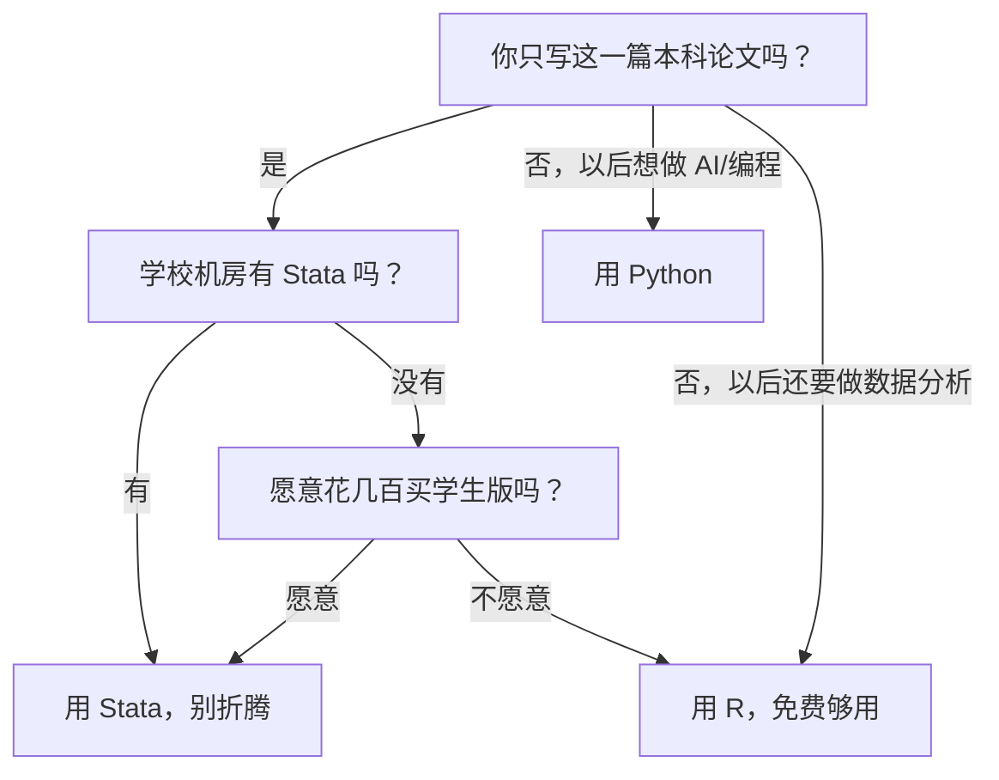

# 04 工具准备：Stata / R / Python 装哪个？

## 一、为什么要学这个？

**生活里的真实痛点：**

你决定写论文了，打开搜索引擎输入"回归分析用什么软件"，搜到的答案是：

- "Stata 是经管论文的金标准，必须用！"
- "R 免费强大，我大 R 万岁！"
- "Python 是未来趋势，学 R 过时了！"

你懵了：三个都学？时间不够。只学一个？万一选错呢？

**这一节就是帮你做决策。** 三个软件都装也行，但你要知道：先学哪个、为什么、怎么打开第一份数据、怎么保存。

**不学会怎样？**
- 论文交了，结果是用 Excel 拖出来的，导师问"你用什么软件跑的回归"，你说"Excel"，气氛凝固；
- 装个 R 装了三天，还在和依赖包作斗争，论文一个字没写；
- 用了一堆截图，表格格式歪歪扭扭，被打回重排。

---

## 二、是什么？

### 生活比喻：三个软件就是三种交通工具

| 软件 | 像什么 | 特点 |
|------|--------|------|
| **Stata** | 出租车 | 上车说目的地就走，司机熟门熟路；贵，但经管论文圈默认它 |
| **R** | 自行车 | 免费、健康、灵活，但刚开始骑会摔；骑熟了比出租车还自由 |
| **Python** | 自己买车 DIY | 什么都能改，生态最大；但要自己装配件、自己修车，学习曲线最陡 |

**结论**：
- 你只写一篇本科论文、学校机房有 Stata → **用 Stata，最快最稳**；
- 你想以后还做数据分析、预算买软件 → **学 R**；
- 你以后想做程序员/AI/爬虫 → **学 Python**。

**对本科论文来说，Stata 性价比最高。** 下面三个都教你装，但默认推荐先把 Stata 用熟。

---

## 三、三个软件对比

| 维度 | Stata | R | Python |
|------|-------|---|--------|
| 价格 | 收费（学校机房一般有/学生版几百元） | 完全免费 | 完全免费 |
| 学习难度 | ⭐ 最简单 | ⭐⭐ 中等 | ⭐⭐⭐ 较陡 |
| 经管论文认可度 | ⭐⭐⭐⭐⭐ 默认 | ⭐⭐⭐⭐ 越来越多 | ⭐⭐⭐ 理工科多 |
| 出表美观度 | 极好（`outreg2` 一键三线表） | 好（`stargazer`） | 一般，要折腾 |
| 代码可重复性 | 好（do 文件） | 极好（R Markdown） | 极好（Jupyter） |
| 适合谁 | 只写论文、不想折腾的经管学生 | 想长期学数据分析的 | 想做 AI/爬虫/工程的 |
| 国内教程资源 | 多（连玉君系列） | 多（浙大、人大网课） | 极多 |

**怎么选（决策树）**：



---

## 四、Stata 怎么用（重点推荐）

### 4.1 怎么获取

- **学校机房**：去机房上机，开始菜单找 Stata，直接用；
- **学生版**：Stata 官网买学生版（Stata/SE 学生价约几百元/年），或者找学校购买的教育版账号；
- **不要用盗版**：答辩时老师可能问你用的什么版本，盗版有风险。

### 4.2 界面长什么样

打开 Stata，你会看到四个窗口：

```
+-----------------------+-------------------+
|  Review（你做过的命令） |  Variables（变量列表）|
+-----------------------+-------------------+
|  Command（你在这里输命令）                    |
+---------------------------------------------+
|  Results（结果输出在这里）                    |
+---------------------------------------------+
```

### 4.3 怎么写 do 文件（重要！）

**do 文件 = 你的代码笔记本**。不要直接在 Command 窗口里一行一行敲——那样关掉就没了。

正确做法：
1. 点菜单 `Window → Do-file Editor → New Do-file Editor`（或按 Ctrl+9）；
2. 在弹出的编辑窗口里写代码；
3. 写几行就点 `Tools → Do`（或按 Ctrl+D）运行；
4. 写完保存为 `myanalysis.do`。

**为什么用 do 文件**：
- 代码全部留档，答辩时老师问"你怎么跑的"，你把 do 文件打开给他看；
- 改一个参数不用重写全部，改一行重新 Do 就行；
- 换一台电脑，把 do 文件和数据文件拷过去就能复现。

### 4.4 怎么打开数据、保存数据

```stata
-- 1. 设置工作路径（改成你自己的文件夹）
cd "/Users/wangpengcheng/Desktop/论文数据"

-- 2. 打开一个 Stata 数据文件（.dta 格式）
use "gdp_data.dta", clear

-- 3. 如果是 Excel 文件，先导入
import excel "gdp_data.xlsx", firstrow clear

-- 4. 做一些操作后，另存为新的 .dta
save "gdp_cleaned.dta", replace

-- 5. 看一下数据长什么样
list in 1/10        // 看前 10 行
summarize           // 看每个变量的均值、标准差
```

### 4.5 跑一个完整回归（感受一下）

```stata
-- 清内存
clear all

-- 设置路径
cd "/Users/wangpengcheng/Desktop/论文数据"

-- 导入数据
import excel "panel_data.xlsx", firstrow clear

-- 看变量
describe

-- 描述性统计
summarize wage edu exp

-- 跑 OLS 回归：工资 = 常数 + 教育 + 工龄
reg wage edu exp

-- 导出回归结果到 Word
outreg2 using "回归结果.doc", replace tstat
```

**你看，从打开数据到出回归表，核心就 5 行命令。**

---

## 五、R 怎么装（免费替代）

### 5.1 安装步骤（macOS）

```bash
# 第 1 步：先装 R 本体
# 浏览器打开 https://cran.r-project.org/bin/macosx/
# 下载最新版 R-x.xx.x.pkg，双击安装

# 第 2 步：装 RStudio（写代码的编辑器，强烈推荐）
# 浏览器打开 https://posit.co/download/rstudio-desktop/
# 下载 RStudio Desktop 免费版，双击安装

# 第 3 步：打开 RStudio，在 Console 里装常用包
# install.packages(c("tidyverse", "haven", "stargazer"))
```

### 5.2 R 的第一份代码

```r
# 设置工作路径
setwd("/Users/wangpengcheng/Desktop/论文数据")

# 读数据
data <- read.csv("panel_data.csv")

# 看前几行
head(data)

# 描述统计
summary(data)

# 跑回归
model <- lm(wage ~ edu + exp, data = data)
summary(model)

# 导出三线表
stargazer(model, out = "回归结果.doc")
```

---

## 六、Python 怎么装（Anaconda）

### 6.1 安装步骤（macOS）

```bash
# 第 1 步：装 Homebrew（如果没装过）
# 浏览器打开 https://brew.sh，复制那行命令到终端执行

# 第 2 步：用 brew 装 anaconda（或者去官网下载 pkg 包双击安装）
brew install --cask anaconda

# 第 3 步：打开终端，验证
python3 --version
# 应输出 Python 3.x.x
```

**更稳妥的方式**：直接去 Anaconda 官网下载 macOS 安装包，双击一路下一步。装完后打开"Anaconda Navigator"，点 Jupyter Notebook 就能写代码。

### 6.2 Python 的第一份代码

```python
# 导入工具包
import pandas as pd
import statsmodels.api as sm

# 读数据
data = pd.read_csv("panel_data.csv")

# 看前几行
print(data.head())

# 描述统计
print(data.describe())

# 跑回归
X = data'edu', 'exp'
X = sm.add_constant(X)   # 加常数项
y = data['wage']
model = sm.OLS(y, X).fit()
print(model.summary())
```

---

## 七、一个完整数字例子（三个软件跑同一个结果）

我们用第 1 节那个 5 人数据：

| edu | wage |
|-----|------|
| 9 | 3000 |
| 12 | 4500 |
| 12 | 5000 |
| 16 | 7000 |
| 19 | 8500 |

**Stata**：
```stata
clear
input edu wage
9 3000
12 4500
12 5000
16 7000
19 8500
end
reg wage edu
```

**R**：
```r
edu <- c(9, 12, 12, 16, 19)
wage <- c(3000, 4500, 5000, 7000, 8500)
lm(wage ~ edu)
```

**Python**：
```python
import pandas as pd
import statsmodels.api as sm
df = pd.DataFrame({'edu':[9,12,12,16,19], 'wage':[3000,4500,5000,7000,8500]})
X = sm.add_constant(df'edu')
sm.OLS(df['wage'], X).fit().summary()
```

**三个软件跑出来的系数完全一样**：截距约 -1200，斜率约 500。软件只是工具，结果是数学决定的。

---

## 八、什么时候用哪个？

- **本科毕业论文、经管学院**：Stata 首选，导师熟、出表好看、圈子默认；
- **数据要清洗、要爬网页、要画图**：Python 顺手；
- **做文本分析、地图可视化、用最新的统计算法包**：R 包最全；
- **答辩现场演示**：Stata 最稳，不容易出幺蛾子。

---

## 九、什么时候不能用？（易错点）

1. **别直接在 Command 窗口敲代码**。一定要写 do 文件/脚本，否则关掉就没了，没法复现。
2. **别不设工作路径**。每次开 Stata/R，第一件事 `cd` 到你的论文文件夹，否则文件到处都是。
3. **别用 Excel 做回归**。Excel 的"数据分析工具库"能跑 [[04_OLS截距和拟合值|OLS]]，但出表丑、没法做[[06_稳健性检验|稳健性检验]]、没法做面板模型。论文级实证必须用 Stata/R/Python。
4. **别装一堆没用的包**。R 和 Python 新手最爱 `install.packages` 装一堆，最后依赖冲突。只装当前任务需要的。
5. **别把数据和代码混在一起**。建议文件夹结构：
   ```
   论文项目/
   ├── data/          # 原始数据（只读）
   │   ├── raw/       # 从统计局下载的原始文件
   │   └── clean/     # 清洗后的数据
   ├── code/          # do 文件、R 脚本、Python 脚本
   ├── output/        # 回归表、图
   └── paper/         # Word 论文
   ```

---

## 十、和"用 Excel 拖一拖"对比

| 维度 | Excel | Stata/R/Python |
|------|-------|----------------|
| 跑 OLS | 能（数据分析库） | 能，一行命令 |
| 面板[[06_固定效应FE|固定效应]] | 不能 | 能 |
| [[03_工具变量IV|工具变量]] IV/2[[04_两阶段最小二乘2SLS|SLS]] | 不能 | 能 |
| Logit/Probit | 不能 | 能 |
| 导出三线表 | 手动调格式 | 一行命令 |
| 可复现性 | 无，点了啥不知道 | 代码全留档 |
| 样本量上限 | 百万行就卡 | 百万行轻松 |

**本科论文里只要出现"面板数据""工具变量""Logit"任何一个词，就必须用 Stata/R，Excel 救不了你。**

---

## 十一、速记卡

> **只写一篇论文 → Stata（学校机房有就用它）；免费长期学 → R；想做 AI/编程 → Python。**
> 永远用 do 文件/脚本写代码，别在命令窗口直接敲。
> 第一件事设工作路径，文件夹分 data/code/output/paper。
> 核心命令就一行：`reg y x`（Stata）/ `lm(y~x)`（R）/ `OLS(y,X).fit()`（Python）。
> 三个软件跑同一个数据，结果一模一样——软件是工具，数学是本体。

---

## 💡 经济学视角：Stata / R 是实证经济学家的"手术刀"

**这个方法是为了解决什么经济学问题？**
19 世纪经济学家靠写信争论，20 世纪 80 年代之前靠计算器和手写表格，到了 90 年代，微观数据（CHIP、CFPS、CGSS）一出来，动辄几万户、几十年、几百个变量——手算根本不可能。Stata 1985 年发布、R 1993 年发布，它们的出现正好赶上"实证经济学革命"：以前一篇文章能聊一个理论，现在一篇文章能跑 50 个回归表。今天你在《经济研究》《经济学（季刊）》看到的论文，90% 以上是 Stata 或 R 跑出来的。不会这把刀，你连别人在说啥都看不懂。

**经济学里哪些经典实证全靠这些工具跑出来？**

| 经典研究 | 用的工具 | 干了什么 |
|---|---|---|
| Card & Krueger 最低工资 | Stata | 跑双重差分 DID |
| 明瑟工资方程 | 任何回归软件 | 工资对教育年限回归 |
| 索洛增长核算 | R / Stata | 跨国面板回归 |
| 健康与财富回报 | R + 大数据清洗 | CFPS 追踪数据处理 |

**举个实证论文的例子：**
《普惠金融对家庭创业的影响——基于 CHFS 2019 数据》用 Stata 跑 Probit 模型，控制家庭收入、年龄、教育等变量后，发现"使用移动支付"让家庭创业概率提高 4.2 个百分点。整个过程：读数据 5 行、跑回归 1 行、出三线表 1 行——手术刀三刀就把结果切出来了。

**📚 配套经济学笔记：**
- [[../../教材笔记/06_西方经济学/00_导论/知识点/KP03_实证分析与规范分析|原KP·实证分析与规范分析]]

---

⬅️ 上一篇：[[03_数学要补到什么程度|数学要补到什么程度]]
下一篇：[[05_学习路线图]]

📚 配套原书：[[../../原文件/统计学原理/韩兆洲_统计学原理第7版_全书|韩兆洲《统计学原理（第7版）》]]
