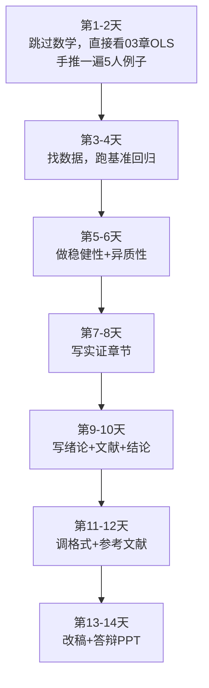

# 05 学习路线图：16 周从 0 到毕业论文

## 一、为什么要学这个？

**生活里的真实痛点：**

你打开这本教程，看到 12 个文件夹、几十节内容，第一反应是：

"这么多，我什么时候学得完？"

然后你做了一个最常见的错误决定：**从第 1 节开始一字不落地读，读到第 3 章就累了，然后弃坑。**

这不是你懒，是你没有路线图。就像旅行——你知道终点是拉萨，但不知道"今天到成都、明天到康定、后天到理塘"，你就会在某个路口迷失。

**这一节给你一张按周排好的地图。** 每周学哪几节、做什么练习、达到什么水平，全部写清楚。照着走就行，不用自己规划。

**不学会怎样？**
- 学着学着忘了前面；
- 该练手的时候还在看理论；
- 到第 14 周才发现数据还没找。

---

## 二、是什么？

### 生活比喻：学这本教程就像健身

- **00 章** = 体检 + 买装备（搞清楚自己几斤几两、装软件）；
- **01 章** = 热身（补数学）；
- **02—09 章** = 正式训练（每章一个肌群）；
- **10—12 章** = 赛前备战（写论文、答辩）。

**16 周计划** = 每周训练什么、练几组、组间休息多久。

---

## 三、16 周完整路线图

### 第 0 周（准备周，3—5 天）

| 任务 | 具体做什么 |
|------|-----------|
| 读 00 章全部 5 节 | 知道经济统计是啥、论文长啥样、数学补到哪、装软件 |
| 装 Stata 或 R | 打开软件，能跑通 `reg wage edu` 那个例子 |
| 建文件夹 | data/code/output/paper 四个子文件夹 |

**周末验收**：能在 Stata/R 里把 5 人数据跑通回归，看到系数 -1200 和 500。

---

### 第 1—2 周：基础数学（01 章）

| 周 | 学哪几节 | 练习 |
|----|----------|------|
| 第 1 周 | 01 函数、02 导数、03 [[03_求和号Σ是什么|求和号]] | 每节后面的手算例题自己算一遍 |
| 第 2 周 | 04 矩阵向量、05 概率、06 期望方差、07 [[07_正态分布|正态分布]]、08 符号速查 | 用 Python 验证一遍期望方差 |

**周末验收**：看到 $\sum_{i=1}^{n}(x_i-\bar{x})^2/n$ 能说出这是方差；看到 $\beta_1$ 知道是斜率。

---

### 第 3—4 周：描述统计（02 章）

| 周 | 学什么 | 练习 |
|----|--------|------|
| 第 3 周 | 数据类型、[[02_集中趋势|集中趋势]]（均值/中位数/众数）、离散趋势（方差/标准差） | 找一份公开数据（如国家统计局 31 省份 GDP），手算均值方差 |
| 第 4 周 | 统计图（直方图/箱线图/散点图）、[[05_数据清洗|数据清洗]]（缺失值/异常值） | 用 Stata/R 画 3 张图，导出到 Word |

**周末验收**：能写一段 200 字的"数据描述"，就像论文里的"描述性统计"小节。

---

### 第 5—7 周：相关与回归（03 章，全书心脏）

| 周 | 学什么 | 练习 |
|----|--------|------|
| 第 5 周 | [[01_相关系数|相关系数]]、[[04_OLS截距和拟合值|OLS]] 手推（用 5 人数据手算一遍 $\hat{\beta}_1$） | 不看答案，手推一遍 OLS |
| 第 6 周 | [[KP03_多元回归Stata|多元回归]]、[[06_拟合优度R²|拟合优度]] R²、t 检验、p 值 | 拿真实数据跑一个二元回归，写结果解读 |
| 第 7 周 | 虚拟变量、对数模型（弹性怎么解释） | 把你的回归结果写成论文里的"基准回归"小节 |

**周末验收**：能对着一张回归表，说出每个系数的方向、大小、显著性。

---

### 第 8—9 周：回归三大问题（04 章）

| 周 | 学什么 | 练习 |
|----|--------|------|
| 第 8 周 | 异方差（检验 + 稳健标准误）、多重共线性 | 给你第 7 周的回归做诊断 |
| 第 9 周 | 自相关、遗漏变量偏误 | 学会用 `estat imtest`、`vif` 这些诊断命令 |

**周末验收**：能给你的回归写一段"稳健性检验"。

---

### 第 10 周：内生性与面板（05 章，选学）

| 学什么 | 练习 |
|--------|------|
| 什么是内生性、工具变量直觉、面板固定效应 | 知道"为什么要做 IV"，不要求手推 |

**周末验收**：能说出"为什么 OLS 可能有偏"，以及"固定效应大概在干嘛"。

> 注：如果你的论文不涉及因果推断，这一周可以跳过，直接看个热闹。

---

### 第 11—12 周：选学一个专题（根据论文题目选）

| 你的论文类型 | 学哪章 |
|--------------|--------|
| 给城市/省份打分排名 | 07 综合评价（熵值法/TOPSIS/AHP） |
| 因变量是"是/否" | 06 受限因变量（Logit/Probit） |
| 变量太多（问卷几十题） | 08 降维与分类（PCA/因子分析） |
| 预测未来（GDP/销量） | 09 时间序列（ARIMA） |

**周末验收**：用你选的方法跑一个完整例子，出一张表。

---

### 第 13 周：论文写作流程（10 章）

| 学什么 | 练习 |
|--------|------|
| 选题、文献怎么找（CNKI/谷歌学术）、数据从哪来 | 定你的论文题目，列 10 篇参考文献 |

**周末验收**：提交一个 200 字的选题报告给导师。

---

### 第 14 周：实证攻坚

| 任务 | 具体做什么 |
|------|-----------|
| 找数据 | 国家统计局、CSMAR、Wind、CNRDS、问卷星 |
| 跑全部回归 | 描述统计、基准回归、稳健性、异质性 |
| 出表出图 | 用 `outreg2`/`stargazer` 导出三线表 |

**周末验收**：实证部分的表格全部就绪，就差填文字。

---

### 第 15 周：写论文初稿

| 任务 | 具体做什么 |
|------|-----------|
| 写绪论+文献 | 各 1500 字 |
| 写实证 | 把第 14 周的表配上文字解读 |
| 写结论+致谢 | 各 500 字 |
| 摘要 | 最后写，200—300 字 |

**周末验收**：8000 字初稿完成，发给导师。

---

### 第 16 周：改稿 + 答辩

| 任务 | 具体做什么 |
|------|-----------|
| 按导师意见改 | 通常改 2—3 轮 |
| 调格式 | 重财格式、三线表、GB/T 7714 参考文献 |
| 准备 PPT | 10—15 页，10 分钟讲完 |
| 答辩演练 | 对着镜子讲三遍，准备 50 个常见问题（12 章有清单） |

**周末验收**：答辩通过。

---

## 四、紧急版路线：2 周速成

如果你只剩两周（比如导师下周就要初稿），按这个压缩版走：



**紧急版取舍原则**：
- ❌ 跳过 01 章基础数学，遇到不懂的符号现查；
- ❌ 跳过 04 章回归三大问题，直接上稳健标准误；
- ❌ 跳过 05—09 章专题，只用 OLS；
- ✅ 保 03 章 OLS（这是心脏）；
- ✅ 保 10、12 章写作和格式；
- ✅ 数据一定要真，别编。

**紧急版的代价**：论文深度不够，只能求"通过"，不能求"优秀"。

---

## 五、每周时间投入建议

| 阶段 | 每周投入 | 说明 |
|------|----------|------|
| 第 0—2 周 | 8—10 小时 | 数学热身，重在手感 |
| 第 3—4 周 | 8 小时 | 描述统计，上手软件 |
| 第 5—7 周 | 12 小时 | OLS 是核心，多花时间 |
| 第 8—10 周 | 8 小时 | 诊断和专题，能懂就行 |
| 第 11—12 周 | 8 小时 | 选学专题，选一个深挖 |
| 第 13—16 周 | 15—20 小时 | 写论文阶段，冲刺 |

**总计约 140—160 小时**。按每天 2 小时算，刚好 16 周。

---

## 六、什么时候用这个路线？

- 学期刚开始、有完整 4 个月 → 走 16 周完整版；
- 只剩 1 个月 → 跳过 01 章，12 周走完；
- 只剩 2 周 → 走紧急版；
- 已经在写论文了 → 直接跳到 10、12 章。

---

## 七、什么时候不能用？（易错点）

1. **别试图一次学完一章**。01 章有 8 节，你一天硬看 8 节，第二天全忘。按上面节奏，一周 3—4 节刚好。
2. **别光看不练**。每节后面的数字例题，必须拿纸笔算一遍。看懂和会算，差着十万八千里。
3. **别等到"学完所有章节"才开始找数据**。第 5 周就可以开始留意数据来源了，别等到第 14 周发现找不到数据。
4. **别跳过写作环节**。很多人把 02—09 章学完就以为大功告成，结果不会写论文。10、12 章和实证同等重要。
5. **别和别人比进度**。有人数学好，01 章一周过完；你可能要两周。按自己节奏来。

---

## 八、Python 代码（做一个学习进度跟踪表）

```python
# 用一个简单的字典记录每章进度
progress = {
    "00_学前准备": 1.0,      # 1.0 = 100%
    "01_基础数学": 0.25,     # 刚学了函数
    "02_描述统计": 0.0,
    "03_相关与回归": 0.0,
    "04_回归三大问题": 0.0,
    "05_内生性与面板": 0.0,
    "06_受限因变量": 0.0,
    "07_综合评价": 0.0,
    "08_降维与分类": 0.0,
    "09_时间序列": 0.0,
    "10_论文写作": 0.0,
    "11_方法选择": 0.0,
    "12_毕业论文实战": 0.0,
}

# 打印总进度
total = sum(progress.values()) / len(progress)
print(f"总进度：{total*100:.1f}%")
for k, v in progress.items():
    bar = "█" * int(v*20) + "░" * (20-int(v*20))
    print(f"{k:20s} {bar} {v*100:5.1f}%")
```

**怎么用**：每周日晚上更新一次这个字典，把本周学完的章节改成 1.0。看着进度条往前走，是最好的正反馈。

---

## 九、和"自学 vs 报班"对比

| 方式 | 优点 | 缺点 | 适合谁 |
|------|------|------|--------|
| 跟着这本教程自学 | 免费、节奏自己定 | 没人答疑、容易放弃 | 自律的人 |
| 学校选课（计量经济学） | 有老师、有作业 | 进度和你论文不一定匹配 | 时间充裕 |
| 网上付费课（连玉君/ econometrics 俱乐部） | 案例多、答疑快 | 花钱 | 自学卡壳的人 |
| 找师兄师姐带 | 直接看他的论文 do 文件 | 欠人情 | 能找到人的话 |

**推荐组合**：这本教程打底 + 学校计量课同步 + 卡壳时搜连玉君 Stata 公开课。

---

## 十、速记卡

> **16 周路线：00 准备 → 01 数学 → 02 描述 → 03 回归（核心）→ 04 诊断 → 05—09 选学 → 10 写作 → 12 实战。**
> 每周 8—12 小时，第 5—7 周 OLS 是心脏，多花时间。
> 2 周紧急版：跳过数学和专题，只保 OLS + 写作。
> 每节例题必须手算，别光看。
> 第 5 周就开始找数据，别拖到最后。

---

## 💡 经济学视角：学经济统计，其实是在走一遍"从理论到证据"的完整路径

**这个方法是为了解决什么经济学问题？**
经济学最核心的命题是：资源是稀缺的，所以社会必须回答三个问题——生产什么、怎么生产、为谁生产。但光在书里推导这些问题没意义，最后要落到现实数据上：今天的中国，资源（土地、劳动、资本、数据）到底是怎么配置的？配置得好不好？该不该调？学习路线图的本质，就是让你从"稀缺性"这个原点出发，先学数学（把"边际""总量"算清楚），再学描述统计（看看数据长什么样），再学回归（看一个变量怎么影响另一个），最后学写作（把结论讲给别人听）。这是一条从理论到证据的完整链路。

**经济学知识体系和统计工具的对应关系：**

| 经济学问题 | 对应统计工具 |
|---|---|
| 一个社会有多少资源？ | 国民经济核算（GDP、CPI） |
| 资源配置给了谁？收入差距多大？ | 描述统计、洛伦兹曲线 |
| 教育会不会让人工资更高？ | 明瑟工资方程、回归 |
| 政府投资会不会挤出私人投资？ | 面板回归、Granger 因果 |
| 未来经济会怎么走？ | 时间序列预测 |

**举个实证论文的例子：**
《数字经济对资源错配的改善效应——基于城市面板数据》按这条路线走：先学理论（资源稀缺 + 配置效率），再找数据（数字经济指数、企业全要素生产率），再跑双向固定效应，最后写结论——数字经济发展让城市资源错配程度下降 8%，相当于把原本浪费的资源重新配置到了更高效的企业手里。

**📚 配套经济学笔记：**
- [[../../教材笔记/06_西方经济学/00_导论/知识点/KP01_资源稀缺性与经济学研究对象|原KP·资源稀缺性与经济学研究对象]]

---

⬅️ 上一篇：[[04_工具准备|工具准备]]
下一篇：[[../01_基础数学/README]]

📚 配套原书：[[../../原文件/统计学原理/韩兆洲_统计学原理第7版_全书|韩兆洲《统计学原理（第7版）》]]
