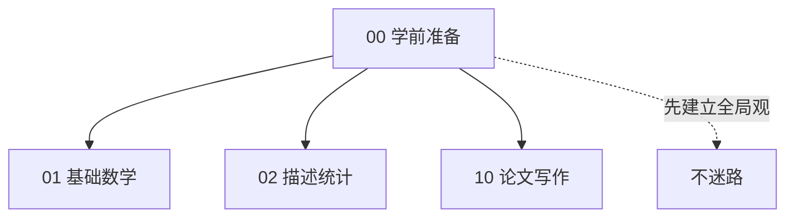

# 00 学前准备

> 别急着学公式。先用半小时搞清楚三件事：
> 1. 经济统计学到底是干嘛的？
> 2. 一篇毕业论文长什么样？
> 3. 我数学烂，到底要补到什么程度才够？

---

## 本章文件

| 文件 | 读完你会 |
|------|----------|
| [01_经济统计学到底是学什么的](01_经济统计学到底是学什么的.md) | 不被"统计"两个字吓住，知道这门课在干嘛 |
| [02_毕业论文到底长什么样](02_毕业论文到底长什么样.md) | 从封面到致谢，一篇论文的完整结构 |
| [03_数学要补到什么程度](03_数学要补到什么程度.md) | 明确告诉你：哪些数学根本不用学，哪些必须会 |
| [04_工具准备](04_工具准备.md) | Stata / R / Python 装哪个、怎么装 |
| [05_学习路线图](05_学习路线图.md) | 按周排好的 16 周学习计划 |

---

## 本章在全书的位置

**为什么先看这一章？**
因为后面 12 章全是工具。你如果不知道"这些工具最后是用来干嘛的"，就会陷入"学了一堆公式但不知道往哪用"的痛苦。
这一章就是给你一张地图，让你每学一个工具都知道"哦，这是地图上那个位置要用的"。

---

## 📖 配套统计学原理（Ch01 绪论）

- [[../../教材笔记/05_统计学原理/01_绪论/知识点/KP01_统计总体与总体单位|统计学原理·总体与总体单位]] — 什么是总体、什么是总体单位
- [[../../教材笔记/05_统计学原理/01_绪论/知识点/KP02_标志与指标|统计学原理·标志与指标]] — 标志（单位特征）vs 指标（总体数量特征）
- [[../../教材笔记/05_统计学原理/01_绪论/知识点/KP03_变异与变量|统计学原理·变异与变量]] — 为什么世界上没有两个完全一样的人
- [[../../教材笔记/05_统计学原理/01_绪论/知识点/KP04_指标体系|统计学原理·指标体系]] — 一个指标不够用，怎么搭一套
- [[../../教材笔记/05_统计学原理/01_绪论/知识点/KP05_统计研究方法与大数定理|统计学原理·统计研究方法与大数定理]] — 统计用哪些方法、为什么样本大了就可靠
- [[../../教材笔记/05_统计学原理/01_绪论/知识点/KP06_统计研究环节|统计学原理·统计研究环节]] — 统计工作的完整流程

---

## 🐣 统计学零基础入门速查

> 第一次接触"统计"两个字？先记住这 6 个词，后面所有章节都是围着它们转。

| 术语 | 一句话小白解释 | 深入了解 |
|------|---------------|----------|
| **总体** | 你真正关心的那一群对象（比如"全国所有大学生"） | [[../../教材笔记/05_统计学原理/01_绪论/知识点/KP01_统计总体与总体单位\|总体与总体单位]] |
| **样本** | 你实际能调查的那一小撮人（比如"随机抽 1000 个大学生"） | [[../../教材笔记/05_统计学原理/06_抽样与参数估计/知识点/KP02_总体与样本\|总体与样本]] |
| **标志** | 每个个体身上的特征（张三身高 175cm——"身高"是标志，175 是标志值） | [[../../教材笔记/05_统计学原理/01_绪论/知识点/KP02_标志与指标\|标志与指标]] |
| **指标** | 把一堆个体汇总后得到的总体数字（"全国大学生平均身高 168cm"） | [[../../教材笔记/05_统计学原理/01_绪论/知识点/KP02_标志与指标\|标志与指标]] |
| **变量** | 会变的那个标志（身高有人 170 有人 180——身高就是变量） | [[../../教材笔记/05_统计学原理/01_绪论/知识点/KP03_变异与变量\|变异与变量]] |
| **变异** | 个体之间为什么不一样（要是所有人都 175cm，统计就失业了） | [[../../教材笔记/05_统计学原理/01_绪论/知识点/KP03_变异与变量\|变异与变量]] |

**一句话串起来**：我们想知道**总体**的某个**指标**，但总体太大查不完，只好抽**样本**，从样本里每个个体的**标志**（也就是**变量**）出发，汇总推断总体——而个体之间的**变异**，正是统计学存在的理由。

---

## 🧭 模块导航

- **✅ 前置知识：** 无（这是全书第一个模块）
- **➡️ 下一篇：** [[../01_基础数学/README|01 基础数学]] —— 开始补后面要用到的数学
- **📚 配套原书：** [[../../原文件/统计学原理/韩兆洲_统计学原理第7版_全书|韩兆洲《统计学原理（第7版）》]]（第一章 绪论）
- **📖 配套教材笔记：** [[../../教材笔记/05_统计学原理/01_绪论/00_章节总结|统计学原理·第一章 绪论]]
