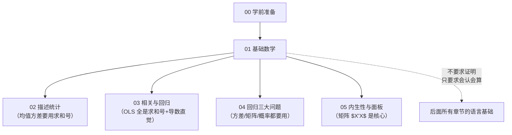
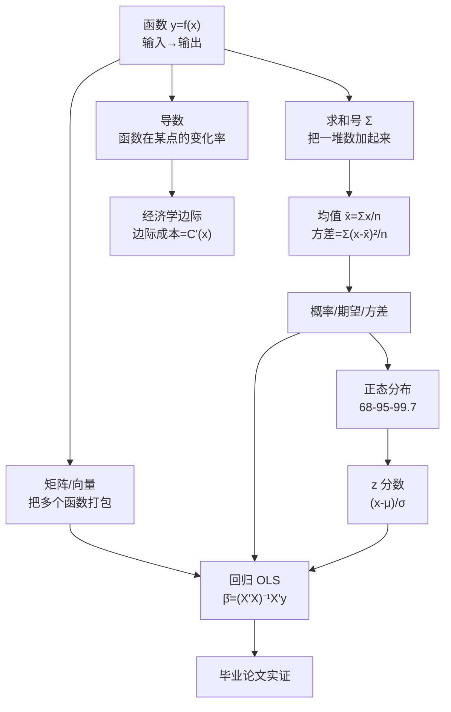

# 01 基础数学

> 别急着学统计。先用两周把"后面真正用得到的数学"补到能上手。
> 这一章不教 ε-δ 极限、不教证明、不教特征值——只教你后面读公式、跑回归时**一定会碰到**的那几块。

---

## 本章文件

| 文件 | 读完你会 |
|------|----------|
| [01_什么是函数](01_什么是函数.md) | 不害怕 $y=f(x)$，知道线性/二次/对数函数长啥样 |
| [02_什么是导数和斜率](02_什么是导数和斜率.md) | 用"开车速度"理解导数，知道"边际=导数" |
| [03_求和号Σ是什么](03_求和号Σ是什么.md) | 看懂 $\sum_{i=1}^n x_i$，会手算一个连加 |
| [04_什么是矩阵和向量](04_什么是矩阵和向量.md) | 把矩阵当 Excel 表看，认得 $X'X$ 是啥 |
| [05_概率是什么](05_概率是什么.md) | 抛硬币讲起，会算条件概率 $P(A|B)$ |
| [06_期望和方差](06_期望和方差.md) | 期望=长期平均，方差=波动大小，能手算 |
| [07_正态分布](07_正态分布.md) | 认识钟形曲线，会用 68-95-99.7 法则和 z 分数 |
| [08_统计学常用符号速查](08_统计学常用符号速查.md) | 一张大表搞定 μ/σ/x̄/β̂/ε/ρ/R²/t/F/p |

---

## 本章在全书的位置

---

## 本章学习心法

### 第一，只补用得到的

上一章（03_[[03_数学要补到什么程度|数学要补到什么程度]]）已经划好了边界：
- **要会算**：初中代数、[[03_求和号Σ是什么|求和号]]、均值方差、代入求导结果、简单概率；
- **要会认**：函数图像、矩阵向量、希腊字母；
- **完全不用**：ε-δ 极限、特征值推导、测度论、各种证明。

**遇到定理证明直接跳过，只记结论。**

### 第二，每个数字都亲手算一遍

这一章每节都有"完整数字例子"。别光看，拿纸笔跟着算。看懂和会算，差着十万八千里。

### 第三，建立"生活比喻库"

- 函数 = 售货机；
- 导数 = 开车瞬时速度；
- 矩阵 = 一张 Excel 表；
- 期望 = 赌场长期平均输赢；
- 方差 = 波动大小；
- [[07_正态分布|正态分布]] = 钟形曲线。

**以后看到公式，先想比喻，再看符号。**

---

## 本章总图：这些数学怎么串起来

**怎么读这张图**：从最左上角"函数"出发，往右/往下看。
- 函数加个"变化率"就成了导数；
- 函数加个"求和"就成了均值方差；
- 函数打包成矩阵，再和概率、正态分布结合，就凑齐了回归 [[04_OLS截距和拟合值|OLS]] 的全部零件；
- 这些零件最后拼起来，就是你论文里的实证模型。

---

## 学完本章你应该达到的水平

看到下面这行公式，你不应该害怕：

$$\hat{\beta}_1 = \frac{\sum_{i=1}^{n}(x_i-\bar{x})(y_i-\bar{y})}{\sum_{i=1}^{n}(x_i-\bar{x})^2}$$

你应该能说出：
- $\sum$ 是求和号；
- $\bar{x}$ 是 x 的均值；
- $\hat{\beta}_1$ 是斜率的估计值；
- 整个公式在算"x 和 y 的协方差除以 x 的方差"；
- 你不需要手推这个公式，但你知道每个符号在干嘛。

达到这个水平，本章就过关了。

---

## 推荐学习顺序和时间

| 周 | 节次 | 时间 |
|----|------|------|
| 第 1 周 | 01 函数、02 导数、03 求和号 | 3—4 小时/节 |
| 第 2 周 | 04 矩阵、05 概率、06 期望方差、07 正态、08 符号速查 | 3 小时/节 |

**两周后**，直接进 02 描述统计。

---

下一篇：[[01_什么是函数]]

---

## 📖 配套统计学原理

> 本章先补数学基础，但后面跑回归、做检验时，你会反复碰到"抽样""估计"这些词。
> 下面按 **抽样概念 → 抽样分布 → 参数估计** 三层分组，先混个脸熟，详细推导见教材笔记。

### 一、抽样概念（先搞清楚"从谁身上抽、怎么抽"）

- [[../../教材笔记/05_统计学原理/06_抽样与参数估计/知识点/KP01_抽样调查与随机原则|统计学原理·抽样调查与随机原则]] — 为什么抽人不能只挑熟人
- [[../../教材笔记/05_统计学原理/06_抽样与参数估计/知识点/KP02_总体与样本|统计学原理·总体与样本]] — 全班 100 人是总体，抽 10 个是样本
- [[../../教材笔记/05_统计学原理/06_抽样与参数估计/知识点/KP03_参数与统计量|统计学原理·参数与统计量]] — μ 是参数（总体真值），x̄ 是统计量（样本算出来的）
- [[../../教材笔记/05_统计学原理/06_抽样与参数估计/知识点/KP04_重复抽样与不重复抽样|统计学原理·重复抽样与不重复抽样]] — 抽完放不放回去，结果差在哪
- [[../../教材笔记/05_统计学原理/06_抽样与参数估计/知识点/KP14_抽样组织形式|统计学原理·抽样组织形式]] — 简单随机、分层、整群、系统抽样怎么选

### 二、抽样分布（样本统计量自己的分布）

- [[../../教材笔记/05_统计学原理/06_抽样与参数估计/知识点/KP05_抽样分布|统计学原理·抽样分布]] — 反复抽样，每次算的 x̄ 都不一样，它们自己也成一个分布
- [[../../教材笔记/05_统计学原理/06_抽样与参数估计/知识点/KP06_样本均值的抽样分布与标准误|统计学原理·标准误]] — 样本均值波动多大？SE = σ/√n
- [[../../教材笔记/05_统计学原理/06_抽样与参数估计/知识点/KP07_中心极限定理|统计学原理·中心极限定理]] — 不管原始数据啥分布，n 大了 x̄ 就近似正态
- [[../../教材笔记/05_统计学原理/06_抽样与参数估计/知识点/KP08_样本成数的抽样分布|统计学原理·样本成数的抽样分布]] — 比例（比如"通过率 80%"）的抽样分布

### 三、参数估计（从样本数字反推总体真值）

- [[../../教材笔记/05_统计学原理/06_抽样与参数估计/知识点/KP09_点估计与优良标准|统计学原理·点估计与优良标准]] — 无偏、有效、一致——什么样的估计量算好
- [[../../教材笔记/05_统计学原理/06_抽样与参数估计/知识点/KP10_区间估计与置信区间|统计学原理·区间估计与置信区间]] — 不说"平均身高 168"，说"165~171，95% 把握"
- [[../../教材笔记/05_统计学原理/06_抽样与参数估计/知识点/KP11_总体均值区间估计|统计学原理·总体均值区间估计]] — 估均值怎么算区间
- [[../../教材笔记/05_统计学原理/06_抽样与参数估计/知识点/KP12_总体成数区间估计|统计学原理·总体成数区间估计]] — 估比例怎么算区间
- [[../../教材笔记/05_统计学原理/06_抽样与参数估计/知识点/KP13_样本量的确定|统计学原理·样本量的确定]] — 想估准一点，至少要抽多少人
- [[../../教材笔记/05_统计学原理/01_绪论/知识点/KP05_统计研究方法与大数定理|统计学原理·大数定理]] — 为什么样本越大越靠谱（和中心极限定理配套）

---

### 🧭 小白先记住这 4 个词

| 概念 | 一句话理解 | 点进去看 |
|------|-----------|----------|
| **抽样分布** | 你反复抽 1000 次样本、算 1000 个 x̄，这些 x̄ 自己排成的"小人群" | [[../../教材笔记/05_统计学原理/06_抽样与参数估计/知识点/KP05_抽样分布\|抽样分布]] |
| **标准误（SE）** | 这些 x̄ 之间差多大——SE 越小，你抽一次就猜得越准 | [[../../教材笔记/05_统计学原理/06_抽样与参数估计/知识点/KP06_样本均值的抽样分布与标准误\|标准误]] |
| **中心极限定理** | 不管全国人身高分布多歪，只要样本量够大，x̄ 就乖乖排成钟形 | [[../../教材笔记/05_统计学原理/06_抽样与参数估计/知识点/KP07_中心极限定理\|中心极限定理]] |
| **置信区间** | 不说死一个数，给一个范围："真实均值有 95% 概率落在 [165, 171]" | [[../../教材笔记/05_统计学原理/06_抽样与参数估计/知识点/KP10_区间估计与置信区间\|置信区间]] |

> 📌 **详细抽样推断（假设检验、t 检验、p 值）见 `03_相关与回归` 的假设检验部分**。本章只要求你认识这些名词、知道它们在干嘛，不要求会推导。

---

## 🧭 模块导航

- **⬅️ 上一篇：** [[../00_学前准备/README|00 学前准备]] —— 先搞清楚"为什么学统计"
- **➡️ 下一篇：** [[../02_描述统计/README|02 描述统计]] —— 拿到真实数据先算均值方差画图
- **📚 配套原书：** [[../../原文件/统计学原理/韩兆洲_统计学原理第7版_全书|韩兆洲《统计学原理（第7版）》]]（第一章·概率统计基础 + 第六章 抽样与参数估计）
- **📖 配套教材笔记：** [[../../教材笔记/05_统计学原理/06_抽样与参数估计/00_章节总结|统计学原理·第六章 抽样与参数估计]]
