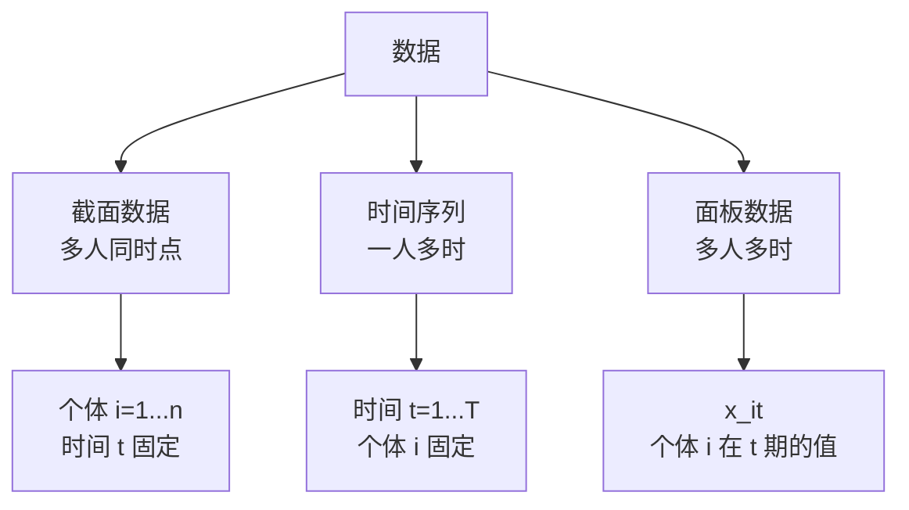

# 02 描述统计 · 章节总结

> 这一页是考前复习用的。先看公式表，再做自测题，不会的回去翻对应小节。

---

## 一、核心公式大表

### 1. 总量与相对指标

| 指标 | 公式 | 一句话解释 |
|------|------|-----------|
| 时期指标累计 | $Q_{年} = \sum_{i=1}^{12} Q_{月,i}$ | 流量，能跨期相加 |
| 时点指标 | 不能相加 | 存量，只是某一瞬间快照 |
| 计划完成相对数 | 实际完成 ÷ 计划任务 | %，越高越好的指标超 100% 是好事 |
| 结构相对数 | 部分 ÷ 总体全部 | %，各组和 = 100% |
| 比例相对数 | 部分 A ÷ 部分 B | A∶B |
| 比较相对数 | 甲空间 ÷ 乙空间同类指标 | % 或倍数（同一时间，不同空间） |
| 动态相对数 | 报告期 ÷ 基期 | %（同一总体，不同时间） |
| 强度相对数 | 某总量 ÷ 另一有联系的不同总量 | 复名数（人/km²、万元/人） |

### 2. 集中趋势

| 指标 | 公式 | 一句话解释 |
|------|------|-----------|
| 均值 | $\bar{x} = \frac{1}{n}\sum_{i=1}^{n} x_i$ | 加起来除以人数 |
| 中位数 | 排序后中间那个 | 一半人在它上下 |
| 众数 | 出现次数最多的 | 分类变量用它 |

### 3. 离散程度

| 指标 | 公式 | 一句话解释 |
|------|------|-----------|
| 极差 | $R = x_{\max} - x_{\min}$ | 最大减最小 |
| 四分位距 | $IQR = Q_3 - Q_1$ | 中间一半人的跨度 |
| 样本方差 | $s^2 = \frac{1}{n-1}\sum(x_i - \bar{x})^2$ | 离均值平方的平均 |
| 样本标准差 | $s = \sqrt{s^2}$ | 方差开根号，和原数据同单位 |
| 3σ 上界 | $\bar{x} + 3s$ | 超出的算异常值（假设正态） |
| IQR 上界 | $Q_3 + 1.5 \times IQR$ | 超出的算异常值（不假设分布） |
| 变异系数 | $CV = s / \bar{x}$ | 消除单位，比较谁更散 |

---

## 二、数据结构速查

---

## 三、变量类型速查

| 类型 | 例子 | 用什么统计量 | 画什么图 |
|------|------|-------------|---------|
| 连续变量 | 工资、身高、GDP | 均值、标准差、[[01_相关系数|相关系数]] | 直方图、散点图 |
| 分类变量 | 性别、行业 | 频数、比例、众数 | 柱状图、饼图 |
| 定序变量 | 学历、满意度 | 中位数、频数 | 柱状图（按顺序） |

---

## 四、什么时候用什么？

| 你的情况 | 用什么 |
|----------|--------|
| 想表达"总共多少" | 总量指标（时期可加，时点不可加） |
| 想表达"跟计划比/跟别人比/跟去年比/占多大比例" | 六种相对数（见 06_总量与相对指标） |
| 收入、房价这种偏态数据 | 中位数 + 缩尾 + 取对数 |
| [[07_正态分布|正态分布]]数据 | 均值 + 标准差 |
| 分类变量 | 众数 + 频数 |
| 识别异常值 | IQR 法（不用 3σ） |
| 缺失值小比例 | 删除 |
| 缺失值中比例 | 均值/中位数填充 |
| 两个连续变量的关系 | 散点图 |
| 按组比较连续变量 | 箱线图 |

---

## 五、易错点 Top 10

1. 收入用均值 → 错，用中位数；
2. 样本标准差除以 n → 错，除以 n-1；
3. 分类变量算均值 → 错，算频数；
4. 3σ 用在偏态数据上 → 不准，用 IQR；
5. 先跑回归再回头删异常值 → 错，先清洗再分析；
6. 直方图 bin 太多太少 → 20~30 个合适；
7. 饼图类别超过 5 个 → 看不清，用柱状图；
8. 删除异常值不写进论文 → 审稿人会查；
9. 跨单位比标准差 → 错，用变异系数；
10. 缺失值填充太完美 → R² 虚高，审稿人一眼识破。

---

## 六、自测题

**题1**：10 个人的收入为 [3000, 3500, 4000, 4500, 5000, 5500, 6000, 6500, 7000, 100000]。
- (a) 算均值和中位数；
- (b) 哪个更能代表"普通人收入"？为什么？
- (c) 用 IQR 法识别异常值。

**题2**：为什么样本方差除以 n-1 而不是 n？

**题3**：为什么衡量[[03_离散程度|离散程度]]时要"平方"而不是直接取绝对值？

**题4**：你有 2015~2023 年 31 个省份的 GDP 数据。这是什么数据结构？你会画什么图？

**题5**：工资变量有 15% 的缺失值，你会怎么处理？为什么？

**题6**：箱线图里，盒子外面的点一定是错误数据吗？为什么？

**题7**：两个变量单位不同（一个是元，一个是年），你怎么比较谁的离散程度更大？

**题8**：某企业 2024 年计划利润 1000 万，实际完成 1150 万；2023 年利润 900 万；同行业平均利润 1000 万；职工 500 人。请分别写出：计划完成相对数、动态相对数、比较相对数、人均利润（强度相对数）各是多少？

---

## 七、自测题答案（先自己做再看）

点开看答案

**题1**：
- (a) 均值 = 149500/10 = 14950；中位数 = (5000+5500)/2 = 5250。
- (b) 中位数更能代表普通人。因为 100000 把均值拉到了 14950，但 10 个人里有 9 个都低于 7000。
- (c) Q1 = 4125, Q3 = 6250, IQR = 2125, 上界 = 6250 + 1.5×2125 = 9437.5。100000 > 9437.5，是异常值。

**题2**：除以 n 会低估总体方差（有偏），除以 n-1 修正后是无偏估计。直觉：算均值时用掉了一个自由度，只剩 n-1 个自由变化的数。

**题3**：正负距离会抵消（和为 0）；绝对值虽然不抵消，但在 0 点不可导，后面做回归（最小化误差）时数学上不好处理；平方既不抵消又处处可导。

**题4**：面板数据（31 个省 × 9 年）。画折线图：横轴年份，纵轴 GDP，每个省一条线；或者画面板散点图。

**题5**：15% 属于中比例，用中位数填充（因为收入偏态）。或者更严谨：用教育、工龄等变量回归插补。不能直接删——15% 样本量损失太大。

**题6**：不一定。它只是"离中间远"，可能是真实的高收入（比如高管）。要回去查原始数据，确认是录入错误还是真实极端值。

**题7**：用变异系数 CV = s/均值，消除单位影响后再比。

**题8**：
- 计划完成相对数 = 1150/1000 = **115%**（超额完成 15%）；
- 动态相对数 = 1150/900 = **127.8%**（比 2023 年增长 27.8%）；
- 比较相对数 = 1150/1000 = **115%**（比行业平均高 15%）；
- 强度相对数（人均利润）= 1150 万 / 500 人 = **2.3 万元/人**。
- 注意：人均利润是**强度相对数**，不是平均指标（分子分母是两个不同性质的总量）。

---

## 📖 配套教材笔记

- [[../../教材笔记/05_统计学原理/02_统计数据采集/00_章节总结|统原·第2章 统计数据采集]]
- [[../../教材笔记/05_统计学原理/03_统计数据整理/00_章节总结|统原·第3章 统计数据整理]]
- [[../../教材笔记/05_统计学原理/04_总量与相对指标/00_章节总结|统原·第4章 总量与相对指标]]
- [[../../教材笔记/05_统计学原理/05_平均与变异指标/00_章节总结|统原·第5章 平均与变异指标]]
- [[../../教材笔记/05_统计学原理/05_平均与变异指标/知识点/KP08_方差与标准差|统原·KP08 方差与标准差]]
- [[../../教材笔记/05_统计学原理/05_平均与变异指标/知识点/KP11_贝塞尔修正|统原·KP11 贝塞尔修正（n-1 的由来）]]

---

⬅️ 上一篇：[[05_数据清洗|数据清洗]]
下一篇：[[../03_相关与回归/README]]

📚 配套原书：[[../../原文件/统计学原理/韩兆洲_统计学原理第7版_全书|韩兆洲《统计学原理（第7版）》]]
