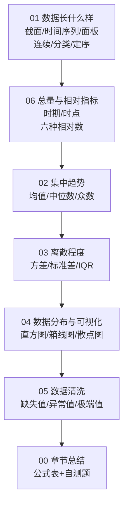

# 02 描述统计：拿到数据先看清楚

> 这一章是"拿到一份数据后，你第一件事该做什么"。
> 不是急着跑回归，而是先把数据**看明白**：它长什么样、集中在哪里、散得开不开、有没有脏东西。

---

## 为什么要学这一章？

你去医院体检，医生不会一上来就给你开药。他先做什么？

- 量血压、测体温、称体重——这是**描述**你的身体；
- 看各项指标在不在正常范围——这是**找异常**；
- 然后才决定要不要进一步检查、要不要开药。

**数据分析一模一样。**

拿到一份 Excel，直接 `reg y x` 跑回归的人，就像医生不体检就开药——迟早出事。
导师第一句话通常是："你先描述一下你的数据。"

描述统计就是那个"体检"环节。它不解决"X 影不影响 Y"的问题，但它决定了后面所有分析是不是建立在一堆垃圾上。

---

## 这一章你会学到什么？

| 文件 | 学完你会 |
|------|----------|
| [01 数据长什么样](01_数据长什么样.md) | 一眼看出你手上的是截面数据还是面板数据，变量是连续的还是分类的 |
| [06 总量与相对指标](06_总量与相对指标.md) | 看懂"GDP 增长 5%"背后是时期指标+动态相对数，分清六种相对数各管什么 |
| [02 集中趋势](02_集中趋势.md) | 算均值、中位数、众数，知道为什么"马云走进酒吧"后不能再用均值 |
| [03 离散程度](03_离散程度.md) | 算方差、标准差、极差、四分位距，知道为什么要平方而不是取绝对值 |
| [04 数据分布与可视化](04_数据分布与可视化.md) | 用 matplotlib 画直方图、箱线图、散点图，知道哪种图配哪种变量 |
| [05 数据清洗](05_数据清洗.md) | 处理缺失值、异常值、极端值，知道什么时候删、什么时候补 |
| [00 章节总结](00_章节总结.md) | 核心公式大表 + 自测题，复习用 |

---

## 这一章在论文里长什么样？

本科论文的"描述性统计"部分，通常就是一张三线表：

| 变量 | 观测数 | 均值 | 标准差 | 最小值 | 最大值 |
|------|--------|------|--------|--------|--------|
| 工资（元） | 500 | 6500 | 2300 | 2800 | 18000 |
| 教育年限 | 500 | 14.2 | 3.1 | 9 | 19 |
| 工龄 | 500 | 8.5 | 6.2 | 0 | 35 |

然后配 1~2 张图（直方图或箱线图），用一段话解释：
- 均值代表什么；
- 标准差大说明什么；
- 有没有极端值需要处理。

**这一章教的就是这张表和这段话背后的全部东西。**

---

## 前置知识

学这一章之前，你只需要：
- 会打开 Excel；
- 会加减乘除；
- 看过 [[01_什么是函数]] 里的函数概念（这章其实用不到，但看过了不害怕符号）。

---

下一篇：[[01_数据长什么样]]

---

## 📖 配套统计学原理

> 下面这些链接指向《统计学原理》教材笔记的对应知识点，是本模块每个概念的"传统教材版"展开。按"数据整理 → 总量相对 → 集中趋势 → 离散程度 → 分布形态"五个分组排列。

### 一、数据整理（Ch03，8 个 KP）

- [[../../教材笔记/05_统计学原理/03_统计数据整理/知识点/KP01_数据审核|KP01 数据审核]] —— 数据清洗的源头，先审后用
- [[../../教材笔记/05_统计学原理/03_统计数据整理/知识点/KP02_统计分组|KP02 统计分组]] —— 按什么标准把人分成几组
- [[../../教材笔记/05_统计学原理/03_统计数据整理/知识点/KP03_组限与组中值|KP03 组限与组中值]] —— 每组的上下限和代表值怎么取
- [[../../教材笔记/05_统计学原理/03_统计数据整理/知识点/KP04_斯特吉斯经验公式|KP04 斯特吉斯经验公式]] —— n 个数据到底分几组
- [[../../教材笔记/05_统计学原理/03_统计数据整理/知识点/KP05_频数分布数列|KP05 频数分布数列]] —— 直方图背后的那张表
- [[../../教材笔记/05_统计学原理/03_统计数据整理/知识点/KP06_累计次数分布|KP06 累计次数分布]] —— 向上/向下累计，分位数的来源
- [[../../教材笔记/05_统计学原理/03_统计数据整理/知识点/KP07_统计表结构|KP07 统计表结构]] —— 论文里三线表的规范
- [[../../教材笔记/05_统计学原理/03_统计数据整理/知识点/KP08_统计图|KP08 统计图]] —— 条形/折线/圆图/曲线图的选用

### 二、总量与相对指标（Ch04，8 个 KP）

- [[../../教材笔记/05_统计学原理/04_总量与相对指标/知识点/KP01_总量指标的概念与分类|KP01 总量指标的概念与分类]] —— 绝对数是一切分析的起点
- [[../../教材笔记/05_统计学原理/04_总量与相对指标/知识点/KP02_时期指标与时点指标|KP02 时期指标与时点指标]] —— 流量 vs 存量，可加不可加
- [[../../教材笔记/05_统计学原理/04_总量与相对指标/知识点/KP03_实物价值劳动量指标|KP03 实物/价值/劳动量指标]] —— 三种计量单位
- [[../../教材笔记/05_统计学原理/04_总量与相对指标/知识点/KP04_计划完成相对数|KP04 计划完成相对数]] —— 实际/计划，%
- [[../../教材笔记/05_统计学原理/04_总量与相对指标/知识点/KP05_结构相对数与比例相对数|KP05 结构相对数与比例相对数]] —— 部分/全体 vs 部分/部分
- [[../../教材笔记/05_统计学原理/04_总量与相对指标/知识点/KP06_比较相对数与动态相对数|KP06 比较相对数与动态相对数]] —— 空间比 vs 时间比
- [[../../教材笔记/05_统计学原理/04_总量与相对指标/知识点/KP07_强度相对数|KP07 强度相对数]] —— 两个不同性质指标相除（人均 GDP）
- [[../../教材笔记/05_统计学原理/04_总量与相对指标/知识点/KP08_六种相对数对比|KP08 六种相对数对比]] —— 一张表分清六把尺子

### 三、集中趋势（Ch05 上半，6 个 KP）

- [[../../教材笔记/05_统计学原理/05_平均与变异指标/知识点/KP01_算术平均数简单与加权|KP01 算术平均数（简单/加权）]] —— 均值的两个版本
- [[../../教材笔记/05_统计学原理/05_平均与变异指标/知识点/KP02_调和平均数|KP02 调和平均数]] —— 已知分子求平均，价格问题用它
- [[../../教材笔记/05_统计学原理/05_平均与变异指标/知识点/KP03_几何平均数|KP03 几何平均数]] —— 增长率、利率的平均
- [[../../教材笔记/05_统计学原理/05_平均与变异指标/知识点/KP04_众数|KP04 众数]] —— 出现最多的值
- [[../../教材笔记/05_统计学原理/05_平均与变异指标/知识点/KP05_中位数|KP05 中位数]] —— 排队站中间
- [[../../教材笔记/05_统计学原理/05_平均与变异指标/知识点/KP06_均值中位数众数关系|KP06 均值/中位数/众数关系]] —— 偏态时三者谁大谁小

### 四、离散程度（Ch05 中部，3 个 KP）

- [[../../教材笔记/05_统计学原理/05_平均与变异指标/知识点/KP07_极差与平均差|KP07 极差与平均差]] —— 最朴素的两个离散指标
- [[../../教材笔记/05_统计学原理/05_平均与变异指标/知识点/KP08_方差与标准差|KP08 方差与标准差]] —— 论文描述统计表的标配
- [[../../教材笔记/05_统计学原理/05_平均与变异指标/知识点/KP09_离散系数|KP09 离散系数（变异系数）]] —— 消除单位后再比谁更散

### 五、分布形态（Ch05 尾部，1 个 KP）

- [[../../教材笔记/05_统计学原理/05_平均与变异指标/知识点/KP10_偏态与峰度|KP10 偏态与峰度]] —— 用数字描述分布歪不歪、尖不尖

---

## 🧭 模块导航

- **⬅️ 上一篇：** [[../01_基础数学/README|01 基础数学]] —— 求和号、期望方差、正态分布是本章的零件
- **➡️ 下一篇：** [[../03_相关与回归/README|03 相关与回归]] —— 描述完数据，开始看变量之间的关系
- **📚 配套原书：** [[../../原文件/统计学原理/韩兆洲_统计学原理第7版_全书|韩兆洲《统计学原理（第7版）》]]（第二~五章：采集、整理、总量相对、平均变异）
- **📖 配套教材笔记：** [[../../教材笔记/05_统计学原理/03_统计数据整理/00_章节总结|第三章 数据整理]] ｜ [[../../教材笔记/05_统计学原理/04_总量与相对指标/00_章节总结|第四章 总量相对]] ｜ [[../../教材笔记/05_统计学原理/05_平均与变异指标/00_章节总结|第五章 平均变异]]

---

## 📖 补充阅读

### 贝塞尔修正（为什么样本方差除以n-1？）

> 小白0基础详解：为什么样本方差是除以n-1，不是n？
> 直观理解 + 数学证明 + 自由度解释 + 生活实例

- [[贝塞尔修正_小白详解|📖 贝塞尔修正详解]]
- 原PDF：[[样本方差的贝塞尔修正(为什么是n-1？).pdf]]
