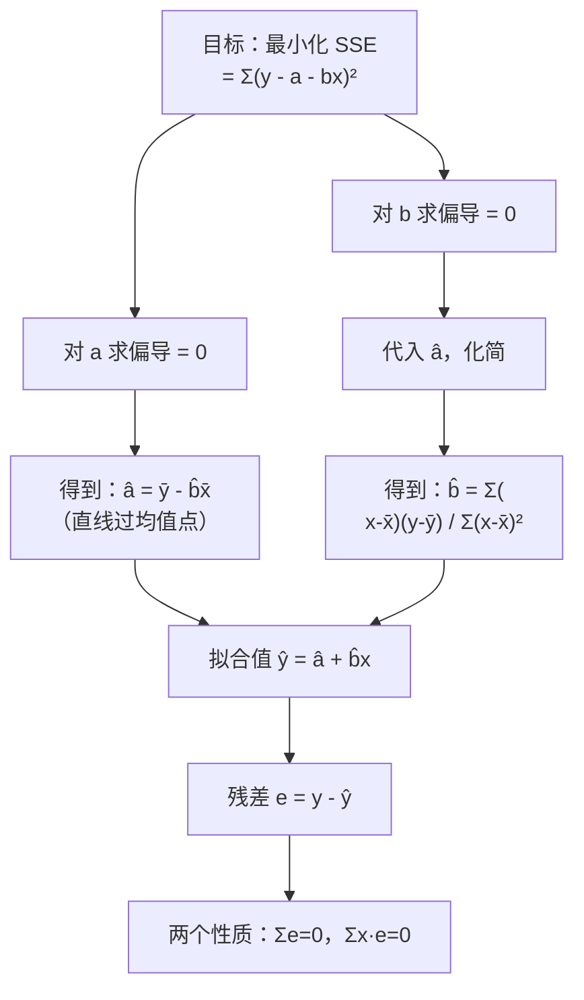

# 03 相关与回归 · 章节总结

> 这一页是考前复习和答辩准备用的。先看公式大表，再做自测题。

---

## 一、核心公式大表

| 公式 | 是什么 | 一句话 |
|------|--------|--------|
| $r = \frac{\sum(x_i-\bar{x})(y_i-\bar{y})}{\sqrt{\sum(x_i-\bar{x})^2}\sqrt{\sum(y_i-\bar{y})^2}}$ | 皮尔逊[[01_相关系数|相关系数]] | 两个变量一起动的程度，[-1,1] |
| $\hat{b} = \frac{\sum(x_i-\bar{x})(y_i-\bar{y})}{\sum(x_i-\bar{x})^2}$ | [[04_OLS截距和拟合值|OLS]] 斜率 | 分子是交叉项，分母是 x 的波动 |
| $\hat{a} = \bar{y} - \hat{b}\bar{x}$ | OLS 截距 | 直线必过均值点 |
| $\hat{y}_i = \hat{a} + \hat{b}x_i$ | 拟合值 | 直线上预测的值 |
| $e_i = y_i - \hat{y}_i$ | 残差 | 真实减预测 |
| $SSE = \sum e_i^2$ | 残差平方和 | OLS 最小化它 |
| $TSS = ESS + RSS$ | 平方和分解 | 总偏差 = 解释 + 没解释 |
| $R^2 = ESS/TSS = 1 - RSS/TSS$ | [[06_拟合优度R²|拟合优度]] | 模型解释了多少变异 |
| $t = \hat{\beta}/SE(\hat{\beta})$ | t 统计量 | 信号/噪声 |
| $F = (ESS/k) / (RSS/(n-k-1))$ | F 统计量 | 模型整体是否显著 |
| $\hat{\beta} = (X'X)^{-1}X'y$ | 多元 OLS 矩阵形式 | [[KP03_多元回归Stata|多元回归]]的矩阵表达式 |

---

## 二、OLS 推导流程图



---

## 三、系数怎么读？

| 变量类型 | 系数解释 |
|---------|---------|
| 连续 x | x 每加 1 单位，y 平均变 β 单位 |
| [[09_虚拟变量|虚拟变量]]（0/1） | 该组相对于基准组的 y 均值差 |
| 对数变量 ln(y) | x 加 1，y 变 β×100%（近似） |
| 对数变量 ln(x) | x 变 1%，y 变 β%（弹性） |

---

## 四、检验怎么读？

| 检验 | 原假设 | 统计量 | p<0.05 时 |
|------|--------|--------|-----------|
| t 检验 | 单个 β_j = 0 | t = b̂/SE | 这个变量有显著影响 |
| F 检验 | 所有 β = 0 | F = (ESS/k)/(RSS/df) | 模型整体显著 |
| R² | — | [0,1] | 越高拟合越好（但不代表因果） |

---

## 五、十大易错点

1. **相关 ≠ 因果**（冰淇淋和溺水）；
2. **回归 ≠ 因果**（[[02_遗漏变量偏误|遗漏变量偏误]]）；
3. **截距常常没经济意义**（x=0 在数据范围外）；
4. **不要外推**（数据范围外预测不准）；
5. **样本标准差除以 n-1，不是 n**；
6. **n 类分类变量设 n-1 个虚拟变量**（防共线性）；
7. **R² 高不代表模型对**（共同趋势也能高 R²）；
8. **p<0.05 ≠ 系数大**（大样本下小系数也显著）；
9. **加变量 R² 必升**，要看调整 R²；
10. **先清洗数据再跑回归**（不要先跑再回头删）。

---

## 六、Stata 输出速查

```
      Source |       SS           df       MS
-------------+-----------------------------
       Model |   ESS             k       ESS/k
    Residual |   RSS           n-k-1   RSS/(n-k-1)
-------------+-----------------------------
       Total |   TSS           n-1     TSS/(n-1)

    Number of obs   =      n
    F(k, n-k-1)     =    F值
    Prob > F        =    p值
    R-squared       =    R²
    Adj R-squared   =    调整 R²

------------------------------------------------------------------------
         y |    Coef.   Std.Err.    t    P>|t|   [95% Conf. Interval]
-----------+------------------------------------------------------------
         x |     β̂      SE        t     p值     下限      上限
     _cons |     β̂₀    SE₀       t₀    p₀      下限      上限
------------------------------------------------------------------------
```

---

## 七、自测题

**题1**：从 SSE 出发，写出对 a 求导等于零的过程，并推出 â = ȳ - b̂x̄。

**题2**：5 个数据点 (x, y) = (1, 2), (2, 1), (3, 4), (4, 3), (5, 5)。手算 b̂ 和 â。

**题3**：TSS = 100，RSS = 20，R² 是多少？

**题4**：回归出来教育系数 = 0.5，标准误 = 0.2，t 值多少？显著吗（大样本下）？

**题5**：为什么 n 类分类变量只能设 n-1 个虚拟变量？

**题6**：相关系数 r = 0.9，能说 x 导致 y 吗？为什么？

**题7**：F 检验显著，但单个 t 检验都不显著，可能是什么原因？

**题8**：为什么 OLS 要最小化平方和，不直接最小化绝对值和？

---

## 八、自测题答案（先自己做再看）

<details>
<summary>点开看答案</summary>

**题1**：
SSE = Σ(y_i - a - bx_i)²
对 a 求偏导：∂SSE/∂a = Σ 2(y_i - a - bx_i)(-1) = 0
→ Σ(y_i - a - bx_i) = 0
→ Σy_i - na - bΣx_i = 0
→ ȳ - a - bx̄ = 0
→ â = ȳ - b̂x̄

**题2**：
x̄ = 3，ȳ = 3。
Σ(x-x̄)(y-ȳ) = (-2)(-1) + (-1)(-2) + 0(1) + 1(0) + 2(2) = 2+2+0+0+4 = 8
Σ(x-x̄)² = 4+1+0+1+4 = 10
b̂ = 8/10 = 0.8
â = 3 - 0.8×3 = 0.6

**题3**：
R² = 1 - RSS/TSS = 1 - 20/100 = 0.8

**题4**：
t = 0.5/0.2 = 2.5
|t| = 2.5 > 1.96 → 在 5% 水平显著。

**题5**：
因为 n 个虚拟变量加起来 = 1（每个人必属于其中一类），和截距完全共线。Stata 会自动删掉一个，并提示 "omitted"。

**题6**：
不能。相关 ≠ 因果。可能有第三个变量同时影响 x 和 y（遗漏变量）。要做因果需要[[03_工具变量IV|工具变量]]、自然实验等方法（第 5 章）。

**题7**：
样本量太小，单个 t 检验功效不够。F 检验联合检测能捕捉到整体信号，但分开看每个变量都不显著。解决：扩大样本。

**题8**：
绝对值在 0 点不可导，数学上不好求最小值；平方处处可导，有解析解。而且经典假设下 OLS 是 BLUE（最优线性无偏估计）。

</details>

---

## 本章方法答辩速查

1. **问：相关系数 r=0.9，能不能说明 x 导致 y？** 答：不能。相关只说明两者一起动，可能被遗漏变量同时推高（冰淇淋和溺水都被夏天驱动）；从相关到因果，要靠控制变量、工具变量或自然实验。
2. **问：多元回归里"控制其他变量不变"到底怎么解决遗漏变量偏误？** 答：把混淆变量（如年龄、工龄）作为控制变量放进同一个方程，每个系数就是"其他变量固定时"该变量的净效应，相当于只比较同工龄、同性别的人之间的差异，把混淆的渠道堵住。
3. **问：我的模型 R² 很高，导师还问"系数显著吗"，R² 高还不够吗？** 答：不够。R² 高只说明整体拟合紧，可能来自共同趋势；t 检验回答"这个变量的效应是不是真信号"，F 检验回答"模型整体是否成立"。论文里 R²、t、F 三者都要报。

---

⬅️ 上一篇：[[09_虚拟变量|09 虚拟变量]] ｜ 📑 [[README|返回目录]] ｜ 下一篇：[[../04_回归三大问题/README|04 回归三大问题 →]] ➡️

---

## 📖 配套教材笔记
- [[../../教材笔记/05_统计学原理/08_相关与回归/00_章节总结|统计原理·第8章 相关与回归]]
- [[../../教材笔记/02_计量经济学/03_一元线性回归/00_章节总结|计量·第4章 一元线性回归]]
- [[../../教材笔记/02_计量经济学/04_多元线性回归/00_章节总结|计量·第5章 多元线性回归]]

## 📚 配套原书
- [[../../原文件/计量经济学/陈强_计量经济学及Stata应用_全书|陈强《计量经济学及Stata应用》]]
