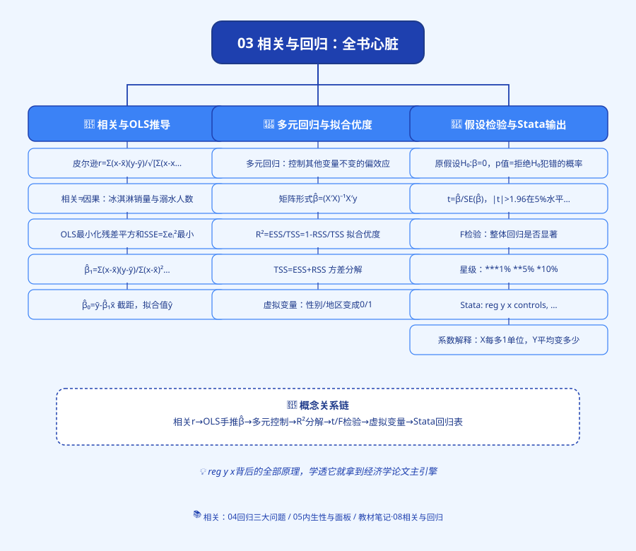
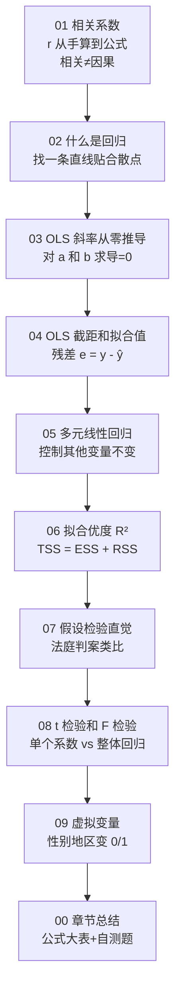

# 思维导图



---

# 03 相关与回归：全教程的心脏

> 这一章是整本书最重要的一章。
> 后面所有章节（[[02_异方差|异方差]]、内生性、面板、Logit……）都是在修这一章的问题。
> 这一章学透了，你就拿到了经济学论文的"主引擎"。

---

## 为什么这一章是心脏？

本科论文 90% 的实证部分，本质上就是一行命令：

```stata
reg y x controls
```

这一行命令背后是什么？就是本章教的：
- 为什么要算[[01_相关系数|相关系数]]？
- [[04_OLS截距和拟合值|OLS]] 这条直线是怎么画出来的？
- 为什么要最小化"残差平方和"？
- t 值、p 值、R² 这些输出到底在说什么？

**你不懂这一章，你的论文就是在"黑箱操作"——跑了个结果，不知道对不对，也不知道怎么解释。**

---

## 这一章你会学到什么？



| 文件 | 学完你会 |
|------|----------|
| [01 相关系数](01_相关系数.md) | 手算皮尔逊 r，知道 r=0.9 多大，相关≠因果 |
| [02 什么是回归](02_什么是回归.md) | 理解回归是"找一条直线贴合散点" |
| [03 OLS 斜率从零推导](03_OLS斜率从零推导.md) | **从 SSE 出发，对 a、b 求导，一步步推到 b̂ 公式** |
| [04 OLS 截距和拟合值](04_OLS截距和拟合值.md) | 算 â、ŷ、残差 e，手算一遍 |
| [05 多元线性回归](05_多元线性回归.md) | 理解"控制其他变量不变"的偏效应 |
| [06 拟合优度 R²](06_拟合优度R².md) | TSS=ESS+RSS，R² 是什么意思 |
| [07 假设检验直觉](07_假设检验直觉.md) | 原假设、p 值、5% 显著性 |
| [08 t 检验和 F 检验](08_t检验和F检验.md) | Stata 输出怎么读 |
| [09 虚拟变量](09_虚拟变量.md) | 把性别、地区变成 0/1 |
| [00 章节总结](00_章节总结.md) | 核心公式大表 + 自测题 |

---

## 这一章在论文里长什么样？

本科论文的回归结果表，大概是这样：

| 变量 | 系数 | 标准误 | t 值 | p 值 |
|------|------|--------|------|------|
| 教育年限 | 0.082*** | 0.015 | 5.47 | 0.000 |
| 工龄 | 0.012** | 0.005 | 2.40 | 0.017 |
| 男性 | 0.156*** | 0.034 | 4.59 | 0.000 |
| 常数项 | 7.234*** | 0.215 | 33.65 | 0.000 |

R² = 0.312, 观测数 = 500

下面写一段话解释：
- 教育年限系数 0.082：**每多上一年学，工资对数提高 8.2%**；
- 三颗星 = 在 1% 水平显著；
- R² = 0.312：模型解释了工资 31.2% 的变异。

**这一章教的就是这张表背后的全部东西。**

---

## 前置知识

学这一章之前，你需要：
- 看过 [[01_什么是函数]]（线性函数 $y = a + bx$）；
- 会算均值和方差（[[../02_描述统计/02_集中趋势]]、[[../02_描述统计/03_离散程度]]）；
- 会一点导数（第 01 章会补，不会也能跟着推导走）。

---

下一篇：[[01_相关系数|01 相关系数]] ➡️


---

## 延伸阅读
- 📚 教材笔记：[[../../教材笔记/02_计量经济学/README|计量经济学教材笔记]]
- 📖 原书：[[../../原文件/计量经济学/陈强_计量经济学及Stata应用_全书|陈强《计量经济学及Stata应用》封面]]
- 📖 统计学原理配套（按学习顺序分组）：

  **🔬 假设检验基础（Ch07，先打地基）**
  - [[../../教材笔记/05_统计学原理/07_假设检验/知识点/KP01_假设检验的逻辑|KP01 假设检验的逻辑]]
  - [[../../教材笔记/05_统计学原理/07_假设检验/知识点/KP02_原假设与备择假设|KP02 原假设与备择假设]]
  - [[../../教材笔记/05_统计学原理/07_假设检验/知识点/KP03_两类错误|KP03 两类错误（弃真α/取伪β）]]
  - [[../../教材笔记/05_统计学原理/07_假设检验/知识点/KP04_显著性水平|KP04 显著性水平 α]]
  - [[../../教材笔记/05_统计学原理/07_假设检验/知识点/KP05_单尾检验与双尾检验|KP05 单尾检验与双尾检验]]
  - [[../../教材笔记/05_统计学原理/07_假设检验/知识点/KP06_P值|KP06 P值]]
  - [[../../教材笔记/05_统计学原理/07_假设检验/知识点/KP07_总体均值Z检验|KP07 总体均值 Z 检验]]
  - [[../../教材笔记/05_统计学原理/07_假设检验/知识点/KP08_总体均值t检验|KP08 总体均值 t 检验]]
  - [[../../教材笔记/05_统计学原理/07_假设检验/知识点/KP09_总体比例检验|KP09 总体比例检验]]
  - [[../../教材笔记/05_统计学原理/07_假设检验/知识点/KP10_检验与置信区间的关系|KP10 检验与置信区间的对偶关系]]

  **📈 相关分析（Ch08 上半段）**
  - [[../../教材笔记/05_统计学原理/08_相关与回归/知识点/KP01_函数关系vs相关关系|KP01 函数关系 vs 相关关系]]
  - [[../../教材笔记/05_统计学原理/08_相关与回归/知识点/KP02_相关方向与相关形式|KP02 相关方向与相关形式]]
  - [[../../教材笔记/05_统计学原理/08_相关与回归/知识点/KP03_相关系数r的直觉|KP03 相关系数 r 的直觉]]
  - [[../../教材笔记/05_统计学原理/08_相关与回归/知识点/KP04_相关系数手算|KP04 相关系数手算]]
  - [[../../教材笔记/05_统计学原理/08_相关与回归/知识点/KP05_相关系数显著性检验|KP05 相关系数显著性检验]]
  - [[../../教材笔记/05_统计学原理/08_相关与回归/知识点/KP06_相关分析vs回归分析|KP06 相关分析 vs 回归分析]]

  **📐 一元线性回归**
  - [[../../教材笔记/05_统计学原理/08_相关与回归/知识点/KP07_一元线性回归模型|KP07 一元线性回归模型]]
  - [[../../教材笔记/05_统计学原理/08_相关与回归/知识点/KP08_最小二乘法OLS|KP08 最小二乘法 OLS]]
  - [[../../教材笔记/05_统计学原理/08_相关与回归/知识点/KP09_拟合优度R2|KP09 拟合优度 R²]]

  **🧮 多元回归与曲线回归**
  - [[../../教材笔记/05_统计学原理/08_相关与回归/知识点/KP10_多元线性回归与偏回归系数|KP10 多元线性回归与偏回归系数]]
  - [[../../教材笔记/05_统计学原理/08_相关与回归/知识点/KP11_曲线回归与线性化|KP11 曲线回归与线性化]]

  **⚠️ 应用注意**
  - [[../../教材笔记/05_统计学原理/08_相关与回归/知识点/KP12_相关不等于因果与应用注意|KP12 相关不等于因果与应用注意]]
