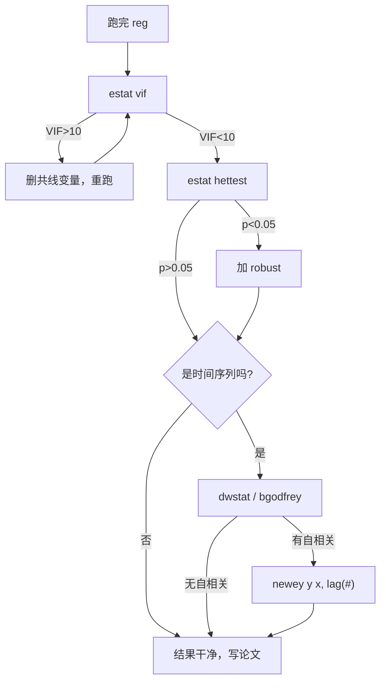

# 04 章节总结：回归三大问题

> 这一章讲了 [[04_OLS截距和拟合值|OLS]] 在真实数据下会遇到的三个毛病。
> 核心思想：**系数无偏 ≠ 结果可信**。系数对了，标准误错了，t 检验照样骗你。

---

## 一、三种问题对比表（最重要）

| 问题 | 比喻 | 系数 $\hat{\beta}$ | 标准误 SE | 检验方法 | 修法 |
|------|------|-------------------|----------|----------|------|
| **[[02_异方差|异方差]]** | 穷人波动小、富人波动大 | 无偏（不变） | **错** | BP 检验 / 怀特检验 | `reg y x, robust` |
| **[[03_自相关|自相关]]** | 今年残差影响明年 | 无偏（不变） | **错**（通常低估） | DW 统计量 / BG 检验 | `newey y x, lag(#)` |
| **[[04_多重共线性|多重共线性]]** | 身高和体重说同一件事 | 无偏但**不稳定** | **大** | VIF（>10 有问题） | 删变量 / 合并 / 加样本 |

**记忆口诀**：
- 前两个问题：系数不动，标准误动 → 打补丁（robust / [[KP03_NeweyWest_HAC|HAC]]）。
- 第三个问题：系数不动但看不清 → 删变量。
- 这三个都不动系数——真正动系数的是下一章的内生性。

---

## 二、核心公式清单

### 1. [[KP03_稳健标准误|稳健标准误]]（怀特）

$$\mathrm{SE}_{robust}(\hat{\beta}_1) = \sqrt{\frac{\sum (X_i-\bar{X})^2 e_i^2}{\left[\sum (X_i-\bar{X})^2\right]^2}}$$

和普通 se 的区别：每个观测用自己的残差 $e_i^2$，不用平均的 $\sigma^2$。

### 2. DW 统计量

$$DW = \frac{\sum_{t=2}^{n} (e_t - e_{t-1})^2}{\sum_{t=1}^{n} e_t^2} \approx 2(1-\hat{\rho})$$

- DW ≈ 2：无自相关；
- DW < 2：正自相关；
- DW > 2：负自相关。

### 3. VIF

$$\mathrm{VIF}_j = \frac{1}{1 - R_j^2}$$

$R_j^2$ 是把 $X_j$ 对其他所有 X 回归得到的 R²。
- VIF < 5：安全；
- VIF > 10：严重共线性。

---

## 三、诊断流程决策图



---

## 四、关键 Stata 命令速查

```stata
reg y x1 x2 x3              -- 基础回归
estat vif                   -- 查共线性
estat hettest               -- BP 查异方差
estat imtest, white         -- 怀特查异方差
reg y x1 x2, robust         -- 修异方差
tsset year                  -- 声明时间序列
dwstat                      -- 查一阶自相关
estat bgodfrey              -- 查高阶自相关
newey y x1 x2, lag(3)       -- 修自相关+HAC
```

---

## 五、自测题（盖住答案先自己想）

**Q1**：异方差下，OLS 的系数估计还无偏吗？标准误呢？

<details>
<summary>答案</summary>
系数还无偏，标准误错了。所以 t 检验不准。修法是加 robust，不是换模型。
</details>

**Q2**：DW=0.3 说明什么？怎么修？

<details>
<summary>答案</summary>
DW 远小于 2，强正自相关。用 Newey-West HAC 标准误：`newey y x, lag(#)`。
</details>

**Q3**：VIF=15 说明什么？为什么 VIF 大了标准误会变大？

<details>
<summary>答案</summary>
严重多重共线性。因为 VIF = 1/(1-R²)，R² 高说明这个 X 能被其他 X 高度预测，样本里"独立信息"少，标准误被膨胀。
</details>

**Q4**：截面数据需要查 DW 吗？为什么？

<details>
<summary>答案</summary>
不需要。DW 检验的是"时间上相邻的残差是否相关"。截面数据没有时间顺序，观测之间独立，天然无自相关。
</details>

**Q5**：以下三个问题，哪个会让系数本身有偏？
（A）异方差 （B）自相关 （C）多重共线性 （D）都不

<details>
<summary>答案</summary>
D。这三个都不动系数。真正让系数有偏的是**内生性**（下一章），也就是 MLR.4 零条件均值假设被违反。
</details>

**Q6**：跑回归的诊断顺序是什么？为什么？

<details>
<summary>答案</summary>
先 VIF（共线性）→ 再 BP（异方差）→ 再 DW（自相关）。
先查共线性是因为它会改变系数分配，不修后面都白搭；异方差和自相关只动标准误，加 robust/HAC 就行。
</details>

**Q7**：BP 检验 p=0.03，你该怎么办？

<details>
<summary>答案</summary>
p<0.05 拒绝同方差原假设，说明有异方差。在回归命令后加 `, robust` 重跑，系数不变，标准误换成怀特稳健的。
</details>

---

## 六、下一章预告

这三个问题都是"精度病"——系数还对，只是看不清。

下一章我们讲一个真正的**"系数病"**：**内生性**。

- 你看到"教育越高工资越高"，但可能是"能力高的人既爱上学又工资高"；
- 你看到"警察越多犯罪越多"，但可能是"犯罪多的地方才多派警察"；
- 这时候 OLS 系数本身就是错的，加 robust 没用。

修法只有两个大方向：**[[03_工具变量IV|工具变量]] IV** 和**面板[[06_固定效应FE|固定效应]] FE**。

下一章见：[[../05_内生性与面板/README]]

---

## 本章方法答辩速查

1. **问：异方差、自相关、多重共线性，这三个问题是先诊断还是先处理？能不能直接默认都加上 robust 就完事？** 答：先诊断后处理，而且一个 robust 打不了天下。共线性先跑 `estat vif`、VIF>10 就删变量重跑；异方差跑 BP/怀特、p<0.05 加 robust；自相关只在时间序列上跑 DW/BG、有问题换 Newey-West。robust 只修异方差，对共线性和自相关无效，顺序反了白跑。
2. **问：三个问题里哪个会让系数有偏？为什么总说"这三个都不动系数"？** 答：一个都不动系数——异方差和自相关只让标准误算错，多重共线性只让标准误变大、估计不稳定，$\hat{\beta}$ 依然无偏。真正让系数有偏的是下一章的内生性（MLR.4 被违反）。答辩时别把"t 值不显著"误说成"X 没影响"——共线性可能只是把效应淹没了。
3. **问：为什么诊断顺序必须是 VIF → BP → DW，不能先查异方差？** 答：共线性改变的是系数本身的分配（两个 X 太像，模型分不清谁的贡献），不修它，后面 BP、DW 的检验都是在错误的系数残差上算的；异方差和自相关只动标准误，加 robust/HAC 是可逆的补丁，放后面不影响。而且截面数据没有时间维度，DW 直接跳过。

---

⬅️ 上一篇：[[05_三大问题诊断流程|05 诊断流程]] ｜ 📑 [[README|返回目录]] ｜ 下一篇：[[../05_内生性与面板/README|05 内生性与面板 →]] ➡️

---

## 📖 配套教材笔记
- [[../../教材笔记/02_计量经济学/06_异方差/00_章节总结|计量·第7章 异方差]]
- [[../../教材笔记/02_计量经济学/07_自相关/00_章节总结|计量·第8章 自相关]]
- [[../../教材笔记/02_计量经济学/08_模型设定与数据问题/00_章节总结|计量·第9章 模型设定]]
- [[../../教材笔记/05_统计学原理/08_相关与回归/00_章节总结|统计原理·相关与回归（回归诊断思想）]]

## 📚 配套原书
- [[../../原文件/计量经济学/陈强_计量经济学及Stata应用_全书|陈强《计量经济学及Stata应用》（第7-9章）]]
