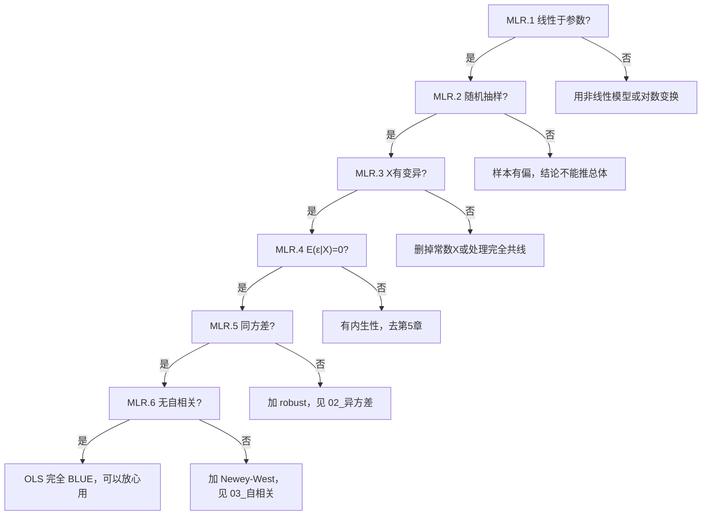

# 01 经典假设五条：[[04_OLS截距和拟合值|OLS]] 凭什么靠谱？

## 一、为什么要学这个？

你在第 3 章学会了 `reg y x`，一行命令出结果。但你有没有想过：

- 为什么 OLS 算出来的 $\hat{\beta}_1$ 就是"真实斜率"的好估计？
- 为什么标准误能用来算 t 检验？
- 为什么样本大了结果就稳定？

答案是：**OLS 不是魔法，它的靠谱建立在五条假设上**。这五条假设就是 OLS 的"出生证明"——假设满足，OLS 就是最优线性无偏估计量（BLUE）；假设违反，OLS 就开始出错。

**不学会怎样？** 你跑完回归不知道哪里错了，导师一问"你这个模型假设满足吗"，你答"应该满足吧"——这在答辩上是要被扣分的。

---

## 二、是什么？（比喻 + 定义）

### 生活比喻：调天平

想象你用天平称苹果重量。

- **天平要准**（线性于参数）：天平每偏 1 格，代表的重量必须是固定的，不能今天 1 格 = 100g、明天 1 格 = 200g。
- **苹果是随机挑的**（随机抽样）：你不能专挑大苹果称。
- **苹果重量有差异**（X 有变异）：如果所有苹果一样重，你没法研究"品种和重量的关系"。
- **秤的误差和苹果无关**（E(ε|X)=0）：你不能每次称大苹果时手都压一下秤盘。
- **所有苹果称重误差一样大**（同方差）：不能大苹果用高精度秤、小苹果用便宜秤。
- **每次称重独立**（无[[03_自相关|自相关]]）：称完一个苹果不能影响下一个的读数。

OLS 就是这台天平。六条要求（第五条小样本才需要）就是天平的校准标准。

### 严格定义（经典线性模型假设）

总体回归模型：
$$Y = \beta_0 + \beta_1 X_1 + \beta_2 X_2 + \cdots + \beta_k X_k + \varepsilon$$

| 编号 | 假设 | 一句话 |
|------|------|--------|
| MLR.1 | 线性于参数 | Y 和 β 之间是线性关系（X 可以随便变换） |
| MLR.2 | 随机抽样 | n 个观测是从总体里随机抽的 |
| MLR.3 | X 有变异 | 每个 X 不能是常数，X 之间不完全共线 |
| MLR.4 | 零条件均值 E(ε\|X)=0 | 误差项和所有 X 都不相关 |
| MLR.5 | 同方差 Var(ε\|X)=σ² | 误差的方差对所有 X 都一样 |
| MLR.6 | 无自相关 Cov(ε_i, ε_j)=0 | 两个不同观测的误差不相关 |
| MLR.7 | 正态性（小样本） | ε ~ N(0, σ²)，大样本不需要 |

---

## 三、公式怎么来的？（逐条拆开）

### MLR.1 线性于参数

意思是：模型对 **β** 是线性的，不是对 X 线性。

$$Y = \beta_0 + \beta_1 X + \beta_2 X^2 + \varepsilon$$

这个模型**满足** MLR.1——因为 β₁、β₂ 都是一次方，X² 只是一个新变量。

$$Y = \beta_0 + \beta_1^2 X + \varepsilon$$

这个模型**不满足**——β₁² 不是线性的，OLS 算不了，要用非线性最小二乘法。

**为什么需要这条？** 因为 OLS 的推导（最小化残差平方和）求导后得到的正规方程，只对 β 是线性的才好解。

### MLR.4 零条件均值 E(ε|X)=0（最重要）

这是六条里**最核心**的一条。

意思：**给定任何 X 值，误差项的平均值都是 0**。

数学上：
$$E(\varepsilon | X_1=x_1, X_2=x_2, \ldots) = 0$$

**生活例子**：研究教育 X → 工资 Y，误差 ε 里包含了"能力"。
- 如果"能力"和教育无关（聪明人不更爱上学），那 E(ε|X)=0，OLS 无偏。
- 如果"能力高的人更爱上学"，那教育高的人误差也高，E(ε|X=高)>0，OLS 有偏。

**为什么这条最重要？** 它保证 $\hat{\beta}$ 的期望等于真实 $\beta$。违反它，就是第 5 章要讲的**内生性**。

### MLR.5 同方差 Var(ε|X)=σ²

意思：不管 X 取什么值，误差的"波动幅度"都一样。

- 满足：收入 1 万的人，消费在均值附近波动 ±500；收入 100 万的人，消费也波动 ±500。
- 违反（[[02_异方差|异方差]]）：穷人消费波动 ±200，富人消费波动 ±20000。

**为什么需要？** 同方差保证 OLS 的标准误公式是对的，t 检验 F 检验才有效。违反了，系数还无偏，但标准误错了。

### MLR.6 无自相关 Cov(ε_i, ε_j)=0

意思：第 i 个人的误差，和第 j 个人的误差，不相关。

- 截面数据（不同人）：一般自动满足，因为人是独立的。
- 时间序列数据（同一个人不同年）：**经常违反**——今年经济好，明年往往也好，残差会拖尾巴。

### MLR.7 正态性（小样本专用）

意思：误差服从[[07_正态分布|正态分布]]。

- 样本大（n>30 或 n>100）：中心极限定理兜底，不需要这条。
- 样本小：需要这条才能用 t 分布、F 分布做检验。

---

## 四、符号表

| 符号 | 读法 | 含义 |
|------|------|------|
| $Y$ | y | 因变量（被解释变量） |
| $X_j$ | x j | 第 j 个自变量 |
| $\beta_j$ | beta j | 第 j 个自变量的真实系数 |
| $\varepsilon$ | epsilon | 误差项（扰动项） |
| $E(\varepsilon\|X)$ | ... | 给定 X 时 ε 的条件期望 |
| $\mathrm{Var}(\varepsilon\|X)$ | ... | 给定 X 时 ε 的条件方差 |
| $\sigma^2$ | sigma 方 | 误差方差（常数） |
| $\mathrm{Cov}(\varepsilon_i,\varepsilon_j)$ | ... | 两个观测误差的协方差 |

---

## 五、一个完整的数字例子

**问题**：5 个人的数据，判断 MLR.4（零条件均值）是否满足。

| 人 | 教育 X | 工资 Y | 遗漏变量：能力 |
|----|--------|--------|----------------|
| 张三 | 9 | 3000 | 低 |
| 李四 | 12 | 4500 | 中 |
| 王五 | 12 | 5000 | 高 |
| 赵六 | 16 | 7000 | 高 |
| 钱七 | 19 | 8500 | 很高 |

**第一步**：用 OLS 算出 $\hat{Y}$。

（第 3 章算过，$\hat{Y} = -1200 + 500X$。）

**第二步**：算残差 $e = Y - \hat{Y}$。

| 人 | X | Y | $\hat{Y}$ | 残差 e | 能力 |
|----|---|---|-----------|--------|------|
| 张三 | 9 | 3000 | 3300 | -300 | 低 |
| 李四 | 12 | 4500 | 4800 | -300 | 中 |
| 王五 | 12 | 5000 | 4800 | +200 | 高 |
| 赵六 | 16 | 7000 | 6800 | +200 | 高 |
| 钱七 | 19 | 8500 | 8300 | +200 | 很高 |

**第三步**：按 X 分组看残差均值。

- X=9（教育最低）：残差均值 = -300
- X=12：残差均值 = (-300+200)/2 = -50
- X=16：残差均值 = +200
- X=19：残差均值 = +200

**结论**：教育越低，残差越负；教育越高，残差越正。这说明 E(ε|X) ≠ 0——能力这个遗漏变量，和教育相关，导致 MLR.4 违反。

**这就是内生性的种子**——第 5 章会专门讲怎么修。

---

## 六、什么时候能用？（前提假设清单）

跑 OLS 之前，逐条核对：



---

## 七、易错点

1. **"线性于参数"不是"X 必须是一次方"**。$Y = \beta_0 + \beta_1 \ln X + \beta_2 X^2$ 完全满足 MLR.1，因为 β 都是一次方。
2. **MLR.4 是最容易违反的**。经济学里几乎没有真正满足 E(ε|X)=0 的场景——总有遗漏变量。这就是为什么第 5 章（内生性）是论文核心。
3. **违反 MLR.5 和 MLR.6 不影响系数无偏性，只影响标准误**。这是初学者最容易混的：系数还是对的，只是 t 检验不准。
4. **违反 MLR.4 才是真的灾难**——系数本身就错了。
5. **样本大了，MLR.7（正态）就不需要了**。中心极限定理会帮你。

---

## 八、Stata 代码（怎么检查假设）

```stata
-- 假设我们已经有数据 wage edu ability
reg wage edu ability      // 先跑 OLS
estat ovtest              // 检验是否遗漏了高阶项（RESET检验）
                          // p>0.05 说明模型设定没问题
estat hettest             // 检验同方差（BP检验），下一章细讲
estat imtest, white       // 怀特检验异方差
dwstat                    // 检验自相关（时间序列数据），下一章细讲
estat vif                 // 检验多重共线性，下下章细讲
```

**输出怎么读**：
- `ovtest` 的 p > 0.05：模型形式 OK；
- `hettest` 的 p > 0.05：同方差 OK；p < 0.05：有异方差；
- `dwstat` 的 DW ≈ 2：无自相关；
- `vif` 的值 < 10：共线性 OK。

---

## 九、和别的概念对比

| 违反哪条 | 后果严重程度 | 系数还对吗 | 标准误还对吗 | 去哪修 |
|----------|-------------|-----------|-------------|--------|
| MLR.1 形式错 | 严重 | 错 | 错 | 换函数形式 |
| MLR.4 内生性 | **最严重** | **错** | 错 | 第 5 章 IV/FE |
| MLR.5 异方差 | 中等 | 对 | **错** | robust |
| MLR.6 自相关 | 中等 | 对 | **错** | Newey-West |
| MLR.3 完全共线 | 严重 | 估不出来 | —— | 删变量 |
| MLR.7 非正态 | 轻微（大样本） | 对 | 对（大样本） | 不用修 |

**一句话记忆**：MLR.4 违反是"系数错"，其他违反是"标准误错"。系数错了要重建模型，标准误错了打个补丁就行。

---

## 十、为什么不用别的方法？

- **为什么不用"样本大了假设就自动满足"？** 样本大能靠中心极限定理救 MLR.7（正态性），让 t 检验在大样本下近似正确；但救不了 MLR.4——[[02_遗漏变量偏误|遗漏变量偏误]]不会因为 n 变大而消失，样本越大只是让你更精确地估出一个错的系数。
- **为什么不直接上[[03_工具变量IV|工具变量]] IV 或[[06_固定效应FE|固定效应]] FE 绕开假设检查？** IV/FE 只修 MLR.4（内生性）这一条，对 MLR.5 异方差、MLR.6 自相关完全无效，该加 robust 还得加；而且 IV 需要找到合格的工具变量（外生、强相关），找不到比不用还糟。先花十分钟跑 `estat hettest`、`dwstat` 便宜得多。
- **为什么不用非参数回归绕过函数形式假设？** 非参数不对 β 设线性形式，但它输出的是一条曲线，给不出"X 每涨 1 单位 Y 涨多少"的系数，论文的经济解释和政策含义没法写；而且非参数收敛慢，经济学论文几百到几千的样本量根本撑不起精度。

---

## 十一、答辩常问（直接背）

1. **问：这几条假设里哪条被违反后果最严重？** 答：MLR.4（零条件均值 E(ε|X)=0）。违反它系数本身就有偏，样本再大也救不回来，只能用 IV/FE 动手术；MLR.5、MLR.6 违反只动标准误，加 robust 或 Newey-West 打个补丁就行。
2. **问：样本量多大才算"大样本"，可以不管正态性假设？** 答：经验上 n>30 起步、n>100 更稳，中心极限定理让 $\hat{\beta}$ 近似正态，t 检验照用；但大样本不等于免检——异方差、自相关照样要靠[[KP03_稳健标准误|稳健标准误]]修正。
3. **问："线性于参数"是不是意味着 X 必须是一次函数？** 答：不是。$Y=\beta_0+\beta_1\ln X+\beta_2 X^2$ 完全满足 MLR.1，因为 β 都是一次方；只要 β 不出现平方或乘积（如 $\beta_1^2$、$\beta_1\beta_2$）就满足，X 随便变换。
4. **问：怎么判断你的模型违反了哪条假设？** 答：按工具分工——`estat ovtest`（RESET）查函数形式，`estat hettest`/怀特查 MLR.5，`dwstat`/BG 查 MLR.6；内生性（MLR.4）光看残差图看不出来，要靠 Hausman 类检验和经济逻辑判断。

---

## 十二、速记卡

> **OLS 的六条假设 = 天平的六个校准标准。**
> - MLR.4（零条件均值）最关键：违反 = 内生性 = 系数错了，去第 5 章。
> - MLR.5（同方差）+ MLR.6（无自相关）：违反 = 标准误错了，打 robust 补丁。
> - MLR.7（正态）：大样本不用管。
> - 记住口诀：**"系数错找内生，标准误错找异方/自相关。"**

---

## 💡 经济学视角：OLS 那六条假设，现实经济几乎条条都违反

**这个方法是为了解决什么经济学问题？**
课本上的 OLS 模型像个无菌实验室：假设误差同方差、不相关、正态分布——但经济学家一打开真实数据，就像把实验员直接扔进菜市场。GDP、收入、价格这些变量天生纠缠在一起，扰动项里塞满了没观测到的东西（政策冲击、消费者情绪、气候灾害）。这六条假设不是"现实"，是经济学家给自己立的一把标尺：先假设世界是干净的，再看哪里脏了、脏了怎么洗。

**经济学里哪些经典模型正好对应这个方法？**
从凯恩斯的消费函数 $C=a+bY$，到索洛的增长方程 $Y=A\cdot F(K,L)$，所有宏观/微观模型最后都要拿数据估系数，一估就要过 OLS 这把尺子。假设成立时，$\hat\beta$ 是"因果效应"；假设崩了，它就退化成"相关系数"——这正是实证经济学和规范经济学的分界线。

**举个实证论文的例子：**
《中国财政支出对经济增长的影响》用 31 省 20 年数据跑 $g_{it}=\alpha+\beta \cdot G_{it}+\varepsilon_{it}$。审稿人第一句话必是：误差同方差吗？各省之间误差相关吗？G 和 ε 里的"地方政府能力"相关吗？——这三问，就是 MLR.5、MLR.6、MLR.4 在论文里的化身。

**📚 配套经济学笔记：**
- [[../../教材笔记/06_西方经济学/00_导论/知识点/KP03_实证分析与规范分析|原KP·实证分析与规范分析]]

---

⬅️ 上一篇：[[README|返回目录]] ｜ 📑 [[README|返回目录]] ｜ 下一篇：[[02_异方差|02 异方差]] ➡️

---

## 📖 配套教材笔记
- [[../../教材笔记/02_计量经济学/06_异方差/00_章节总结|计量·第7章 异方差]]
- [[../../教材笔记/02_计量经济学/07_自相关/00_章节总结|计量·第8章 自相关]]
- [[../../教材笔记/02_计量经济学/08_模型设定与数据问题/00_章节总结|计量·第9章 模型设定]]
- [[../../教材笔记/05_统计学原理/08_相关与回归/00_章节总结|统计原理·相关与回归（回归诊断思想）]]

## 📚 配套原书
- [[../../原文件/计量经济学/陈强_计量经济学及Stata应用_全书|陈强《计量经济学及Stata应用》（第7-9章）]]
