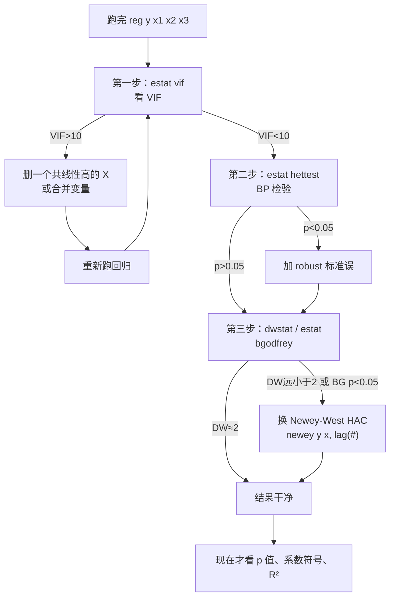

# 05 三大问题诊断流程：拿到结果先查什么？

<div style="text-align:right;margin:10px 0;"><a href="../../exam.html" target="_blank" style="display:inline-block;padding:6px 16px;background:#2563eb;color:#fff;border-radius:6px;text-decoration:none;font-size:14px;">📝 开始做题</a></div>


## 一、为什么要学这个？

你跑完 `reg y x1 x2 x3`，屏幕上蹦出一大张表：Coef、Std. Err、t、P>|t|、R²……

**先看哪一列？先做什么检验？**

没有经验的同学会盯着 p 值看，p<0.05 就欢呼，p>0.05 就焦虑。这是错的。

正确的顺序是：**先确认你的结果是"干净"的，再看 p 值**。不然你看到的显著，可能是[[02_异方差|异方差]]/[[03_自相关|自相关]]/共线性制造的假象。

这一章给你一张可以打印出来贴在电脑旁边的**检查清单**。

---

## 二、是什么？（比喻 + 定义）

### 比喻：新车上牌前的安检

你买了辆新车要上牌，车管所不会一上来就问"你车跑得快不快"。它按顺序检查：

1. 刹车灵不灵（安全底线）；
2. 尾气合不合格（环保）；
3. 灯光齐不齐（照明）；
4. 然后才是上牌、上路。

回归结果也一样：先检查"车能不能开"（三大问题），再看"跑得快不快"（系数显不显著）。

---

## 三、诊断流程图（核心）



**为什么是这个顺序？**

1. **先查共线性（VIF）**：因为共线性会改变系数本身——两个 X 太像，Stata 分配不清贡献。这个问题不修，后面的检验都建立在错误的系数上。
2. **再查异方差（BP）**：因为异方差只动标准误，不动系数。修起来简单（加 robust）。
3. **最后查自相关（DW/BG）**：自相关主要影响时间序列，截面数据一般不用查。

---

## 四、每个检查点的具体操作

### 第一步：VIF（[[04_多重共线性|多重共线性]]）

```stata
reg y x1 x2 x3
estat vif
```

**判读**：

| VIF 值 | 含义 | 行动 |
|--------|------|------|
| < 5 | 安全 | 进入下一步 |
| 5~10 | 轻度 | 心里有数，解释时提一句 |
| > 10 | 严重 | 删变量或合并 |

**删哪个？** 删经济意义弱的那个。比如身高和臂展共线，留身高（更常用），删臂展。

### 第二步：BP 检验（异方差）

```stata
estat hettest
```

**判读**：p < 0.05 拒绝同方差原假设 = 有异方差。

**修法**：直接在回归命令后加 `, robust`。不需要换模型。

### 第三步：DW / BG 检验（自相关）

**截面数据**（不同人、不同公司）：跳过这步，天然无自相关。

**时间序列数据**：

```stata
tsset year
reg y x
dwstat
estat bgodfrey
```

**判读**：DW 远小于 2（如 < 1.5）= 正自相关。BG p < 0.05 = 有自相关。

**修法**：

```stata
newey y x, lag(3)   // HAC 标准误，一次修异方差+自相关
```

---

## 五、符号表（汇总）

| 检验 | 命令 | 原假设 H₀ | 拒绝 H₀ 意味着 |
|------|------|-----------|---------------|
| VIF | `estat vif` | （无原假设，看数值） | VIF>10 共线性严重 |
| BP | `estat hettest` | 同方差 | p<0.05 有异方差 |
| 怀特 | `estat imtest, white` | 同方差 | p<0.05 有异方差 |
| DW | `dwstat` | 无自相关 | DW 远离 2 有自相关 |
| BG | `estat bgodfrey` | 无自相关 | p<0.05 有自相关 |

---

## 六、一个完整的走一遍（迷你例子）

假设你研究"研发投入 X₁、广告投入 X₂、员工数 X₃ → 利润 Y"，50 个公司数据。

**Step 1**：`reg Y X1 X2 X3`，看到 X₂ 不显著（p=0.3）。

**Step 2**：`estat vif`，发现 X₂ 和 X₃ 的 VIF = 12（广告投入和员工数高度相关——大公司广告多、员工也多）。

**Step 3**：删掉 X₃，重跑 `reg Y X1 X2`。X₂ 现在 p=0.03 显著了。

**Step 4**：`estat hettest`，p=0.02，有异方差。加 `, robust`。

**Step 5**：截面数据，跳过自相关。

**Step 6**：现在才看结果——X₁ 系数 0.5（p<0.01），X₂ 系数 0.2（p<0.05），可以写论文了。

**Python 伪代码演示流程**：

```python
import statsmodels.api as sm
from statsmodels.stats.outliers_influence import variance_inflation_factor

# Step 1: OLS
X = sm.add_constant(data'X1','X2','X3')
model = sm.OLS(data['Y'], X).fit()

# Step 2: VIF
for i, col in enumerate(X.columns):
    vif = variance_inflation_factor(X.values, i)
    print(f"{col}: VIF={vif:.2f}")

# Step 3: 删 VIF>10 的变量后重跑
# Step 4: 用 robust 标准误
model_robust = sm.OLS(data['Y'], X).fit(cov_type='HC1')
```

---

## 七、什么时候用？

**任何一篇实证论文，跑完回归第一件事就是走这个流程。**

答辩时导师必问：
- "你检验异方差了吗？"
- "你的 VIF 多少？"
- "时间序列你做自相关检验了吗？"

没做的话，结果再显著也要被打回来。

---

## 八、易错点

1. **顺序不能反**。先 VIF 再 BP 再 DW。你先加 robust 再查 VIF 没用——共线性不因为你换标准误就消失。
2. **截面数据别纠结 DW**。DW 是时间序列的，截面数据相邻观测没有时间顺序，DW 没有意义。
3. **加了 robust 不等于万事大吉**。robust 修异方差，不修共线性，也不修自相关。
4. **每改一次模型就要重新诊断**。删了变量，VIF 变了，异方差可能也变了。
5. **不要把诊断过程藏起来**。论文里要汇报你做了什么检验、用了什么标准误——这是严谨性的体现。

---

## 九、Stata 代码（一键模板）

```stata
-- ===== 回归三大问题诊断模板 =====
-- 1. 跑基础回归
reg y x1 x2 x3

-- 2. 查共线性
estat vif
-- 如果某变量 VIF>10，删掉它后重跑：
-- reg y x1 x2

-- 3. 查异方差
estat hettest
estat imtest, white
-- p<0.05 就加 robust：
-- reg y x1 x2, robust

-- 4. 时间序列才查自相关
-- tsset year
-- dwstat
-- estat bgodfrey
-- 有自相关就用：
-- newey y x1 x2, lag(3)

-- 5. 最终结果汇报
reg y x1 x2, robust
estimates store model1
outreg2 using "回归结果.doc", replace tex
```

---

## 十、和别的方法对比

| 检查 | 不查的后果 | 查了修不好的后果 |
|------|-----------|-----------------|
| VIF | 系数不稳定，误删变量 | 结果精度差，但方向对 |
| BP | t 检验不准 | 换了 robust 就好 |
| DW | 时间序列 t 值虚高 | 换 Newey-West 就好 |

**一句话**：这三大问题里，VIF 是"数据病"（要删变量），BP 和 DW 是"精度病"（换标准误）。

---

## 十一、为什么不用别的方法？

- **为什么不一上来就加 robust 包打天下？** robust 只修异方差，不修共线性、不修自相关。你加完 robust 再去查 VIF，发现 VIF=15——共线性一点没动，系数分配还是错的，后面所有检验都建立在错误的系数上。顺序必须先 VIF。
- **为什么不用一个"全自动诊断命令"代替手动三步？** Stata 没有官方命令能同时判共线性、异方差、自相关并自动修好；而且每改一次模型（删变量、加 robust），VIF 和残差结构都会变，必须人工循环重跑。网上第三方插件假设千奇百怪，自动化反而漏检。
- **为什么不把诊断结果藏起来、只报最终回归表？** 审稿人和导师要的是"你查过"的证据：VIF 最大值、BP/BG 的 p 值、用的是 robust 还是 [[KP03_NeweyWest_HAC|HAC]]。不汇报等于默认没查，结果再显著也会被打回；这三个检验在论文里半页纸就能放下。

---

## 十二、答辩常问（直接背）

1. **问：为什么诊断顺序是 VIF → BP → DW，不能反过来？** 答：共线性改变系数本身的分配（不修它，后面检验都建在错系数上），必须先处理；异方差和自相关只动标准误，加 robust/HAC 就行，放后面；自相关主要伤时间序列，截面数据直接跳过。顺序反了，比如先加 robust 再查 VIF，共线性原封不动。
2. **问：BP 检验 p=0.2，还要不要加 robust？** 答：p>0.05 不能拒绝同方差，严格说可以用普通标准误；但现在经济学论文的惯例是"不管检验过没过都汇报 robust"，成本只是加一个词，还能防止小样本下 BP 检验功效不足、抓不出真实异方差。所以默认加，不用纠结。
3. **问：每改一次模型就要重新走一遍流程吗？** 答：要。删变量后剩余变量之间的相关性变了，VIF 要重算；函数形式一变残差结构就变，异方差和自相关状态也要重查。论文里汇报的是"最后一版模型"的完整诊断结果，不是初稿的。

---

## 十三、速记卡

> **拿到回归结果，按这个顺序查：**
> 1. `estat vif` —— VIF>10 删变量；
> 2. `estat hettest` —— p<0.05 加 robust；
> 3. `dwstat`（仅时间序列）—— 远离 2 用 Newey-West；
> 4. 全过了，才看 p 值写结论。
>
> 记住：**先洗车再看里程表**。

---

## 💡 经济学视角：实证论文的"三道安检门"

**这个方法是为了解决什么经济学问题？**
为什么同样一份数据，A 教授跑出来说"教育回报 15%"，B 教授跑出来说"只有 5%"？差别往往不在经济学直觉，而在有没有按流程洗车：异方差洗了吗？自相关洗了吗？共线性洗了吗？**实证经济学不是"讲故事"，是"过安检"**——三道关都过了，你的系数才配叫"效应"；过不了，那只是"相关"。

**经济学里哪些经典模型正好对应这个方法？**
从弗里德曼的消费函数，到卢卡斯的理性预期批判，再到今天的可信性革命，经济学方法论的核心就是一句话：**观测到的关系要分清是"因果"还是"巧合"**。异方差、自相关、共线性这三道关，本质上是在回答："你估计出来的这个数，它的统计可靠性撑不撑得起政策建议？"

**举个实证论文的例子：**
本科毕业论文《数字经济对城乡收入差距的影响》的标准流程是：①跑 OLS 看系数方向；②`estat hettest` 有异方差就加 robust；③时间序列省份数据跑 DW，<1 就上 Newey-West；④VIF > 10 就删一个高度相关的数字经济代理变量；⑤最后才写"数字经济显著缩小差距，β=-0.23，p<0.01"。跳过这四步直接报 p 值，答辩一定会被问爆。

**📚 配套经济学笔记：**
- [[../../教材笔记/06_西方经济学/00_导论/知识点/KP03_实证分析与规范分析|原KP·实证分析与规范分析]]

---

⬅️ 上一篇：[[04_多重共线性|04 多重共线性]] ｜ 📑 [[README|返回目录]] ｜ 下一篇：[[00_章节总结|00 章节总结]] ➡️

---

## 📖 配套教材笔记
- [[../../教材笔记/02_计量经济学/06_异方差/00_章节总结|计量·第7章 异方差]]
- [[../../教材笔记/02_计量经济学/07_自相关/00_章节总结|计量·第8章 自相关]]
- [[../../教材笔记/02_计量经济学/08_模型设定与数据问题/00_章节总结|计量·第9章 模型设定]]
- [[../../教材笔记/05_统计学原理/08_相关与回归/00_章节总结|统计原理·相关与回归（回归诊断思想）]]

## 📚 配套原书
- [[../../原文件/计量经济学/陈强_计量经济学及Stata应用_全书|陈强《计量经济学及Stata应用》（第7-9章）]]
