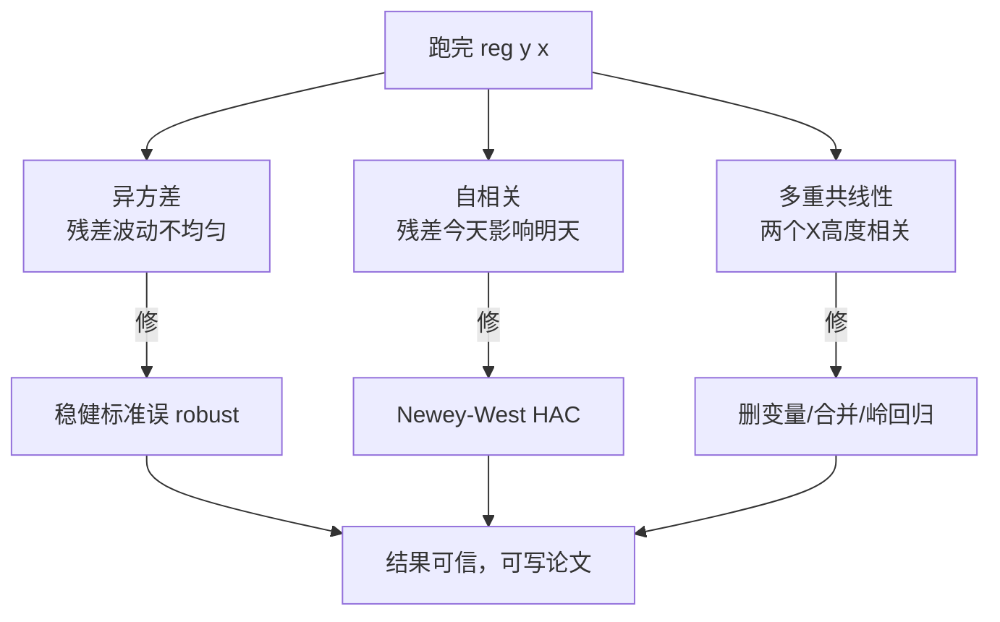
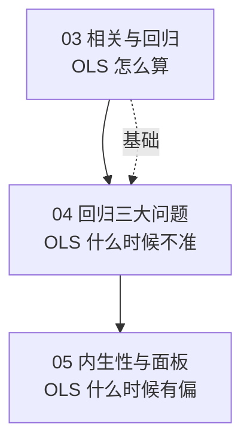

# 04 回归三大问题：真实数据不完美时怎么办

> 第 3 章我们学了 [[04_OLS截距和拟合值|OLS]]，知道怎么从数据里算出一条直线。
> 但第 3 章讲的是"理想世界"——数据干干净净、假设全部满足。
> 这一章讲"真实世界"——你的数据几乎永远不满足假设，OLS 会在哪些地方骗你。

---

## 这一章解决什么痛点？

你跑完 `reg y x`，看到一个 p 值 < 0.05，兴冲冲跑去跟导师说"我的结果显著了！"

导师会问你三个问题：

1. **"你检验[[02_异方差|异方差]]了吗？"**——如果残差的波动不均匀，你的标准误算错了，t 检验就是错的。
2. **"你检验[[03_自相关|自相关]]了吗？"**——如果你用的是时间序列数据，今年的残差会影响明年，标准误又错了。
3. **"你的 X 之间相关吗？"**——如果两个 X 高度相关，你的系数会忽大忽小、符号翻转。

这三个问题，就是**回归三大问题**：

---

## 这一章你会学到什么？

| 文件 | 核心问题 | 一句话答案 |
|------|----------|-----------|
| [[01_经典假设五条]] | OLS 凭什么靠谱？ | 靠五条假设，违反任何一条都会出问题 |
| [[02_异方差]] | 穷人波动小、富人波动大怎么办？ | 系数不变，标准误换成稳健的 |
| [[03_自相关]] | 时间序列里今年影响明年怎么办？ | 用 Newey-West [[KP03_NeweyWest_HAC|HAC]] 标准误 |
| [[04_多重共线性]] | 身高和体重同时放进去会怎样？ | 系数不稳定，看 VIF |
| [[05_三大问题诊断流程]] | 拿到结果先查什么？ | 先 VIF → 再 BP → 再 DW |
| [[00_章节总结]] | 考前复习 | 对比表 + 自测题 |

---

## 和前面章节的关系

第 3 章教你"怎么算"，这一章教你"算出来的东西哪里会错"，第 5 章教你"错了怎么修"。

---

⬅️ 上一篇：[[../03_相关与回归/README|← 03 相关与回归]] ｜ 下一篇：[[01_经典假设五条|01 经典假设五条]] ➡️

---

## 延伸阅读
- 📚 教材笔记：[[../../教材笔记/02_计量经济学/README|计量经济学教材笔记]]
- 📖 统计学原理配套：[[../../教材笔记/05_统计学原理/08_相关与回归/知识点/KP12_相关不等于因果与应用注意|相关不等于因果]]、[[../../教材笔记/05_统计学原理/07_假设检验/知识点/KP03_两类错误|两类错误（弃真/取伪）]]
  - 回归诊断（BP 检验、DW 检验、VIF）背后都是**假设检验思想**：先立一个原假设（"异方差不存在"/"自相关不存在"），再看 p 值决定要不要拒绝 → [[../../教材笔记/05_统计学原理/07_假设检验/知识点/KP01_假设检验的逻辑|KP01 假设检验的逻辑]]
